# 作业 1 · 从零搭一个 Agent Harness：CMU 作业 1 实战

> 卡耐基梅隆大学 11-768 AI Agents（2026 秋）第一次大作业 "Build an Agent Harness" 的中文图文教程。作业仓库：[cmu-agents/assignment-1](https://github.com/cmu-agents/assignment-1)。
> 视频：B 站 / 视频号 / 抖音 / 小红书搜索「竹二木SI」。幻灯片 PDF：[a01-幻灯片.pdf](./a01-幻灯片.pdf)。
> 这次作业是我和 AI 编程助手一起完成的：代码由助手按我的要求写，真跑和排错一起做。作业本身也要求提交 `AI_USAGE.md` 说明 AI 的使用方式。
> **关于答案代码**：作业还在进行中。本教程只放讲清思路所需的关键片段，不公开完整答案。请先自己写，再对照这里的思路。

## 这一讲你会学到

1. **agent harness**（智能体运行框架）是什么，ReAct 循环由哪几步组成。
2. 怎么拼每一步的提示词，为什么 system 和任务要每次重新生成。
3. 循环里最容易写错的三处判断：步数上限、模型只回文字、工具结果和调用的配对。
4. 工具执行的错误处理原则，以及技能的**渐进式披露**（progressive disclosure）。
5. 怎么实现上下文压缩，以及实测下来它在什么时候反而更贵。
6. 怎么让模型写 Python 去调工具（**programmatic tool calling**），以及背后的安全要求。
7. 真跑这份作业会遇到的环境坑和两次翻车，以及从中得出的 harness 设计原则。

### 这一讲的路线

| 块 | 讲什么 | 本课件 |
|---|---|---|
| 作业概览 | harness 的定义、三部分、评分方式、解题顺序 | 1 节 |
| ReAct 循环 | 四种消息、build_prompt、run 的三处判断、按位置配对 | 2 节 |
| 工具和技能 | 错误还给模型、渐进式披露、公开测试不够 | 3 节 |
| 真跑之前的坑 | 代理、旧 key、Modal 镜像构建器版本 | 4 节 |
| 修 bug 实战 | agent 的 9 步和它的 patch | 5 节 |
| 上下文压缩 | 按步切、SWE-bench 两次对比 | 6 节 |
| 下棋 agent | 并行落子、推演、run_python、下棋技能 | 7 节 |
| 实验和翻车 | 观测 A/B、沙箱到期空转、推理占满上下文 | 8 节 |

---

## 1 作业概览

### 1.1 harness 是什么

语言模型本身只会做一件事：给一串文字，接着往下写。要让它在环境里干活，就要有一层胶水代码：

1. 把环境的状态写成文字，交给模型；
2. 把模型的输出解析成动作；
3. 执行动作；
4. 把结果写回去，进入下一轮。

作业把这一层叫 **agent harness**，用的框架是 **ReAct**（Reasoning + Acting）：提示词里交替出现观察、推理和动作，每一轮让模型给出下一个动作。

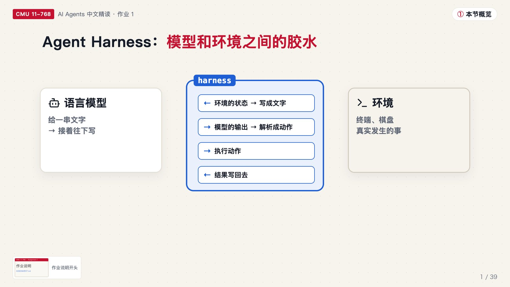

### 1.2 三部分怎么串起来

```text
                SWE-Bench issue
                      |
                      v
buggy chess app -> CodeAgent -> fix.patch -> repaired chess server
                                              ^
                                              |
                                    ChessAgent tools
```

| 部分 | 要做什么 | 产出 |
|---|---|---|
| Part 1 | 写通用的 `Agent` 基类和 `CodeAgent`，修国际象棋 app 的 bug | `fix.patch`、运行记录 |
| Part 2 | 给基类加上下文压缩，解 SWE-bench 题 `django__django-15368` | patch、运行记录、`token-usage-analysis.md` |
| Part 3 | 派生 `ChessAgent`，用修好的棋盘服务下棋；加推演和 run_python | 若干盘棋的记录、`observation-experiment.md` |

主线是**同一个循环跑三个领域**。作业规则明确写了：不许在子类里重复实现共享的 ReAct 循环。基类里不能出现任何和修代码、下棋有关的逻辑，子类只提供工具和提示词。

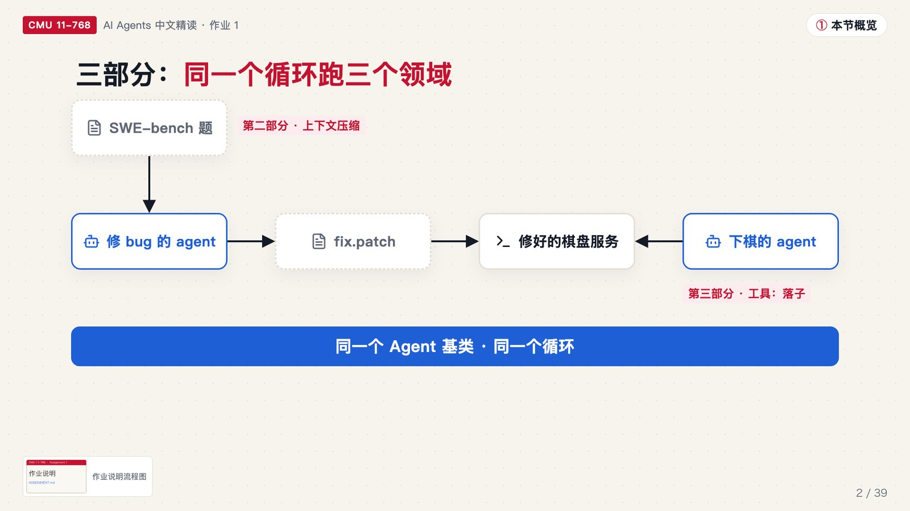

### 1.3 评分决定了力气花在哪

| 来源 | 分值 | 说明 |
|---|---:|---|
| 私有测试 | 56 | Part 1 22 分、Part 2 12 分、Part 3 22 分 |
| 重放 patch 和运行记录 | 34 | patch 在全新环境里重放；trajectory 检查是否满足要求 |
| 两份实验报告 | 8 | token 用量分析、观测实验 |
| 提交格式 | 2 | 压缩包结构、文件齐全 |

两件事要特别注意：

- **公开测试过了，不代表写对了。** 作业原话："Passing public tests is not proof of full correctness." 私有测试点名要测：失败时的清理、重复或格式错误的技能、并行的落子调用、网络错误、产物一致性、patch 重放、真实 Modal 集成。
- **评分不重新调用模型**，只重放你提交的记录。所以运行记录（trajectory）比什么都重要。作业提供的循环外面包着一层 `finally`：不管正常结束还是中途出错，都会写记录、关沙箱。这一层不许改。

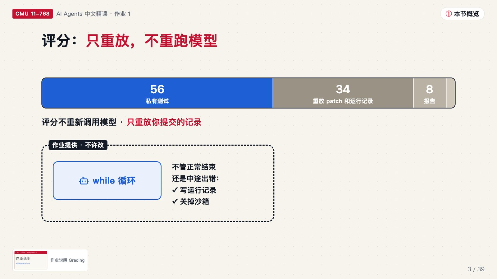

### 1.4 我的解题顺序

| 步 | 做什么 | 为什么 |
|---|---|---|
| ① | 先读公开测试，再读作业说明 | 说明写给人看，测试精确规定了函数要返回什么、出错时怎么处理 |
| ② | 先跑一遍测试，记下起点 | 我们的起点是 11 个失败、4 个通过，失败的全是 TODO |
| ③ | 先离线、后花钱 | 离线测试不调模型、不开沙箱；真跑要 Modal 和模型额度 |
| ④ | 每部分单独提交一次 | 出了问题能退回；讲解时也能逐个提交地讲 |

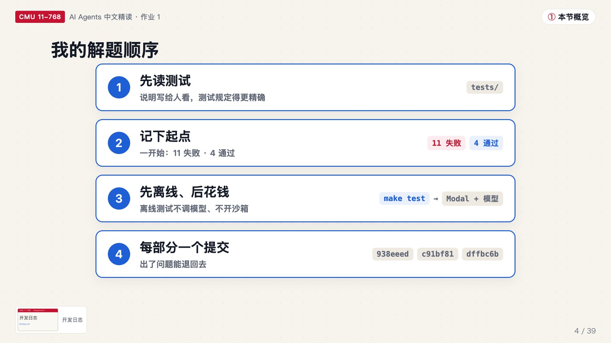

---

## 2 ReAct 循环

### 2.1 四种消息

每一步请求模型，发过去的是一串消息（OpenAI chat 格式），每条有一个角色：

| 角色 | 放什么 | 位置 |
|---|---|---|
| `system` | 长期规则：领域说明、环境信息、可用技能目录 | 第一条，只有一条 |
| `user` | 任务本身 | 紧跟 system |
| `assistant` | 模型每一轮的输出：推理、文字、工具调用 | 之后交替出现 |
| `tool` | 每个工具调用的结果，也就是"观察" | 紧跟发起调用的那条 assistant |

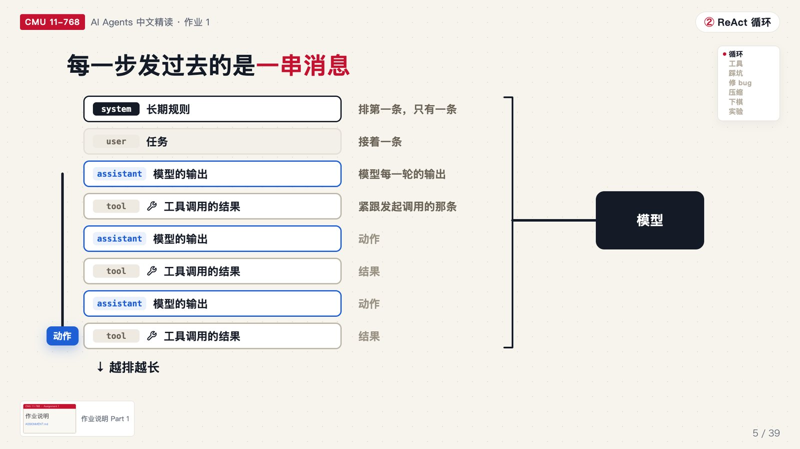

### 2.2 build_prompt：system 和任务每次重新生成

文件：`src/assignment/agent/base.py`，`Agent.build_prompt`（删掉了注释和 `append` 的参数）。

```python
messages = [
    {"role": "system", "content": self.system_prompt},   # 每次从属性重新拼
    {"role": "user", "content": self.task_prompt},       # 同上：原始指令永远不进 history
]
if self.working_memory:                                  # 只有压缩过才有
    messages.append({"role": "user", "content": "...<working_memory>...</working_memory>"})
messages.extend(deepcopy(self.history))                  # 拷贝一份，调用方改了也不会污染状态
return messages
```

设计要点：`history` 只存任务之后发生的事。这样 Part 2 的压缩只需要改 `history`，作业要求的"system 和任务原样保留"在 Part 1 就自动满足了。

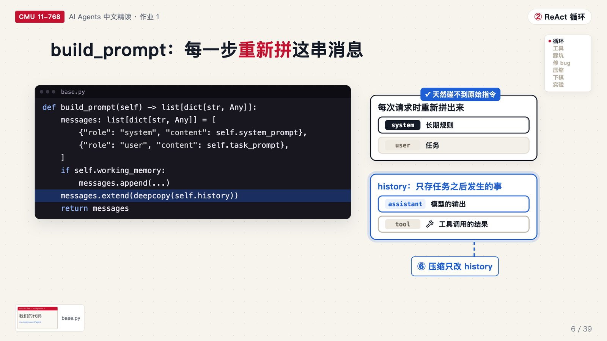

### 2.3 run：三处判断

文件：`base.py`，`Agent.run`（删掉了 `finally` 里作业提供的记录和清理代码）。

```python
while not self.finished:
    if self.steps_taken >= self.step_limit:          # ① 先查步数上限
        raise StepLimitError(...)
    self.maybe_compact_context()                     # ② 再决定要不要压缩（Part 2）
    action = self._assistant_message(self.query_language_model())
    self.history.append(action)
    tool_calls = action.get("tool_calls", [])
    if not tool_calls:                               # ③ 模型只回了文字
        self.history.append({"role": "user", "content": NO_TOOL_CALL_NUDGE})
        continue
    observations = self.execute_tool_calls(tool_calls)
    self.history.extend(self._linked_observations(tool_calls, observations))
```

| 判断 | 写错会怎样 | 我的做法 |
|---|---|---|
| ① 先查步数，再压缩 | 到上限那一步还多花一次模型调用去写总结 | 循环开头先查 |
| ③ 模型只回文字 | 什么都没执行，下一轮请求和这一轮几乎一样 | 保留回复，补一句"你这一轮没调用工具，什么都没发生" |
| 工具结果配对 | 配错或缺结果，下一次请求被接口拒绝 | 按位置配对（见 2.4） |

模型只回文字不是假设。后面下棋时沙箱断了，模型就一次次只回一段"服务器连不上"的话。评分表里也单列了 "text-only recovery" 这一项。

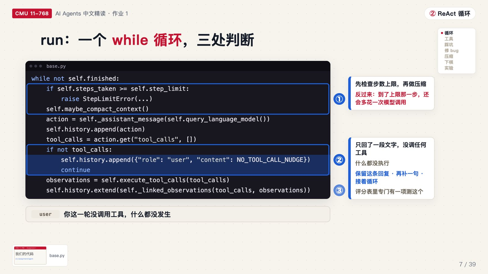

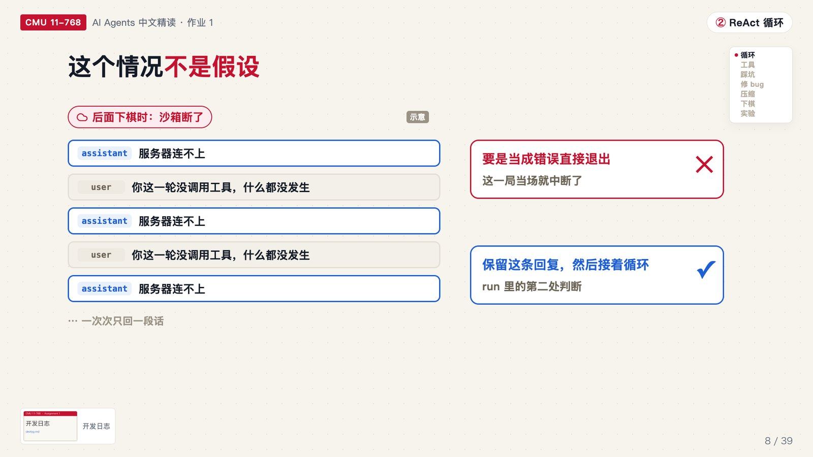

### 2.4 工具结果按位置配对

作业脚注 2：有的模型服务每一轮都把调用编号写成 `call_0`。如果按编号在整段历史里找结果，就会配到别的轮次上。另一条硬规矩：一条 assistant 消息里只要有一个调用没有对应的 tool 消息，下一次请求就会被接口拒绝。

文件：`base.py`，`Agent._linked_observations`。

```python
linked = []
for index, call in enumerate(tool_calls):            # 只在这一条 assistant 消息内部配
    call_id = str(call.get("id", ""))
    if index < len(observations) and isinstance(observations[index], dict):
        content = observations[index].get("content", "")
    else:
        content = "Error: this tool call produced no result."   # 缺了就补一条错误
    linked.append({"role": "tool", "tool_call_id": call_id,
                   "content": content if isinstance(content, str) else json.dumps(content)})
return linked
```

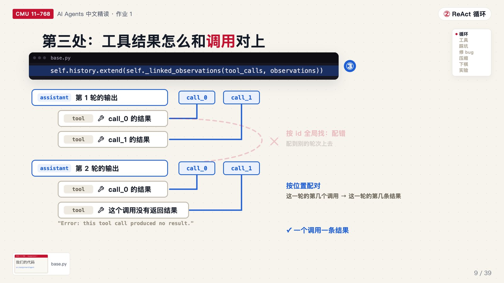

> 这一段记住一句：循环本身很短，要花心思的是消息结构不能断。

---

## 3 工具和技能

### 3.1 两个编程工具

`CodeAgent` 只有两个工具：

| 工具 | 作用 |
|---|---|
| `execute` | 在 Modal 沙箱里跑 shell 命令，可选 `cwd`、`timeout` |
| `send_message` | 说"我做完了"，同时提交总结 |

作业对工具执行的要求（TODO 1.3）：

- 一次回复里可能有多个调用，**每个调用都要回一条 tool 消息**；
- 参数 JSON 写坏了、调用了不存在的工具，都要变成一条**可恢复的观察**还给模型，不能抛异常让程序崩掉。

我还多加了一条：同一条回复里，`send_message` 之后的调用一律不执行，因为提交技能写着"提交之后不能再做任何事"。

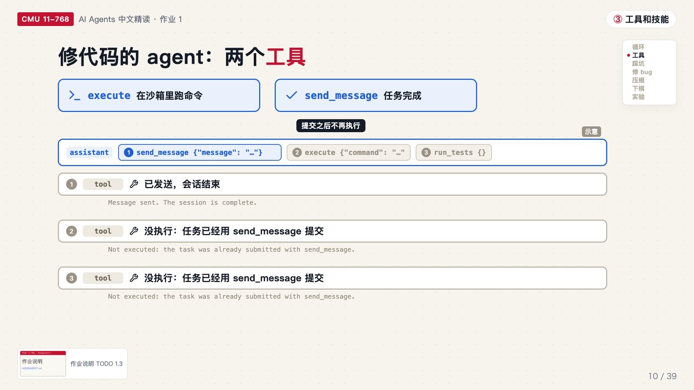

### 3.2 技能：渐进式披露

修完 bug 要把改动存成 `patch.txt` 再提交。作业用一个**技能**（skill）教 agent 这套流程。技能遵循 [Agent Skills](https://agentskills.io/home) 协议：一个目录里放一个 `SKILL.md`，开头是 YAML frontmatter（`name`、`description`），后面是完整步骤。

**渐进式披露**分两层：

1. system 里只放每个技能的 `name` 和 `description`，相当于目录；
2. 模型需要时调用 `invoke_skill(name)`，才把完整内容交给它。

作业对加载技能的硬规定（TODO 1.4）：

| 情况 | 要求 |
|---|---|
| 名字重复 | 抛 `ValueError` |
| frontmatter 缺失或格式不对 | 抛 `ValueError` |
| 一个技能都没有 | 提示词里不能出现 `patch.txt`，也不能有任何提交说明 |

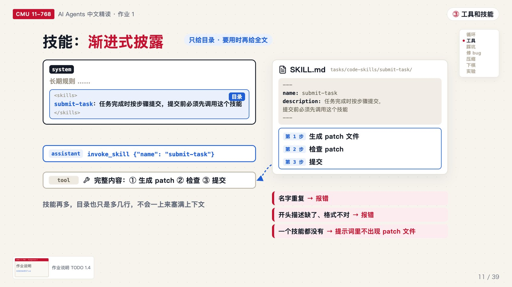

提交技能 `tasks/code-skills/submit-task/SKILL.md` 本身的规矩也值得学：

| 步 | 内容 |
|---|---|
| 1 | `git diff -- 改过的源文件 > patch.txt`，只放源代码，不放测试和临时脚本 |
| 2 | 单独读一遍 `patch.txt`，确认内容和 `--- a/`、`+++ b/` 路径 |
| 3 | 调用 `send_message` 提交 |

另外两条：检查之后又改了 patch 要重新检查；一旦提交就不能再做任何事。

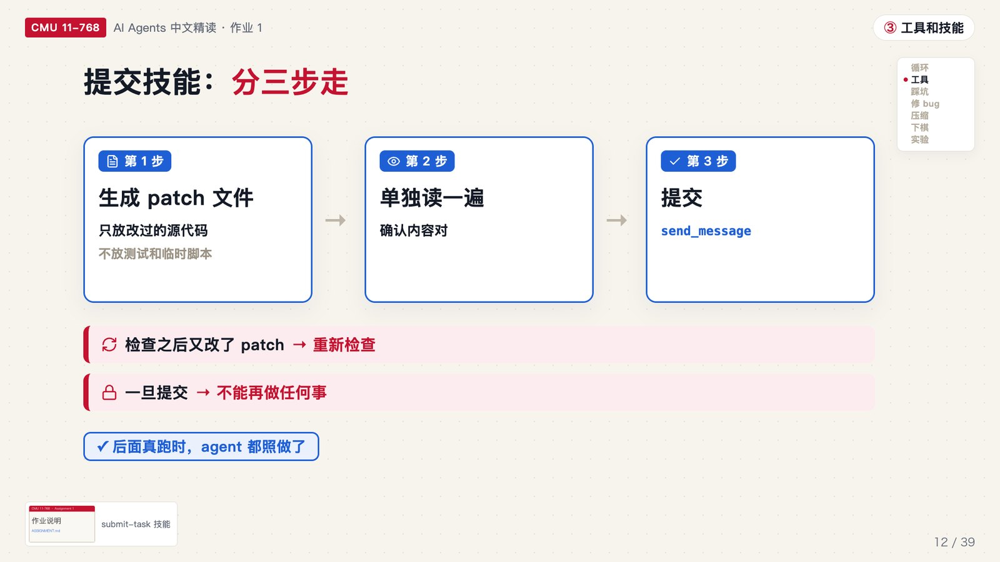

### 3.3 公开测试过了，不等于对了

离线部分写完，`make test` 从 11 个失败变成 15 个全部通过。但私有测试点名的那些情况，公开测试没覆盖。我另写了一个自检脚本，在本地起一个真实的棋盘服务，覆盖坏参数、网络断开、并行落子、坏技能文件、重复技能、run_python 刷新棋盘等 41 项。脚本不放进 `tests/`，因为作业不许改测试目录。

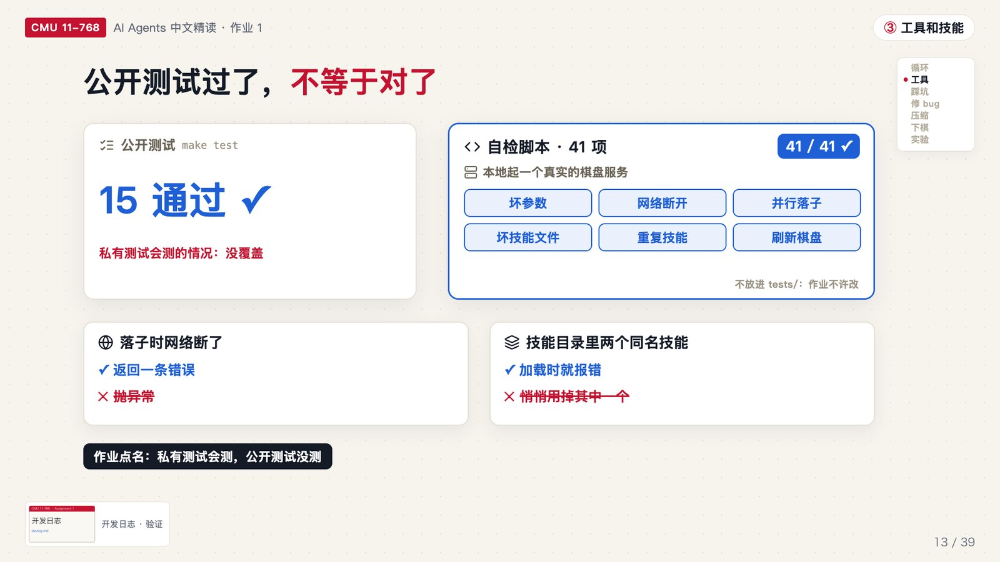

> 这一段记住一句：工具出错要还给模型，不要让程序替它崩掉。

---

## 4 真跑之前的坑

沙箱用的是 **Modal**：一个按秒计费的云平台，agent 生成的命令和代码都在它的隔离容器里跑。开跑前先用作业提供的 `make doctor` 检查：它不开沙箱、不生成 token，只检查 Modal 登录、模型地址和 key。

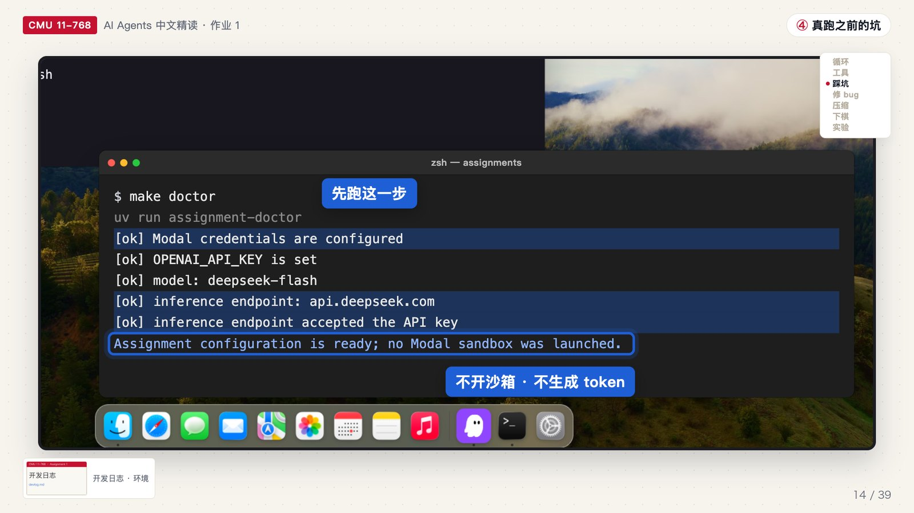

| 现象 | 原因 | 处理 |
|---|---|---|
| `make test` 报缺 `socksio` | 本机设了 `ALL_PROXY=socks5h://...`，httpx 看到 socks 代理就要这个包 | 运行时去掉 `ALL_PROXY` |
| `make doctor` 报 401，同一个 key 直接调接口是 200 | 终端里早有一个别处用的 `OPENAI_API_KEY`，`load_dotenv()` 默认不覆盖已有环境变量 | 包一层启动脚本，先清掉它 |
| Modal 报 `Could not connect to the Modal server` | Modal 客户端走本机的 HTTP 代理连不通，直连是通的 | 去掉所有代理变量 |
| 第一次真跑报 `VersionError: You are using '2026.10'` | 新 Modal 账号默认镜像构建器是 2026.10，作业锁定的客户端最高只认 2025.06 | 设 `MODAL_IMAGE_BUILDER_VERSION=2025.06`，不升级依赖 |

启动脚本大致是这样（示意）：

```bash
#!/usr/bin/env bash
cd "$(dirname "$0")/a1-agent-harness" && exec env \
  -u ALL_PROXY -u all_proxy -u HTTPS_PROXY -u https_proxy -u HTTP_PROXY -u http_proxy \
  -u OPENAI_API_KEY -u OPENAI_BASE_URL -u OPENAI_MODEL \
  MODAL_IMAGE_BUILDER_VERSION=2025.06 "$@"
```

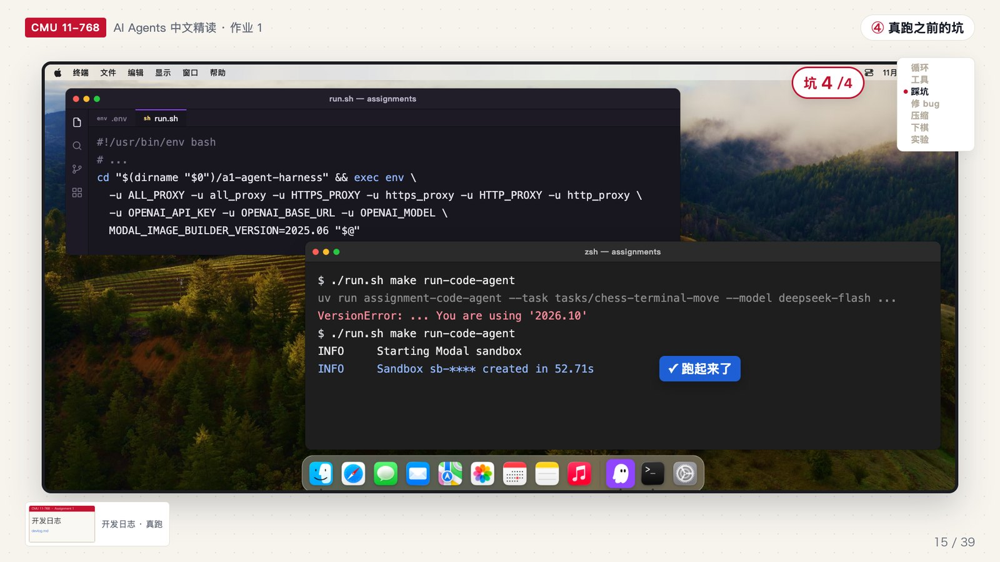

> 这一段记住一句：真跑出错时，先怀疑环境变量，再怀疑代码。

模型方面，作业默认 `deepseek/deepseek-v4-flash-0731`（课程给的服务商命名），我们换成了 DeepSeek 官方接口上的 `deepseek-flash`。SDK 没换：作业自带 OpenAI SDK，调模型的那几段标着"不许改"，评分也按 OpenAI 消息格式重放。

---

## 5 修 bug 实战

### 5.1 题目

棋盘服务的 bug：白方走出一步直接结束对局的棋，`POST /api/move` 返回 500。题目给的复现局面是 `7k/5Q2/6K1/8/8/8/8/8 w - - 0 1`，白后走 `f7g7` 将死。原因是对局已经结束，引擎还在给黑方找回应。

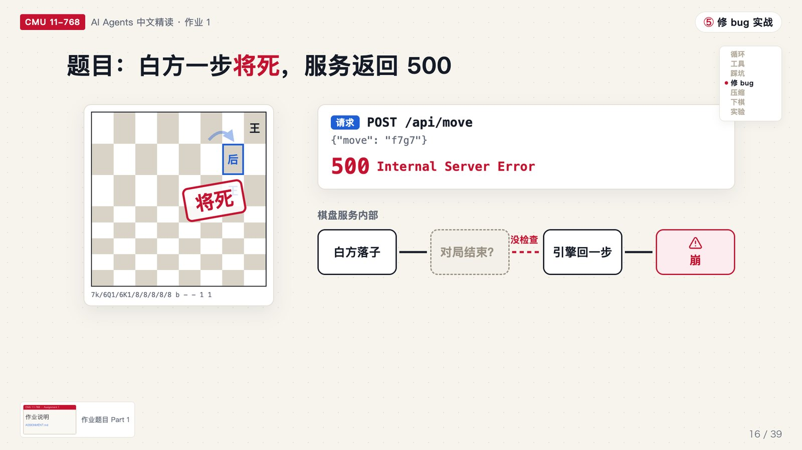

### 5.2 agent 的 9 步

沙箱启动约 52 秒，agent 一共 9 步：

| 步 | 工具 | 做了什么 |
|---|---|---|
| 1–3 | execute | 列目录，读 `game.py`、`server.py` 和测试 |
| 4 | execute | 跑题目给的复现脚本，确认返回 500 |
| 5 | execute | 用一小段 Python 读进 `game.py`、替换那几行、写回 |
| 6 | execute | 再跑复现脚本，确认修好 |
| 7 | invoke_skill | 读提交技能 `submit-task` |
| 8 | execute | `git diff -- src/chess_app/game.py > patch.txt` |
| 9 | send_message | 提交 |

第 7 步说明渐进式披露起作用了：system 里那一行描述，让它在该提交时想起了这个技能。

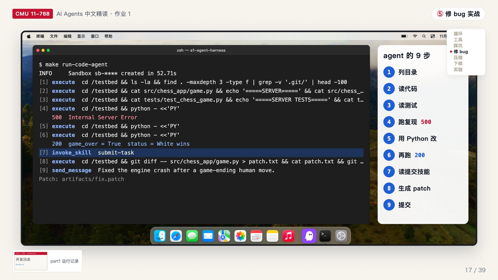

### 5.3 patch 只改了一处

```diff
-            reply = self._choose_engine_move()
-            engine_move = reply.uci()
-            self._record_and_push(reply)
+            if self._board.outcome(claim_draw=True) is None:   # 对局还没结束才让引擎走
+                reply = self._choose_engine_move()
+                engine_move = reply.uci()
+                self._record_and_push(reply)
```

`outcome(claim_draw=True)` 判断的是"对局有没有结束"，不只是"是不是将死"：逼和、重复局面导致的和棋也会结束对局。`make check-part1` 在全新环境里重放：FAIL_TO_PASS 1/1，PASS_TO_PASS 9/9，RESOLVED。

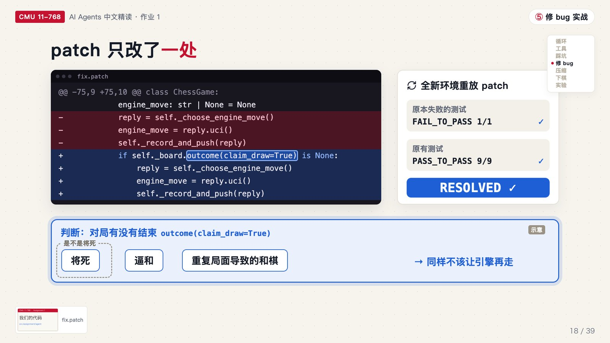

> 这一段记住一句：一个好用的 agent，靠的是循环、工具和技能各自做对，不靠哪一步特别聪明。

---

## 6 上下文压缩

### 6.1 为什么要压缩

ReAct 的提示词每一步都在变长：上一轮的动作和结果都要带上。任务一长，费用跟着涨，最后会撑爆模型的上下文窗口。压缩的办法是让模型自己把旧的部分写成一份**工作记忆**（working memory），用它替换原文。作业规定不能用模型服务商自带的压缩接口。

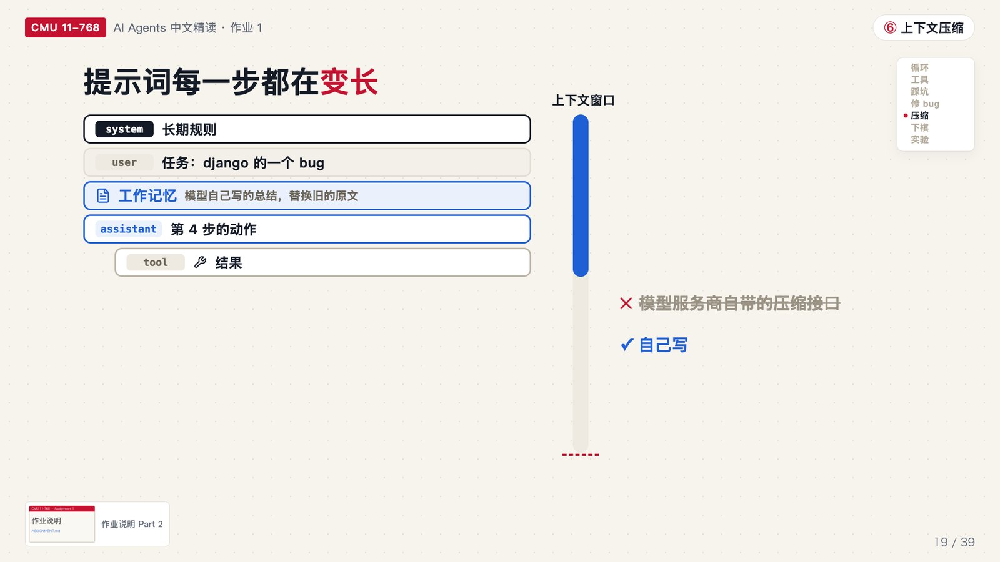

这一部分的题是 SWE-bench 的 `django__django-15368`：`QuerySet.bulk_update()` 不认普通的 `F('...')` 表达式，把表达式的文字原样写进了数据库。评分要让 1 个原本失败的测试通过，同时 29 个原有测试不被改坏。

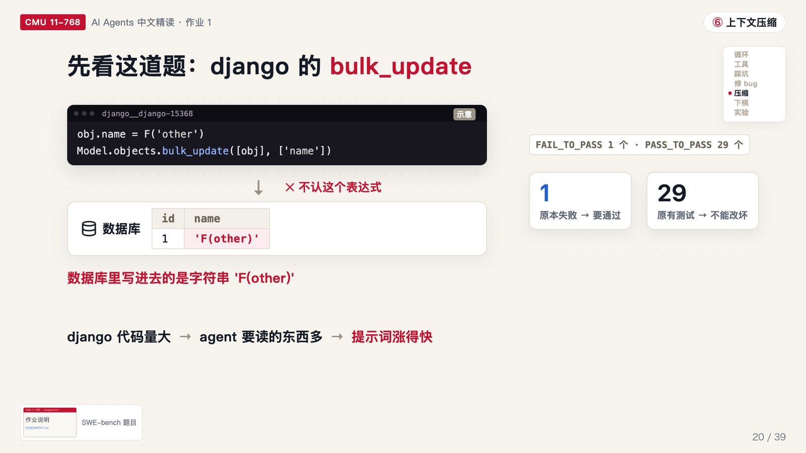

### 6.2 三条规矩和触发时机

作业要求（TODO 2.1）：

1. 只总结旧的前缀，system 和任务原样保留；
2. 至少保留最近一次完整的 assistant 动作，连同它的所有 tool 结果；
3. 不许动 `api_prompts` 和 `api_responses`，评分要用。

总结用的指令要保住这些信息：目标、约束、碰过的文件、跑过的命令、改了什么、具体结果、试过但失败的办法、测试、卡住的地方、下一步。

触发由作业提供的 `maybe_compact_context()` 负责（TODO 2.2 只要求在每次请求前调用它）。它估算下一次提示词的长度：拿上一次请求时服务端报回的真实 `prompt_tokens`，加上之后新增那部分的粗略估计，到了阈值就压。

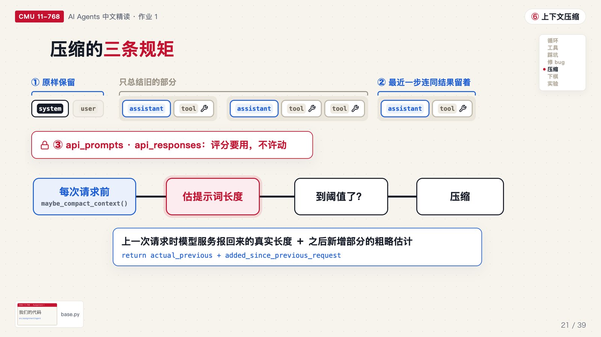

### 6.3 按"步"切

规矩 2 最容易出错：切点要是落在一个调用和它的结果中间，下一次请求就会因为"有调用没结果"被拒。我按"步"切：一步从一条 assistant 消息开始，到下一条之前结束，切点只能落在两步之间。

文件：`base.py`，`Agent._compaction_split`。

```python
starts = [i for i, m in enumerate(self.history) if m.get("role") == "assistant"]  # 每一步的起点
if len(starts) <= self.compaction_keep_recent_steps:
    return 0                                           # 步数不够，不压
return starts[-self.compaction_keep_recent_steps]      # 从倒数第 N 步的开头切
```

两个额外决定：

- 多次压缩时，把上一份工作记忆一起交给模型，让它合并成新的一份；
- 总结是空的（比如输出预算全花在推理上），就不删历史：`if summary and split > 0:` 才替换。

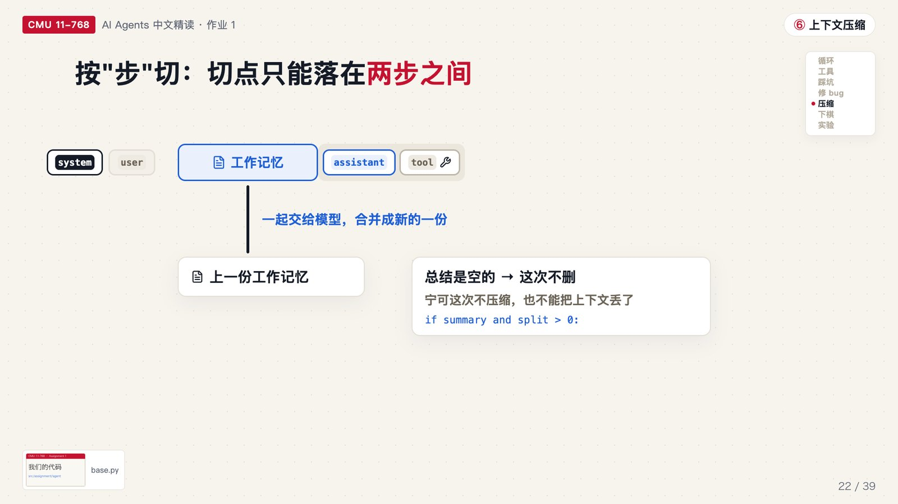

### 6.4 实测：同一道题跑两次

阈值 6,000 token，各跑一次，两次都做对了，改出来的代码一模一样：把 `isinstance(attr, Expression)` 改成 `hasattr(attr, 'resolve_expression')`。

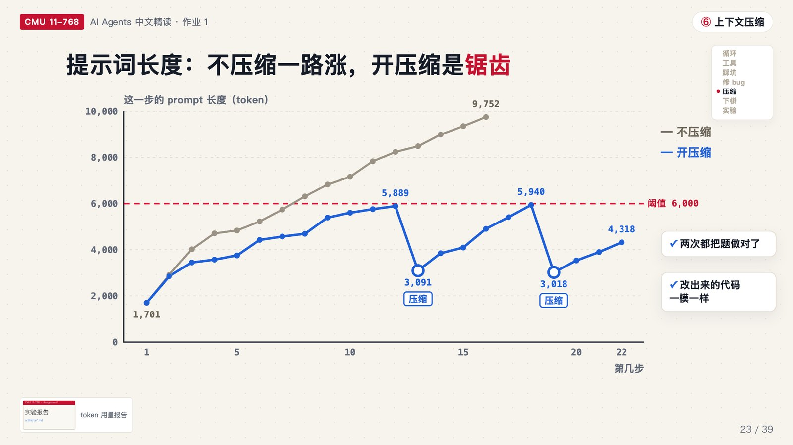

| | 开压缩 | 不开压缩 |
|---|---:|---:|
| 步数 | 22 | 16 |
| 压缩次数 | 2（第 12、18 步之后） | 0 |
| 最大的一次提示词 | 5,940 | 9,752 |
| 总 token | 约 110,000 | 约 105,100 |
| 缓存命中率 | 81% | 93% |
| 没命中缓存的输入 | 约 20,300 | 约 6,840 |

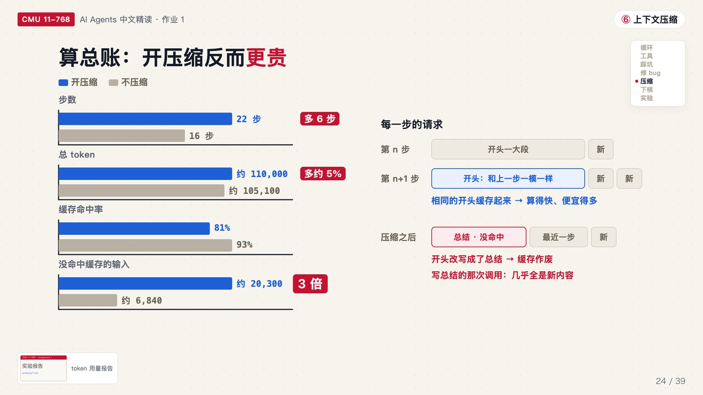

怎么读这张表：

1. **上下文确实压住了。** 不压缩时每步涨约 500 token；压缩后是锯齿形，涨到接近 6,000、压回约 3,000。
2. **总量没省，反而多了约 5%。** 这道题本来就短，不压缩也离窗口上限很远；压缩多了两次总结调用，压缩后又多走了 6 步。
3. **压缩让缓存作废。** 每一步的请求开头都和上一步一样，DeepSeek 会缓存相同的开头。压缩把开头改写成总结，缓存就作废了，总结调用本身也几乎全是新内容。没命中缓存的输入变成 3 倍，而这部分才是费用和延迟的大头。
4. **压缩后会回头重读。** 第 13 步重读了 `query.py` 第 660–685 行，第 15 步重读了测试文件第 1–30、190–225 行。总结记下了做过什么，没记下当时依赖的原文。

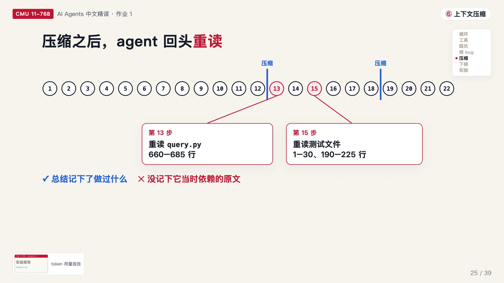

这一部分的评分：开压缩那次至少触发一次压缩、上下文明显变短、patch 通过测试，三条都满足。步数多不扣分。

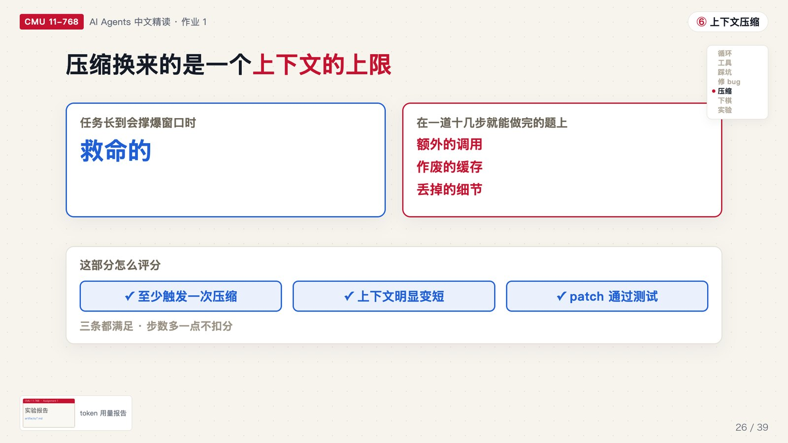

> 这一段记住一句：压缩是安全网，不是省钱的工具，阈值要设在接近真实上限的地方。

---

## 7 下棋 agent

### 7.1 同一个循环，换一套工具

`ChessAgent` 不改基类循环，只换工具。它执白，服务器上的规则机器人执黑，白方每走一步合法的棋，机器人就自动回一步；机器人是确定的，同一局面永远回同一步。

`play_move(move)` 的 schema（TODO 3.1.a）：只有一个必填字符串参数 `move`，用 UCI 记法（如 `e2e4`、升变 `e7e8q`），`additionalProperties: false` 禁止多余参数。走不合法、参数写坏、网络断开，都包在 `<chess_error>...</chess_error>` 里还给模型。

每步的观察里有：对局状态、轮到谁、是否被将军、是否结束、FEN、白方和黑方刚走的两步、字符画棋盘、最近八步，默认还有全部合法着法的列表。

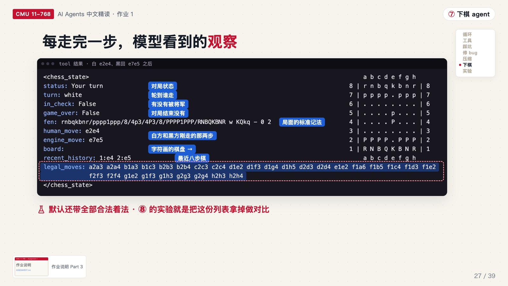

### 7.2 一次回复里走了好几步

模型可能在一条回复里并行发出好几个 `play_move`。作业要求只执行第一个，其余的可恢复地拒绝：第一步走完机器人已经回棋，局面变了，后面几步是按旧局面算的。

我的实现里，会改棋盘的有 `play_move` 和 `run_python` 两个工具。同一条回复里只要其中一个已经改了棋盘，后面这两类调用都退回去；`simulate_move` 不改棋盘，照常执行。

```python
elif name in ("play_move", "run_python") and board_changed:
    content = _error(f"{name} was not executed: an earlier call in this response "
                     "already changed the board. Read the new position and "
                     "choose the next move from it.")
elif name == "play_move":
    content = self._play(arguments)
    board_changed = not content.startswith("<chess_error>")   # 走成功了才算改了棋盘
```

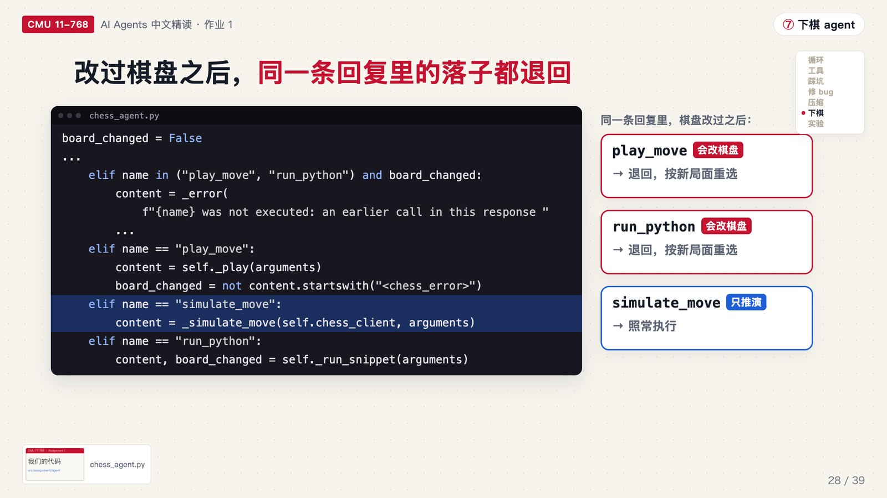

### 7.3 simulate_move：只推演，不落子

`simulate_move(fen, move=None)` 调 `POST /api/simulate`，无状态：只给 FEN 就返回这个局面和合法着法；再给一步，返回走完之后的局面，黑白双方都能走。它不碰真实棋盘，也不触发机器人。

顺带一个作业笔误：TODO 3.1.b 要求 `_play_move` 处理 "a missing or non-string fen"，但 `play_move` 没有 fen 参数，这句是从 `simulate_move` 那条复制过来的。

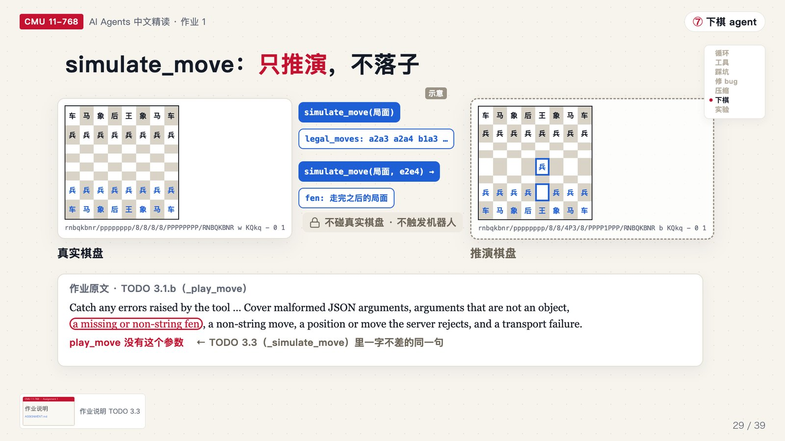

### 7.4 run_python：让模型写程序调工具

模型写一段 Python，在代码里把 `simulate_move` 和 `play_move` 当普通函数调，上百次推演在一次工具调用里跑完。两个安全要求：

1. **模型写的代码不在本地跑。** 先 base64 编码（编码后只有字母、数字和 `+/=`，不用担心 shell 引号），再交给沙箱里的 `sandbox_python.py`。
2. **跑完重新读一次棋盘**，附在观察后面，否则模型可能把代码里已经走过的那步再走一遍。

文件：`chess_tools.py`，`_run_python`（节选）。

```python
encoded = base64.b64encode(code.encode("utf-8")).decode("ascii")
command = f"python /opt/assignment/sandbox_python.py {int(port)} {encoded}"
result = env.execute(command, timeout=PYTHON_TIMEOUT_SECONDS)
if result.get("returncode") != 0:                       # 沙箱本身失败：工具错误
    return _chess_error(f"The Python sandbox failed: {detail}")
return stdout                                           # 代码自己的异常在 JSON 的 error 字段里，原样还给模型
```

两种失败要分开：模型代码自己报错（比如变量名写错）属于正常运行，错误信息原样还给模型；沙箱命令没跑起来才是工具失败。

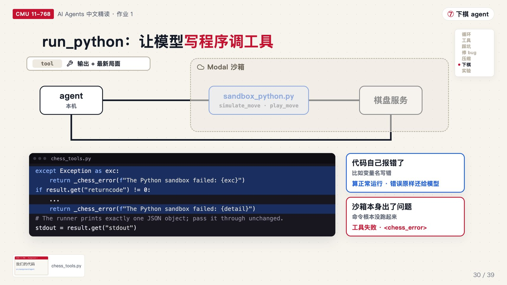

### 7.5 下棋技能

只给 `run_python`，模型往往还是直接落子。作业给了技能 `tasks/chess-skills/select-move`，写死一套策略：

| 步 | 内容 |
|---|---|
| 开局 | 第一步从 `e2e4`、`d2d4`、`c2c4`、`g1f3` 里取第一个合法的 |
| 排序 | 合法着法按 UCI 字符串升序排，平分时取最前的 |
| 搜索 | 每个候选推两层：我走一步、对方回一步，对方取对我最不利的 |
| 打分 | 兵 100、马 320、象 330、车 500、后 900；占中间四格 ±12；被将军 ±25；白胜 +100,000、黑胜 −100,000、和棋 0 |
| 落子 | 代码最后调用一次 `play_move` |

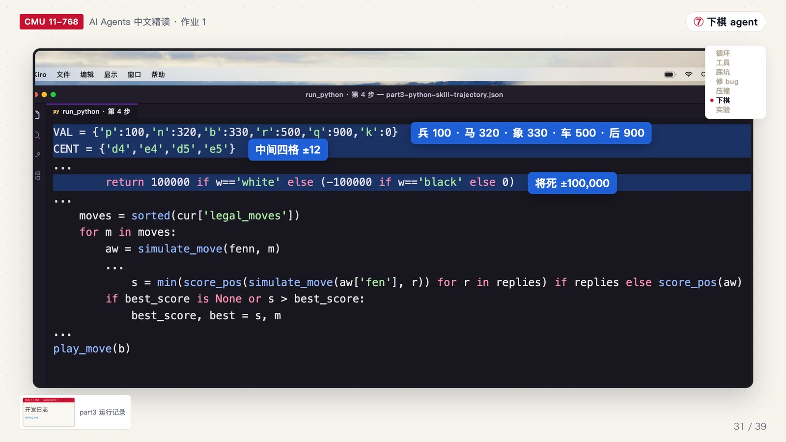

实际跑出来：第 1 步读技能，第 2 步按开局规则走 `e2e4`，之后 11 次都是 `run_python`。第 13 步以**三次重复局面**和棋：白车在 a1、a2 之间来回，黑车在 a5、a7 之间来回。我的理解是：只看两层、固定排序、平分取最前，加上机器人确定，同一局面算出来永远是同一步，双方绕进了一个圈。作业只要求展示工具配合，不要求赢。

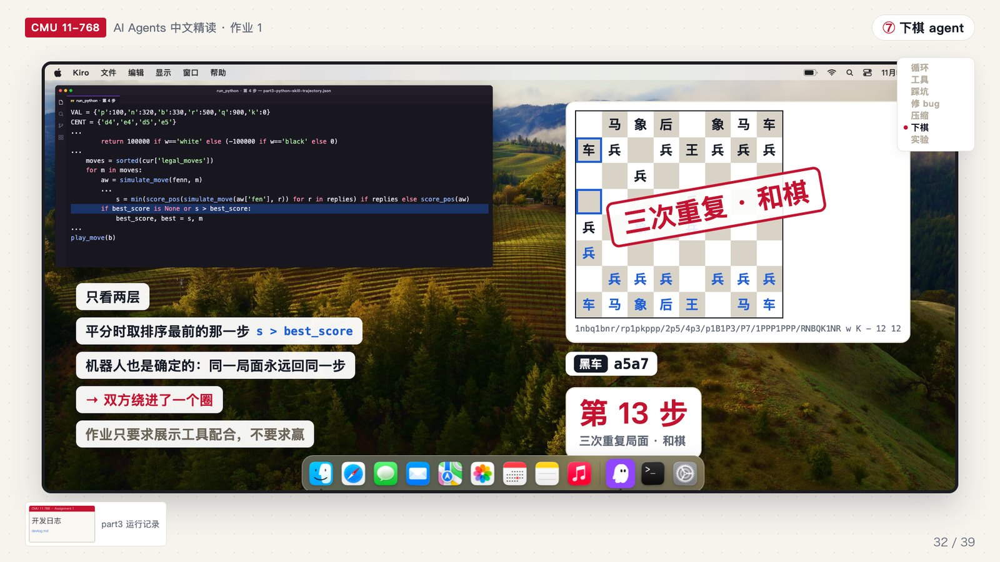

> 这一段记住一句：让模型写程序调工具，一次调用能做上百次推演；但程序有多死板，结果就有多死板。

---

## 8 实验和翻车

### 8.1 观测 A/B：给不给合法着法列表

实验问的是一个工具设计问题：观察里多给一份信息，模型会不会少犯错？代价是每步提示词更长。作业要求两种观测各下一局、两个模型共四局，记录 `play_move` 次数、被判非法的次数、非法率、是否下到 `game_over`。评分看过程和证据，不看输赢。

作业指定的第二个模型我们没跑成，换成了gpt-6.1-sol。

| 模型 | 观测 | play_move | 非法 | 结局 |
|---|---|---:|---:|---|
| DeepSeek | 只给棋盘 | 70 | 0 | 白胜，139 个半回合 |
| DeepSeek | 棋盘 + 合法着法 | 27 | 1 | 白胜，49 个半回合 |
| gpt-6.1-sol | 只给棋盘 | 63 | 0 | 白胜，123 个半回合 |
| gpt-6.1-sol | 棋盘 + 合法着法 | 56 | 0 | 白胜，107 个半回合 |

四局 216 次落子只有 1 次非法，每种条件只有一局，**这个样本说明不了合法着法列表有没有用**。唯一的非法出在给了列表的那局：第 11 步 DeepSeek 走 `d4d5`，可 d4 上是白马，它把马当兵往前推了，而这一步不在给它的列表里。

统计时要分清错误类型：网络错误（`Could not reach the chess server`）不算非法着法。我的第一版统计脚本把两者混在一起，差点得出"给了列表反而更容易出错"的结论。

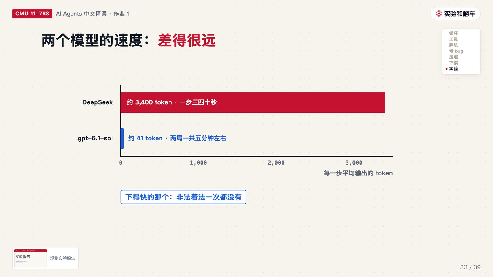

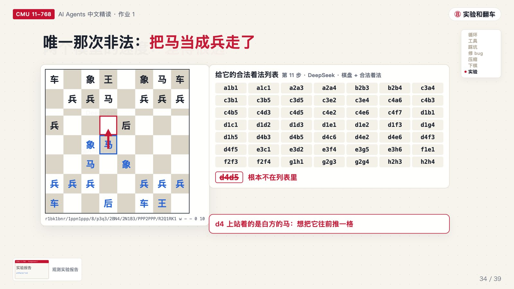

### 8.2 翻车一：沙箱到期，空转 155 步

第一次跑主局时，沙箱寿命用的是作业默认的 `CHESS_TIMEOUT=1800`（30 分钟）。DeepSeek 每步要想三四十秒，两局都在 30 分钟左右断了：

- 主局前 45 步正常；第 46 步起，每次落子都返回连不上棋盘服务。之后 155 步里，125 次落子全是这个错误，29 次模型只回了一段话。一直耗到 200 步上限，报 `StepLimitError`。
- 程序没崩，符合"网络错误交还给模型"的要求。问题是没有"连续失败几次就停"的**熔断**（circuit breaker）。
- 两局空转一共处理了约 1.13 亿个输入 token，约占整个作业所有运行的九成，好在大部分命中了缓存。
- 运行记录会存每一步的完整提示词，那两局的记录文件一个 175 MB、一个 188 MB，超过了 GitHub 单文件 100 MB 的上限。

把寿命加到 3600 秒重跑，两局都下完了。

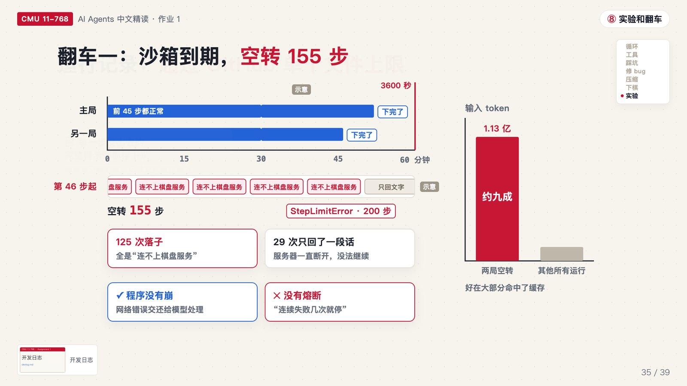

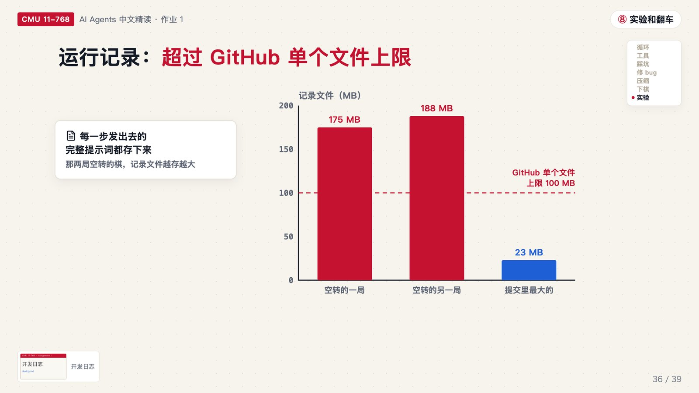

### 8.3 翻车二：上下文里 92% 是模型自己的推理

| | DeepSeek，只给棋盘 | gpt-6.1-sol，只给棋盘 |
|---|---:|---:|
| 落子次数 | 70 | 63 |
| 最后一次提示词 | 257,193 token | 18,912 token |
| 平均每步输出 | 约 3,400 token | 约 41 token |

拆开 DeepSeek 最后那次请求：92% 的内容是它自己前面每一轮的 `reasoning_content`，棋盘观察只占 5%。gpt-6.1-sol不返回推理文本，它的历史里 60% 是棋盘观察。

原因在我自己的代码：`_assistant_message` 把每一轮 assistant 消息原样保留，包括推理内容，每次请求都发回去。修代码时推理很短看不出影响；下棋时每步三四千 token，七十步就堆成了 25 万 token。换成上下文只有 131k 的模型，同样的棋三十多步就会撑爆。

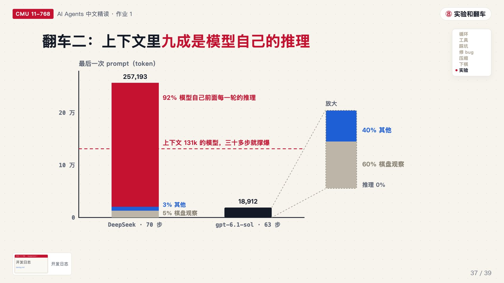

> 这一段记住一句：要不要把推理发回去，这么一个小决定，就能让上下文差出十几倍。

### 8.4 如果重来一次

| 做法 | 为什么 |
|---|---|
| 给循环加熔断 | 连续几次连不上环境就停下报告，不对着死掉的服务器一直重试 |
| 推理只留最近几轮 | 避免上下文被模型自己的推理塞满 |
| 沙箱寿命按每步耗时估 | DeepSeek 一步三四十秒，两百步接近两小时，30 分钟不够 |
| 统计前先分清错误类型 | 网络错误和非法着法分开计 |

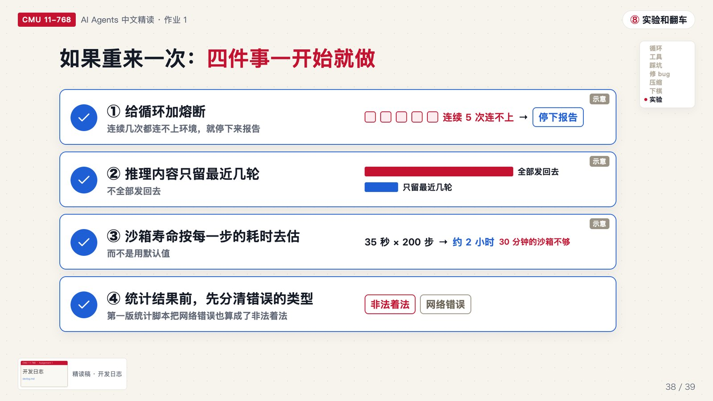

---

## 本讲小结

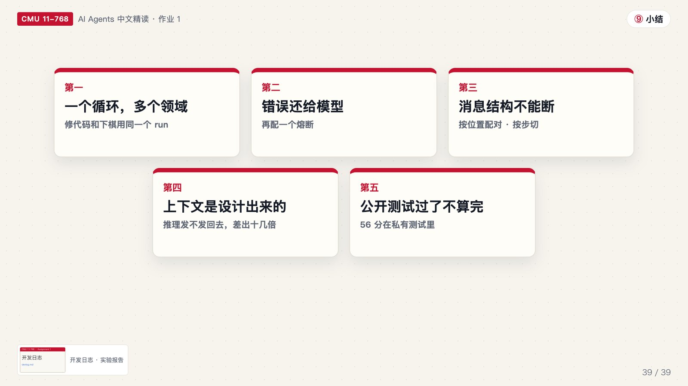

1. **一个循环，多个领域。** 基类只管请求、执行、配对、循环。
2. **错误还给模型，再配一个熔断。**
3. **消息结构不能断。** 一个调用一条结果，按位置配，压缩按步切。
4. **上下文是设计出来的。** system 和任务每次重新生成；压缩是安全网；推理发不发回去差出十几倍。
5. **公开测试过了不算完。** 56 分在私有测试里。

## 关键术语

| 中文 | 英文 | 一句话 |
|---|---|---|
| 智能体运行框架 | agent harness | 模型和环境之间的胶水代码 |
| ReAct | Reasoning + Acting | 观察、推理、动作交替循环的框架 |
| 工具调用 | tool call | 模型在回复里请求执行一个函数 |
| 观察 | observation | 工具执行结果，以 `tool` 角色回给模型 |
| 渐进式披露 | progressive disclosure | 先给技能目录，需要时再给全文 |
| 工作记忆 | working memory | 压缩时模型写的旧历史总结 |
| 前缀缓存 | prefix caching | 服务端缓存与上次请求相同的开头 |
| 程序化工具调用 | programmatic tool calling | 模型写代码，在代码里调工具 |
| 熔断 | circuit breaker | 连续失败到一定次数就停止重试 |
| FEN / UCI | Forsyth–Edwards Notation / Universal Chess Interface | 棋局局面记法 / 着法记法 |

## 思考题

<details>
<summary>1. 为什么 system 和任务消息要每次从属性重新生成，而不是存进 history？</summary>

压缩只改 history，原始指令自然不会被改动；同时避免调用方修改 prompt 时污染内部状态。作业要求压缩时"system 和任务原样保留"，这个结构让它在 Part 1 就满足了。
</details>

<details>
<summary>2. 为什么工具结果按位置配对，而不按 tool_call_id？</summary>

有的服务每一轮都用 `call_0` 这样的编号，编号不是全局唯一的。按编号在整段历史里找会配错。按"这一条 assistant 消息里的第几个调用"配，并且保证每个调用都有一条结果，接口才不会拒绝下一次请求。
</details>

<details>
<summary>3. 什么情况下上下文压缩真正划算？</summary>

任务长到会接近或超过上下文窗口、或者模型在长上下文上明显变差时。短任务上压缩会增加总结调用、让前缀缓存失效、丢失原文细节，反而更贵。阈值应接近真实上限，当安全网用。
</details>

<details>
<summary>4. run_python 跑完为什么要重新读一次棋盘？</summary>

代码里可能已经调用了 `play_move`，真实局面变了。如果不刷新，模型以为局面没变，可能把同一步再走一遍，或按旧局面继续推演。
</details>

<details>
<summary>5. 回传模型的推理内容有什么好处和代价？</summary>

好处：模型能看到自己之前的思路，连贯性更好，作业也要求 prompt 里包含推理。代价：推理长的模型上下文涨得极快（本期 DeepSeek 下棋时推理占 92%），速度、费用和窗口上限都会出问题。折中做法是只保留最近几轮的推理。
</details>

## 动手练习

> 下面的命令会执行模型生成的代码，只在沙箱里跑。

**练习 1：给循环加熔断。** 在你自己的 `run` 里，统计连续多少次工具结果是"连不上环境"的错误，超过阈值就停下并写明原因。

```python
consecutive_failures = 0
while not self.finished:
    ...
    observations = self.execute_tool_calls(tool_calls)
    if all(is_transport_error(o["content"]) for o in observations):   # is_transport_error 自己实现
        consecutive_failures += 1
        if consecutive_failures >= MAX_TRANSPORT_FAILURES:
            raise RuntimeError("environment unreachable")               # 记录仍会由 finally 写出
    else:
        consecutive_failures = 0
    ...
```

追问：熔断该算"连续 N 次"还是"最近 M 次里 N 次"？哪种更不容易误伤偶发的网络抖动？

**练习 2：只保留最近几轮的推理。** 改 `_assistant_message` 或 `build_prompt`，让只有最近 K 条 assistant 消息带 `reasoning_content`。分别用 K=0、K=2 和"全部保留"下同一局棋，比较最后一次提示词长度和非法着法数。

**练习 3：重做观测实验。** 每种条件各下 3 局而不是 1 局，看非法率的差别是否稳定。想想：机器人是确定的，模型如果也很稳定，三局会不会一模一样？

## 延伸阅读

- 作业仓库：[cmu-agents/assignment-1](https://github.com/cmu-agents/assignment-1)
- ReAct 论文：[ReAct: Synergizing Reasoning and Acting in Language Models](https://arxiv.org/abs/2210.03629)
- Agent Skills 协议：[agentskills.io](https://agentskills.io/home)
- SWE-bench：[swebench.com](https://www.swebench.com/)
- 本期的两份实验报告和开发日志（公开版，去掉了本机配置细节，不含答案代码）：[token 用量分析](./reports/token-usage-analysis.md)、[观测实验](./reports/observation-experiment.md)、[开发日志](./reports/devlog.md)

## 下一讲预告

卡耐基梅隆大学下一讲的课程录像还没上传，等上传后我会继续更新。下一期接着做作业二，具体时间还没定。
