# 作业 2 · 卡耐基梅隆大学Agent 作业 2：Agent 评测全记录

> 卡耐基梅隆大学 11-768 AI Agents（2026 秋）第二次大作业的中文图文教程：给数据可视化 agent 写一个验证器（validator）。作业仓库：[cmu-agents/assignment-2](https://github.com/cmu-agents/assignment-2)，本文对应 commit `f609e76`。
> 视频：B 站 / 视频号 / 抖音 / 小红书搜索「竹二木SI」。幻灯片 PDF：[a02-幻灯片.pdf](./a02-幻灯片.pdf)。开发日志和报告的公开版在 [reports/](./reports/)。
> 这次作业是我和 AI 编程助手一起完成的：代码由助手按我的要求写，部署、真跑和排错一起做。Part 3 的 15 条人工标注目前是初稿。
> **关于答案代码**：作业还在进行中。本教程只放讲清思路所需的关键片段，不公开完整答案。请先自己写，再对照这里的思路。
> **和原作业不一样的地方**：原作业的模型都部署在 Modal 上，我的卡绑不上，所以换成了自己租的云 GPU 和托管模型服务。裁判模型、推理框架版本和参数和原作业完全一样；三个 agent 里有一个换了替代模型。详见 2.3 节。

## 这一讲你会学到

1. 怎么给一个画图 agent 打分：四类错误、**MCC**（Matthews 相关系数）和 **macro-MCC**，以及为什么不用准确率。
2. 作业为什么把裁判固定成一个偏弱的视觉模型，自己部署它有什么意义。
3. 弱裁判最常见的两类误判：把 YES 答反、放过写死在要求里的参数。
4. 用工程手段补弱裁判：**确定性判断**有没有出图；在沙箱里**重放**（replay）agent 的代码，量出 matplotlib 实际画了什么。
5. 怎么针对验证器的弱点自己出题，以及人工标注时要看什么。
6. **Harbor** 打包：确定性检查（deterministic verifier）管得到什么、管不到什么。
7. 再迭代一轮时，可读性改成测量带来的提升，以及"不让裁判算数"带来的回退。

### 这一讲的路线

| 块 | 讲什么 | 本课件 |
|---|---|---|
| 作业概览 | 资源账单、任务、四类错误、MCC、四部分和评分、解题顺序 | 1 节 |
| 自己部署模型 | 弱裁判、三个理由、我的实验环境、冷启动 | 2 节 |
| Part 1 baseline | 0.027；答反了；硬性要求被放过 | 3 节 |
| Part 2 两项改进 | 用代码判出图；重放 + 测量；0.332；一个误报一个漏报 | 4 节 |
| Part 3 自己出题 | 两类弱点、五道题、标注时看到的现象、−0.064 | 5 节 |
| Harbor | 目录结构、两个错误答案、确定性检查的边界 | 6 节 |
| Part 4 再迭代 | 四处改动、0.511 / 0.435、剩下的错 | 7 节 |
| 踩坑 | 环境、测量、错误答案复制错位 | 8 节 |

---

## 1 作业概览

### 1.1 资源账单

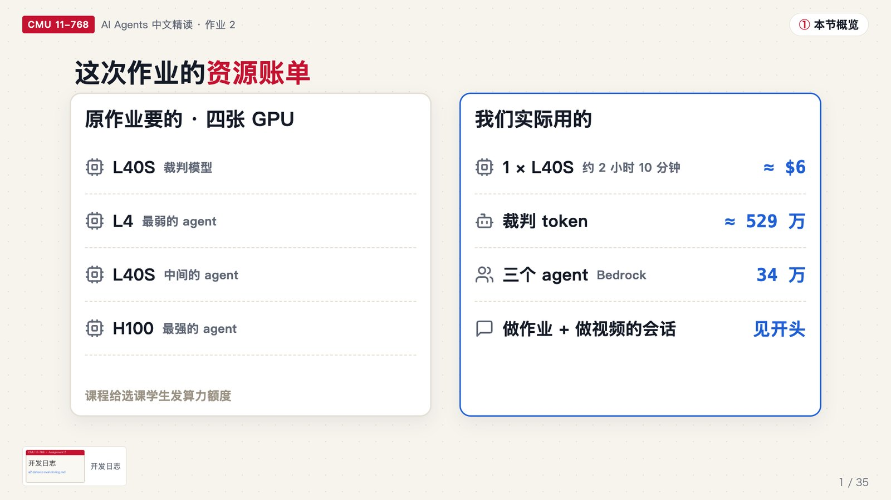

| 项目 | 原作业 | 我们 |
|---|---|---|
| 裁判模型 | Qwen3-VL-30B-A3B-Instruct-FP8，L40S | 同一个模型，一张 L40S，三次开机共约 2 小时 10 分钟，约 6 美元 |
| agent 1（最弱） | Qwen2.5-Coder-3B，L4 | 托管的 Ministral 3B（替代） |
| agent 2 | Ministral-3-14B，L40S | 托管的同一个模型 |
| agent 3 | GLM-4.7-Flash，H100 | 托管的同一个模型 |
| token | — | 裁判约 529 万（从推理服务日志估算），三个 agent 共 34.3 万（130 次调用） |
| 本机 | Docker（Harbor）、LaTeX（报告） | 同左，放在一台 ARM 云主机上 |

原作业的 GPU 由课程给选课学生发额度。我们没有这份额度，裁判之外的三个 agent 用了按 token 计费的托管服务，加起来不到 0.1 美元。

### 1.2 从做 agent 到给 agent 打分

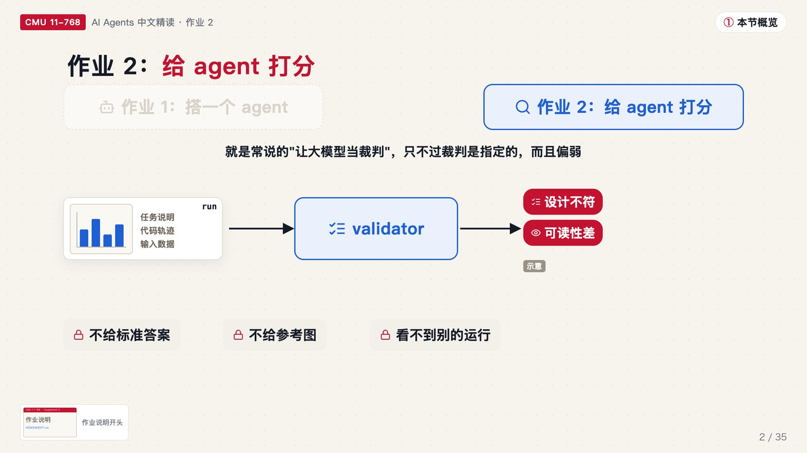

作业 1 是搭一个 agent，作业 2 反过来：别人的 agent 交上来一张图，由你来判它做得对不对。这就是常说的"让大模型当裁判"（LLM-as-a-judge），只不过裁判是指定的，而且偏弱。

这里的 agent 是**数据可视化 agent**：给它数据和一段画图要求，它写 matplotlib 代码、执行、存出 `figure.png`。我们要写的 `validate(run)` 读这次运行的全部材料（任务说明、输入数据、agent 的 trajectory、最终的图），输出一个错误列表。

评分时 validator 一次只看一个运行：**没有标准答案，没有参考图，也看不到别的运行**（作业说明第 7 行）。

### 1.3 四类错误

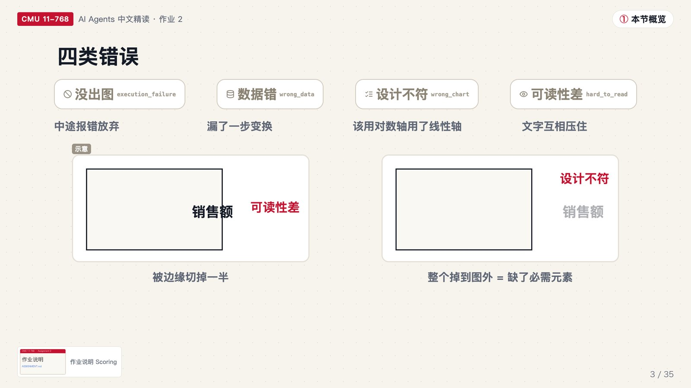

| 类别 | 中文 | 例子 |
|---|---|---|
| `execution_failure` | 没出图 | 中途报错放弃，没存下图 |
| `wrong_data` | 数据错 | 漏了一步变换、排序反了、窗口算错 |
| `wrong_chart` | 设计不符 | 该用对数轴用了线性轴、该有图例没有、dpi 不对 |
| `hard_to_read` | 可读性差 | 文字互相压住、字被裁掉一半、颜色和背景太接近 |

两条边界值得记住：
- 标签被图片边缘**切掉一半**算可读性差；**整个掉到图外**算缺了必需元素，归到设计不符。
- `execution_failure` 是终结性的：人工标了它，另外三类就不再计分。每报一个错都要附具体证据。

### 1.4 MCC 和 macro-MCC

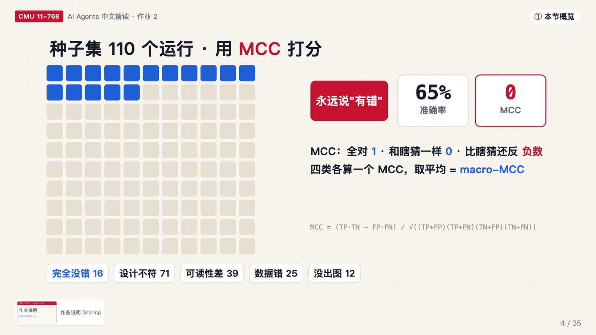

每一类单独看成一个二分类：这个运行有没有这类错。和人工标签比，数出真阳（TP）、真阴（TN）、假阳（FP）、假阴（FN），算

$$\mathrm{MCC}=\frac{TP\cdot TN-FP\cdot FN}{\sqrt{(TP+FP)(TP+FN)(TN+FP)(TN+FN)}}$$

全对是 1，和瞎猜一样是 0，比瞎猜还反是负数。四类 MCC 的平均就是 macro-MCC。

为什么不用准确率：种子集 110 个运行里只有 16 个完全没错，设计不符有 71 个，可读性差 39 个，数据错 25 个，没出图 12 个。一个永远说"有设计问题"的 validator，在这一类准确率有 65%，MCC 却是 0。MCC 把这种偷懒判法压成 0。

注意：某一类在评测集里全是正例或全是负例时，作业的评分脚本会把这一类的 MCC 记为 0 并提示"支持不足"。自建题只有 15 个运行，很容易遇到这种情况。

### 1.5 四部分和评分

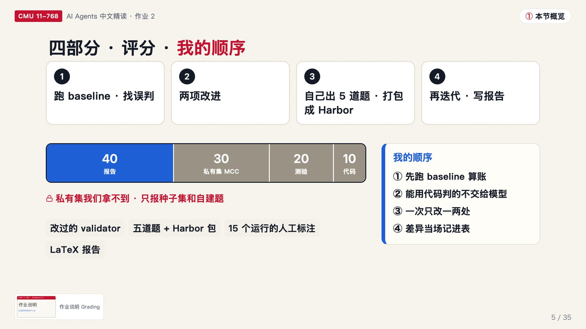

| Part | 做什么 |
|---|---|
| 1 | 在 110 个种子运行上跑 baseline，算 MCC，找两类常见误判，每类至少举 2 个运行 |
| 2 | 实现两项改进，重算 MCC，各分析一个误报和一个漏报 |
| 3 | 针对两类弱点出 5 道题，让 3 个指定 agent 各做一遍，人工标注 15 个运行，再打分；把题打包成 Harbor 环境，写参考答案和两个错误答案 |
| 4 | 再改进一次，在种子集和自建题上都报 MCC，写 LaTeX 报告 |

评分：报告 40%，私有测试集上的 macro-MCC 30%，测验 20%，代码质量 10%。作业 1 的分数大头在私有测试抓边界情况，作业 2 的大头在实验设计和报告。私有集里有种子集没出现过的图表类型，作业明说别过拟合公开样例。

要交的东西：改过的 `validator/solution.py`、5 道题和它们的 Harbor 包、15 个运行的标注 `labels.json`、`report.tex` 和 `report.pdf`，外加 `AI_USAGE.md`。

### 1.6 我的解题顺序

1. 先只部署裁判，跑一遍 baseline，看清一轮要多少钱、多少时间，再决定迭代几轮。
2. 读判错的例子时，先问"能不能用代码确定地判"，能的就不交给模型。
3. 每次只改一两处，改完马上全量重跑评分。Part 2 我刻意没动可读性那一项，这样分数变化说得清来自哪里。
4. 和原作业不一样的地方，当场记进开发日志的一张表（见 [reports/devlog.md](./reports/devlog.md)）。

---

## 2 为什么要自己部署模型

### 2.1 裁判被固定成一个弱模型

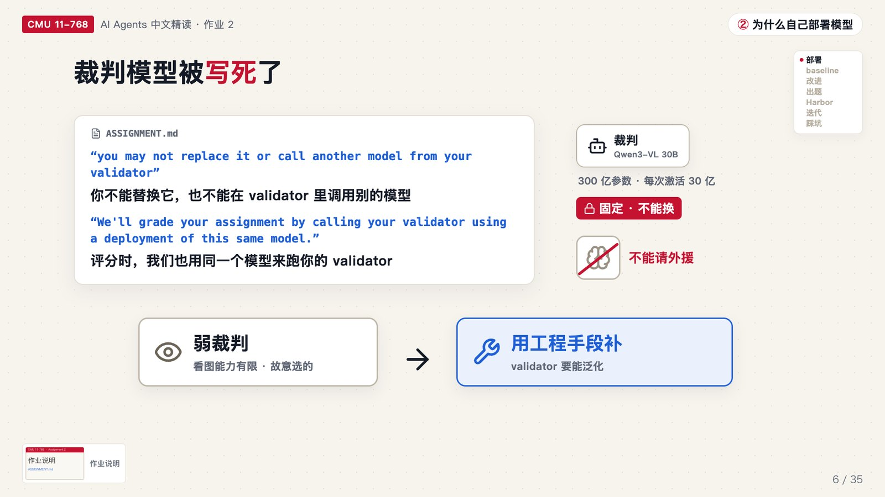

作业原话："The validator model we'll work with is **Qwen/Qwen3-VL-30B-A3B-Instruct-FP8** - you may not replace it or call another model from your validator. Your validator should therefore be designed to generalize rather than depend on a strong judge model. We'll grade your assignment by calling your validator using a deployment of this same model."

这个模型总参数 300 亿，每次只激活 30 亿（MoE）。它看图能力有限，你又不能换掉它，所以整份作业的难点是**用工程手段去补弱裁判**。

### 2.2 自己部署的三个理由

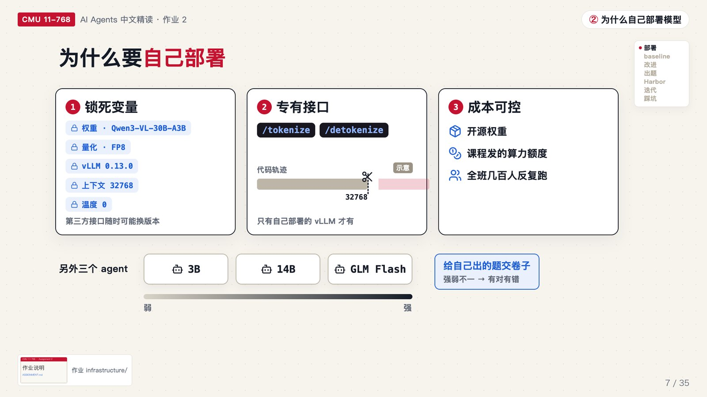

1. **锁死变量**。部署文件（`infrastructure/validator_model.py`、`serving.py`）写死了权重、FP8 量化、vLLM 0.13.0、上下文 32768、温度 0。第三方接口随时可能换版本，调好的 validator 换个环境就不灵。
2. **vLLM 专有接口**。baseline 调 `/tokenize` 和 `/detokenize`，把太长的轨迹截到上下文上限以内，这两个接口只有自己部署的 vLLM 才有。
3. **开源权重成本可控**。全班反复跑 110 个运行，开源模型加课程额度最划算。（这一条是我的推断，原文没写。）

三个 agent 也指定了模型，而且强弱不同（3B、14B、GLM Flash）。它们的作用是给自建题交卷子：强弱不一才会出现各种错法，标出来的数据有对有错，才测得出 validator 的好坏。

### 2.3 我的实验环境

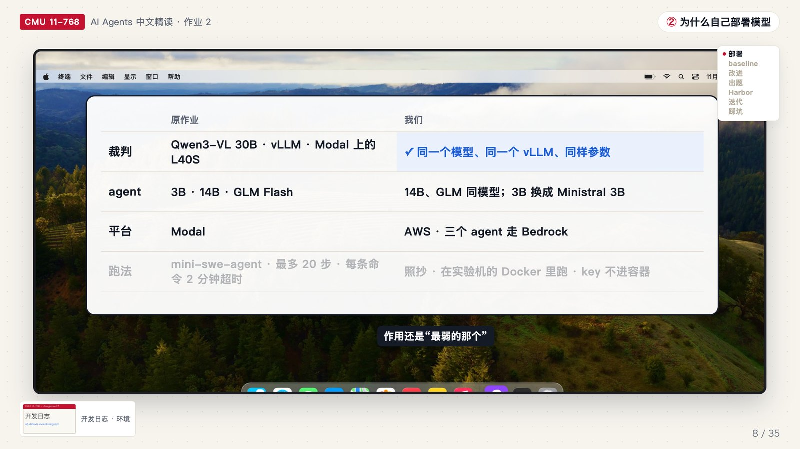

Modal 的免费额度也要求先绑卡才能起 GPU（报错 `Please add a payment method to use L40S GPU functions.`），我的卡绑不上，所以换了环境：

| 项目 | 原作业 | 我们 | 影响 |
|---|---|---|---|
| 算力平台 | Modal | 自己租的云：一台 ARM 云主机当实验机，一台带 1 张 L40S 的 GPU 机器跑裁判 | 无 |
| 裁判 | Modal L40S 上的 Qwen3-VL-30B-A3B-FP8，vLLM 0.13.0 | 同一个模型、同一个 vLLM、同样参数 | 无。端点不开鉴权，改用网络规则只放行实验机 |
| agent 1 | Qwen2.5-Coder-3B | 托管的 Ministral 3B | 托管服务里没有原模型，选体量最接近的弱模型 |
| agent 2、3 | 自部署 Ministral-3-14B、GLM-4.7-Flash | 托管的同一个模型 | 量化和推理栈可能不同 |
| agent 跑法 | Modal 容器里跑 mini-swe-agent 2.4.5 | 实验机的 Docker 里跑，版本、步数上限（20）、单条命令超时（120 秒）照抄 | 模型调用经本机转发，key 不进容器 |
| 提交检查 | 要求 agent 是那三个指定模型 | 有一个模型名不同，这一条过不了 | 我们不交作业 |
| 私有测试集 | 30% 的分数 | 拿不到 | 只报种子集和自建题 |
| 机器架构 | x86_64 | ARM64 | 重放用的 Docker 镜像是 arm64 版，Python 包版本相同 |

### 2.4 冷启动

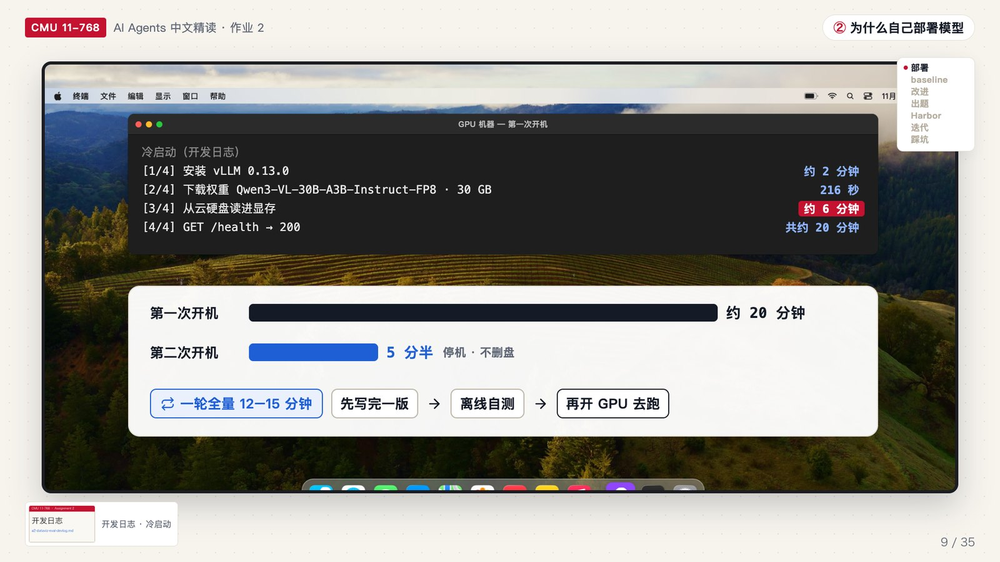

第一次开机到能用约 20 分钟：装 vLLM 约 2 分钟，下载 30 GB 权重 216 秒，从磁盘读进显存约 6 分钟。默认的云硬盘吞吐（约 125 MB/s）是瓶颈。所以不用的时候只停机、不删盘，第二次开机约 5 分半就能用。之后每跑一轮全量约 12–15 分钟，我都是先写完一版、离线自测过，再开 GPU 去跑。

---
## 3 Part 1：baseline 只有 0.027

### 3.1 分数

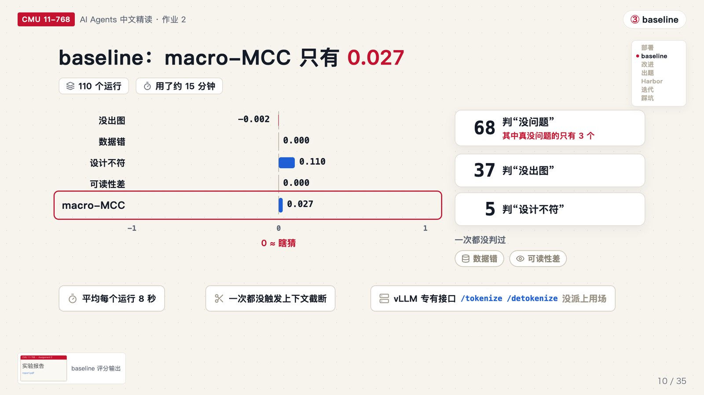

| 类别 | MCC | TP | TN | FP | FN |
|---|---:|---:|---:|---:|---:|
| 没出图 | −0.002 | 4 | 65 | 33 | 8 |
| 数据错 | 0.000 | 0 | 73 | 0 | 25 |
| 设计不符 | 0.110 | 3 | 27 | 0 | 68 |
| 可读性差 | 0.000 | 0 | 59 | 0 | 39 |
| **macro-MCC** | **0.027** | | | | |

110 个运行跑了约 15 分钟，平均每个 8 秒，一次都没触发上下文截断。baseline 判了 68 个"没问题"（真没问题的只有 3 个），37 个"没出图"，5 个"设计不符"，数据错和可读性差一次都没判过。

### 3.2 误判类型一：答反了，还盖住了别的错

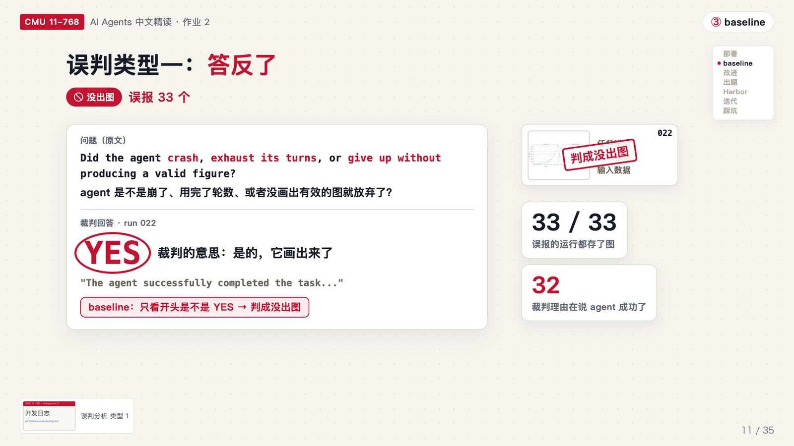

- "没出图"这一类误报了 33 个，**每一个都存了图**。其中 32 个，裁判自己写的理由在说 agent 成功了（如 run 022："The agent successfully completed the task..."），回答开头却是 YES。
- 原因在问法：问题是一个带否定的长选择问句，"Did the agent crash, exhaust its turns, or give up without producing a valid figure?"。裁判把 YES 当成"是的，它画出来了"，而 baseline 的 `_ask` 只看回答开头是不是 YES。
- 连带损失：`validate()` 一判出"没出图"就直接返回，其他三类不再查。33 个误报里有 20 个其实带着别的错，一共 25 个标签被盖住（设计不符 14、可读性差 8、数据错 3），比如 004（第三个子图该用对数轴却是线性轴）。
- 反方向：真没出图的 8 个（010、053、065、089、096、168、181、208）裁判全答了 NO。

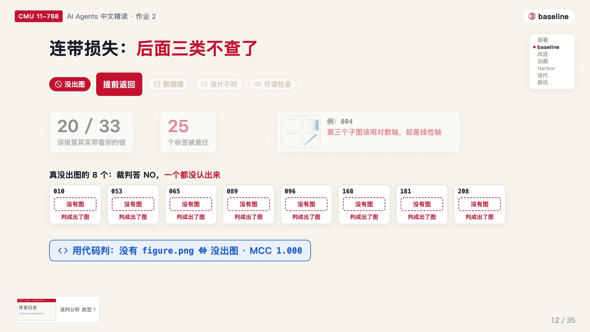

**这件事不用问模型**：种子集里，"没有 figure.png"和"没出图"标签一一对应，TP 12、FP 0、FN 0，MCC 1.000。

### 3.3 误判类型二：写死的参数被放过

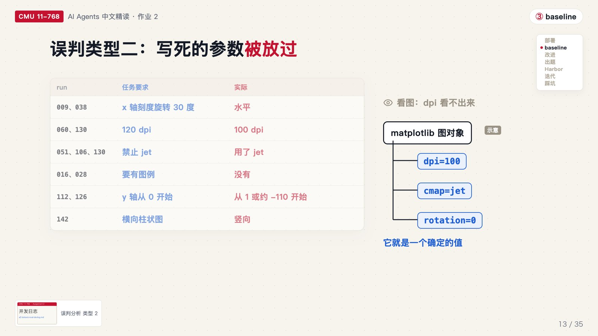

65 个其实有错的运行被判成"没问题"，漏掉了 54 个设计不符、28 个可读性差、22 个数据错。很多是任务说明里写死的参数：

| run | 要求 | 实际 |
|---|---|---|
| 009、038 | x 轴刻度旋转 30 度 | 水平 |
| 060、130 | 120 dpi | 100 dpi |
| 051、106、130 | 禁止 jet | 用了 jet |
| 016、028 | 要有图例 | 没有 |
| 112、126 | y 轴从 0 开始 | 从 1 或约 −110 开始 |
| 142 | 横向柱状图 | 竖向 |

我的推断：每类只问一个笼统的问题（"Does the figure fail to follow any part of the requested chart design?"），再塞进整段轨迹，弱裁判最省事的回答就是"没有"。这些参数里，dpi 看图根本看不出来，但在 matplotlib 的图对象里是确定的值。

另一个现象：可读性差一个都没判出来。030、038、052 有一条序列画成了背景色，008、069 的数值标签是近白色。从图对象的颜色算对比度就能查出来，这留到 Part 4。

---

## 4 Part 2：两项改进，0.027 → 0.332

### 4.1 改进一：有没有出图，用代码判

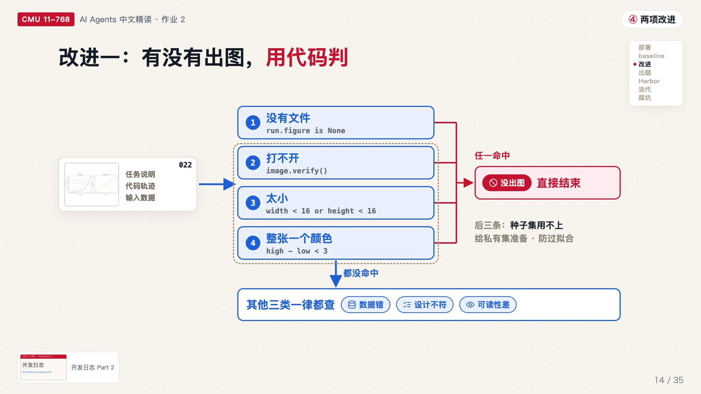

```python
# validator/solution.py（节选）
def _figure_problem(run: Run) -> str | None:
    if run.figure is None:                       # 没有文件
        return "the run ended without saving figure.png"
    try:
        with Image.open(run.figure) as image:
            image.verify()                       # 打得开吗
        with Image.open(run.figure) as image:
            grey = image.convert("L")
            low, high = grey.getextrema()        # 最暗和最亮的灰度
            width, height = image.size
    except (UnidentifiedImageError, OSError, ValueError) as error:
        return f"figure.png is not a readable PNG ({error})"
    if width < 16 or height < 16:                # 小得不正常
        return f"figure.png is only {width}x{height} pixels"
    if high - low < 3:                           # 整张一个颜色
        return "figure.png is a blank single-colour canvas"
    return None

def validate(run: Run) -> list[Error]:
    execution = judge_execution(run)
    if execution:
        # 人工标签里"没出图"是终结性的，其他三类不计分
        return execution
    return _merge(judge_data_and_chart(run) + judge_readability(run))   # 有图就三类都查
```

后三条检查在种子集里一个都用不上，是给私有集准备的，免得规则只认"没文件"这一种情况。

### 4.2 改进二：重放代码，量出实际画了什么

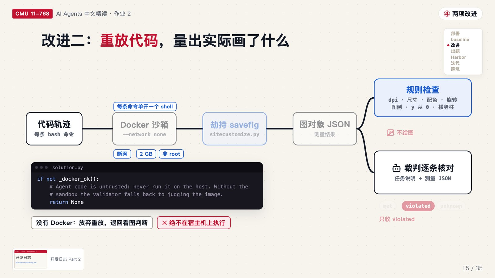

流水线：
1. 从轨迹里取出 agent 发过的每条 bash 命令，按顺序放进 Docker 沙箱重放。沙箱**断网、2 GB 内存、非 root**。
2. 每条命令单独开一个 shell。mini-swe-agent 当时就是这样执行的：命令之间只有文件留存，`cd` 不留存。
3. 通过 `PYTHONPATH` 注入一个 `sitecustomize.py`，劫持 `Figure.savefig`，借作业 Harbor 示例自带的 `figure_manifest.py` 把整棵 artist 树存成 JSON，再补记它没有的字段：保存时实际用的 dpi、刻度旋转角度、坐标轴边框是否可见、每段文字的像素框和颜色。
4. **规则检查**：dpi、尺寸、禁用的 colormap、刻度旋转、图例 / 网格 / 色条、y 轴从 0 开始、横竖柱、3D、极坐标、隐藏边框。
5. **模型检查**：不给图，只给"任务说明 + 测量结果 JSON"，让裁判逐条要求输出 met / violated / unknown，只收 violated。

```python
# validator/solution.py（节选，_replay 的后半段）
        if not _docker_ok():
            # agent 写的代码不可信：绝不在宿主机上跑；没有沙箱就退回看图判断
            return None
        command = [
            "docker", "run", "--rm", "--network", "none", "--memory", "2g", "--cpus", "2",
            "--user", f"{os.getuid()}:{os.getgid()}", "-e", "HOME=/tmp",
            "-v", f"{work}:/work", "-v", f"{hook}:/hook:ro", "-v", f"{out}:/manifests",
        ]
        # 有的 agent 用绝对路径进它当时的临时目录，重放时把工作目录也挂到那个路径
        for original in sorted(set(re.findall(r"/tmp/agent-eval-[A-Za-z0-9_]+", "\n".join(commands)))):
            command += ["-v", f"{work}:{original}"]
        command += [
            "-e", "PYTHONPATH=/hook", "-e", "A2_MANIFEST_DIR=/manifests",   # 注入 savefig 钩子
            "-e", "MPLBACKEND=Agg", "-w", "/work", REPLAY_IMAGE, "bash", "/work/.a2replay.sh",
        ]
```

```python
# validator/solution.py（节选）：裁判只收 violated
    for item in reply.get("requirements") or []:
        if not isinstance(item, dict) or str(item.get("status", "")).lower() != "violated":
            continue
        family = str(item.get("family", "")).lower()
        if family not in ("wrong_data", "wrong_chart"):
            continue
        ...
```

为什么不给裁判看图？dpi、角度这种东西，看图本来就看不准；给它确定的数，它只需要对照文字要求，这是弱裁判最擅长的事（这是我当时的想法，后面的分数部分验证了它）。

先不调模型离线跑一遍（1 分 45 秒）：98 个有图的运行重放成功 97 个，尺寸和原图全部一致。只靠规则，设计不符就从 0.110 到 0.341，0 个误报。唯一失败的 run 191 中途 `pip install kaleido`，沙箱断网装不上。安全上宁可失败，也不放开网络。

### 4.3 结果：可读性反而变负

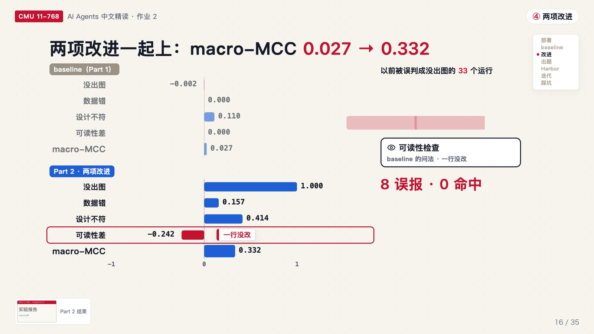

| 类别 | baseline | Part 2 | Part 2 TP/TN/FP/FN |
|---|---:|---:|---|
| 没出图 | −0.002 | **1.000** | 12/98/0/0 |
| 数据错 | 0.000 | 0.157 | 9/58/15/16 |
| 设计不符 | 0.110 | **0.414** | 55/18/9/16 |
| 可读性差 | 0.000 | **−0.242** | 0/51/8/39 |
| macro-MCC | 0.027 | **0.332** | |

可读性那一项一行没改，却从 0 掉到 −0.242。原因是改进一去掉了"提前返回"：以前那 33 个被误判成没出图的运行根本走不到可读性检查，现在都走到了，baseline 的问法于是暴露出 8 个误报、0 个命中。**baseline 的 0.000 是"根本没问"，不是"没判错"。**分数变好或变坏，先看是哪些运行的判定变了，再下结论。

### 4.4 一个误报，一个漏报

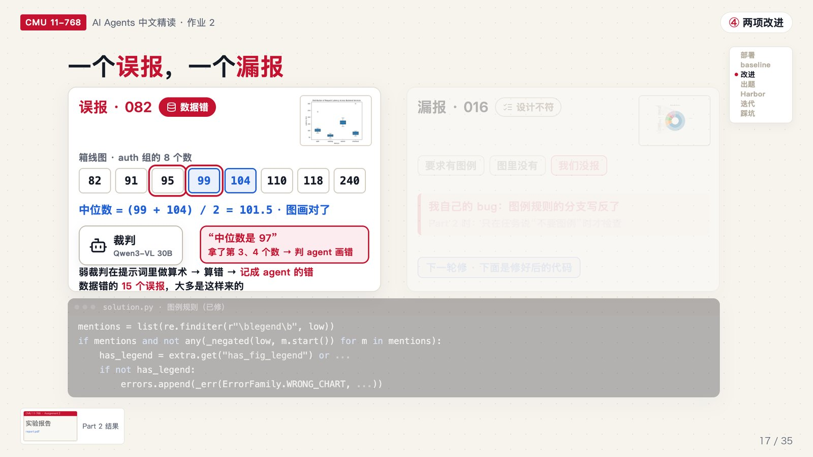

**误报 082（数据错）**：箱线图，auth 组 8 个样本 82, 91, 95, 99, 104, 110, 118, 240，中位数是 (99+104)/2 = 101.5，图画对了。裁判却说中位数是 97，"95 和 99 的平均"，判 agent 画错。让弱裁判在提示词里做算术，它算错了会把自己的错当成 agent 的错，数据错的 15 个误报大多是这一类。

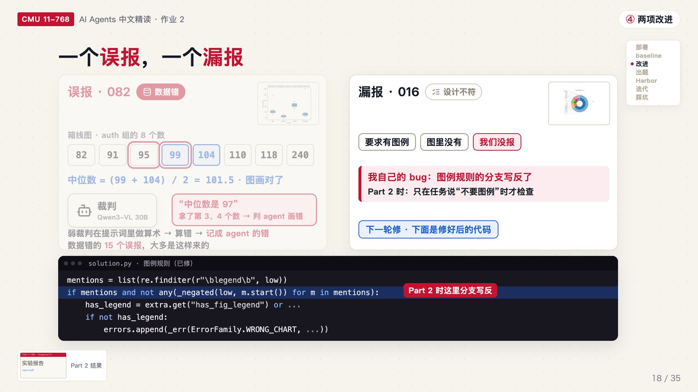

**漏报 016（设计不符）**：要求有图例，图里没有，我们没报。原因是我写的图例规则分支写反了，只在任务说"不要图例"时才检查。Part 4 修好后的版本：

```python
# validator/solution.py（节选，Part 4 修好后的图例规则）
    # Legend (Part 2 had this branch inverted: it only checked when the request
    # said "no legend". Found through run 016 in the Part 2 FN analysis.)
    mentions = list(re.finditer(r"\blegend\b", low))
    if mentions and not any(_negated(low, m.start()) for m in mentions):   # 提到了图例且没被否定
        has_legend = extra.get("has_fig_legend") or any(a.get("legend") for a in manifest.get("axes", []))
        if not has_legend:
            errors.append(_err(ErrorFamily.WRONG_CHART, "the request asks for a legend, but the figure has none"))
```

---
## 5 Part 3：自己出题考 validator

### 5.1 先猜它会在哪翻车

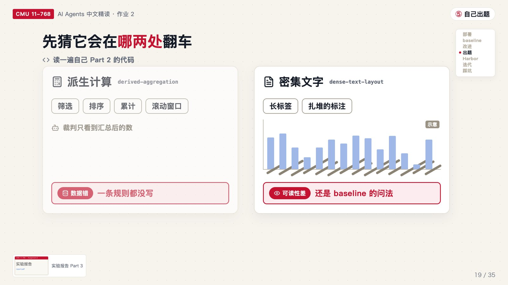

读一遍自己 Part 2 的代码，猜它会在两个地方翻车：
- **派生计算**（`task_class = derived-aggregation`）：筛选、排序、累计、滚动平均。数据错这一类一条规则都没写，裁判又只看到汇总后的数，算错了大概率漏掉。
- **密集文字**（`dense-text-layout`）：长标签、扎堆的标注。可读性用的还是 baseline 的问法，种子集上一次都没判对过。

### 5.2 五道题

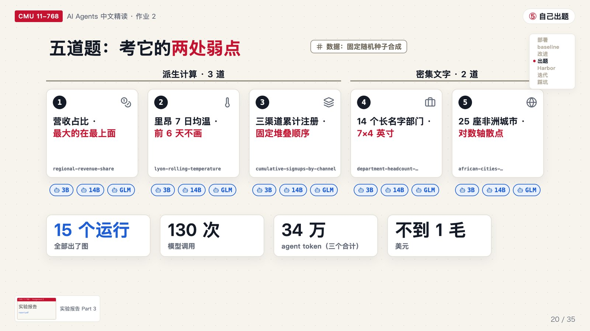

| 题 | 类别 | 考什么 |
|---|---|---|
| regional-revenue-share | 派生计算 | 60 笔订单，营收 = 数量 × 单价，去掉 Sample 区域，算占比，横向柱状图，最大的在最上面 |
| lyon-rolling-temperature | 派生计算 | 两城 90 天，里昂缺 4 天；筛选、去缺失、7 日滚动均值，前 6 行不能有值 |
| cumulative-signups-by-channel | 派生计算 | 16 周 × 3 渠道，按固定顺序堆叠累计值 |
| department-headcount-long-labels | 密集文字 | 14 个长名字的部门塞进 7×4 英寸，每根柱子都标数值 |
| african-cities-annotated-scatter | 密集文字 | 25 个带名字的点，x 轴对数，城市扎堆 |

数据都用固定随机种子合成（作业允许用 LLM 合成或复用别的题的数据）。三个 agent 各做一遍，15 个运行全部出了图，130 次调用、34.3 万 token。

### 5.3 标注时看到的现象

标注依据：看图、读 agent 最终的脚本、用代码从输入数据重算正确值，再和重放出的测量结果对照。

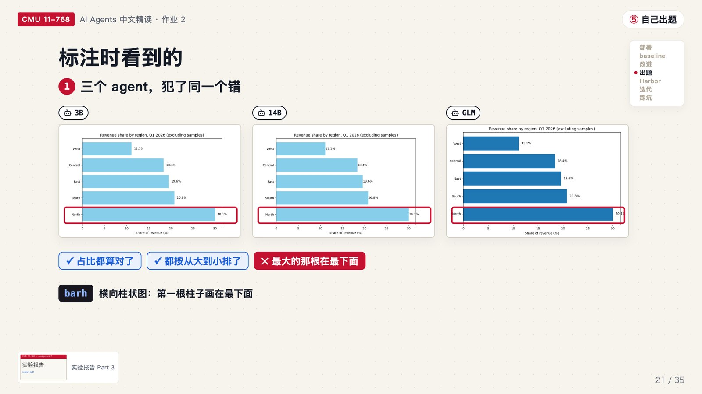

- **三个 agent 犯了同一个错**：营收占比都算对了，也都按从大到小排了，可 `barh` 的第一根柱子画在最底下，最大的那根三个都跑到了最下面。
- **`min_periods=1`**：14B 和 GLM 的七日均线从第一天就开始画，题目要求前六天不画。

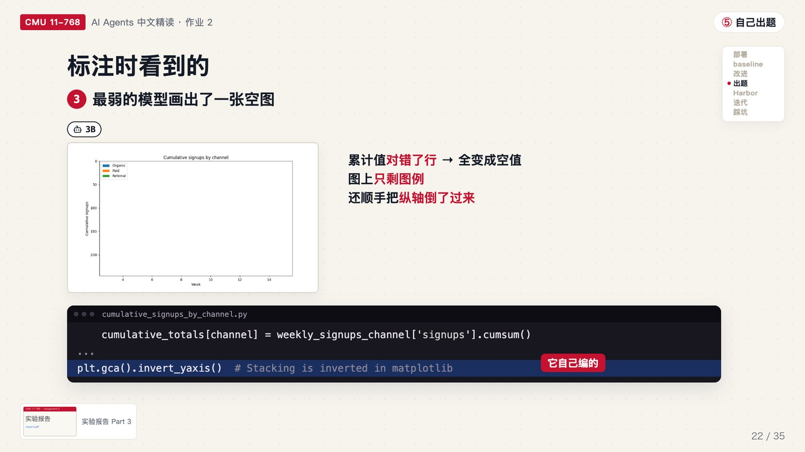

- **空图**：3B 模型的累计图把列赋值到错位的索引上，全变成空值，图上只剩图例。它还顺手 `invert_yaxis()`，注释写 "Stacking is inverted in matplotlib"，这是它编的。

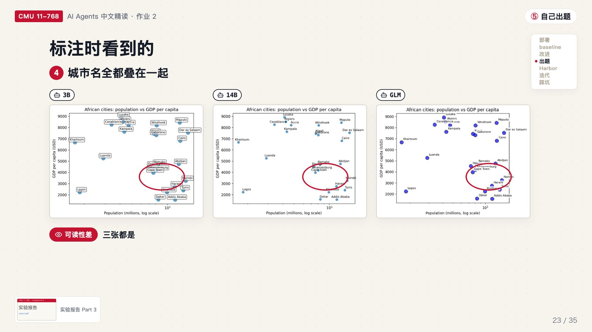

- **标签重叠**：三张散点图里城市名全都叠在一起。3B 的部门图把柱子挤在画布 18% 的地方；另外两个模型 40–45 度斜放的标签判为能读。

最没把握的一条：3B 那张空图同时倒置了纵轴，但它一个数据都没画出来，我只标了数据错。**这 15 条标注是初稿**，作业要求人工审核，最后还要我再过一遍。

### 5.4 迭代前：−0.064

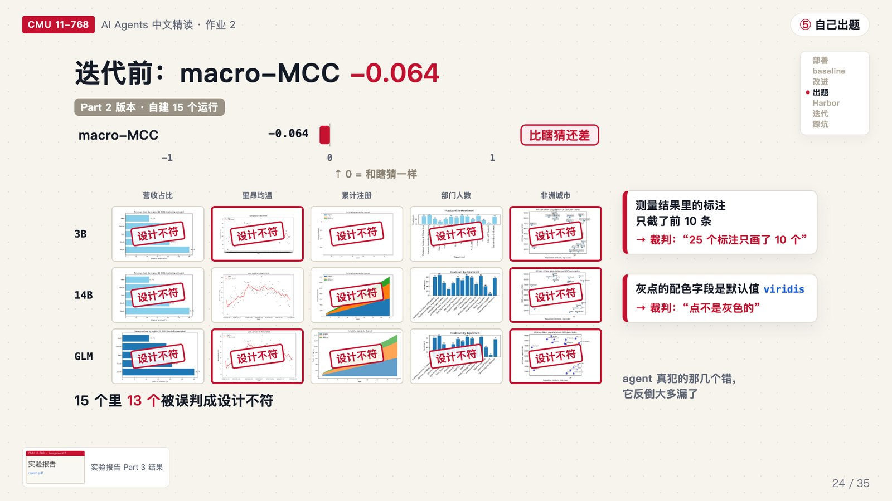

Part 2 版本在自建题上 macro-MCC −0.064，15 个里 13 个被误判成设计不符。原因全在 validator 自己：
- 测量结果里的标注只截了前 10 条，裁判就说"25 个标注只画了 10 个"。
- 灰色散点的 colormap 字段是默认值 viridis，裁判就说"点不是灰色的"。
- agent 真犯的错（排序方向、窗口语义、标签重叠）反而大多漏了。

**给裁判的测量结果，本身也会误导它。**

---

## 6 Harbor：确定性检查管得到什么

### 6.1 Harbor 是什么

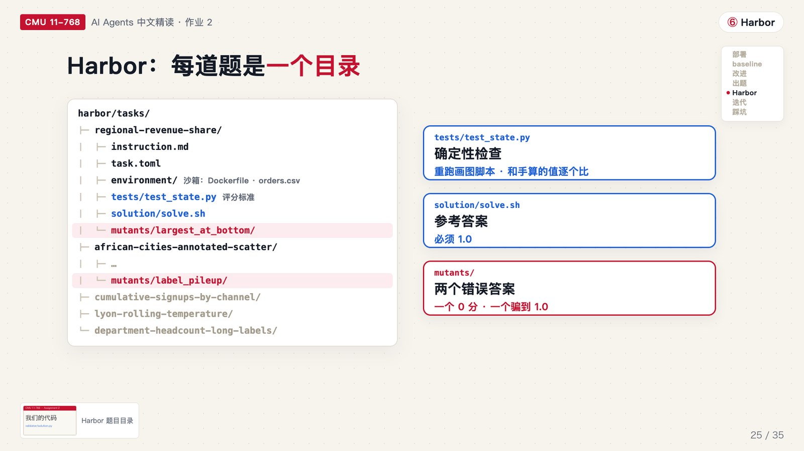

[Harbor](https://github.com/harbor-framework/harbor) 是 Terminal-Bench 2.0 带火的评测框架：每道题是一个自带沙箱和评分标准的目录，谁的 agent 都能拿来跑。作业要求把 5 道题都打包进去，每道题写：
- `tests/test_state.py`：确定性检查，重跑 agent 的画图脚本，和手算好的字面值逐个比；
- `solution/solve.sh`：参考答案，必须拿 1.0；
- 一共两个错误答案（`mutants/<name>/solve.sh`）：一个要被判 0 分，另一个明明是错的却能拿 1.0。

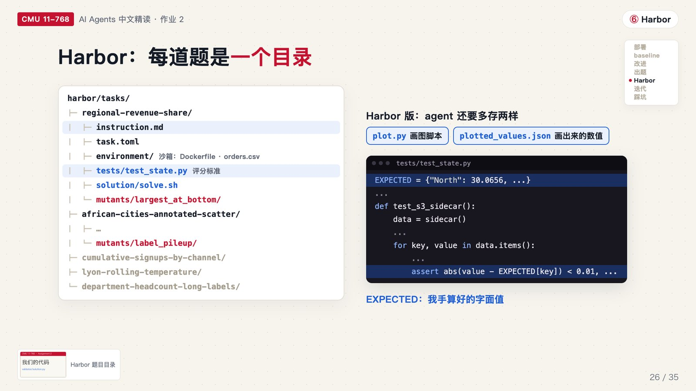

为了能确定地检查，Harbor 版的题目还要求 agent 额外存 `plot.py` 和 `plotted_values.json`，检查就拿这两样和手算的字面值比。生成后不许再改种子提示词。

### 6.2 两个错误答案

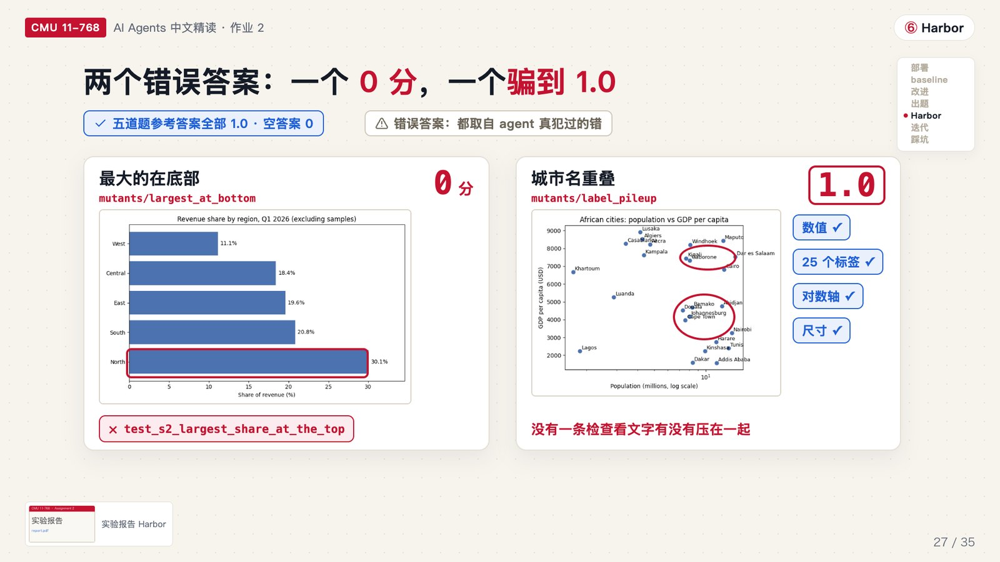

五道题的参考答案全部 1.0，空答案 0。两个错误答案都取自 agent 真犯过的错：
- **largest_at_bottom**（营收占比，最大的在底部）：0 分，被 `test_s2_largest_share_at_the_top` 从 y 轴刻度顺序拦下。
- **label_pileup**（散点图，城市名重叠）：**1.0**。数值、25 个标签、对数轴、文字、尺寸全对，但没有一条断言去看文字有没有压在一起。

### 6.3 这说明什么

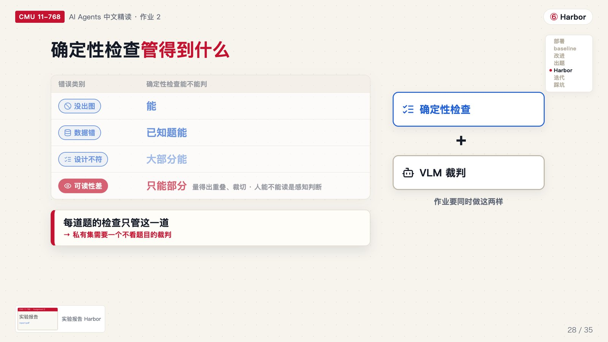

| 类别 | 确定性检查能不能判 |
|---|---|
| 没出图 | 能：文件在不在、能不能解码 |
| 数据错 | 对一道已知题能：预期值写死在检查里 |
| 设计不符 | 大部分能：类型、尺度、文字、尺寸都在 artist 树里；自由描述的风格要求不行 |
| 可读性差 | 只能部分：重叠、裁切可以量，"人能不能读"是感知判断 |

每道题的检查把答案写死了，只管这一道题。私有集里的题没人写过检查，所以给 validator 打分还是需要一个不依赖具体题目的裁判。作业让我们同时做确定性检查和模型裁判，原因就在这里。

提交检查 `check-submission` 只有一条没过：agent 不是那三个指定模型。在临时副本里把模型名改回去，其余各项（包括 Harbor 实跑）全部通过。

---

## 7 Part 4：再迭代一次

### 7.1 四处改动

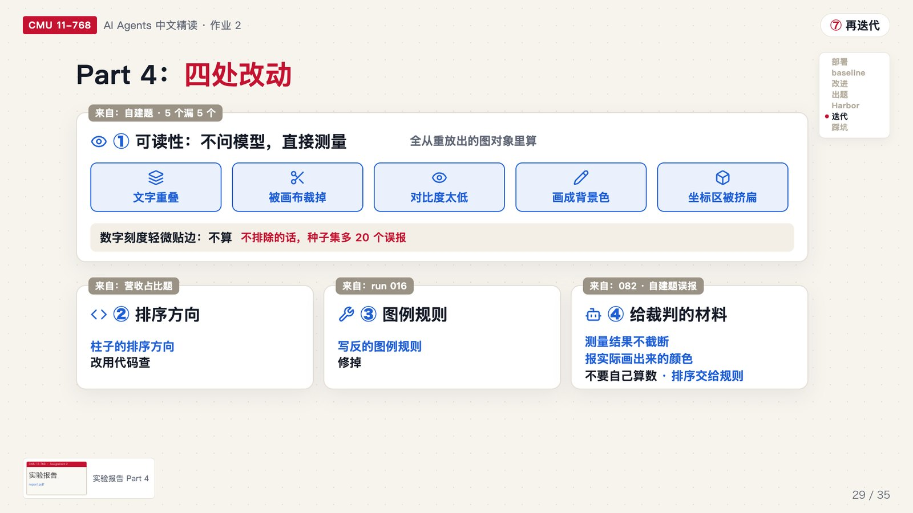

1. **可读性改成测量**（自建题上 5 个漏了 5 个）：文字互相压住（框重叠超过 20%；斜放的刻度标签按锚点间距算）、被画布切掉、和局部背景对比低于 1.8:1、序列画成背景色或线宽为 0、单个坐标区被挤到画布 20% 以下。数字刻度轻微贴边不算，种子集的人工标签从不把它算成可读性差，不排除会多出 20 个误报。
2. **排序方向用代码查**（来自营收占比题）。
3. **修掉图例规则的 bug**（来自 016）。
4. **测量结果不截断、报实际颜色，并告诉裁判不要自己算数**，排序交给规则（来自 082 和自建题的误报）。

```python
# validator/solution.py（节选）：斜放的刻度标签按锚点间距判重叠
            for a, b in zip(group, group[1:]):
                angle = abs(a.get("rotation", 0)) % 180
                if role == "xtick" and 5 < angle < 175:
                    if a.get("anchor") is not None and b.get("anchor") is not None:
                        dx = b["anchor"] - a["anchor"]          # 相邻两个刻度锚点的水平距离
                    else:
                        ...
                    text_height = a.get("fontsize", 10) * (extra.get("saved_dpi") or 100) / 72
                    if abs(dx) * math.sin(math.radians(angle)) < 0.8 * text_height:   # 垂直于文字方向的间距不够一行字高
                        pair_hits.append((a["text"], b["text"]))
                elif _overlap(a["bbox"], b["bbox"]):
                    pair_hits.append((a["text"], b["text"]))
            # 一对数字挨着算噪声；有文字标签，或连着撞了 3 对以上，才算读者真读不了
            words = any(not numeric(t) for t in group)
            if pair_hits and (words or len(pair_hits) >= 3):
                overlaps.extend(pair_hits)
```

可读性这一项完全不调模型。

### 7.2 结果

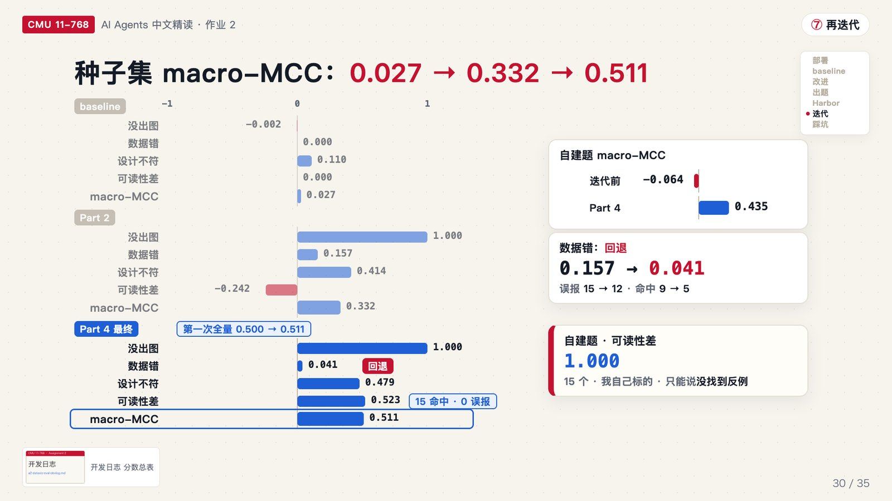

| 种子集 | baseline | Part 2 | Part 4 最终 |
|---|---:|---:|---:|
| 没出图 | −0.002 | 1.000 | 1.000 |
| 数据错 | 0.000 | 0.157 | 0.041 |
| 设计不符 | 0.110 | 0.414 | 0.479 |
| 可读性差 | 0.000 | −0.242 | 0.523 |
| **macro-MCC** | **0.027** | **0.332** | **0.511** |
| **自建题 macro-MCC** | — | **−0.064** | **0.435** |

- 第一次全量是 0.500（自建题 0.398）。后来修了一个刻度标签分角色的 bug（见 8.2），可读性那一项是纯规则，离线重算后换进去，才是 0.511 / 0.435，报告里写明了。
- 种子集可读性 15 个命中、0 个误报。
- **回退**：数据错从 0.157 掉到 0.041。不让裁判算数，误报从 15 降到 12，命中也从 9 降到 5。
- 自建题可读性到了 1.000，可只有 15 个运行，还是我自己标的，只能说"没找到反例"。

### 7.3 剩下的错

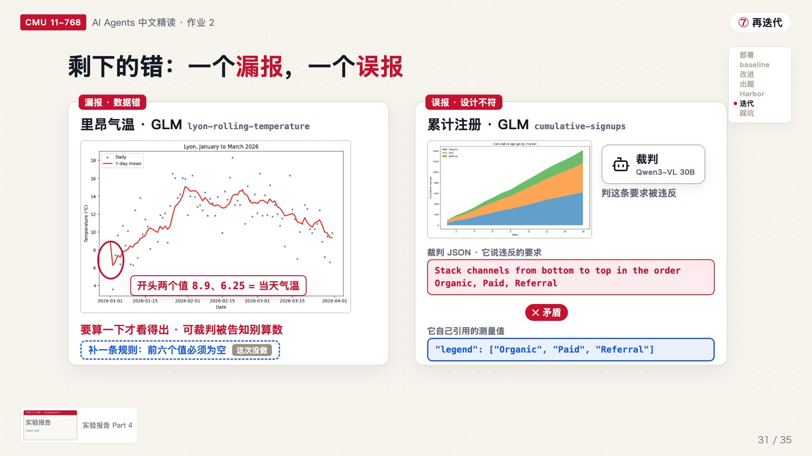

- **漏报：里昂 GLM**。均线开头两个值（8.9、6.25）就等于当天的气温，这正是 `min_periods=1` 的特征。可要发现它得算一下，而我刚让裁判别算数。补一条"前六个值必须为空"（数开头的空值）的规则就能抓到，这次没做。
- **误报：累计 GLM**。裁判判"按 Organic、Paid、Referral 堆叠"这条要求被违反，自己引用的测量值却正是 `["Organic","Paid","Referral"]`。结论和它自己给的证据打架，和 Part 1 答反 YES 是同一个毛病，只是这次藏在 JSON 里。可以再加一道一致性检查：引用的测量值满足要求时，丢掉这条 violated。

不让它算，会漏；让它算，会错。数据对不对这件事，交给弱裁判还是全写成规则，是这份作业最值得想的取舍。

---

## 8 踩坑

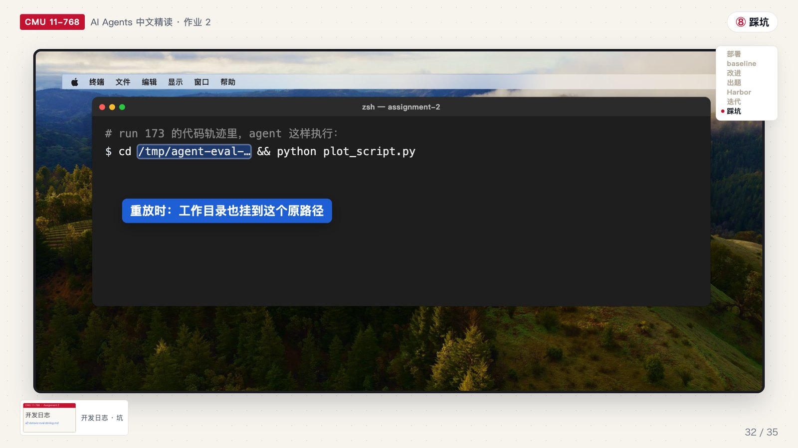

| 坑 | 现象 | 处理 |
|---|---|---|
| Modal 免费额度不能起 GPU | `Please add a payment method to use L40S GPU functions.` | 卡绑不上，换环境 |
| Modal 两种 token | 部署用 CLI 账户 token，调 endpoint 要另建一种 Proxy Auth Token | 弄清区别再配 `.env` |
| 新账号的镜像构建器版本 | 默认 2026.10，作业锁定的 modal 1.5.5 只支持到 2025.06 | `MODAL_IMAGE_BUILDER_VERSION=2025.06`，不升级依赖 |
| Docker 没有 compose v2 | Harbor 报 `unknown flag: --project-name`；装好后又报 `compose build requires buildx 0.17 or later` | 官方 compose 和 buildx 装到 `~/.docker/cli-plugins`，校验 sha256，不用 sudo |
| savefig 的 dpi 不是画布 dpi | `fig.get_dpi()` 是画布 dpi，`savefig(dpi=120)` 会覆盖它，作业自带的 manifest 只记了前者 | 钩子里另记 savefig 的参数 |
| agent 用绝对路径 | `cd /tmp/agent-eval-… && python plot_script.py` | 重放时把工作目录同时挂到原路径 |
| 重放不能联网 | run 191 中途 `pip install kaleido` | 宁可这一个失败，也不放开网络 |

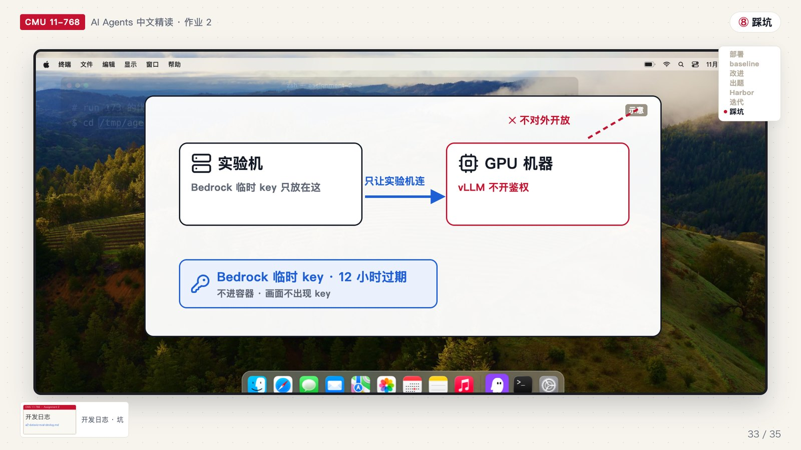

安全：GPU 机器上的 vLLM 没开鉴权，所以它不对外开放，只让实验机连；托管模型服务的临时 key 只放在实验机上，12 小时就过期，不进 agent 的容器。

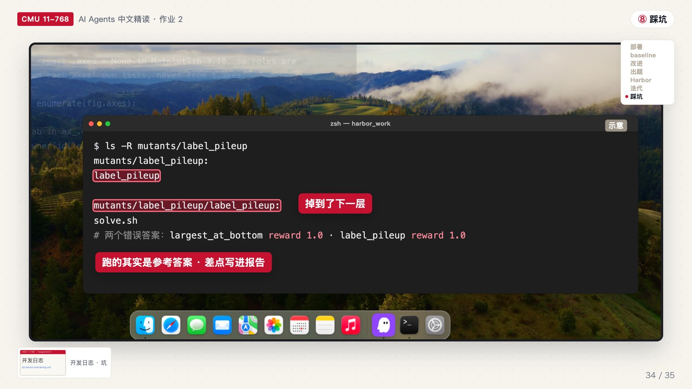

| 坑 | 现象 | 处理 |
|---|---|---|
| Matplotlib 3.10 刻度标签的 `.axes` 是 None | 按 `.axes` 分角色，86 个重叠的日期刻度被当成普通文字，又因为像数字被跳过 | 从每个坐标区的 `get_xticklabels()` 反查角色 |
| 旋转标签的外接框会重叠 | 45 度长标签字形没碰到，外接矩形却叠在一起，误报一堆 | 改成刻度锚点间距 × sin(角度) 和字高比 |
| 3D 坐标轴刻度画两次 | 投影后的文字框不能直接比 | 3D 排除在测量检查外 |
| 数字刻度不算难读 | 不排除时种子集多 20 个误报 | 数字刻度要连撞 3 对才算 |
| 空目录让错误答案复制错位 | 上次失败留下空的 `mutants/<名>`，`cp -r` 复制到了下一层，两个 1.0 其实跑的是参考答案 | 重跑前确认 `solve.sh` 里确实是错误答案 |

---
## 本讲小结

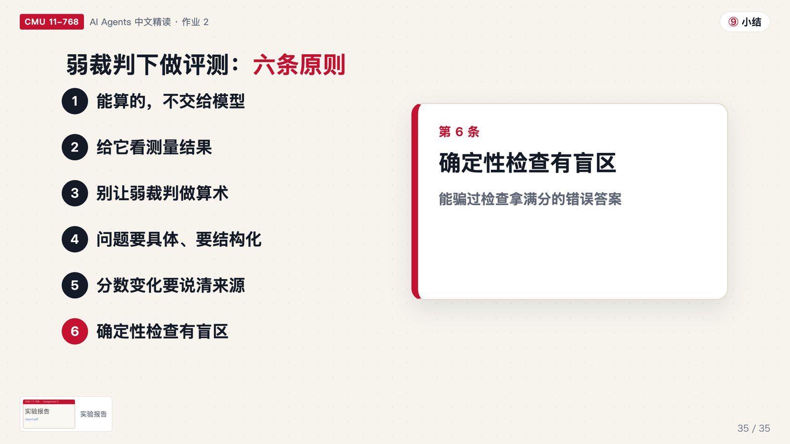

1. **能用代码确定判的，不交给模型**。有没有出图、dpi、配色、排序、文字重叠，都是确定的值。
2. **给裁判看测量结果，不让它看图猜**。重放 agent 的代码，它实际画了什么一清二楚。
3. **别让弱裁判做算术**。它算错了会把自己的错算到 agent 头上；可一点都不让它算，又会漏掉要算才看得出的错。
4. **问题要具体、要结构化**。带否定的长问句加一个 YES 会让它答反；逐条核对加 JSON 好得多，但结论和证据打架的情况还在。
5. **分数的变化要说得清来源**。baseline 的 0 是根本没问，不是没判错。
6. **确定性检查有盲区**。能骗过检查拿满分的错误答案，正好说明为什么还需要一个裁判。

## 关键术语

| 术语 | 英文 | 解释 |
|---|---|---|
| 验证器 | validator | 读一次 agent 运行的全部材料，输出错误列表的程序 |
| 让大模型当裁判 | LLM-as-a-judge | 用模型给另一个模型的输出打分 |
| 马修斯相关系数 | MCC | 二分类的相关性指标，1 全对，0 等于瞎猜，负数比瞎猜还反 |
| 宏平均 MCC | macro-MCC | 四类 MCC 的不加权平均 |
| 种子集 | seed runs | 作业给的 110 个已标注运行 |
| 私有集 | private set | 评分用的、学生看不到的运行 |
| 重放 | replay | 在沙箱里按原顺序重跑 agent 的命令 |
| artist 树 / manifest | artist tree / figure manifest | matplotlib 图对象里所有元素（轴、线、文字）的结构化记录 |
| 确定性检查 | deterministic verifier | 不调模型、结果固定的检查，Harbor 题目的评分方式 |
| 错误答案 | mutant | 故意做错的参考解，用来测检查的漏洞 |
| 终结性类别 | terminal family | 标了它其余类别就不计分的类别（没出图） |

## 思考题

<details><summary>1. 为什么作业不用准确率，而用 MCC？</summary>

种子集里正负例严重不平衡：110 个运行里设计不符有 71 个。一个永远说"有错"的 validator，这一类准确率 65%，MCC 是 0。MCC 同时看四个格子，偷懒的常数判法拿不到分。
</details>

<details><summary>2. baseline 的可读性一开始是 0.000，Part 2 什么都没改却变成 −0.242，说明了什么？</summary>

0.000 是因为那 33 个运行被提前返回了，根本没走到可读性检查；Part 2 去掉提前返回后，baseline 的问法在这些运行上暴露出 8 个误报、0 个命中。分数变化要追到"哪些运行的判定变了"，不能只看总分。
</details>

<details><summary>3. 为什么重放 agent 的代码必须放在断网的 Docker 里，没有 Docker 时为什么宁可放弃重放？</summary>

agent 写的代码不可信，可能删文件、联网下载、耗光资源。validator 运行在评分方的机器上，在宿主机上执行它等于把评分环境交给被评对象。宁可退回看图判断，也不冒这个险。
</details>

<details><summary>4. 不让裁判算数以后，数据错从 0.157 掉到 0.041。你会怎么改？</summary>

一种思路是把计算挪到代码里：从输入数据算出关键值（中位数、累计值、前 N 行是否为空），和重放出的数值比，裁判只判"要求里说了什么"。另一种是保留裁判算数，但要求它在 JSON 里写出算式，再由代码复算，算式不对就丢掉这条判断。
</details>

<details><summary>5. label_pileup 这个错误答案能拿 1.0，确定性检查要怎么补才能拦住它？代价是什么？</summary>

可以在检查里量文字框的两两重叠，超过阈值就判失败。代价是阈值难定：斜放标签的外接框天然重叠，数字刻度贴边人眼也能读，阈值太严会误伤参考答案。这正是可读性"只能部分"确定性判断的原因。
</details>

## 动手练习

1. **只做改进一**：在 baseline 上只加 `_figure_problem` 和"有图就三类都查"，重跑种子集，看可读性是不是也掉到负数。
2. **写一个最小 savefig 钩子**（只在沙箱里运行模型生成的代码）：

```python
# sitecustomize.py：放进 PYTHONPATH，任何 python 进程启动时自动加载
import json, os
import matplotlib
matplotlib.use("Agg")
from matplotlib.figure import Figure

_orig = Figure.savefig

def _hooked(self, fname, *args, **kwargs):
    info = {
        "canvas_dpi": self.get_dpi(),
        "saved_dpi": kwargs.get("dpi"),            # 追问：没传 dpi 时实际用的是什么？
        "size_in": list(self.get_size_inches()),
        "axes": [{"xscale": ax.get_xscale(), "yscale": ax.get_yscale(),
                  "legend": ax.get_legend() is not None} for ax in self.axes],
    }
    out = os.environ.get("A2_MANIFEST_DIR", ".")
    with open(os.path.join(out, "manifest.json"), "w") as f:
        json.dump(info, f)
    return _orig(self, fname, *args, **kwargs)

Figure.savefig = _hooked
```

   追问：刻度标签的旋转角度和像素框怎么取？Matplotlib 3.10 里刻度标签的 `.axes` 是什么？
3. **自己出一道题**：选一个你觉得 validator 会漏的计算（比如"同比增长率"），写任务说明和输入数据，手算出正确答案，再写一个能骗过你自己检查的错误答案。

## 延伸阅读

- 作业仓库：[cmu-agents/assignment-2](https://github.com/cmu-agents/assignment-2)（`ASSIGNMENT.md`、`harbor/README.md`）
- [Harbor](https://github.com/harbor-framework/harbor) 评测框架
- [vLLM 文档](https://docs.vllm.ai/)：OpenAI 兼容服务和 `/tokenize` 接口
- 本讲的开发日志和报告公开版：[reports/](./reports/)
- 公开课主页：[cmu-agents.com](https://www.cmu-agents.com/#/)

## 下一讲预告

作业 3 是用强化学习训练 agent，全程要 H100，自费要一两百美元，这次先不做。卡耐基梅隆大学下一讲的课程录像还没上传，等新一讲上传后我再继续更新。
