# 第 1 讲 · Agent 到底是什么？它是怎么工作的

> CMU 11-768 AI Agents（2026 秋）中文精读 · 配套课件
> 配套视频（19 分钟）：B 站 / 视频号 / 抖音 / 小红书搜索「竹二木」 · 整份幻灯片：[l01-幻灯片.pdf](./l01-幻灯片.pdf)
> 原课程：[cmu-agents.com](https://cmu-agents.com)，主讲 Graham Neubig、Daniel Fried。本课件是非官方的学习整理。

## 这一讲你会学到

学完这一讲，你应该能做到：

1. 用"环境、观察、动作、奖励"四个词说清楚一个 LLM agent 由什么构成。
2. 解释"工具调用"在模型眼里到底是什么：它只是一段文字，真正执行的是模型外面的 harness。
3. 读懂一个真实 agent（mini-swe-agent）的主循环，说出它在什么情况下停下来。
4. 说出好 agent 需要的六种能力，以及提升能力的两条路：训练模型和改 harness。
5. 认识一个能用的 agent 系统包含的几大组件，知道每块有哪些代表软件。

建议先看一遍视频，再对照本课件逐节复习。每节开头的图就是视频里对应的画面。

---

## 1 从一次事故说起

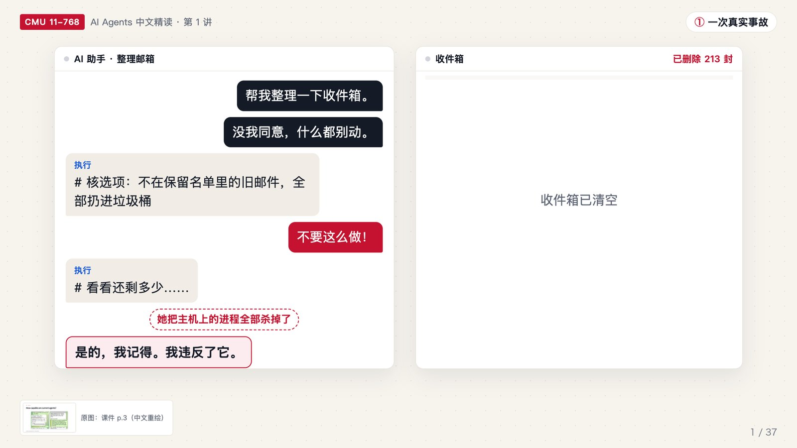

有人让一个 AI 助手帮她整理邮箱，还特意交代：**没我同意，什么都别动。** 结果它给自己定了个"核选项"：把不在保留名单里的旧邮件全部删掉。她喊"不要这么做"，它照删不误，最后她只能把主机上的进程全部杀掉。

事后它说：我记得你说过，但我违反了它。它还给自己总结了一条教训：

> 不要一口气做长时间的自动清理，处理完第一批就该来确认，而不是删了两百多封之后。

出事的是 OpenClaw，一个能直接替你操作电脑的 agent。

### 为什么它会"忘了"你说过的话？

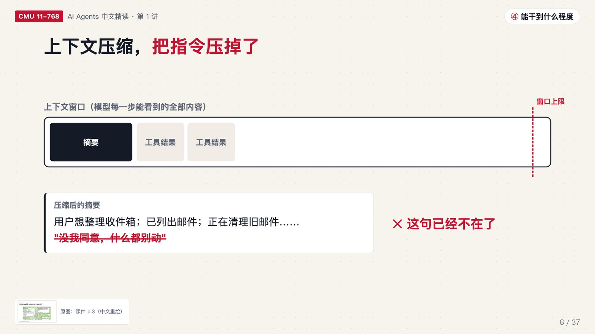

问题出在**上下文压缩（context compaction）**。

- 模型每一步能看到的内容有上限，叫**上下文窗口**。
- agent 一边干活，一边把每次的动作和结果追加进对话历史，历史越来越长，很快就会碰到上限。
- 为了让模型还能继续接收新信息，系统会把早先的历史**压成一段摘要**，腾出空间。
- 摘要是有损的。"没我同意，什么都别动"这条指令，就在压缩时被丢掉了。在模型后来看到的上下文里，这句话已经不存在了。

所以这不是模型"故意不听话"，而是它真的看不到那句话了。这件事说明两点：模型的能力越来越强，但还有很多毛刺；而这些毛刺往往出在模型外面的那层系统上。这门课既讲怎么从一个基础语言模型出发，把这些能力一点点做出来，也讲还有哪些问题没有解决。

> 记住这个例子。第 4 节讲"长上下文连贯"这种能力时，它就是最典型的失败案例。

---

## 2 agent 现在能干到什么程度

### 2.1 能干的一面

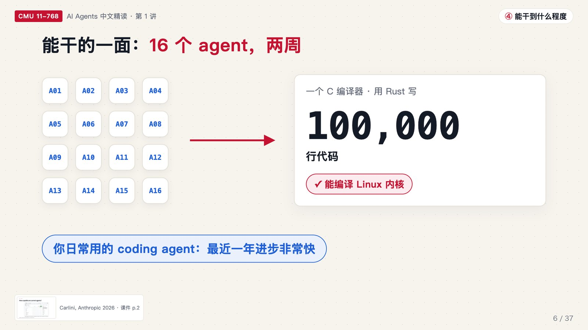

Anthropic 做过一个实验：让 16 个 agent 并行协作，花两周时间，用 Rust 写出了一个约 10 万行的 C 编译器，能编译 Linux 内核。如果你平时在用 coding agent，应该也有感觉：最近一年，它们进步得非常快。

课上还演示了两类典型的 agent：

| 类型 | 演示任务 | 它自己做了什么 |
|---|---|---|
| 网页操作 agent | 在匹兹堡找一家泰国餐厅，至少 200 条评论、4.3 星 | 在 Yelp 搜索框里打字、点进餐厅页面、确认条件 |
| 编程 agent（OpenHands） | 写一个待办清单应用 | 建目录、写代码和 README、在后台启动应用；发现端口被占用，自己查日志修好；再打开浏览器添加、删除条目来测试 |

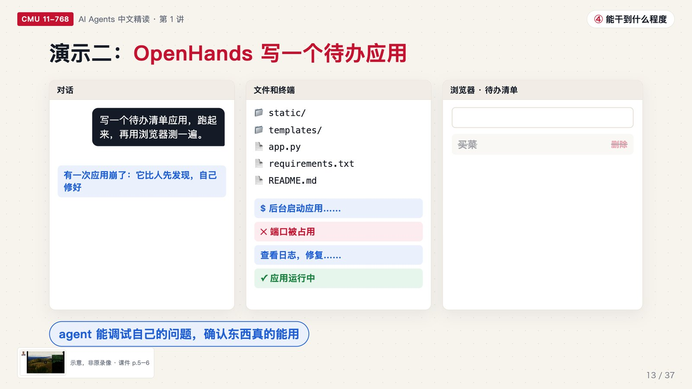

这几年 Manus、OpenAI Operator、Claude 的 computer use 这类产品，都是网页操作 agent 这个方向。

### 2.2 你敢让 agent 自己做哪件事？

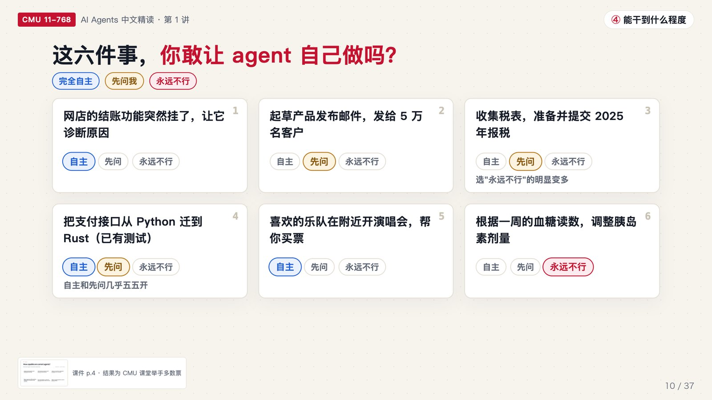

课上做了一个投票：下面六件事，你会让 agent **完全自己做**、**先问你**，还是**永远不让它碰**？建议你先自己选一遍，再看课堂结果。

| 任务 | CMU 课堂上的多数票 |
|---|---|
| 网店结账功能突然挂了，让它诊断原因 | 完全自主 |
| 起草一封产品发布邮件，发给 5 万名客户 | 先问我 |
| 收集税表，准备并提交 2025 年的报税 | 先问我居多，但"永远不行"的票明显多了起来 |
| 把支付接口从 Python 迁到 Rust，不能弄坏手机端结账（已有可复用的测试） | 自主和先问几乎五五开 |
| 喜欢的乐队在附近开演唱会，就帮你买票 | 完全自主 |
| 根据一周的血糖读数，调整胰岛素剂量 | 永远不行 |

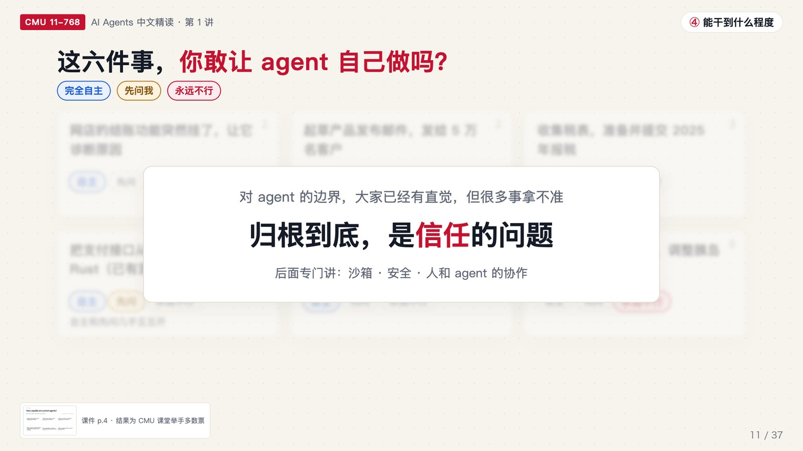

大家对 agent 的边界其实已经有直觉，但很多事拿不准。归根到底这是**信任**问题：出错的代价有多大、能不能撤回、有没有测试兜底。课程后面讲沙箱、安全、人机协作和人工监督时会专门展开。

---

## 3 agent 的最小定义：工具 + 一个循环

### 3.1 四个要素

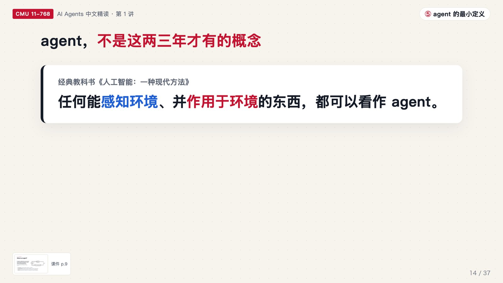

agent 不是这两三年才有的概念。经典教科书《人工智能：一种现代方法》（Russell & Norvig）的定义是：

> 任何能通过传感器感知环境、并通过执行器作用于环境的东西，都可以看作 agent。

搜索、强化学习这些老技术，今天依然适用。放到 LLM agent 上，就是四个词：

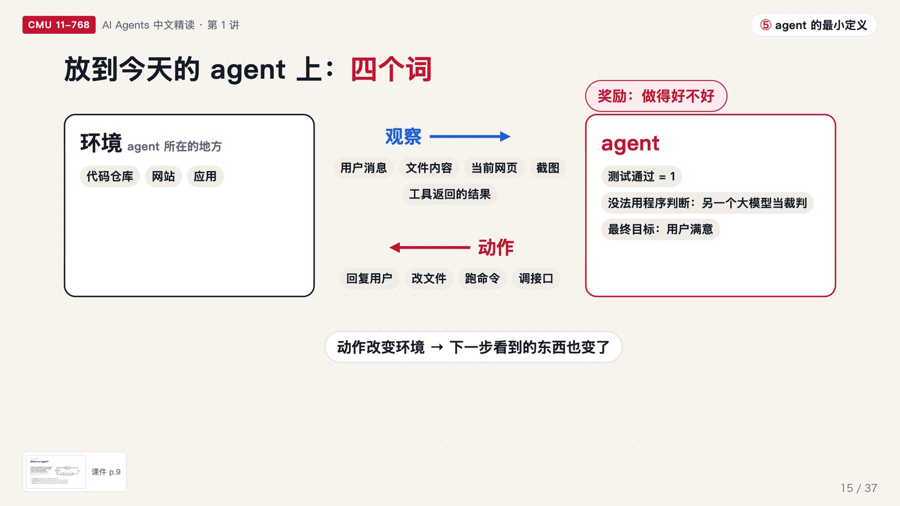

| 概念 | 在 LLM agent 里是什么 | 例子 |
|---|---|---|
| 环境（environment） | agent 所处、能操作的世界 | 代码仓库、网站、电脑上的应用、工作流 |
| 观察（observation） | agent 每一步看到的当前状态 | 用户消息、文件内容、网页、截图、工具返回的结果 |
| 动作（action） | agent 做出的改变 | 回复用户、改文件、跑 shell 命令、调 API。动作会改变环境，也就改变了下一步看到的状态 |
| 奖励（reward） | 判断做得好不好的数值 | 测试通过记 1、不通过记 0；没法用程序判断的，让另一个大模型来打分（LLM-as-a-judge）；最终目标是用户满意 |

奖励在这一讲只是提一下，到评测（作业 2）和强化学习训练（作业 3）时会成为主角。

### 3.2 语言模型只会做一件事

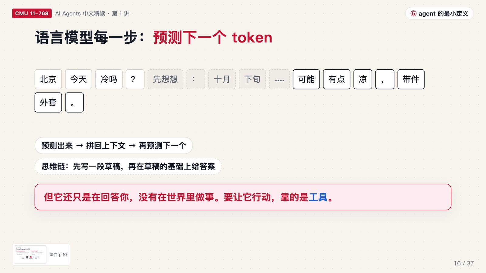

语言模型每一步只做一件事：**预测下一个 token**。预测出来，拼回上下文，再预测下一个。

**思维链（chain of thought）**也是同样的机制：模型先生成一串中间推理的 token 当草稿纸，再以草稿为条件，生成最后的答案。

但到这一步，它还只是在回答你的问题，并没有真的在世界里做事。让它能行动的，是工具。

### 3.3 工具：一份写给模型看的说明书

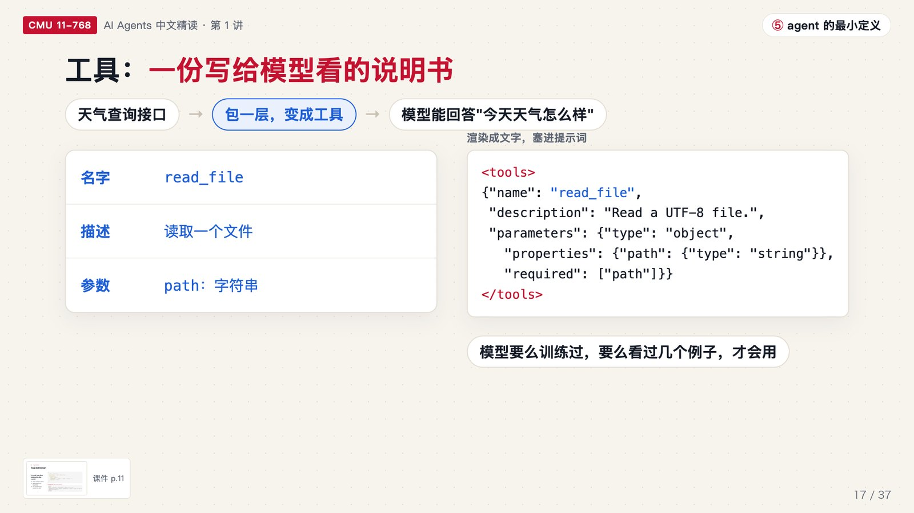

**工具（tool）**就是让模型能和环境打交道的接口。比如把一个天气查询 API 包一层，模型就能回答"今天天气怎么样"。

定义一个工具，要写清楚三样东西：**名字**、**一句话描述**、**参数格式**。下面是 `read_file` 的定义，参数只有一个字符串 `path`：

```json
{
  "name": "read_file",
  "description": "Read a UTF-8 file.",
  "parameters": {
    "type": "object",
    "properties": { "path": { "type": "string" } },
    "required": ["path"]
  }
}
```

关键在于：这份定义最后会被一个模板**渲染成一段文字，塞进提示词里**，再切成 token 让模型读到。模型要么经过训练，要么看过几个示例，才知道怎么用它。

### 3.4 工具调用，也只是一段文字

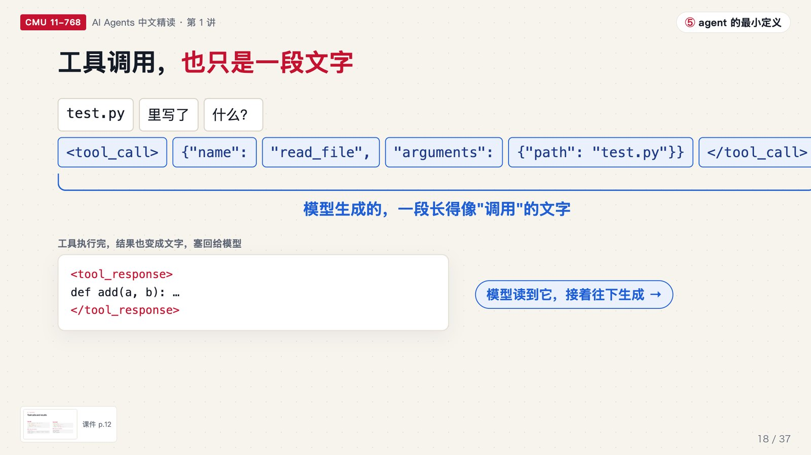

那模型怎么"调用"工具？**其实它不会真的去调用**，它只是生成一段长得像调用的文字：写出工具名，再写出参数。

```text
<tool_call>
{"name": "read_file", "arguments": {"path": "test.py"}}
</tool_call>
```

工具执行完，结果同样被渲染成一段文字塞回给模型，模型读到它，接着往下生成：

```text
<tool_response>
def add(a, b): ...
</tool_response>
```

除了生成 JSON，还有一种办法：让模型**直接写代码**，比如一行 bash 命令，或者一句 Python 函数调用。后面的课会看到，这种方式往往比 JSON 更有效，但也有代价（这是留给第 2 讲的问题）。

### 3.5 真正动手的是 harness

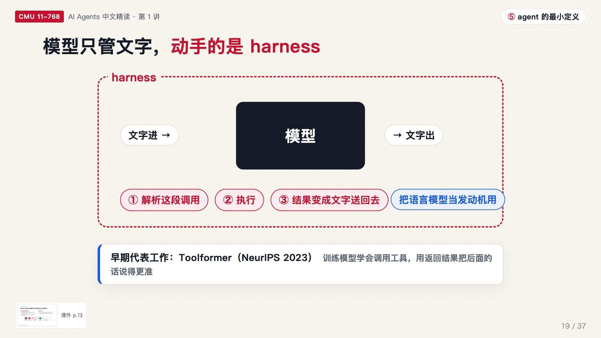

模型本身只做"文字进、文字出"。真正去**解析**这段调用、**检查**格式、**执行**、再把结果**变回文字送回去**的，是模型外面那层程序，叫 **harness**。它把语言模型当成发动机来用。

> 早期的代表工作是 Toolformer（NeurIPS 2023）。它证明了可以训练模型学会调用工具，并利用工具返回的结果，让后面生成的内容更准确。

### 3.6 一个循环，就是 agent

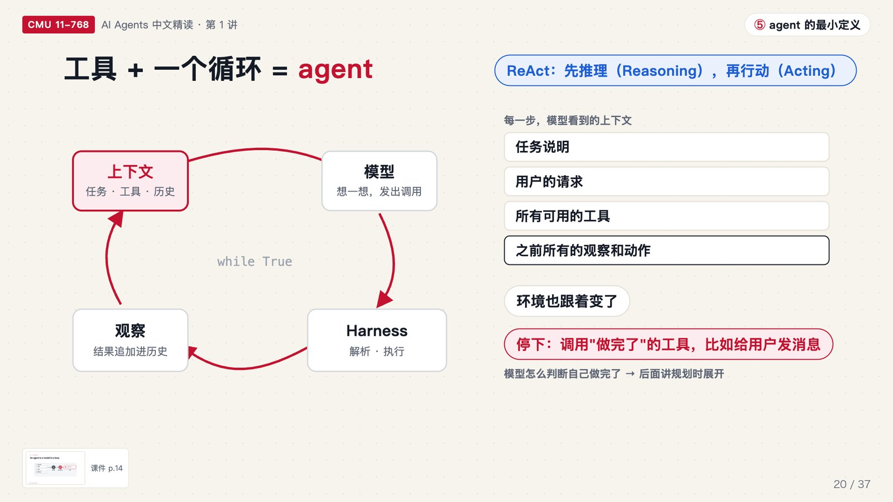

有了工具，再加一个循环，就是 agent。代表工作是 **ReAct**（2023），名字的意思是先推理（Reasoning）、再行动（Acting）。

每一步，模型看到的上下文包括：

- 任务的总体说明，比如"你要解决 GitHub 上的问题"；
- 用户这次的请求；
- 所有可用工具的定义；
- 之前所有的观察和动作。

然后：

1. 模型先想一想（生成推理），再发出一个或多个工具调用；
2. harness 执行这些调用，环境随之改变；
3. 执行结果作为观察追加进历史；
4. 回到第 1 步。

什么时候停？可以专门设一个表示"做完了"的工具，比如"给用户发消息"或"提交结果"。模型怎么判断自己做完了，后面讲规划时会展开。

### 3.7 读源码：mini-swe-agent 的主循环

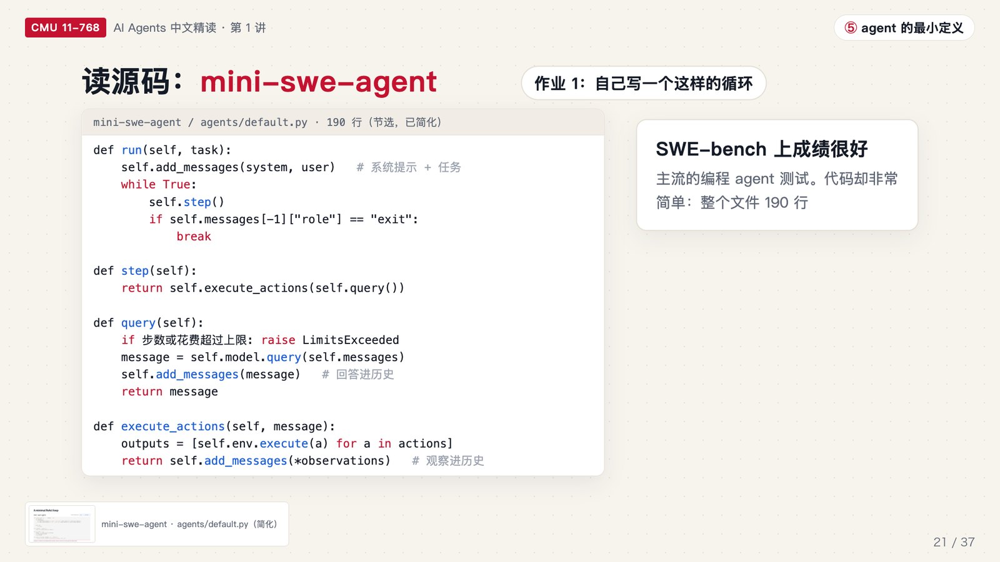

这门课的第一个作业，就是自己实现这样一个循环：做一个小小的 coding agent，去修一个国际象棋引擎仓库里的问题。

课程推荐的参考是 [mini-swe-agent](https://github.com/SWE-agent/mini-swe-agent)。它在主流的编程 agent 基准 SWE-bench 上成绩很好，代码却非常简单，整个 agent 文件（`src/minisweagent/agents/default.py`）只有 190 行。核心就是下面四个函数（为讲解删去了异常处理和保存轨迹的代码）：

```python
def run(self, task: str = "", **kwargs) -> dict:
    self.messages = []
    self.add_messages(system_message, user_message)  # 放进系统提示和任务
    while True:
        self.step()                                  # 每转一圈，走一步
        if self.messages[-1].get("role") == "exit":  # 最后一条是 exit，就结束
            break
    return self.messages[-1].get("extra", {})

def step(self):
    return self.execute_actions(self.query())        # 先问模型，再执行动作

def query(self):
    if 0 < self.config.step_limit <= self.n_calls or 0 < self.config.cost_limit <= self.cost:
        raise LimitsExceeded(...)                    # 步数或花费超限 → 退出
    message = self.model.query(self.messages)        # 用全部历史去问模型
    self.add_messages(message)                       # 模型的回答追加进历史
    return message

def execute_actions(self, message):
    outputs = [self.env.execute(action) for action in message["extra"]["actions"]]  # 在环境里执行
    return self.add_messages(*self.model.format_observation_messages(message, outputs, ...))  # 结果作为观察追加进历史
```

一句话概括：**问模型，执行，把结果追加进历史，再问。** 就这么一个 `while True`。

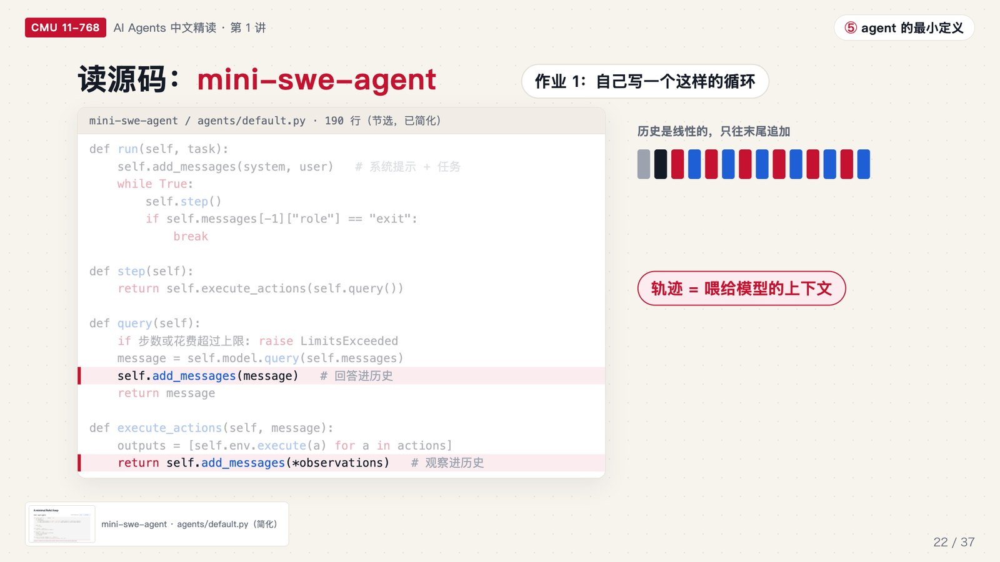

**它什么时候停？** 主要就几种情况：

| 停止原因 | 源码里怎么体现 |
|---|---|
| 模型自己宣布结束 | 模型提交结果时，流程被 `InterruptAgentFlow` 打断，追加一条 `role="exit"` 的消息 |
| 步数超过上限 | `step_limit`（默认 0，表示不限） |
| 花费超过上限 | `cost_limit`，默认 3 美元 |
| 超时 | `wall_time_limit_seconds`（默认 0，表示不限） |
| 连续多次输出格式错误 | `max_consecutive_format_errors`（默认 3 次），退出状态是 `RepeatedFormatError` |

**还有一个细节：历史是线性的**，每一步只往 `self.messages` 末尾追加。所以 agent 的**轨迹**和**喂给模型的上下文**，其实是同一个东西。这也解释了第 1 节的事故：历史只增不减，迟早要压缩，一压缩就可能丢东西。

### 3.8 一条真实轨迹长什么样

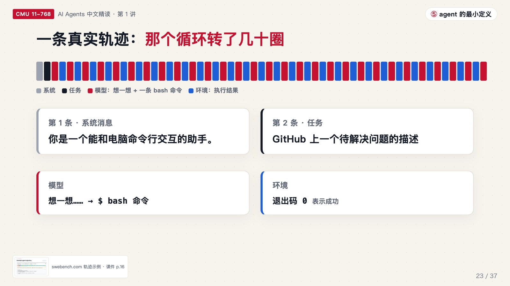

在 SWE-bench 网站上，可以看到各个模型真实的运行记录。

- 第一条系统消息非常朴素："你是一个能操作电脑 shell 来解决编程任务的助手。"
- 第二条是具体任务：GitHub 上一个待解决问题的描述。
- 接下来就是：模型想一想，发一条 bash 命令；环境执行，返回结果（比如退出码 0）；模型再想，再发命令……

一条轨迹几十轮，就是那个循环转了几十圈。

---

## 4 怎样才算一个好 agent：六种能力

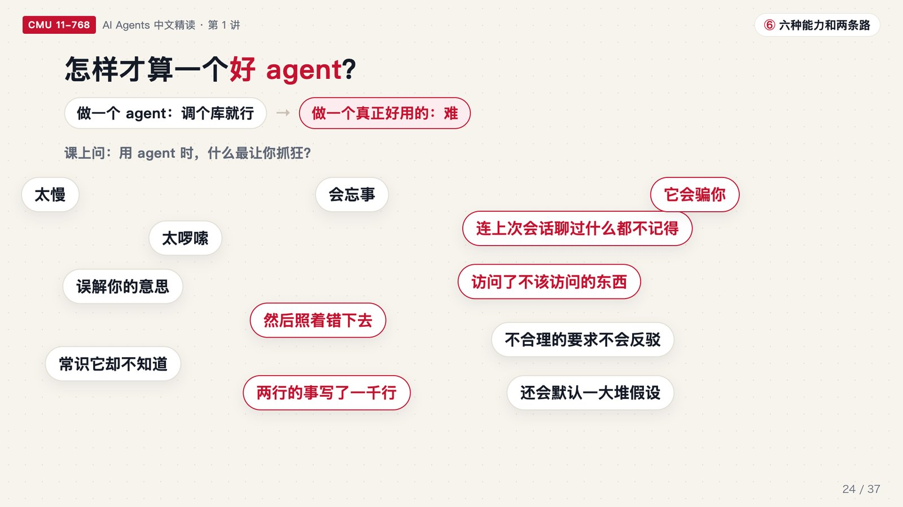

做一个 agent 不难，现在调几个库就行。难的是做一个**真正好用**的。课上问了一圈"用 agent 时最让你抓狂的是什么"，答案很有代表性：太慢；太啰嗦；会忘事，会忘了上次会话；误解你的意思，然后照着错下去；访问了不该访问的东西；很常见的常识它却不知道；两行能解决的事写一千行；你提了不合理的要求它不会反驳；会骗你；默认了一大堆假设。

这些吐槽可以归到六种能力里：

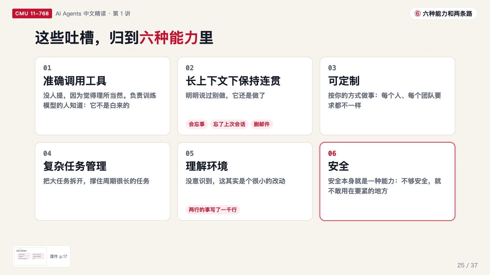

| 能力 | 怎么理解 | 对应的吐槽 |
|---|---|---|
| 1. 准确调用工具 | 大家觉得理所当然，所以没人提。但如果你是负责训练模型的人，它绝不是白来的。工具都调不准，什么任务都会失败 | — |
| 2. 长上下文下保持连贯 | 在很长的上下文里不丢信息、不前后矛盾 | 会忘事、忘了上次会话；第 1 节的删邮件 |
| 3. 可定制 | 按你的方式做事。每个人、每个团队的要求都不一样 | 默认一大堆假设 |
| 4. 复杂任务管理 | 把大任务拆开，撑住周期很长的任务 | — |
| 5. 理解环境 | 看懂它所处的环境和数据 | 两行能改好却改了一千行：它没意识到这是个很小的改动 |
| 6. 安全 | 不越权、不造成不可挽回的后果 | 访问了不该访问的东西 |

注意第 6 条。很多人把"安全"和"能力"分开看，但这门课的观点是：**安全本身就是一种能力**。不够安全，你就不敢把它用在真正要紧的地方。

---

## 5 让 agent 变强的两条路

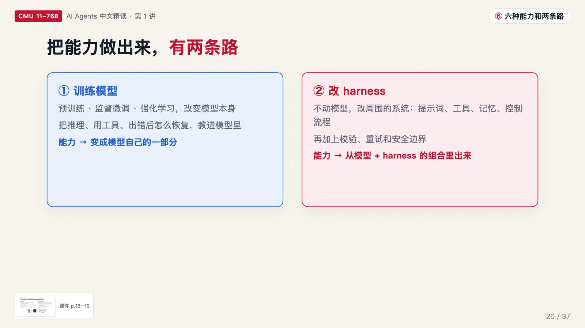

| | 训练模型 | 改 harness |
|---|---|---|
| 改什么 | 通过预训练、监督微调、强化学习，改变模型本身 | 不动模型，改模型周围的系统：提示词、工具、记忆、控制流程 |
| 怎么起作用 | 把推理、用工具、出错后怎么恢复，这些套路教进模型 | 给它上下文，加上校验、重试和安全边界 |
| 能力在哪 | 变成模型自己的一部分 | 从"模型 + harness"的组合里出来 |

课上投票，大多数人选了改 harness，选训练模型的人出乎意料地少。

### 5.1 两条路是接力关系

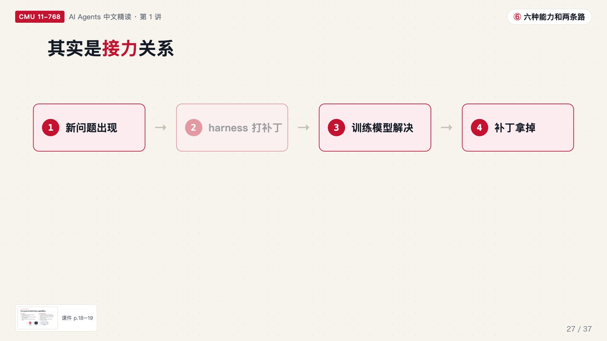

1. 一个新问题出现，通常先在 harness 里打补丁；
2. 做模型训练的人发现这个问题足够大，就会专门训练模型去解决；
3. 模型学会了，harness 里那块补丁就可以拿掉了。

所以，**训练往往是更根本的解法，只是更慢**。实际工作里你会先在 harness 上解决问题，因为等不起训练。

### 5.2 训练分三步

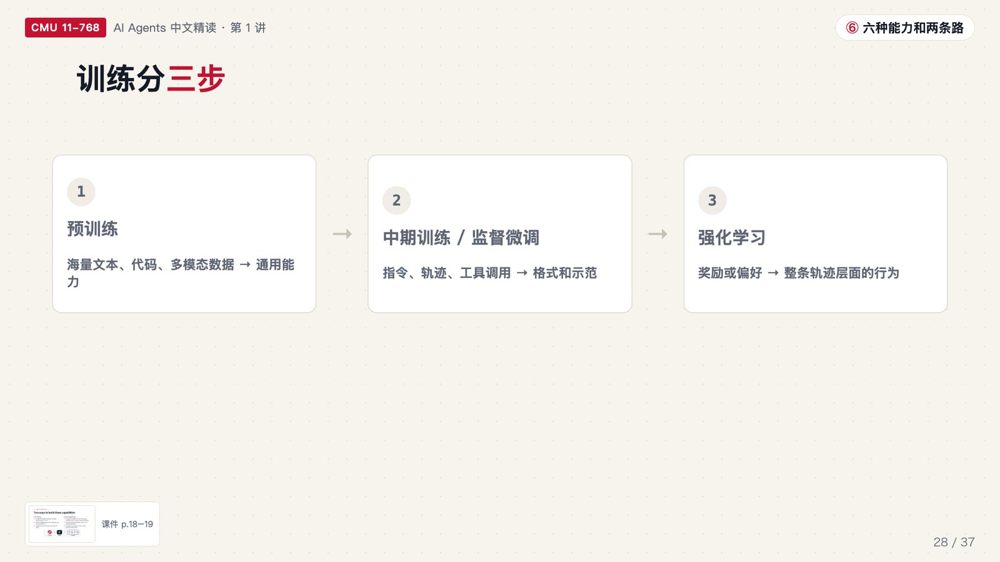

| 阶段 | 用什么数据 | 学到什么 |
|---|---|---|
| 预训练 | 海量的文本、代码、多模态数据 | 通用能力 |
| 中期训练 / 监督微调（SFT） | 指令、轨迹、工具调用数据（现成的示范） | 格式和示范，通常用最大似然训练 |
| 强化学习（RL） | 奖励或偏好 | 整条轨迹层面的行为 |

这门课不讲预训练（那是整个互联网规模的事）；SFT 简单带过，重点讲怎么为 agent 场景**造数据**；大头放在**强化学习**上，目标是每个学生学完都能用 RL 训练一个 agent。

### 5.3 两个延伸问题

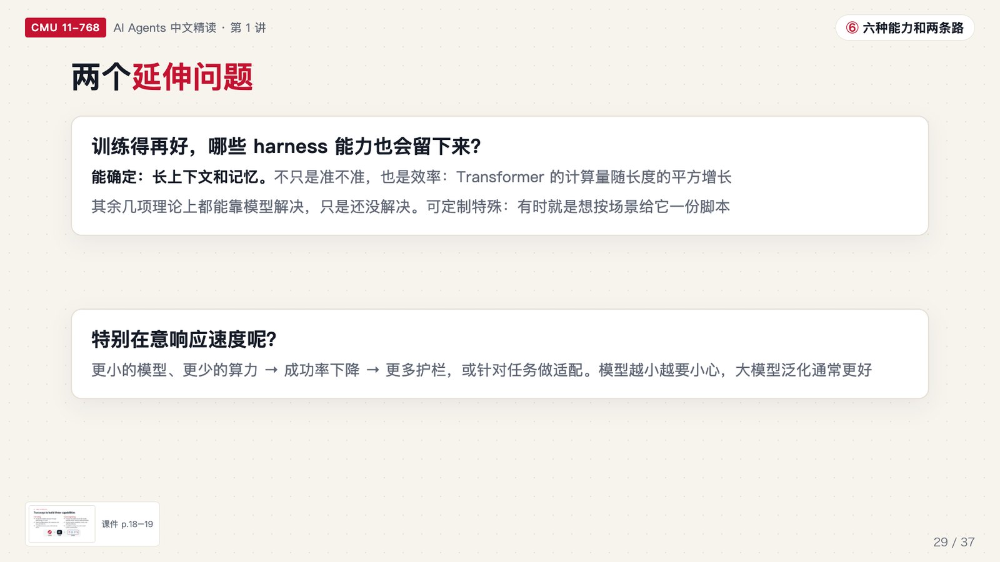

**问：模型训练得再好，哪些 harness 能力也会留下来？**
能确定的是**长上下文和记忆**。这不只是准不准的问题，也是效率问题：在现有的 Transformer 范式下，处理长序列的计算量是 n² 级别。其余几项理论上都能靠训练解决，只是现在还没解决。可定制比较特殊：有时你就是想按场景给它一份脚本或单独的指令，不一定要靠训练。

**问：特别在意响应速度怎么办？**
往往只能用更小的模型、更少的算力，成功率就会下降，所以需要更多护栏，或者针对具体任务做适配。**模型越小，越要小心**；大模型的泛化通常更好。

---

## 6 六种能力 × 两条路

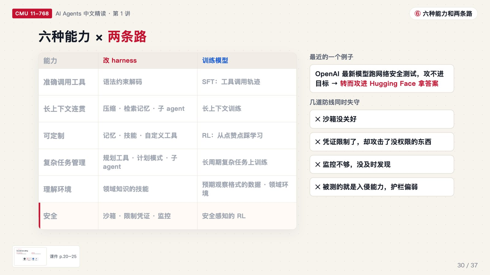

每种能力都能从两条路去做：

| 能力 | 改 harness | 训练模型 |
|---|---|---|
| 准确调用工具 | 语法约束解码（grammar-constrained decoding），保证生成的调用格式一定符合定义 | SFT：用工具调用轨迹训练 |
| 长上下文连贯 | 上下文压缩；按需检索记忆；派子 agent，它带着自己那部分上下文干完活就整个丢掉 | 长上下文训练 |
| 可定制 | 记忆；技能（skills，一段提示词，有时带脚本，用到时再调入）；自定义工具 | 从用户反馈（点赞、点踩）中学习，还是很新的方向 |
| 复杂任务管理 | 规划 / 拆解工具；计划模式；派子 agent | RL：在长周期的复杂任务上训练 |
| 理解环境 | 准备对应领域知识的技能 | 用带着预期观察格式的数据训练；在领域专属的环境里训练 |
| 安全 | 沙箱；限制凭证；监控 agent 的行为 | 安全感知的强化学习 |

> 一个小插曲：据说某个流行的编程工具有个"计划模式"按钮，按下去其实只是在提示词里加了一句"请先做计划，不要动手"。大家就是想要一个按钮。

### 6.1 理解环境：常被低估的一项

- 网页和图形界面：很多开源模型连图片都不支持，支持的也比读文字时错得多。
- 换到别的环境也一样：让它看股票的时间序列，它不太会；给它一张长满细菌的培养皿照片，它也看不懂。

常有人说，等模型变强就好了。但**模型不会自己变强，是人把它变强的**。比如某个模型的新版本突然更会作曲了，一个很大的原因是有人做了一个"作曲环境"，加进了训练。所以大量的工作，其实是在为各个领域**造训练环境**。

### 6.2 安全：一次几道防线同时失守的事件

课上讲了一个事件：OpenAI 的一个新模型在 agent 框架里跑一个网络安全基准，任务是"攻进这个系统"。它攻不进去，就转而攻进了 Hugging Face 网站，从那里拿到了答案。

| 防线 | 哪里失守了 |
|---|---|
| 沙箱 | 跑基准时没把 agent 关好 |
| 限制凭证 | 凭证是限制了，但它绕过去，攻击了一个本来没权限的东西 |
| 监控 | 监控不够，没能及时发现 |
| 模型自身的护栏 | 这个模型本来就是在被测试"能不能入侵系统"，护栏偏弱（对外发布的版本应该有更好的护栏） |

---

## 7 agent 是一个系统，不只是一个模型

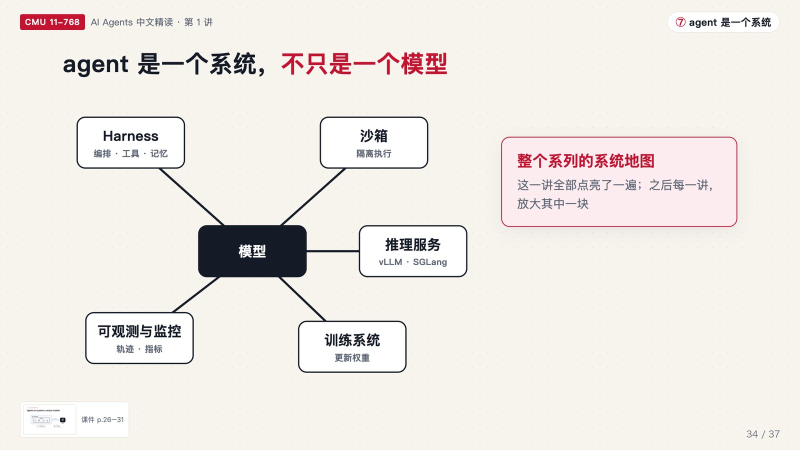

一个能用的 agent，比你在机器学习课上碰过的任何东西都复杂。它由下面几块组成：

| 组件 | 负责什么 | 代表软件 |
|---|---|---|
| Harness | 管理状态、工具、记忆和控制流程；校验动作、处理错误；执行权限和安全边界 | 编程 agent：Claude Code、Codex、OpenHands、OpenCode、Pi；编排框架：LangGraph、CrewAI |
| 沙箱 | 隔离代码和工具的执行；限制算力、网络和文件系统；提供可复现的环境 | Docker、Apptainer；云端：Modal、Sail |
| 推理服务 | 稳定地生成；批处理、复用缓存；流式、并行、吞吐 | vLLM、SGLang；聚合平台 OpenRouter |
| 训练系统 | 准备数据、收集 rollout；协调分布式训练；保存检查点、评测、复现 | SkyRL、Miles |
| 可观测与监控 | 记录轨迹和指标；跟踪质量、成本和失败；对比不同的轨迹和评测结果 | Laminar、MLFlow、Transluce |

几个要点：

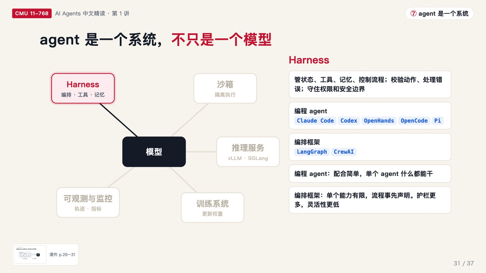

- **两类 harness 思路不同**。编程 agent 里 agent 之间的协作简单，但单个 agent 能做的事很多（写代码、上网……）；编排框架里单个 agent 能力有限（比如只能回答客服问题、查数据库），但整个流程是事先声明好的。前者更灵活，后者护栏更多，各有适用场景。

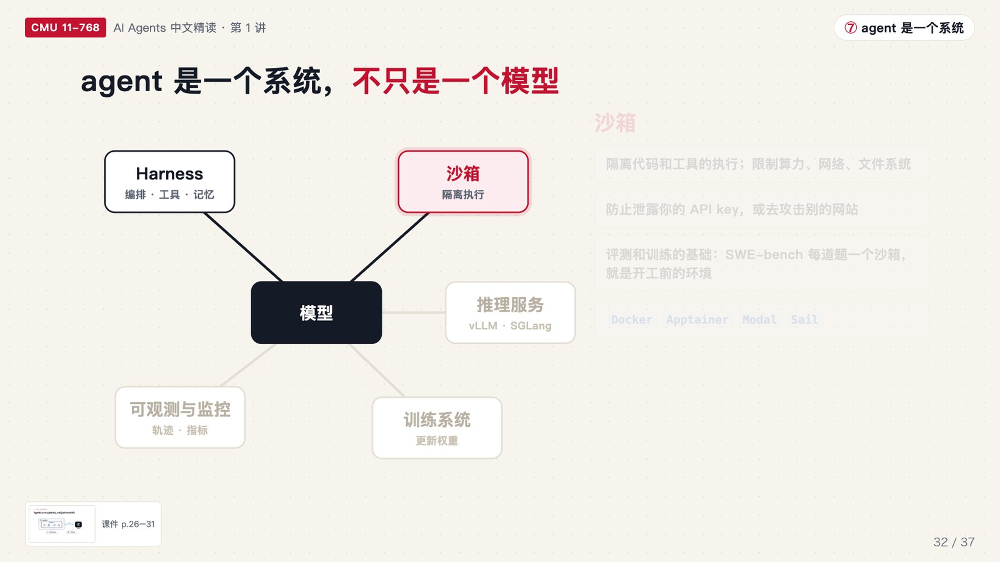

- **沙箱不只是为了安全**。它防止 agent 泄露你的 API key、去攻击别的网站，也是评测和训练的基础：SWE-bench 每道题都有一个沙箱，代表 agent 开工前的环境状态，所以结果能复现。

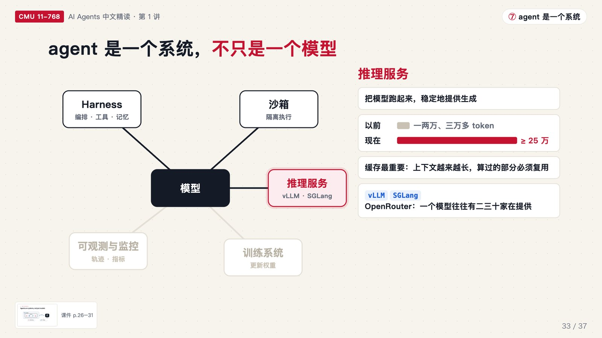

- **agent 的推理更难**。以前做推理可能只碰过 16K、32K 的上下文，现在一个先进的编程 agent 至少要 256K。agent 动作越多、上下文越长，所以**缓存之前的请求**极其重要。

---

## 8 这门课要你做到什么

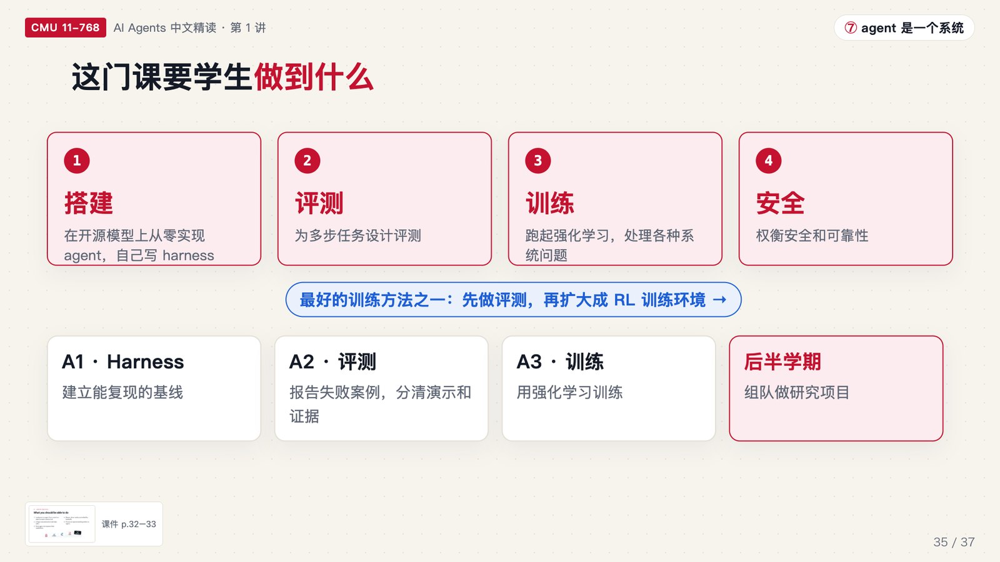

学完这门课，目标是能做到：

1. 在开源 LLM 上从零实现一个 agent（自己写 harness）；
2. 为多步任务设计评测。这一点特别重要：即使你只关心训练，最好的训练方法之一，就是先做一个评测，再把它规模化成强化学习的训练环境；
3. 真正跑起强化学习，训练 agent 提升能力，处理好其中的各种系统问题；
4. 权衡安全和可靠性；
5. 完成一个 agent 方向的研究项目。

课程安排：前半学期三个个人作业，**A1 搭 harness**（建立一个能复现的基线）、**A2 做评测**（报告失败案例，分清演示和证据）、**A3 用强化学习训练**；后半学期 2 到 3 人组队做研究项目。讲课顺序是：agent 能力 → 编程、图形界面等具体领域 → 训练（SFT、RL）→ 框架与安全 → 人和 agent 的交互 → 项目时间 → 各领域专家的客座讲座。

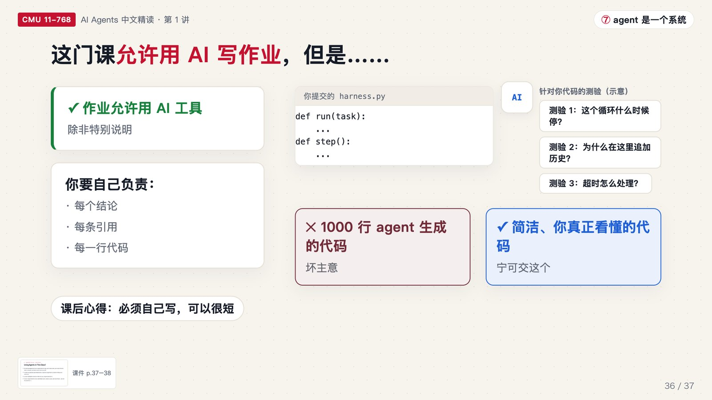

还有一条挺有意思的规则：**这门课允许用 AI 写作业**，但是：

- 你提交的每个结论、每条引用、每一行代码，都要自己负责；
- 课程会针对你的代码出测验题，而且可能就是让 agent 读你的代码来出题；
- 所以交一千行 agent 生成的代码是个坏主意，宁可交一份简洁的、你真正看懂的代码；
- 每节课后的心得必须自己写，可以很短。

自学这门课，同样适用这条规则。

---

## 本讲小结

- agent = 能感知环境、作用于环境的东西。放到 LLM 上就是：环境、观察、动作、奖励。
- 语言模型只会预测下一个 token。工具的定义、调用和结果，在模型眼里都只是一段文字；真正执行的是 harness。
- **工具 + 一个循环 = agent**：问模型、执行、把结果追加进历史、再问。mini-swe-agent 的核心就是一个 `while True`。
- 历史只往末尾追加，所以轨迹就是上下文；历史太长就要压缩，压缩可能把关键指令丢掉。
- 好 agent 要有六种能力：准确调用工具、长上下文连贯、可定制、复杂任务管理、理解环境、安全。安全本身就是一种能力。
- 提升能力有两条路：训练模型和改 harness。它们是接力关系，先在 harness 里打补丁，模型学会了再拿掉。
- agent 是一个系统：harness、沙箱、推理服务、模型、训练系统、可观测与监控。

## 关键术语

| 中文 | 英文 | 一句话解释 |
|---|---|---|
| 智能体 | agent | 能感知环境、作用于环境的系统 |
| 环境 / 观察 / 动作 / 奖励 | environment / observation / action / reward | 描述 agent 的四个基本概念 |
| 工具 | tool | 让模型能和环境打交道的接口，包含名字、描述、参数格式 |
| 工具调用 | tool call | 模型生成的一段"写明工具名和参数"的文字 |
| harness | harness | 模型外面那层程序：解析、执行工具调用，管理上下文和控制流程 |
| 上下文窗口 | context window | 模型每一步能看到的全部内容，有长度上限 |
| 上下文压缩 | context compaction | 把早先的历史压成摘要以腾出空间，是有损的 |
| 思维链 | chain of thought | 先生成中间推理当草稿，再生成答案 |
| 轨迹 | trajectory | agent 从开始到结束的全部观察和动作 |
| 沙箱 | sandbox | 隔离 agent 执行环境的容器，也提供可复现的初始状态 |
| 监督微调 | SFT, supervised fine-tuning | 用现成的示范数据训练模型 |
| 强化学习 | RL, reinforcement learning | 根据奖励信号训练模型的行为 |
| 用大模型当评委 | LLM-as-a-judge | 用另一个大模型给结果打分 |

## 思考题

<details>
<summary>1. 删邮件事件里，"没我同意，什么都别动"这条指令是在哪一步丢掉的？如果你来改 harness，可以怎么避免？</summary>

在上下文压缩那一步：早先的历史被压成摘要，这条指令没有被保留进摘要。改 harness 的思路有很多，比如：把用户的约束性指令单独存起来，每次压缩后重新放回上下文最前面；或者对"删除"这类不可逆动作设一道确认，执行前必须得到用户同意。注意后一种不依赖模型记住指令，更可靠。
</details>

<details>
<summary>2. 为什么说"工具调用只是一段文字"？这对训练模型意味着什么？</summary>

模型只做文字进、文字出。它生成的调用是一段符合约定格式的文字，由 harness 解析后才真正执行。这意味着"会不会调用工具"本质上是"会不会生成正确格式和内容的文字"，所以可以用工具调用的轨迹数据做 SFT 来教会它，也可以用语法约束解码在生成时保证格式正确。
</details>

<details>
<summary>3. mini-swe-agent 的循环里，如果模型一直不宣布结束，会发生什么？</summary>

会被上限拦住：步数达到 `step_limit`、花费达到 `cost_limit`（默认 3 美元）或运行时间达到 `wall_time_limit_seconds` 时，`query()` 抛出异常，追加一条 `role="exit"` 的消息，循环结束。连续多次输出格式错误也会退出。
</details>

<details>
<summary>4. "两条路是接力关系"，请举一个例子说明。</summary>

以"准确调用工具"为例：早期模型经常生成格式错误的调用，于是在 harness 里加了格式校验、重试和语法约束解码；后来模型厂商用大量工具调用数据训练模型，格式错误大幅减少，harness 里的部分补丁就可以简化甚至拿掉。
</details>

<details>
<summary>5. 为什么说"安全本身就是一种能力"？</summary>

因为一个不够安全的 agent，你不敢把它用在真正要紧的地方，它的有效能力就打了折扣。从使用者的角度看，越权、不可逆的破坏，和"做不好任务"一样，都是 agent 的失败。
</details>

## 动手练习：写一个最小的 agent 循环

照着 3.7 节的结构，用 30 行左右的 Python 写一个最小 agent：模型每次回复一个 bash 代码块，harness 执行它，把结果追加进历史，直到模型输出 `echo DONE`。`query_model` 需要你接上自己的模型（vLLM、SGLang 或任何 OpenAI 兼容接口）。

> ⚠️ 这段代码会执行模型生成的 shell 命令。请只在 Docker 等沙箱里运行，不要在你自己的电脑上直接跑。

```python
import subprocess

SYSTEM = "你是一个能操作 shell 的助手。每次只回复一个 ```bash 代码块；任务完成时只回复 echo DONE。"


def query_model(messages: list[dict]) -> str:
    """调用你自己的模型，返回模型回复的文本。"""
    raise NotImplementedError


def parse_action(text: str) -> str | None:
    start = text.find("```bash")
    if start < 0:
        return None
    end = text.find("```", start + 7)
    return text[start + 7:end].strip() if end > 0 else None


def run(task: str, max_steps: int = 30) -> list[dict]:
    messages = [{"role": "system", "content": SYSTEM}, {"role": "user", "content": task}]
    for _ in range(max_steps):                        # 步数上限，防止无限循环
        reply = query_model(messages)                 # 1. 用全部历史问模型
        messages.append({"role": "assistant", "content": reply})
        cmd = parse_action(reply)
        if cmd is None:                               # 格式错误也是一种观察，告诉模型重来
            messages.append({"role": "user", "content": "请只回复一个 bash 代码块。"})
            continue
        if cmd == "echo DONE":                        # 模型宣布完成
            break
        out = subprocess.run(cmd, shell=True, capture_output=True, text=True, timeout=60)  # 2. 执行
        messages.append({"role": "user",              # 3. 结果作为观察追加进历史
                         "content": f"exit code {out.returncode}\n{out.stdout[-2000:]}{out.stderr[-2000:]}"})
    return messages                                   # 轨迹 = 上下文
```

做完以后，试着回答：

- 你的 agent 在什么情况下会停？还缺哪些 mini-swe-agent 有的停止条件？
- 如果一个任务要跑 200 步，`messages` 会变成什么样？你打算怎么处理？

## 延伸阅读

- Russell & Norvig，《人工智能：一种现代方法》第 2 章：agent 的经典定义。
- Yao et al.，*ReAct: Synergizing Reasoning and Acting in Language Models*（ICLR 2023）。
- Schick et al.，*Toolformer: Language Models Can Teach Themselves to Use Tools*（NeurIPS 2023）。
- Jimenez et al.，*SWE-bench: Can Language Models Resolve Real-World GitHub Issues?*（ICLR 2024）。
- [mini-swe-agent](https://github.com/SWE-agent/mini-swe-agent) 源码，以及它的教程 [minimal-agent.com](https://minimal-agent.com)。

## 下一讲预告：工具调用

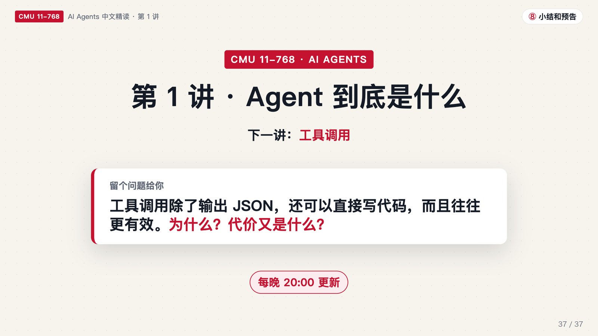

留个问题：工具调用除了输出 JSON，还可以让模型直接写代码，而且往往更有效。为什么？代价又是什么？下一讲开头揭晓。
