# 第 2 讲 · 工具调用：模型怎么和世界打交道

> CMU 11-768 AI Agents（2026 秋）中文精读 · 配套课件
> 配套视频（20 分钟）：B 站 / 视频号 / 抖音 / 小红书搜索「竹二木」 · 整份幻灯片：[l02-幻灯片.pdf](./l02-幻灯片.pdf)
> 原课程：[cmu-agents.com](https://cmu-agents.com)，主讲 Graham Neubig、Daniel Fried。本课件是非官方的学习整理。

## 这一讲你会学到

学完这一讲，你应该能做到：

1. 说清楚工具是什么、给模型带来"扩展"和"便利"两种好处，并判断一个场景值不值得调工具。
2. 解释为什么让模型直接写代码往往比输出 JSON 更有效（CodeAct），以及代码动作要付出的代价。
3. 从 token 层面讲清一次工具调用：工具定义怎么进提示词、模型怎么写出调用、harness 怎么分发、结果怎么按调用 ID 对回去。
4. 说出约束解码的四层约束，理解 JSON Schema、下推自动机和 XGrammar 的 token 掩码各自解决什么问题，以及它们管不了什么。
5. 比较 REST API 和 MCP 两种接入方式，理解凭证代管；会用并行调用提速，并知道评测工具调用要看哪几层、哪些运营指标。

建议先看一遍视频，再对照本课件逐节复习。每节开头的图就是视频里对应的画面。

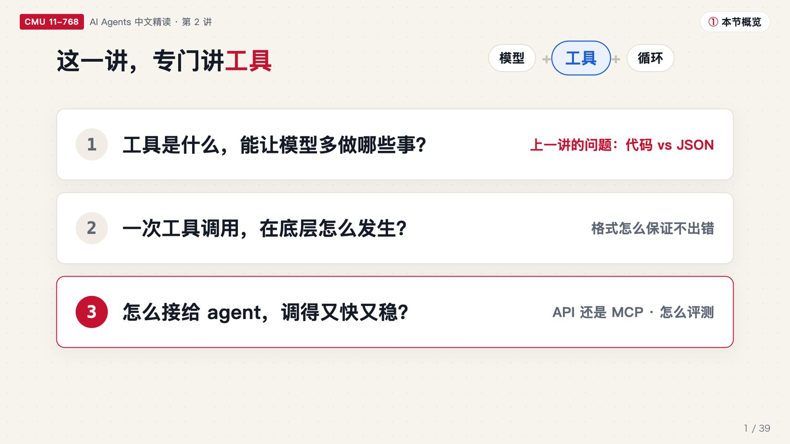

上一讲说，**agent = 模型 + 工具 + 一个循环**。这一讲专门讲中间那一项，围绕三个问题展开：

| 问题 | 对应章节 | 关键词 |
|---|---|---|
| 工具是什么，能让模型多做哪些事？ | 第 1 节 | 扩展与便利、ChatGPT 的五类工具、代码是元工具 |
| 一次工具调用在底层怎么发生？格式怎么保证不出错？ | 第 2 节 | 聊天模板、调用 ID、约束解码 |
| 怎么把能力接给 agent，调得又快又稳，又怎么评测？ | 第 3 节 | REST API、MCP、并行调用、BFCL |

上一讲留的问题（代码 vs JSON）在 1.5 节揭晓。

---

## 1 工具是什么、能干什么

### 1.1 定义：模型负责提议，外部软件负责执行

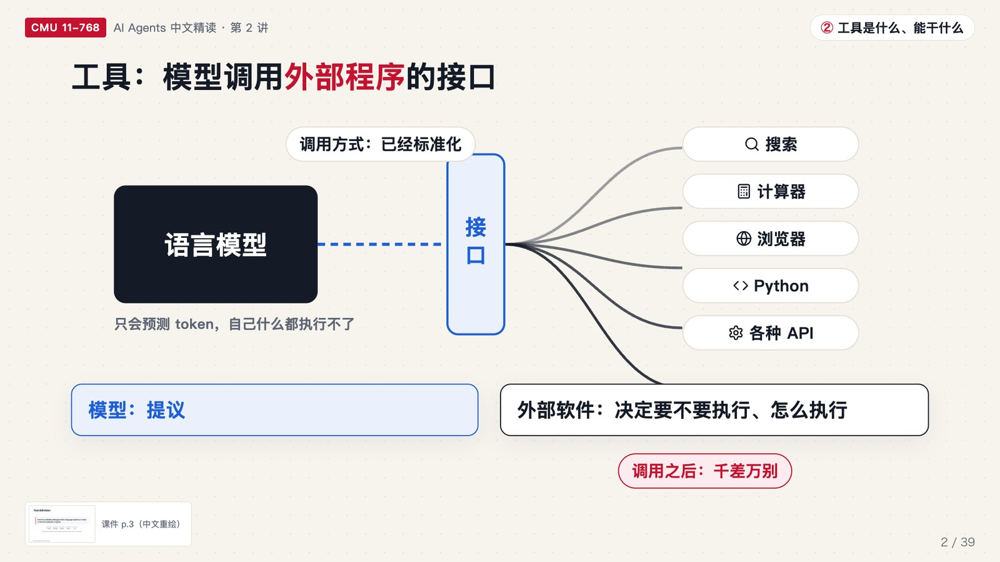

**工具（tool）**是一个接口：语言模型通过它去调用一个外部的计算机程序。搜索、计算器、浏览器、Python 解释器、各种 API，都算工具。这个定义来自课程阅读材料 *What Are Tools Anyway?*（Wang et al., COLM 2024）。

为什么一定要有接口？因为语言模型本质上是一台预测 token 的机器，它自己什么都执行不了。原课件上有一句话值得背下来：

> 模型负责提议，外部软件决定要不要执行、怎么执行。（The model proposes; external software decides whether and how to execute.）

还有一点：**怎么调用工具**现在已经基本标准化了（第 2 节会看到具体格式），但**调用之后下游做什么**可以千差万别，可以是查一张表，也可以是启动一台虚拟机。

### 1.2 两种好处：扩展和便利

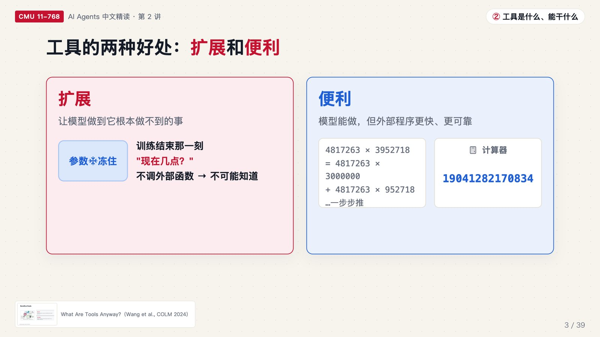

| 好处 | 英文 | 含义 | 例子 |
|---|---|---|---|
| 扩展 | Extend | 让模型拿到参数里根本没有的信息或动作 | 问"现在几点"。模型参数在训练结束那一刻就冻住了，不调外部函数，它不可能知道当前时间 |
| 便利 | Facilitate | 模型自己也能做，但交给外部程序更可靠、更快 | 两个七位数相乘。现在的模型一步步推理也能算对，但很慢；计算器一下就出来 |

判断一个工具属于哪一类，可以问自己：**不给这个工具，模型理论上能不能做到？**做不到是扩展，能做到只是做得差是便利。

### 1.3 什么时候值得用工具

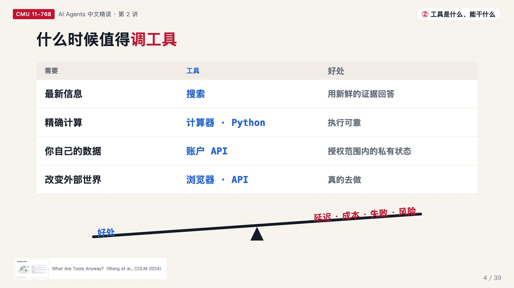

| 需要 | 工具举例 | 好处 |
|---|---|---|
| 最新信息 | 搜索 | 用新鲜的证据回答 |
| 精确计算 | 计算器、Python | 执行可靠 |
| 私有状态 | 账户 API | 拿到授权范围内的用户数据 |
| 对外动作 | 浏览器、API | 真正改变外部环境 |

但工具不是调得越多越好。每次调用都有**延迟**、**成本**、**失败**的可能和**风险**（比如对外动作不可撤回）。**只有好处大过这四样，才值得去调。**

### 1.4 拆解 ChatGPT：从"能帮我做什么"倒推工具

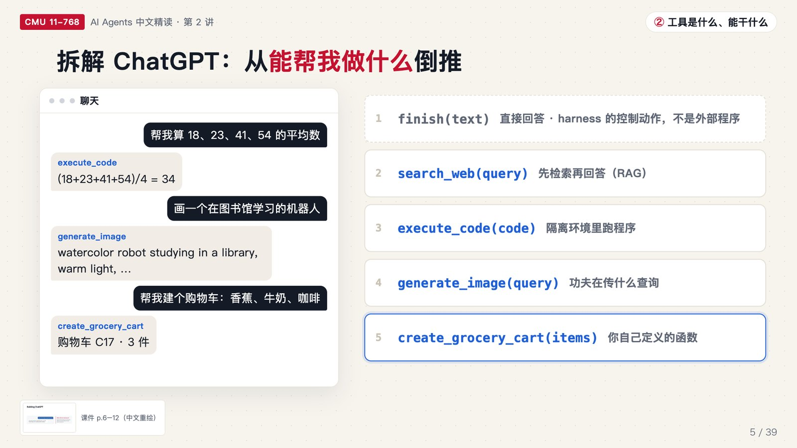

ChatGPT 刚出来时只能文字进、文字出；现在它几乎什么都能做：写代码、画图、推荐商品、把 LaTeX 编译成 PDF、连上你的 Slack。为了回答你的问题，它会一轮一轮地调用工具，这正好符合上一讲对 agent 的定义：**ChatGPT 现在就是一个 agent。**

设计这样一个系统的思路是倒推：先想清楚想要哪些能力，再给每一类交互定义一个**窄接口**。原课件拆出了五类：

| # | 工具 | 例子（取自原课件） | 要点 |
|---|---|---|---|
| 1 | `finish(text)` | "加纳首都是哪？" → `finish("Accra is the capital of Ghana.")` | 直接回答。它是 **harness 的控制动作**，不是外部程序 |
| 2 | `search_web(query)` | "CMU 今天发布了什么？" → `search_web("site:cmu.edu announced today")` | 先检索再回答，即**检索增强生成（RAG, retrieval-augmented generation）** |
| 3 | `execute_code(code)` | 18、23、41、54 的平均数 → `execute_code("sum([18,23,41,54])/4")` → 34.0 | 在隔离环境里跑程序，把输出拿回来 |
| 4 | `generate_image(query)` | "画一个在图书馆学习的机器人" → `"watercolor robot studying in a library, warm light, ..."` | 功夫在**决定往里传什么查询**：模型通常把你一句话扩写成详细得多的提示词 |
| 5 | `create_grocery_cart(items)` | "建个购物车：香蕉、牛奶、咖啡" → "购物车 C17 · 3 件 · 31.42 美元" | 自定义函数，把某个应用的能力包成一个带类型的调用 |

几个值得展开的细节：

- **agent 循环怎么结束？**有两种做法：专门给一个 `finish` 工具，模型调它就结束；或者约定"模型这一轮一个工具都没调，循环就结束"。两种你在开源框架里都能见到。
- **RAG 死了吗？**这几年常听到"RAG 已死"的说法，课上的观点正相反：先检索再生成已经普及到大家用着都没感觉了。不是死了，是活得太好、被忘了。
- **想加什么能力，都照第 5 类的样子加**：起个名字，写清参数，背后挂一个函数。

### 1.5 代码是"元工具"：回答上一讲留的问题

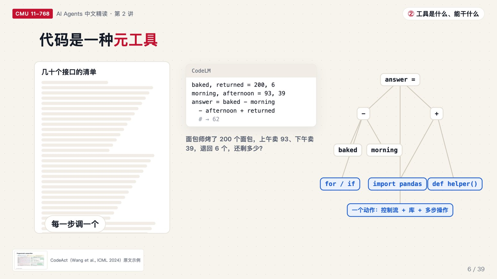

调用工具有两种思路：

1. 给 agent 一张几十个 API 的清单，每一步调一个（或并行调几个）；
2. 让它直接写代码。

代码之所以特殊，是因为它是**元工具（meta-tool）**。一段代码可以看成一棵**函数调用树**：比如"面包师烤了 200 个面包，卖掉一些，还剩多少"这段代码里，赋值是一次调用，减法也是一次调用。树里还能有：

- **循环和分支**：对一组对象重复同样的操作；
- **外部库**：`import pandas`，一下子拿到 pandas 的全部功能；
- **辅助函数**：自己定义、自己复用。

一句话：**一个动作里，就能把控制流、库和多步操作组合起来。**

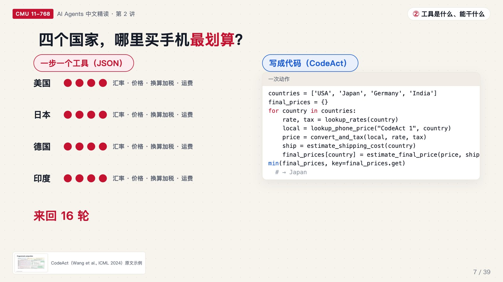

这不是一直以来的做法。三四年前刚开始用大模型做 agent 时，标准做法是一步一个工具。CodeAct 论文（Wang et al., ICML 2024）里有个例子：在美国、日本、德国、印度四个国家里，找出买某款手机最划算的地方（论文里的手机型号是虚构的）。

| 方式 | 要做的事 | 交互轮数 |
|---|---|---|
| 一步一个工具 | 每个国家都要查价格、查汇率、换算、加税，四个国家各来一遍 | 来回十几轮 |
| 写成代码 | 一个 `for` 循环遍历四个国家，算完取最小值 | 一个程序就算完 |

### 1.6 CodeAct 的结果

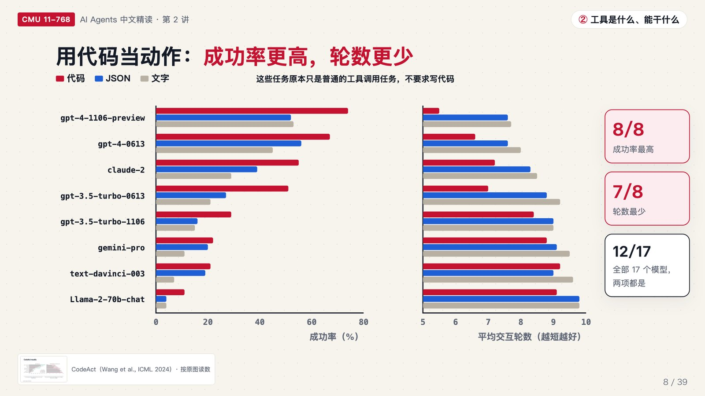

CodeAct 对比了用代码、JSON、纯文本三种格式表达动作的效果：

| 统计范围 | 代码成功率最高的模型数 | 代码交互轮数最少的模型数 |
|---|---|---|
| 原课件展示的 8 个模型 | 8 / 8 | 7 / 8 |
| 论文里全部 17 个模型 | 12 / 17 | 12 / 17 |

要注意一点：**这些任务原本只是普通的工具调用任务，并不要求写代码。**也就是说，哪怕任务本身没让你写程序，把动作写成代码也更有效。原因就是上一节说的：代码能在一个动作里组合多步操作，少了来回，也少了每一轮出错的机会。

### 1.7 代码的代价：威力大，也更难管

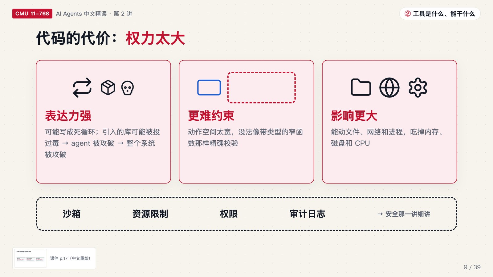

那为什么不什么都让它写代码？因为代码给 agent 的权力太大了。

| 特点 | 带来的问题 | 需要的配套 |
|---|---|---|
| 表达力强：循环、变量、库 | 循环可能写成死循环；引入的库可能被人投过毒，agent 一引入就被攻破，接着是整个系统 | 超时、兜底中止；依赖来源审查 |
| 更难约束：动作空间太宽 | 没法像一个带类型的窄函数那样精确校验，行为也更难预测 | 更多运行时检查 |
| 影响更大：能动文件、网络、进程 | 能吃掉大量内存、磁盘和 CPU，能破坏或泄露数据 | **沙箱、资源限制、权限、审计日志** |

所以"代码 vs JSON"不是谁绝对更好：代码更强，但要配一整套隔离设施；窄工具更弱，但好校验、好审计。这部分在安全那一讲细讲。

---

## 2 一次工具调用在底层怎么发生

### 2.1 工具调用也是 token

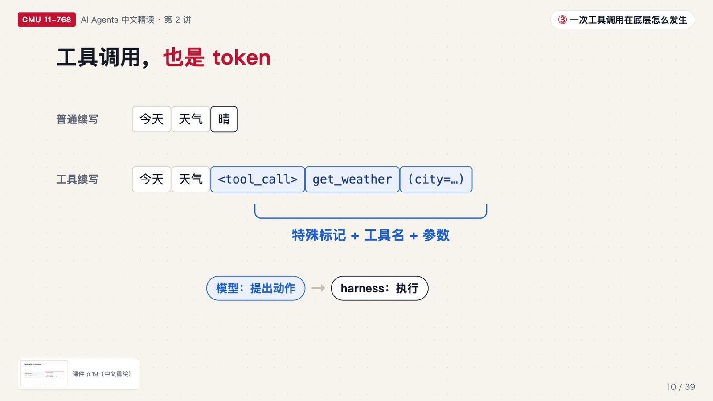

模型只会预测下一个 token，工具调用也一样是 token。

| 续写类型 | 模型输出 |
|---|---|
| 普通续写 | `天气晴。` |
| 工具续写 | 先输出一个特殊标记 `<tool_call>`，意思是"下面是工具调用"，再写出 `get_weather(...)` 和参数 |

**模型只是提出动作，真正去执行的是 harness。**

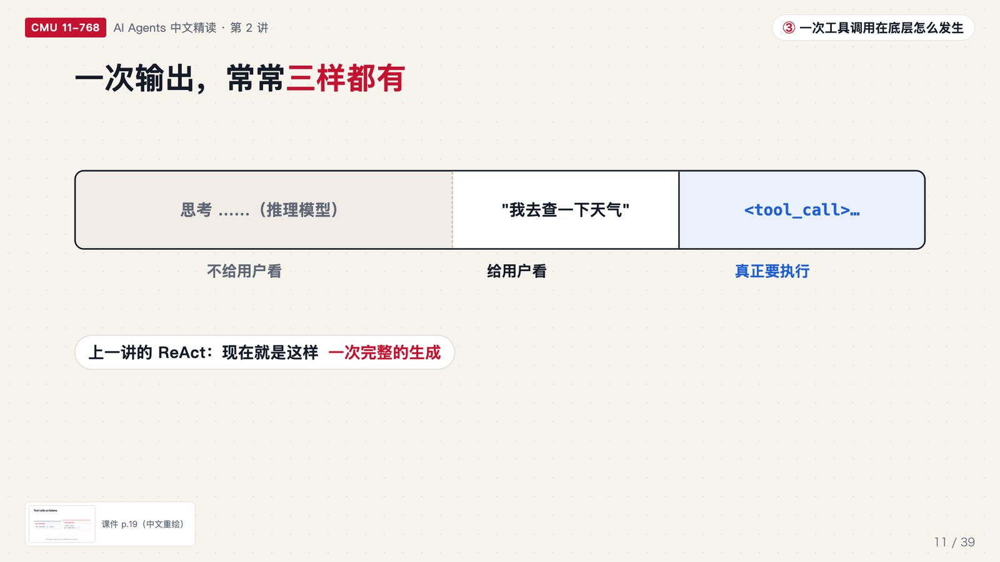

而且一次输出里常常几样都有：

| 部分 | 给谁看 | 作用 |
|---|---|---|
| 思考（推理模型才有） | 不给用户看 | 模型的草稿纸 |
| 消息 | 给用户看 | 解释它要做什么、或者最终回答 |
| 工具调用 | 给 harness | 真正要执行的部分 |

上一讲的 **ReAct**（先推理、再行动），现在就是这样一次完整的生成，而不是拼起来的几段。

### 2.2 特殊标记从哪来：中期训练

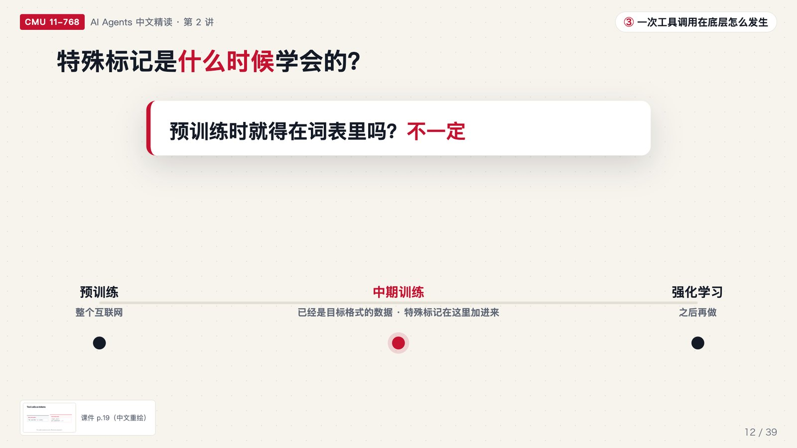

你可能会问：`<tool_call>` 这类特殊 token，预训练时就得在词表里吗？不一定。在整个互联网上做预训练时通常还没有；更常见的做法是在**中期训练（mid-training）**阶段加进来，也就是用一批中等规模、已经是目标格式的数据接着训练，之后再做强化学习。

### 2.3 消息和工具定义怎么变成模型输入

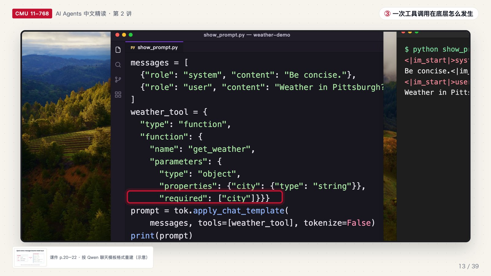

调 API 时，我们传的是一组带角色的消息：system、user、assistant。在 Python 里它们是结构化数据，但喂给模型之前，**聊天模板（chat template）**会把它们拼成一整条文字。以 Qwen 为例（取自原课件）：

```text
<|im_start|>system
Be concise.<|im_end|>
<|im_start|>user
Weather in Pittsburgh?<|im_end|>
<|im_start|>assistant
I need current data.<|im_end|>
```

每条消息前后套上开始、结束标记，标记里写着角色。**角色是给 API 用的结构，模板把它们序列化成模型看到的一条输入。**

加了工具，请求里就多了一份**工具定义（tool schema）**（取自原课件）：

```python
weather_tool = {
    "type": "function",
    "function": {
        "name": "get_weather",
        "parameters": {
            "type": "object",
            "properties": {"city": {"type": "string"}},   # 参数 city 是字符串
            "required": ["city"],                          # 而且必填
        },
    },
}
response = client.chat.completions.create(model=model, messages=messages, tools=[weather_tool])
```

想亲眼看模板拼出来的结果，可以用 Hugging Face 的 `tok.apply_chat_template(messages, tools=[weather_tool], tokenize=False)` 打印出来。

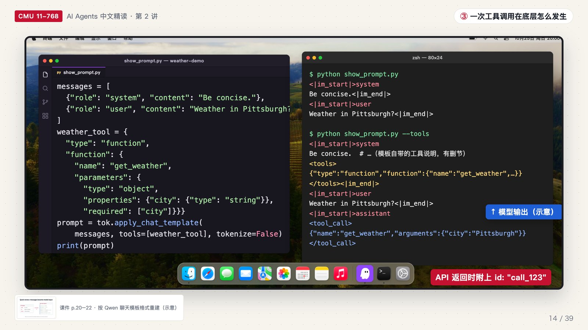

模板把工具定义放进提示词里专门的 `<tools>...</tools>` 区域。模型读到它，就输出：

```text
<tool_call>
{"name": "get_weather", "arguments": {"city": "Pittsburgh"}}
</tool_call>
```

注意：**模型只输出调用的内容；这次调用的唯一 ID，是 API 返回时再附上去的。**

### 2.4 同一个调用，各家格式不一样

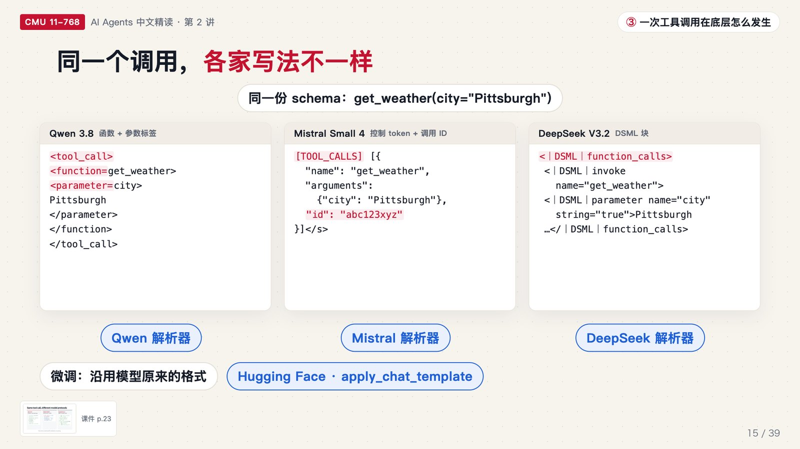

同样是"查匹兹堡天气"，三家模型的写法完全不同（取自原课件 p.23）：

| 模型 | 格式特点 | 输出 |
|---|---|---|
| Qwen 3.8 | 一层层标签，套着函数名和参数名 | `<tool_call><function=get_weather><parameter=city>Pittsburgh</parameter></function></tool_call>` |
| Mistral Small 4 | 一个控制 token，后跟 JSON 列表，自带调用 ID | `[TOOL_CALLS] [{"name": "get_weather", "arguments": {"city": "Pittsburgh"}, "id": "abc123xyz"}]` |
| DeepSeek V3.2 | 自己的 **DSML**（DeepSeek Markup Language）调用块；它叫"函数调用"不叫"工具调用" | `<｜DSML｜function_calls><｜DSML｜invoke name="get_weather"><｜DSML｜parameter name="city" string="true">Pittsburgh</｜DSML｜parameter>...` |

哪种都能用，同样的数据训同一个模型，效果可能略有差别。要记住的是：**一份 schema，每家模型有自己的序列化和解析方式。**给 DeepSeek 写的解析代码，不能想当然地拿去解析 Qwen。

两条实践建议：

- 在一个已经训好的模型上接着微调，**一定要沿用它原来的工具调用格式**，别让它学一种没训过的格式。
- Hugging Face 的 `apply_chat_template` 已经把各家模板实现好了，直接调就行。但底下发生了什么你得心里有数，不然很容易出错。

### 2.5 harness 怎么分发一次调用：读 OpenHands 源码

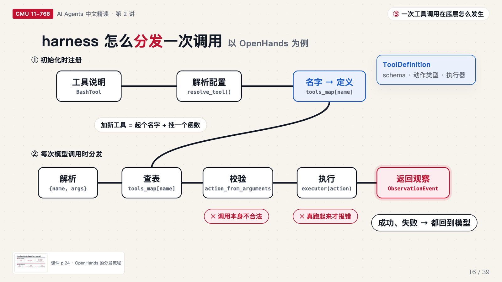

模型把调用写出来之后，就是 harness 的活了。以 **OpenHands** 为例，流程分两段：

1. **初始化时注册**：每个工具有一份说明（如 `BashTool`），用 `resolve_tool(spec, state)` 解析配置后，放进一张按名字查的表 `tools_map`。表里每一项是一个 `ToolDefinition`，有三样东西：参数格式（schema）、动作类型（Action）、执行器（executor）。
2. **每次模型调用时分发**：解析出名字和参数 → `tools_map[name]` 查表 → `action_from_arguments(args)` 校验并生成动作 → `executor(action)` 执行 → 返回带 `tool_call_id` 的 `ObservationEvent`。

大多数 agent 框架都是这个思路：**加一个新工具，就是给它起个名字，再挂上一个函数。**

下面是真实代码。出处：[OpenHands/software-agent-sdk](https://github.com/OpenHands/software-agent-sdk)，提交 `d2ee0cd`（2026-10-24），三个文件：

- [`openhands-sdk/openhands/sdk/agent/base.py`](https://github.com/OpenHands/software-agent-sdk/blob/d2ee0cdea60825608c2f8906eb54e1d4d264fb42/openhands-sdk/openhands/sdk/agent/base.py)（注册）
- [`openhands-sdk/openhands/sdk/agent/agent.py`](https://github.com/OpenHands/software-agent-sdk/blob/d2ee0cdea60825608c2f8906eb54e1d4d264fb42/openhands-sdk/openhands/sdk/agent/agent.py)（`_get_action_event`、`_execute_action_event`）
- [`openhands-sdk/openhands/sdk/tool/tool.py`](https://github.com/OpenHands/software-agent-sdk/blob/d2ee0cdea60825608c2f8906eb54e1d4d264fb42/openhands-sdk/openhands/sdk/tool/tool.py)（`action_from_arguments`、`ToolDefinition.__call__`）

为讲解删去了：工具名归一化的报错细节、安全风险评估（`security_risk`）、摘要提取、流式事件、critic 评估、可观测性埋点、`response_schema` 拆分、传给 `_emit_tool_error` 的思考内容等参数。删掉的位置用 `...` 标出，中文注释是本课件加的。

**第一段：初始化时注册（base.py）**

```python
tools: list[ToolDefinition] = []
with ThreadPoolExecutor(max_workers=4) as executor:          # 并行解析多个工具
    futures = []
    for tool_spec in self.tools:                             # self.tools 是用户配置的工具说明，如 BashTool
        future = executor.submit(resolve_tool, tool_spec, state)  # 按名字找到解析器，生成 ToolDefinition
        futures.append(future)
    for future in futures:
        result = future.result()
        tools.extend(result)                                 # 一份说明可能解析出多个工具
...
tool_names = [tool.name for tool in tools]
if len(tool_names) != len(set(tool_names)):                  # 名字是查表的键，不允许重名
    duplicates = set(name for name in tool_names if tool_names.count(name) > 1)
    raise ValueError(f"Duplicate tool names found: {duplicates}")

self._tools = {tool.name: tool for tool in tools}            # 这就是 tools_map：名字 → 定义
self._initialized = True
```

**第二段：解析、查表、校验（agent.py 的 `_get_action_event`）**

```python
try:
    arguments = parse_tool_call_arguments(tool_call.arguments)   # 模型给的参数是字符串，先解析成 dict；
                                                                 # JSON 不合法会抛 JSONDecodeError
    tool_name, arguments = normalize_tool_call(                  # 处理别名等，把名字规范化
        requested_tool_name, arguments, self.tools_map.keys(),
    )
    tool = self.tools_map.get(tool_name, None)                   # 按名字查表
    if tool is None:                                             # 失败点①：模型编了一个不存在的工具
        available = list(self.tools_map.keys())
        err = f"Tool '{tool_name}' not found. Available: {available}"
        self._emit_tool_error(error=err, tool_name=tool_name, tool_call=tool_call, ...)
        return                                                   # 把可用工具列表作为错误交回给模型
    arguments = fix_malformed_tool_arguments(arguments, tool.action_type)  # 先修补一遍格式有问题的参数（具体修哪些，看源码里这个函数）
    ...
    action: Action = tool.action_from_arguments(arguments)       # 校验参数并生成动作对象

except (ValueError, json.JSONDecodeError, ValidationError) as e: # 失败点②：参数不合法
    keys = list(arguments.keys()) if isinstance(arguments, dict) else None
    params = (f"Parameters provided: {keys}" if keys is not None
              else "Arguments: unparseable JSON")                # 只报参数名，不回显参数值
    err = f"Error validating tool '{display_tool_name}': {e}. {params}"
    self._emit_tool_error(error=err, tool_name=display_tool_name, tool_call=tool_call, ...)
    return

action_event = ActionEvent(                                      # 校验通过：生成动作事件
    action=action,
    tool_name=tool.name,
    tool_call_id=normalized_tool_call.id,                        # 调用 ID 从这里一路带下去
    tool_call=normalized_tool_call,
    ...
)
```

**第三段：动作对象就是一次 Pydantic 校验（tool.py）**

```python
def action_from_arguments(self, arguments: dict[str, Any]) -> Action:
    """Create an action from parsed arguments."""
    action_arguments, structured_output = self._split_response_arguments(arguments)
    action = self.action_type.model_validate(action_arguments)   # 用动作类型（Pydantic 模型）校验：
                                                                 # 缺字段、类型不对都会抛 ValidationError
    action._structured_output = structured_output
    return action
```

**第四段：执行并返回观察（agent.py 的 `_execute_action_event`）**

```python
tool = self.tools_map.get(action_event.tool_name, None)          # 再查一次表，拿到工具
...
try:
    observation = tool(action_event.action, conversation)        # ToolDefinition.__call__ 内部
                                                                 # 调 self.executor(action, conversation)
except ValueError as e:                                          # 失败点③：调用看着合法，跑起来出错
    err = f"Error executing tool '{tool.name}': {e}"
    error_event = AgentErrorEvent(                               # 转成错误事件，让模型自己改
        error=err,
        tool_name=tool.name,
        tool_call_id=action_event.tool_call.id,                  # 错误也带着同一个调用 ID
        ...
    )
    return [error_event]

obs_event = ObservationEvent(                                    # 成功：返回观察事件
    observation=observation,
    action_id=action_event.id,
    tool_name=tool.name,
    tool_call_id=action_event.tool_call.id,                      # 靠这个 ID 把结果对回调用
)
return [obs_event]
```

读完可以对照原课件那张图总结出三点：

| 观察 | 源码依据 |
|---|---|
| 失败有两大类：**校验失败**（工具不存在、JSON 坏了、参数不合 schema）和**执行失败**（调用合法但跑不通） | `_get_action_event` 的 `except` 和 `_execute_action_event` 的 `except ValueError` |
| **不管成功失败，都会生成一条带调用 ID 的事件交回给模型**，让它有机会自己改 | `_emit_tool_error`、`AgentErrorEvent`、`ObservationEvent` 都带 `tool_call_id` |
| 有些工具什么输入都能"校验通过"，只能执行时才发现错误 | 比如执行 Python 的工具，参数就是一个字符串，任何字符串都合 schema |

### 2.6 结果靠调用 ID 对回去

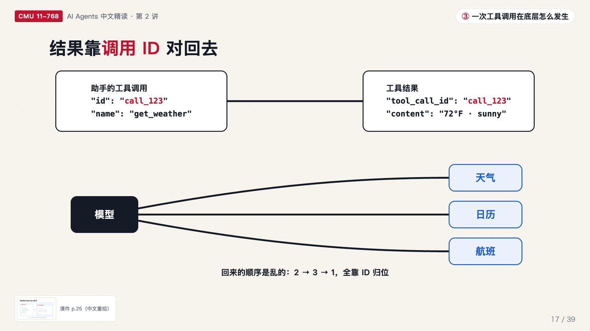

每次调用带一个 **调用 ID（tool call ID）**，返回的工具结果消息里写着同一个 ID（取自原课件）：

```json
// 助手发出的工具调用
{"id": "call_123", "name": "get_weather", "arguments": {"city": "Pittsburgh"}}

// 工具结果消息
{"role": "tool", "tool_call_id": "call_123", "content": "72°F · sunny"}
```

一次发出好几个调用（**并行调用**）时，这一点特别重要：结果回来的顺序可能是乱的，全靠 ID 才知道哪个结果对应哪个调用。

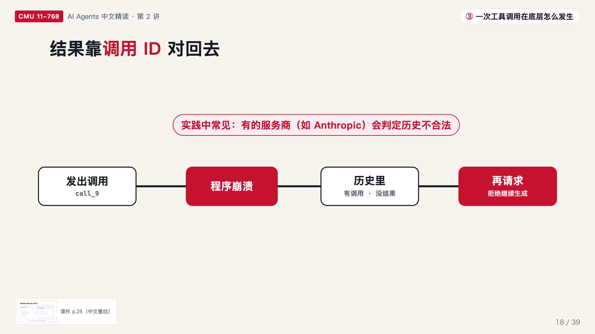

实践中有个很常见的坑：有的服务商（比如 Anthropic）在历史里看到一个工具调用、却找不到对应的结果，会直接判定这段历史不合法，拒绝继续生成。典型场景是：agent 刚发出调用，程序就崩了，结果没写进历史；恢复以后再去请求，就卡死在这里。

修法是在恢复时检查历史：每个没有结果的调用 ID，都补一条结果消息（比如内容写"执行被中断，结果未知"），再继续请求。

### 2.7 约束解码：让格式一定不出错

**问题。**模型并不保证写出的调用格式正确。比如这段输出少了最后一个右括号，丢给 JSON 解析器直接抛异常（取自原课件）：

```text
{"name":"get_weather", "arguments":{"city":"Pittsburgh"}
```

很多人的第一反应是事后去补括号，这条路不好走：括号好补，少了引号、截断在字符串中间、多了一个字段，就没法一一猜。更好的办法是在生成的时候就约束它，这叫**约束解码（constrained decoding）**。

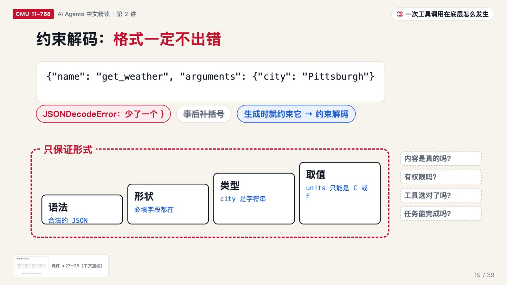

| 层次 | 要求 | 例子 |
|---|---|---|
| 语法（syntax） | 是合法的 JSON | 括号成对、引号闭合 |
| 形状（shape） | 必填字段都在 | 有 `city` |
| 类型（types） | 字段类型正确 | `city` 是字符串 |
| 取值（values） | 值在允许范围内 | `units` 只能是 `C` 或 `F` |

但要记住：**约束只保证形式。**内容是不是真的、有没有权限、工具选得对不对、任务能不能完成，它都管不了。

**JSON Schema。**这四层要求通常用 **JSON Schema** 来写。它是一套描述 JSON 数据的词汇，能写类型、必填字段和允许的取值，而且机器可以直接拿来校验。原课件用的是 Draft 2020-12：

```json
{
  "type": "object",
  "properties": {
    "city":  {"type": "string"},
    "units": {"enum": ["C", "F"]}
  },
  "required": ["city"],
  "additionalProperties": false
}
```

`additionalProperties: false` 的意思是不允许出现定义之外的字段。

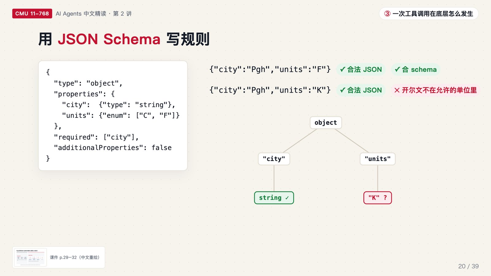

| 输出 | 是合法 JSON 吗 | 合 schema 吗 | 原因 |
|---|---|---|---|
| `{"city":"Pgh","units":"F"}` | 是 | 是 | 每一格都能按规则推导出来 |
| `{"city":"Pgh","units":"K"}` | 是 | 否 | 开尔文不在允许的单位里，`unit → "C" \| "F"` 推不出 `"K"` |

可以把 schema 想成一套**语法（grammar）**：合法的输出能按这套语法画出一棵完整的语法树；不合法的，画到 `units` 那一格就画不下去了。

**从有限状态机到下推自动机。**怎么在生成时检查？分两步理解：

| 机器 | 能识别的语言 | 记忆 | 够不够用 |
|---|---|---|---|
| **有限状态自动机（finite-state automaton）** | 正则语言（正则表达式那一类） | 只有当前状态：每读一个符号，跳到下一个状态 | 不够。JSON 可以任意嵌套，有限个状态记不住嵌套了几层 |
| **下推自动机（pushdown automaton, PDA）** | 上下文无关语言（JSON 属于这一类） | 状态 + 一个栈 | 够。状态记住现在走到了规则的哪一步；栈记住嵌套到了第几层、出来以后回到哪里 |

举例：读到 `{` 时把"对象"压栈，读到 `[` 时把"数组"压栈，读到 `]` 时弹出"数组"，读到最后的 `}` 弹出"对象"，栈空，说明结构完整。

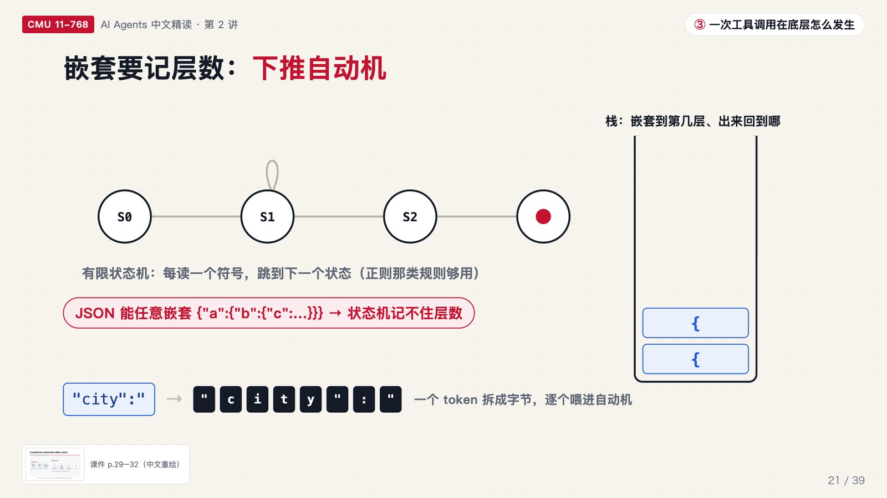

**检查要按字节做。**还有个细节：一个 token 可能跨好几个语法单元（比如 `"F"}` 一个 token 就包含引号、值、引号、右括号），也可能停在一个单元的中间。所以**不能把 token 边界当成语法边界**。做法是把语法编译成按字节运行的下推自动机，每个候选 token 都把它解码出来的字节放进自动机里跑一遍，看能不能往下走，能走就保留，走不下去就屏蔽。

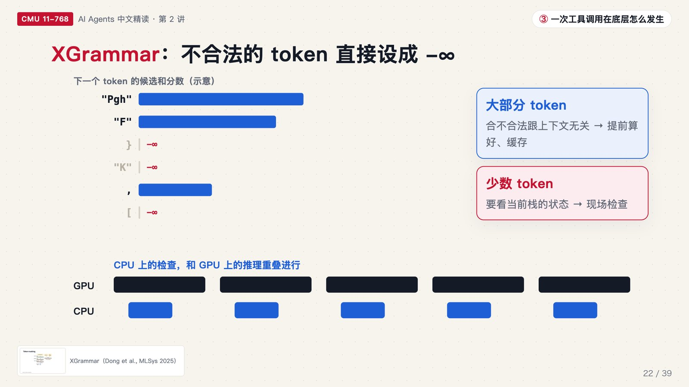

**XGrammar 的 token 掩码。****XGrammar**（Dong et al., MLSys 2025）是 CMU 的工作，现在各大推理框架都在用。每一步解码：

1. 模型给词表里所有候选 token 打完分（logits）；
2. 语法说合法的保留，不合法的分数直接设成负无穷；
3. 重新归一化后再采样。这样采样出来的只可能是合法的 token。

问题是词表有十几万个 token，每步都逐个跑自动机太慢。XGrammar 的提速办法：

| 手段 | 做法 |
|---|---|
| 缓存（处理大多数 token） | 大部分 token 合不合法只看栈顶所在的语法位置、与更深的上下文无关，称为**上下文无关 token**，可以提前算好、缓存起来，按栈顶节点直接查 |
| 现场检查（处理少数 token） | 只有少数**上下文相关 token** 要拿完整的栈现场跑一遍 |
| 持久化栈 | 语法有多种可能的走法时，多个栈共享前缀，支持分支而不必复制 |
| CPU/GPU 重叠 | CPU 上算掩码的同时，GPU 在做模型推理，两者重叠进行 |

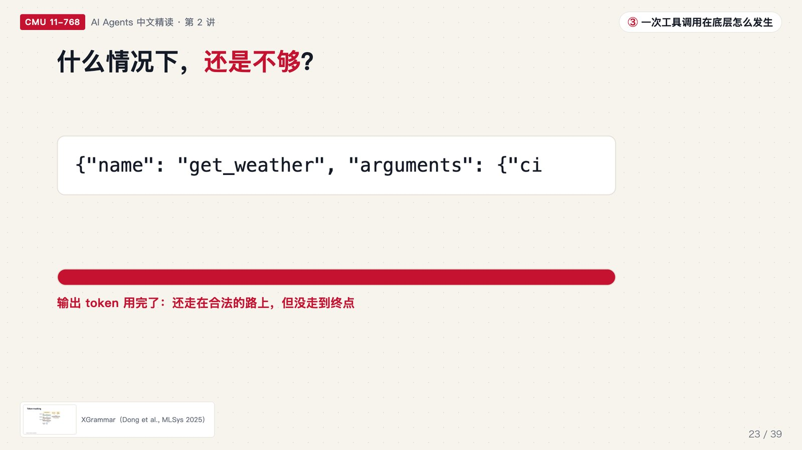

开了约束解码、设好 schema，几乎总能拿到格式正确的调用。那什么情况下还是不够？**输出 token 用完的时候。**模型还走在合法的路上，但没走到终点，只留下半截 JSON。约束解码保证的是"每一步都合法"，不保证"一定能走完"。harness 要检查生成是不是因为长度上限而停止，比如 OpenAI 兼容接口里的 `finish_reason == "length"`，遇到就调大上限重试，或者把它当成一次失败交回给模型。

---

## 3 怎么把能力接给 agent，怎么调得又快又稳

### 3.1 库函数：同一个进程里的接口

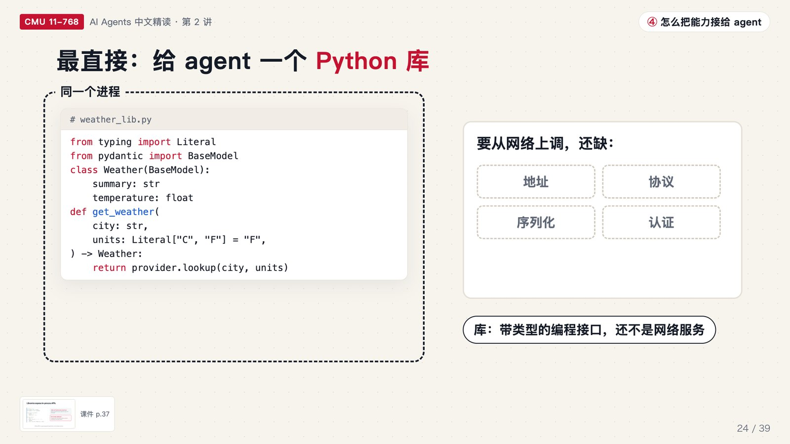

最直接的做法是给模型一个 Python 库（取自原课件）：

```python
# weather_lib.py
from typing import Literal
from pydantic import BaseModel

class Weather(BaseModel):
    summary: str
    temperature: float

def get_weather(city: str, units: Literal["C", "F"] = "F") -> Weather:
    return provider.lookup(city, units)
```

告诉模型需要时就调，再给它执行 Python 的能力。这就是原课件说的**程序化工具调用（programmatic tool calling）**。函数名、参数、类型、返回值，Python 都替你写清楚了。

局限是：**调用方和函数必须在同一个进程里**，不能远程调用，也接不上标准的（非代码的）工具调用方式。要从网络上调，还缺地址、协议、序列化和认证。**库是一个带类型的编程接口，还不是网络服务。**

### 3.2 REST API：把函数挂到 HTTP 上

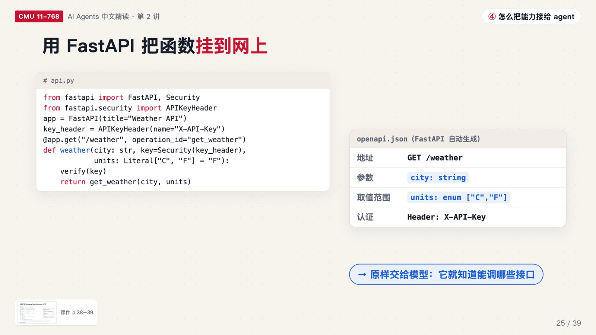

用 **FastAPI**，几行代码就能把这个函数变成一个 **REST API**（取自原课件）：

```python
# api.py
from typing import Annotated, Literal
from fastapi import FastAPI, Security
from fastapi.security import APIKeyHeader
from weather_lib import Weather, get_weather

app = FastAPI(title="Weather API")
key_header = APIKeyHeader(name="X-API-Key")         # 要求请求头里带 X-API-Key

@app.get("/weather", operation_id="get_weather")    # 把函数挂到 GET /weather
def weather(
    city: str,
    key: Annotated[str, Security(key_header)],
    units: Literal["C", "F"] = "F",
) -> Weather:
    verify(key)                                     # 校验 key（verify 原课件未给出实现）
    return get_weather(city, units)
```

这样做有两个好处：

1. **能管住谁来调**：没带 key 的请求一律拒绝。查天气无所谓，背后如果是你的个人数据，这一层就很重要。
2. **白送一份接口描述**：FastAPI 会自动生成 **OpenAPI** 文档，写清楚每个接口的路径、参数、取值范围和认证方式。参数部分用的就是 2.7 节讲的 JSON Schema：

```json
{
  "paths": {"/weather": {"get": {
    "operationId": "get_weather",
    "parameters": [
      {"name": "city", "in": "query", "required": true, "schema": {"type": "string"}},
      {"name": "units", "in": "query",
       "schema": {"type": "string", "enum": ["C", "F"], "default": "F"}}
    ],
    "security": [{"APIKeyHeader": []}]
  }}},
  "components": {"securitySchemes": {"APIKeyHeader": {
    "type": "apiKey", "in": "header", "name": "X-API-Key"
  }}}
}
```

**OpenAPI 描述 HTTP 操作，里面嵌着的 JSON Schema 描述取值。**这份文档可以原样交给模型，它就知道能调哪些接口了。

### 3.3 用 curl 直接调：简单，但 key 暴露了

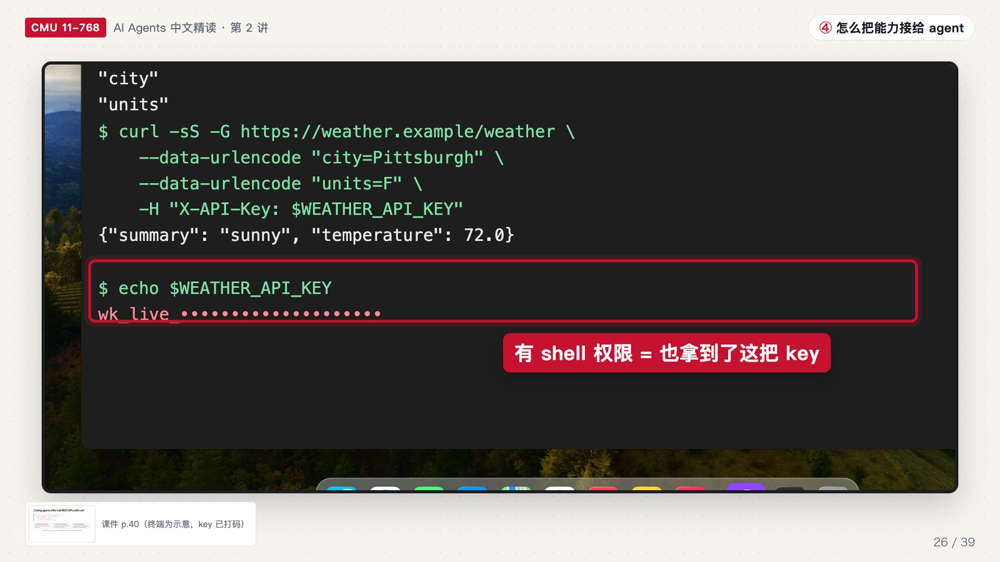

编码 agent 还常常直接用 `curl` 调接口（取自原课件）：

```bash
curl -sS -G https://weather.example/weather \
  --data-urlencode "city=Pittsburgh" \
  --data-urlencode "units=F" \
  -H "X-API-Key: $WEATHER_API_KEY"
```

步骤是：读接口文档 → 选好操作和参数、拼出命令 → shell 从环境变量里展开 key，curl 发请求。简单直接，但有个问题：**有 shell 权限的 agent，也就拿到了那把 key。**它可以 `echo $WEATHER_API_KEY` 把 key 读出来，也可能把它用到不该用的地方。

### 3.4 MCP：多一层，换来凭证隔离

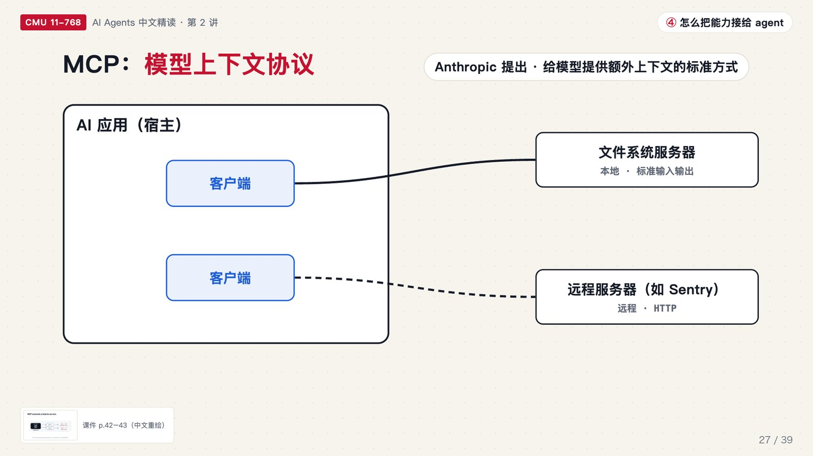

**MCP（Model Context Protocol，模型上下文协议）**是 Anthropic 大约一年半到两年前提出的，本意是给模型提供额外上下文的一种标准方式。结构有三个角色：

| 角色 | 英文 | 是什么 |
|---|---|---|
| 宿主 | host | AI 应用本身，比如一个编码 agent |
| 客户端 | client | 宿主里开的连接器，每个客户端连一个服务器 |
| 服务器 | server | 提供能力的一方。可以在本地，通过标准输入输出（stdio）连，比如文件系统服务器；也可以在远程，通过 HTTP 连，比如 Sentry 服务器 |

很多人第一次见到 MCP 都会问：调接口已经有现成的好办法了，为什么还要再跑一个程序？先说清楚：**MCP 是另一种面向 agent 的接口，不是调 REST API 的前提。**

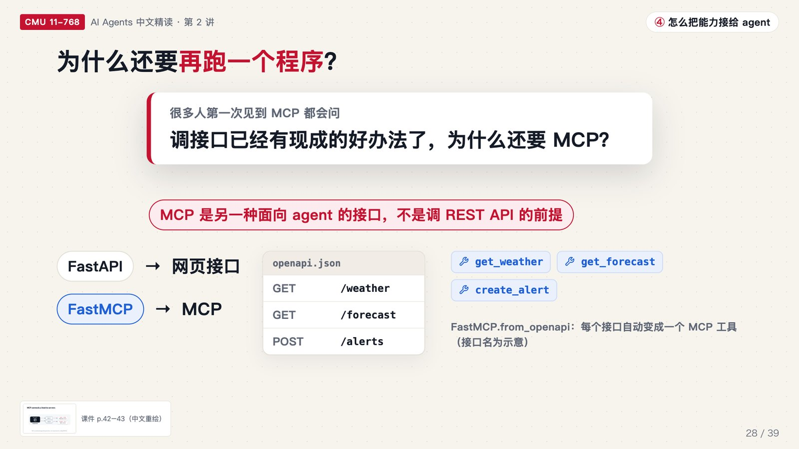

写起来很省事。**FastMCP** 之于 MCP，就像 FastAPI 之于网页接口；它还能直接读一份 OpenAPI 文档，把每个接口自动变成一个 MCP 工具（取自原课件，`httpx2` 照抄原课件写法）：

```python
import httpx2
from fastmcp import FastMCP

spec = httpx2.get("https://weather.example/openapi.json").json()   # 取 OpenAPI 文档
mcp = FastMCP.from_openapi(
    openapi_spec=spec,
    client=httpx2.AsyncClient(base_url="https://weather.example"),
    name="Weather MCP",
)   # 默认每个 OpenAPI 路由都变成一个可被发现的 MCP 工具，GET /weather → get_weather(city, units)
```

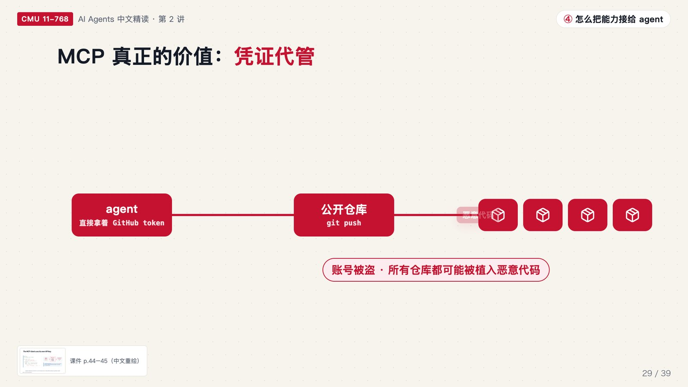

**MCP 真正的价值在凭证上。**跟着一次请求走一遍（取自原课件 p.44–45）：

```python
# 服务器端：上游 key 和 MCP key 分开
upstream = httpx2.AsyncClient(
    base_url="https://weather.example",
    headers={"X-API-Key": os.environ["UPSTREAM_API_KEY"]})       # 上游 key 只在服务器手里
mcp_auth = StaticTokenVerifier(tokens={
    os.environ["MCP_API_KEY"]: {"client_id": "course-agent"}})   # MCP key 只能登录这个服务器
mcp = FastMCP.from_openapi(openapi_spec=spec, client=upstream,
                           name="Weather MCP", auth=mcp_auth)
mcp.run(transport="http", port=8001)

# 客户端（agent harness）：只带 MCP key
async with Client("https://mcp.example/mcp", auth=os.environ["MCP_API_KEY"]) as client:
    tools = await client.list_tools()                             # 运行时发现工具
    result = await client.call_tool("get_weather", {"city": "Pittsburgh", "units": "F"})
```

链路是：agent 带着 MCP key 发来请求 → 服务器校验、授权、分发 → 用自己手里的上游 key 去调真正的接口。这叫**凭证代管（credential brokering）**：服务器接受一种凭证，向上游用另一种凭证。**两把 key，模型都看不到。**

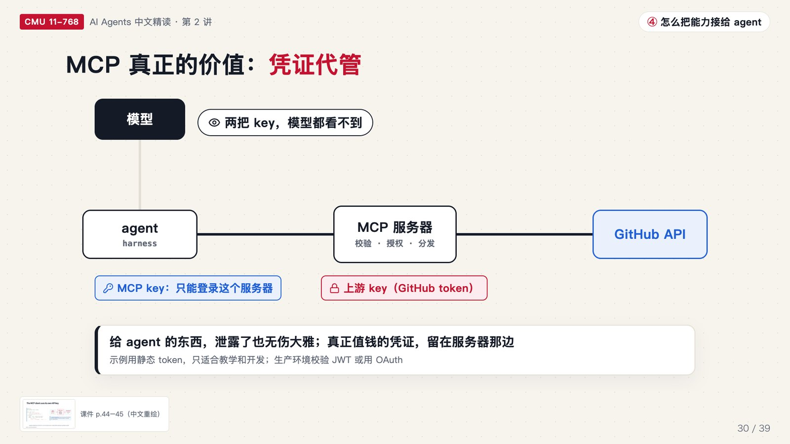

为什么要这样？想象你把 GitHub token 直接给了 agent，它某天觉得把 token 推到公开仓库是个好主意。结果账号被盗，所有仓库都可能被植入恶意代码。所以设计原则是：**给 agent 的东西，最好泄露了也无伤大雅；真正值钱的凭证，留在服务器那边。**

注意原课件的说明：示例里的静态 token（`StaticTokenVerifier`）只适合教学和开发，生产环境要校验 JWT 或者用 OAuth 这类正式的认证。

### 3.5 REST API 和 MCP 对照

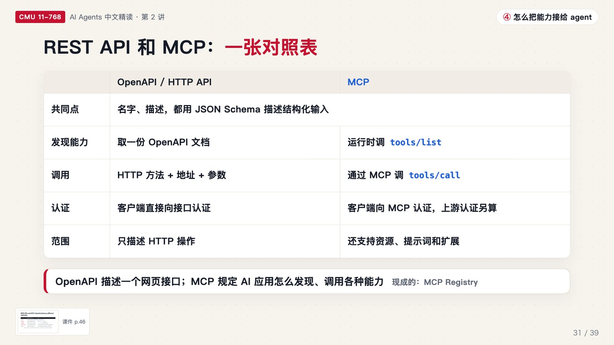

| | OpenAPI / HTTP API | MCP |
|---|---|---|
| 共同点 | 名字、描述、用 JSON Schema 描述的结构化输入 | 同左 |
| 发现能力 | 取一份 OpenAPI 文档 | 运行时调 `tools/list` |
| 调用 | HTTP 方法 + 路径 + 参数 | 通过 MCP 传输层调 `tools/call` |
| 认证 | 客户端直接向 API 认证 | 客户端向 MCP 认证，上游认证另算 |
| 范围 | 只描述 HTTP 操作 | 还支持资源（resources）、提示词（prompts）和扩展 |

一句话：**OpenAPI 描述的是一个网页接口；MCP 规定的是 AI 应用怎么发现、调用各种能力。**想找现成的 MCP 服务器，可以去官方的 MCP Registry。

### 3.6 并行调用：一次往返做三件事

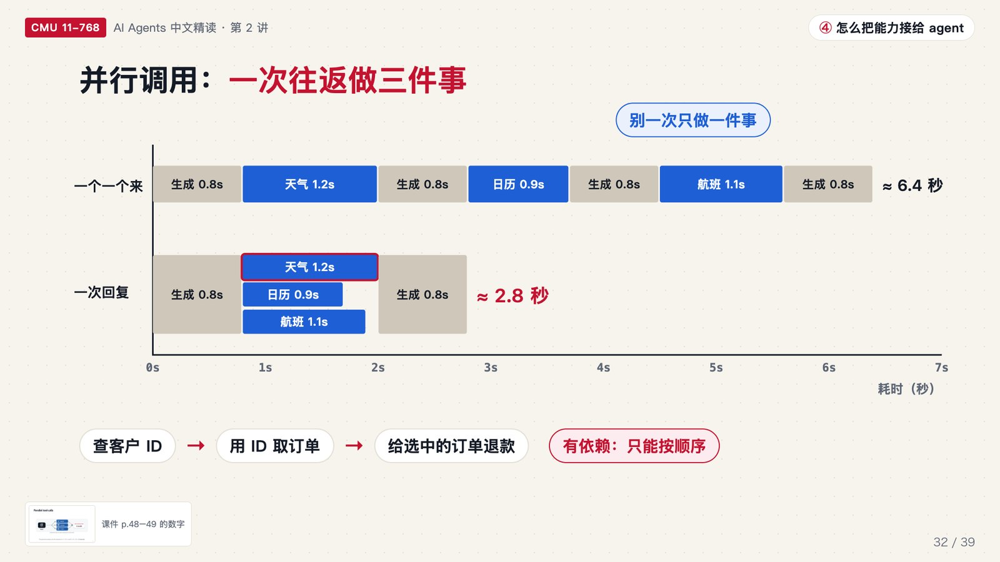

假设要同时查天气、查日历、查航班（耗时取自原课件）：

| 方式 | 时间线 | 总耗时 |
|---|---|---|
| 串行 | 生成 0.8 + 天气 1.2 + 生成 0.8 + 日历 0.9 + 生成 0.8 + 航班 1.1 + 生成 0.8 | ≈ 6.4 秒 |
| 并行 | 生成 0.8（一次发出三个调用）+ 等最慢的 max(1.2, 0.9, 1.1) + 生成 0.8 | 2 × 0.8 + 1.2 ≈ 2.8 秒 |

模型在一次回复里同时发出三个调用块，共用一次生成、一次等待。道理和 1.5 节讲代码时一样：**别一次只做一件事。**

但**只有互不依赖才能并行**：

| 可以并行 | 必须按顺序 |
|---|---|
| 查匹兹堡天气 / 读今天的日历 / 查航班状态 | 查客户 ID → 用 ID 取订单 → 给选中的订单退款 |

后一组每一步都要用上一步的结果，并行发出去的话，第二步根本不知道该填什么 ID。

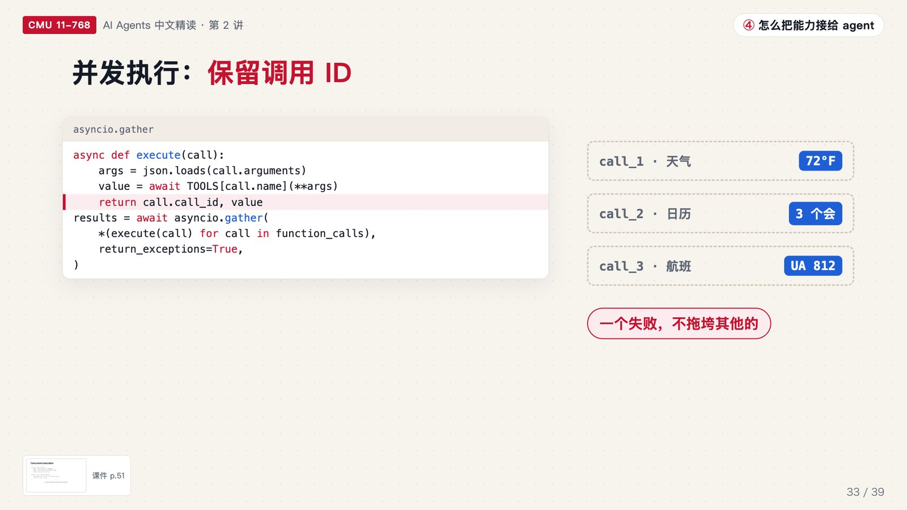

执行时用 Python 的 `asyncio.gather` 同时跑这些调用（取自原课件）：

```python
async def execute(call):
    args = json.loads(call.arguments)              # 解析参数
    value = await TOOLS[call.name](**args)         # 按名字查表并执行
    return call.call_id, value                     # 结果和调用 ID 一起返回

results = await asyncio.gather(
    *(execute(call) for call in function_calls),
    return_exceptions=True,                        # 一个失败不拖垮其他：异常作为结果返回
)
```

结果完成的顺序会乱，所以一定要保留调用 ID。另外注意：开了 `return_exceptions=True`，异常会作为一个元素出现在 `results` 里，这时它不带调用 ID，要靠它在列表中的位置找回对应的调用（`gather` 返回的列表顺序与传入顺序一致）。

### 3.7 更贵的模型，按任务算可能更便宜

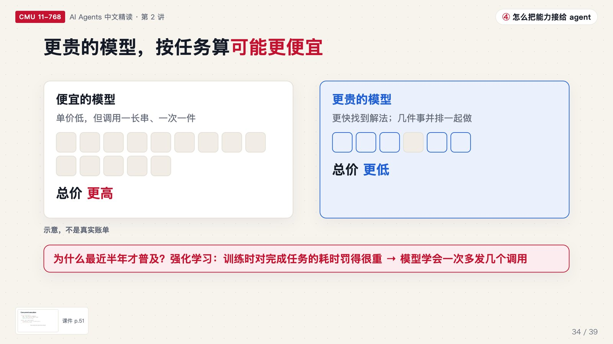

一个反直觉的现象：**更贵的模型，按任务算反而可能更便宜。**原因有两个：

1. 它更聪明，能更快找到合适的解法，少走弯路；
2. 新模型并行调用用得好多了，比如编码 agent 一次同时看好几张图、同时写好几个文件。

并行调用的机制早就有了，但真正被大量使用，大概也就是最近半年的事。原因是**强化学习**：训练时对完成任务的耗时罚得很重，模型就被逼着学会了一次多发几个调用。这也是上一讲"两条路是接力关系"的一个例子：并行先是 harness 支持的能力，后来模型被训练得会用了。

### 3.8 怎么评测工具调用

这里先只评"会不会用工具"本身，端到端的 agent 任务评测后面专门讲。会用工具，是 agent 能做好事情的前提。

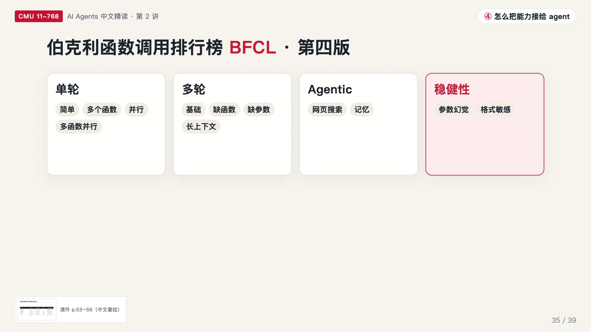

**伯克利函数调用排行榜（BFCL, Berkeley Function-Calling Leaderboard）**是最有名的工具调用评测，已经出到第四版。第一版只测单轮调用，现在覆盖：

| 类别 | 子项 |
|---|---|
| 单轮 | 简单、多个函数、并行、多函数并行 |
| 多轮 | 基础、缺函数、缺参数、长上下文 |
| Agentic | 网页搜索、记忆 |
| 稳健性 | 参数幻觉（会不会编造参数）、格式敏感度（对应 2.4 节的各家格式不同） |

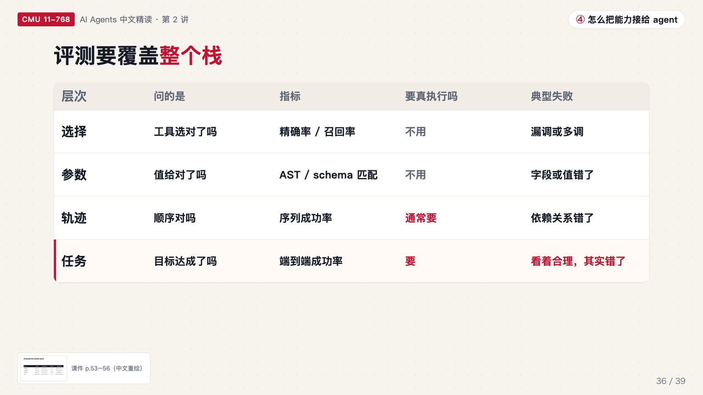

**评测要覆盖整个栈**，分四个层次：

| 层次 | 问的是 | 指标举例 | 要不要真执行 | 典型失败 |
|---|---|---|---|---|
| 选择 | 工具选对了吗 | 精确率 / 召回率 | 不用 | 漏调或多调 |
| 参数 | 值给对了吗 | AST / schema 匹配 | 不用 | 字段或值错了 |
| 轨迹 | 调用顺序对吗 | 序列成功率 | 通常要 | 依赖关系错了 |
| 任务 | 目标达成了吗 | 端到端成功率 | 要 | 答案看着合理，其实是错的 |

前两层对照标准答案就能判（**AST 匹配**是把调用解析成语法树后比较函数名和参数，不在乎空格、参数顺序这类表面差异）；后两层通常要真跑。**最难抓的失败在最后一层**：答案看着很合理，其实是错的。

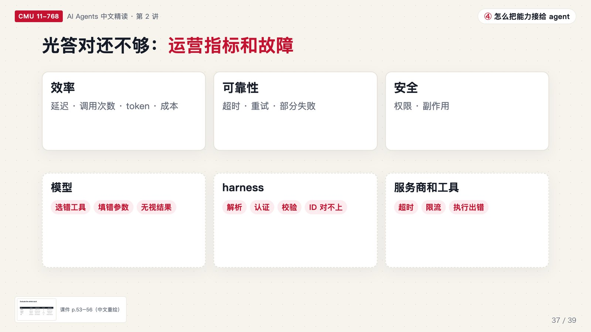

光答对还不够，质量还有**运营**上的维度：

| 维度 | 看什么 | 为什么 |
|---|---|---|
| 效率 | 延迟、调用次数、token、成本 | 一个答对了的 agent，也可能慢到、贵到没法用 |
| 可靠性 | 超时、重试、部分失败 | 要在真实的服务商表现下报告任务成功率 |
| 安全 | 策略、权限、副作用 | 要测对抗性的输出和后果严重的动作 |

失败可能出在三个地方：

| 出在哪 | 典型失败 |
|---|---|
| 模型 | 选错工具、填错参数、无视工具结果 |
| harness | 解析、认证、校验出错，调用 ID 对不上 |
| 服务商或工具本身 | 超时、限流、执行出错 |

所以上线前的评测，**既要看基准准确率，也要看这些运营故障率。**

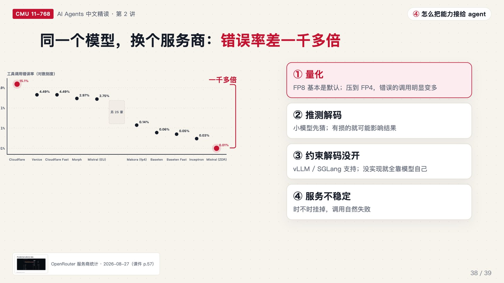

最后一个例子很能说明问题。OpenRouter 公布了各家服务商的**工具调用错误率（tool call error rate）**（原课件引用的是 2026-08-27 的数据）。同一个模型，据说是 GLM 5.3，唯一的区别是谁在提供推理服务：错误率最高约 15.1%，最低只有 0.01%，**差了一千多倍**。

原因可能有四种：

| 原因 | 解释 |
|---|---|
| 量化程度不同 | FP8 基本是默认的量化级别；实践中压到 FP4，错误的工具调用会明显变多。服务商省了钱，模型却变差了 |
| 推测解码 | **推测解码（speculative decoding）**用一个便宜的小模型先猜大模型要说什么，用来加速。无损的不该影响结果；有损的就可能影响，但那样还叫"同一个模型"，本身就说不过去 |
| 约束解码有没有开 | 有的服务商自己从零写推理引擎，有的用 vLLM 或 SGLang，它们支持不同的约束解码算法；没实现的，就只能全靠模型自己写对格式 |
| 服务本身不稳定 | 时不时挂掉，调用自然就失败了 |

对你的启示：**评测一个模型的工具调用能力时，要把服务商也当成变量**；上线时选服务商，工具调用错误率和价格一样值得看。

---

## 本讲小结

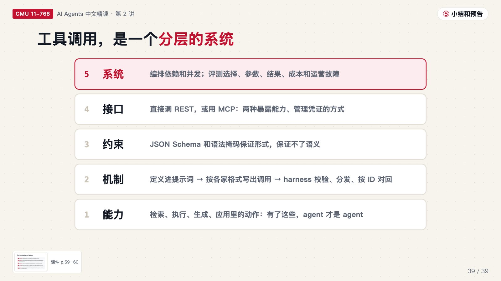

工具调用是一个分层的系统：

- **能力**：工具给模型加上检索、执行、生成和应用里的动作，有了这些，agent 才是 agent。好处分扩展和便利两种，但只有好处大过延迟、成本、失败和风险时才值得调。代码是元工具，一个动作能组合多步操作（CodeAct），代价是要配沙箱、资源限制、权限和审计日志。
- **机制**：工具定义经聊天模板进提示词，模型按自己的格式写出调用（各家不同），harness 查表、校验、分发、执行，再按调用 ID 把结果对回去；成功失败都要交回一条观察。
- **约束**：JSON Schema 和语法掩码（下推自动机 + XGrammar）能保证形式，保证不了语义。一段字符串能被解析成 Python，不代表这段 Python 是对的；token 用完时仍可能只剩半截。
- **接口**：直接调 REST 和用 MCP，是两种暴露能力、管理凭证的方式。MCP 的价值在凭证代管：模型看不到真正的凭证。
- **系统**：编排依赖和并发（无依赖才能并行）；评测要看选择、参数、轨迹、任务四层，以及成本和运营故障，服务商本身也是变量。

这门课的第一个作业就是自己搭一个 harness，这一讲的内容全都用得上。

## 关键术语

| 中文 | 英文 | 一句话解释 |
|---|---|---|
| 工具 | tool | 语言模型调用外部程序的接口 |
| 扩展 / 便利 | extend / facilitate | 工具的两种好处：做到做不到的事 / 把能做的事做得更快更稳 |
| 检索增强生成 | RAG, retrieval-augmented generation | 先检索再生成回答 |
| 元工具 | meta-tool | 能组合其他工具的工具，指代码 |
| 代码动作 | CodeAct | 用可执行代码而不是 JSON 来表达 agent 的动作 |
| 中期训练 | mid-training | 用中等规模、已是目标格式的数据接着训练，常在这一步加入工具调用标记 |
| 聊天模板 | chat template | 把带角色的消息和工具定义序列化成一条模型输入 |
| 工具定义 / schema | tool schema | 工具的名字、描述和参数格式 |
| 调用 ID | tool call ID | 把工具结果对回对应调用的标识 |
| 约束解码 | constrained decoding | 生成时屏蔽不合语法的 token，保证输出格式 |
| JSON Schema | JSON Schema | 描述 JSON 数据类型、必填字段、取值的机器可读规则 |
| 下推自动机 | pushdown automaton, PDA | 有限状态机加一个栈，能识别任意嵌套的结构 |
| token 掩码 | token mask | 把不合法 token 的分数设成负无穷 |
| 程序化工具调用 | programmatic tool calling | 让模型写代码调用库函数 |
| OpenAPI | OpenAPI | 描述 HTTP 接口路径、参数、认证的标准文档格式 |
| 模型上下文协议 | MCP, Model Context Protocol | 规定 AI 应用怎么发现、调用外部能力的协议 |
| 凭证代管 | credential brokering | 服务器接受一种凭证、向上游用另一种凭证，模型两把都看不到 |
| 并行调用 | parallel tool calls | 一次回复里发出多个互不依赖的调用 |
| 推测解码 | speculative decoding | 用小模型先猜、大模型验证，以加速生成 |
| 伯克利函数调用排行榜 | BFCL | 最有名的工具调用评测，已到 V4 |

## 思考题

<details>
<summary>1. "现在几点"和"两个七位数相乘"，各属于工具的哪种好处？再各举一个你自己的例子。</summary>

"现在几点"是扩展：模型参数在训练结束时就冻住了，不调外部函数不可能知道当前时间。"七位数相乘"是便利：模型一步步推理也能算对，只是慢、且有出错概率，交给计算器更快更稳。判断标准是"不给工具，模型理论上能不能做到"。自举例子：查你账户的余额是扩展（私有状态不在参数里）；把一段文本按字母排序是便利。
</details>

<details>
<summary>2. 为什么 CodeAct 能同时提高成功率、减少交互轮数？如果你在生产环境采用代码动作，至少要配哪些设施？</summary>

代码能在一个动作里组合循环、分支、库和多步操作，比如"四个国家查价、换汇、加税"可以写成一个循环一次算完，不用来回十几轮；轮数少了，每轮出错（选错工具、参数抄错）的机会也少了。代价是动作空间太宽、难以精确校验，还能动文件、网络、进程、吃资源，所以至少要配沙箱、资源限制（超时、内存、CPU）、权限控制和审计日志，并留意引入的第三方库是否可信。
</details>

<details>
<summary>3. 开了约束解码、设好 JSON Schema，为什么 harness 仍然要处理"工具调用解析失败"和"调用语义错误"？</summary>

两种情况约束解码管不了。一是输出 token 用完：每一步都合法，但没走到终点，只剩半截 JSON，harness 要检查生成是否因长度上限停止（如 `finish_reason == "length"`），调大上限重试或当作失败交回模型。二是语义错误：约束只保证形式，参数可能合 schema 但值是错的（城市写错）、工具选错、没有权限。另外，有的服务商根本没开约束解码。所以 OpenHands 这类 harness 在校验和执行两处都要兜底，并把错误带着调用 ID 交回给模型。
</details>

<details>
<summary>4. agent 发出一个工具调用后进程崩溃，重启后请求 Anthropic 一直被拒。原因是什么？怎么修？</summary>

历史里有一个工具调用，却没有对应 `tool_call_id` 的结果消息，服务商判定历史不合法。修法是在恢复时扫描历史：对每个没有结果的调用 ID，补一条结果消息（例如"执行被中断，结果未知，请确认后重试"），再继续请求。注意不要简单删掉那条调用，因为它可能已经产生了副作用（比如已经发出了退款），模型需要知道这件事可能发生过。
</details>

<details>
<summary>5. 在凭证代管的方案里，如果 MCP key 泄露了，和 GitHub token 泄露相比，损失有什么不同？</summary>

MCP key 只能登录这一个 MCP 服务器，能做的事受服务器暴露的工具和授权范围限制，而且可以单独吊销、轮换，不影响上游账号。GitHub token 泄露则等于整个账号的权限外泄，可能导致账号被盗、所有仓库被植入恶意代码。这正是设计原则"给 agent 的东西泄露了也无伤大雅，值钱的凭证留在服务器那边"的意义。
</details>

<details>
<summary>6. "查客户 ID → 取订单 → 退款"能不能并行？如果每次生成 0.8 秒、每个工具 1 秒（示意数字），最少要多久？</summary>

不能并行，因为每一步都要用到上一步的结果。最少需要三轮"生成 + 执行"，再加最后一次生成给出答复：4 × 0.8 + 3 × 1 = 6.2 秒（示意）。能省时间的地方在别处：如果同时还要查天气等无关信息，可以把它和第一步放在同一次回复里并行发出；或者让模型写一段代码把三步串起来一次执行（代价见 1.7 节）。
</details>

## 动手练习

两个练习任选一个，或都做，每个 15–20 分钟。都只依赖 Python 3.10+，不需要真模型；模型输出用写死的字符串模拟（示意）。

### 练习 ①：校验工具调用参数，并把错误回传给模型

先 `pip install jsonschema`。

```python
import json
from jsonschema import Draft202012Validator

SCHEMA = {                                         # 与 2.7 节的 schema 相同
    "type": "object",
    "properties": {"city": {"type": "string"}, "units": {"enum": ["C", "F"]}},
    "required": ["city"],
    "additionalProperties": False,
}
validator = Draft202012Validator(SCHEMA)

# 模拟模型输出的几次工具调用（示意）
MODEL_CALLS = [
    {"id": "call_1", "name": "get_weather", "arguments": '{"city": "Pittsburgh", "units": "F"}'},
    {"id": "call_2", "name": "get_weather", "arguments": '{"city": "Pittsburgh", "units": "K"}'},
    {"id": "call_3", "name": "get_weather", "arguments": '{"units": "C", "country": "US"}'},
    {"id": "call_4", "name": "get_weather", "arguments": '{"city": "Pittsburgh"'},
]


def check(call: dict) -> dict:
    """返回一条 tool 消息：成功时是结果，失败时是给模型看的错误说明。"""
    try:
        args = json.loads(call["arguments"])
    except json.JSONDecodeError as e:
        # TODO 1：返回 {"role": "tool", "tool_call_id": ..., "content": ...}，说明 JSON 不合法
        ...
    errors = sorted(validator.iter_errors(args), key=lambda e: list(e.path))
    if errors:
        # TODO 2：把每个错误的位置（e.path）和原因（e.message）拼成一段话，
        #         告诉模型哪里错了、该怎么改，同样带上 tool_call_id
        ...
    # TODO 3：校验通过，返回一个模拟结果，比如 "72°F · sunny"
    ...


for call in MODEL_CALLS:
    print(check(call))
```

做完以后回答：

- 四个调用分别在四层约束（语法、形状、类型、取值）的哪一层失败？
- 你的错误消息里有没有回显参数值？OpenHands 为什么只报参数名（参考 2.5 节源码）？
- 如果真的把 `call_2` 的错误消息回传给模型，你希望模型下一步输出什么？要不要限制重试次数？

### 练习 ②：并行执行三个模拟工具，按调用 ID 对回结果

```python
import asyncio
import json
import random
import time


async def get_weather(city: str) -> str:           # 模拟工具：耗时取自原课件，结果是示意
    await asyncio.sleep(1.2)
    return f"{city}: 72°F, sunny"

async def read_calendar(day: str) -> str:
    await asyncio.sleep(0.9)
    return f"{day}: 2 meetings"

async def flight_status(flight: str) -> str:
    await asyncio.sleep(1.1)
    if random.random() < 0.3:                      # 30% 概率失败，模拟服务商不稳定
        raise TimeoutError(f"{flight}: upstream timeout")
    return f"{flight}: on time"

TOOLS = {"get_weather": get_weather, "read_calendar": read_calendar, "flight_status": flight_status}

CALLS = [                                           # 模拟模型一次回复里发出的三个调用（示意）
    {"id": "call_a", "name": "get_weather", "arguments": '{"city": "Pittsburgh"}'},
    {"id": "call_b", "name": "read_calendar", "arguments": '{"day": "today"}'},
    {"id": "call_c", "name": "flight_status", "arguments": '{"flight": "UA123"}'},
]


async def execute(call: dict):
    args = json.loads(call["arguments"])
    value = await TOOLS[call["name"]](**args)
    return call["id"], value


async def serial():
    # TODO 1：用 for 循环逐个 await execute(call)，返回结果列表
    ...

async def parallel():
    # TODO 2：用 asyncio.gather(..., return_exceptions=True) 同时执行
    # TODO 3：把结果整理成 tool 消息列表 [{"role": "tool", "tool_call_id": ..., "content": ...}]
    #         异常元素没有 ID，用它在列表里的位置从 CALLS 里找回对应的调用 ID
    ...


for fn in (serial, parallel):
    t0 = time.perf_counter()
    try:
        print(asyncio.run(fn()))
    except Exception as e:
        print("failed:", e)
    print(f"{fn.__name__}: {time.perf_counter() - t0:.1f}s")
```

做完以后回答：

- 串行和并行各用了多少秒？和 3.6 节的 6.4 秒、2.8 秒相比，差的那部分是什么（提示：这里没有模拟模型生成时间）？
- `flight_status` 失败时，串行版本和并行版本的行为有什么不同？
- 如果在 `execute` 里给每个工具完成时打印一行，打印顺序和 `CALLS` 的顺序一样吗？为什么最后的 `results` 列表顺序却一样？

> 这两个练习都不执行模型生成的命令。如果你把它们接上真模型、并加入执行代码或 shell 的工具，请只在 Docker 等沙箱里运行。

## 延伸阅读

- Wang et al.，*What Are Tools Anyway? A Survey from the Language Model Perspective*（COLM 2024）：[arXiv:2403.15452](https://arxiv.org/abs/2403.15452)。本讲工具定义、扩展与便利、代码是元工具的出处。
- Wang et al.，*Executable Code Actions Elicit Better LLM Agents*（CodeAct，ICML 2024）：[arXiv:2402.01030](https://arxiv.org/abs/2402.01030)。
- Dong et al.，*XGrammar: Flexible and Efficient Structured Generation Engine for Large Language Models*（MLSys 2025）：[arXiv:2411.15100](https://arxiv.org/abs/2411.15100)。
- [JSON Schema Draft 2020-12](https://json-schema.org/draft/2020-12) 规范。
- [MCP 规范](https://modelcontextprotocol.io/specification/latest) 与 [官方 MCP Registry](https://registry.modelcontextprotocol.io/)。
- [Berkeley Function-Calling Leaderboard（BFCL）](https://gorilla.cs.berkeley.edu/leaderboard.html)，页面上有 V1–V4 各版的博客。
- [OpenHands Software Agent SDK](https://github.com/OpenHands/software-agent-sdk) 源码，2.5 节的代码出自这里。
- OpenRouter 关于工具调用错误率的说明：[Automatic tool-calling provider optimization](https://openrouter.ai/docs/guides/routing/auto-exacto)。各模型页面的 Performance 标签页能看到按服务商统计的 Tool Call Error Rate。
- FastAPI 与 FastMCP 官方文档：3.2、3.4 节示例代码的出处。

## 下一讲预告：长上下文模型的上下文管理

留个问题：上一讲说过，agent 的历史只往末尾追加，轨迹就是上下文。这一讲你又看到，每次工具调用的定义、调用和结果都要变成文字塞进上下文，并行调用一次就塞进好几份。一个要跑几百步的 agent，上下文很快就会撑满。是该把旧内容压成摘要、按需检索，还是派一个子 agent 带着自己的上下文干完就丢？各自会丢掉什么？下一讲开头揭晓。
