# 第 3 讲 · 长上下文：历史越来越长，agent 怎么继续干活

> CMU 11-768 AI Agents（2026 秋）中文精读 · 配套课件
> 配套视频（25 分钟）：B 站 / 视频号 / 抖音 / 小红书搜索「竹二木SI」 · 整份幻灯片：[l03-幻灯片.pdf](./l03-幻灯片.pdf)
> 原课程：[cmu-agents.com](https://cmu-agents.com)，主讲 Graham Neubig、Daniel Fried。本课件是非官方的学习整理。

## 这一讲你会学到

学完这一讲，你应该能做到：

1. 算清楚 agent 的上下文为什么"历史线性增长、总输入按平方增长"，说出一个 agent 提示词里各部分大致占多少，以及上下文变长带来的两个挑战：能力和效率。
2. 讲清一次请求在推理服务里怎么走（预填充、解码、KV 缓存），会用 TTFT、TPOT、吞吐、成本四个指标描述服务质量，并知道"号称的上下文"和"真正能用的上下文"不是一回事。
3. 说出模型层让长上下文"读得起"的四种机制：滑动窗口、线性注意力（DeltaNet 家族）、稀疏注意力、KV 压缩；以及"读得了"的三件事：由短到长的训练、位置编码（RoPE、NoPE、位置插值、YaRN）和上下文并行。
4. 解释提示词缓存为什么能省钱，PagedAttention、RadixAttention、缓存感知路由各解决什么问题；写 harness 时知道哪些做法会无意中打破缓存。
5. 把上下文压缩看成一次状态估计，说出什么该原样保留、什么该外置、什么该丢；能读懂 OpenHands 压缩器的源码，知道它在触发、选择、替换、恢复四个决定上各怎么做；知道反复压缩为什么会漂移，以及为什么评测压缩要看"压完能不能接着干"。

建议先看一遍视频，再对照本课件逐节复习。每节开头的图就是视频里对应的画面。

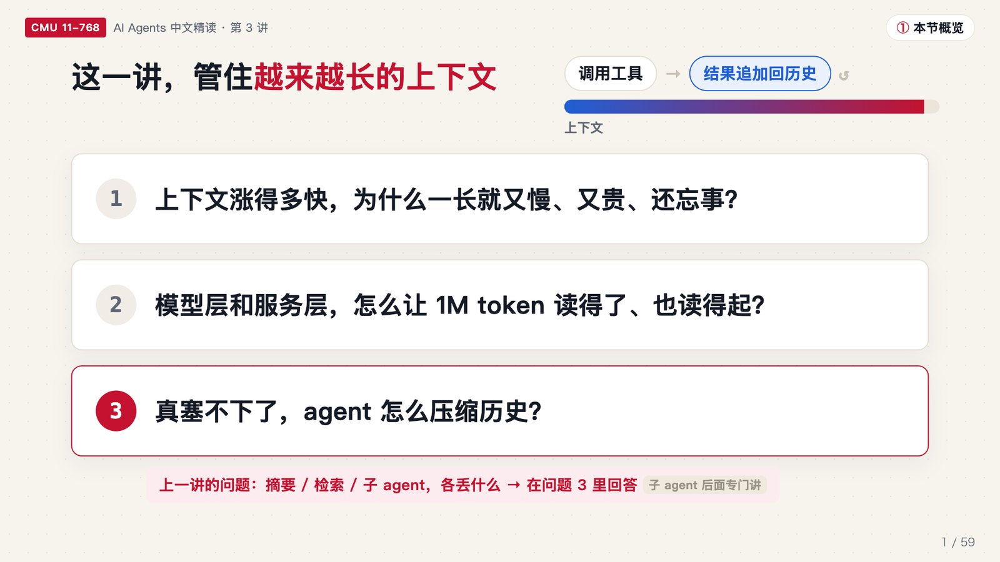

上一讲说，每次工具调用的定义、调用和结果，都要变成文字塞进上下文。agent 跑得越久，上下文就越长。这一讲围绕三个问题展开：

| 问题 | 对应章节 | 关键词 |
|---|---|---|
| 上下文涨得有多快？为什么一长就又慢、又贵、还忘事？ | 第 1 节 | 平方增长、预填充与解码、KV 缓存、大海捞针 |
| 模型层和服务层，怎么让 1M token 读得了、也读得起？ | 第 2、3 节 | 混合架构、DeltaNet、RoPE / NoPE / YaRN、提示词缓存、RadixAttention |
| 真塞不下了，agent 怎么压缩历史？什么能丢、什么不能丢？ | 第 4、5 节 | 状态估计、锚点、证据库、压缩漂移、OpenHands condenser |

上一讲留的问题（是把旧内容压成摘要、按需检索，还是派一个子 agent，各自会丢掉什么）在第 4 节回答：摘要会丢什么见 4.3 和 4.5，按需检索怎么补见 4.3 的"证据库"。子 agent 也是管理上下文的一种办法，这门课后面专门讲，这一讲不展开。

---

## 1 上下文为什么会越来越长、越来越难

### 1.1 历史线性增长，总输入按平方增长

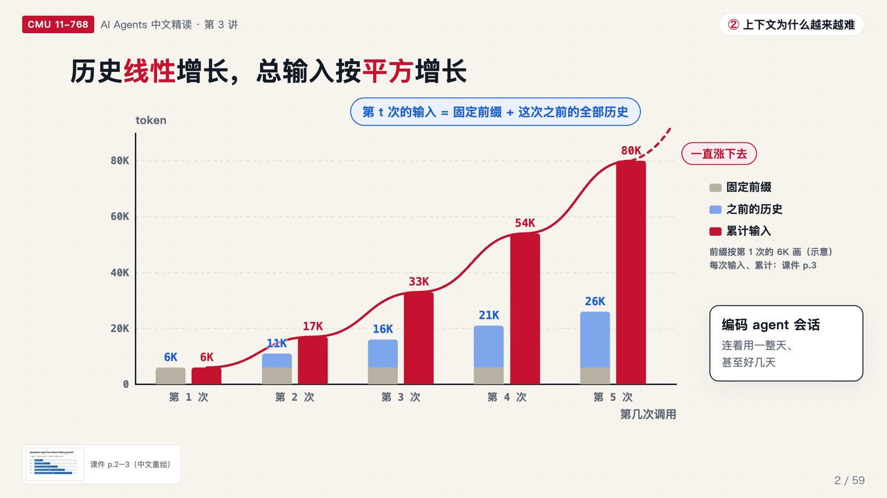

agent 每调一次模型，输入都是：

```text
第 t 次调用的输入 = 固定前缀（系统提示词、工具定义） + 这次调用之前的全部历史
```

原课件的例子：第 1 次调用输入 6K token，之后每次多 5K。

| 调用 | 这一次的输入 | 累计处理的输入 |
|---|---|---|
| 第 1 次 | 6K | 6K |
| 第 2 次 | 11K | 17K |
| 第 3 次 | 16K | 33K |
| 第 4 次 | 21K | 54K |
| 第 5 次 | 26K | 80K |

（图上把每次的固定前缀都按第 1 次的 6K 画，是示意；累计数字取自原课件。）

每一次的输入只是**线性**变长，但累计要处理的 token 是一个等差数列求和：第 n 次调用之后，累计是 `6n + 5·n(n−1)/2`（单位 K），按 n 的**平方**增长。五次调用就已经是 80K；如果什么都不做，后面会一直这样涨下去。

实践中，一个编码 agent 会话连着用一整天、甚至好几天，并不罕见。可以想象这个累计数会有多大。

### 1.2 一个 agent 的提示词里装了什么

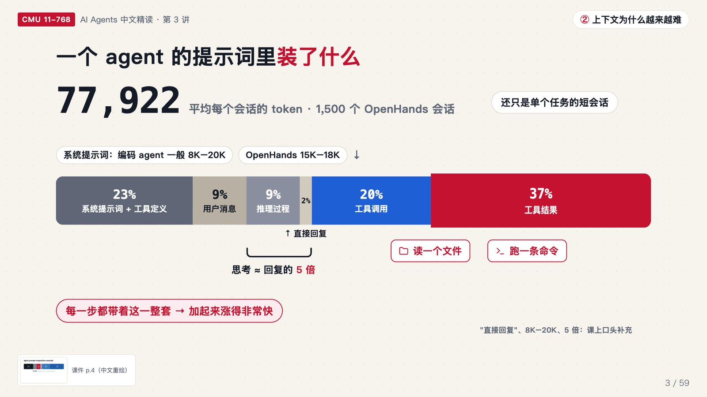

原课件统计了 1,500 个 OpenHands 会话，平均每个会话 **77,922 个 token**。注意这还只是解决单个任务的短会话，不是连着用好几天的那种。构成如下：

| 部分 | 占比 | 说明 |
|---|---|---|
| 系统提示词 + 工具定义 | 23% | 编码 agent 的系统提示词一般在 8K–20K token，看接进来多少工具；OpenHands 自己大约 15K–18K，因为它对"该怎么干活"规定得很细（课上口头补充） |
| 用户消息 | 9% | |
| 推理过程 | 9% | 模型的"思考" |
| 直接回复用户 | 2% | 课件上这一格没有标签，课上口头说明是模型直接对用户说的话 |
| 工具调用 | 20% | 模型写出的调用本身 |
| 工具结果 | 37% | 最大的一块：读一个文件、跑一条命令，返回的东西全都进了上下文 |

两个值得记住的比例：推理过程大约是直接回复的五倍（9% 对 2%），模型花在"想"上的 token 远多于跟你说话的；工具调用加工具结果占了一半多（57%），这正是上一讲那套机制的代价。每一步都包含这些部分，加起来涨得非常快。

### 1.3 两个挑战：能力和效率

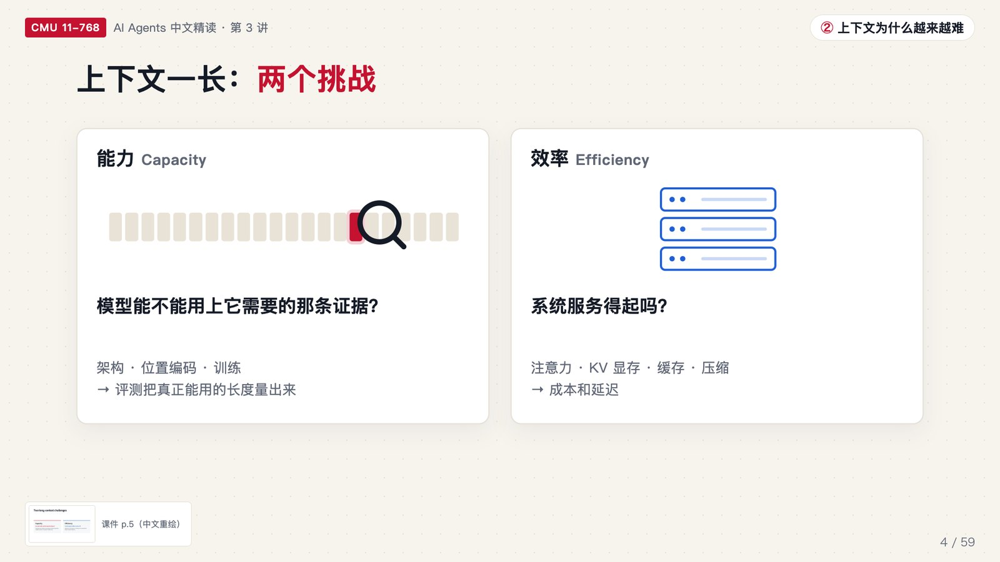

上下文一长，会碰到两个不同性质的问题：

| 挑战 | 问的是 | 由什么决定 |
|---|---|---|
| **能力（capacity）** | 模型能不能用上它需要的那条证据？ | 架构、位置编码和训练决定能用的上下文有多长；评测负责把真正能用的长度量出来 |
| **效率（efficiency）** | 系统服务得起吗？ | 注意力、KV 显存、缓存和压缩，最后落到成本和延迟上 |

这一讲后面的内容，基本都可以归到这两格里：第 1.7 节讲能力怎么量，第 2 节讲模型层怎么同时照顾两者，第 3 节讲服务层怎么省，第 4 节讲 harness 层在两者都不够时怎么办。

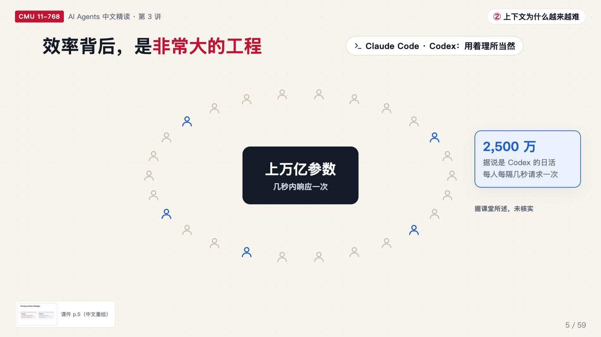

效率这件事，平时用 Claude Code、Codex 的人可能觉得理所当然，其实背后是非常大的工程：一个上万亿参数的模型，要在几秒内一遍遍地响应海量用户。课上口头提到，据说 Codex 有两千五百万日活用户，每个人每隔几秒就请求一次（这个数字课上也没有给出处，未核实）。

### 1.4 一次请求在推理服务里怎么走

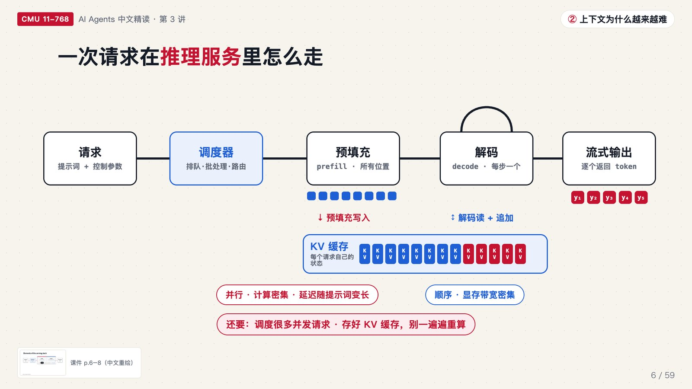

一次请求要经过这些环节：

```text
请求（提示词 + 控制参数）
  → 调度器（排队、批处理、路由）
  → 预填充 prefill：一次处理所有提示词位置，写入 KV 缓存
  → 解码 decode：每一步生成一个新位置，读 KV 缓存并追加，循环
  → 流式返回 token
```

中间那块 **KV 缓存（KV cache）**是每个请求自己的持久状态：预填充时写入，解码时一边读一边追加。两个阶段的特点很不一样：

| 阶段 | 英文 | 做什么 | 能否并行 | 瓶颈 |
|---|---|---|---|---|
| **预填充** | prefill | 把全部输入 token 一起算一遍，得到每个位置的 K、V。以前也叫"编码" | 可以批量并行 | 计算密集；延迟随提示词长度增长 |
| **解码** | decode | 拿着已有的 KV，生成一个输出 token，再把它的 K、V 追加进去 | 只能一步一个、顺序做 | 显存带宽密集 |

所以一个服务系统除了要算预填充和解码这两步，还要调度很多并发请求，还要把 KV 缓存存好，别一遍遍重算。预填充和解码的特性差得这么远，所以有工作干脆把两者拆到不同的机器上跑（DistServe，见延伸阅读）。

### 1.5 衡量服务的四个指标

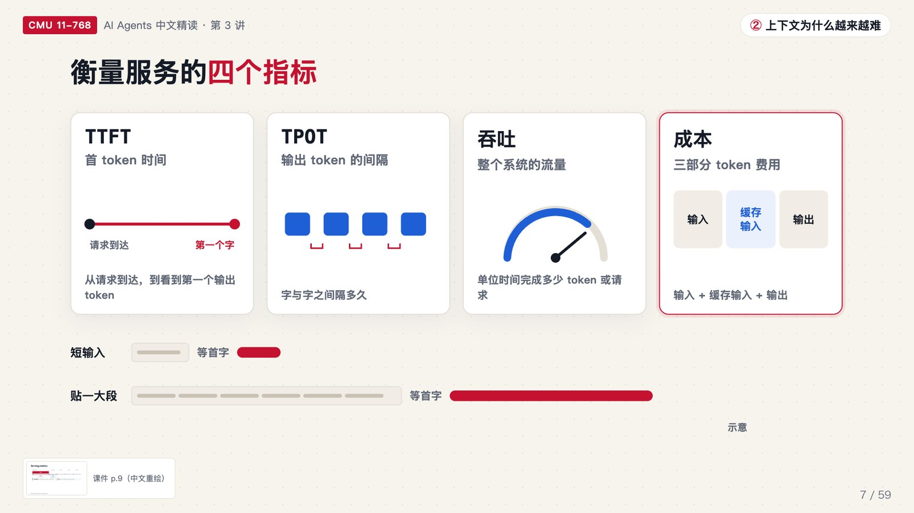

| 指标 | 英文 | 含义 | 你在哪能感觉到 |
|---|---|---|---|
| **TTFT** | time to first token，首 token 时间 | 从请求到达，到看到第一个输出 token | 往聊天框里贴一大段，要等更久才开始出字：输入越长，TTFT 越高（图下方两条横条是示意） |
| **TPOT** | time per output token | 相邻两个输出 token 之间的间隔 | 字往外蹦的速度 |
| **吞吐** | throughput | 单位时间内整个系统完成多少 token 或请求 | 通常从服务商的角度看 |
| **成本** | cost | 输入、缓存输入、输出，三部分 token 的费用加起来 | 账单 |

注意成本里单列了一项"缓存输入"，第 3 节会看到它便宜得多。

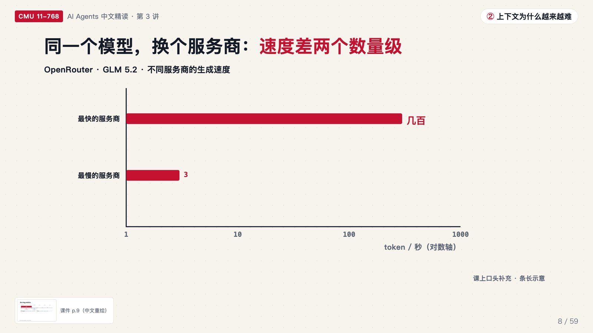

一个课上口头补充的现象：在 OpenRouter 上能看到，同一个模型（课上看的是 GLM 5.2）由不同服务商来跑，生成速度能差出两个数量级，有的每秒只有三个 token，有的每秒几百个（图上条长是示意）。这对用 agent 的体验影响非常大。上一讲讲过同一个模型换服务商后工具调用错误率也能差很多，这里是速度上的同一件事：**服务商本身就是一个变量。**

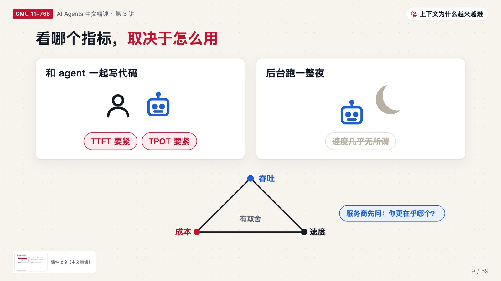

该盯哪个指标，取决于你怎么用 agent：

| 用法 | 要紧的指标 |
|---|---|
| 和 agent 一起交互式写代码 | TTFT、TPOT 很要紧，等不起 |
| 让 agent 在后台跑一整夜 | 速度几乎无所谓，更在乎成本 |

吞吐、成本和速度三者之间有取舍。实践中，服务商常会先问你更在乎哪个，再按你的需求去调整系统。

### 1.6 注意力回顾：平方从哪来

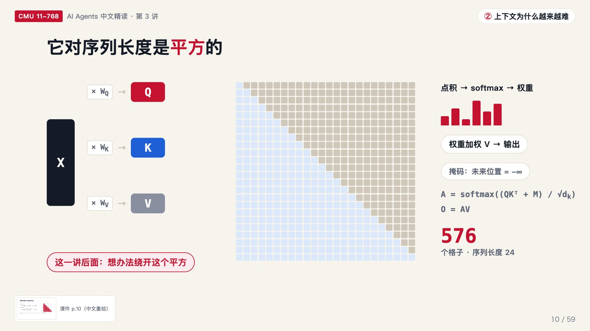

输入 X 经过三个线性投影得到查询、键、值：

```text
Q = X·W_Q      K = X·W_K      V = X·W_V
A = softmax((Q·Kᵀ + M) / √d_k)       # 因果自注意力
O = A·V
```

掩码 **M** 让每个位置只能看到自己和之前的位置，未来的位置设成负无穷（softmax 之后权重就是 0）。

问题在于它对序列长度 n 是**平方**的：每个位置都要和之前所有位置比一遍。图右的方阵就是 Q·Kᵀ，序列长度 24 时就有 24 × 24 = 576 个格子（下三角那一半是真正要算的）。长度翻十倍，格子数翻一百倍。这一讲后面很多内容，都是在想办法绕开这个平方。

### 1.7 号称的上下文 ≠ 真正能用的上下文

这是"能力"那一面。一个模型或服务号称能吃下一百万 token，不代表它真能用好一百万 token。

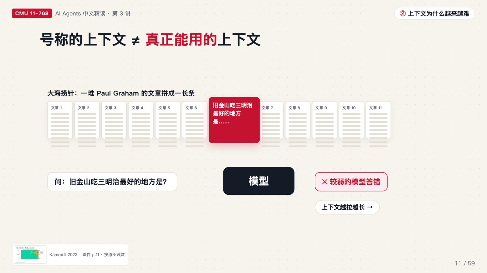

最有名的检验是 **大海捞针（needle in a haystack）**评测（Kamradt, 2023）：把一大堆 Paul Graham 的文章拼成一长条，在中间某个位置插一句"旧金山吃三明治最好的地方是某某"，最后问模型这个问题。把上下文越拉越长、把这句话插在不同深度，较弱的模型就开始答错。

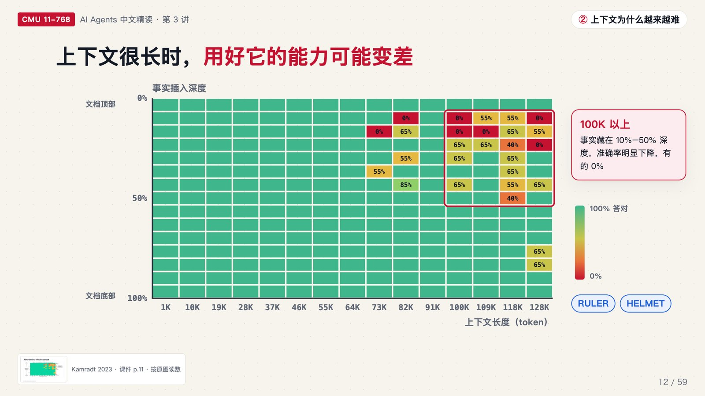

原课件放的是对 GPT-4 的结果：横轴是上下文长度（1K 到 128K），纵轴是那条事实被插在文档的哪个深度。大部分格子都是 100% 答对；但在长上下文那一端（100K 以上），事实藏在文档 10%–50% 深度时，准确率明显下降，图上能看到 0%、40%、55%、65% 这样的格子。

同类的常用基准还有 **RULER** 和 **HELMET**，它们在"找一句话"之外还测多跳追踪、聚合等更难的任务（论文见延伸阅读）。结论很简单：**上下文很长时，模型用好它的能力可能会变差。**

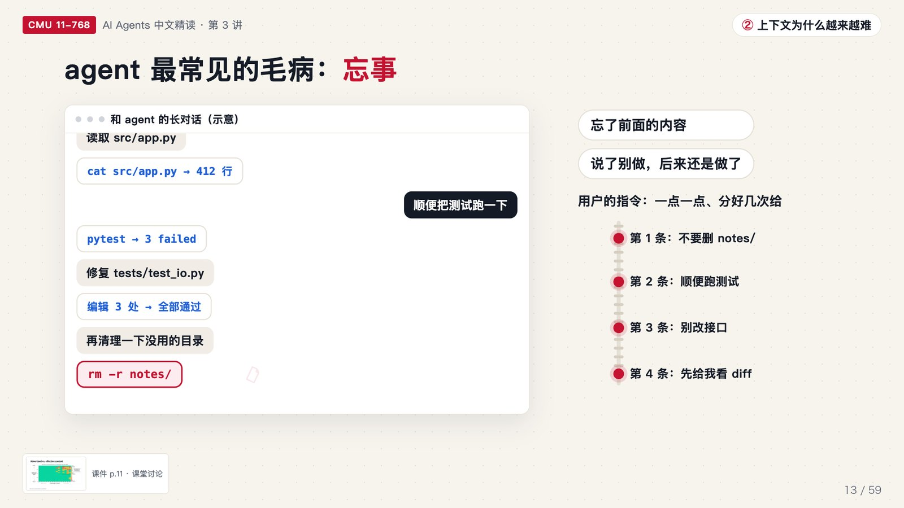

落到 agent 上，这个毛病最常见的样子是"忘事"：忘了前面的内容，或者对话中途说了别做某件事，后来它还是做了。实践中出过很糟的情况：用户明确说了"不要删这个"，agent 因为忘了这句话，还是把它删了（图上的对话是示意）。

在 agent 场景里这尤其要命，因为用户的指令就是一点一点、分好几次给的：第 1 条说不要删 `notes/`，第 2 条说顺便跑测试，第 3 条说别改接口，第 4 条说先给我看 diff。第一条离当前位置最远，也最容易被"忘"。你自己用 agent 的时候，不妨留意一下它忘过你哪句话。

---

## 2 模型层：怎么让模型读得了、读得起长上下文

这一节按四个方面讲：架构、训练、位置编码、并行。架构既关系效率，也关系准确。

### 2.1 全局注意力太贵：给比较次数设一个上限

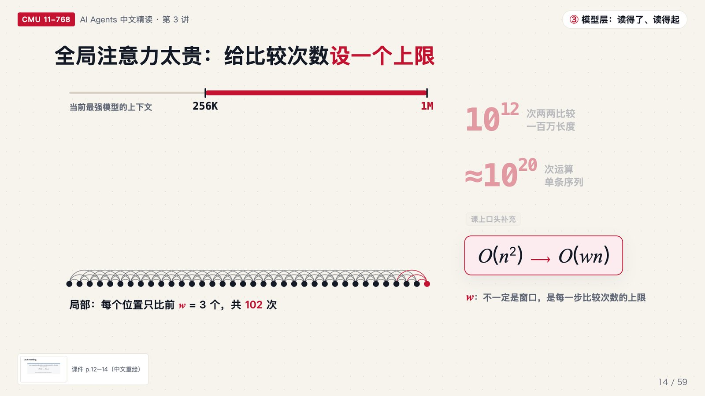

标准注意力是**全局（global）**的：每个位置和整个序列里的所有位置两两比较。

算一笔账（课上口头补充）：现在最强的模型，上下文一般在 256K 到 1M，而且大家都在往 1M 走。一百万长度，两两比较就是 10¹² 次；每次比较还要做大向量的乘法，单条序列的计算量会到 10²⁰ 左右。

几乎所有解决办法都是一个思路：**给每个时间步的比较次数设一个常数上限。**原课件把它叫**局部计算（local computation）**：每个位置只看一个固定大小 w 的子集，两两比较的成本就从 O(n²) 降到 O(wn)；w 是常数，工作量就和序列长度 n 成正比。图上的例子是每个位置只比前 w = 3 个，一共 102 次。

注意这里的 w 写成"窗口"，但不一定非得是一段连续的窗口，只要是"每一步比较次数的上限"就行。下面几种机制，就是这个上限的不同取法。

### 2.2 混合架构：几次局部，一次全局

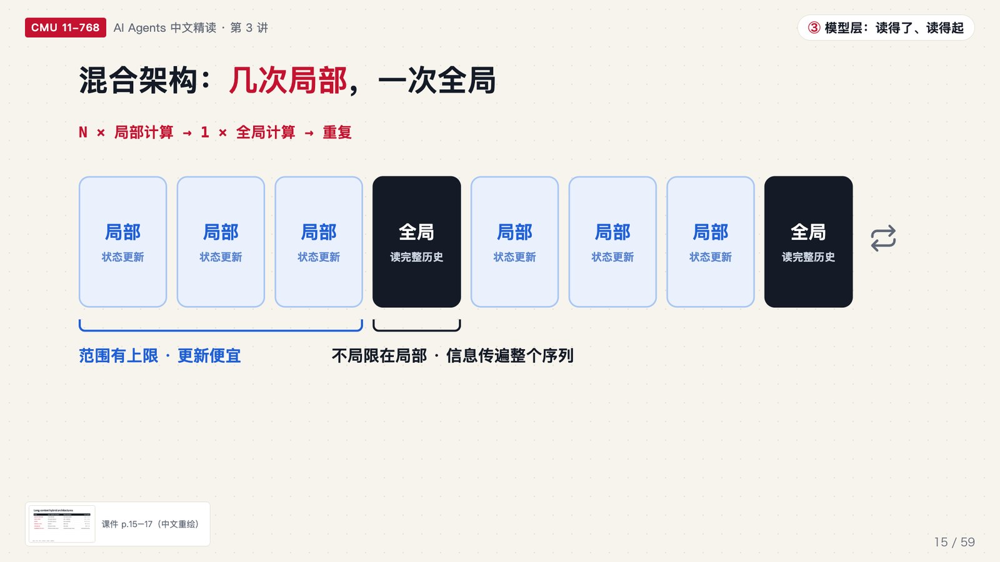

| 类型 | 计算范围 | 特点 |
|---|---|---|
| 局部模型 | 有上限，落在一个局部范围里 | 状态更新很便宜 |
| 全局模型 | 不局限在局部（可能有上限也可能没有） | 信息能在整个序列里传递 |

现在流行的模型几乎都是**混合（hybrid）**的：N 次局部计算（便宜的状态更新）→ 1 次全局计算（从完整历史里取信息）→ 再重复。

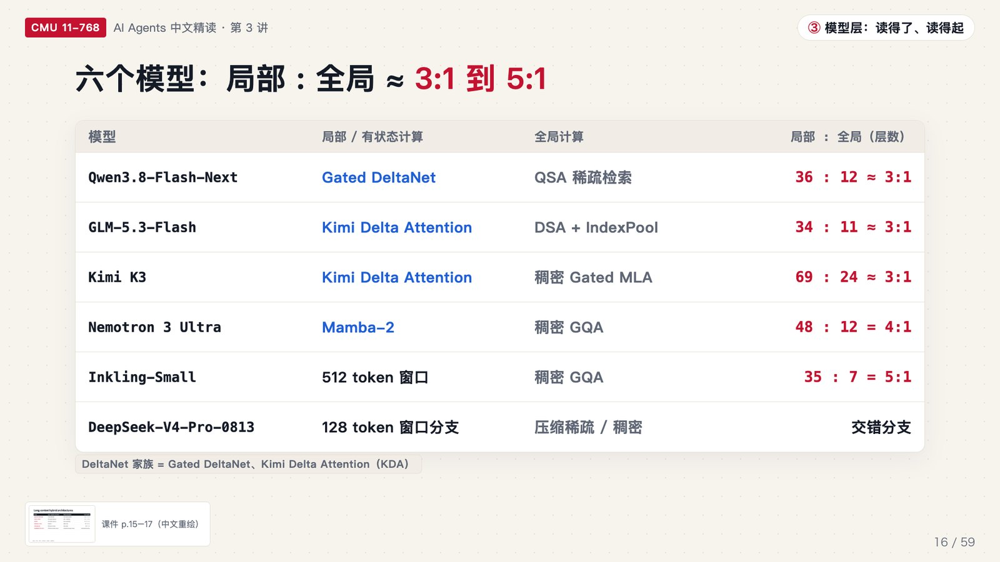

原课件对比了六个模型（按层数统计）：

| 模型 | 局部 / 有状态的计算 | 全局计算 | 局部 : 全局 |
|---|---|---|---|
| Qwen3.8-Flash-Next | Gated DeltaNet | QSA 稀疏检索 | 36 : 12 ≈ 3:1 |
| GLM-5.3-Flash | Kimi Delta Attention | DSA + IndexPool | 34 : 11 ≈ 3:1 |
| Kimi K3 | Kimi Delta Attention | 稠密 Gated MLA | 69 : 24 ≈ 3:1 |
| Nemotron 3 Ultra | Mamba-2 | 稠密 GQA | 48 : 12 = 4:1 |
| Inkling-Small | 512 token 窗口 | 稠密 GQA | 35 : 7 = 5:1 |
| DeepSeek-V4-Pro-0813 | 128 token 窗口分支 | 压缩稀疏 / 稠密 | 交错的分支 |

规律是：局部和全局的比例大多在 3:1 到 5:1 之间。表里的 Gated DeltaNet、Kimi Delta Attention（KDA）同属"DeltaNet 家族"，2.5 节会讲。

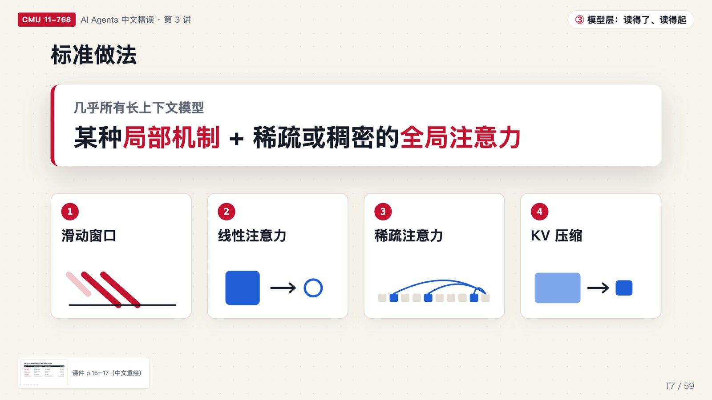

一句话概括今天的标准做法：**某种局部机制 + 稀疏或稠密的全局注意力。**反复出现的机制有四种：滑动窗口、线性注意力、稀疏注意力和 KV 压缩。下面不逐个讲实现细节，讲到你能自己去查论文的程度。

### 2.3 滑动窗口注意力：公式不变，只换掩码

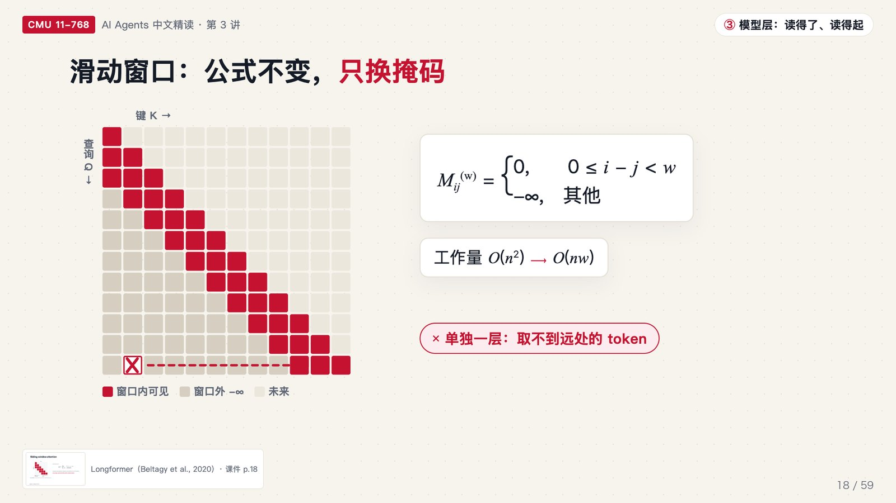

**滑动窗口注意力（sliding window attention）**概念上最简单：注意力公式一个字不改，只换掩码：

```text
M_ij = 0     当 0 ≤ i − j < w   （窗口内可见）
M_ij = −∞    其他               （窗口外和未来都不可见）
```

工作量从 O(n²) 降到 O(nw)。代价是：**单独一层，没法直接取到远处的 token。**（Longformer，Beltagy et al., 2020）

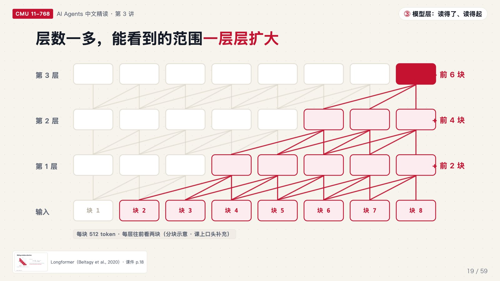

但层叠起来就不一样了。按块来看（图上每块 512 token、每层往前看两块，是课上口头补充的示意）：第 1 层只能从前两块拿信息；到了第 2 层，前面那些块的表示里已经带着它们更前面的信息，于是能"间接"看到前 4 块；第 3 层是前 6 块。**层数越多，能看到的范围就一点点扩大。**这和卷积网络里感受野随层数变大是同一个道理。

### 2.4 线性注意力：把 KV 缓存折叠成一个矩阵

**起点：softmax 注意力。**

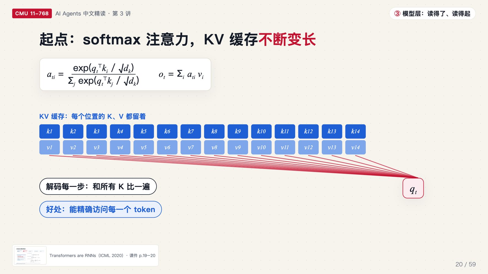

```text
a_ti = exp(q_tᵀk_i / √d_k) / Σ_j exp(q_tᵀk_j / √d_k)
o_t  = Σ_i a_ti · v_i
```

要保留之前每一个 k_i、v_i，KV 缓存不断变长；解码时，每一步都要拿 q_t 和所有的 k 比一遍，第 t 步是 O(t) 次比较。好处是能精确地访问到每一个 token。（Attention Is All You Need，Vaswani et al., 2017）

**线性注意力（linear attention）**分三步：

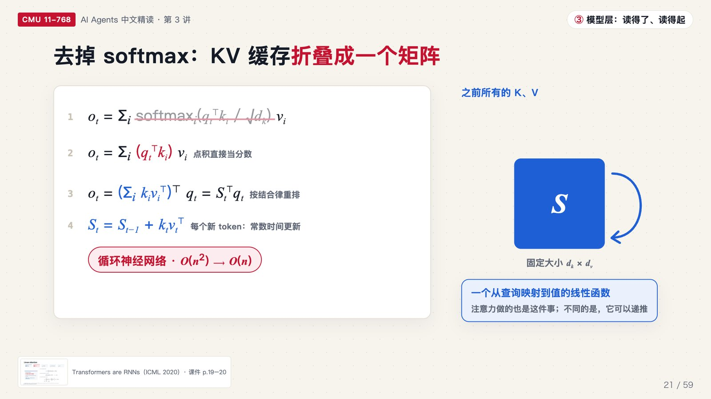

```text
1  o_t = Σ_i softmax(q_tᵀk_i / √d_k) · v_i       # 从标准注意力出发
2  o_t = Σ_i (q_tᵀk_i) · v_i                      # 去掉 softmax，点积直接当分数
3  o_t = (Σ_i k_i v_iᵀ)ᵀ q_t = S_tᵀ q_t           # 按结合律重排求和
4  S_t = S_{t−1} + k_t v_tᵀ                        # 每来一个新 token，常数时间更新
```

关键是第 3 步：去掉 softmax 之后，求和可以重新排列，于是之前所有的 K、V 被合成了一个**固定大小的状态矩阵（state matrix）** S（大小 d_k × d_v，和序列长度无关）。S 本身就是一个"从查询映射到值"的线性函数，注意力做的也是这件事；不同的是，S 可以递推，每来一个新 token 就用常数时间更新一次。这样它就变成了一个**循环神经网络（RNN）**，成本从平方级直接降到线性。（Transformers are RNNs，Katharopoulos et al., ICML 2020）

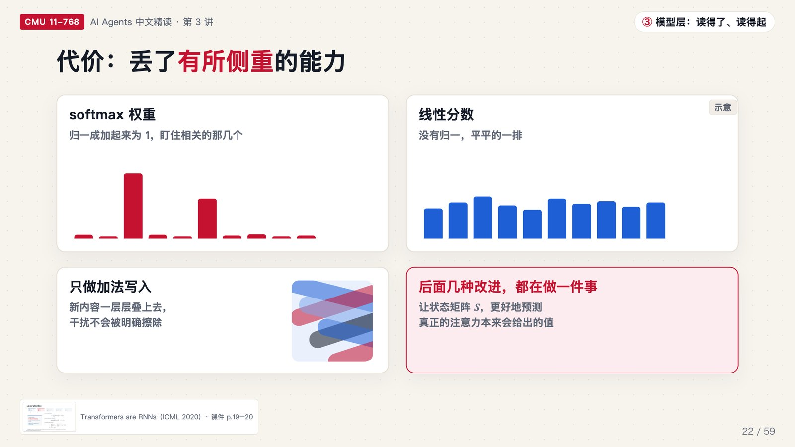

代价也很明显：

| | softmax 权重 | 线性分数 |
|---|---|---|
| 形状 | 归一成加起来为 1，能盯住相关的那几个 token | 没有归一，平平的一排（图上分布是示意） |
| 写入 | 每个 token 单独存着 | 只做加法写入：新内容一层层叠上去，干扰不会被明确擦除 |

softmax 是非线性的，它让模型"有所侧重"，这正是注意力的卖点；去掉它，表达力就变弱了。后面这几种改进，往深里看，都是想让这个状态矩阵更好地预测"真正的注意力本来会给出的值"。

### 2.5 DeltaNet 家族：只写误差，再学会遗忘

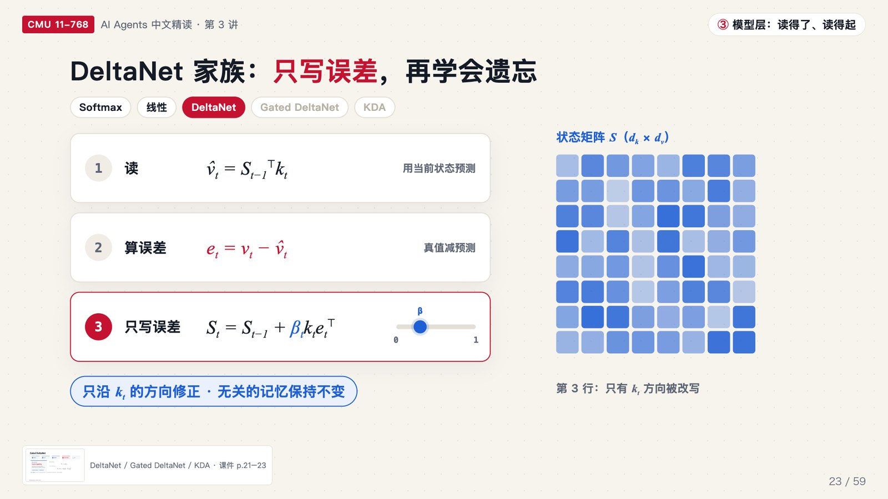

**DeltaNet** 把"只做加法"改成"只写误差"：

```text
1 读：    v̂_t = S_{t−1}ᵀ k_t          # 用当前状态预测 k_t 应该对应什么值
2 算误差：e_t = v_t − v̂_t              # 真值减预测
3 写误差：S_t = S_{t−1} + β_t k_t e_tᵀ  # 只把误差写进去
   输出： o_t = S_tᵀ q_t
```

β_t ∈ [0, 1] 是修正强度，作用类似学习率：不让一次更新太大。效果是把状态矩阵往一个方向推，让"长得像当前 key 的查询"能输出想要的值。**只沿着 k_t 的方向修正，无关的记忆保持不变**（图右只有一行被改写）。这其实就是在线做一步梯度下降的 delta 规则。（Linear Transformers Are Secretly Fast Weight Programmers，Schlag et al., ICML 2021）

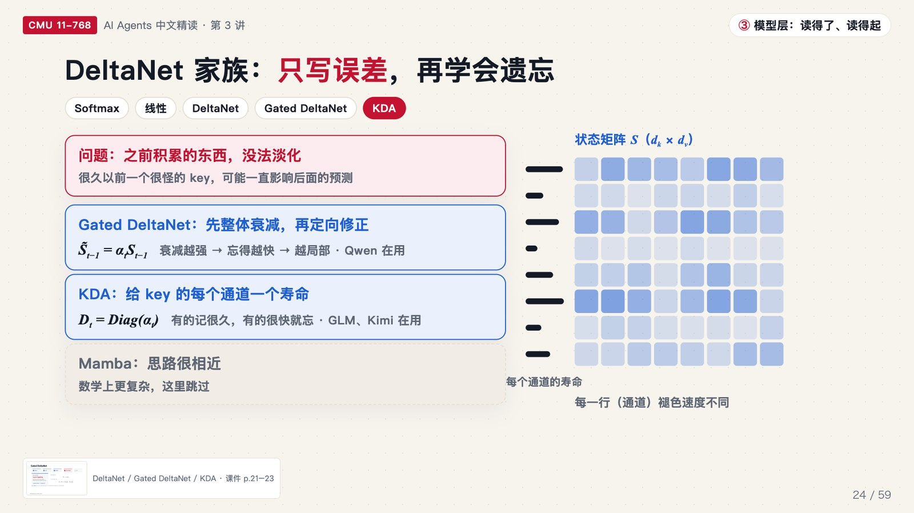

DeltaNet 还有个问题：之前积累的东西没有机制去淡化，很久以前一个很怪的 key，可能一直影响后面的预测。于是有了两步改进：

| 模型 | 改进 | 公式要点 | 退化情况 | 谁在用 |
|---|---|---|---|---|
| **Gated DeltaNet** | 先整体衰减，再定向修正 | `S̃_{t−1} = α_t · S_{t−1}`，α_t 是标量保留门；衰减越强，忘得越快，模型就越"局部" | α_t = 1 时退回 DeltaNet | Qwen |
| **Kimi Delta Attention（KDA）** | 给 key 的每个通道一个自己的寿命 | 衰减从标量变成向量 α_t ∈ [0,1]^d_k，写成对角矩阵 `D_t = Diag(α_t)`；有的通道记很久，有的很快就忘 | 所有通道衰减相同时退回 Gated DeltaNet | GLM、Kimi |

（Gated Delta Networks，Yang et al., 2024；Kimi Linear，Kimi Team, 2025）

还有 **Mamba**，思路很相近，数学上更复杂，这里就跳过了。2.2 节表里 Nemotron 用的 Mamba-2 就属于这一类。

### 2.6 稀疏注意力：只挑一部分看，而且限量

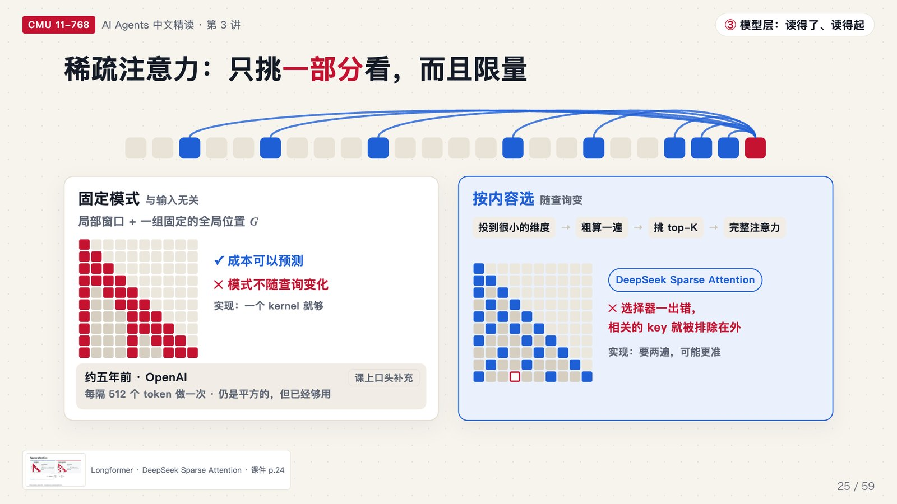

**稀疏注意力（sparse attention）**不看前文的全部，只看其中一部分，并且限制看的数量。两种做法：

| 做法 | 可见的位置 | 优点 | 缺点 | 实现 |
|---|---|---|---|---|
| 固定模式 | 局部窗口 + 一组固定的全局位置 G，与输入无关 | 成本可预测 | 模式不随查询变化 | 写一个 kernel 就够（Longformer, 2020） |
| 按内容选择 | 学出来的选择器 g 给每个查询挑 top-K 个 key | 能自适应地检索 | 选择器一出错，相关的 key 就被排除在外 | 要两遍，但可能更准（DeepSeek Sparse Attention, 2025） |

两种都只在留下来的集合上重新做 softmax 归一化。

按内容选择的具体做法（课上口头补充）：先用一种很便宜的方式粗算一遍注意力（比如把向量投影到很小的维度上），挑出 top-K，再只对这一小批做完整的注意力，DeepSeek 用的就是这种。历史上更早的稀疏注意力是 OpenAI 大约五年前的工作，每隔 512 个 token 做一次，仍然是平方的，但比全看少了几百倍，已经够用。

课堂上有人问：在压缩后的小空间里用什么衡量相似度？一般是点积而不是余弦，不过也可能事先做过归一化。这个细节课上也说不确定。

### 2.7 KV 压缩：缓存得更小

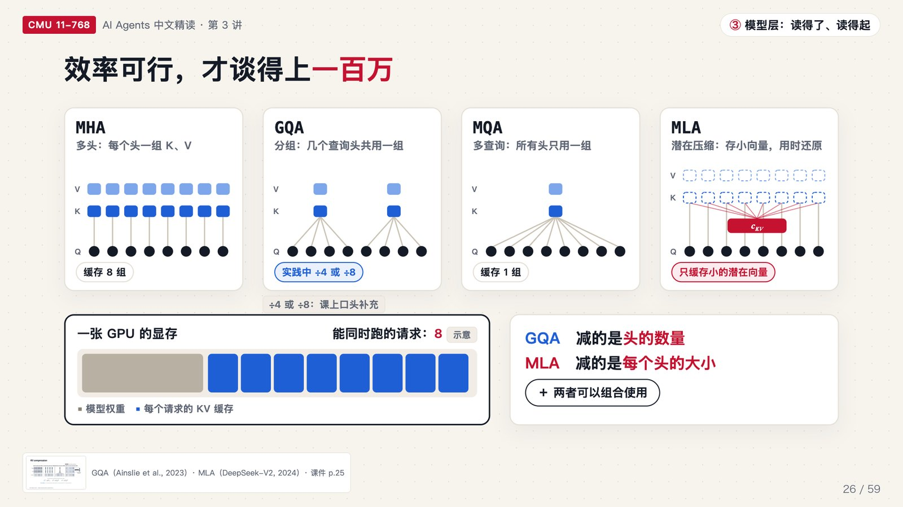

推理时缓存的是 K 和 V（不缓存 Q）。KV 缓存一大，一张 GPU 上能同时跑的请求就少（图下方"能同时跑 8 个请求"是示意）。四种结构对照：

| 结构 | 英文 | 做法 | 缓存 |
|---|---|---|---|
| **MHA** | multi-head attention，多头注意力 | 每个头一组 K、V | 全部要存 |
| **GQA** | grouped-query attention，分组查询注意力 | 几个查询头共用一组 K、V | 头数变少；实践中一般减到 1/4 或 1/8（课上口头补充）（Ainslie et al., 2023） |
| **MQA** | multi-query attention，多查询注意力 | 所有查询头只共用一组 | 相当于 GQA 只分一组 |
| **MLA** | multi-head latent attention，多头潜在注意力 | 不减头数，把 K、V 压成一个小的潜在向量缓存，用时再还原：`c_KV = W_D·z_t`，`k⁽ʰ⁾ = W_UK⁽ʰ⁾·c_KV`，`v⁽ʰ⁾ = W_UV⁽ʰ⁾·c_KV` | 只存小的潜在向量（DeepSeek-V2, 2024） |

区分要点：**GQA 减的是头的数量，MLA 减的是每个头的大小**，两者也可以组合使用。

有了这些架构上的办法，处理一百万 token，在效率上才变得可行。

### 2.8 训练长上下文模型：难点在数据

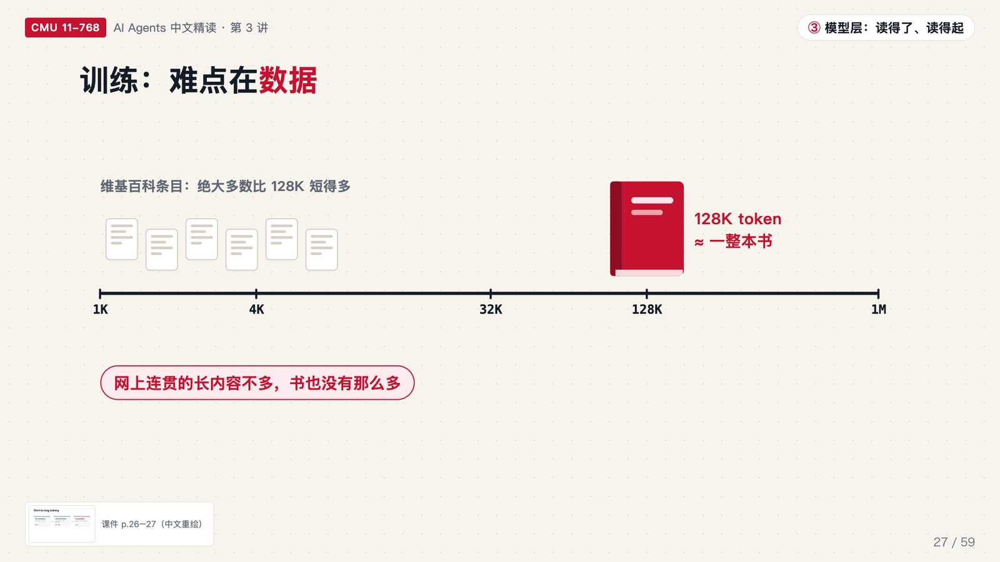

要模型处理 128K 甚至更长，就得拿这么长的连贯文本去训练它。问题是网上连贯的长内容并不多：128K token 比绝大多数维基百科条目都长，已经是一整本书的量级，而网上的书没有那么多。

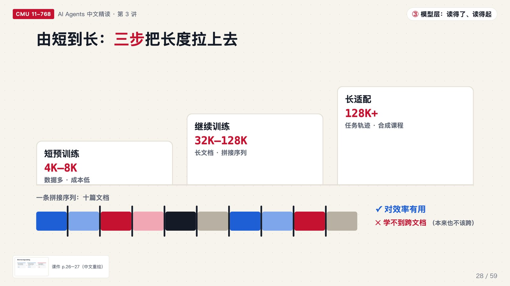

所以通常分三步把长度拉上去：

| 阶段 | 长度 | 数据 | 为什么 |
|---|---|---|---|
| 短预训练 | 4K–8K | 数据多 | 成本低，大部分知识在这里学 |
| 继续训练 | 32K–128K | 长文档、拼接序列 | 开始适应长距离 |
| 长适配 | 128K 以上 | 任务轨迹、合成课程 | 学会在真正长的上下文里干活 |

一个容易误解的点：**拼接序列（packed sequences）**是把好几篇文档拼进一条序列，它对训练效率有用（不浪费填充位），但对学长上下文帮助不大。拼了十篇文档，模型并不会学着跨文档去看，而且本来也不该跨。真要适配很长的上下文，需要本身连贯的长数据。

### 2.9 位置编码：从加一个向量，到旋转 Q、K，再到不要

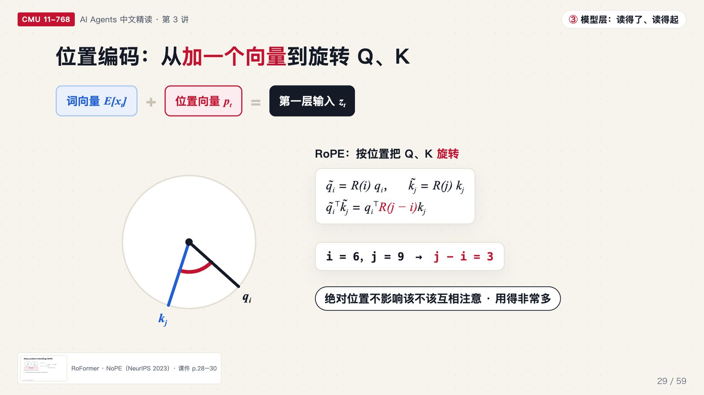

**绝对位置编码（absolute position encoding）**：第一层的输入是词向量加位置向量，`z_t = E[x_t] + p_t`。固定的正弦编码按公式定义每个位置，学出来的绝对位置是一张固定大小的表。位置信息在算 Q、K、V 之前就进来了。（Vaswani et al., 2017）

**旋转位置编码（RoPE, rotary position embedding）**：把 Q、K 按各自的位置旋转：

```text
q̃_i = R(i)·q_i        k̃_j = R(j)·k_j
q̃_iᵀ k̃_j = q_iᵀ R(j − i) k_j        # 只取决于相对距离 j − i
```

例如 i = 6、j = 9，结果只和 j − i = 3 有关。V 不变，注意力公式也不变。目的是不让绝对位置影响两个 token 之间该不该互相注意。它用得非常多。（RoFormer，Su et al.）

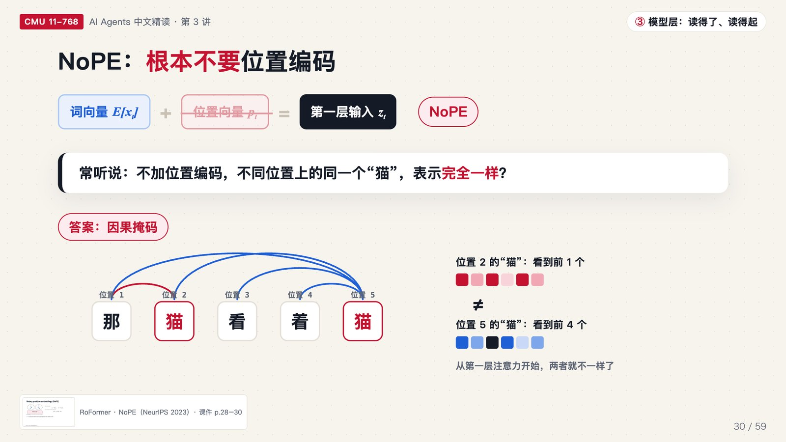

**NoPE（no positional encoding）**：第一层的输入只有词向量 `z_t = E[x_t]`，注意力公式不变。顺序从因果计算或循环的动态里推出来，而不是靠 p_t 或 R(t)。这样就不存在"位置怎么外推"的问题，但长距离的行为仍然要靠训练。（Kazemnejad et al., NeurIPS 2023）

这很反直觉。学 Transformer 时常听到：不加位置编码，不同位置上的同一个"猫"，表示完全一样。为什么现在不成立了？答案是**因果掩码**：在"那 猫 看 着 猫"里，位置 2 的"猫"只能看到前面 1 个 token，位置 5 的"猫"能看到前面 4 个，从第一层注意力开始，两者的表示就不一样了。

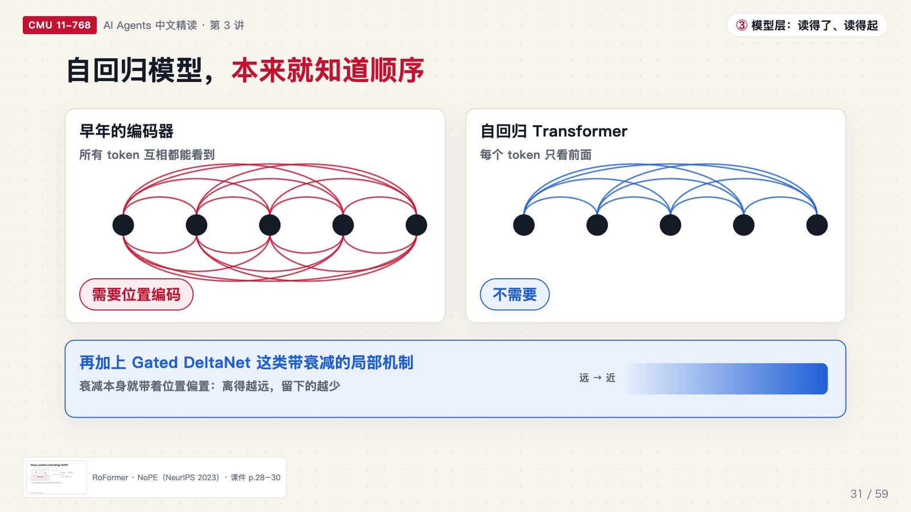

| 模型 | 注意力可见范围 | 需要位置编码吗 |
|---|---|---|
| 早年的编码器 | 所有 token 互相都能看到，顺序信息无从得知 | 需要 |
| 自回归 Transformer | 每个 token 只看前面，看到的"数量"本身就编码了位置 | 不需要 |

再加上 Gated DeltaNet 这类带衰减的局部机制，衰减本身就带着位置偏置（离得越远，留下的越少），就更不需要了。

### 2.10 把上下文拉长：位置插值和 YaRN

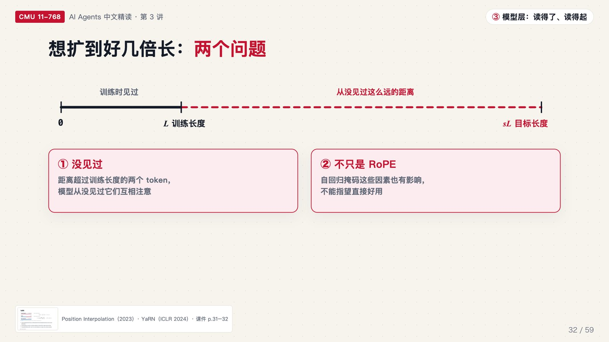

假设模型用的是 RoPE，在长度 L 上训练，想扩展到 L′ = sL。会遇到两个问题：

1. **没见过**：模型从没见过距离超过训练长度的两个 token 互相注意。
2. **不只是 RoPE**：相对位置编码只是一部分，自回归掩码这些因素也有影响，不能指望直接拿到更长序列上就好用。

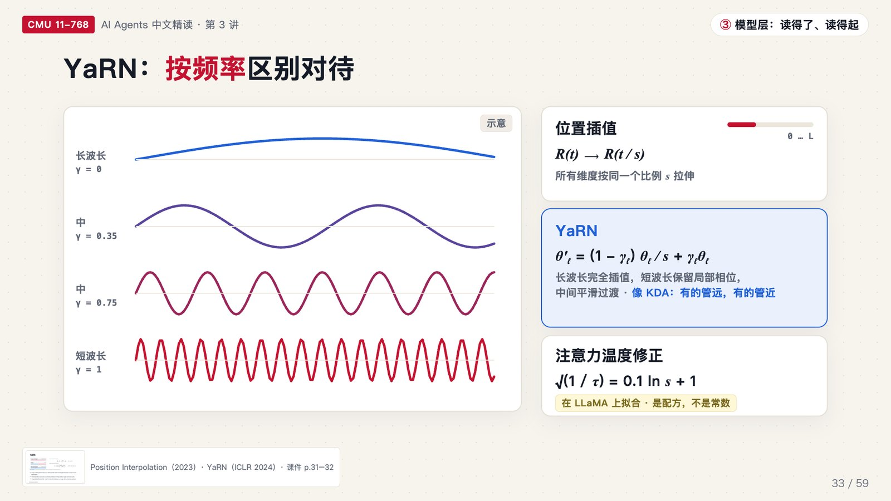

| 方法 | 做法 | 直觉 |
|---|---|---|
| **位置插值**（position interpolation） | `R(t) → R(t/s)`，等价于每个频率 θ_l 都除以 s | 所有维度按同一个比例拉伸，长位置仍然落在预训练见过的相位范围里（Chen et al., 2023） |
| **YaRN** | `θ′_l = (1 − γ_l)·θ_l / s + γ_l·θ_l`：长波长的维度完全插值（γ = 0），短波长的保留原来的局部相位（γ = 1），中间平滑过渡 | 有的维度管远、有的管近，和 KDA"每个通道各自遗忘"的思路有点像（Peng et al., ICLR 2024） |

图左各条波形和 γ 的取值是示意。YaRN 还加了一个**注意力温度修正**：`√(1/τ) = 0.1·ln s + 1`，用来抵消扩展倍数变大时注意力熵的漂移。原课件特意注明：这个公式是在 LLaMA 上拟合出来的，**是配方，不是通用常数**，换个模型族未必合适。

### 2.11 各家怎么扩到 1M

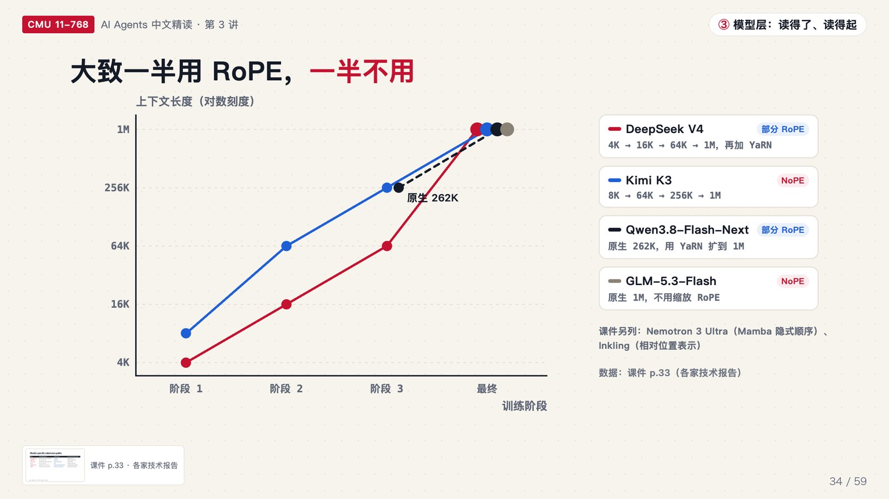

| 模型 | 上下文长度的训练 | 位置方法 | 怎么到达最大上下文 |
|---|---|---|---|
| Qwen3.8-Flash-Next | 原生 262K；完整课程未公开 | 部分 RoPE | 用 YaRN 扩到 1M |
| DeepSeek V4 | 4K → 16K → 64K → 1M | 部分 RoPE | 渐进训练 + YaRN |
| GLM-5.3-Flash | 原生 1M；具体课程未公开 | 主注意力里用 NoPE | 不需要 RoPE 缩放 |
| Kimi K3 | 8K → 64K → 256K → 1M | NoPE | 渐进训练到 1M |
| Nemotron 3 Ultra | 1M 长上下文继续预训练；SFT 到 512K | 靠 Mamba 隐式的顺序，无 RoPE | 在长长度上训练和评测 |
| Inkling | 1M 上下文；课程未公开 | 相对位置编码 | 学出来的相对表示 |

大致一半用部分 RoPE，一半干脆不用位置编码。"部分 RoPE"指只在一部分维度上做旋转，其余维度不加位置信息。

### 2.12 长数据从哪来

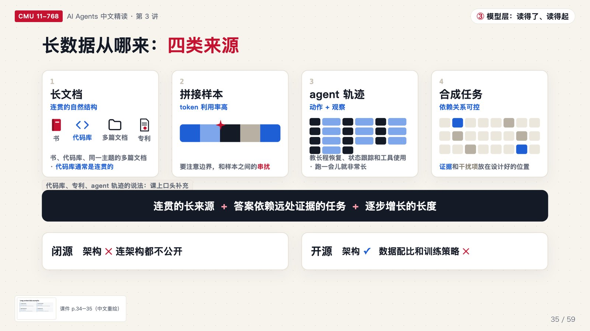

| 来源 | 优点 | 要注意 | 例子 |
|---|---|---|---|
| 长文档 | 结构天然连贯 | 数量有限 | 书、代码库（下载一个大仓库就有足够多的 token）、同一主题的多篇文档、专利（公开数据多，还能相互关联） |
| 拼接样本 | token 利用率高 | 要注意边界和样本之间的串扰 | 2.8 节说的拼接序列 |
| agent 轨迹 | 教长程恢复、状态跟踪和工具使用 | | 动作 + 观察；agent 只要跑一会儿，轨迹就非常长 |
| 合成任务 | 依赖关系可控 | | 把证据和干扰项放在设计好的位置 |

（代码库、专利、agent 轨迹这几条说明是课上口头补充。）原课件还列了各家的数据配比：

| 模型 | 天然长数据 | 构造的监督 | 长度课程 |
|---|---|---|---|
| Kimi K3 | 清洗、上采样的文档 + 视频 | 打乱顺序的多模态子任务，证据分布在整个上下文 | 8K → 64K → 256K → 1M |
| GLM-5 | 文档；仓库文件、issue、PR 和 diff | 合成依赖 + agent 轨迹 | 32K → 128K → 200K |
| Nemotron 3 Ultra | 长文档问答 | 多文档推理、顺序扫描、合成表格 | 33B token 的 1M 继续预训练；SFT 到 512K |
| DeepSeek V4 | 科学论文 + 技术报告 | 长上下文预训练之后做 agentic 后训练 | 4K → 16K → 64K → 1M |

共同的配方：**连贯的长来源 + 答案依赖远处证据的任务 + 逐步增长的长度。**

为什么只能讲到这个程度？闭源的公司连架构都不公开；开源模型必须公开架构，不然没法运行，于是它们藏起来的，是数据配比和训练策略。

### 2.13 上下文并行：序列切块，K、V 绕环传

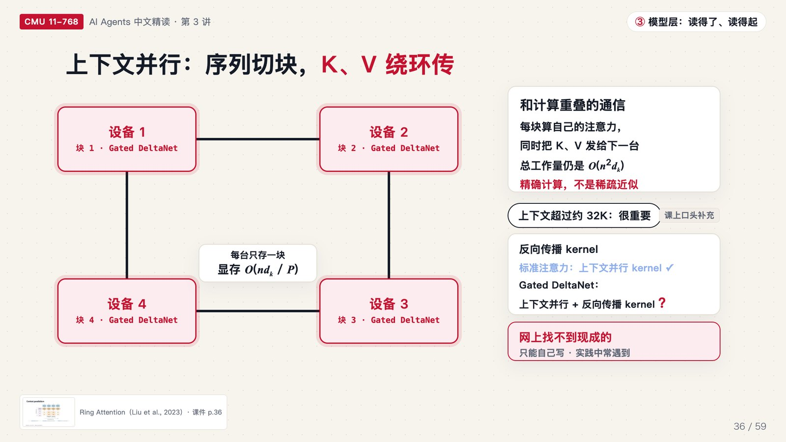

训练（或服务）大模型时，常见的并行方式有数据并行和模型并行，后者又包括专家并行、张量并行、流水线并行。训练 agent 要用很长的上下文，所以**上下文并行（context parallelism）**变得重要：

1. 把序列切成 P 块，分到 P 台设备上；
2. 每台设备算自己那块的注意力，同时把 K、V 发给下一台、从上一台接收；
3. 一圈圈传下去，直到每块都和所有该看的块算过。

| 量 | 值 |
|---|---|
| 每台设备的显存 | O(n·d_k / P)，每台只存一块 |
| 通信 | 和分块注意力的计算重叠进行 |
| 总工作量 | 仍是 O(n²·d_k)：是精确计算，不是稀疏近似 |

（Ring Attention，Liu et al., 2023；Megatron 的 context parallelism）

上下文超过 32K 左右时这就很重要了，但它也麻烦：做模型的人想用 KDA，做基础设施的人就得给 KDA 写一个支持上下文并行、还能反向传播的 kernel。实践中常遇到：想给用 Gated DeltaNet 的 Qwen 做上下文并行训练，却找不到现成的 kernel，只能自己写，或者换方案。标准注意力和滑动窗口的 kernel 都好找，难的是那些非标准的注意力。

---

## 3 服务层：提示词缓存和 KV 缓存

这一部分即使你不部署模型、只是用 agent、写 harness，也非常重要。

### 3.1 一次次调用之间，复用 KV

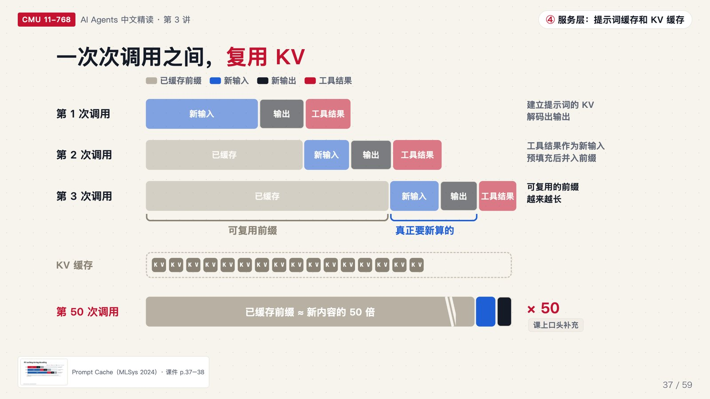

回到 1.4 节的两个阶段。一次 agent 调用：算输入时做预填充，算输出（消息和工具调用）时做解码，两个阶段都会产生 KV。算完之后，到输出末尾为止每个位置的 K、V 都有了，可以放进缓存，下次不用再算。

工具结果是新的（模型还没对它做过计算），它作为下一次调用的新输入进来；预填充完，它也加入可复用的前缀。于是：

| 调用 | 已缓存前缀 | 真正要新算的 |
|---|---|---|
| 第 1 次 | 无 | 新输入、输出 |
| 第 2 次 | 第 1 次的全部 | 上次的工具结果 + 新输出 |
| 第 3 次 | 前两次的全部 | 同上 |
| 第 50 次 | 很长 | 依然只是最后那一点 |

原课件的说法：调用内部，输出 token 在解码时扩展 KV 缓存；调用之间，工具结果作为新输入返回，预填充后成为可复用前缀的一部分。这就是**提示词缓存（prompt caching）**，也叫前缀缓存。（Prompt Cache，Gim et al., MLSys 2024）

到第五十步，如果不做特别处理，缓存的部分会是新内容的五十倍左右（课上口头补充的估算）。缓存做好了，省得非常多。对照 1.1 节：平方增长的那部分"累计输入"，绝大多数其实都是可以缓存的前缀。

### 3.2 缓存的实测收益

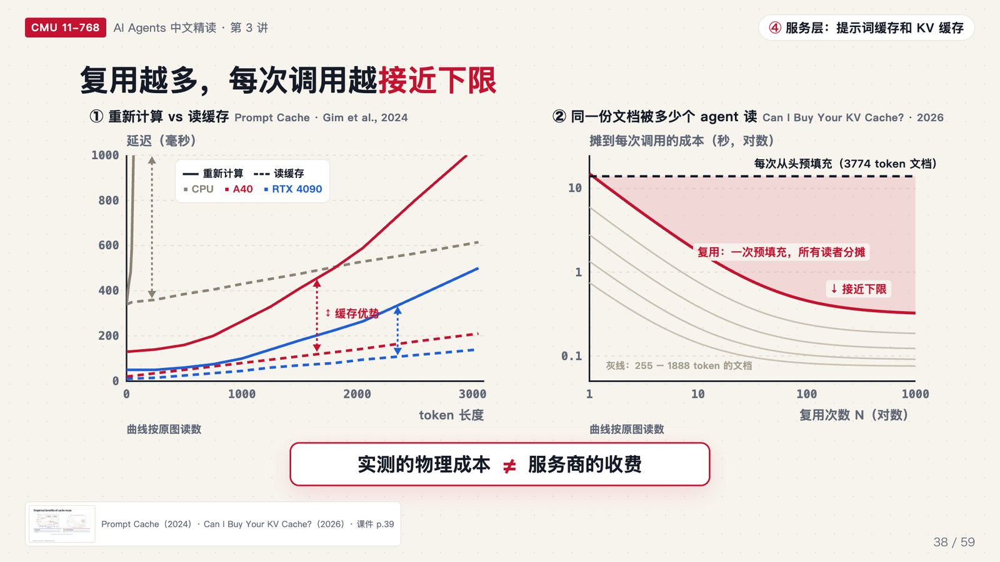

两篇论文的图：

| 图 | 横轴 | 纵轴 | 结论 |
|---|---|---|---|
| ① Prompt Cache（Gim et al., 2024） | token 长度（0–3000） | 延迟 | 在 CPU、A40、RTX 4090 上，"重新计算"的延迟都比"读缓存"涨得快得多；两者差多少取决于硬件 |
| ② *Can I Buy Your KV Cache?*（2026） | 复用次数 N：多少个 agent 读同一份文档（1–1000） | 摊到每次调用的成本 | 一次预填充被所有读者分摊，复用越多越接近"复用一步"的下限；每次都从头预填充则是一条水平线 |

（两张图的曲线都是按原图读数重画的。）原课件底下一句提醒很重要：**实测的物理成本，和服务商的收费，是两种不同的量。**物理上省了多少是一回事，服务商按什么价格收你的钱是另一回事。

### 3.3 缓存读取，一般只收十分之一

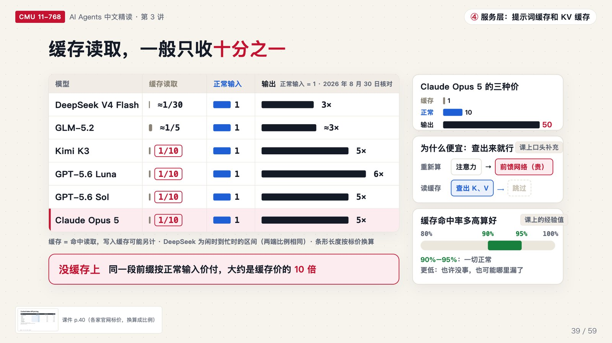

原课件列了各家的官方价格（2026 年 8 月 30 日核对）。换算成以"正常输入 = 1"的比例：

| 模型 | 缓存读取 | 正常输入 | 输出 |
|---|---|---|---|
| DeepSeek V4 Flash | ≈ 1/30 | 1 | 3× |
| GLM-5.2 | ≈ 1/5 | 1 | ≈ 3× |
| Kimi K3 | 1/10 | 1 | 5× |
| GPT-5.6 Luna | 1/10 | 1 | 6× |
| GPT-5.6 Sol | 1/10 | 1 | 5× |
| Claude Opus 5 | 1/10 | 1 | 5× |

注："缓存"指缓存命中后的读取，写入缓存可能另外计费；DeepSeek 的价格是闲时到忙时的区间，两端比例相同。

规律是：**缓存读取一般是正常输入价格的十分之一左右。**以 Claude Opus 5 为例，缓存 : 正常输入 : 输出 = 1 : 10 : 50。换句话说，同一段前缀如果没缓存上，就要按正常输入价付费，大约是缓存价的 10 倍。所以一定要清楚自己的 token 有没有被缓存上。

为什么缓存便宜？只需要把已经算好的 K、V 查出来，不用真的再算一遍。重新计算要走完注意力和前馈网络（这部分很贵），读缓存则全部跳过。

缓存命中率多高算好？经验是：**90% 到 95% 就说明一切正常；**低于这个数，也许没事（比如你的任务本身每步都有大量新输入），但可能哪里漏了，值得去查。

### 3.4 怎么放在显存里：PagedAttention

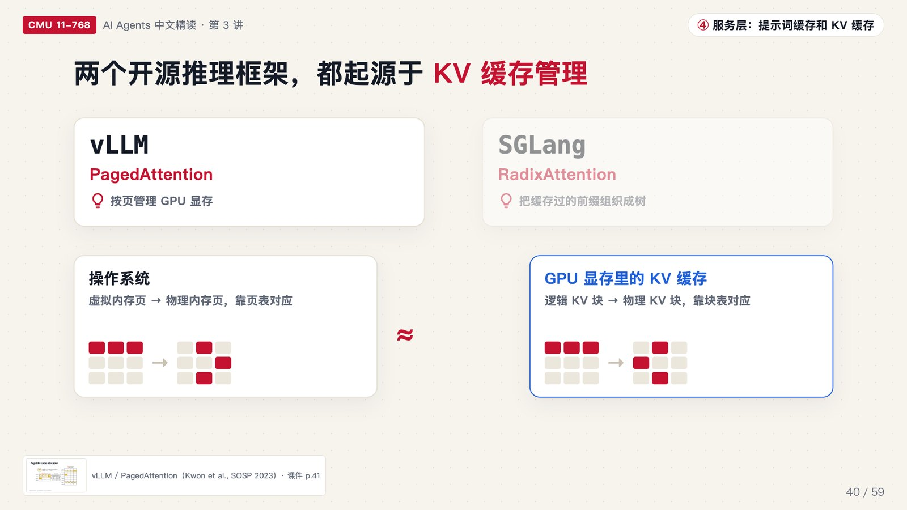

两个最流行的开源推理框架 **vLLM** 和 **SGLang**，各自都起源于一项 KV 缓存管理上的创新（现在它们都已经是通用推理框架，功能远不止这些）：

| 框架 | 核心创新 | 类比 |
|---|---|---|
| vLLM | **PagedAttention**：按页管理 GPU 显存 | 操作系统的虚拟内存：虚拟页 → 物理页，靠页表对应 |
| SGLang | **RadixAttention**：把缓存过的前缀组织成一棵树 | 下一节讲 |

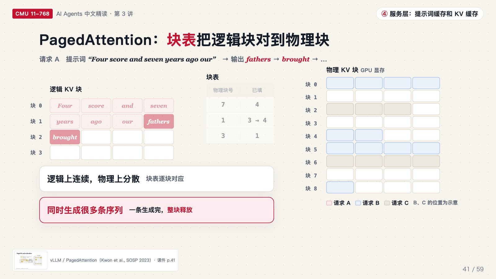

PagedAttention（Kwon et al., SOSP 2023）的例子：请求 A 的提示词是 "Four score and seven years ago our"，接着生成 "fathers" → "brought"。

| 逻辑块 | 内容 | 对应物理块 | 已填 |
|---|---|---|---|
| 块 0 | Four score and seven | 7 | 4 |
| 块 1 | years ago our fathers | 1 | 3 → 4（生成 "fathers" 后） |
| 块 2 | brought | 3 | 1 |

**逻辑上连续，物理上分散，块表逐块对应**（图右请求 B、C 的位置是示意）。好处是不用给每个请求预留一整段连续显存，于是能同时生成很多条序列；一条生成完了，就把它的块整块释放掉。

### 3.5 前缀复用：RadixAttention

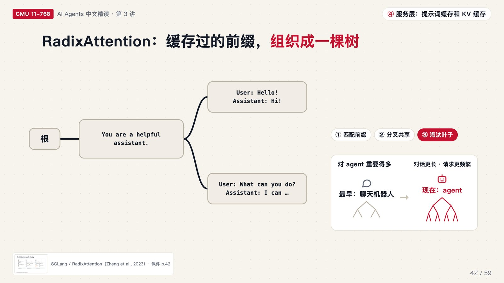

**RadixAttention**（SGLang，Zheng et al., 2023）专门为了复用已经缓存的输入。它把所有缓存过的前缀组织成一棵**基数树（radix tree）**，新请求来了就在树上找最长的已算过的前缀。三个操作：

| 操作 | 做什么 | 图上的例子 |
|---|---|---|
| 匹配 | 复用前缀，追加新的后缀 | 新请求以 "You are a helpful assistant." 开头，直接复用这一段 |
| 分叉共享 | 两段对话在分叉处分成两个分支，公共前缀只存一份 | "User: Hello!" 和 "User: What can you do?" 共享系统提示词 |
| 淘汰叶子 | 显存不够时，删掉最久没用的叶子节点（LRU） | |

它最早面向聊天机器人：用户开一段对话再接着聊，前面那部分就能缓存。现在它对 agent 重要得多，因为 agent 的对话更长、请求更频繁。

### 3.6 缓存感知路由

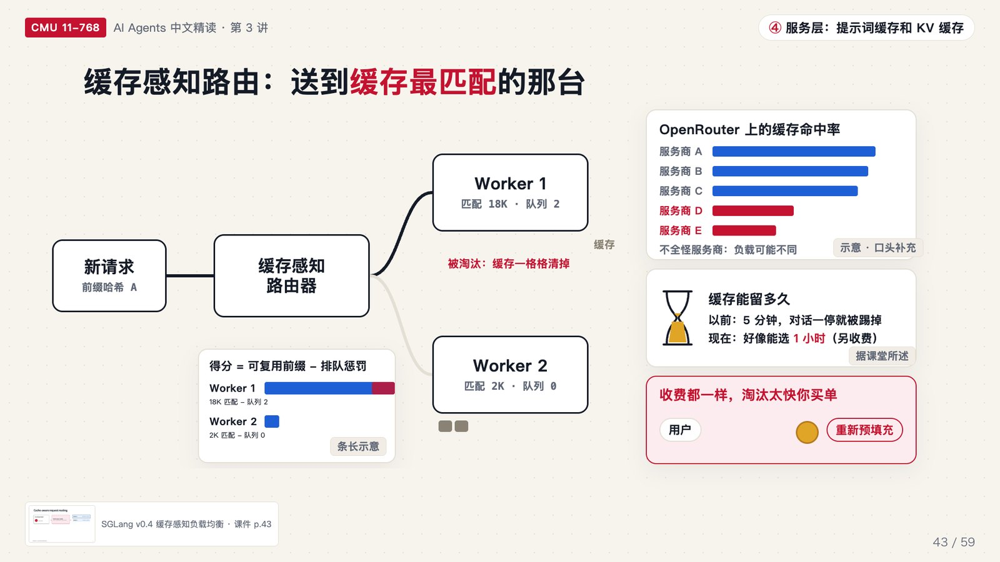

多机部署时（一个服务集群可能有几十上百个节点），缓存只在某一台机器上。所以每个请求进来，都应该路由到缓存最匹配它的那台。原课件的例子（SGLang v0.4 的缓存感知负载均衡）：

```text
得分 = 可复用的前缀 − 排队惩罚
Worker 1：匹配 18K，队列里有 2 个
Worker 2：匹配 2K，队列为空
→ 打分后选了 Worker 1：多复用 16K 前缀，抵得过多排两个请求
```

几个课上口头补充的现实情况：

- OpenRouter 上能看到各服务商的缓存命中率，有的明显偏低（图上条长是示意）。这不完全说明服务商做得差，也可能是跑的负载不同。影响命中率的因素，一是缓存路由做得好不好，二是缓存多快被淘汰。
- 服务商不会永远替你留着缓存。课上口头提到，Anthropic 以前是 5 分钟左右（对话不停就一直在缓存里，一停就被踢掉），现在好像能选到 1 小时，价格稍高；这一条课上也说对最新情况不太确定，以官方文档为准。
- 对用户不利的是：不管路由做得多好、淘汰得多快，收费都一样。被淘汰得太快，多花的钱是你出。
- 会不会分层缓存（快的放 GPU、慢的放磁盘）？课上没有给出确定答案；有学生补充，一般会从 GPU 卸载到 CPU 内存，因为 GPU 显存太宝贵。

### 3.7 写 harness：千万别无意中打破缓存

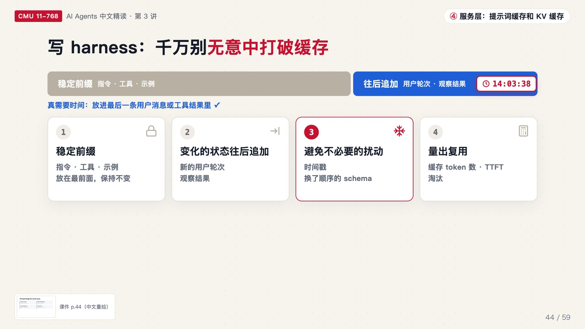

如果你只是写 harness、不部署模型，这一讲最实用的一点就是：**千万别无意中打破缓存。**缓存是按前缀匹配的，前缀里改动一个 token，从那个位置往后的缓存就全部作废。原课件给了四条：

| # | 原则 | 具体指 |
|---|---|---|
| 1 | 稳定前缀 | 指令、工具、示例放在最前面，保持不变 |
| 2 | 变化的状态往后追加 | 新的用户轮次、观察结果 |
| 3 | 避免不必要的扰动 | 时间戳、换了顺序的工具 schema |
| 4 | 量出复用情况 | 缓存 token 数、TTFT、淘汰 |

最常见的坑是第 3 条：一个很自然的想法是"在系统提示词里加上当前时间，让 agent 知道现在几点"。别这么做，时间每一步都在变，等于每一步都从头预填充。真需要的话，就加在最后一条用户消息，或者工具结果里。同理，每次用 `dict` 拼工具列表时如果顺序不固定，序列化出来的 schema 也会变。

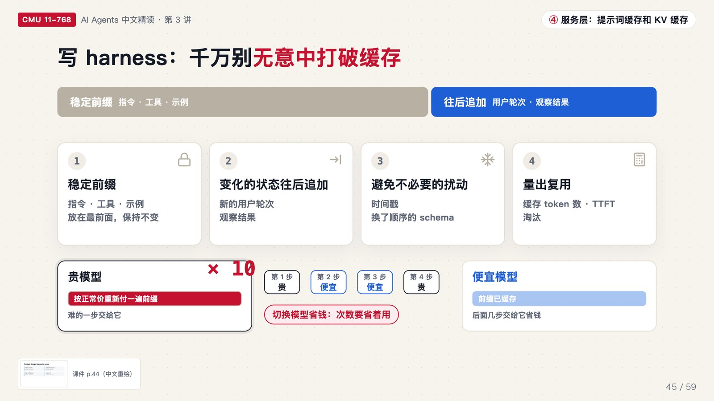

另一个坑是**每一步路由到不同的模型**：比如这一步难，交给最强的贵模型，后几步交给便宜模型省钱。问题是下次再回到那个贵模型时，它的缓存可能已经没了，你又得按 10 倍于缓存价的正常输入价，把整段前缀重新付一遍。想靠切换模型省钱，切换的次数一定要省着用。（对话中途动态改工具，课上的说法是可以这么做，但它同样会改动前缀，代价要心里有数。）

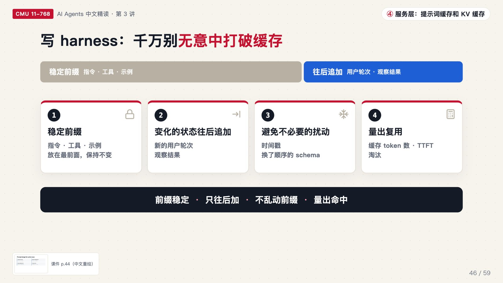

四条原则浓缩成一句：**前缀稳定、只往后加、不乱动前缀、量出命中。**写 harness 的时候随时用得上。

下面是一段**示意代码**（不是哪个框架的真实实现），把这几条落到代码里：

```python
import json

SYSTEM_PROMPT = "You are a coding agent. ..."        # 固定文本：不在这里放日期、时间、随机 ID

def build_tools(tool_specs: dict[str, dict]) -> list[dict]:
    # 按名字排序，保证每次序列化出来的工具列表一模一样
    return [tool_specs[name] for name in sorted(tool_specs)]

def stable_json(obj) -> str:
    # 键排序 + 固定分隔符：同样的内容永远序列化成同样的字节
    return json.dumps(obj, sort_keys=True, separators=(",", ":"), ensure_ascii=False)

class History:
    """只追加的消息历史：已经发出去的消息永远不改。"""

    def __init__(self):
        self.messages: list[dict] = [{"role": "system", "content": SYSTEM_PROMPT}]

    def append_user(self, text: str, now: str | None = None):
        # 需要时间时，放在最新的这条消息里，而不是改系统提示词
        if now is not None:
            text = f"[current time: {now}]\n{text}"
        self.messages.append({"role": "user", "content": text})

    def append_tool_result(self, call_id: str, result) -> None:
        self.messages.append({"role": "tool", "tool_call_id": call_id,
                              "content": stable_json(result)})

def cache_hit_rate(usage: dict) -> float:
    # 从服务商返回的用量里算命中率；字段名各家不同，这里用通用名示意
    cached = usage.get("cached_input_tokens", 0)
    total = usage.get("input_tokens", 0)
    return cached / total if total else 0.0       # 长期低于 0.9 左右就该去查哪里破了前缀
```

注意：不同服务商开启缓存的方式不同，有的自动按前缀缓存，有的要在请求里显式标出缓存断点，用量字段的名字和含义也不一样（有的把缓存命中的 token 单独列一个字段，不算在普通输入里）。用之前先读你那家的文档。

---

## 4 harness 层：上下文压缩

现在很多人日常用编码 agent，都碰到过"正在压缩上下文"的提示。看到它，大概没人会兴奋：压得不好，agent 就会忘事，开始干完全不一样的事，甚至删掉你的文件。这一节讲怎么压才不出事。

### 4.1 一个压缩的例子

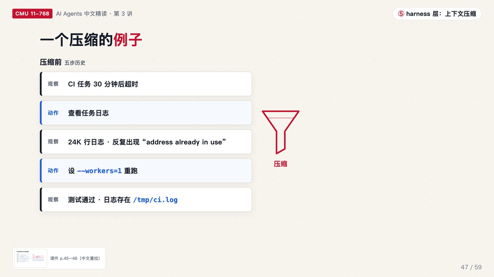

压缩前，是五步观察和动作：

1. 观察：CI 任务 30 分钟后超时。
2. 动作：查看任务日志。
3. 观察：24K 行日志，反复出现 "address already in use"。
4. 动作：设 `--workers=1` 重跑。
5. 观察：测试通过，日志存在 `/tmp/ci.log`。

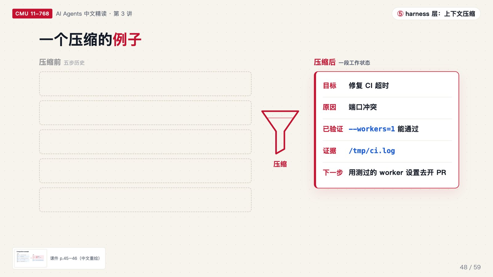

**上下文压缩（context compaction）**之后，变成一段工作状态：

| 字段 | 内容 |
|---|---|
| 目标 | 修复 CI 超时 |
| 原因 | 端口冲突 |
| 已验证 | `--workers=1` 能通过 |
| 证据 | `/tmp/ci.log` |
| 下一步 | 用测过的 worker 设置去开 PR |

24K 行日志没了，但接着干活需要的东西一样不少：要干什么、为什么、已经确认了什么、证据在哪、下一步做什么。

### 4.2 把压缩看成状态估计

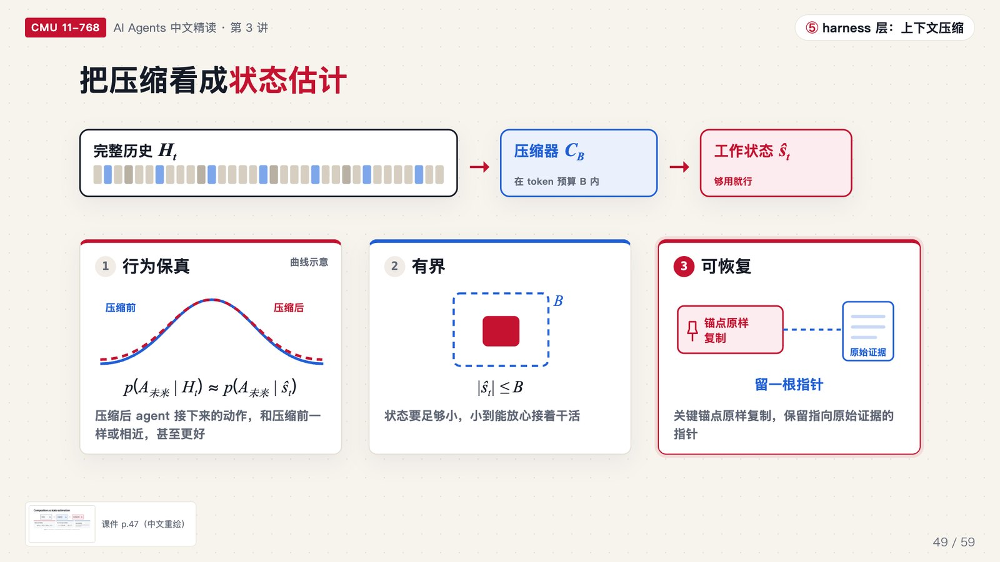

形式化一点：完整历史 H_t 经过压缩器 C，得到工作状态 ŝ_t。好的压缩要满足三个要求：

| 要求 | 公式 | 含义 |
|---|---|---|
| **行为保真**（behavioral fidelity） | `p(A_未来 ∣ H_t) ≈ p(A_未来 ∣ ŝ_t)` | 压缩后 agent 接下来的动作，和压缩前一样或相近，甚至更好（图上曲线是示意） |
| **有界**（bounded） | `ŝ_t = C(H_t; B)`，`‖ŝ_t‖ ≤ B`（token 数） | 状态要足够小，小到能放心接着干活；B 是 token 预算 |
| **可恢复**（recoverable） | | 关键锚点原样复制，保留指向原始证据的指针 |

这个视角的好处是：它告诉你压缩的目标不是"写一段好摘要"，而是"让后面的行为不变"。所以摘要写得好不好，最终要用后面的行为来检验（4.6 节）。

### 4.3 压缩时，什么能留下来

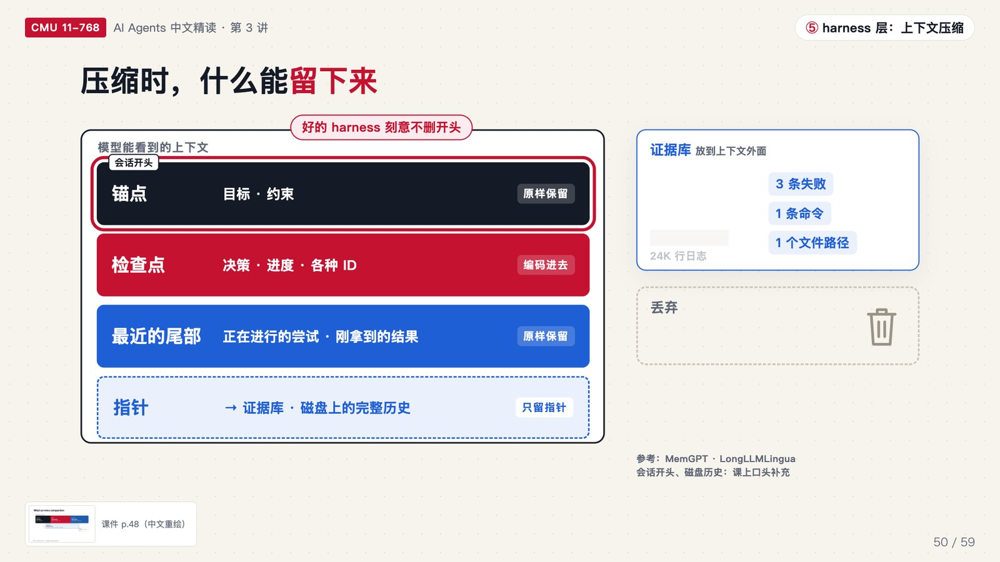

把模型能看到的上下文分成几层，各有不同的处理方式：

| 内容 | 举例 | 处理 |
|---|---|---|
| **锚点**（anchors） | 目标、约束 | 原样保留 |
| **检查点**（checkpoints） | 决策、进度、各种 ID | 编码进去（写成结构化的摘要） |
| **最近的尾部**（recent tail） | 正在进行的尝试、刚拿到的结果 | 原样保留 |
| **证据库**（evidence store） | 24K 行日志 → 3 条失败、1 条命令、1 个文件路径 | 外置：放到上下文外面，上下文里只留指针 |
| 重复的内容、已经被推翻的尝试 | | 丢弃 |

（参考：MemGPT 的"外置再检索"；LongLLMLingua 的选择性压缩。）

这里能回到 1.7 节说的毛病：agent 有时会忘掉会话最开头说的东西。这可能是你用的 harness 的设计缺陷：好的 harness 会刻意不删会话开头的内容，因为那部分更重要（任务描述和最初的约束都在那里）。当然有些情况下也确实避免不了。


再看"指针"那一层。至少用命令行编码 agent 时，完整历史通常都存在磁盘上某个地方。知道存在哪，压缩时丢了东西，也能让 agent 回去读历史找出来。原始材料不留在上下文里，只留一个指针。

**这就回答了上一讲留的问题：**

| 办法 | 会丢什么 | 怎么补 |
|---|---|---|
| 压成摘要 | 细节，尤其是被一次次转述的约束（4.5 节的漂移） | 锚点原样复制，别让它进摘要 |
| 按需检索 | 本身不丢：原始材料都在上下文外的证据库里 | 代价是要多一次读取，而且 agent 得知道"该回去查" |
| 派子 agent | 子 agent 的中间过程（只交回结果） | 这门课后面专门讲 |

### 4.4 落到实现上：四个决定


| 决定 | 选项 | 要点 |
|---|---|---|
| 1 **触发**（trigger） | 超过 token 阈值（例如设定最多用 200K，超过就压，课上口头举例）；服务商报上下文溢出（硬上限）；用户手动要求（很多编码 agent 有 `/compact` 命令） | 都要给下一次输出留出空间 |
| 2 **选择**（select） | 保护开头，压缩较早的部分，保留最近的尾部 | 切点要落在完整的轮次或工具调用边界上（上一讲讲过，调用和结果拆开会让历史不合法） |
| 3 **替换**（replace） | 可读的摘要；结构化检查点（规定摘要里必须有哪几项，有的要求通过一次工具调用来写）；服务商给的不透明对象；或者干脆换一个全新的上下文 | |
| 4 **恢复**（recover） | 原始历史保持不变；能重试或重置；保留可搜索的历史 | 规定好压缩失败时怎么办 |

原课件列的参考实现有 Codex、OpenCode、Pi、Hermes、OpenHands。第 5 节会读 OpenHands 的源码，看它在这四格里各怎么做。

关于"不透明对象"：据说只有 OpenAI 这么做，把上下文压成一个加密的、你读不了的东西，不让你看到它是怎么压的，免得压缩算法被人学走（课上口头提到，未核实）。

### 4.5 反复压缩会漂移

压一次通常没问题，麻烦在**反复压缩**：每次都在上一次的检查点上再压，

```text
ŝ_{k+1} = C(ŝ_k ⊕ R_k)        # R_k 是上次压缩之后新增的历史
```


原始历史写着：用 CUDA 12.4。

| 版本 | 内容 |
|---|---|
| 原始历史 | 用 CUDA 12.4 |
| 摘要 1 | 用 CUDA 12.x |
| 摘要 2 | 用较新的 CUDA |
| 摘要 3 | 约束没了 |


每一次转述看起来都"差不多对"，但误差会累积，这就是**压缩漂移（compaction drift）**。第一次压缩没问题，压的次数一多，丢的东西就越来越多，agent 就跑偏了。这也是大家不喜欢压缩的原因之一。


对策三条：

1. **锚点原样复制**：目标和约束不进摘要，每次原封不动地带过去；
2. **保留最近的尾部**：正在做的事不经转述；
3. **回原始证据检索**：拿不准时回证据库查原文。

（ReSum：基于摘要的 agent 续跑，见延伸阅读。）上一讲留的问题，压成摘要会丢什么、按需检索又怎么补回来，答案就在这里。

### 4.6 评测压缩：看压完能不能接着干


评测压缩分三步：

```text
1 埋入状态：在历史里放进约束、决策、产物
2 压缩：用线上实际在用的那个策略
3 继续：衡量压缩之后的决策
```

看四个指标：

| 指标 | 问的是 |
|---|---|
| 状态回忆 | 约束和标识符还在不在 |
| 任务成功 | 接下来做得对不对 |
| 效率 | token、延迟和成本 |
| 稳定性 | 反复压缩之后还行不行 |


为什么不直接换几种压缩算法，在已有基准上整体跑一遍？实践中常见这样的情况：团队花一个月左右做出一个压缩策略，在 SWE-bench 上分数一点没掉，token 省了很多（图上分数柱是示意）；一上线，就犯很傻的错：

- **每压缩一次就开一个 PR**：它忘了自己已经开过，同一个功能最后开了五个；
- **忘掉用户中途补充的指令**：因为评测集里都是只有一条用户消息的单轮任务，真实使用却是多轮、中途有补充（图上对话是示意）。压缩时，后来的多条用户消息被压掉了，而评测根本测不出来。


所以**光跑基准不够。**除非基准真能代表每一种用法，还得在真实使用中测。

---

## 5 源码解读：OpenHands 的上下文压缩器

4.4 节的四个决定，落到真实代码里是什么样？下面读 OpenHands 的**压缩器（condenser）**。

出处：[OpenHands/software-agent-sdk](https://github.com/OpenHands/software-agent-sdk)，`main` 分支提交 `d2ee0cd`（`d2ee0cdea60825608c2f8906eb54e1d4d264fb42`，2026-10-25 UTC），涉及这几个文件：

- [`openhands-sdk/openhands/sdk/context/condenser/llm_summarizing_condenser.py`](https://github.com/OpenHands/software-agent-sdk/blob/d2ee0cdea60825608c2f8906eb54e1d4d264fb42/openhands-sdk/openhands/sdk/context/condenser/llm_summarizing_condenser.py)（主要逻辑）
- [`openhands-sdk/openhands/sdk/context/condenser/base.py`](https://github.com/OpenHands/software-agent-sdk/blob/d2ee0cdea60825608c2f8906eb54e1d4d264fb42/openhands-sdk/openhands/sdk/context/condenser/base.py)（`RollingCondenser.condense`：软 / 硬两种触发的分流）
- [`openhands-sdk/openhands/sdk/event/condenser.py`](https://github.com/OpenHands/software-agent-sdk/blob/d2ee0cdea60825608c2f8906eb54e1d4d264fb42/openhands-sdk/openhands/sdk/event/condenser.py)（`Condensation.apply`：怎么把摘要换进去）
- [`openhands-sdk/openhands/sdk/context/condenser/prompts/summarizing_system.j2`](https://github.com/OpenHands/software-agent-sdk/blob/d2ee0cdea60825608c2f8906eb54e1d4d264fb42/openhands-sdk/openhands/sdk/context/condenser/prompts/summarizing_system.j2)（让模型写摘要的提示词）

为讲解删去了：所有 `async` 版本（与同步版逻辑相同）、`@observe` 可观测性装饰器、关闭流式输出的校验器、日志语句、部分 docstring，以及 `_build_summary_messages` 的模板渲染细节。删掉的位置用 `...` 标出；中文注释是本课件加的，英文注释是源码原有的。

### 5.1 先看整体思路

这个目录下的 README 用一句话说清了策略：定期地、或者在 agent / 用户要求时，**把所有事件的前一半换成一条摘要事件**。它列了这样做的四点考虑：

| 考虑 | README 原意 | 对应本讲 |
|---|---|---|
| 每次调用的成本 | 定期压缩，上下文就有上限，每次调用用的 token 更少 | 1.1 节的平方增长 |
| 缓存优化 | 压缩会**破坏提示词缓存**；但定期做，重建缓存的代价就低 | 3.7 节 |
| 早期上下文 | 事件被摘要，摘要在以后的压缩里也会被再次摘要，重要信息得以留在上下文里 | 4.5 节的漂移，正是从这里来的 |
| 近期上下文 | 后一半不动，agent 很容易接着做当前任务 | 4.3 节的"最近的尾部" |

另一个关键设计是**事件日志只追加（append-only）**：压缩并不真的删除事件，而是追加一条 `Condensation` 事件，记下"忘掉哪些事件 ID、摘要是什么、插在哪"，README 把它比作 Cassandra、Kafka 里的**墓碑（tombstone）**。发给模型的是一个 `View`（视图），由事件日志按这些墓碑算出来。所以原始历史一直完整地留在日志里，这就是 4.4 节"恢复"那一格说的"原始历史保持不变"。

### 5.2 参数和默认值

```python
class LLMSummarizingCondenser(RollingCondenser):
    llm: LLM                                          # 写摘要用的模型，可以和 agent 用的不是同一个
    max_size: int = Field(default=240, gt=0)          # 视图里最多多少个事件（按事件数触发）
    max_tokens: int | None = None                     # token 上限（按 token 触发），默认不设

    keep_first: int = Field(default=2, ge=0)
    """Minimum number of events to preserve at the start of the view. The first
    `keep_first` events in the conversation will never be condensed or summarized.
    """                                               # 开头这几个事件永远不压：这就是"锚点"

    minimum_progress: float = Field(default=0.1, gt=0.0, lt=1.0)
    ...                                               # 一次至少要忘掉视图里 10% 的事件，否则视为压缩失败

    hard_context_reset_max_retries: int = Field(default=5, gt=0)          # 硬重置最多试 5 次
    hard_context_reset_context_scaling: float = Field(default=0.8, gt=0.0, lt=1.0)
                                                      # 每次失败，把每个事件的最大长度乘以 0.8 再试

    @model_validator(mode="after")
    def validate_keep_first_vs_max_size(self):
        events_from_tail = self.max_size // 2 - self.keep_first - 1   # 压完以后保留的尾部事件数
        if events_from_tail <= 0:                                     # 开头保护得太多，尾部就没地方了
            raise ValueError(
                "keep_first must be less than max_size // 2 to leave room for "
                "condensation"
            )
        return self
    ...

# Sizing for the standard summarizing condenser. Kept here so the default agent and
# spawned sub-agents stay in sync.
_DEFAULT_MAX_SIZE: Final[int] = 80                    # 标准配置：80 个事件就触发
_DEFAULT_KEEP_FIRST: Final[int] = 4                   # 标准配置：开头保护 4 个事件


def default_condenser(llm: LLM) -> LLMSummarizingCondenser:
    """Standard summarizing condenser used by the default agent and sub-agents."""
    return LLMSummarizingCondenser(
        llm=llm, max_size=_DEFAULT_MAX_SIZE, keep_first=_DEFAULT_KEEP_FIRST
    )
```

注意有两套默认值，别搞混：

| | `max_size` | `keep_first` | 压完保留的尾部 `max_size // 2 − keep_first − 1` |
|---|---|---|---|
| 类字段的默认值（直接 `LLMSummarizingCondenser(llm=...)`） | 240 | 2 | 117 |
| `default_condenser()`（源码注释说默认 agent 和子 agent 都用它） | 80 | 4 | 35 |

`minimum_progress = 0.1`、`max_tokens = None`、重试 5 次、缩放 0.8 两套相同。

### 5.3 触发：三种原因，软和硬两种要求

```python
class Reason(Enum):
    """Reasons for condensation."""

    REQUEST = "request"                               # 用户或 agent 明确要求压缩
    TOKENS = "tokens"                                 # token 超限
    EVENTS = "events"                                 # 事件数超限

...
    def _effective_max_tokens(self, agent_llm: LLM | None) -> int | None:
        limits = [
            limit
            for limit in (
                self.max_tokens,                      # 压缩器自己配置的上限
                agent_llm.effective_max_input_tokens if agent_llm is not None else None,
                                                      # agent 所用模型的有效输入上限
            )
            if limit is not None
        ]
        return min(limits) if limits else None        # 取两者里更严的那个；都没有就不按 token 触发

    def get_condensation_reasons(
        self, view: View, agent_llm: LLM | None = None
    ) -> set[Reason]:
        reasons = set()

        # Reason 1: Unhandled condensation request. ...
        if view.unhandled_condensation_request:       # 比如用户敲了压缩命令，或 agent 检测到上下文溢出
            reasons.add(Reason.REQUEST)

        # Reason 2: Token limit is provided and exceeded.
        max_tokens = self._effective_max_tokens(agent_llm)
        if max_tokens is not None and agent_llm is not None:
            total_tokens = get_total_token_count(view.events, agent_llm)   # 用 agent 的模型数 token
            if total_tokens > max_tokens:
                ...
                reasons.add(Reason.TOKENS)

        # Reason 3: View exceeds maximum size in number of events.
        if len(view) > self.max_size:
            reasons.add(Reason.EVENTS)

        return reasons

    def condensation_requirement(
        self, view: View, agent_llm: LLM | None = None
    ) -> CondensationRequirement | None:
        reasons = self.get_condensation_reasons(view, agent_llm)

        # No reasons => no condensation needed.
        if reasons == set():
            return None

        # Token pressure is a hard requirement ...
        if Reason.TOKENS in reasons:                  # token 超限：不压下一次请求就可能直接失败
            return CondensationRequirement.HARD

        # ... Treat event-count pressure as soft ...
        resource_reasons = {Reason.EVENTS}
        if reasons.issubset(resource_reasons):        # 只是事件数多：能压就压，压不了下一步再试
            return CondensationRequirement.SOFT

        # Requests -- whether they come from the user or the agent -- are always hard
        # requirements. ...
        if Reason.REQUEST in reasons:                 # 明确要求：用户在等，或者 agent 已经没空间了
            return CondensationRequirement.HARD
```

对应 4.4 节"触发"那一格的三种来源：token 阈值（`TOKENS`）、服务商报溢出（agent 检测到后发出请求，算 `REQUEST`）、用户手动要求（`REQUEST`）。OpenHands 多了一个按事件数的 `EVENTS`，并且把它定为"软"要求。

### 5.4 选择：保护开头，忘掉中间，保留尾部

```python
    def _get_forgotten_events(
        self, view: View, agent_llm: LLM | None = None
    ) -> tuple[Sequence[LLMConvertibleEvent], int]:
        reasons = self.get_condensation_reasons(view, agent_llm=agent_llm)
        assert reasons != set(), "No condensation reasons found."

        suffix_events_to_keep: set[int] = set()       # 每个原因各算一个"尾部保留几个事件"

        if Reason.REQUEST in reasons:
            target_size = len(view) // 2              # 明确要求：压到当前视图的一半
            suffix_events_to_keep.add(target_size - self.keep_first - 1)

        if Reason.EVENTS in reasons:
            target_size = self.max_size // 2          # 事件数超限：压到 max_size 的一半
            suffix_events_to_keep.add(target_size - self.keep_first - 1)
                                                      # 减去开头保护的 keep_first 个，再减 1 给摘要事件

        if Reason.TOKENS in reasons:
            ...
            total_tokens = get_total_token_count(view.events, agent_llm)
            tokens_to_reduce = total_tokens - (max_tokens // 2)   # token 超限：压到上限的一半以下

            suffix_events_to_keep.add(
                get_suffix_length_for_token_reduction(            # 从尾部往前数，算出能保留几个事件
                    events=view.events[self.keep_first :],
                    llm=agent_llm,
                    token_reduction=tokens_to_reduce,
                    base_events=view.events[: self.keep_first],
                )
            )

        # We might have multiple reasons to condense, so pick the strictest condensation
        # to ensure all resource constraints are met.
        events_from_tail = min(suffix_events_to_keep) # 多个原因同时成立时，取保留最少（最严）的那个

        # Calculate naive forgetting end (without considering atomic boundaries)
        naive_end = len(view) - events_from_tail      # 粗算的"忘到哪里为止"

        # The leading SystemPromptEvent must never be forgotten, ...
        protected_prefix = self.keep_first
        system_idx = _leading_system_prompt_index(view.events)
        if system_idx is not None:                    # 系统提示词无论如何都要保住，哪怕 keep_first=0
            protected_prefix = max(protected_prefix, system_idx + 1)

        # Find actual forgetting_start: smallest manipulation index >= protected_prefix
        forgetting_start = view.manipulation_indices.find_next(protected_prefix)

        # Find actual forgetting_end: smallest manipulation index >= naive_end
        forgetting_end = view.manipulation_indices.find_next(naive_end)
                                                      # 两个切点都对齐到"可操作的下标"：
                                                      # 不会把一次工具调用和它的结果切开

        # Extract events to forget using boundary-aware indices
        forgotten_events = view[forgetting_start:forgetting_end]   # 中间这一段就是要被忘掉的

        # Summary offset is the same as forgetting_start
        return forgotten_events, forgetting_start     # 摘要就插在被忘掉那段原来开始的位置
```

这一段对应 4.4 节"选择"那一格的每一个要点：

- **保护开头**：`keep_first` 加上系统提示词，永远不进摘要；
- **压缩较早的部分**：`[forgetting_start, forgetting_end)` 这一段；
- **保留最近的尾部**：最后 `events_from_tail` 个事件原样不动；
- **切点落在完整边界上**：`manipulation_indices.find_next(...)`。上一讲 2.6 节讲过，历史里有工具调用却没有对应结果，服务商会直接拒绝；切点对齐就是为了不制造这种历史。

### 5.5 替换：让模型写一段结构化摘要

```python
    def _generate_condensation(
        self,
        forgotten_events: Sequence[LLMConvertibleEvent],
        summary_offset: int,
        max_event_str_length: int | None = None,
    ) -> Condensation:
        assert len(forgotten_events) > 0, "No events to condense."

        # Convert events to strings for the template
        event_strings = [
            maybe_truncate(str(forgotten_event), truncate_after=max_event_str_length)
            for forgotten_event in forgotten_events   # 每个要忘的事件转成文字；需要时截断过长的事件
        ]

        messages = self._build_summary_messages(event_strings)   # system：摘要规则；user：这些事件
        ...
        try:
            llm_response = self.llm.generate(messages=messages, store=False)
        except Exception as e:
            raise NoCondensationAvailableException(              # 写摘要失败，交给上层决定怎么办
                f"Summarization LLM call failed: {e}"
            ) from e

        # Extract summary from the LLMResponse message
        summary = None
        if llm_response.message.content:
            first_content = llm_response.message.content[0]
            if isinstance(first_content, TextContent):
                summary = first_content.text

        return Condensation(                          # 一条"墓碑"事件：只记录，不删原日志
            forgotten_event_ids={event.id for event in forgotten_events},
            summary=summary,
            summary_offset=summary_offset,
            llm_response_id=llm_response.id,
        )
```

摘要用的系统提示词（`summarizing_system.j2`，节选）要求的是一份**结构化检查点**，而不是自由发挥的段落：

```text
You are maintaining a context-aware state summary for an interactive agent.
You will be given a list of events corresponding to actions taken by the agent, which will include previous summaries.
...
USER_CONTEXT: (Preserve essential user requirements, goals, and clarifications in concise form)

TASK_TRACKING: {Active tasks, their IDs and statuses - PRESERVE TASK IDs}

COMPLETED: (Tasks completed so far, with brief results)
PENDING: (Tasks that still need to be done)
CURRENT_STATE: (Current variables, data structures, or relevant state)

For code-specific tasks, also include:
CODE_STATE: {File paths, function signatures, data structures}
TESTS: {Failing cases, error messages, outputs}
CHANGES: {Code edits, variable updates}
DEPS: {Dependencies, imports, external calls}
VERSION_CONTROL_STATUS: {Repository state, current branch, PR status, commit history}
...
```

拿它和 4.1 节的例子对一下：`USER_CONTEXT` 是目标和约束，`COMPLETED` / `PENDING` 是进度和下一步，`TESTS` 是"已验证"，`VERSION_CONTROL_STATUS` 里有 PR 状态（正好防 4.6 节"同一个功能开五个 PR"的错）。第二行那句 "which will include previous summaries" 也值得注意：上一次的摘要会作为事件被再次摘要，这就是 4.5 节 `ŝ_{k+1} = C(ŝ_k ⊕ R_k)` 在代码里的样子。

摘要怎么换进视图（`event/condenser.py` 的 `Condensation.apply`）：

```python
    def apply(self, events: list[LLMConvertibleEvent]) -> list[LLMConvertibleEvent]:
        output = [event for event in events if event.id not in self.forgotten_event_ids]
                                                      # 先去掉被忘掉的事件
        if self.has_summary_metadata:
            assert self.summary_offset is not None
            summary_event = self.summary_event
            output.insert(self.summary_offset, summary_event)    # 再把摘要插到原来的位置
        return output
```

### 5.6 恢复：软要求就跳过，硬要求就重置

`base.py` 里的 `RollingCondenser.condense` 把前面几步串起来，并决定压缩失败时怎么办：

```python
    def condense(self, view: View, agent_llm: LLM | None = None) -> View | Condensation:
        # If we trigger the condenser-specific condensation threshold, compute and
        # return the condensation.
        request = self.condensation_requirement(view, agent_llm=agent_llm)
        if request is not None:
            try:
                return self.get_condensation(view, agent_llm=agent_llm)  # 正常路径：算出一次压缩

            except NoCondensationAvailableException as e:
                logger.debug(f"No condensation available: {e}")

                if request == CondensationRequirement.SOFT:
                    # For soft requests, we can just return the uncondensed view. ...
                    return view                       # 软要求：这次不压，原样返回，下一步再试

                elif request == CondensationRequirement.HARD:
                    # ... try to recover from this situation by performing a hard context
                    # reset, if supported by the condenser.
                    try:
                        hard_reset_condensation = self.hard_context_reset(
                            view, agent_llm=agent_llm
                        )
                        if hard_reset_condensation is not None:
                            return hard_reset_condensation   # 硬要求：退一步，把整个视图都摘要掉
                    except Exception as hard_reset_exception:
                        raise hard_reset_exception from e

                # In all other situations re-raise the exception.
                raise e

        # Otherwise we're safe to just return the view.
        else:
            return view                               # 不需要压缩
```

什么时候会"压不了"？`get_condensation` 里有两道检查（`llm_summarizing_condenser.py`）：

```python
        if not forgotten_events:                      # 一个超长的工具循环几乎占满视图，找不到合法切点
            raise NoCondensationAvailableException(
                "Cannot condense 0 events. ..."
            )

        if len(forgotten_events) < len(view) * self.minimum_progress:
            raise NoCondensationAvailableException(   # 能忘掉的不到 10%，压了也白压
                "Cannot apply condensation: events forgotten below minimum progress "
                "threshold."
            )
```

硬重置 `hard_context_reset` 只保住系统提示词，把它后面的事件全部摘要；如果连写摘要都失败（比如事件太长、摘要模型自己也塞不下），就把每个事件截短到原来的 0.8 倍再试，最多 5 次：

```python
        system_idx = _leading_system_prompt_index(view.events)
        preserve = (system_idx + 1) if system_idx is not None else 0
        forgotten_events = view.events[preserve:]     # 系统提示词之后的全部事件
        summary_offset = preserve

        max_event_str_length: int | None = None
        attempts_remaining: int = self.hard_context_reset_max_retries   # 默认 5 次

        while attempts_remaining > 0:
            try:
                return self._generate_condensation(
                    forgotten_events=forgotten_events,
                    summary_offset=summary_offset,
                    max_event_str_length=max_event_str_length,
                )
            except Exception as e:
                if max_event_str_length is None:      # 第一次失败：以最长事件的长度为起点
                    max_event_str_length = max(len(str(event)) for event in view.events)
                max_event_str_length = int(
                    max_event_str_length * self.hard_context_reset_context_scaling
                )                                     # 每次乘 0.8，越截越短
                ...
            attempts_remaining -= 1

        logger.error("Hard context reset summarization failed after multiple attempts.")
        return None
```

### 5.7 用默认值走一遍

用 `default_condenser()` 的配置（`max_size = 80`，`keep_first = 4`），假设视图里第 0 个事件是系统提示词，现在有 81 个事件，只触发了 `EVENTS`：

| 步骤 | 计算 | 结果 |
|---|---|---|
| 触发 | 81 > 80，只有 `EVENTS` | 软要求 |
| 尾部保留 | 80 // 2 − 4 − 1 | 35 个事件 |
| 粗算忘到哪 | 81 − 35 | 下标 46 |
| 开头保护 | max(keep_first = 4, 系统提示词下标 0 + 1) | 从下标 4 开始忘 |
| 要忘的事件 | 下标 [4, 46)，假设切点刚好落在边界上 | 42 个，超过 81 × 10%，通过检查 |
| 压缩后 | 4 个开头 + 1 条摘要 + 35 个尾部 | 40 个事件，正好是 max_size 的一半 |

如果触发的是 `TOKENS`，目标则是压到 token 上限的**一半**以下。我的理解是：压到一半而不是刚好低于上限，下一步就不会马上又触发压缩，每压一次后面能连续跑一段，缓存也有时间重新攒起来。这和 README 里"定期压缩、让重建缓存的代价保持在低位"的说法一致。

### 5.8 对照四个决定

| 决定 | 4.4 节说的 | OpenHands 的做法 |
|---|---|---|
| 触发 | token 阈值、服务商溢出、用户要求；给输出留空间 | `TOKENS`（取配置和模型上限里更严的）、`EVENTS`（按事件数）、`REQUEST`；压到上限的一半 |
| 选择 | 保护开头、压缩较早的部分、保留尾部、切在边界上 | `keep_first` + 系统提示词、`[start, end)` 中间段、`events_from_tail`、`manipulation_indices` |
| 替换 | 可读摘要 / 结构化检查点 / 不透明对象 / 新上下文 | 结构化摘要（`USER_CONTEXT`、`TASK_TRACKING`……）；硬重置时相当于"只带摘要的新上下文" |
| 恢复 | 原始历史不变、重试或重置、可搜索历史、规定失败处理 | 只追加的事件日志 + 墓碑；软要求跳过、硬要求硬重置、截短重试 5 次 |

还能看出它没做什么：摘要会被再次摘要，锚点只靠 `keep_first` 个**最早的事件**来保护，用户在对话中途补充的约束只能指望摘要提示词里的 `USER_CONTEXT` 把它带过去。这正是 4.5、4.6 节说的风险所在，动手练习里你可以自己试一试。

---

## 本讲小结


长上下文是一个分层的系统，从下往上：

1. **增长**：agent 循环一遍遍地读入指令、动作和观察，历史线性增长，总输入按平方增长；工具调用和工具结果占了一半多。
2. **推理**：预填充是计算密集的、解码是显存带宽密集的，稠密注意力对长度是平方的，KV 缓存吃显存；TTFT、TPOT、吞吐、成本之间有取舍，看你怎么用。号称的上下文不等于真正能用的上下文。
3. **架构**：几次局部、一次全局的混合架构；滑动窗口、线性注意力（DeltaNet → Gated DeltaNet → KDA）、稀疏注意力、KV 压缩（GQA、MLA）决定哪些历史还能被访问到、代价多大。由短到长的训练、位置编码（RoPE、NoPE、位置插值、YaRN）和上下文并行，让模型读得了 1M。
4. **缓存**：稳定的前缀能省掉重复的预填充，缓存读取一般只收正常输入价的十分之一左右；PagedAttention、RadixAttention、缓存感知路由在服务端把它做好。但缓存不会减少模型看到的历史，写 harness 时别无意中打破它。
5. **压缩**：把压缩看成状态估计，保住意图（锚点）、准确的任务状态（检查点）、最近的工作（尾部）和恢复路径（证据库指针）；当心反复压缩的漂移，并用"压缩后能不能接着干"来评测，光跑基准不够。

## 关键术语

| 中文 | 英文 | 一句话解释 |
|---|---|---|
| 预填充 | prefill | 把全部输入一次算完、写入 KV 缓存的阶段，计算密集 |
| 解码 | decode | 一步生成一个 token、读并追加 KV 缓存的阶段，显存带宽密集 |
| KV 缓存 | KV cache | 每个位置算好的 K、V，留着给后面的位置用，不必重算 |
| 首 token 时间 | TTFT, time to first token | 从请求到达到第一个输出 token 的时间 |
| 每输出 token 时间 | TPOT, time per output token | 相邻两个输出 token 之间的间隔 |
| 大海捞针 | needle in a haystack | 在长文本某个深度插一条事实，看模型能否答出，检验真正能用的上下文 |
| 局部计算 | local computation | 每个位置只和固定数量的位置比较，成本从 O(n²) 降到 O(wn) |
| 混合架构 | hybrid architecture | 几层便宜的局部计算，穿插一层全局注意力 |
| 滑动窗口注意力 | sliding window attention | 只换掩码，每个位置只看前 w 个 |
| 线性注意力 | linear attention | 去掉 softmax，把全部 K、V 折叠成固定大小的状态矩阵，变成 RNN |
| 状态矩阵 | state matrix | 线性注意力里代替 KV 缓存的固定大小矩阵 S |
| DeltaNet | DeltaNet | 只把预测误差写进状态矩阵的线性注意力 |
| Gated DeltaNet / KDA | Gated DeltaNet / Kimi Delta Attention | 在 DeltaNet 上加整体衰减 / 按通道衰减，让状态能遗忘 |
| 稀疏注意力 | sparse attention | 只挑一部分位置做注意力，按固定模式或按内容 top-K |
| 分组查询注意力 / 多头潜在注意力 | GQA / MLA | 减少 KV 头的数量 / 把每个头的 KV 压成小向量，缩小 KV 缓存 |
| 拼接序列 | packed sequences | 把多篇文档拼进一条训练序列，提效率但不教跨文档 |
| 旋转位置编码 | RoPE, rotary position embedding | 按位置旋转 Q、K，使点积只取决于相对距离 |
| 无位置编码 | NoPE | 不加位置编码，靠因果掩码等机制隐式得到顺序 |
| 位置插值 / YaRN | position interpolation / YaRN | 把长位置的相位缩回训练见过的范围 / 按频率区别缩放并修正温度 |
| 上下文并行 | context parallelism | 把一条序列切块分到多台设备，K、V 绕环传递，精确计算 |
| 提示词缓存 | prompt caching | 跨调用复用相同前缀的 KV，读取价约为正常输入的 1/10 |
| 分页注意力 | PagedAttention | 像虚拟内存一样按块管理 KV 显存（vLLM） |
| 基数树注意力 | RadixAttention | 把缓存过的前缀组织成基数树来匹配和共享（SGLang） |
| 缓存感知路由 | cache-aware routing | 把请求送到缓存最匹配、排队又不太长的机器 |
| 上下文压缩 | context compaction | 把较早的历史换成一段工作状态，让上下文保持在预算内 |
| 锚点 / 检查点 / 尾部 | anchors / checkpoints / recent tail | 压缩时原样保留的目标约束 / 编码进去的决策进度 / 原样保留的最近工作 |
| 证据库 | evidence store | 放在上下文外的原始材料，上下文里只留指针，需要时检索 |
| 压缩漂移 | compaction drift | 反复在摘要上再摘要，约束一点点走样直到丢失 |
| 压缩器 | condenser | OpenHands 里负责压缩上下文的组件 |
| 墓碑 | tombstone | 只追加日志里标记"哪些事件被忘掉"的记录，原事件不删 |

## 思考题

<details>
<summary>1. 按 1.1 节的增长方式（第 1 次 6K，之后每次多 5K），跑 10 次调用累计要处理多少输入 token？如果每次都能命中前缀缓存，真正需要预填充的又大约是多少？</summary>

第 n 次的输入是 6 + 5(n−1) K，10 次累计是 6 × 10 + 5 × (10 × 9 / 2) = 60 + 225 = 285K。如果每次调用都能命中上一次的全部前缀，每次真正要新算的大约只有新增的那 5K（第 1 次是 6K），累计约 6 + 9 × 5 = 51K（这里忽略了输出 token 的解码和边界细节，只看数量级）。累计输入按平方涨，新算部分按线性涨，两者之差就是缓存能省的部分，而且调用越多差得越大。注意缓存省的是计算和费用，模型看到的历史一样长，能力上的问题（忘事）缓存解决不了。
</details>

<details>
<summary>2. 线性注意力把成本降到线性，代价是什么？DeltaNet、Gated DeltaNet、KDA 分别在补哪个短板？</summary>

代价是表达力：去掉 softmax 后没有了归一化的"有所侧重"，所有历史被加法叠进一个固定大小的状态矩阵，新旧内容互相干扰、无法明确擦除。DeltaNet 改成"先用状态预测、只写入误差"，沿当前 key 的方向定向修正，减少干扰；Gated DeltaNet 再加一个标量衰减，让整个状态能逐步遗忘很久以前的怪 key；KDA 把衰减变成按通道的向量，让不同特征有不同寿命，有的记得久、有的忘得快。三者一个比一个更细，退化情况分别是 β 固定、α = 1、各通道 α 相同。
</details>

<details>
<summary>3. 有人说"Transformer 不加位置编码，就分不清词的顺序"。这句话在什么模型里成立，在什么模型里不成立？为什么？</summary>

在双向可见的模型里成立，比如早年的编码器：每个 token 都能看到所有 token，注意力对输入顺序是置换不变的，不加位置编码确实分不清顺序。在自回归（因果掩码）模型里不成立：位置 t 的 token 只能看到前面 t−1 个，看到的集合本身就随位置不同，从第一层开始同一个词在不同位置的表示就不一样。再加上 Gated DeltaNet 这类带衰减的局部层本身带有"越远留得越少"的位置偏置，所以 Kimi K3、GLM 这样的模型可以用 NoPE。
</details>

<details>
<summary>4. 一个 harness 每一步都在系统提示词末尾写上"当前时间：14:03:38"。会发生什么？怎么改？</summary>

缓存按前缀匹配，系统提示词在最前面，它每一步都变，从变化的那个 token 往后的缓存就全部作废，等于每一步都要按正常输入价把整段历史重新预填充，费用约是能命中缓存时的 10 倍，TTFT 也会变高。改法：系统提示词保持完全不变；真需要时间，就把它放在最新那条用户消息或工具结果里（只影响最后一小段）。顺带检查工具列表的顺序、JSON 序列化的键顺序是否稳定，并把缓存命中率作为一个监控指标。
</details>

<details>
<summary>5. 你的 agent 缓存命中率长期只有 70%。可能的原因有哪些？怎么排查？</summary>

harness 侧：前缀里有会变的东西（时间戳、随机 ID、换了顺序的工具 schema）；频繁在不同模型之间切换；中途改工具列表或改系统提示词；压缩太频繁（每压一次，摘要之后的缓存都要重建，OpenHands 的 README 也明确说压缩会破坏缓存）。服务侧：缓存被淘汰得太快（对话停顿超过保留时间）、多机路由没把请求送到有缓存的机器。也可能是负载本身每步都有大量新输入（比如每步读一个大文件），那 70% 未必是问题。排查：逐步对比相邻两次请求的序列化前缀，找出第一个不同的位置；看用量里缓存 token 的字段；对比停顿前后的命中率；换个服务商对比同一负载。
</details>

<details>
<summary>6. 用户在第 30 轮说"以后都用 CUDA 12.4"，agent 用的是 OpenHands 的默认压缩器（max_size = 80，keep_first = 4）。几次压缩之后这条约束有可能丢吗？为什么？你会怎么改？</summary>

有可能。第 30 轮的消息不在开头 4 个事件里，`keep_first` 保护不到它；它会落进被忘掉的中间段，只能靠摘要提示词里的 `USER_CONTEXT` 带过去。而每次压缩都会把上一次的摘要再摘要一次（"which will include previous summaries"），这正是 4.5 节 12.4 → 12.x → 较新的 CUDA → 没了的漂移路径。改法思路：把用户消息里的约束单独抽出来作为锚点，每次原样复制而不经转述（相当于动态扩展"开头保护"）；或者用结构化检查点，要求约束字段逐字保留并校验；同时保证原始日志可检索，让 agent 拿不准时回去查。改完要用 4.6 节的方法评测：在历史里埋约束、反复压缩、看后续动作是否还遵守。
</details>

<details>
<summary>7. 一个压缩策略在 SWE-bench 上分数不降、token 省了很多，上线后却出现同一个功能开五个 PR。为什么评测没抓到？你会怎么设计一个能抓到它的评测？</summary>

因为评测任务和真实使用的分布不同：基准任务大多是单轮的（只有一条用户消息）、较短、开 PR 往往不是任务的一部分，压缩丢掉"我已经开过 PR"这种进度信息不会影响分数。设计评测：按 4.6 节的三步，先在历史里埋入状态（已经开过的 PR 编号、用户中途补充的约束、关键文件路径），用线上同一个压缩策略压缩一次以及连续压缩多次，再让 agent 继续，检查状态回忆（PR 编号、约束还在不在）、后续动作（会不会重复开 PR、会不会违反约束）、效率和多次压缩后的稳定性；任务集要包含多轮、中途补充指令的真实对话。
</details>

## 动手练习

两个练习任选一个，或都做，每个 15–20 分钟。都只依赖 Python 3.10+ 标准库，不需要真模型；摘要用一个写死的规则函数模拟（示意）。

### 练习 ①：写一个迷你压缩器，看约束怎么在反复压缩中丢掉

仿照第 5 节 OpenHands 的思路：保护开头、保留尾部、中间换成一条摘要，切点不能把工具调用和它的结果拆开。

```python
from dataclasses import dataclass, field
import itertools

_ids = itertools.count()


@dataclass
class Event:
    kind: str            # "system" / "user" / "call" / "result" / "summary"
    text: str
    id: int = field(default_factory=lambda: next(_ids))


def fake_summarize(events: list[Event]) -> str:
    """模拟一个"有损"的摘要模型（示意）：只保留最后 3 条事件的前 30 个字符。"""
    return " | ".join(e.text[:30] for e in events[-3:])


def is_boundary(events: list[Event], i: int) -> bool:
    # TODO 1：如果 events[i] 是一个 "result"（它前面紧挨着的是对应的 "call"），
    #         那么在 i 处切开就会把调用和结果拆开，返回 False；其他情况返回 True
    ...


def condense(events: list[Event], max_size: int = 20, keep_first: int = 2) -> list[Event]:
    if len(events) <= max_size:
        return events
    tail = max_size // 2 - keep_first - 1                 # 与 OpenHands 同样的算法
    start, end = keep_first, len(events) - tail
    # TODO 2：把 start、end 都往后挪到最近的合法切点（用 is_boundary）
    # TODO 3：返回 events[:start] + [Event("summary", fake_summarize(events[start:end]))] + events[end:]
    ...


history = [Event("system", "You are a coding agent."), Event("user", "Fix the CI timeout.")]
history.append(Event("user", "Constraint: always use CUDA 12.4."))   # 用户在第 3 个事件补充的约束
for step in range(60):
    history.append(Event("call", f"run_tests(step={step})"))
    history.append(Event("result", f"step {step}: 3 failed, log at /tmp/ci-{step}.log"))
    history = condense(history)

print(any("CUDA 12.4" in e.text for e in history))       # 约束还在吗？
for e in history:
    print(e.kind, "|", e.text[:60])
```

做完以后回答：

- 跑完 60 步，约束还在吗？如果把 `keep_first` 改成 3 呢？这说明 `keep_first` 保护的是"最早的几个事件"还是"最重要的几个事件"？
- 把 `Constraint` 那条挪到第 10 步之后再插入，`keep_first` 还能保护它吗？请改 `condense`，让所有以 `Constraint:` 开头的用户消息都作为锚点原样保留（不进摘要），再跑一遍。
- 统计一下 60 步里一共压缩了几次。每压一次，摘要之后的前缀都变了；结合 3.7 节，压缩频率和缓存命中率之间是什么关系？

### 练习 ②：写一个"前缀稳定性检查器"，找出打破缓存的那一行

```python
import json
import time


def serialize(messages: list[dict], tools: list[dict]) -> str:
    """把一次请求序列化成字符串，近似模型看到的前缀（示意，真实模板见第 2 讲 2.3 节）。"""
    return json.dumps({"tools": tools, "messages": messages}, ensure_ascii=False)


def common_prefix_len(a: str, b: str) -> int:
    # TODO 1：返回两个字符串最长公共前缀的长度
    ...


def reuse_ratio(prev: str, curr: str) -> float:
    # TODO 2：本次请求里，有多大比例的字符落在与上一次相同的前缀里
    ...


# 一个有问题的 harness（示意）：系统提示词里带时间，工具顺序每次随机
def bad_request(history: list[dict], tool_specs: dict) -> str:
    system = {"role": "system", "content": f"You are an agent. Now: {time.time()}"}
    tools = list(tool_specs.values())[::-1] if len(history) % 2 else list(tool_specs.values())
    return serialize([system] + history, tools)


def good_request(history: list[dict], tool_specs: dict) -> str:
    # TODO 3：按 3.7 节的四条原则改写：系统提示词固定、工具按名字排序、时间放进最后一条消息
    ...


tool_specs = {"bash": {"name": "bash"}, "read_file": {"name": "read_file"}, "edit": {"name": "edit"}}
history: list[dict] = [{"role": "user", "content": "Fix the CI timeout."}]
for build in (bad_request, good_request):
    prev = None
    for step in range(5):
        history.append({"role": "tool", "content": f"result of step {step}"})
        curr = build(history, tool_specs)
        if prev is not None:
            print(build.__name__, step, f"{reuse_ratio(prev, curr):.0%}")
        prev = curr
```

做完以后回答：

- `bad_request` 和 `good_request` 的复用比例各是多少？`bad_request` 的公共前缀断在哪个位置？
- 如果在第 3 步把历史里第 1 条用户消息改掉（比如做了一次压缩），`good_request` 的复用比例会怎样？这和 OpenHands README 里"压缩会破坏提示词缓存"是同一件事吗？
- 真实服务商按 token 而不是按字符匹配前缀，而且有的只在固定的块边界上缓存。你的检查器要怎么改才更接近真实情况？

> 这两个练习都不执行模型生成的命令。如果你把它们接上真模型、并给 agent 执行 shell 或代码的工具，请只在 Docker 等沙箱里运行。

## 延伸阅读

推理服务与评测：

- Zhong et al.，*DistServe: Disaggregating Prefill and Decoding for Goodput-optimized Large Language Model Serving*（OSDI 2024）：[arXiv:2401.09670](https://arxiv.org/abs/2401.09670)。
- Kamradt，大海捞针评测代码：[gkamradt/LLMTest_NeedleInAHaystack](https://github.com/gkamradt/LLMTest_NeedleInAHaystack)。
- Hsieh et al.，*RULER: What's the Real Context Size of Your Long-Context Language Models?*：[arXiv:2404.06654](https://arxiv.org/abs/2404.06654)。
- Yen et al.，*HELMET: How to Evaluate Long-Context Language Models Effectively and Thoroughly*：[arXiv:2410.02694](https://arxiv.org/abs/2410.02694)。

模型架构：

- Beltagy et al.，*Longformer: The Long-Document Transformer*（2020）：[arXiv:2004.05150](https://arxiv.org/abs/2004.05150)。
- Katharopoulos et al.，*Transformers are RNNs: Fast Autoregressive Transformers with Linear Attention*（ICML 2020）：[arXiv:2006.16236](https://arxiv.org/abs/2006.16236)。
- Schlag et al.，*Linear Transformers Are Secretly Fast Weight Programmers*（ICML 2021）：[arXiv:2102.11174](https://arxiv.org/abs/2102.11174)。
- Yang et al.，*Gated Delta Networks: Improving Mamba2 with Delta Rule*（2024）：[arXiv:2412.06464](https://arxiv.org/abs/2412.06464)。
- Kimi Team，*Kimi Linear: An Expressive, Efficient Attention Architecture*（2025）：[arXiv:2510.26692](https://arxiv.org/abs/2510.26692)。KDA 的出处。
- Ainslie et al.，*GQA: Training Generalized Multi-Query Transformer Models from Multi-Head Checkpoints*（2023）：[arXiv:2305.13245](https://arxiv.org/abs/2305.13245)。
- DeepSeek-AI，*DeepSeek-V2: A Strong, Economical, and Efficient Mixture-of-Experts Language Model*（2024）：[arXiv:2405.04434](https://arxiv.org/abs/2405.04434)。MLA 的出处。

位置编码与长度扩展：

- Su et al.，*RoFormer: Enhanced Transformer with Rotary Position Embedding*：[arXiv:2104.09864](https://arxiv.org/abs/2104.09864)。
- Kazemnejad et al.，*The Impact of Positional Encoding on Length Generalization in Transformers*（NeurIPS 2023）：[arXiv:2305.19466](https://arxiv.org/abs/2305.19466)。NoPE 的出处。
- Chen et al.，*Extending Context Window of Large Language Models via Positional Interpolation*（2023）：[arXiv:2306.15595](https://arxiv.org/abs/2306.15595)。
- Peng et al.，*YaRN: Efficient Context Window Extension of Large Language Models*（ICLR 2024）：[arXiv:2309.00071](https://arxiv.org/abs/2309.00071)。
- Liu et al.，*Ring Attention with Blockwise Transformers for Near-Infinite Context*（2023）：[arXiv:2310.01889](https://arxiv.org/abs/2310.01889)。

缓存：

- Gim et al.，*Prompt Cache: Modular Attention Reuse for Low-Latency Inference*（MLSys 2024）：[arXiv:2311.04934](https://arxiv.org/abs/2311.04934)。
- Kwon et al.，*Efficient Memory Management for Large Language Model Serving with PagedAttention*（SOSP 2023）：[arXiv:2309.06180](https://arxiv.org/abs/2309.06180)。
- Zheng et al.，*SGLang: Efficient Execution of Structured Language Model Programs*（2023）：[arXiv:2312.07104](https://arxiv.org/abs/2312.07104)。RadixAttention 的出处。

上下文压缩：

- Packer et al.，*MemGPT: Towards LLMs as Operating Systems*（2023）：[arXiv:2310.08560](https://arxiv.org/abs/2310.08560)。
- Jiang et al.，*LongLLMLingua: Accelerating and Enhancing LLMs in Long Context Scenarios via Prompt Compression*（2023）：[arXiv:2310.06839](https://arxiv.org/abs/2310.06839)。
- *ReSum: Unlocking Long-Horizon Search Intelligence via Context Summarization*（2025）：[arXiv:2509.13313](https://arxiv.org/abs/2509.13313)。
- [OpenHands Software Agent SDK 的 condenser 目录](https://github.com/OpenHands/software-agent-sdk/tree/d2ee0cdea60825608c2f8906eb54e1d4d264fb42/openhands-sdk/openhands/sdk/context/condenser)，第 5 节的代码出自这里，目录下的 README 值得通读。

## 下一讲预告：记忆和技能

这一讲管的是**一次会话里**的上下文：塞不下了就压缩，压的时候尽量保住目标、约束和进度。但会话总会结束。今天你告诉 agent"这个仓库的测试要加 `--workers=1` 才跑得过"，明天开一个新会话，它又从零开始，一模一样的坑再踩一遍。

留个问题：如果要让 agent 记住跨越很多次会话的东西，你会存什么、存在哪、什么时候读回来？是像第 4 节的证据库一样留一份完整历史按需检索，还是像摘要一样提炼成几条结论，还是把一套反复用到的做法写成一份可复用的"操作手册"？各自又会在什么时候出错？下一讲开头揭晓。
