# 第 4 讲 · 记忆和技能：agent 怎么不用每次从头再来

> CMU 11-768 AI Agents（2026 秋）中文精读 · 配套课件
> 配套视频（26 分钟）：B 站 / 视频号 / 抖音 / 小红书搜索「竹二木SI」 · 整份幻灯片：[l04-幻灯片.pdf](./l04-幻灯片.pdf)
> 原课程：[cmu-agents.com](https://cmu-agents.com)，主讲 Graham Neubig、Daniel Fried。本课件是非官方的学习整理。

## 这一讲你会学到

学完这一讲，你应该能做到：

1. 说出更新一个 agent 的三个位置（上下文、外部产物、模型权重）各自的优缺点，分清三类经验（片段、事实、技能），以及记忆和技能的区别。
2. 读懂一个 Agent Skills 技能包（`SKILL.md` + `scripts/` + `references/` + `assets/`），讲清**渐进式披露**的三层，知道技能索引怎么写进系统提示词、`skill_view` 怎么按需加载。
3. 用 SkillsBench 的结果说明人写的技能能带来多少提升、什么时候反而有害，以及一个技能该怎么在使用中维护。
4. 说出 agent 从经验里学的几条路：外部记忆（MemGPT）、处理记忆冲突（Mem0）、记住反馈（Reflexion）、检索相似轨迹（ExpeL 等），以及归纳文字技能（AWM）和代码技能（ASI、SkillWeaver、PolySkill），并比较三种技能表示的取舍。
5. 把一个技能看成有生命周期的东西：学（裁判、归纳、准入）、用（检索、行动）、维护（新增、修复、淘汰），知道失败经验、裁判准确率、检索条数、记忆整合和强化学习训练各在这个循环里起什么作用。

建议先看一遍视频，再对照本课件逐节复习。每节开头的图就是视频里对应的画面。

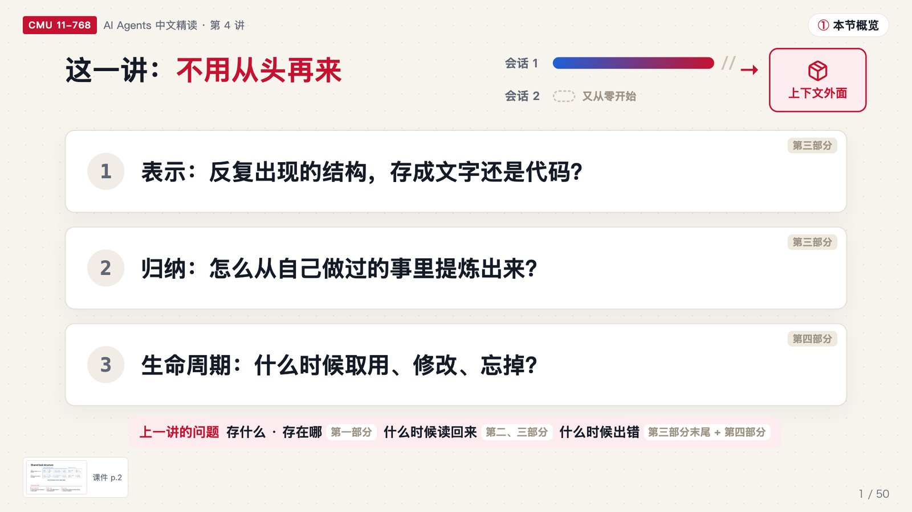

上一讲管的是**一次会话里**的上下文：塞不下了就压缩。可会话总会结束，下次开新会话，agent 又从零开始。这一讲讲怎么把经验存到上下文**外面**，下次接着用。围绕三个问题：

| 问题 | 对应章节 | 关键词 |
|---|---|---|
| **表示**：任务之间反复出现的结构，该存成文字还是代码？ | 第 1、3 节 | 片段 / 事实 / 技能、SKILL.md、文字技能 vs 代码技能 |
| **归纳**：agent 怎么从自己做过的事里把它归纳出来？ | 第 3 节 | MemGPT、Mem0、Reflexion、AWM、ASI、SkillWeaver |
| **生命周期**：一个技能什么时候该取出来用、该修改、该忘掉？ | 第 3.7、4 节 | 学 / 用 / 维护、ReasoningBank、TroVE、SAGE |

上一讲留的问题（要让 agent 记住跨会话的东西，存什么、存在哪、什么时候读回来、各自什么时候出错）分散在这几处回答：存在哪见 1.2，存什么见 1.3；什么时候读回来见 2.3（渐进式披露）、3.4（检索相似轨迹）、4.4（检索太多反而变差）；各自什么时候出错，集中在 3.15 的三种表示对照表，另有 2.5（人写的技能也会把任务带偏）和 4.3（裁判判错会把错的东西存进去）。

---

## 1 经验该存在哪、存成什么

### 1.1 任务之间有大量重复的结构

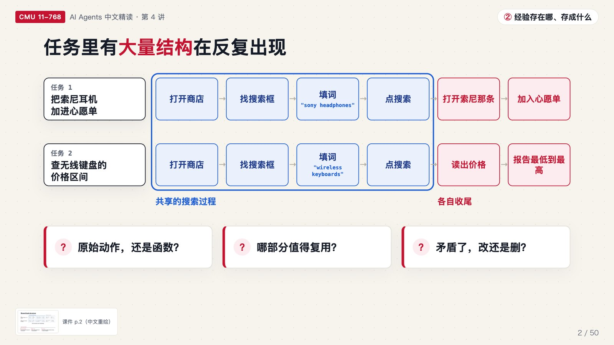

一个在购物网站上干活的 agent，接到两个任务：

- 任务 1：把索尼耳机加进我的心愿单。
- 任务 2：查一下无线键盘的价格区间。

| | 共享的搜索过程 | | | | 各自收尾 | |
|---|---|---|---|---|---|---|
| 任务 1 | 打开商店 | 找搜索框 | 填入 "sony headphones" | 点搜索 | 打开索尼那条 | 加入心愿单 |
| 任务 2 | 打开商店 | 找搜索框 | 填入 "wireless keyboards" | 点搜索 | 读出价格 | 报告最低到最高 |

前四步几乎一模一样，只有搜索词不同。原课件的结论是：**agent 的任务里有大量结构在反复出现。**如果 agent 摸索了半天才学会在这个网站上搜东西，下次就应该能直接用上。

图下方三个问题，正好是这一讲要回答的：

1. 是直接留下原始动作，还是抽象成一个函数（可以当黑盒运行、可以测试、还能层层调用别的函数）？
2. agent 怎么判断任务里哪部分值得复用？
3. 记忆越攒越多，碰到矛盾的信息、或者找到了更好的做法，要不要改、要不要删？

### 1.2 更新 agent 的三个位置

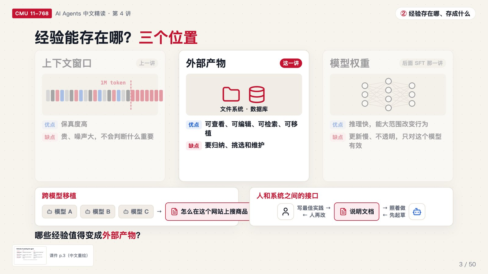

| 位置 | 优点 | 缺点 | 在哪讲 |
|---|---|---|---|
| **上下文窗口**（context window） | 对发生过的事保真度高 | 贵、噪声大，自己不会判断什么重要 | 上一讲 |
| **外部产物**（external artifacts） | 可查看、可编辑、可检索、可移植 | 得归纳出来、挑出来，还要维护 | 这一讲 |
| **模型权重**（model weights） | 推理更快，能大范围改变行为 | 更新慢、不透明、只对这一个模型有效 | 后面讲 SFT 的那一讲 |

几点补充（课上口头补充）：

- 上下文就是 ReAct 式的那一串：过去的观察、动作、用户消息、环境反馈。就算上下文有一百万 token，连着做很多个任务也一定会超，所以要把过去任务里的东西存到外面。
- 外部产物通常像一个需要管理的数据库，或者一个 agent 能访问的文件系统。
- 外部产物最大的好处是**能跨模型移植**：一份"怎么在这个网站上搜商品"的说明，换哪个模型都能用；改权重则只对那一个模型有效。
- 它还**对人透明**：人可以写下最佳实践给 agent 用，agent 也可以先起草、人再看再改。记忆是人能读懂的，人和系统之间就有了一个接口。

原课件这页底下留了一个问题：**哪些经验值得变成外部产物？**下一小节回答。

### 1.3 三类经验：片段、事实、技能

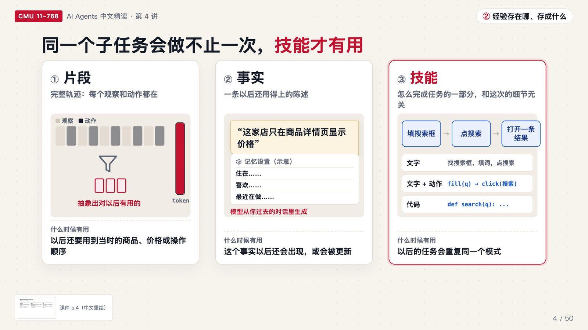

| 类型 | 是什么 | 什么时候有用 |
|---|---|---|
| **片段**（episode） | 完整轨迹，每一个观察和动作都在 | 以后还会用到当时那个具体商品、价格或操作顺序 |
| **事实**（fact） | 一条以后还用得上的陈述，比如"这家店只在商品详情页显示价格" | 这个事实在以后的任务里会再出现，或者会被更新 |
| **技能**（skill） | 怎么完成任务的一部分，比如"填搜索框 → 点搜索 → 打开一条结果" | 以后的任务会重复同一个模式 |

逐个展开：

- **片段**保真度最高，环境和用户指令的细节全留着，但也最贵、最占 token。而且通常用不着那么多细节。就像做监督学习，我们也不想记住每个训练样本的细节，而是要抽象出对以后泛化有用的东西。
- **事实**是早期记忆系统主要存的东西：用户聊天时说了自己多大、住哪，系统记下来以后用。用过 ChatGPT 或 Anthropic 记忆功能的人都见过，在设置里能看到它记了你哪些事，那是模型从你过去的对话里生成的一段文字（图中"记忆设置"列表是示意）。这有点像上一讲的压缩：由 LLM 生成，存在上下文外面。
- **技能**是 agent 特有的：它描述怎么完成任务的一部分，和这次任务的细节无关。比如"在这个网站上怎么搜商品"，不用记这次搜的是哪个商品。技能可以只是文字，可以带上实际的动作，也可以是代码。**只有同一个子任务会做不止一次，技能才有用。**

### 1.4 记忆和技能

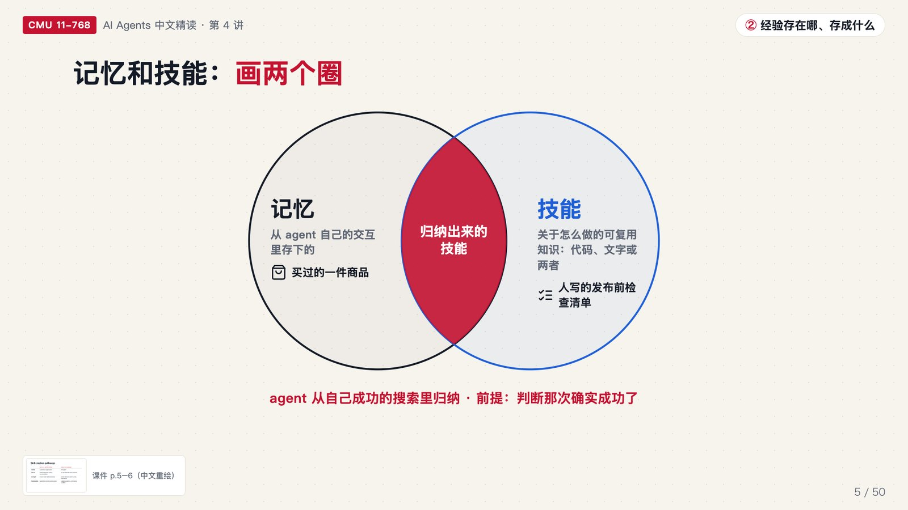

两个概念有交集：

- **记忆**（memory）：从 agent 自己的交互里存下来的东西，比如以前买过的一件商品。
- **技能**（skill）：关于"怎么做"的可复用知识，可以是代码、文字，或者两者都有。比如一份人写的发布前检查清单。
- **交集是归纳出来的技能**（induced skill）：agent 从自己成功的搜索里归纳出一个技能，存起来以后用。前提是判断那次确实是成功的（课上口头补充）；这个"判断"会在第 4.3 节变成一个专门的问题。

### 1.5 技能的两条来路

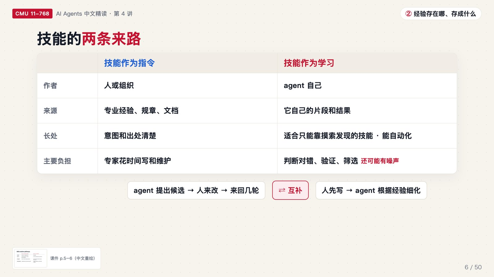

| | 技能作为指令（skills as instructions） | 技能作为学习（skills as learning） |
|---|---|---|
| 作者 | 一个人或一个组织 | agent 自己 |
| 来源 | 已有的专业经验、规章、文档 | 它自己的片段和结果 |
| 长处 | 意图和出处清楚 | 适用于技能只能靠摸索发现的场合 |
| 主要负担 | 专家要花时间写、花时间维护 | 判断结果对不对、验证、筛选 |

人写的技能可以是个人偏好，也可以是组织规定（"我们公司就是这样写代码、测代码的"），质量更可控，但写和维护都费时间。agent 学的技能可以自动化：归纳一个技能，用它把同类任务重做一遍，看指标有没有变好；但可能有噪声，尤其是交给别的 agent 用时，可能带来意想不到的后果。

两条路是**互补**的（课上口头补充）：可以让 agent 从经验里提出候选的最佳实践，人来改，来回几轮；也可以反过来，人先写一个技能，agent 根据经验去细化它。

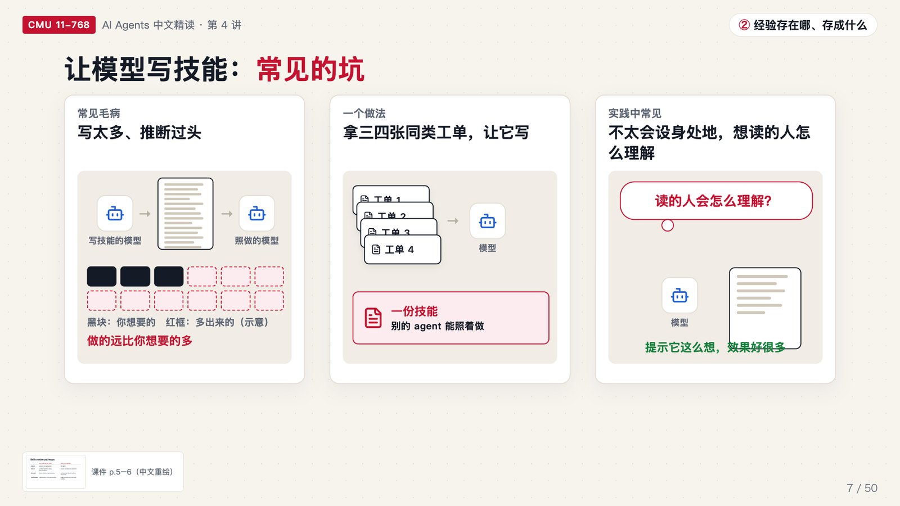

课堂上大多数人都用过技能，约一半自己写过，不少人让 agent 替自己写过。大家反馈的典型问题（课上口头补充）：

| | 内容 |
|---|---|
| 常见毛病 | 模型写技能常常**写得太多、推断过头**；交给另一个模型时，对方一字一句照着做，做的远比你想要的多 |
| 一个做法 | 给它三四张处理过同类生产问题的工单，让它"写一个别的 agent 能照着做的技能" |
| 实践中常见 | 模型不太会设身处地去想另一个人或 agent 读这份说明时会怎么理解；但提示它这么去想，效果会好很多 |

你更愿意自己写技能，还是让 agent 替你写？这正是原课件最后一个讨论题（人和 agent 各出多少力），本讲小结会再回来。

---

## 2 人写的技能

### 2.1 技能是什么

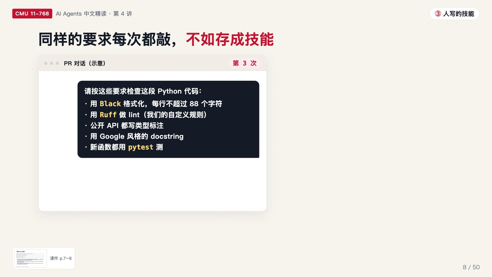

例子来自 OpenHands 的博客《How to Create Effective Agent Skills》（Michelini & Neubig, 2026）。每次开一个 PR 对话，都要敲一遍同样的要求：

```text
Please check this Python code using:
- Black formatting with 88-char line limit      # 用 Black 格式化，每行不超过 88 个字符
- Ruff linting with our custom rules             # 用 Ruff 按自定义规则做 lint
- Type hints for all public APIs                 # 所有公开 API 写类型标注
- Google-style docstrings                        # Google 风格的 docstring
- Pytest for all new functions                   # 新函数都用 pytest 测
```

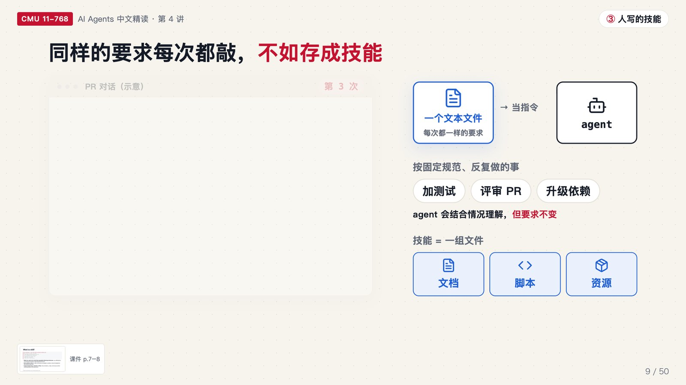

既然每次都一样，更自然、更快的做法是把这些要求存成一个文本文件，让 agent 当指令用。原课件的三句话：

| | |
|---|---|
| 什么时候用技能 | 要按固定规范**反复**做一件事时，比如加测试、评审 PR、升级依赖。agent 会结合当时的情况去理解它，但总的要求不变 |
| 谁来写 | 这里是人写的；本讲后面会让 agent 自己发现这种重复、自己写技能 |
| 怎么实现 | 一组文件：文档、脚本和资源，提供指导和自动化 |

### 2.2 一个技能包长什么样

现在的标准叫 **Agent Skills**（规范见 [agentskills.io/specification](https://agentskills.io/specification)）。一个 `python-review` 技能包的目录：

```text
python-review/
├── SKILL.md      # 必须：指令 + 元数据
├── scripts/      # 可选：可执行代码
├── references/   # 可选：文档
└── assets/       # 可选：模板、资源
```

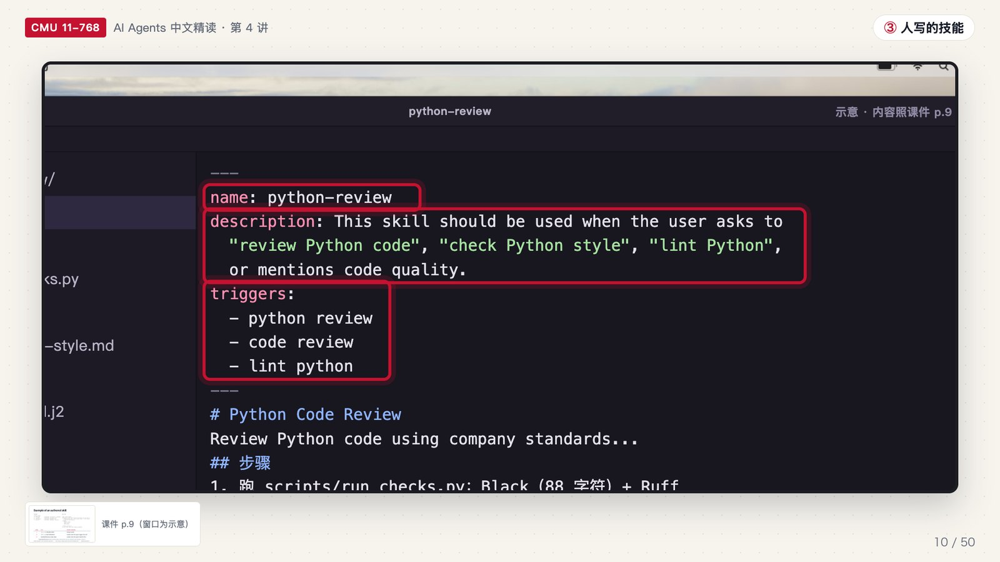

`SKILL.md` 是一个 Markdown 文件，开头是一段 YAML **元数据**（frontmatter）。原课件给的例子：

```yaml
---
name: python-review
description: This skill should be used when the user asks to
  "review Python code", "check Python style", "lint Python",
  or mentions code quality.
triggers:
  - python review
  - code review
  - lint python
---
```

| 字段 | 作用 |
|---|---|
| `name` | 技能名，加载时用它 |
| `description` | **写给模型看的**，告诉它什么时候该用这个技能。这里写的是：用户要求评审 Python 代码、检查风格、做 lint，或提到代码质量时 |
| `triggers` | 几个触发词 |

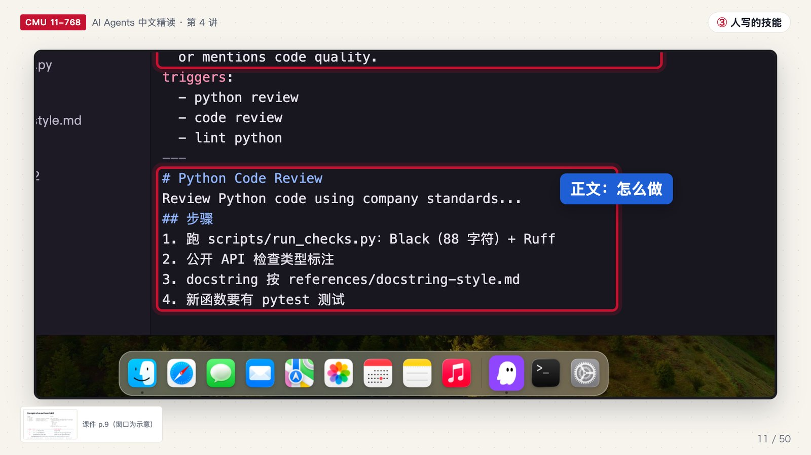

元数据之后是**正文**，详细写怎么做，比如跑哪些 linter、怎么测（图里 Kiro 窗口和正文排版是示意，内容按原课件 p.9）。

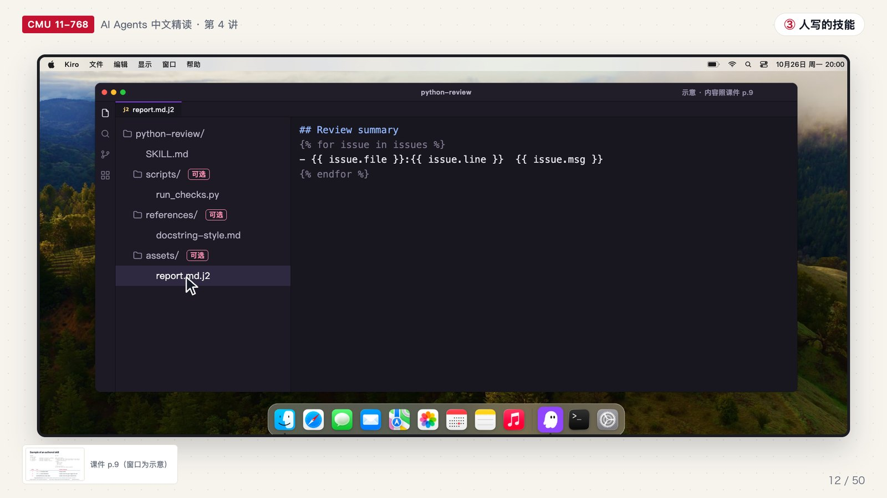

三个可选目录（课上口头补充）：

| 目录 | 放什么 | 例子 |
|---|---|---|
| `scripts/` | 可执行代码 | 跑 linter 的 Python 脚本 `run_checks.py`，在 SKILL.md 里说明它 |
| `references/` | 补充文档，不是每次都要看 | `docstring-style.md`，SKILL.md 里留个引用，需要时再读 |
| `assets/` | 模板或资源 | 按条件加载的 Jinja 模板，比如 `report.md.j2` |

### 2.3 渐进式披露：用到哪层，才加载哪层

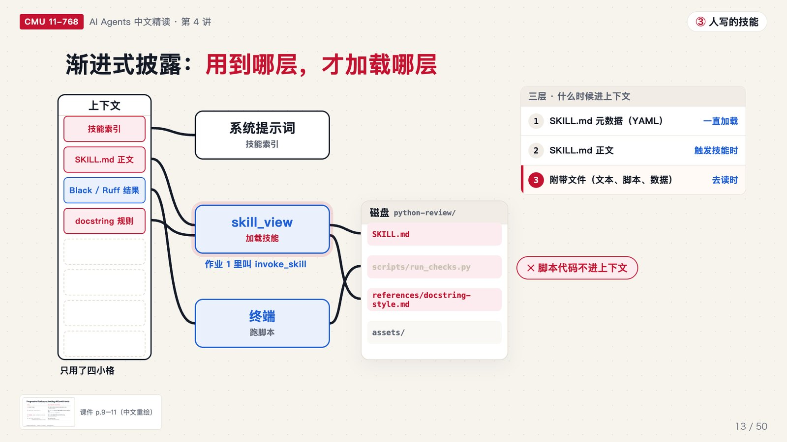

这些东西不会一股脑塞进上下文，这叫**渐进式披露**（progressive disclosure）。下表出自 Anthropic 的文章《Equipping agents for the real world with Agent Skills》：

| 层级 | 文件 | 什么时候进上下文 |
|---|---|---|
| 1 | SKILL.md 的元数据（YAML） | 一直加载 |
| 2 | SKILL.md 的正文（Markdown） | agent 触发这个技能时 |
| 3 | 附带的文件（文本、脚本、数据） | agent 去读这些文件时 |

所以写技能有两条要求：描述要**简洁**，技能一多才不会把上下文撑满；正文要**写够信息**，让模型知道该去哪几个目录里找更多东西。

落到实现上，原课件以开源的 **HermesAgent** 为例，分四轮：

| 轮次 | 动作 | 什么进上下文 |
|---|---|---|
| 1 | 系统提示词 | **技能索引**：只有名字和描述。Hermes 里约 3K token |
| 2 | `skill_view('python-review')` | SKILL.md 正文，作为工具结果：评审步骤，文字形式。只加载一次。作业 1 里这个工具叫 `invoke_skill` |
| 3 | 终端里跑 `python scripts/run_checks.py src/` | 脚本的输出：Black 和 Ruff 的检查结果。**脚本代码本身从不进上下文** |
| 4 | `skill_view('python-review', 'references/docstring-style.md')` | docstring 规则，只在模型要的时候才进来 |

第 1 轮的系统提示词写得很硬（原课件节选自 HermesAgent 的 `agent/prompt_builder.py`）：

```text
## Skills
Before replying, scan the skills below. If a skill matches or is even partially relevant
to your task, you MUST load it with skill_view(name) and follow its instructions. …
<available_skills>
  code-quality:
    - python-review: This skill should be used when the user asks to "review Python code", ...
  workflow:
    - submit-task: When the task is complete, take the required steps to submit the solution.
      DO NOT submit without invoking this skill.
    - release-notes: …
</available_skills>
Only proceed without loading a skill if genuinely none are relevant.
```

大意：回复之前先扫一遍技能列表，只要有一个匹配、哪怕只是部分相关，就**必须**用 `skill_view(name)` 加载并照做；确实没有相关技能，才可以不加载直接做。列出来的就是各个技能的元数据。这段提示词在源码里具体怎么拼出来、`skill_view` 怎么按需返回文件，第 5 节逐段读。

作业 1 就要实现这一套（[作业说明](https://github.com/cmu-agents/assignment-1/blob/main/ASSIGNMENT.md) §1.4 Load skills）。

### 2.4 几个常被问到的问题

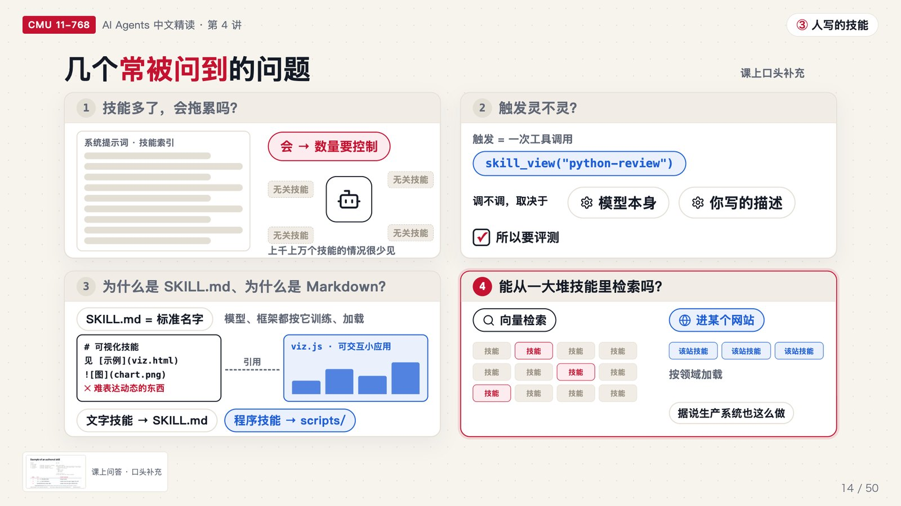

都是课堂问答（课上口头补充）：

| 问题 | 回答 |
|---|---|
| 技能多了，元数据一直占着系统提示词，会拖累效果吗？ | 会，所以数量要控制、按需加载。HermesAgent 里技能描述加起来约 3,000 token。后面会看到，塞进不相关的技能会让效果变差：上下文变长，模型会被无关的东西分心。上千、上万个技能的情况很少见 |
| 触发灵不灵？ | 触发就是模型生成的一次工具调用，调不调取决于模型本身，也取决于你写的描述，所以需要评测 |
| 为什么叫 SKILL.md？ | 这个名字是标准化的，模型和 agent 框架都按它训练、加载。想用别的格式，也尽量贴近这个结构 |
| 为什么用 Markdown？ | 在机器可读和人可读之间取了平衡：线性、能放链接、能嵌图片，但很难表达动态的东西。要演示几种数据可视化，一个可交互的 JavaScript 小应用更合适，那就当代码文件放进包里，在 Markdown 里引用。研究文献里的技能基本两类：文字技能放 Markdown，程序技能放 `scripts/`，覆盖面已经很宽 |
| 能从一大堆技能里检索吗？ | 研究里有人用文本向量检索，或者按领域加载（进哪个网站就加载适用于它的技能）。据说生产系统也这么做，课上没有给出处 |

### 2.5 怎么衡量技能带来的提升：SkillsBench

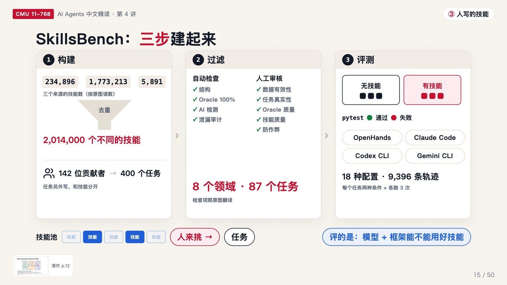

**SkillsBench**（arXiv 2602.12670）分三步构建（按原课件图核对）：

| 步骤 | 做了什么 | 结果 |
|---|---|---|
| ① 构建 | 从技能生态的三个来源收集技能（234,896 / 1,773,213 / 5,891 个），去重；142 位贡献者另写任务 | 2,014,000 个不同的技能；400 个任务 |
| ② 过滤 | 自动检查（结构、参考解 100% 通过、AI 生成检测、泄漏审查）+ 人工审核（数据有效性、任务真实性、参考解质量、技能质量、防作弊） | 8 个领域、87 个任务 |
| ③ 评测 | 每个任务在"不给技能""给技能"两种条件下各跑 3 次，用 pytest 判通过与否；框架有 OpenHands、Claude Code、Codex CLI、Gemini CLI | 18 种模型 + 框架配置，9,396 条轨迹 |

注意它的设计：**任务和技能是分开写的**，写任务的人再从技能池里挑出看起来适用的那几个，所以每个任务配哪一包技能由人来选（"挑好的技能"，curated skills）。另外还有一道过滤：先在一小批模型上确认给了技能确实变好，再看换成更多框架和模型还成不成立（课上口头补充）。所以它间接评了技能质量，但主要评的是**模型加框架能不能用好技能**。

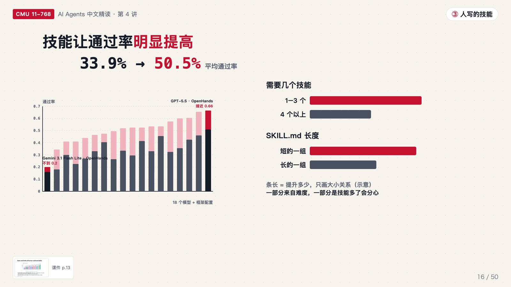

结果有三条：

1. **技能把平均通过率从 33.9% 提到 50.5%。**18 个配置几乎都是浅色的"技能带来的提升"叠在深色的"无技能"柱子上；最低的 Gemini 3.1 Flash Lite（OpenHands）不到 0.2，最高的 GPT-5.5（OpenHands）接近 0.66。各柱的具体数值图上读不准，只看趋势。
2. **技能越聚焦，提升越大。**只需要 1–3 个技能的任务，比需要 4 个以上的提升更多；SKILL.md 越短的那组，提升也越大（右侧两组条形只表示大小关系，是示意）。这一部分是难度造成的，一部分是因为技能一多，模型会分心（课上口头补充）。


3. **技能仍然让 87 个任务里的 13 个变差。**一个技能可能顶掉了模型原本更好的默认做法，让它按和用户要求不一样的方式去做。所以写完技能要检查：它到底有没有让结果变好。

### 2.6 技能包从哪来

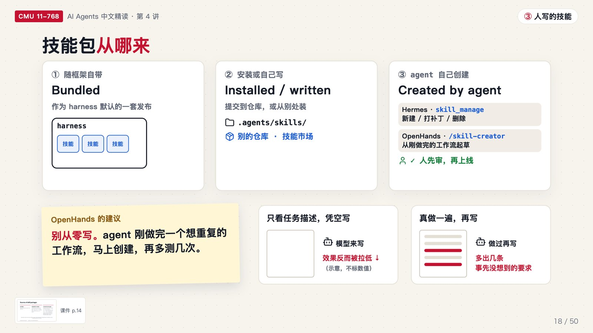

| 来源 | 说明 |
|---|---|
| **随框架自带**（bundled） | 作为 harness 默认的一套一起发布 |
| **安装或自己写**（installed / written） | 一个人为自己的工作写一个，提交到仓库的 `.agents/skills/` 下；或者从别的仓库、技能市场装一个 |
| **agent 自己创建**（created by agent） | Hermes 提供 `skill_manage` 工具，可以新建、打补丁、删除；OpenHands 有 `/skill-creator` 命令，能根据 agent 刚完成的工作流起草一个技能。上线之前，人可以先审一遍 |

**OpenHands 的建议：别从零开始写技能。**在 agent 刚做完一个你想重复的工作流之后马上创建，然后多测几次。

为什么？课上口头补充：SkillsBench 论文里有结果显示，让模型只看任务描述凭空写技能，写得很差，反而让效果变差（图中"效果反而被拉低"的箭头是示意，不标数值）。人凭空写可能好一些，因为人知道自己想怎么做；但最好还是基于做过的事来写，因为真做一遍，会暴露出很多事先想不到的要求。

### 2.7 案例：维护一个代码评审技能

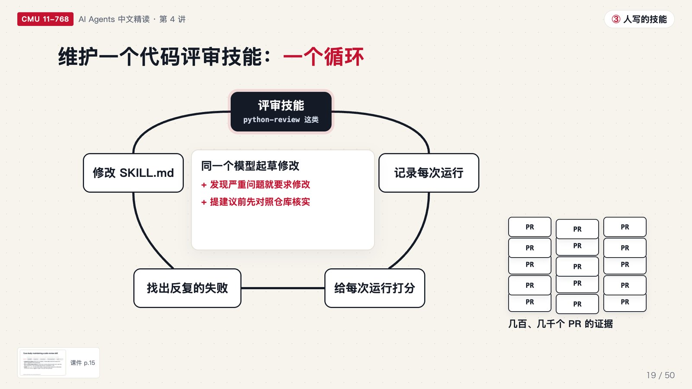

OpenHands 在自己所有仓库的每个 PR 上都跑一个 python-review 这类的评审技能。维护是一个循环：

```text
评审技能 → 记录每次运行 → 给每次运行打分 → 找出反复出现的失败 → 修改 SKILL.md → 回到评审技能
```

| 环节 | 怎么做 |
|---|---|
| 评估输出 | 每个 PR 合并后，用一个模型当裁判，数一数 agent 提的建议里，人最后采纳了多少条 |
| 让模型分析失败 | 它读运行记录，指出反复出现的问题：无视仓库自己的约定（约 15%），以及在 PR 有严重缺陷时仍然批准（约 10%） |
| 更新 SKILL.md | 由同一个模型起草：发现严重问题就要求修改；提建议之前，先对照仓库核实一遍 |

几百、几千个 PR 积累下来，什么管用、什么不管用就有了大量证据，可以用推理模型把它们汇总，再让模型提出修改技能文件的建议，让 agent 写的评审更可能被人采纳（课上口头补充）。这个循环也预告了第 3.7 节"技能的生命周期"：学、用、维护。

---

## 3 从经验里学：记忆和归纳技能

上一节的技能是人写的。这一节讲 agent 怎么**自动**记住过去的经验（3.1–3.4），再在这个基础上从经验里**归纳技能**（3.5–3.15）。

### 3.1 管理一个外部记忆：MemGPT

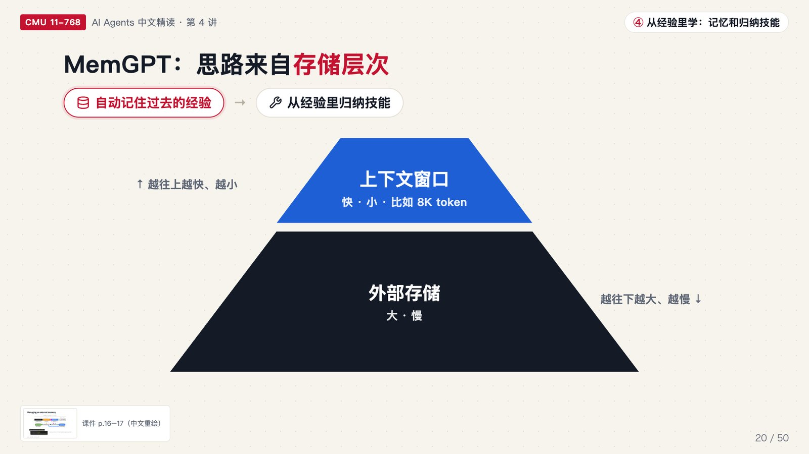

**MemGPT**（Packer et al., 2023）是最早提出"在语言模型的上下文窗口之外管理记忆"的论文之一，影响很大。它的思路来自计算机系统里的**存储层次**（memory hierarchy）：快但小的那一层是上下文窗口，大但慢的那一层是外部存储（课上口头补充）。

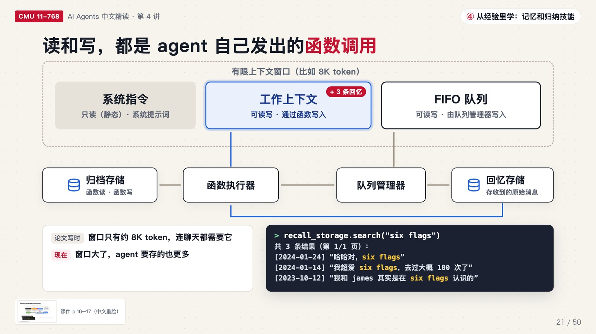

| 位置 | 组成 | 谁来写 |
|---|---|---|
| 有限的上下文窗口（比如 8K token） | **系统指令**：只读、静态，MemGPT 自己的系统提示词 | — |
| | **工作上下文**（working context）：可读可写 | 通过函数写入 |
| | **FIFO 队列**：可读可写 | 由队列管理器写入 |
| 窗口外 | **归档存储**（archival storage） | 通过函数读写 |
| | **回忆存储**（recall storage）：收到的原始消息 | 通过函数读，由队列管理器写 |

中间是函数执行器和队列管理器。原课件上的例子：

```text
> recall_storage.search("six flags")
共 3 条结果
[2024-01-24] "lol yeah six flags"
[2024-01-14] "i love six flags been like 100 times"
[2023-10-12] "james and I actually first met at six flags"
```

这三条结果被放进工作上下文，模型回答时就能用上。关键一句：**读和写都是 agent 自己发出的函数调用。**记忆管理本身也是 agent 的一种"工具使用"。

论文写的时候上下文窗口只有 8,000 token 左右，哪怕只是跟助手聊天，这种做法也很有必要。现在窗口大了，但 agent 要存的东西也多得多，这个思路对 agent 同样适用（课上口头补充）。

### 3.2 处理记忆冲突：Mem0

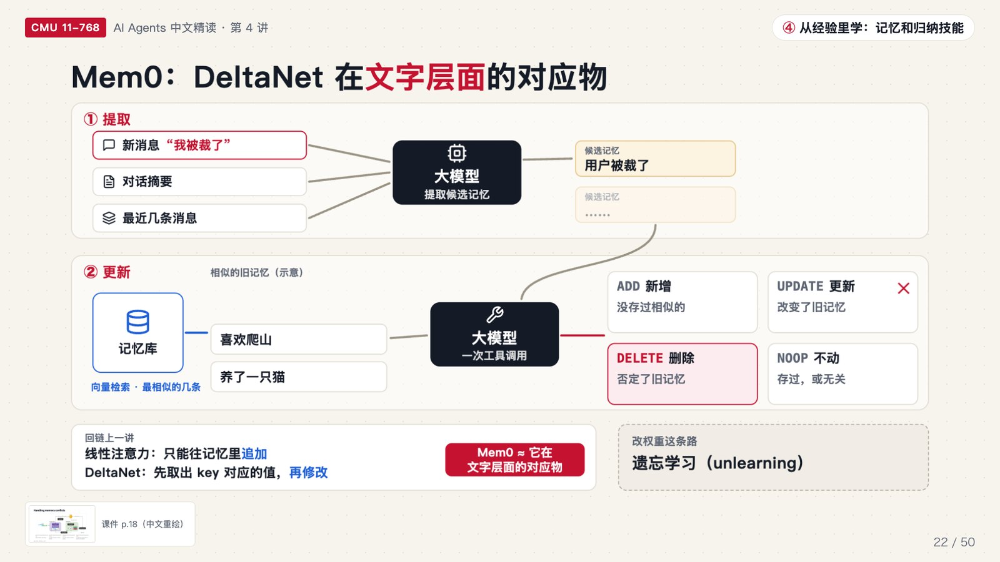

只往记忆里加东西是不够的。你告诉系统"我在 X 公司上班"，后来换了工作，系统应该用最新的信息。**Mem0**（Chhikara et al., 2025）分两个阶段：

1. **提取**：拿到新消息，加上从数据库取来的对话摘要和最近几条消息，用 LLM 提取一批**候选记忆**。
2. **更新**：从数据库里取出和它最相似的若干条旧记忆（课上口头说用的是向量检索），再由 LLM 通过**一次工具调用**，给每条候选记忆选一个操作，写回数据库：

| 操作 | 什么时候 |
|---|---|
| `ADD` 新增 | 还没存过相似的东西 |
| `UPDATE` 更新 | 新消息改变了一条已有的记忆 |
| `DELETE` 删除 | 新消息否定了一条已有的记忆 |
| `NOOP` 不动 | 已经存过了，或者无关 |

课上的例子：先说"我在 X 公司上班"，后来说"我被裁了"，这时应该**直接删掉**那条，而不是去更新它。

和上一讲的联系（课上口头补充）：**DeltaNet** 的目标很像。线性注意力只能往"记忆"（状态矩阵）里追加；DeltaNet 先把某个 key 对应的值取出来，再修改它，这能提升效果。Mem0 可以看成它在文字层面的对应物。在改权重这条路上，能忘掉东西也同样有用，比如**遗忘学习**（unlearning）。

### 3.3 记住对轨迹的反馈：Reflexion

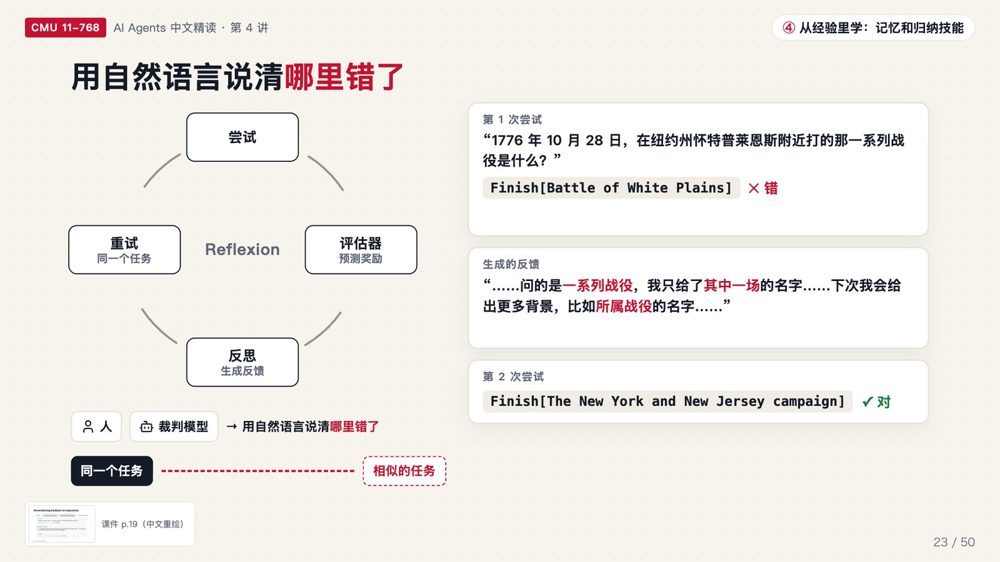

MemGPT 和 Mem0 是为聊天助手设计的。对 agent 来说，**对轨迹的反馈**特别有用。**Reflexion**（Shinn et al., NeurIPS 2023）是一个循环：

```text
尝试 → 评估器：预测奖励 → 反思：生成反馈 → 重试同一个任务
```

原课件上的例子：

| 步骤 | 内容 |
|---|---|
| 第 1 次尝试 | 问："1776 年 10 月 28 日在纽约州怀特普莱恩斯附近打的那一系列战役是什么？" 回答 `Finish[Battle of White Plains]`，**错** |
| 生成的反馈 | "……问题问的是**一系列**战役，而我只给了**其中一场**战役的名字……我会给出更多背景，比如这场战事所属的战役名称……" |
| 第 2 次尝试 | 回答 `Finish[The New York and New Jersey campaign]`，**对** |

反馈可以来自人，也可以来自一个当裁判的模型。论文表明，用自然语言说清"哪里错了"再让模型重试，帮助非常大。方法简单有效，你的项目里想让 agent 从过去的经验中受益，值得先实现这个。这里是在**同一个任务**上改进；反馈写得够通用，也能推广到相似的任务上（课上口头补充）。

### 3.4 检索相似轨迹当示例

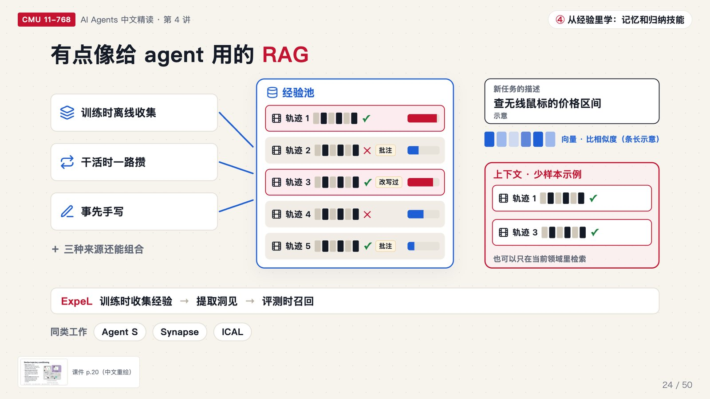

另一种思路是把整条轨迹存起来，遇到新任务时检索相似的当示例：

| | |
|---|---|
| 存什么 | 完整轨迹，成功的和失败的都存，有时会先改写、加注释再存 |
| 经验池从哪来 | 训练阶段离线收集、agent 干活时一路攒、事先手写，可以组合 |
| 怎么用 | 用文本向量检索出和新任务最相似的几次运行，作为**少样本示例**放进上下文 |

原课件的图出自 **ExpeL**（Zhao et al., AAAI 2024）：训练阶段在任务 1 到 N 上收集经验进经验池、提取洞见；评测阶段召回经验、配合洞见指导。同类工作还有 **Agent S**（ICLR 2025）、**Synapse**（ICLR 2024）、**ICAL**（NeurIPS 2024）。

这有点像"给 agent 用的 RAG"（课上口头补充）。轨迹就是 agent 收到的环境和用户消息、它做的动作（工具调用），可能还有思维链，基本上就是上下文里的全部消息。检索时通常拿**新任务的文字描述**做向量，和其他任务的描述比相似度（每个任务都挂着一条轨迹），也可以限定只检索当前领域的任务。

### 3.5 技能：任务里可复用的一块

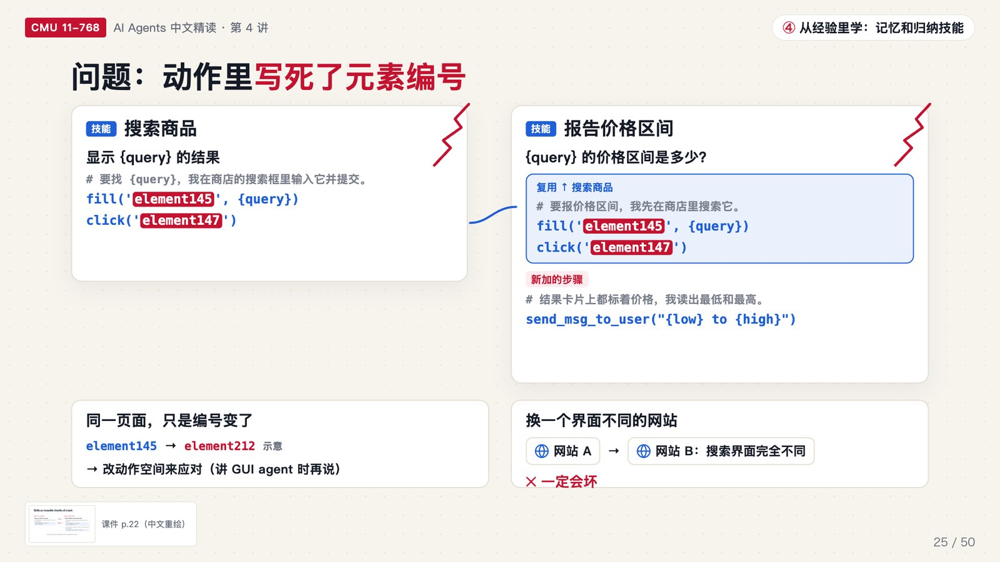

有了上面这些基础，就可以讲怎么归纳技能了。技能可以看成**任务中能跨任务复用的那一块**（reusable chunk）。原课件的例子：

```text
# 技能 1：搜索商品 —— Show me results for {query}
# To find {query}, I will type it into the store's search box and submit.
fill('element145', {query})
click('element147')

# 技能 2：报告价格区间 —— What is the price range for {query}?
# To get the price range for {query}, I will first search the store for it.
fill('element145', {query})          # ← 复用技能 1 的两步
click('element147')
# The results list a price on each card. I will read the lowest and the highest.
send_msg_to_user("{low} to {high}")  # ← 加上新的步骤
```

这种表示有什么问题？课堂上学生答：**动作里写死了元素编号，编号一变就坏**（课上口头补充）。如果只是同一个页面编号变了，可以通过改动作空间来应对，后面讲 GUI agent 时会讲；但换一个搜索界面不同的网站，它一定会坏，3.14 节会看到真实例子。

接下来的问题是：技能该用什么表示？原课件对比文字和代码。

### 3.6 程序归纳的前史

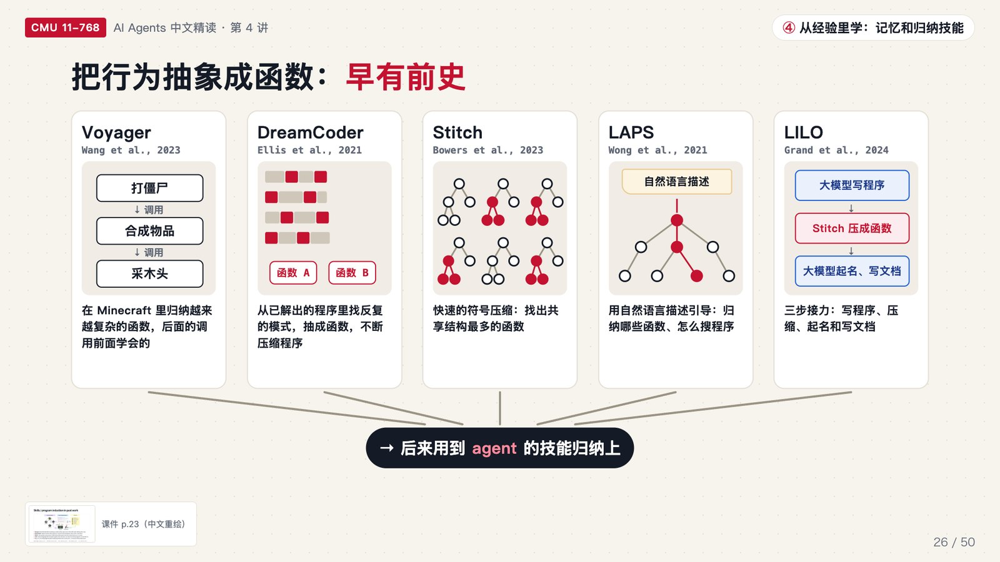

"把重复的行为抽象成函数"不是 LLM agent 才有的想法：

| 工作 | 做了什么 |
|---|---|
| **Voyager**（Wang et al., 2023） | 在 Minecraft 里为越来越复杂的动作序列归纳函数（"合成某件物品""打僵尸"），每个函数调用之前学会的函数，层层堆高 |
| **DreamCoder**（Ellis et al., 2021） | 归纳出能把一批已解出的程序"压缩"的函数，之后搜索时复用它们 |
| **Stitch**（Bowers et al., 2023） | 快速的符号压缩：在一批程序里找出能概括最多共享结构的函数 |
| **LAPS**（Wong et al., 2021） | 用自然语言的任务描述，引导归纳哪些函数、怎么搜索程序 |
| **LILO**（Grand et al., 2024） | LLM 写程序，Stitch 把它们压缩成函数，LLM 再给每个函数起名、写文档 |

DreamCoder 这一脉来自程序归纳领域：用很底层的函数构造出完整的对象，在里面找反复出现的模式，抽象成函数，反复做，相当于不断压缩构造这些对象的程序。后续工作又引入了大语言模型、Python 代码和自然语言描述，这些想法后来都用到了 agent 的技能归纳上（课上口头补充）。

### 3.7 在线归纳的评测设定和技能的生命周期

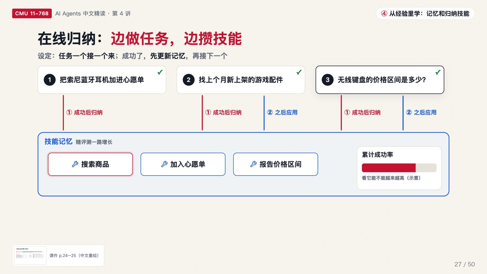

**评测设定**：评测任务一个接一个到来；一个任务成功了，就先更新记忆，再迎接下一个任务。评估的是**到目前为止所有任务的累计成功率**。

| 顺序 | 任务 | 技能记忆里多了什么 |
|---|---|---|
| 1 | 把一副索尼蓝牙耳机加进心愿单 | 搜索商品、加入心愿单 |
| 2 | 找出上个月新上架的游戏配件 | （复用搜索商品） |
| 3 | 无线键盘的价格区间是多少？ | 报告价格区间 |

每个任务上发生两件事：① 任务成功后**归纳**；② 在之后的任务上**应用**。这就是一个在线学习的设定：要看的是成功率是不是越来越高，能不能借着学会的简单子任务，解出越来越复杂的任务。

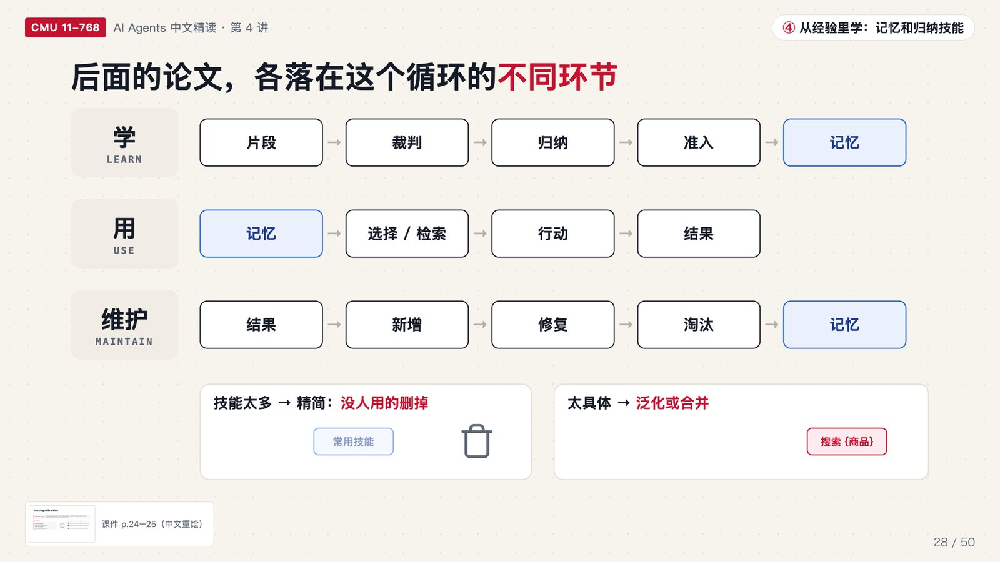

一个归纳出来的技能有一个**生命周期**（lifecycle）：

| 阶段 | 流程 |
|---|---|
| **学**（LEARN） | 片段 → 裁判 → 归纳 → 准入 → 记忆 |
| **用**（USE） | 记忆 → 选择 / 检索 → 行动 → 结果 |
| **维护**（MAINTAIN） | 结果 → 新增 → 修复 → 淘汰 → 记忆 |

维护这一步（课上口头补充）：技能太多了要精简，删掉没人用的；太具体的要泛化，或者把几个合并成一个。后面的论文分别落在这个循环的不同环节上，读的时候可以先问一句"它改的是哪一格"。

### 3.8 归纳文字技能：Agent Workflow Memory

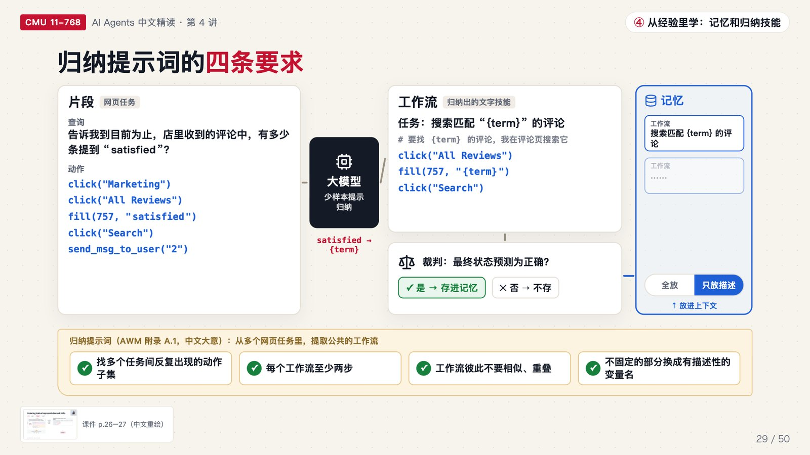

**AWM**（Agent Workflow Memory，Wang et al., ICLR 2025）用在网页任务上，对应生命周期里的"裁判 → 归纳 → 准入"。

**片段**：一个自然语言查询加上实际的动作。

```text
查询：Tell me the number of reviews that our store received so far that mention the term "satisfied"
click("Marketing")
click("All Reviews")
fill(757, "satisfied")
click("Search")
send_msg_to_user("2")
```

**归纳**：用少样本提示让语言模型看这串工具调用，找出以后可能有用的部分，输出一个**工作流**（workflow），也就是文字加动作形式的技能：

```text
Task: Search for reviews matching "{term}"
Actions:
# To find reviews for {term}, I will search for "{term}" in the reviews page
click("All reviews")
fill(757, "{term}")
click("Search")
```

具体的搜索词被换成了模板变量 `{term}`，就能用到别的搜索词上。看着已经有点像代码了，下面会拿代码来对比。

**裁判**：一个模型判断最终状态是否正确。判对才把工作流存进记忆，判错就跳过：错的东西存进去，会在以后把模型带偏。

**用**的时候，就是把这些工作流放进上下文，跟 Agent Skills 标准很像：可以全放，也可以只放文字描述，取决于技能有多少、模型上下文有多长（课上口头补充）。

AWM 的**归纳提示词**（论文附录 A.1）要点：

1. 给你一组网页导航任务，每个任务有一条自然语言指令和一串解决它的动作；
2. 找出**多个任务之间**重复出现的动作子集，每一个提取成一个工作流，它应该是任务里常被复用的子程序；
3. 不要生成相似或重叠的工作流；每个工作流至少两步；
4. 不固定的部分（输入的文字、按钮上的字）用有描述性的变量名代替。

### 3.9 AWM 的累积效果

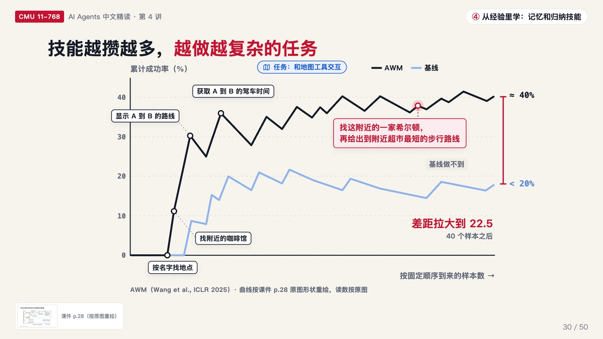

横轴是按固定顺序到来的样本数，纵轴是累计成功率，任务是和地图工具交互。AWM（黑线）一路往上，沿途标着它逐步学会的任务：

```text
按名字找地点 → 找附近的咖啡馆 → 获取一个地点的坐标 → 显示 A 到 B 的路线
→ 获取一个地点的邮编 → 获取 A 到 B 的驾车时间 → 判断能否在给定时间内从 A 开到 B
→ 找这附近的一家希尔顿，再给出到附近超市最短的步行路线
```

黑线最后在 40% 左右，基线在 20% 以下来回；**40 个样本之后，差距拉大到 22.5。**基线 agent 做不到最后那种复杂任务。（课上口头说基线收敛在 10% 左右，图上看末段在 15%–20% 之间，以图为准。）

### 3.10 文字技能还是代码技能

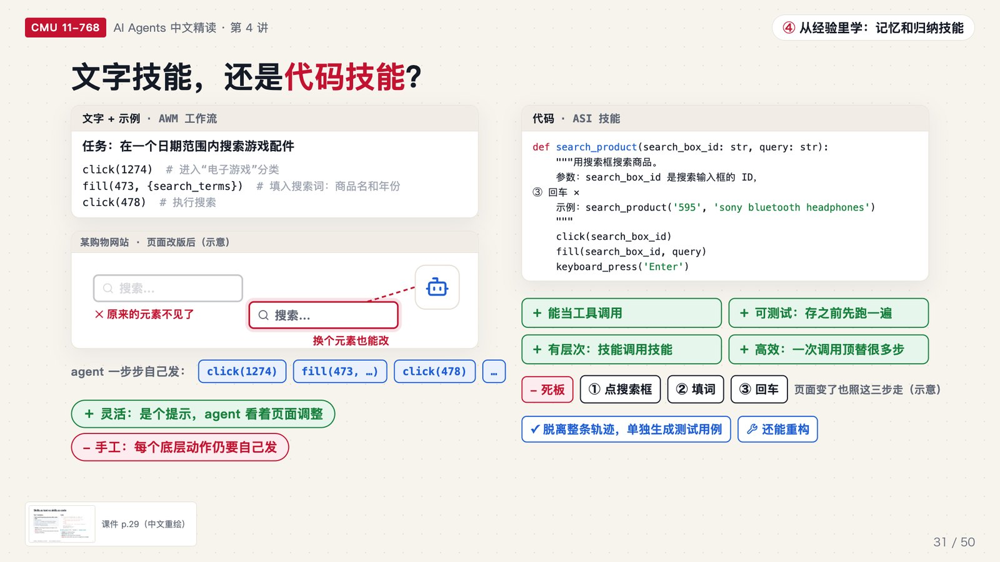

同一个"搜索商品"，两种写法（原课件 p.29）：

**文字 + 示例**（AWM 的工作流）：

```text
Task: Search for gaming accessories within a date range
Action trajectory:
click(1274)                 # Navigate to the Video Games category
fill(473, {search_terms})   # Enter search terms including product name and year
click(478)                  # Execute the search
```

**代码**（ASI 的技能）：

```python
def search_product(search_box_id: str, query: str):
    """Search for a product using the search box.
    Args:
        search_box_id: ID of the search input field
        query: Search query string to enter
    Returns:
        None
    Examples:
        search_product('595', 'sony bluetooth headphones')
    """
    click(search_box_id)
    fill(search_box_id, query)
    keyboard_press('Enter')
```

| | 文字 + 示例 | 代码 |
|---|---|---|
| ＋ | **灵活**：是一个提示，agent 会理解它，并根据眼前的页面调整。网站改了、搜索框不再是那个元素，也能改用对的那个 | **能当工具用**：`search_product('595', 'Macbook')`；**可测试**：存之前先跑一遍；**有层次**：技能可以调用技能；**高效**：一次调用顶替模型的很多步 |
| − | **手工**：每一个底层动作仍然要 agent 自己发出，照抄再改 | **死板**：它就照写的那样做三步，哪怕页面已经变了，也没有偏离的余地 |

代码还有两个好处（课上口头补充）：可以脱离整条轨迹，**单独为这个函数生成测试用例**；还能**重构**。

### 3.11 归纳代码技能：ASI

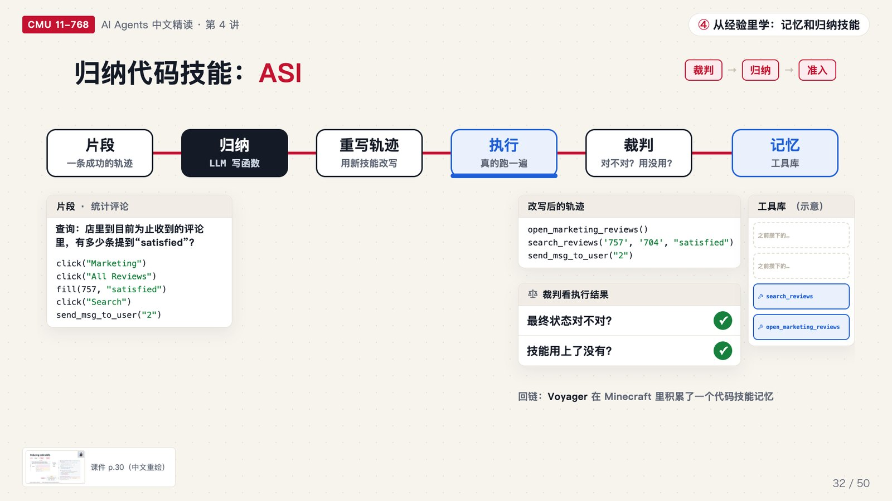

**ASI**（Agent Skill Induction，论文题目 *Inducing Programmatic Skills for Agentic Tasks*，Wang et al., COLM 2025）流程和 AWM 很像，同样是"裁判 → 归纳 → 准入"，只是利用语言模型也擅长写代码，让它把轨迹里的行为抽象成**函数**。还是那个"统计提到 satisfied 的评论"的片段，归纳出两个技能（原课件上的真实例子，docstring 有删节）：

```python
def search_reviews(search_box_id, search_button_id, search_term):
    """Search for reviews with a specific term.
    Args:
        search_box_id: …
    …
    Examples:
        search_reviews('757', '704', 'great')
    """
    fill(search_box_id, search_term)
    click(search_button_id)

def open_marketing_reviews():
    """Navigate to All Reviews under Marketing.
    Examples:
        open_marketing_reviews()
    """
    click("Marketing")
    click("All Reviews")
```

和 AWM 不同的两步：

1. **重写轨迹**：让模型把原来的轨迹用这些技能重写一遍，然后**真的执行**（test）：

   ```python
   open_marketing_reviews()
   search_reviews('757', '704', "satisfied")
   send_msg_to_user("2")
   ```

2. **裁判看重写后的结果**：裁判看的不再是原始轨迹，而是这段代码跑出的最终结果，问两件事：**最终状态对不对？技能用上了没有？**都通过才进记忆。

代码跑出来的结果是对的，就更有把握技能本身也是对的。进了记忆之后，它们就成了模型可以直接调用的工具，相当于在攒一个**工具库**。原课件注明：这一脉可以追溯到 Voyager 在 Minecraft 里积累代码技能的记忆。

### 3.12 代码技能可以单独测试：SkillWeaver

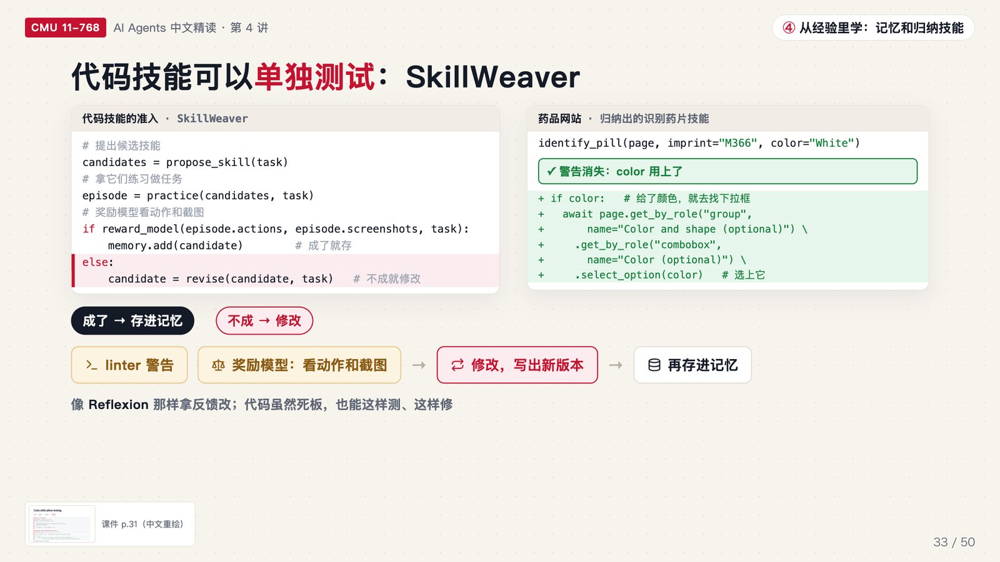

**SkillWeaver**（Zheng et al., 2025）的准入过程，原课件写成四行伪代码：

```python
candidates = propose_skill(task)                 # 提出候选技能
episode = practice(candidates, task)             # 用它们练习做任务
if reward_model(episode.actions, episode.screenshots, task):   # 奖励模型看动作和截图判断成没成
    memory.add(candidate)                        # 成了就存
else:
    candidate = revise(candidate, task)          # 不成就修改
```

一个 lint 和测试代码技能的例子：在一个药品网站上归纳出 `identify_pill(page, imprint="M366", color="White")`，linter 报警告：

```text
WARNING  parameter 'color' is defined but never used in the function body
```

修改后加上了这一段（原课件节选）：

```python
+ if color:
+     await page.get_by_role("group", name="Color and shape (optional)") \
+         .get_by_role("combobox", name="Color (optional)").select_option(color)
```

也就是：给了颜色，就去"颜色和形状（可选）"那组里找到"颜色（可选）"下拉框，选上它。拿到 linter 或奖励模型的反馈，像 Reflexion 那样写出新版本再存（课上口头补充）。所以哪怕代码本身更死板，它也有这些文字技能没有的好处。

### 3.13 代码技能能压缩步数、提高成功率

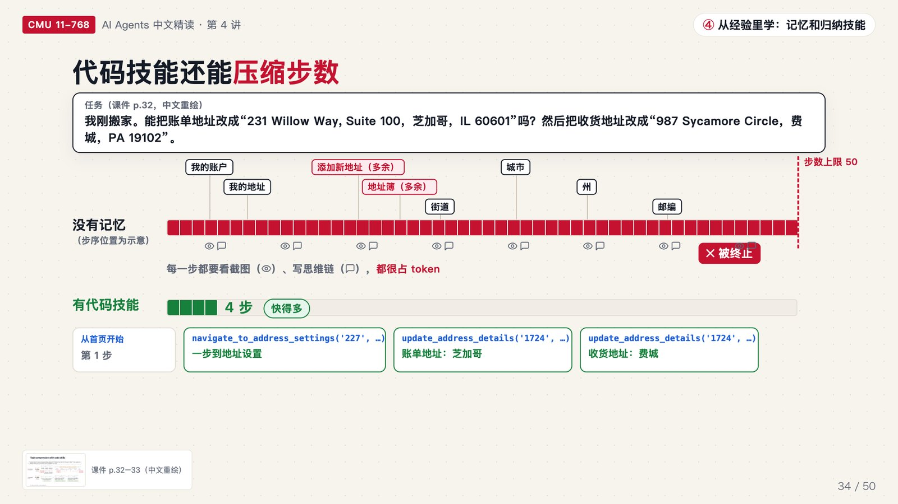

ASI 论文图 5（购物网站）。任务："我最近搬家了，能把我的账单地址改成'231 Willow Way, Suite 100, Chicago, IL, 60601'吗？然后把收货地址改成 987 Sycamore Circle, Philadelphia, PA, 19102。"

| | 过程 | 步数 |
|---|---|---|
| **没有记忆** | 从首页开始，点"我的账户"、点"我的地址"、点"修改账单地址"，中间还点了"添加新地址""地址簿"这些多余的步骤；再逐项更新街道第 1 行、第 2 行、城市、州、邮编、保存…… | 撞到 **50 步上限被终止** |
| **有代码技能** | `navigate_to_address_settings('227', 'change billing address')` 一步到地址设置；`update_address_details('1724', …, '231 Willow Way', 'Suite 100', 'Chicago', 'Illinois', '60601')` 一步改完账单地址；再一次 `update_address_details(...)` 改完收货地址 | **一共 4 步** |

（图中每步的格子和"多余"标签位置是示意。）agent 快得多，因为它不用每步都重新观察网页、生成工具调用、再观察新网页。后面讲 GUI agent 时会看到，这类模型的一大瓶颈就是和网站交互的次数：截图很占 token，每个动作前的思维链也很占 token，全都要生成出来（课上口头补充）。

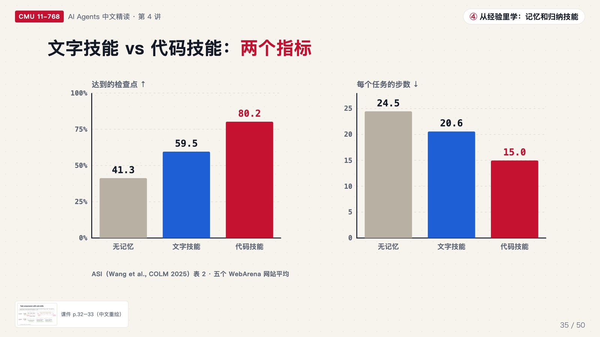

ASI 论文表 2，五个 WebArena 网站的平均（任务有较多重复结构）：

| | 无记忆 | 文字技能 | 代码技能 |
|---|---|---|---|
| 达到的检查点 ↑ | 41.3% | 59.5% | **80.2%** |
| 每个任务的步数 ↓ | 24.5 | 20.6 | **15.0** |

代码技能的成功率总体高于文字技能，用的步数也更少。

### 3.14 技能有多通用：跨网站会坏，PolySkill

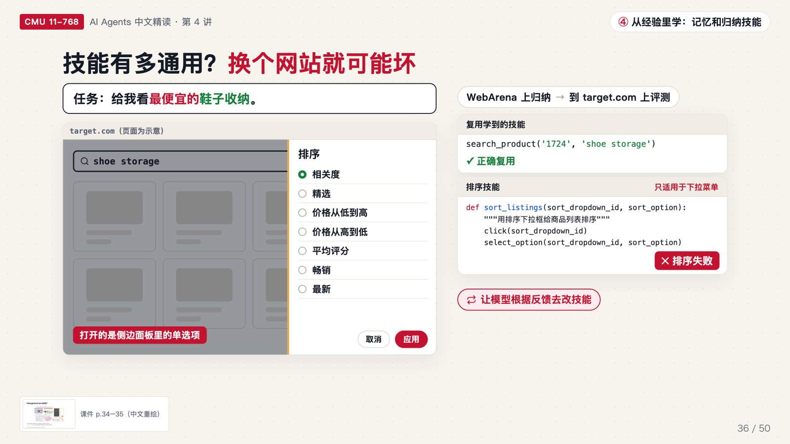

ASI 论文图 4：在 WebArena 的网站上归纳技能，到真实的 target.com 上评测（图中网页是示意）。任务："给我看最便宜的鞋子收纳。"

| 技能调用 | 结果 |
|---|---|
| `search_product('1724', 'shoe storage')` | 正确复用了学到的技能 |
| `sort_listings(sort_dropdown_id, sort_option)` | 这个技能是点一个**下拉菜单**，只适用于下拉菜单；而 Target 的"排序"点开后是另开的**侧边面板**，里面是一组单选项。于是失败 |

这时得让模型根据环境的反馈去改这个技能（课上口头补充）。

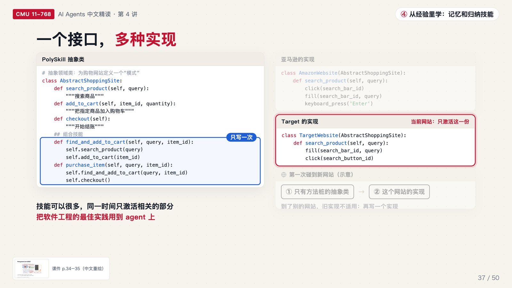

**PolySkill**（Yu et al., ICLR 2026）对应维护里的"修复"。办法代码里早就有：**抽象类**，也就是多态（polymorphism）。原课件的代码（中文注释是本课件加的）：

```python
# 抽象领域类：为购物网站定义一个"模式"
class AbstractShoppingSite:
    def search_product(self, query: str): """搜索一个商品。"""
    def add_to_cart(self, item_id: str, quantity: int): """把指定商品加进购物车。"""
    def checkout(self): """开始结账。"""

    ## 组合技能：只针对抽象方法写一次
    def find_and_add_to_cart(self, query, item_id):
        self.search_product(query); self.add_to_cart(item_id)
    def purchase_item(self, query, item_id):
        self.find_and_add_to_cart(query, item_id); self.checkout()
```

每个网站只实现底层的浏览器动作：

| 方法 | `AmazonWebsite` | `TargetWebsite` |
|---|---|---|
| `search_product` | 点搜索栏、填词、按回车 | 填词，再点搜索按钮 |
| `add_to_cart` | — | 先点添加、填数量、再点加入购物车 |
| `checkout` | 先看购物车，再点结账 | — |

（表中"—"是原课件没有展开的部分。）**组合技能只针对抽象方法写一次，各个网站只实现最基本的浏览器动作。**

怎么用起来（课上口头补充）：模型第一次碰到一个新网站，先写一个只有方法桩的抽象类（搜索商品、加购物车、结账），再写这个网站的具体实现；到了另一个网站，用元数据或者直接让语言模型判断"这个具体实现不适用了"，再写一个新的实现。这样可以有大量具体技能，但同一时间只激活相关的那一部分。说到底，就是把软件工程的最佳实践用到 agent 上。

### 3.15 三种表示的取舍

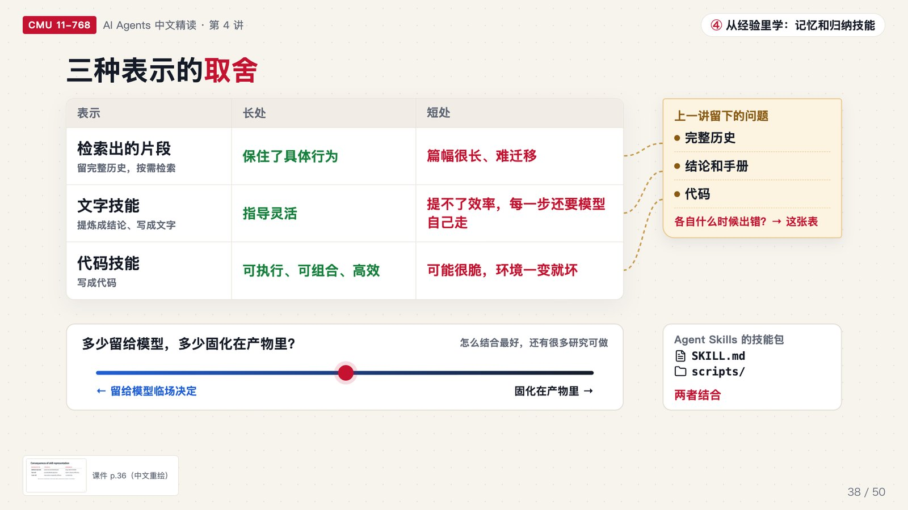

| 表示 | 长处 | 短处 |
|---|---|---|
| 检索出的片段 | 保留了具体的行为 | 篇幅很长，难迁移 |
| 文字技能 | 提供灵活的指导 | 提不了效率，每一步还要模型自己走 |
| 代码技能 | 可执行、可组合、高效 | 可能很脆，环境一变就坏 |

原课件底下的问题：**行为里有多少留给模型临场决定，有多少固化在产物里？**Agent Skills 标准允许两者结合（文字放在 SKILL.md，代码放在 `scripts/`），怎么结合最好，还有很多研究可做。

这张表也是上一讲那个问题的答案：留完整历史按需检索，保住了细节，但又长又难迁移；提炼成结论或写成文字手册，灵活，但每一步还得模型自己走；写成代码，最快，但环境一变就可能坏。这张取舍表以后设计 agent 的记忆都用得上，建议收藏。

---

## 4 技能的生命周期：学、用、维护

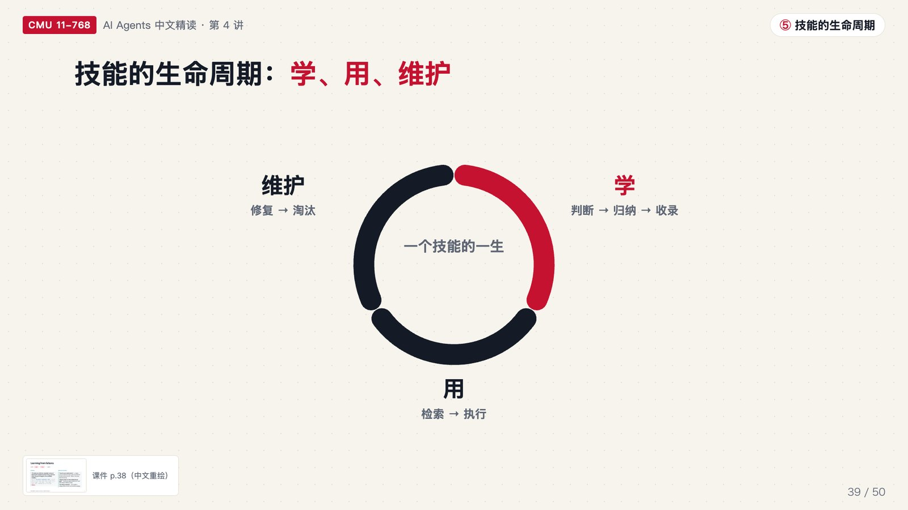

怎么归纳、管理技能，还是一个非常开放的研究问题。下面几篇论文分别落在 3.7 节那个循环的不同环节：

| 小节 | 论文 | 环节 |
|---|---|---|
| 4.1–4.2 | ReasoningBank | 学：从失败里归纳 |
| 4.3 | ReasoningBank | 学：裁判 |
| 4.4 | ReasoningBank、SkillsBench | 用：检索 → 行动 |
| 4.5 | TroVE、Not All Skills Help | 维护：修复 → 淘汰 |
| 4.6 | SAGE、AgeMem | 训练归纳器本身 |

### 4.1 从失败里学：ReasoningBank

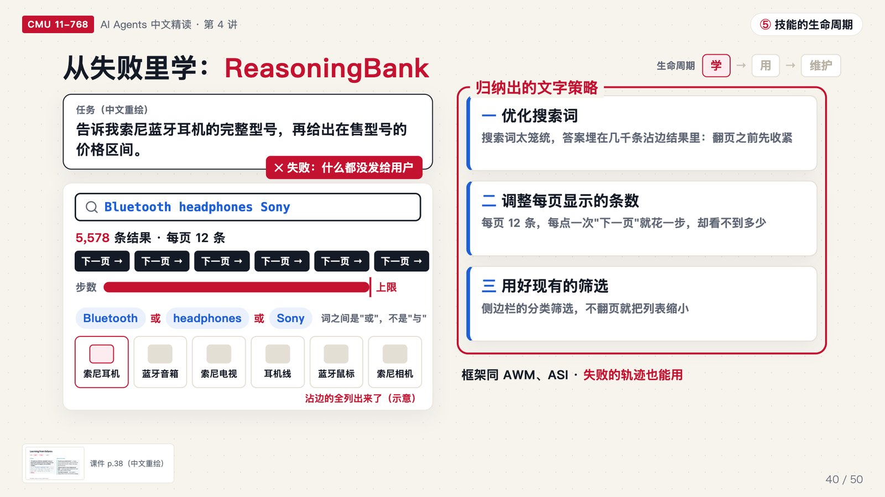

前面讲的都是从成功里学。从失败里学也很有用。**ReasoningBank**（Ouyang et al., ICLR 2026）附录里的案例：

**片段**："告诉我索尼蓝牙耳机的完整型号名，再给出在售型号的价格区间。"

```text
search "Bluetooth headphones Sony"
→ 5,578 条结果，来自全店各个部门，每页 12 条
→ 下一页 → 下一页 → … → 撞到步数上限，什么都没发给用户
失败
```

为什么会这样（课上口头补充）：这个网站的搜索词之间是"或"而不是"与"，所以把所有带 Bluetooth、headphones 或 Sony 的东西都列了出来（图中混进来的商品是示意）；agent 翻页翻到最后，忘了任务是什么。

**归纳出的文字策略**：

| 策略 | 内容 |
|---|---|
| 优化搜索词 | 含糊的搜索词让答案埋在几千条松散匹配的结果下面，翻页之前先把搜索词收紧 |
| 调整每页显示的条数 | 每页 12 条，每点一次"下一页"都要花一步，却只多看到一点点 |
| 用好现有的筛选 | 侧边栏的分类筛选能不翻页就把列表缩小 |

ReasoningBank 用的框架和 AWM、ASI 一样（裁判 → 归纳 → 准入），区别是它不只抽象正确的轨迹，而是生成**文字形式的策略**，这对失败的轨迹也适用。这也正是你自己写技能时会写的那种东西。

### 4.2 失败对有的记忆有用，对有的没用

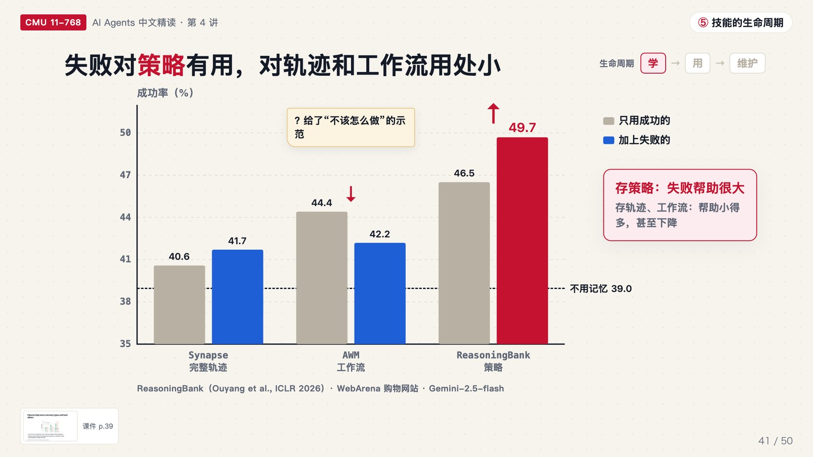

ReasoningBank 的实验（WebArena 购物网站，Gemini-2.5-flash），成功率（不用记忆是 39.0）：

| 记忆类型 | 只用成功的 | 加上失败的 | 变化 |
|---|---|---|---|
| Synapse（完整轨迹） | 40.6 | 41.7 | +1.1 |
| AWM（工作流） | 44.4 | 42.2 | **−2.2** |
| ReasoningBank（策略） | 46.5 | 49.7 | **+3.2** |

- 归纳**策略**时，失败的帮助很大。
- 对**轨迹**或**工作流**，失败的帮助小得多，AWM 甚至下降了。原课件打了个问号：难道是给了"不该怎么做"的示范？

这说得通（课上口头补充）：用文字可以笼统地描述"怎么才不会失败"，而直接把失败的过程拿来当示例，就没那么有用。

### 4.3 裁判准不准，有多要紧

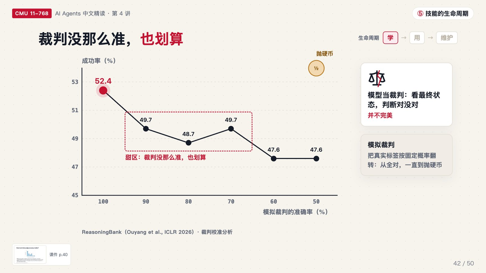

大多数这类工作都让一个模型当**裁判**（judge）：看轨迹的最终状态和任务，判断"看起来做对了没有"，据此决定要不要存、从中归纳什么。可裁判并不完美。

**设置**：为了知道这有多要紧，ReasoningBank 换成**模拟的裁判**：拿真实标签，以固定概率翻转，从完全准确一直到抛硬币。

| 裁判准确率（%） | 100 | 90 | 80 | 70 | 60 | 50 |
|---|---|---|---|---|---|---|
| 成功率 | 52.4 | 49.7 | 48.7 | 49.7 | 47.6 | 47.6 |

效果确实取决于裁判的准确率，但在**相当宽的一段裁判质量范围内**都有提升（对照 4.2 节，不用记忆是 39.0）。有一个"甜区"：裁判没那么准时，用它来归纳记忆仍然划算，但这里还有很多工作可做（课上口头补充）。

### 4.4 检索太多反而变差

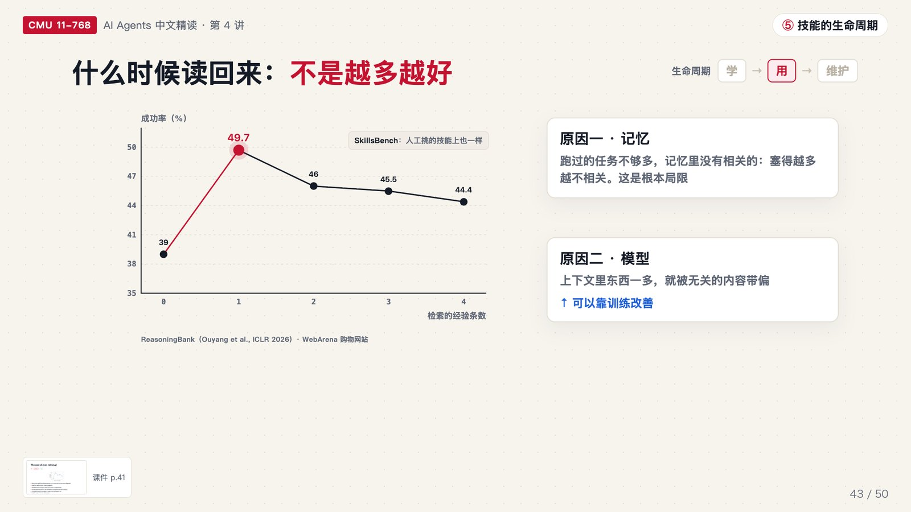

对应"用"里的"检索 → 行动"。ReasoningBank（WebArena 购物网站）里，检索的经验条数和成功率：

| 检索条数 | 0 | 1 | 2 | 3 | 4 |
|---|---|---|---|---|---|
| 成功率 | 39 | **49.7** | 46 | 45.5 | 44.4 |

**多检索经验，效果可能反而下降！**SkillsBench 在人工挑选的技能上也发现了同样的现象（2.5 节）。两个原因：

| 原因 | 解释（课上口头补充） |
|---|---|
| 一些经验可能不相关：**记忆本身的局限** | agent 可能还没在足够多的任务上跑过，记忆里根本没有相关的，塞得越多越不相关。你只能从相似的东西里学，这是这类方法的根本局限 |
| agent 能有效利用的东西可能有限：**模型的局限** | 上下文里东西一多就被带偏。可以通过训练模型、让它更不容易被无关上下文分心、更会判断什么真正相关来改善 |

这回答了上一讲问题里的"什么时候读回来"：按需读，而且**不是越多越好**。

### 4.5 记忆整合：TroVE

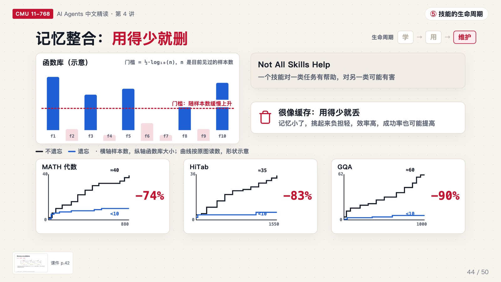

对应"维护"里的"修复 → 淘汰"。**TroVE**（Wang et al., ICML 2024）的规则很简单：

```text
任何一个函数，如果被用到的次数 < ½ · log₁₀(n)，就删掉；n 是目前见过的样本数
```

门槛随样本数缓慢上升（图中左上的函数库柱子是示意）。原课件图上三个任务的函数库大小：

| 任务 | 样本数（约） | 不遗忘时库涨到（约） | 遗忘后 | 库缩小 |
|---|---|---|---|---|
| MATH 代数 | 800 | 40 | 10 以下 | 74% |
| HiTab | 1,500 | 35 | 10 以下 | 83% |
| GQA | 1,000 | 60 | 10 以下 | 90% |

原课件还提到另一篇：**Not All Skills Help**，一个技能对一类任务有帮助，可能对另一类有害。

主动缩小记忆，能减轻语言模型从中挑选的负担（课上口头补充）。这种做法很像**缓存**：看一条记忆过去被用了多少次，用得少就丢。上下文里要放的东西少了，效率能提高很多；模型要是正在被无关的东西分心，成功率也能提高。

### 4.6 训练技能归纳器：SAGE 和 AgeMem

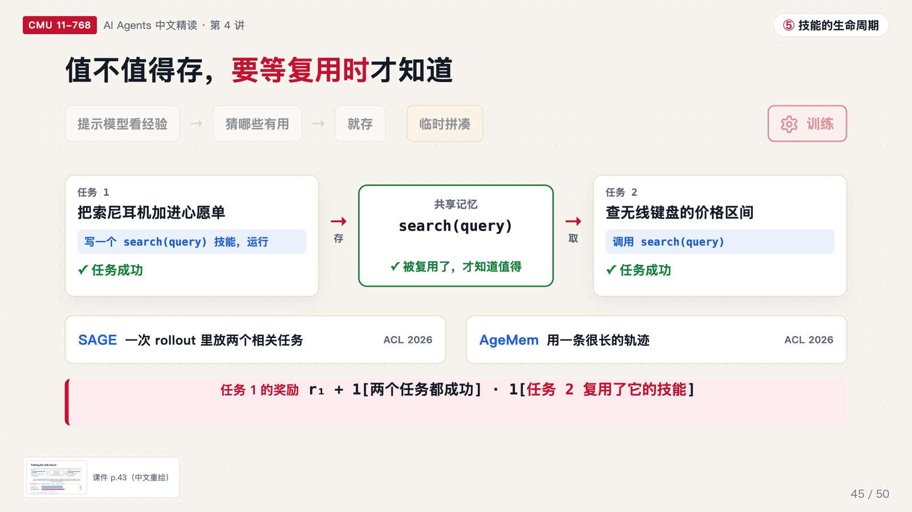

前面这些多少都有点**临时拼凑**：只是提示语言模型看过去的经验，猜"哪些以后可能有用"，就存进记忆。很自然的问题是：能不能直接**训练**模型去做这件事？可以，这个方向才刚开始，两篇论文今年刚发在 ACL 上（课上口头补充）。

| | 任务 1：把索尼耳机加进心愿单 | 共享记忆 | 任务 2：查无线键盘的价格区间 |
|---|---|---|---|
| 发生了什么 | 写一个搜索技能并运行，任务成功 → **存** | `search(query)` | **取出**并调用 `search(query)`，任务成功 |

关键在中间那格：**它值不值得存，要等到被复用时才知道。**任务 1 的奖励只说明任务 1 成没成功，说明不了"把解法的一部分存下来"值不值，只有之后的任务能说明。所以要把之后的任务放进训练样本里：

- **SAGE**（Wang et al., ACL 2026）：在一次 rollout 里放两个相关的任务；
- **AgeMem**（Yu et al., ACL 2026）：用一条很长的轨迹。

任务 1 的奖励：

```text
r₁ + 1[两个任务都成功] · 1[任务 2 复用了它的技能]
```

也就是：任务 1 自己的结果，再加一项，只有两个任务都成功、而且任务 2 复用了任务 1 存下的技能，才额外加分。

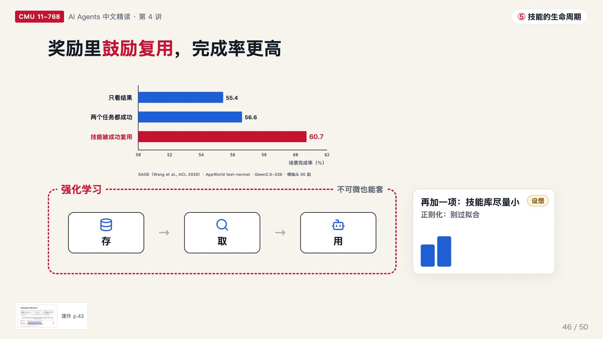

AppWorld test-normal 上的场景完成率（SAGE，Qwen2.5-32B）：

| 奖励设计 | 场景完成率 |
|---|---|
| 只看结果 | 55.4 |
| 两个任务都成功 | 56.6 |
| 技能被成功复用 | **60.7** |

在奖励里加一项鼓励复用技能，能提高成功率。这个过程很复杂：要存、要取、要用，用到好几个模型，但强化学习不在乎，不可微的复杂过程也能直接套上去，后面有几讲会讲怎么做。还可以想象加别的奖励项，比如让技能库尽量小，起到正则化的作用、不过拟合（图右"技能库尽量小"标了"设想"）；这里有很多值得做的工作（课上口头补充）。

---

## 5 源码解读：HermesAgent 怎么做渐进式披露

2.3 节的四轮加载，落到真实代码里是什么样？下面读原课件引用的 HermesAgent 源码。

出处：[NousResearch/hermes-agent](https://github.com/NousResearch/hermes-agent)（MIT 许可），`main` 分支提交 `0107da5`（`0107da5d2a362b1b0b29aff8ada3fd2d4437f88e`，2026-10-26 UTC），涉及这几个文件：

- [`agent/prompt_builder.py`](https://github.com/NousResearch/hermes-agent/blob/0107da5d2a362b1b0b29aff8ada3fd2d4437f88e/agent/prompt_builder.py)：把技能索引拼进系统提示词（第 1 轮）
- [`agent/skill_utils.py`](https://github.com/NousResearch/hermes-agent/blob/0107da5d2a362b1b0b29aff8ada3fd2d4437f88e/agent/skill_utils.py)：描述截断
- [`tools/skills_tool.py`](https://github.com/NousResearch/hermes-agent/blob/0107da5d2a362b1b0b29aff8ada3fd2d4437f88e/tools/skills_tool.py)：`skill_view` 工具（第 2、4 轮）
- [`tools/skills_tool_plugin.py`](https://github.com/NousResearch/hermes-agent/blob/0107da5d2a362b1b0b29aff8ada3fd2d4437f88e/tools/skills_tool_plugin.py)：读技能包里的单个文件
- [`tools/skills_tool_dedup.py`](https://github.com/NousResearch/hermes-agent/blob/0107da5d2a362b1b0b29aff8ada3fd2d4437f88e/tools/skills_tool_dedup.py)：同一份内容只给一次

为讲解删去了：缓存与快照、多个技能目录的优先级和重名处理、插件技能、按平台和条件隐藏技能、安全扫描与隔离、环境变量和依赖检查、单次查询会话的提示词变体，以及部分 docstring。删掉的位置用 `...` 标出；中文注释是本课件加的，英文注释是源码原有的。HermesAgent 更新很快，读最新版时行号和细节可能已经变了。

### 5.1 第 1 轮：每个技能只取名字和一段很短的描述

技能索引里每一行的描述从 SKILL.md 的 YAML 里取，但会被**截短**：

```python
# agent/prompt_builder.py
def _parse_skill_file(skill_file: Path) -> tuple[bool, dict, str]:
    """Read a SKILL.md once -> (is_compatible, frontmatter, description); errors yield (True, {}, "")."""
    try:
        raw = skill_file.read_text(encoding="utf-8-sig")
        frontmatter, _ = parse_frontmatter(raw)          # 只解析开头那段 YAML 元数据
        ...                                              # 删：按平台 / 环境 / 应用判断是否兼容
        return True, frontmatter, extract_skill_description(frontmatter)
    except Exception as e:
        logger.warning("Failed to parse skill file %s: %s", skill_file, e)
        return True, {}, ""
```

```python
# agent/skill_utils.py
SKILL_PROMPT_DESC_LIMIT = 60                             # 索引里的描述最多 60 个字符

def extract_skill_description(frontmatter: dict[str, Any]) -> str:
    """Extract a system-prompt-length description from parsed frontmatter."""
    return clip_skill_description(_normalize_skill_description(frontmatter))

def clip_skill_description(desc: str) -> str:
    """*desc* fitted to SKILL_PROMPT_DESC_LIMIT, cut at a word boundary so the index never shows a half word."""
    if len(desc) <= SKILL_PROMPT_DESC_LIMIT:
        return desc
    head = desc[:SKILL_PROMPT_DESC_LIMIT - 2]  # one char past the budget: whitespace there means the last word is whole
    boundary = _LAST_WHITESPACE_RE.search(head)  # any whitespace (tab, NBSP, ...) separates words, not just " "
    if not boundary or boundary.start() == 0:  # a single word longer than the budget has no boundary to cut at
        return desc[:SKILL_PROMPT_DESC_LIMIT - 3] + "..."
    return _CLIP_TRAIL_RE.sub("", head[:boundary.start()]) + "..."   # 在词边界截断，补上省略号
```

这正是 2.3 节"描述要简洁"的硬约束：这个版本里，描述超过 60 个字符就会在系统提示词里被截成"……"，**最关键的触发条件要写在描述最前面**。原课件 p.10 那条 python-review 的描述有一百多个字符，在这个版本里会被截断。

### 5.2 第 1 轮：把索引拼进系统提示词

```python
# agent/prompt_builder.py
def _render_skills_index(
    skills_by_category: dict[str, list[tuple[str, str]]],
    compact_categories: frozenset[str] | None, available_tools: set[str] | None, unloadable: list[str] = (),
) -> str:
    ...
    if not skills_by_category:
        return ""                                        # 一个技能都没有，就不加这一段
    ...                                                  # 删：按类别降级成"只列名字"、重名提示
    index_lines = []
    for category in sorted(skills_by_category):          # 按类别排序：前缀稳定，不打破提示词缓存（第 3 讲）
        entries = skills_by_category[category]
        ...
        rows: dict[str, str] = {}
        for name, desc in sorted(entries, key=lambda x: x[0]):  # stable: first entry per name wins
            rows.setdefault(name, desc)
        # A one-skill category is a single top-level row: its header would only repeat what the row
        # says (a skill at the top of the tree is its own category, so the name printed twice).
        indent = "  " if len(rows) == 1 else "    "
        if len(rows) > 1:
            index_lines.append(f"  {category}:")         # 类别标题，如 "  code-quality:"
        index_lines.extend(f"{indent}- {name}: {desc}" if desc else f"{indent}- {name}" for name, desc in rows.items())
    ...                                                  # 删：单次查询会话的另一种措辞
    return (
        "## Skills\n"
        "Before replying, scan the skills below. If a skill matches or is even partially relevant to your "
        "task, you MUST load it with skill_view(name) and follow its instructions. Err on the side of "
        "loading — it is always better to have context you don't need than to miss critical steps, pitfalls, "
        "or established workflows. ..."                  # 删：中间几句，见下表
        "If a skill has issues, fix it with skill_manage(action='patch').\n"
        "After difficult/iterative tasks, offer to save as a skill. If a skill you loaded was missing steps, "
        "had wrong commands, or needed pitfalls you discovered, update it before finishing.\n"
        "\n"
        "<available_skills>\n"
        + "\n".join(index_lines) + "\n"
        "</available_skills>\n\n"
        "Only proceed without loading a skill if genuinely none are relevant to the task."
        + hidden_note
    )
```

拼出来的就是原课件 p.10 那段提示词。对照原文，这一版比课件节选多了几层意思：

| 源码里的句子 | 意思 | 对应本讲 |
|---|---|---|
| `you MUST load it with skill_view(name)` + `Err on the side of loading` | 宁可多加载，也别漏掉关键步骤 | 2.3、2.4"触发灵不灵" |
| `Load the skill even if you think you could handle the task with basic tools`（删节部分） | 哪怕觉得自己会做也要加载，因为技能里写着"在这里该怎么做" | 2.1"按固定规范反复做" |
| `fix it with skill_manage(action='patch')` | 技能有问题就打补丁 | 2.6 agent 自己创建、3.7 维护 |
| `offer to save as a skill` / `update it before finishing` | 做完难的任务主动提出存成技能；技能缺步骤就当场补上 | 2.6"别从零写，做完马上建"、3.7 维护 |

注意第一行：提示词把"触发"完全交给了模型，代码里没有任何关键词匹配。本节读的这几个文件里都没有读取 `triggers` 字段；触发准不准，全看模型读描述时的判断，这就是 2.4 节说"所以要评测"的原因。

### 5.3 第 2 轮：`skill_view(name)` 返回正文和"还有哪些文件"

工具的定义（模型看到的就是这段 schema）：

```python
# tools/skills_tool.py
SKILL_VIEW_SCHEMA = {
    "name": "skill_view",
    "description": "Load a skill's SKILL.md, or one of its linked references, templates or scripts. The first call returns SKILL.md plus a 'linked_files' dict; call again with file_path to read one.",
    "parameters": {
        "type": "object",
        "properties": {
            "name": {...},                               # 技能名
            "file_path": {
                "type": "string",
                "description": "OPTIONAL: Path to a linked file within the skill (e.g., 'references/api.md', 'templates/config.yaml', 'scripts/validate.py'). Omit to get the main SKILL.md content.",
            },
        },
        "required": ["name"],
    },
}
```

一个工具、两种用法：不带 `file_path` 是第 2 轮（读正文），带 `file_path` 是第 4 轮（读附带文件）。函数本体（大量删节）：

```python
# tools/skills_tool.py
def skill_view(
    name: str, file_path: str | None = None, task_id: str | None = None, preprocess: bool = True) -> str:
    try:
        ...                                              # 删：名字合法性检查、插件技能
        roots, active_skills_dir = skill_search_dirs()
        all_dirs = [d for _t, d in roots]
        error, skill_dir, skill_md = locate_skill(name, local_category_name, roots)   # 按名字找到 SKILL.md
        if error is not None:
            return error
        try:  # read once — reused for platform check and main content
            content = _read_skill_text(skill_md)
        except Exception as e:
            return _fail(f"Failed to read skill '{name}': {e}")
        ...                                              # 删：安全告警、平台检查、是否被禁用
        if file_path and skill_dir:                      # 第 4 轮：只要一个附带文件
            return _serve_skill_file(
                skill_dir, file_path, name, list_available=True, mark_read=True,
                hint="Use a relative path within the skill directory")
        ...                                              # 删：tags / related_skills
        linked_files = _skill_linked_files(skill_dir)    # 只列出附带文件的路径，不读内容
        ...                                              # 删：相对路径、环境变量与依赖检查
        result = {
            "success": True, "name": skill_name, "description": frontmatter.get("description", ""),
            "tags": tags, "related_skills": related_skills, "content": rendered_content,   # content = SKILL.md 全文
            "path": rel_path, "skill_dir": str(skill_dir) if skill_dir else None,
            "linked_files": linked_files if linked_files else None,
            "usage_hint": "To view linked files, call skill_view(name, file_path) where file_path is e.g. 'references/api.md' or 'assets/config.yaml'" if linked_files else None,
            ...
        }
        ...
        return _json(result)                             # 整个结果以 JSON 字符串作为工具结果进上下文
    except Exception as e:
        return tool_error(str(e), success=False)
```

第 2 轮进上下文的是 SKILL.md 全文，加上一个 `linked_files` 目录清单和一句用法提示。附带文件**只给路径不给内容**，这就是渐进式披露的第 3 层：

```python
# tools/skills_tool.py
# (support dir, globs, recursive, files only) — order is the linked_files key order.
_LINKED_FILE_SPECS = (
    ("references", ["*.md"], False, False),
    ("templates", ["*.md", "*.py", "*.yaml", "*.yml", "*.json", "*.tex", "*.sh"], True, False),
    ("assets", ["*"], True, True),
    ("scripts", ["*.py", "*.sh", "*.bash", "*.js", "*.ts", "*.rb"], False, False))


def _skill_linked_files(skill_dir: Optional[Path]) -> dict:
    """references/templates/assets/scripts of a directory skill (empty groups dropped)."""
    files: dict = {}
    for sub, globs, recursive, files_only in _LINKED_FILE_SPECS if skill_dir else ():
        base = skill_dir / sub
        found = [
            f.relative_to(skill_dir).as_posix() for g in globs if base.exists()
            for f in (base.rglob(g) if recursive else base.glob(g))
            if not files_only or f.is_file()]            # 只收集相对路径字符串
        if found:
            files[sub] = found
    return files
```

注意它除了规范里的 `scripts/`、`references/`、`assets/`，还多认一个 `templates/` 目录；`references/` 只收 `.md`，`scripts/` 只收常见脚本后缀，而且这两个不递归子目录。

### 5.4 第 4 轮：读一个附带文件

```python
# tools/skills_tool_plugin.py
def _serve_skill_file(
    skill_root: Path, file_path: str, label: str, *, hint: str | None = None,
    list_available: bool = False, read_error_prefix: bool = False, mark_read: bool = False) -> str:
    from tools.path_security import has_traversal_component, validate_within_dir
    extra = {"hint": hint} if hint else {}
    if has_traversal_component(file_path):
        return _fail("Path traversal ('..') is not allowed.", **extra)   # 不许用 .. 跳出技能目录
    target = skill_root / file_path
    if path_error := validate_within_dir(target, skill_root):
        return _fail(path_error, **extra)                # 再确认目标真的在技能目录里
    # is_file(), not exists(): a bare directory must take the not-found branch.
    if not target.is_file():
        listing = {} if not list_available else {
            "available_files": _available_skill_files(skill_root),
            "hint": "Use one of the available file paths listed above"}  # 找不到就把可用文件列给模型
        return _fail(f"File '{file_path}' not found in skill '{label}'.", **listing)
    try:
        content = _read_skill_text(target)
    except UnicodeDecodeError:                           # 二进制文件不塞进上下文，只报文件名和大小
        return _json({
            "success": True, "name": label, "file": file_path, "is_binary": True,
            "content": f"[Binary file: {target.name}, size: {target.stat().st_size} bytes]"})
    ...
    return _json({
        "success": True, "name": label, "file": file_path, "content": content,
        "file_type": target.suffix})
```

两点值得注意：

- `file_path` 是**模型生成的**参数，所以先挡路径穿越，再确认目标在技能目录里，否则模型可以借 `skill_view` 读机器上的任意文件。第 2 讲说过，能动文件的工具要配权限控制；模型生成的参数也要按不可信输入来校验（后一句是按通行做法补充）。
- 第 3 轮"终端里跑脚本"不经过 `skill_view`：模型从 `linked_files` 里知道有 `scripts/run_checks.py`，再用终端工具去运行它，进上下文的只有脚本的输出。读脚本源码（`skill_view(name, 'scripts/...')`）是可以的，但那是模型主动要的。

### 5.5 "只加载一次"：同一份内容不重复给

2.3 节表里写着正文"只加载一次"。真正注册给模型的处理函数外面还包了一层去重：

```python
# tools/skills_tool.py
def _skill_view_with_bump(args, **kw):
    ...
    result = skill_view(name, file_path=args.get("file_path"), task_id=task_id)
    with suppress(Exception):
        parsed = json.loads(result)
        if isinstance(parsed, dict) and parsed.get("success"):
            if (stub := dedup_skill_view(dedup_task_id, name, args.get("file_path"), parsed, result)) is not None:
                return stub                              # 和上次给的一字不差：只回一句"内容没变"
            ...                                          # 删：记录查看次数和最后使用时间（给维护用）
    return result
```

```python
# tools/skills_tool_dedup.py
def dedup_skill_view(task_id, name, file_path, payload: dict, result: str) -> str | None:
    ...
    resolved = str(payload.get("name") or name)
    key = (resolved, file_path or "")                    # 按 (技能名, 文件) 记
    digest = hashlib.sha256(result.encode("utf-8")).hexdigest()   # 记的是这次结果的内容摘要
    with _skill_view_tracker_lock:
        cache = _skill_view_tracker.setdefault(str(task_id), {})
        if cache.get(key) == digest:
            return json.dumps({
                "success": True, "status": "unchanged", "name": resolved,
                "file": file_path or "SKILL.md", "dedup": True, "content_returned": False,
                "message": _SKILL_VIEW_DEDUP_MESSAGE}, ensure_ascii=False)
        ...
    return None
```

`_SKILL_VIEW_DEDUP_MESSAGE` 告诉模型：内容和这次对话里早先加载的一样，去看那次的结果。这个缓存在**上下文压缩时清空**（模块 docstring 写明），因为压缩后早先那次工具结果可能已经被换成摘要了，再要就得重新给全文。这把第 3 讲的压缩和这一讲的技能连在了一起。

被删掉的那行 `bump_view` / `bump_use` 也有意思：每次加载都给技能记一笔查看次数和使用时间。源码注释说维护流程（curator）的"过期"计时就看这个时间。这就是 4.5 节 TroVE"用得少就删"在工程里需要的那份数据。

### 5.6 对照四轮

| 轮次 | 2.3 节说的 | HermesAgent 的做法 |
|---|---|---|
| 1 | 系统提示词里只放名字和描述 | `_render_skills_index` 按类别排好；描述经 `clip_skill_description` 截到 60 个字符；提示词要求"部分相关也必须加载" |
| 2 | 触发时加载正文 | `skill_view(name)` 返回 SKILL.md 全文 + `linked_files` 路径清单；同一内容第二次只回 `unchanged` |
| 3 | 脚本的输出进上下文，代码不进 | 不经过 `skill_view`，模型用终端工具运行 `linked_files` 里的脚本 |
| 4 | 要的时候才读附带文件 | `skill_view(name, file_path)` → `_serve_skill_file`，先挡路径穿越，二进制文件只报大小 |

---

## 本讲小结

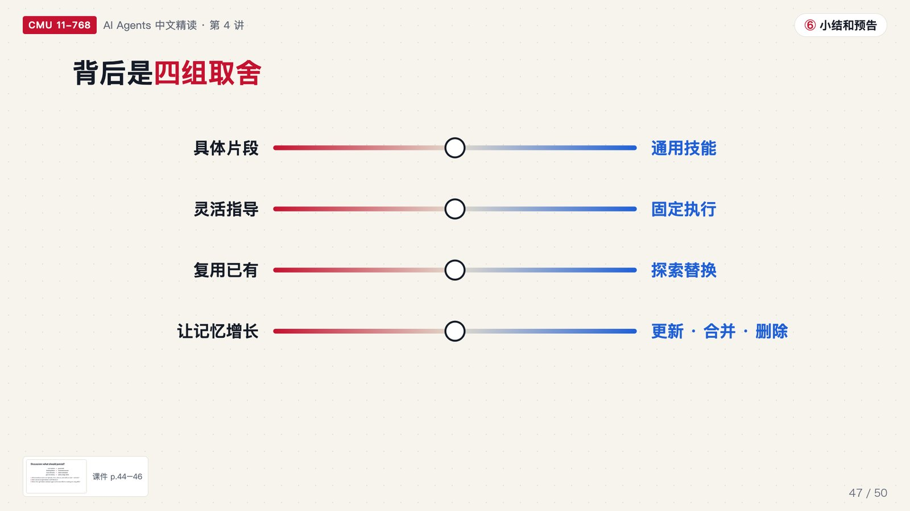

记忆和技能，就是把经验存到上下文外面：存成**片段、事实还是技能**，写成**文字还是代码**；再从经验里**归纳**，决定怎么**用**、怎么**改**、什么时候**忘**。

1. **存在哪**：上下文保真但贵、会超；权重快但慢更新、不透明、只对一个模型有效；外部产物可查看、可编辑、可检索、可跨模型移植，代价是要归纳、挑选和维护。
2. **人写的技能**：一个 SKILL.md（YAML 元数据 + Markdown 正文）加可选的 `scripts/`、`references/`、`assets/`；靠渐进式披露按需加载。SkillsBench 上技能把平均通过率从 33.9% 提到 50.5%，越聚焦提升越大，但仍让 87 个任务里的 13 个变差，写完要评测、要维护。
3. **从经验里学**：MemGPT 让 agent 用函数调用读写外部记忆；Mem0 用增改删处理冲突；Reflexion 记住对轨迹的反馈；ExpeL 一类检索相似轨迹当示例。归纳技能可以写成文字（AWM）或代码（ASI、SkillWeaver）：代码能测试、能组合、能把 50 步压成 4 步，但更脆，跨网站会坏；PolySkill 用抽象类把"组合"和"实现"分开。
4. **生命周期**：学（裁判、归纳、准入）、用（检索、行动）、维护（新增、修复、淘汰）。失败经验对文字策略有用、对轨迹和工作流用处小；裁判没那么准也划算；检索太多反而变差；用得少的技能该删（TroVE）；还可以直接用强化学习训练"该存什么"（SAGE、AgeMem），奖励里鼓励复用效果更好。

背后是四组取舍（原课件 p.44）：

| 一端 | 另一端 |
|---|---|
| 具体的片段 | 通用的技能 |
| 灵活的指导 | 固定的执行 |
| 复用现有的 | 探索、替换 |
| 让记忆增长 | 更新、合并、删除 |

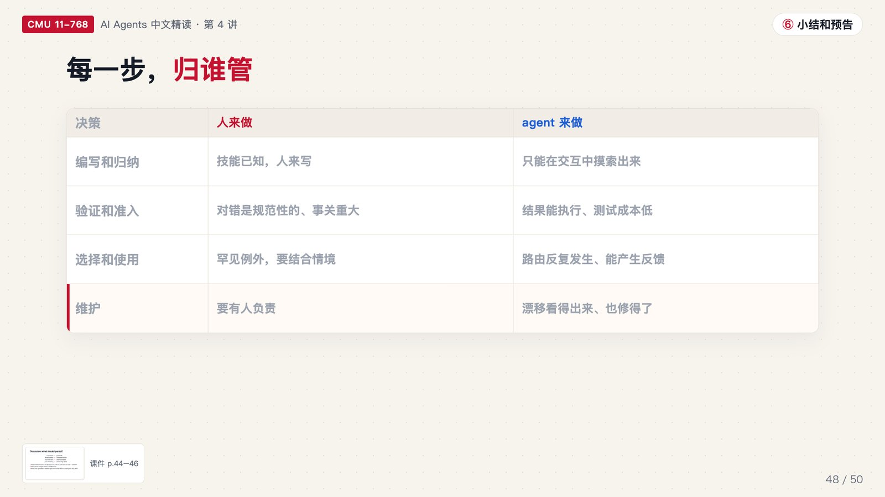

每个记忆决策归谁管（原课件 p.45）：

| 决策 | 人来做更有价值，当…… | agent 来做更有价值，当…… |
|---|---|---|
| 编写或归纳 | 技能或规定本来就是已知的 | 它只能在交互中摸索出来 |
| 验证和准入 | 对错是规范性的，或者事关重大 | 结果可执行、测试成本低 |
| 选择和使用 | 罕见的例外需要结合情境判断 | 路由反复发生、能产生反馈 |
| 维护 | 需要有人为它负责 | 漂移能从结果里看出来，而且修得了 |


原课件留了三个讨论题，第 1、2 个放在视频结尾，第 3 个就是 1.5 节那个"自己写还是让 agent 写"。三个题的参考思路都在下面的思考题里（第 5、6、7 题）。

## 关键术语

| 中文 | 英文 | 一句话解释 |
|---|---|---|
| 外部产物 | external artifacts | 存在上下文和权重之外、可查看可编辑可检索的东西，如文件、数据库 |
| 片段 | episode | 一条完整轨迹，每个观察和动作都在 |
| 事实 | fact | 一条以后还用得上、可能被更新的陈述 |
| 技能 | skill | 关于"怎么做"的可复用知识，可以是文字、代码或两者 |
| 归纳出的技能 | induced skill | agent 从自己成功的经验里提炼出的技能，记忆和技能的交集 |
| 技能包 | skill package | 一个 SKILL.md 加可选的 scripts / references / assets 目录 |
| 元数据 | frontmatter / metadata | SKILL.md 开头的 YAML：名字、描述、触发词 |
| 渐进式披露 | progressive disclosure | 元数据一直加载，正文触发时加载，附带文件读时才加载 |
| 技能索引 | skill index | 写进系统提示词的技能名字和描述列表 |
| SkillsBench | SkillsBench | 87 个任务、18 种模型加框架配置，评测给技能前后通过率的基准 |
| 存储层次 | memory hierarchy | 快而小的一层（上下文）+ 大而慢的一层（外部存储） |
| 工作上下文 | working context | MemGPT 上下文里可由函数读写的那一块 |
| 记忆冲突 | memory conflict | 新信息和旧记忆矛盾；Mem0 用 ADD / UPDATE / DELETE / NOOP 处理 |
| 遗忘学习 | unlearning | 在权重层面让模型忘掉某些东西 |
| 反思 | reflection（Reflexion） | 用自然语言写下"哪里错了"，再重试 |
| 少样本示例 | few-shot examples | 检索出的相似轨迹，放进上下文当示范 |
| 工作流 | workflow | AWM 归纳出的文字加动作形式的技能，具体值换成模板变量 |
| 裁判 | judge | 判断一次轨迹是否成功、决定要不要存的模型 |
| 准入 | admit | 归纳出的技能通过检查后才进入记忆 |
| 在线归纳 | online induction | 任务一个个到来，成功就更新记忆，看累计成功率 |
| 生命周期 | lifecycle | 学（裁判、归纳、准入）→ 用（检索、行动）→ 维护（新增、修复、淘汰） |
| 程序归纳 | program induction | 从一批程序里找出共享结构，抽象成可复用的函数 |
| 抽象类 / 多态 | abstract class / polymorphism | PolySkill 的做法：组合技能写在抽象接口上，各网站各自实现底层动作 |
| 记忆整合 | memory consolidation | 合并、精简记忆，比如 TroVE 删掉用得少的函数 |
| 场景完成率 | scenario completion | AppWorld 上的指标，SAGE 用它比较奖励设计 |

## 思考题

<details>
<summary>1. 有人说"现在上下文都有一百万 token 了，把所有历史都留在上下文里就行，不需要外部记忆"。这句话错在哪？</summary>

三个层面。第一，长度：agent 连着做很多任务，再长的窗口也一定会超（1.2）。第二，能用：上一讲讲过号称的上下文不等于真正能用的上下文，东西越多越容易忘事、分心；这一讲 4.4 也看到，检索的经验条数从 1 加到 4，成功率反而从 49.7 降到 44.4。第三，成本和迁移：上下文要按平方级累计处理，贵；而且会话一结束就没了，换个模型更是从零开始。外部产物可查看、可编辑、可跨模型移植，人也能参与改，这些都是"全留在上下文"给不了的。
</details>

<details>
<summary>2. 你在给团队写一个"升级依赖"的技能。描述应该怎么写？哪些内容放正文、哪些放 references、哪些放 scripts？</summary>

描述写给模型看、决定什么时候触发，要短，并把触发条件放在最前面：比如"Use when the user asks to upgrade, bump or update dependencies"。第 5 节看到 HermesAgent 这一版会把索引里的描述截到 60 个字符，后半截可能根本看不到。正文写每次都要照做的步骤：先读锁文件、一次只升一个大版本、跑哪些测试、怎么写 PR 说明。不是每次都要看的东西放 `references/`，比如各个包的已知破坏性变更清单、内部镜像的说明，正文里留一句"遇到 X 时读 references/x.md"。能确定地自动做的放 `scripts/`，比如列出过期依赖、跑兼容性检查，脚本输出进上下文，代码本身不进。最后按 2.5、2.7 节的思路评测：拿几次真实的升级任务对比有无技能的结果，看它是不是反而顶掉了更好的默认做法。
</details>

<details>
<summary>3. SkillsBench 上给了技能后平均通过率明显提高，为什么还会有 13 个任务变差？给出至少两种可能的原因，以及你会怎么发现它们。</summary>

原课件给的原因是技能可能顶掉了模型原本更好的默认做法，让它按和用户要求不一样的方式做。由此可以想到几种情况（后面三条是按通行做法补充的推测，原课没有逐一展开）：技能写得太宽泛或推断过头，模型一字一句照做，做多了（1.5）；技能和任务只是看起来相关，其实不适用，带偏了模型；任务需要好几个技能，上下文变长、模型分心（2.5 第二条：技能越多提升越小）。发现办法：每个技能都做有无对比，按任务看而不只看平均；读变差那些任务的轨迹，看模型在哪一步按技能做了与任务不符的事；像 2.7 节那样记录每次运行、打分、找反复出现的失败，再改 SKILL.md。
</details>

<details>
<summary>4. 同一个"在购物网站上搜商品"的技能，什么时候写成文字工作流更好，什么时候写成代码函数更好？</summary>

看环境稳不稳、重复多不多、对效率要求高不高。网站界面经常变、要适配很多不同网站、或者每次都需要结合页面判断，文字更好：它是提示，模型能根据眼前的页面调整（3.10）。同一个网站、同一类子任务大量重复，而且每一步交互都很贵（截图和思维链很占 token），代码更好：能一次调用顶替很多步（3.13：50 步上限 vs 4 步），能单独测试和 lint（3.12），还能组合。代码的风险是脆：Target 的排序是侧边面板而不是下拉菜单，`sort_listings` 就坏了（3.14）。折中办法：像 PolySkill 那样把组合逻辑写在抽象接口上，各网站只实现底层动作；或者按 Agent Skills 的做法，文字说明放 SKILL.md、确定的步骤放 scripts。
</details>

<details>
<summary>5. 你会把下面这些东西分别存成片段、事实、教训、文字技能还是代码？①"这个仓库的测试要加 --workers=1 才跑得过"；② 上周修好一个线上故障的完整操作记录；③"部署到预发环境"的固定六步；④"翻页之前先收紧搜索词"。</summary>

① 是事实（也可以看成一条约束），以后在这个仓库里会反复用到，也可能被更新，存成一条事实最合适，或者写进这个仓库的技能里。② 是片段：以后再遇到一模一样的故障，具体的命令和顺序最有用；但它长、难迁移，更好的做法是先存片段，等同类故障出现两三次后，再从几条片段里归纳出一个技能（1.5 的工单做法）。③ 是步骤固定、可执行、测试成本低的，写成代码脚本最高效，再配一段文字说明什么时候用、出错怎么办。④ 是从失败里学到的策略，适合存成文字（4.1–4.2：失败对文字策略帮助最大）。课件第一个讨论题没有标准答案，关键是想清楚"以后会不会以同样的模式再出现"和"环境会不会变"。
</details>

<details>
<summary>6. agent 什么时候该删掉一个技能？什么时候该修改它？</summary>

删：长期没人用（TroVE 的规则是用到的次数低于随样本数缓慢上升的门槛就删，4.5）；和别的技能重复、可以合并；它让结果变差且修不好（SkillsBench 的 13 个任务、Not All Skills Help）。改：经常被用，但在某类情况下失败，而且失败能从结果里看出来，比如换了网站排序方式不同（3.14），或者评审技能反复无视仓库约定（2.7）；linter 或测试报出问题（3.12）。按小结里那张"归谁管"的表，"漂移能从结果里看出来，而且修得了"时交给 agent 改；需要有人负责、或者事关重大时，由人来决定删改。
</details>

<details>
<summary>7. 在创建和使用技能上，人和 agent 各出多少力才合适？用一个你熟悉的场景回答。</summary>

用"代码评审技能"举例，可以按决策拆开（对照小结里那张表）：编写，团队已有的规范（格式、类型标注、测试要求）人来写，"这个仓库里评审时容易漏的点"让 agent 从几百个 PR 里归纳（2.7）；验证和准入，评审标准是规范性的、批错一个有严重缺陷的 PR 代价大，所以 SKILL.md 的修改要人审，但"建议有没有被采纳"可以让模型裁判自动统计；选择和使用，每个 PR 都触发，反复发生、有反馈，交给 agent；维护，漂移（采纳率下降、某类问题反复出现）能从结果里看出来，可以让 agent 起草修改，但要有一个人对这个技能负责。核心是：已知的、重大的、要负责的归人，要摸索的、可执行可测的、反复发生的归 agent。
</details>

<details>
<summary>8. 4.6 节的奖励里为什么要乘上"任务 2 复用了它的技能"这一项？只奖励"两个任务都成功"有什么问题？</summary>

因为要训练的是"存什么"这个决定。只奖励两个任务都成功，模型可能根本没存有用的东西、任务 2 是自己从头做成的，存技能这一步拿到了不该拿的奖励，学不到"存下来的东西是否有用"。乘上"复用了它的技能"，奖励才和"任务 1 存下的技能确实帮到了任务 2"挂钩。实测也是这样：只看结果 55.4，两个任务都成功 56.6，技能被成功复用 60.7。可能的副作用（按通行做法补充的推测）：模型可能倾向于存很多技能、硬去复用，所以课上提到可以再加一项"技能库尽量小"做正则化。
</details>

## 动手练习

两个练习任选一个，或都做，每个 15–20 分钟。都只依赖 Python 3.10+ 标准库，不需要真模型。

### 练习 ①：写一个迷你技能加载器，体会渐进式披露

仿照第 5 节 HermesAgent 的思路：系统提示词里只放索引，`skill_view` 按需返回正文或附带文件。先在当前目录建一个技能包（内容随意，示意）：

```text
skills/
└── python-review/
    ├── SKILL.md
    ├── scripts/run_checks.py
    └── references/docstring-style.md
```

`SKILL.md` 开头写上 `name` 和一段较长的 `description`，正文写几行评审步骤。然后补全下面的骨架：

```python
import json
from pathlib import Path

SKILLS = Path("skills")
DESC_LIMIT = 60                       # 和第 5 节看到的版本一样，索引里的描述最多 60 个字符


def parse_frontmatter(text: str) -> tuple[dict, str]:
    """极简版：只认 '---' 包起来的 'key: value' 单行字段（示意，真实实现要用 YAML 解析器）。"""
    # TODO 1：返回 (元数据字典, 正文)；没有 frontmatter 时返回 ({}, text)
    ...


def clip(desc: str) -> str:
    # TODO 2：超过 DESC_LIMIT 就在最后一个空格处截断并加 "..."
    ...


def build_index() -> str:
    lines = []
    for skill_md in sorted(SKILLS.glob("*/SKILL.md")):
        meta, _ = parse_frontmatter(skill_md.read_text(encoding="utf-8"))
        lines.append(f"- {meta.get('name', skill_md.parent.name)}: {clip(meta.get('description', ''))}")
    return "## Skills\n<available_skills>\n" + "\n".join(lines) + "\n</available_skills>"


def skill_view(name: str, file_path: str | None = None) -> str:
    root = (SKILLS / name).resolve()
    if file_path:
        target = (root / file_path).resolve()
        # TODO 3：target 不在 root 里面（比如 file_path 是 "../../etc/passwd"）就返回错误
        ...
        return json.dumps({"file": file_path, "content": target.read_text(encoding="utf-8")})
    meta, body = parse_frontmatter((root / "SKILL.md").read_text(encoding="utf-8"))
    linked = sorted(str(p.relative_to(root)) for p in root.rglob("*") if p.is_file() and p.name != "SKILL.md")
    # TODO 4：返回 JSON：正文 content + 附带文件的路径清单 linked_files（只给路径，不给内容）
    ...


def approx_tokens(s: str) -> int:
    return len(s) // 4                 # 粗略估算（示意），真实情况请用对应模型的分词器


rounds = [
    ("系统提示词里的索引", build_index()),
    ("skill_view('python-review')", skill_view("python-review")),
    ("skill_view(..., 'references/docstring-style.md')", skill_view("python-review", "references/docstring-style.md")),
]
for label, text in rounds:
    print(f"{label:<50} ~{approx_tokens(text)} tokens")
print(skill_view("python-review", "../../etc/passwd"))   # 应该被拒绝
```

做完以后回答：

- 把技能复制成 20 个、50 个，索引大约多少 token？如果一次性把所有正文和附带文件都塞进系统提示词，又是多少？
- 你的 `description` 截断后还剩什么？触发条件在不在前 60 个字符里？改写描述，让截断后仍然能看出"什么时候该用"。
- 第 3 轮"跑脚本"为什么不应该通过 `skill_view` 读出脚本源码再让模型照着执行？进上下文的东西会有什么不同？

### 练习 ②：模拟一个会遗忘的技能库

用一串写死的任务流（示意）模拟 3.7 节的在线设定，再加上 TroVE 的遗忘规则，看库的大小怎么变。

```python
import math
import random

random.seed(0)
SUBTASKS = ["search", "add_to_cart", "checkout", "sort", "filter", "wishlist"]
WEIGHTS  = [0.45, 0.2, 0.15, 0.1, 0.07, 0.03]          # 有的子任务常见，有的罕见（示意）


class SkillLibrary:
    def __init__(self, forget: bool):
        self.uses: dict[str, int] = {}                   # 技能名 -> 被用到的次数
        self.forget = forget

    def solve(self, task: list[str]) -> int:
        """返回这个任务要走多少步：有现成技能的子任务算 1 步，没有的算 6 步（示意）。"""
        steps = 0
        for sub in task:
            versions = [k for k in self.uses if k.split("#")[0] == sub]   # 同一子任务可能有好几个版本
            if versions:
                self.uses[random.choice(versions)] += 1
                steps += 1
            else:
                steps += 6
            # TODO 1：模拟"归纳"：没有现成技能时一定归纳一个新版本；有的时候也以 30% 的概率
            #         再归纳一个略有不同的版本，名字形如 f"{sub}#{random.randint(1, 50)}"，初始用到次数为 0
            ...
        return steps

    def maintain(self, n_seen: int) -> None:
        # TODO 2：forget=True 时，删掉用到次数 < 0.5 * log10(n_seen) 的技能（TroVE 的门槛）
        ...


for forget in (False, True):
    lib, total = SkillLibrary(forget), 0
    for n in range(1, 501):
        task = random.choices(SUBTASKS, WEIGHTS, k=3)
        total += lib.solve(task)
        lib.maintain(n)
        if n % 100 == 0:
            print(f"forget={forget} n={n:3d} 库大小={len(lib.uses):3d} 平均步数={total / n:.1f}")
```

做完以后回答：

- 有遗忘和没遗忘时，库的大小各怎么变？平均步数差多少？TODO 1 里不断冒出的"略有不同的版本"模拟了真实系统里的什么问题？
- 门槛随样本数缓慢上升。如果改成一个固定门槛（比如 3 次），刚出现不久的技能会怎样？
- 罕见但关键的技能（比如 `wishlist`）会不会被误删？结合 4.5 节和小结里"维护归谁管"那一行，你会加什么保护？

> 这两个练习都不执行模型生成的命令。如果你把练习 ① 接上真模型，并让 agent 用终端运行技能包里的脚本，请只在 Docker 等沙箱里运行，而且只装你自己审过的技能包。

## 延伸阅读

技能包规范与人写的技能：

- AgentSkills 规范：[agentskills.io/specification](https://agentskills.io/specification)。
- Anthropic，*Equipping agents for the real world with Agent Skills*：[文章](https://www.anthropic.com/engineering/equipping-agents-for-the-real-world-with-agent-skills)。渐进式披露那张三层表的出处。
- Michelini & Neubig，*How to Create Effective Agent Skills*（OpenHands 博客，2026）：[文章](https://www.openhands.dev/blog/20260227-creating-effective-agent-skills)。PR 要求、"别从零写"和代码评审技能维护的出处。
- HermesAgent 的技能文档：[Skills System](https://hermes-agent.nousresearch.com/docs/user-guide/features/skills/)；源码见第 5 节。
- 作业 1：[cmu-agents/assignment-1](https://github.com/cmu-agents/assignment-1/blob/main/ASSIGNMENT.md)，§1.4 Load skills。
- Li et al.，*SkillsBench: Benchmarking How Well Agent Skills Work Across Diverse Tasks*：[arXiv:2602.12670](https://arxiv.org/abs/2602.12670)。

记忆：

- Packer et al.，*MemGPT: Towards LLMs as Operating Systems*（2023）：[arXiv:2310.08560](https://arxiv.org/abs/2310.08560)。
- Chhikara et al.，*Mem0: Building Production-Ready AI Agents with Scalable Long-Term Memory*（2025）：[arXiv:2504.19413](https://arxiv.org/abs/2504.19413)。
- Shinn et al.，*Reflexion: Language Agents with Verbal Reinforcement Learning*（NeurIPS 2023）：[arXiv:2303.11366](https://arxiv.org/abs/2303.11366)。
- Zhao et al.，*ExpeL: LLM Agents Are Experiential Learners*（AAAI 2024）：[arXiv:2308.10144](https://arxiv.org/abs/2308.10144)。
- Agashe et al.，*Agent S: An Open Agentic Framework that Uses Computers Like a Human*（ICLR 2025）：[arXiv:2410.08164](https://arxiv.org/abs/2410.08164)。
- Zheng et al.，*Synapse: Trajectory-as-Exemplar Prompting with Memory for Computer Control*（ICLR 2024）：[arXiv:2306.07863](https://arxiv.org/abs/2306.07863)。
- Sarch et al.，*VLM Agents Generate Their Own Memories: Distilling Experience into Embodied Programs of Thought*（NeurIPS 2024）：[arXiv:2406.14596](https://arxiv.org/abs/2406.14596)。原课件里的 ICAL。

程序归纳的前史：

- Wang et al.，*Voyager: An Open-Ended Embodied Agent with Large Language Models*（2023）：[arXiv:2305.16291](https://arxiv.org/abs/2305.16291)。
- Ellis et al.，*DreamCoder: Growing generalizable, interpretable knowledge with wake-sleep Bayesian program learning*（2021）：[arXiv:2006.08381](https://arxiv.org/abs/2006.08381)。
- Bowers et al.，*Top-Down Synthesis for Library Learning*（2023）：[arXiv:2211.16605](https://arxiv.org/abs/2211.16605)。原课件里的 Stitch。
- Wong et al.，*Leveraging Language to Learn Program Abstractions and Search Heuristics*（2021）：[arXiv:2106.11053](https://arxiv.org/abs/2106.11053)。原课件里的 LAPS。
- Grand et al.，*LILO: Learning Interpretable Libraries by Compressing and Documenting Code*（2024）：[arXiv:2310.19791](https://arxiv.org/abs/2310.19791)。

归纳技能：

- Wang et al.，*Agent Workflow Memory*（ICLR 2025）：[arXiv:2409.07429](https://arxiv.org/abs/2409.07429)。
- Wang et al.，*Inducing Programmatic Skills for Agentic Tasks*（COLM 2025）：[arXiv:2504.06821](https://arxiv.org/abs/2504.06821)。原课件里的 ASI（Agent Skill Induction）。
- Zheng et al.，*SkillWeaver: Web Agents can Self-Improve by Discovering and Honing Skills*（2025）：[arXiv:2504.07079](https://arxiv.org/abs/2504.07079)。
- Yu et al.，*PolySkill: Learning Generalizable Skills Through Polymorphic Abstraction*（ICLR 2026）：[arXiv:2510.15863](https://arxiv.org/abs/2510.15863)。

技能的生命周期：

- Ouyang et al.，*ReasoningBank: Scaling Agent Self-Evolving with Reasoning Memory*（ICLR 2026）：[arXiv:2509.25140](https://arxiv.org/abs/2509.25140)。4.1–4.4 节的实验都出自这里。
- Wang et al.，*TroVE: Inducing Verifiable and Efficient Toolboxes for Solving Programmatic Tasks*（ICML 2024）：[arXiv:2401.12869](https://arxiv.org/abs/2401.12869)。
- Wang et al.，*Not All Skills Help: Measuring and Repairing Agent Knowledge*：[arXiv:2606.15390](https://arxiv.org/abs/2606.15390)。
- Wang et al.，*Reinforcement Learning for Self-Improving Agent with Skill Library*（ACL 2026）：[ACL Anthology 2026.acl-long.69](https://aclanthology.org/2026.acl-long.69/)。原课件里的 SAGE。
- Yu et al.，*Agentic Memory: Learning Unified Long-Term and Short-Term Memory Management for Large Language Model Agents*（ACL 2026）：[ACL Anthology 2026.acl-long.981](https://aclanthology.org/2026.acl-long.981/)。原课件里的 AgeMem。

## 下一讲预告：规划、任务拆解和多 agent 协作


这一讲管的是 agent 怎么**跨会话**积累经验：存成片段、事实还是技能，写成文字还是代码，怎么归纳、怎么用、怎么改、什么时候忘。但到目前为止，agent 还是一步一步地走：看一眼环境，决定下一个动作。任务一大，比如"把这个服务从一个框架迁到另一个框架"，光靠一步步试，很容易走偏、绕远，或者像 4.1 节那样翻页翻到忘了任务。

留个问题：面对一个要几十步才能做完的大任务，你会让 agent 先写一份完整的计划再动手，还是边做边想？计划写错了怎么发现、怎么改？如果把任务拆开交给几个 agent 同时做，它们之间要传什么、谁来拍板？下一讲开头揭晓。
