# 第 6 讲 · 编程 agent：从补全代码到做软件工程

> CMU 11-768 AI Agents（2026 秋）中文精读 · 配套课件
> 配套视频（30 分钟）：B 站 / 视频号 / 抖音 / 小红书搜索「竹二木SI」 · 整份幻灯片：[l06-幻灯片.pdf](./l06-幻灯片.pdf)
> 原课程：[cmu-agents.com](https://cmu-agents.com)，本讲主讲 Graham Neubig。本课件是非官方的学习整理。

## 这一讲你会学到

学完这一讲，你应该能做到：

1. 说清编程 agent 的三个层次（写代码、改仓库、做开发），以及一个会写代码的模型要会的三件事：语言、编辑、推理。
2. 讲清代码模型怎么训：预训练怎么混数据、洗数据、切 token；中期训练怎么配比代码、文本和数学，怎么拉长上下文；**填空**（infilling）训练为什么能让模型学会编辑。
3. 比较评测生成代码的几种办法（精确匹配、BLEU、CodeBLEU、CodeBERTScore、跑单元测试），说出执行检查的好处和假阳性、假阴性这些局限，读懂 pass@k，知道测试结果怎么变成强化学习的奖励。
4. 用"定位 → 修改 → 验证"的循环描述一个编程 agent 怎么修 bug，说出它和固定工作流 Agentless 的区别，以及只给一个 shell、整文件写入、查找替换、diff 这几种工具设计各自的代价。
5. 说清 SWE-bench 怎么评，一个能跑的训练任务要哪三样东西，SWE-Gym、SWE-smith 怎么造训练数据，为什么要在多套脚手架上一起训练。
6. 说出写代码之外的开发任务（前端验证、定位、做应用、写库、维护、写测试、修 CI）各自的产物和验证方式。
7. 读懂 mini-SWE-agent 的真实代码：agent 主循环、只有一个 bash 工具时动作怎么解析和执行、什么时候结束。

建议先看一遍视频，再对照本课件逐节复习。每节开头的图就是视频里对应的画面。

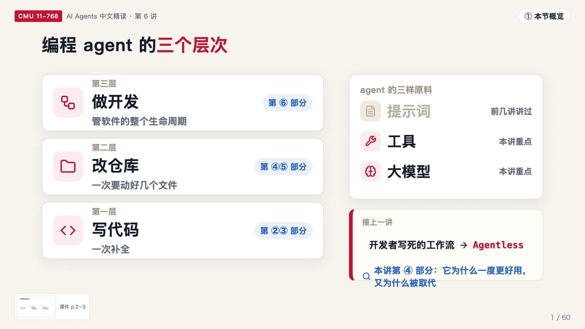

上一讲讲 agent 怎么定计划、拆任务，这一讲换到现在用得最多的一类 agent：**编程 agent**（coding agent）。原课件把它分成三层：

| 层次 | 做什么 | 范围 | 本讲在哪里讲 |
|---|---|---|---|
| 第一层 | 写代码 | 一次补全 | 第 1、2 节 |
| 第二层 | 改仓库 | 改多个文件 | 第 3、4 节 |
| 第三层 | 做开发 | 软件的整个生命周期 | 第 5 节 |

第一层最常见：用一句话让模型写个程序，比如在提示词里贴一份 CSV，让它画成柱状图。第二层是"在这个仓库里修掉这个 issue"，要动好几个文件。第三层是真正做软件，除了写代码、修 issue，还有评审、部署、维护这些事（课上口头补充）。

和前面几讲的 agent 一样，编程 agent 也由三样东西组成：**提示词、工具、大模型**。提示词那边的技能、记忆、长上下文，前几讲已经讲得比较多，这一讲主要讲后两样。严格说，第 1、2 节讲的还只是"会写代码的模型"，单步生成，不是 agent；但后面所有的编程 agent 都建立在它上面。

上一讲把"开发者写死的工作流"的代表记为 **Agentless**。这一讲 3.3 节会正面讲它：它怎么做，为什么有一段时间比 agent 还好用，后来又为什么被 agent 取代。

---

## 1 会写代码的模型

### 1.1 要会三件事，分三个阶段训

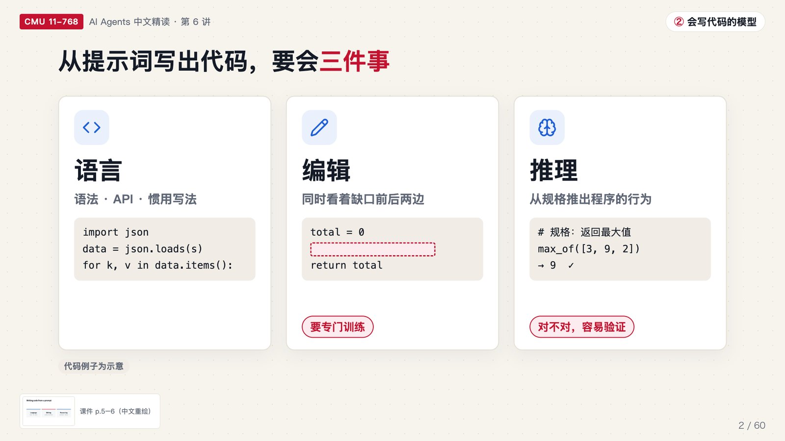

从提示词写出代码，模型要会三件事（原课件 p.5）：

| 能力 | 要会什么 | 说明 |
|---|---|---|
| **语言** | 语法、API、惯用写法 | 最基本的一层 |
| **编辑** | 同时以缺口前后两边的代码为条件来写 | 代码很少写一次就扔，通常反复改；这个能力不是语言模型白送的，要专门训练（1.8 节） |
| **推理** | 从规格推出程序的行为 | 编程是推理模型最成功的应用之一，原因和数学一样：做得对不对，比较容易验证 |

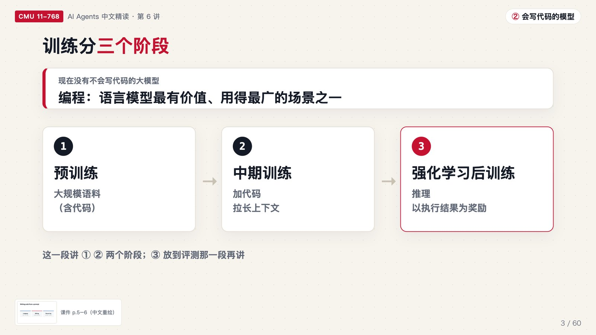

现在没有不会写代码的大模型，因为编程是语言模型最有价值、用得最广的场景之一。但这个能力不是白来的，训练分三个阶段（原课件 p.6）：

| 阶段 | 做什么 |
|---|---|
| **预训练**（pre-training） | 在大语料上训练，语料里包括代码 |
| **中期训练**（mid-training） | 加大代码比例、拉长上下文 |
| **强化学习后训练**（RL post-training） | 推理，以执行结果为奖励 |

这里把中期训练、继续预训练、监督微调当成一步来讲；各阶段的通用训练方法后面的课再讲，这一讲只讲和代码有关的细节。

### 1.2 预训练：混数据、洗数据

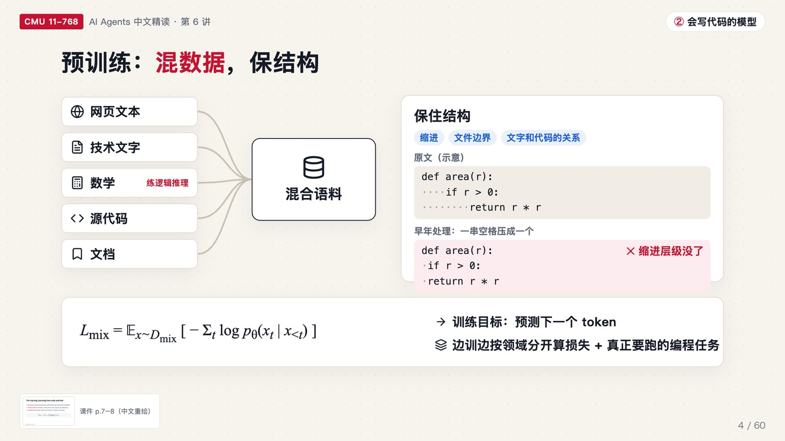

预训练语料要**混合多种来源**：网页文本、解释代码怎么工作的技术文字、数学、源代码、文档。数学用来练逻辑推理。

还要**保住结构**：缩进、文件边界、API、文字和代码之间的关系。早年处理语料时，会把空白"规范化"，比如把一串空格压成一个。这对 Python 很糟，因为空白在 Python 里是语法的一部分，压完缩进层级就没了。同理，文字里夹的一段 Markdown 代码块，处理完还得是一个代码块。

训练目标仍是**预测下一个 token**：在混合的数据分布上，对每个位置的对数概率求和、取负期望（原课件 p.7 引 OLMo 的公式，见上图）。训练过程中要**按领域分开算**留出集上的损失，再加上真正要跑的编程任务，才知道代码能力有没有在涨。

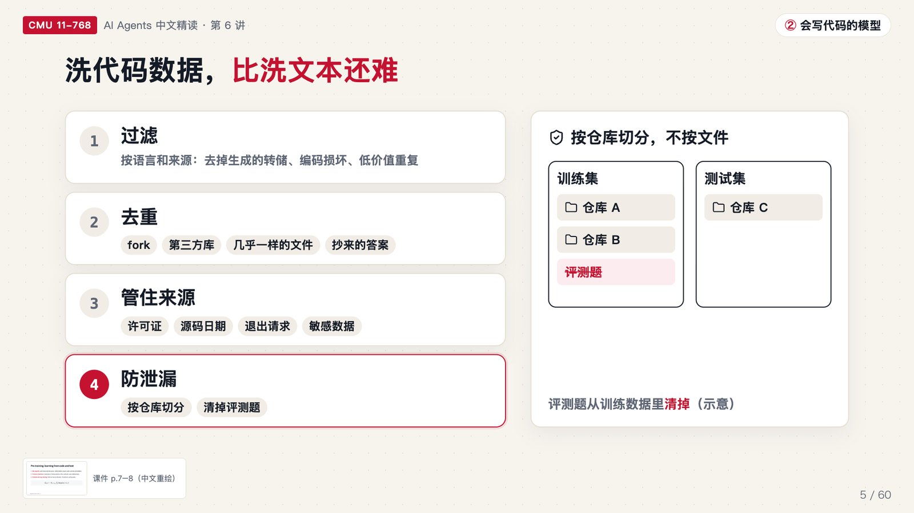

洗代码数据比洗文本还难，原课件 p.8 列了四件事（出处是 StarCoder 的数据处理）：

| 步骤 | 做什么 | 为什么 |
|---|---|---|
| **过滤** | 按语言和来源过滤，去掉自动生成的大段代码、编码损坏的文件、价值低的重复内容 | 代码分布很特别，垃圾比例高 |
| **去重**（deduplication） | fork、打包进项目的第三方库、几乎一样的文件、抄来的答案 | GitHub 上一个仓库可能有成千上万个 fork，原样拿来会让同一份代码出现很多次 |
| **管住来源** | 记录许可证、源码日期、退出（opt-out）请求，过滤敏感数据 | 见下 |
| **防泄漏** | 按仓库或问题类别切分训练集和测试集，把评测题从训练数据里清掉 | 否则评测分数虚高 |

"管住来源"里的几件事（课上口头补充）：

- **许可证**：假设你用专有许可证的代码训练、发布了模型、赚了很多钱，两年后可能就有人找上门。在不在乎由你决定，但要记下来才能选。
- **源码日期**：不想要太多老代码，可以只取新的。
- **敏感数据**：有人会把 API 密钥推进仓库，有 TruffleHog 这类工具专门把它们找出来、过滤掉。顺带一句：别把自己的密钥推进仓库。

### 1.3 把代码切成 token

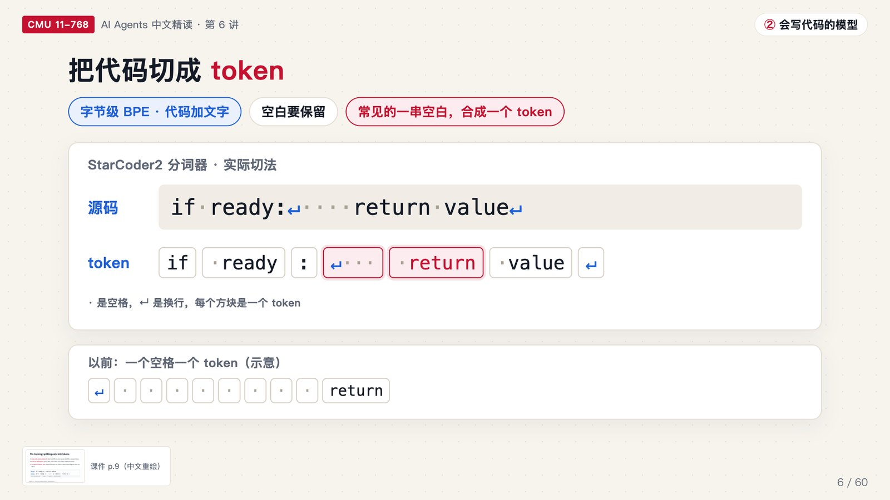

数据洗好，下一步是**分词**（tokenization）。原课件 p.9 的三条：

- 在代码加文字上做**字节级 BPE**，学适合代码的子词；一个标识符可以跨好几个 token。
- **保留空白**：空格、制表符、换行既承载语法，也承载字面内容。
- **压缩常见的连续空白**：一串空白合成一个 token，而不是每个空格占一个。

原课件的例子是 StarCoder2 分词器的实际切法（`·` 是空格，`↵` 是换行，`|` 是 token 边界）：

```text
源码：  if·ready:↵····return·value↵
token： if | ·ready | : | ↵··· | ·return | ·value | ↵
```

注意"换行加三个空格"是一个 token，第四个空格和后面的 `return` 粘在了一起。在大家大量做代码之前，可能一个空格就是一个 token，缩进很深的 Python 要吐出一大串空格。

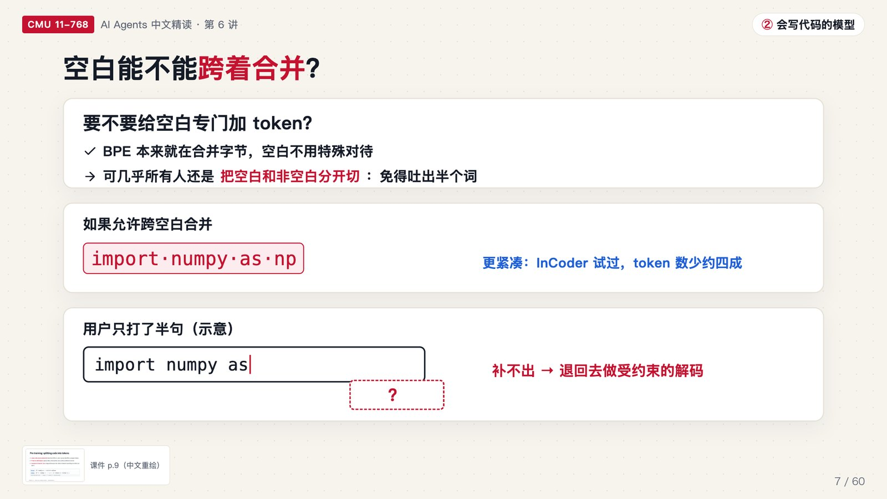

课上有两个问答值得记下：

| 问题 | 回答 |
|---|---|
| 要不要给空白专门加 token？ | BPE 本来就在合并字节，空白不需要特殊对待；但几乎所有人还是把空白和非空白分开切，因为模型状态不好时吐出半个词很怪，分开切能少出这种情况 |
| 允许 token 跨空白合并会怎样？ | 代码能紧凑很多，InCoder 那篇论文试过，token 数能少约 40%。但会出怪问题：`import numpy as np` 这种常见的整句可能合成一个 token，用户只打到 `import numpy as` 时模型就补不出来，只能退回去做**受约束的解码**（constrained decoding）。中途改分词器也要非常小心 |

### 1.4 在大规模代码上预训练

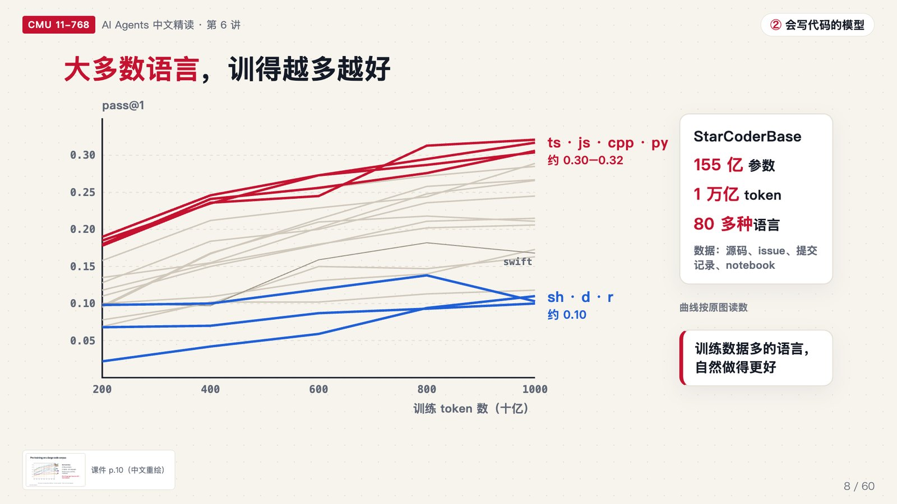

分词定了，就可以在大规模代码上预训练。**StarCoder**（Li et al., 2023）是最早一批专门为写代码预训练的模型。原课件 p.10：StarCoderBase 有 155 亿参数，训了 1 万亿 token，覆盖 80 多种语言，数据包括源码、issue、提交记录和 notebook。

图的横轴是训练 token 数（十亿，200 到 1000），纵轴是 **pass@1**，也就是只生成一次就通过测试的比例（2.5 节细讲），每条线是一种语言。原课件的结论：**大多数语言，训练 token 越多越好。**

按原图读数：到 1000B token 时，TypeScript、JavaScript、C++、Python 这一组最高，在 0.30–0.32 左右；Shell、D、R 这一组最低，在 0.10 左右；有几条线（比如 Swift）后段略有回落。训练数据多的语言，自然做得更好。

### 1.5 模型偏爱 Python

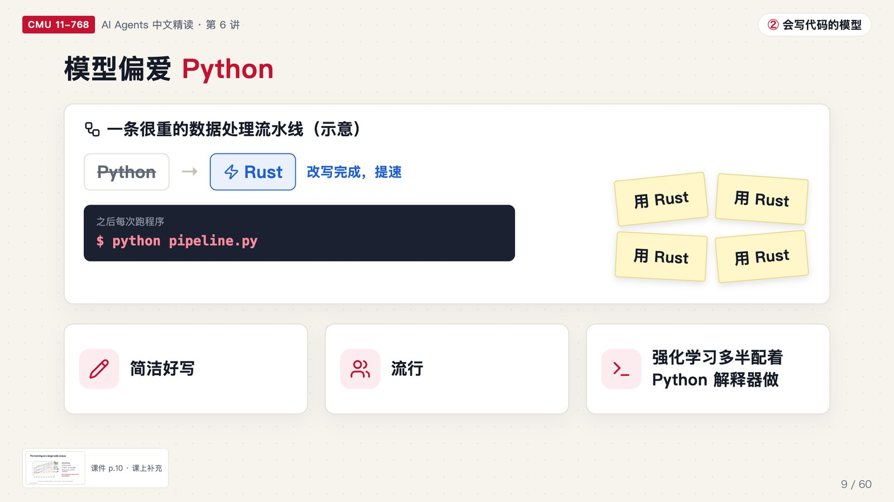

语言多了，也带来偏好。你不指定语言让模型写个应用，它多半用 Python；要做仪表盘，多半用 React（课堂问答）。

实践中常见的情况：一条很重的数据处理流水线，让模型从 Python 改写成 Rust 提速，它改完了；可之后每次跑程序，它又用 Python 去跑，要一遍遍提醒它用 Rust。这种偏好有几个来源：

1. Python 简洁、好写；
2. Python 流行，训练数据多；
3. 模型下游的强化学习，多半是配着 Python 解释器做的。

所以挑语言时，除了模型擅长什么，还要考虑用户想用什么、你用的 agent 框架支持什么。

### 1.6 中期训练：代码、文本、数学怎么配

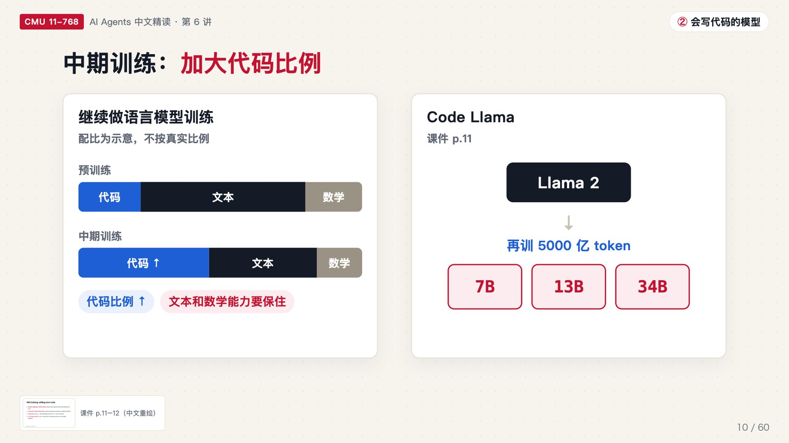

预训练之后是中期训练：**继续做语言模型训练**，但加大代码比例，同时保住文本和数学能力（原课件 p.11）。**Code Llama**（Rozière et al., 2023）从 Llama 2 出发，再训 5000 亿 token，得到 7B、13B、34B 三个模型。Code Llama 和下面的 Qwen2.5-Coder 都是公开论文，讲的正是怎么把一个已经训好的通用模型改造成代码模型。

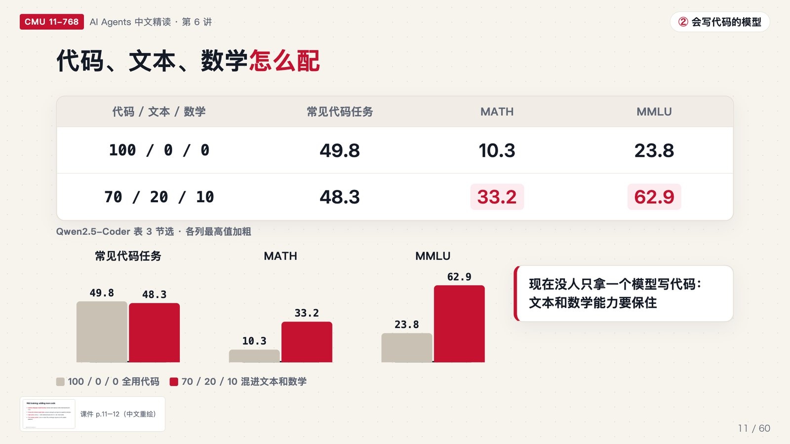

比例怎么配，要靠实验。原课件 p.12 引 Qwen2.5-Coder（Hui et al., 2024）表 3 的部分列：

| 代码 / 文本 / 数学 | 常见代码任务 | MATH | MMLU |
|---|---|---|---|
| 100 / 0 / 0 | **49.8** | 10.3 | 23.8 |
| 70 / 20 / 10 | 48.3 | **33.2** | **62.9** |

全用代码继续训，代码分数最高，但数学和通用问答掉得很厉害；混进两成文本、一成数学，代码只掉 1.5 分，别的能力都保住了。现在没人只拿一个模型写代码，所以这一点很重要。

### 1.7 中期训练：处理更长的输入

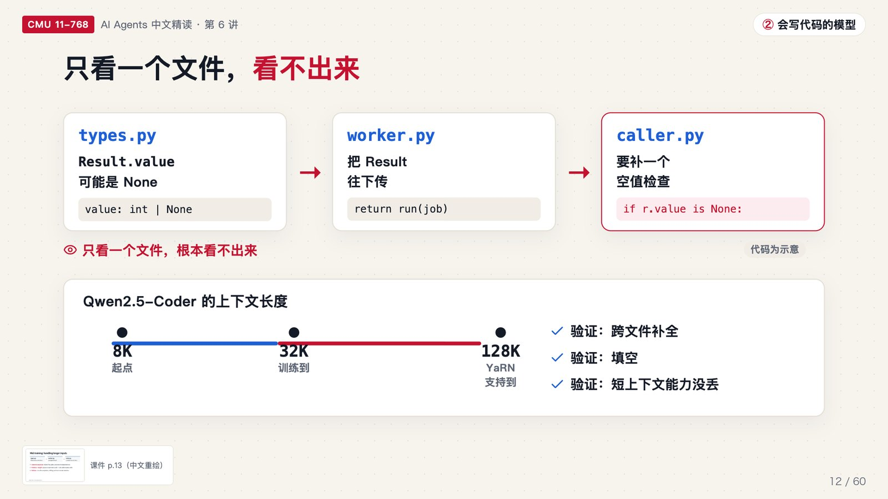

中期训练还要拉长上下文。最朴素的做法是把一个仓库的文件全拼起来，可模型一般最多训到 100 万 token 左右，大多数像样的代码库都超过这个规模；据说 Google 的单体仓库有几十亿行（课上口头补充）。

所以要让序列**连贯**：把同一目录的文件放在一起，或者解析依赖图，把互相依赖的文件拼在一起。原课件 p.13 的例子是一条跨文件的依赖链：

| 文件 | 做了什么 |
|---|---|
| `types.py` | `Result.value` 可能是 `None` |
| `worker.py` | 把 `Result` 往下传 |
| `caller.py` | 要补一个空值检查 |

只看 `caller.py` 一个文件，根本看不出来为什么要补这个检查。

长度上，Qwen2.5-Coder 从 8K 训到 32K，再靠第 3 讲讲过的 **YaRN** 支持到 128K。拉长之后要验证三件事：跨文件补全、填空、短上下文的能力有没有掉。

### 1.8 填空：同时用缺口前后的代码

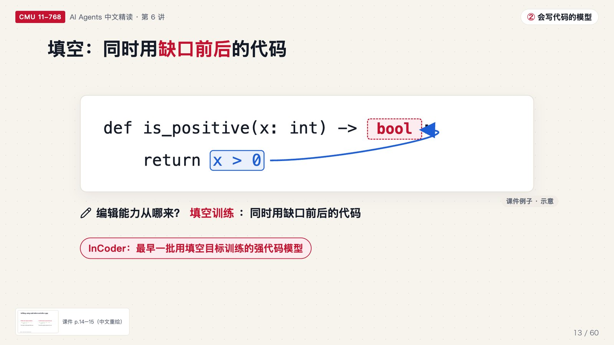

编辑能力从哪来？靠**填空训练**（fill-in-the-middle，FIM），也就是同时用缺口前后的代码。原课件 p.14 的例子（注明是示意）：

```python
def is_positive(x: int) -> ____:
    return x > 0
```

普通的自回归模型只看左边，光看函数名 `is_positive` 也许能猜 `bool`，也可能猜成字符串、枚举。可函数体就在缺口右边，它返回的是一个大小比较 `x > 0`，这就是"返回 `bool`"的证据。**InCoder**（Fried et al.，2022 预印本，ICLR 2023）是最早一批用填空目标训练强代码模型的工作。

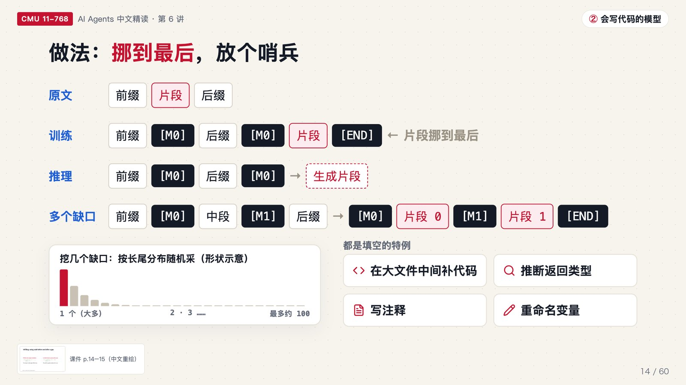

做法出奇地简单：**把填空任务变成自回归任务**（原课件 p.15）。

| | 序列 |
|---|---|
| 原文 | 前缀 · 片段 · 后缀 |
| 训练 | 前缀 `[M0]` 后缀 `[M0]` 片段 `[END]` |
| 推理 | 前缀 `[M0]` 后缀 `[M0]` → 模型接着生成片段 |

把要填的那段挪到最后，原位置放一个**哨兵符号**（sentinel）`[M0]`；推理时把哨兵放在前缀和后缀之间，末尾再放一个，模型就接着生成中间那段。缺口多了，就用 `[M0]`、`[M1]`、`[M2]` 这样不同的哨兵依次生成。

挖几个缺口、每个多长？课上的回答是按长尾分布随机采：大多数时候挖一个，有时两个，三个更少，最多可到 100 个左右；长度也按类似的分布采。

在大文件中间补代码、推断返回类型、写注释、重命名变量，都是填空的特例，所以填空训练让模型能"零样本"做这些编辑。

### 1.9 右边的上下文值多少

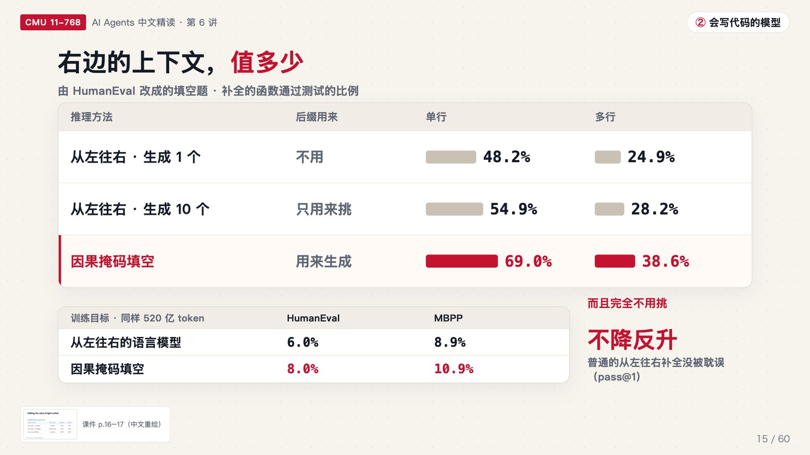

后面那段代码到底值多少？原课件 p.16 引 InCoder §4.1，在由 HumanEval 改成的填空题上比较补全的函数通过测试的比例：

| 推理方式 | 后缀用来做什么 | 单行 | 多行 |
|---|---|---|---|
| 从左到右 · 1 个候选 | 不用 | 48.2% | 24.9% |
| 从左到右 · 10 个候选 | 只用来重排 | 54.9% | 28.2% |
| 因果掩码填空 | 用来生成 | **69.0%** | **38.6%** |

生成 10 个候选、再用后缀挑，会好一些；但远不如直接训练模型去填空，而且填空完全不需要挑。

会不会耽误普通的从左往右补全？原课件 p.17：同样 520 亿 token 的训练预算，pass@1 是这样的：

| 训练目标 | HumanEval | MBPP |
|---|---|---|
| 从左到右的语言模型 | 6.0% | 8.9% |
| 因果掩码（填空） | 8.0% | 10.9% |

不降反升，两者不是此消彼长。原课件还引了 Bavarian et al.（2022）关于填空训练的规模研究。

### 1.10 填空之外，还能从代码里学什么

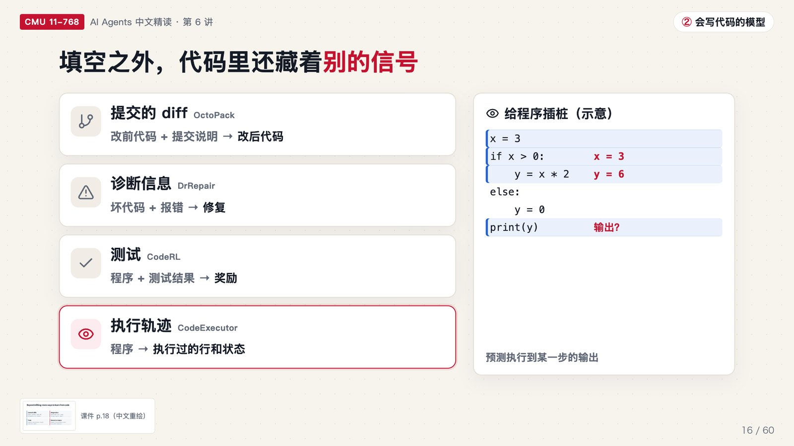

代码里还藏着别的训练信号（原课件 p.18）：

| 数据 | 怎么学 | 出处 |
|---|---|---|
| 提交的 diff | 改之前的代码 + 提交说明 → 改之后的代码或 diff | OctoPack（Muennighoff et al., 2023） |
| 诊断信息 | 坏代码 + 报错 → 修复 | DrRepair（Yasunaga & Liang, 2020） |
| 测试 | 程序 + 测试结果 → 奖励 | CodeRL（Le et al., 2022） |
| 执行轨迹 | 程序 → 执行过的行和当时的状态 | CodeExecutor（Liu et al., 2023） |

- **提交 diff** 能训出好的代码编辑模型。
- 哪里能几乎免费拿到大量"坏代码 + 报错"？答案是**持续集成**（CI）测试：每次推送都会跑，历史全在 GitHub 上公开，能看到某个版本报错，后来的版本修好、合并了进去。自己生成这种数据很痛苦，4.4 节会讲用 agent 造数据。
- **执行轨迹**：给程序插桩、运行，看它实际执行了哪些行、当时变量是什么状态，让模型预测执行到某一步的输出。第 6 节"预测代码行为的模型"就依赖这种数据。

这一节记住一句：会写代码不是白来的，数据要洗、空白要切对、要学会看两边填空，还要从提交、报错和测试里学。

---

## 2 怎么评测生成的代码

### 2.1 和参考答案比

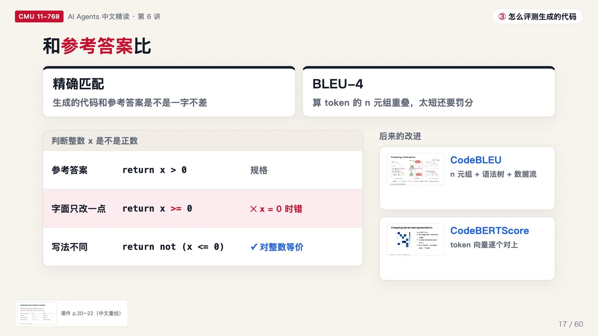

模型会写了，写出来的代码怎么打分？最早的办法是和人写的**参考答案**比（原课件 p.20）：

- **精确匹配**（exact match）：生成的代码和参考答案一字不差吗？
- **BLEU-4**：算 token 的 n 元组重叠，再加一个过短惩罚。

2017 年前后的论文（如 Yin & Neubig, ACL 2017）就是这么评的，比的是像不像人写的，不是能不能跑。问题马上就来，看判断整数 x 是不是正数的三种写法：

| | 代码 | 行为 |
|---|---|---|
| 参考答案 | `return x > 0` | 规格 |
| 字面上只改一点 | `return x >= 0` | x = 0 时错 |
| 写法不同 | `return not (x <= 0)` | 对整数完全等价 |

第二种和参考答案只差一个符号，行为却是错的；第三种字面重叠很少，行为却一样。比字面，两头都会判错。

后来有两种改进，视频里只提了一句，这里展开：

| 指标 | 怎么比 | 原课件 |
|---|---|---|
| **CodeBLEU**（Ren et al., 2020） | 普通 BLEU + 加权 n 元组匹配（`return`、类型名这类关键字权重更高）+ **抽象语法树**（AST）匹配 + **数据流**匹配（哪个变量从哪里来），四项加权求和 | p.21，用一段 C# 的 `Sign` 函数（机器翻译版返回 `int`、人写版返回 `short`）演示三种匹配 |
| **CodeBERTScore**（Zhou et al., EMNLP 2023） | 把提示词和每段代码一起编码，比较带上下文的 token 向量，找最佳匹配，算精确率、召回率和 F 值 | p.22，热力图比较 `math.sqrt(x)` 和 `x ** 0.5` 的各个 token |

CodeBERTScore 的想法是：一段代码里的每个 token，在另一段里都能找到对得上的 token，就说明两种实现互相体现了对方。它们都比 BLEU 好，但本质上仍然是"和参考答案比"。

### 2.2 跑起来看行为

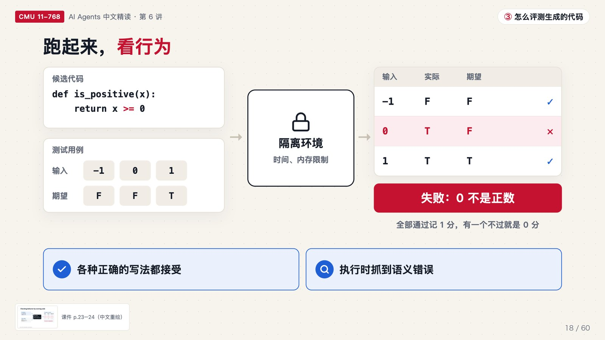

现在远比这些流行的，是**直接跑起来看行为**，也就是**功能性评测**（functional evaluation，Chen et al., 2021）。原课件 p.23 还是用那个 `return x >= 0` 的候选：

1. **测试用例**：输入 −1、0、1，期望输出假、假、真。
2. **运行代码**：放进隔离的运行环境，限好时间和内存。
3. **比较输出**：

| 输入 | 实际 | 期望 | |
|---|---|---|---|
| −1 | F | F | ✓ |
| 0 | T | F | ✕ |
| 1 | T | T | ✓ |

结果：失败，0 不是正数。全部测试通过记 1 分，有一个不过就是 0 分。

### 2.3 执行检查的好处和局限

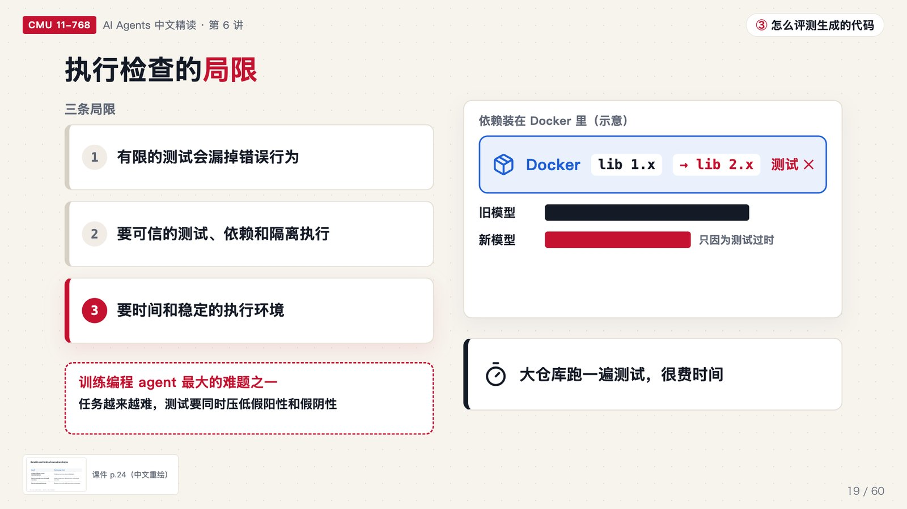

原课件 p.24 的对照：

| 好处 | 局限 |
|---|---|
| 接受各种不同的正确实现 | 有限的测试可能漏掉错误行为 |
| 通过执行发现语义错误 | 需要可信的测试、依赖，以及隔离的执行环境 |
| 匹配观察到的行为 | 需要时间和稳定的执行环境 |

最大的局限是测试本身。几乎每个出名的基准，都有一篇论文抱怨它的单元测试有多差（原课件引了 EvalPlus）：

- **假阳性**（false positive）：测试不够严，错的实现也能过。
- **假阴性**（false negative）：给 agent 的信息不够，根本不可能全过。比如需求是"在右上角放一个写着'了解更多'的按钮"，测试却还查了按钮的背景色，这个要求一开始谁也看不出来。

这是现在训练编程 agent 最大的难题之一：任务越来越难，测试要同时压低假阳性和假阴性，非常难写。

另外两个麻烦：

- **依赖**：只用标准库很容易，否则要提前装好，通常用 Docker 容器。可库的版本一升级，测试就可能挂，新模型的分反而更低，只因为测试过时了。
- **时间**：大仓库跑一遍测试很费时间，4.1 节的 SWE-bench 就要专门处理这个问题。

### 2.4 两个经典基准

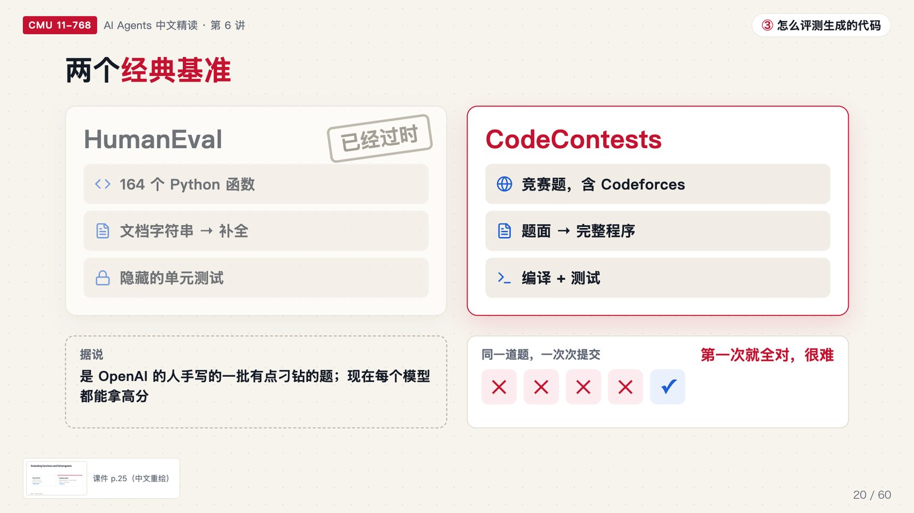

| 基准 | 内容 | 形式 |
|---|---|---|
| **HumanEval** | 164 个 Python 函数 | 给出文档字符串 → 补全函数体；用隐藏的单元测试检查 |
| **CodeContests** | 竞赛题，包括 Codeforces 的题 | 题面 → 完整程序；编译 + 测试 |

HumanEval 是单步代码生成的经典基准，现在已经过时了，每个模型都能拿高分；据说它是 OpenAI 的人手写的一批有点刁钻的 Python 函数，不一定反映真实的使用。CodeContests 难得多。很少有人第一次就把一道 Codeforces 题一个错不犯地做对，而这正是我们要求单步模型做到的事，所以它需要大量推理。

### 2.5 多次尝试的成功率：pass@k

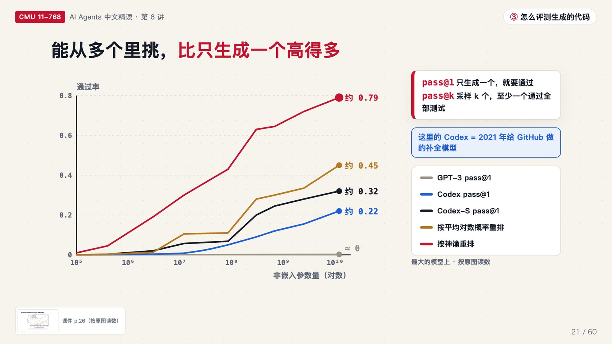

**pass@k**：采样 k 个程序，至少有一个通过全部测试的概率。pass@1 只生成一个就要通过；pass@5 是生成 5 个，任何一个对就算对，更宽松。

原课件 p.26 的图出自 HumanEval 论文（Chen et al., 2021）。横轴是非嵌入参数量（10⁵ 到 10¹⁰，对数刻度），纵轴是通过率。注意这里的 **Codex** 是 2021 年给 GitHub 做的最早的代码补全模型，不是现在的 Codex 编程 agent。按原图读数，在最大的模型上：

| 曲线 | 约 |
|---|---|
| GPT-3 pass@1 | 0（一直贴着横轴） |
| Codex pass@1 | 0.22 |
| Codex-S pass@1（专门微调过） | 0.32 |
| Codex-S，生成多个后按平均对数概率重排 | 0.45 |
| Codex-S，生成多个后由"神谕"挑 | 0.79 |

两个结论：模型越大越好；能从多个样本里挑，比只生成一个高得多。"神谕"（oracle）指假设有人知道哪个是对的，代表挑选能做到的上限。

### 2.6 非功能需求

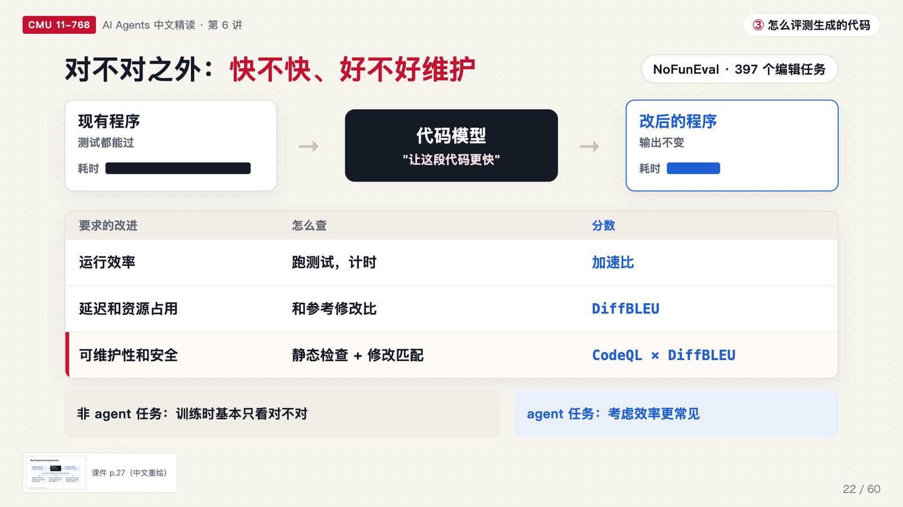

对不对之外，还有快不快、好不好维护。**NoFunEval**（Singhal et al., 2024）收了 397 个代码编辑任务，比如"让这段代码更快"，要求改完输出不变（原课件 p.27）：

| 要求的改进 | 怎么查 | 分数 |
|---|---|---|
| 运行效率 | 跑测试并计时 | 加速比 |
| 延迟 / 资源占用 | 和参考修改比 | DiffBLEU |
| 可维护性 / 安全 | 静态检查 + 修改匹配 | CodeQL × DiffBLEU |

对非 agent 任务，训练时基本只看对不对，不太管代码快不快，NoFunEval 是少数例外；agent 任务里考虑效率更常见（课堂问答）。

### 2.7 用测试结果做强化学习

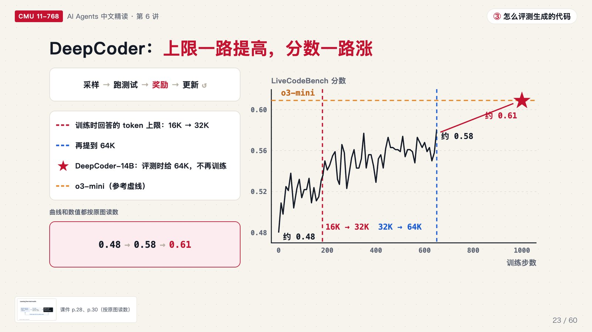

有了能自动判对错的测试，就能拿它做强化学习。原课件 p.28 的 **DeepCoder**（Luo et al., 2025）循环：

```text
采样回答（题目 → 推理 + 最终代码）
  → 跑测试（执行最终代码，通过 / 失败 → 奖励）
  → 更新模型（让拿到奖励的回答更可能出现）
  → 用更新后的模型再采样
```

从强化学习的角度看这不意外；重要的是它能训出大型推理模型，单步解竞赛题正需要仔细想。很多竞赛题还有执行时限，超时也拿不到分，这算是把效率间接放进了奖励。

原课件 p.29（课上没展开）用一道题说明"推理着走向答案"：计算 1 + … + n，其中 0 ≤ n ≤ 10¹²。

| 思路 | 代码 | 结果 |
|---|---|---|
| 逐个加 | `sum(range(n + 1))` | n 很大时太慢 |
| 首尾配对推出公式，再检查 0 和 1 | `n * (n + 1) // 2` | 正确又高效 |
| 背公式，但抄错了 | `n * (n - 1) // 2` | n = 1 就已经错了 |

第二种思路自己推、自己用边界值检查，这就是推理模型在编程上的价值。

原课件 p.30 是 DeepCoder 在 LiveCodeBench 上的曲线：横轴训练步数（0 到 1000），纵轴 LiveCodeBench 分数。强化学习时回答的 token 上限先是 16K，再提到 32K（K = 1000 个 token）；评测时给到 64K，不再训练。按原图读数：起点约 0.48，上限一路提高，曲线到约 0.58；64K 推理的 DeepCoder-14B 约 0.61，和图上 o3-mini 那条参考虚线基本齐平。课上补充：中期训练之后再做这种强化学习，还能进一步提高。

### 2.8 课堂问答：模型为什么爱写注释

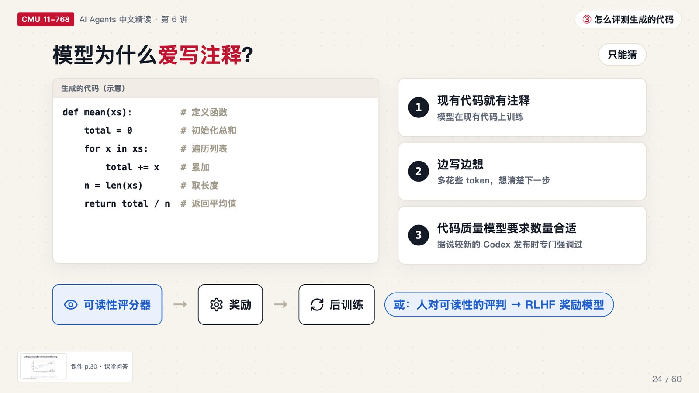

停在这张图时，课上有人问：为什么生成的代码里总有注释，哪怕任务不需要？回答是只能猜，因为不知道各家具体怎么训的：

1. 模型在现有代码上训练，现有代码就有注释；
2. 写注释可能是一种边写边想，多花些 token，想清楚下一步；
3. 现在多半还有判断代码质量的模型，要求注释数量合适。以前的编程模型最招人烦的，就是写一大堆没人看的注释；据说较新的 Codex 发布时，专门强调了不会刷屏式地写注释。

可读性也能专门训：训一个判断代码质量的模型放进奖励；或者在后训练时收集人对"可读性"的评判，放进 RLHF 的奖励模型。

这一节记住一句：比字面靠不住，跑测试才算数，可测试本身也会出错；能自动判对错，就能拿来做强化学习。

---

## 3 编程 agent：定位、修改、验证

### 3.1 从单步编程到 agent 式编程

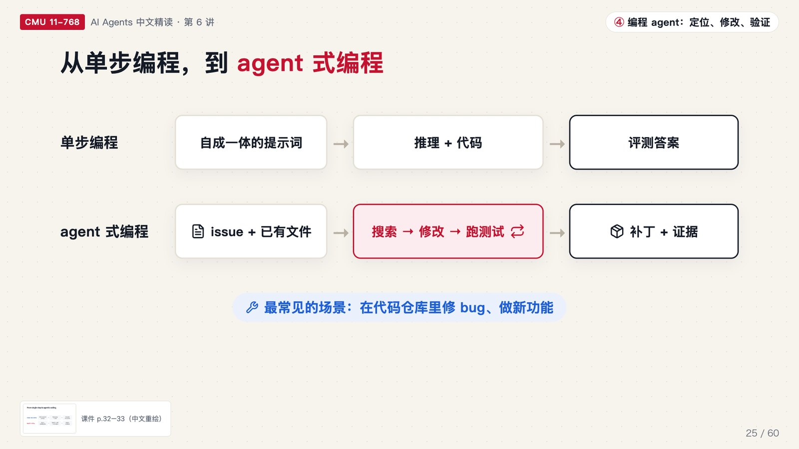

前面讲的都是一问一答的单步编程。换到真正的 agent，输入、过程、产出都变了（原课件 p.32）：

| | 输入 | 过程 | 产出 |
|---|---|---|---|
| 单步编程 | 自成一体的提示词 | 推理 + 代码 | 评测这个答案 |
| **agent 式编程**（agentic coding） | issue + 已有的文件 | 搜索 → 修改 → 跑测试，循环 | 补丁 + 证据 |

最大的区别是现在要反复调用工具。最常见的场景，就是在代码仓库里修 bug、做新功能。

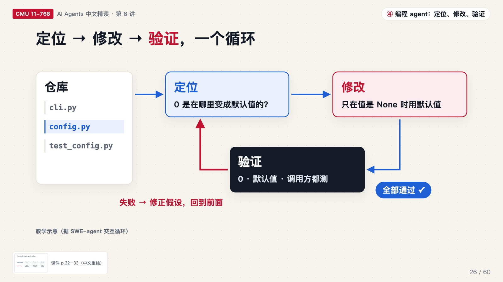

这个循环有三步（原课件 p.33，按 SWE-agent 的交互循环画的教学示意）：

| 步骤 | 做什么 | 在下面的例子里 |
|---|---|---|
| **定位**（localize） | 找到要改的地方 | 0 是在哪里变成默认值的？ |
| **修改**（edit） | 改它 | 只在值为 None 时才用默认值 |
| **验证**（verify） | 确认真的改好了 | 0 的情况 + 默认值的情况 + 调用方有没有被改坏 |

验证失败，就**修正假设**，回到前面，一直迭代到全部通过。

### 3.2 一个 bug 走一遍循环

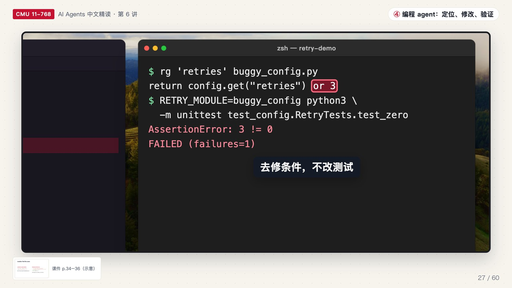

看一个具体的 bug：配置里显式把重试次数 `retries` 写成 0，程序却按 3 次来重试。仓库里有 `cli.py`、`config.py`、`test_config.py`（原课件 p.34–36，命令和输出照原课件）。

**定位**：用 ripgrep 搜重试次数，找到实现的那一行。

```console
$ rg 'retries' buggy_config.py
return config.get("retries") or 3
```

取配置里的值，取不到就用默认值 3。可 0 在 Python 里是**假值**（falsy），`0 or 3` 的结果是 3，显式写的 0 被当成"没填"。

**复现**：跑专门测 0 的那个单元测试。

```console
$ RETRY_MODULE=buggy_config python3 \
    -m unittest test_config.RetryTests.test_zero
AssertionError: 3 != 0
FAILED (failures=1)
```

期望 0，得到 3。现在该去**修条件**，而不是去改测试。

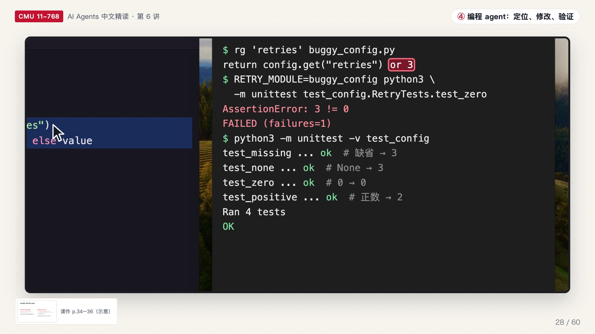

**修改**：先把值取出来，只有它是 `None` 时才用默认值。

| | 代码 | 效果 |
|---|---|---|
| 改之前 | `return config.get("retries") or 3` | 所有假值（0、空字符串、None）都会选默认值 |
| 改之后 | `value = config.get("retries")`<br>`return 3 if value is None else value` | 显式写的 0 能留下来 |

**验证**：跑已有的全部测试 `python3 -m unittest -v test_config`。

| 用例 | 期望 | 结果 |
|---|---|---|
| 缺省 | 3 | 通过 |
| None | 3 | 通过 |
| 0 | 0 | 通过 |
| 正数 | 2 | 通过 |

共 4 个测试，全部通过。要是没通过，就**用失败来引导下一步**：0 还是变成 3，就回去定位值在哪里变的；默认值的情况坏了，就改规则，再验证一遍。

### 3.3 另一种做法：固定工作流 Agentless

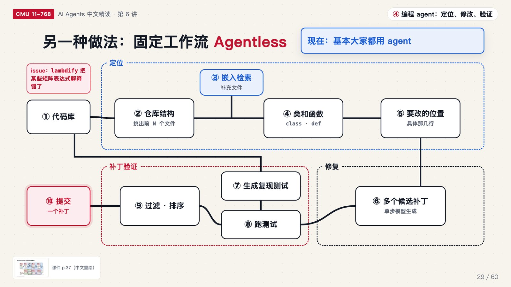

**Agentless**（Xia et al.）不让 agent 自己调工具去找，而是把修 bug 拆成写死的几步（原课件 p.37，issue 是"lambdify 把某些矩阵表达式解释错了"）：

| 阶段 | 步骤 |
|---|---|
| 定位 | ① 拿到代码库 → ② 看仓库结构，让模型挑出最可能的前 N 个文件（③ 用嵌入检索补充）→ ④ 定位到类和函数 → ⑤ 定位到具体要改的位置 |
| 修复 | ⑥ 用单步模型根据要改的位置生成多个候选补丁 |
| 补丁验证 | ⑦ 自动生成复现问题的测试 → ⑧ 跑测试 → ⑨ 过滤、排序补丁 → ⑩ 提交一个补丁 |

和 3.1 节的 agent 对比：

| | 编程 agent | Agentless |
|---|---|---|
| 下一步做什么 | 模型每步自己决定（搜、读、改、跑） | 开发者事先写死 |
| 定位 | 调工具一步步找 | 文件 → 类和函数 → 行，三层逐级预测 |
| 修改 | 在循环里边改边测 | 一次生成多个候选补丁 |
| 验证 | agent 自己跑测试，失败了回去改 | 生成复现测试，过滤、排序后提交一个 |

有一小段时间，这套固定流程好用得让人沮丧：实践中不少模型用它，效果反而比编程 agent 好。原因是那时的模型被大量训练去做单步的代码修复，却没怎么训练过 agent 式的工具调用和验证循环。等模型补上了这一课，现在基本大家都用 agent 了。

### 3.4 只给一个 shell

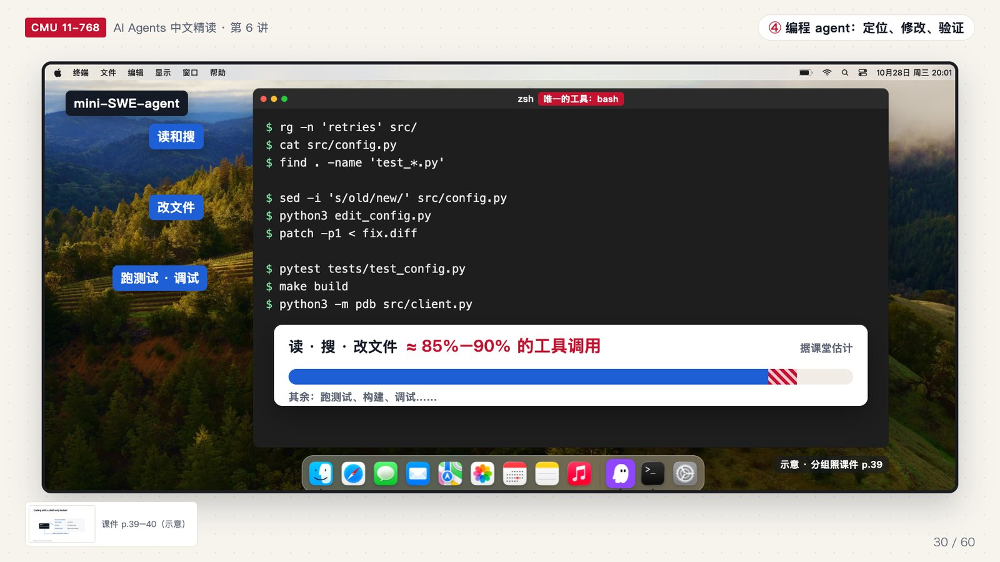

知道了循环怎么转，再看 agent 手里的工具。最简单的配法，是**只给一个工具：运行 bash 命令**。模型选一条命令，拿回输出、退出码，或者超时（原课件 p.39）：

| 用途 | 命令 |
|---|---|
| 读 / 搜索 | `rg`、`cat`、`find` |
| 改文件 | `sed`、Python、`patch` |
| 执行检查 | `pytest`、构建命令 |

**mini-SWE-agent** 就是这么做的，它出自做 SWE-bench 和 SWE-agent 的那批人。这不是说只能用这几个命令，而是 agent 手里只有 bash 这**一个**工具，GDB 这类调试器也能从 bash 里跑。至少在理论上，有这一个工具就够实现一个编程 agent。第 7 节会读它的源码。

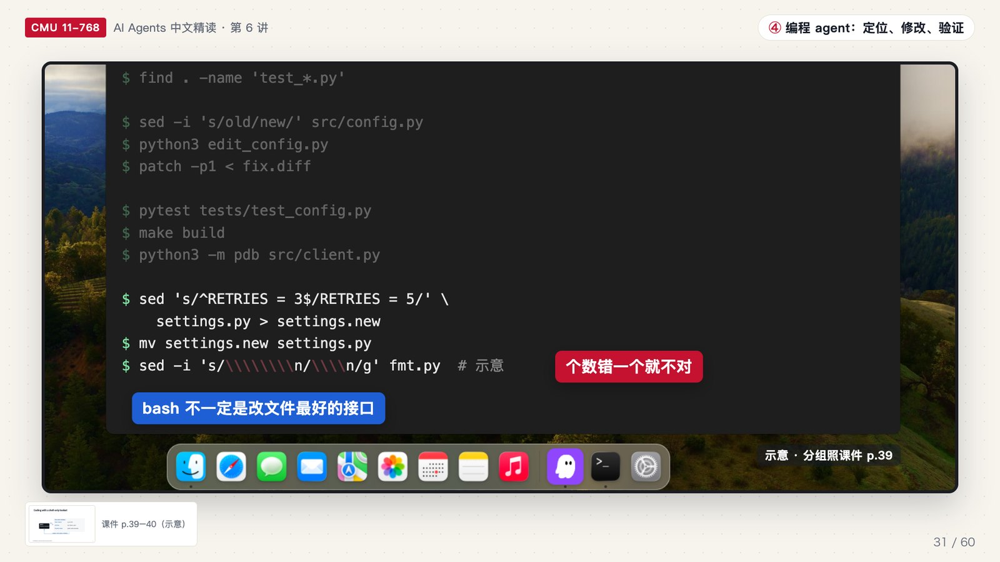

可只给 shell 也有代价（课堂问答）。原课件 p.40 用 `sed` 改一行：

```bash
sed 's/^RETRIES = 3$/RETRIES = 5/' \
    settings.py > settings.new
mv settings.new settings.py
```

匹配那一行，写出结果，再替换原文件。一个 shell 有很多种改法：`sed`、`awk` 做文本模式和按行修改，Python 脚本可以跨文件计算替换。问题在于：

- 读、搜、改文件占了工具调用的绝大部分，课上一位同学估计在 85%–90%（据课堂估计）；
- 每次改文件，agent 都要想用 `sed`、Python 还是 `patch`；
- 要替换的内容里反斜杠一多，就要一层层转义，个数错一个就不对。

如果有一个专门为 agent 设计的改文件工具，它就基本只用这一个，改得更准。bash 不一定是操作文件最好的接口。

### 3.5 三种改文件的格式

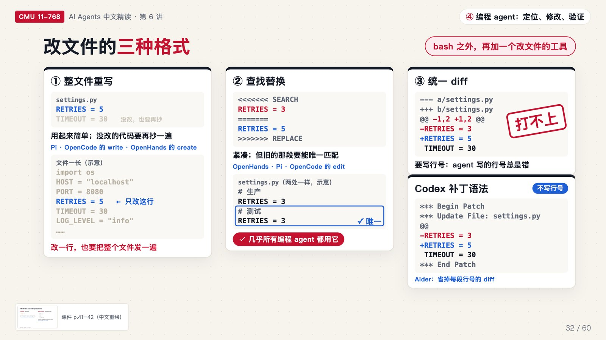

所以几乎所有有竞争力的编程 agent，最大的改动都是**至少再加一个改文件的工具**。原课件 p.41–42 对比了三类格式：

**① 整文件写入**：把文件整个重写。

```text
settings.py:
RETRIES = 5
TIMEOUT = 30
```

用起来简单，但没改的代码（这里的 `TIMEOUT = 30`）也要再抄一遍。谁在用：Pi 的 write、OpenCode 的 write、OpenHands 的 create。

**② 查找替换**（search / replace）：把旧的一段和新的一段都发过去。

```text
<<<<<<< SEARCH
RETRIES = 3
=======
RETRIES = 5
>>>>>>> REPLACE
```

很紧凑；但旧的那段在文件里要能**唯一匹配**。要是文件里有两处 `RETRIES = 3`，就分不清改哪处，agent 要多带几行上下文，直到唯一为止。好处远大于这个坏处，几乎所有编程 agent 都用它（OpenHands、Pi、OpenCode 的 edit）。

**③ diff 类格式**：

```diff
--- a/settings.py
+++ b/settings.py
@@ -1,2 +1,2 @@
-RETRIES = 3
+RETRIES = 5
 TIMEOUT = 30
```

标准的**统一 diff**（unified diff）要写行号，可 agent 写的行号总是错，补丁就打不上。所以最常见的是一种很像 diff、但不写行号的格式：Aider 是省掉每段（hunk）里的行号；Codex 用自己的补丁语法：

```text
*** Begin Patch
*** Update File: settings.py
@@
-RETRIES = 3
+RETRIES = 5
 TIMEOUT = 30
*** End Patch
```

文件操作加上下文，不写行号。OpenCode、OpenHands 按模型预设，也会用这种格式。

| 格式 | 优点 | 缺点 | 例子 |
|---|---|---|---|
| 整文件写入 | 最简单，不会匹配失败 | 没改的也要抄，长文件费 token，容易抄丢 | Pi / OpenCode 的 write、OpenHands 的 create |
| 查找替换 | 紧凑 | 旧片段必须唯一匹配 | OpenHands、Pi、OpenCode 的 edit |
| 统一 diff | 标准、训练数据里多 | 行号容易写错 | Aider（省掉行号） |
| Codex 补丁语法 | 不写行号，能表达增删文件 | 要模型学过这种格式 | Codex；OpenCode / OpenHands 视预设 |

### 3.6 格式的差别可能很大

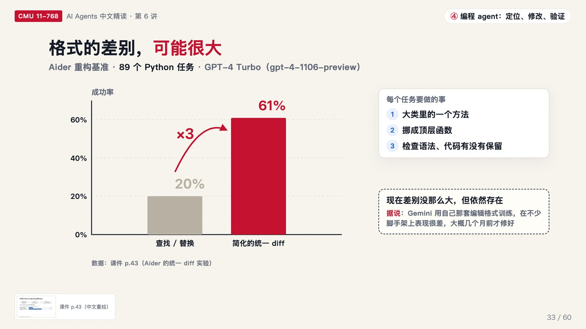

格式听着像细节，差别却可能很大。Aider 有个**重构基准**：89 个 Python 任务，要把大类里的一个方法挪成顶层函数，再检查语法和代码有没有保留下来（原课件 p.43）。同一个 GPT-4 Turbo（gpt-4-1106-preview）：

| 编辑格式 | 成功率 |
|---|---|
| 查找 / 替换 | 20% |
| 简化的统一 diff | 61% |

差了三倍，因为这个模型训练数据里见统一 diff 更多。现在差别没那么大了，但依然存在。据说直到不久前，Gemini 在不少脚手架上表现都很差，因为它是用自己那套编辑格式训的，大概几个月前才修好。这件事没做好，会是 agent 好不好用的一个很大的瓶颈。三种改文件的方式和这组数字，挑工具、挑模型时都用得上，建议收藏。

### 3.7 找到相关代码

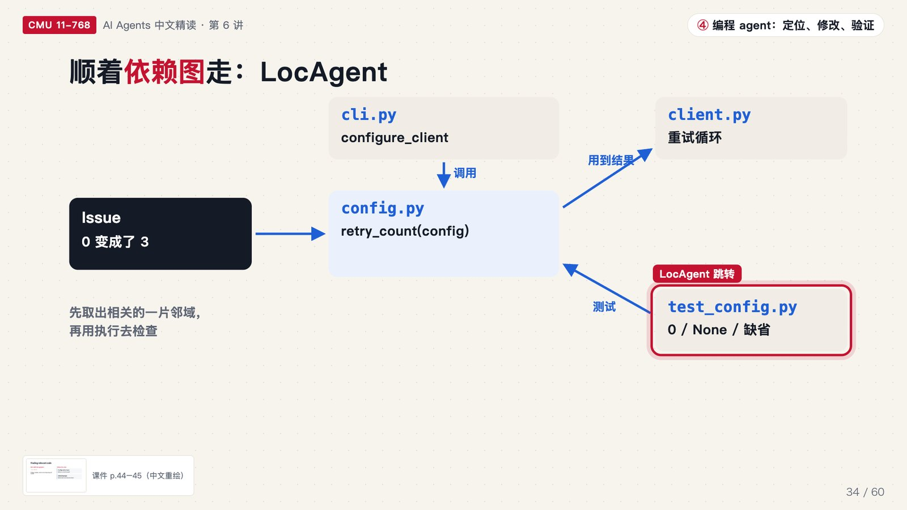

回到循环的第一步：怎么找到相关代码。最流行的是从症状开始用 ripgrep 搜（原课件 p.44）：

```console
$ rg 'retries' .
```

命令行参数、配置加载器、重试循环可能都会匹配上。然后**顺着值走**：0 最早是在哪里被读进来的？0 是在哪里变成 3 的？

**LocAgent**（Chen et al., 2025）给 agent 一个专门的工具，顺着**依赖图**走（原课件 p.45）：`cli.py` 的 `configure` 调用 `config.py` 的 `retry_count(config)`，`client.py` 的重试循环用它的结果，`tests/test_config.py` 测 0、None、缺省三种情况。找到 `config.py` 之后，能直接跳到调用它的地方和测它的测试。原课件的一句话是：先取出相关的那一片邻域，再用执行去检查。不过实践中常见的情况是，这类方法很难比更简单的搜索办法做得更好。

这一节记住一句：编程 agent 就是定位、修改、验证的循环；改文件的格式和模型训练时见过的对不对得上，影响大得出人意料。

---

## 4 评测和训练编程 agent

### 4.1 SWE-bench 怎么评

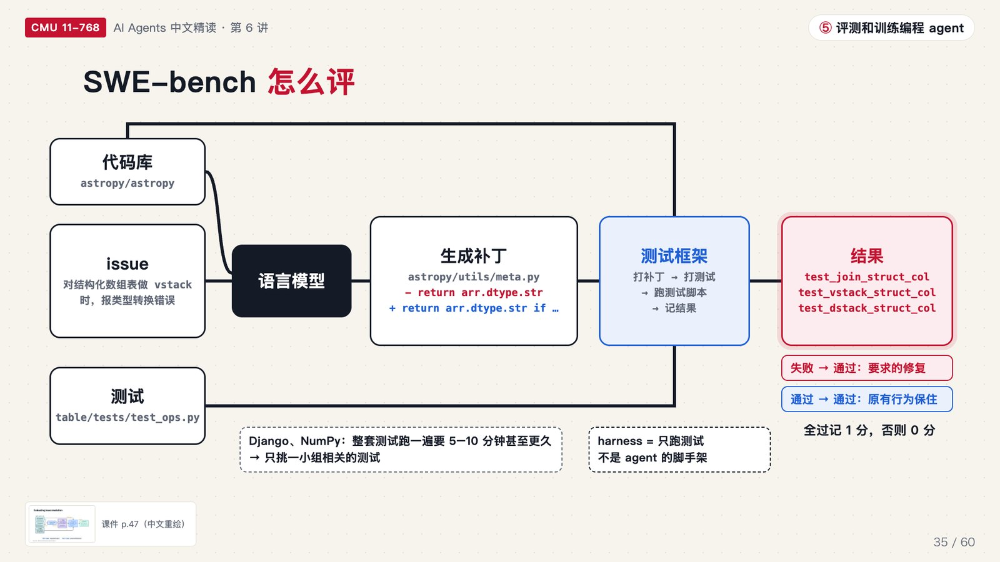

agent 能修 bug 了，怎么知道它修得好不好？最流行的基准是 **SWE-bench**（Jimenez et al.）。它从 GitHub issue 来：

1. 取 issue 当问题；
2. 取解决它的 PR **合并之前**的代码状态当起点；
3. 找出和这个 PR 一起加进来的测试，它们应该正好在测要修的功能。

原课件 p.47 的例子：代码库是 astropy/astropy，issue 说对结构化数组做竖直拼接（vstack）时报类型转换错误。模型生成一个补丁，改了 `astropy/utils/meta.py` 里的一行 `return arr.dtype.str`。然后**测试框架**（harness）把补丁打进仓库，把测试打进仓库，跑测试脚本，记下结果。这里的 harness 只管跑测试，和 agent 的"脚手架"（4.5 节）是两回事。

Django、NumPy 这种仓库，整套测试跑一遍要五到十分钟甚至更久，所以只挑一小组相关的测试，分两类：

| 类别 | 含义 | 测的是什么 |
|---|---|---|
| **失败 → 通过**（FAIL_TO_PASS） | PR 之前失败、之后通过 | 要求的修复 |
| **通过 → 通过**（PASS_TO_PASS） | PR 之前就过、之后也要过 | 原有行为保住了，没改坏别的 |

两类全过记 1 分，否则 0 分。例子里的结果是 `table/tests/test_ops.py` 里的 `test_join_struct_col`、`test_vstack_struct_col`、`test_dstack_struct_col`。

### 4.2 做成能跑的训练任务

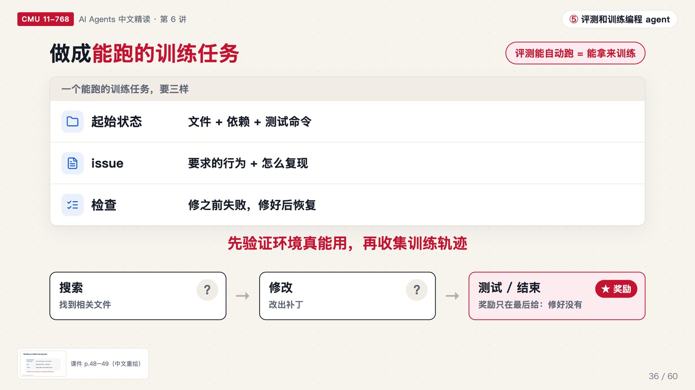

评测能自动跑，就意味着能拿来训练：只要能大批造出这种任务，就能在上面做强化学习，让模型生成输出，算它做得好不好的奖励。一个**能跑的任务**（executable task）要三样东西（原课件 p.48）：

| 组成 | 包括 |
|---|---|
| 起始状态 | 文件 + 依赖 + 测试命令 |
| issue | 要求的行为 + 怎么复现 |
| 检查 | bug 修之前失败，修好后恢复行为 |

原课件强调：**先验证环境真能用，再去收集训练轨迹。**

难在哪？原课件 p.49（出处 R2E-Gym，Jain et al., 2025，课上没展开）把多步修复写成强化学习：

| 步骤 | 助手的动作 | 环境返回 |
|---|---|---|
| 搜索 | 找到 `config.py` | 找到的文件 |
| 修改 | 保住 0 | 打上的补丁 |
| 测试 / 结束 | 检查回归 | 测试输出 |

只有助手的动作是训练目标，环境返回的内容只当上下文。最后只有一个**终局奖励**：修好没有。目标是最大化轨迹的期望奖励。问题是：后面失败了，说不清是前面哪一步决定错了，这就是强化学习里的**信用分配**（credit assignment）难题。

### 4.3 SWE-Gym：训练数据和推理算力

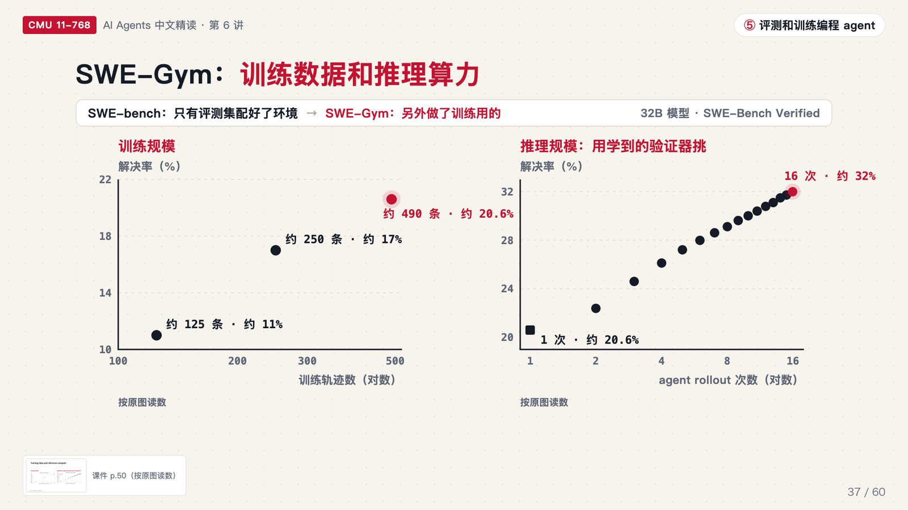

SWE-bench 只有评测集配好了环境。**SWE-Gym**（Pan et al., 2024）另外做了训练用的环境（原课件 p.50，32B 模型，纵轴都是 SWE-Bench Verified 的解决率）。按原图读数：

| 训练轨迹数 | 解决率 |
|---|---|
| 约 125 条 | 约 11% |
| 约 250 条 | 约 17% |
| 约 490 条 | 约 20.6% |

只有几百个例子，就明显变好。另一张图是**推理时扩展**（inference-time scaling）：让 agent 多跑几次（rollout），用学到的**验证器**（verifier）挑一个。按原图读数，只跑 1 次约 20.6%，跑 16 次涨到约 32%。

课件之外还值得知道 **SWE-rebench**（课上口头补充）：它持续造新的 SWE-bench 式环境，用的是 2024 年 12 月到 2026 年 6 月 30 日的 PR，分训练集和开发集；课上的评价是，这可能是这种格式里规模最大的公开编程 agent 数据。

### 4.4 注入 bug 造任务：SWE-smith

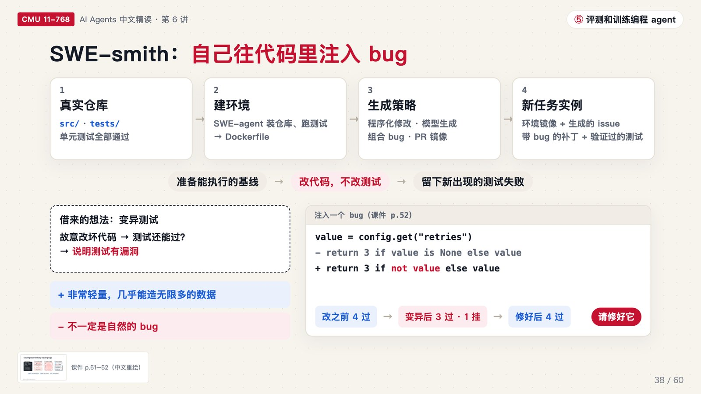

真实的 PR 总是有限的。**SWE-smith**（Yang et al., 2025）换了个思路：不等 PR，自己往代码里注入 bug（原课件 p.51）：

1. **真实仓库**：源码和单元测试，测试全部通过。
2. **建环境**：SWE-agent 尝试装好仓库、跑通测试；开发者根据它的工作写 Dockerfile。
3. **生成任务的策略**：程序化修改、语言模型生成、组合多个 bug、PR 镜像（把真实 PR 的修改反过来）。
4. **新的任务实例**：环境镜像 + 生成的 issue + 带 bug 的补丁 + 验证过的测试。

它借了软件工程里**变异测试**（mutation testing）的想法：不确定单元测试够不够全，就对代码做些本该把它弄坏的小改动；测试还能过，说明测试有漏洞，该补测试。SWE-smith 反过来用：**改代码、不改测试，留下那些新出现的失败**。

原课件 p.52 拿 3.2 节修好的代码演示：

| | 代码 | 测试 |
|---|---|---|
| 能用的基线 | `return 3 if value is None else value` | 4 个全过 |
| 改条件 | `return 3 if not value else value` | 0 又变成 3，3 过 1 挂 |
| 恢复后 | 改回来 | 4 个全过 |

这样就得到一个"请修好它"的任务。好处是非常轻量，只靠代码库里现有的测试，几乎能造无限多的数据；坏处是这些不一定是你真正想解决的那种自然的 bug。

### 4.5 跨语言，多套脚手架

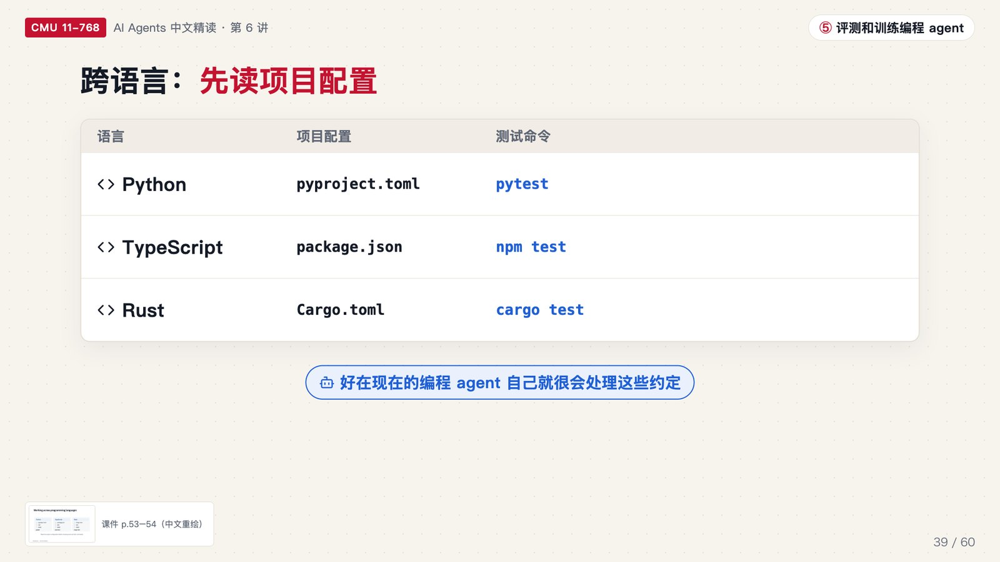

这套做法也能扩到别的语言（原课件 p.53，出处 Multi-SWE-bench、SWE-bench Multilingual）：

| 语言 | 项目配置 | 目录 | 测试命令 |
|---|---|---|---|
| Python | `pyproject.toml` | `src/`、`tests/` | `pytest` |
| TypeScript | `package.json` | `src/`、`tests/` | `npm test` |
| Rust | `Cargo.toml` | `src/`、`tests/` | `cargo test` |

**先读项目配置，再选构建和测试命令。**唯一的麻烦是各语言约定不同，好在现在的编程 agent 自己就很会处理这些约定。

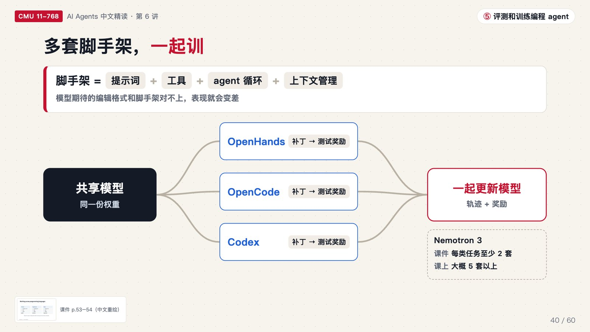

还有一个坑是脚手架。原课件 p.54 的定义：**脚手架（harness）= 提示词 + 工具 + agent 循环 + 上下文管理**。3.6 节说过，模型期待的编辑格式和脚手架对不上，表现就会变差，所以没训练过的脚手架上，模型大多表现更差。

现在模型厂商普遍**在多套脚手架上一起训练**：同一份权重，接上 OpenHands、OpenCode、Codex 这些脚手架，各自跑任务、拿测试奖励（补丁 → 测试），轨迹和奖励汇回来一起更新模型。原课件举了两个例子：

- **Nemotron 3 Ultra**：每类任务分布至少用 2 套脚手架（课件）；课上说英伟达有意用了大概五套以上。
- **Polar**：让各个原生脚手架去调用一个共享的模型 API 代理（课上没展开）。

这一节记住一句：能自动跑的测试，既是考卷也是训练场；任务可以从真实 PR 来，也可以自己注入 bug，还要在多套脚手架上练。

---

## 5 写代码之外的软件开发

前面都在修 issue。可软件开发远不止修 issue，要做出真正好用的模型，下面这些事也很重要。它们在研究里没那么主流，课上讲得也比较快，这里按课件补全。

### 5.1 前端：在浏览器里验证

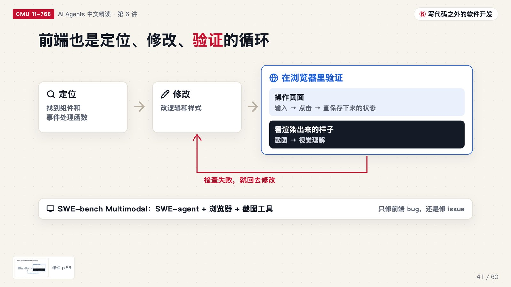

前端开发也是定位、修改、验证的循环（原课件 p.56）：

- **定位**：找到组件和事件处理函数。
- **修改**：改逻辑和样式。
- **在浏览器里验证**：一种是操作页面（输入 → 点击 → 检查保存下来的状态）；另一种是看渲染出来的样子（截图 → 视觉理解）。检查失败就回去改。

**SWE-bench Multimodal**（Yang et al., 2024）就给 SWE-agent 配了浏览器和截图工具，只管修前端的 bug，还是修 issue 这一类，不是从零做前端。和前面比多了两点：你会觉得需要多模态模型，能读进 issue 里的图片；还要想办法在浏览器里验证。

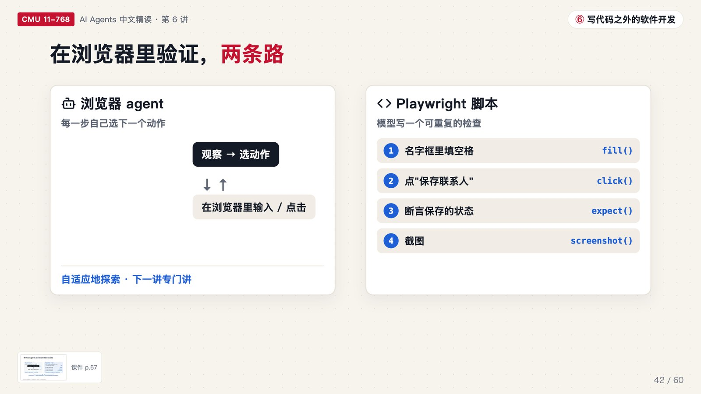

在浏览器里验证有两条路（原课件 p.57）：

| | 浏览器 agent | Playwright 脚本 |
|---|---|---|
| 谁决定动作 | 模型每一步选下一个动作 | 模型写一个可重复的检查 |
| 怎么做 | 观察 → 选动作 → 在浏览器里输入、点击 | `fill()` 填表 → `click()` 点按钮 → `expect()` 断言状态 → `screenshot()` 截图 |
| 特点 | 自适应地探索（下一讲专门讲） | 编好的步骤 + 断言，能反复跑 |

截图之后，可以看图检查，也可以和批准过的基线图比对。浏览器 agent 那条路，常见做法是把一个 GUI agent 当成编程 agent 的一个组件，或者做一个两种任务都能做的 agent；**Playwright** 是很多人用的 GUI 测试库。

### 5.2 验证一个前端修复

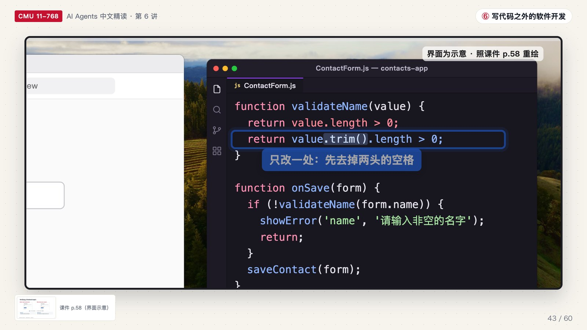

原课件 p.58 的例子（界面为示意）："新建联系人"表单，要求名字里至少有一个不是空格的字符。

| | 页面 | 记录数 |
|---|---|---|
| 改之前 | 名字框为空，点"保存联系人"，照样保存 | 已保存记录：1 |
| 改之后 | 名字框为空，名字旁出现红字"请输入非空的名字" | 已保存记录：0 |

修改只有一处：判断长度之前，先把两头的空格去掉，`value.length` 改成 `value.trim().length`。

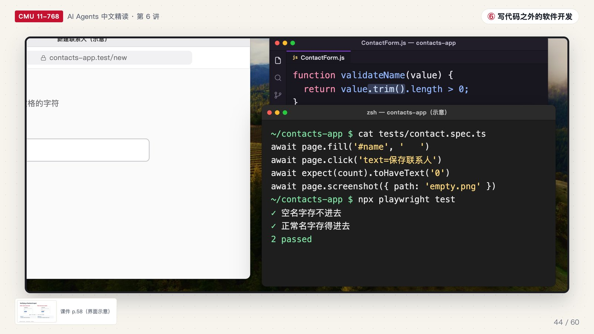

验证分两面：

- **行为**：空名字存不进去，记录还是 0 条；合法的名字照样能保存。
- **外观**：错误提示在名字旁边，看得见、读得清。

可以截图看一眼，也可以写个 Playwright 脚本，确保空名字存不进去、正常名字存得进去（上图的脚本和输出是示意）。

### 5.3 带图的 issue 怎么评

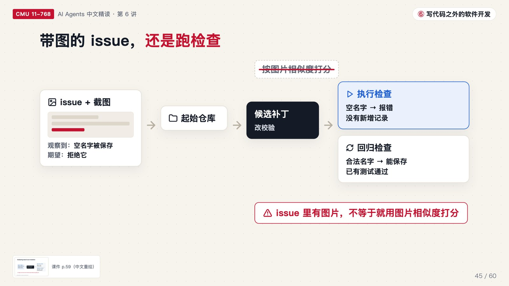

评这类修复要注意：**issue 里有图片，不等于就用图片相似度打分**（原课件 p.59）。流程是 issue + 截图（观察到：空名字；期望：拒绝）→ 起始仓库 → 候选补丁（改校验）→ 两类检查：

- **执行检查**：空名字 → 报错，没有新增记录。
- **回归检查**：合法名字 → 能保存，已有测试通过。

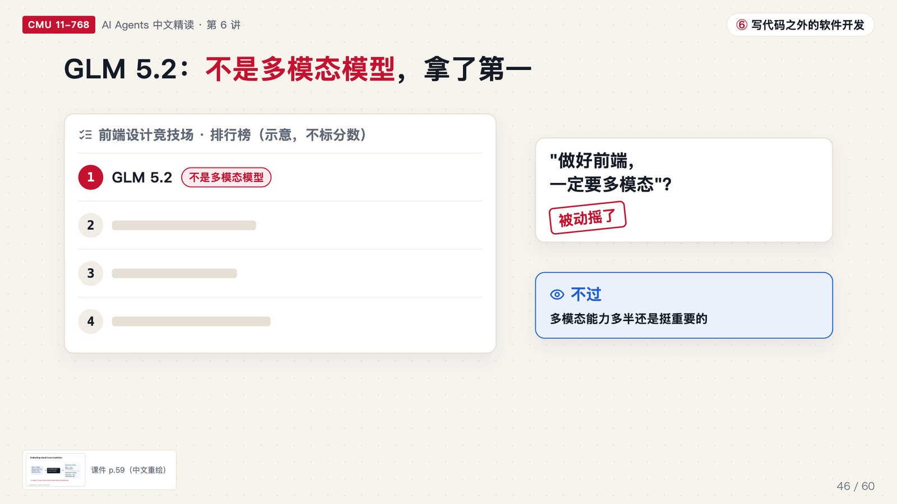

几个月前有个让人意外的结果：GLM 5.2 刚出来，它不是多模态模型，却在一个前端设计竞技场上拿了第一（上图排行榜为示意）。这动摇了"做好前端一定要多模态"的假设，不过多模态能力多半还是挺重要的。

### 5.4 内循环和外循环

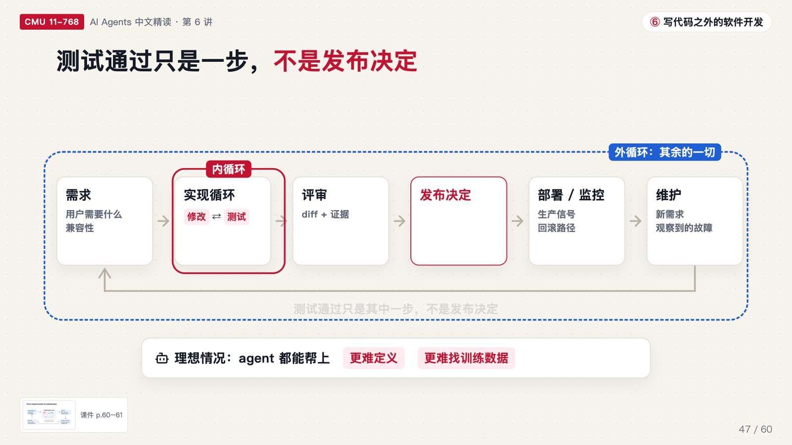

前端之外，软件开发是一整条链（原课件 p.61）：

| 环节 | 内容 |
|---|---|
| 需求 | 用户需要什么、兼容性 |
| 实现循环 | 修改 ⇄ 测试 |
| 评审 | diff + 证据 |
| 发布决定 | 要不要发 |
| 部署 / 监控 | 生产环境的信号、回滚路径 |
| 维护 | 新的需求、观察到的故障 |

**测试通过只是其中一步，不是发布决定。**

开发里常说**内循环**（inner loop）和**外循环**（outer loop）。前面讲的修 bug、跑测试、反复迭代，都是内循环；外循环是其余的一切：代码评审、部署、监控、维护、做规划、定需求。理想情况下 agent 都能帮上，难在这些事更难定义，也更难找到训练数据。

### 5.5 开发者的时间花在哪

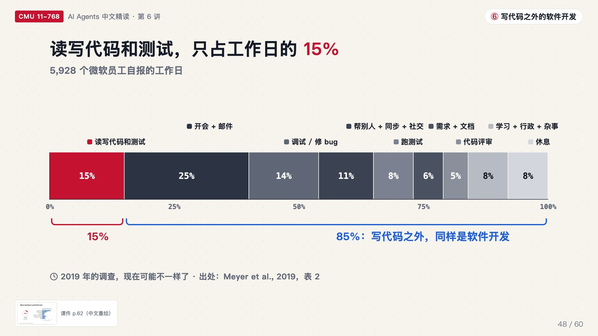

外循环有多大？原课件 p.62 引 Meyer et al.（2019）表 2，是微软开发者自报的 5,928 个工作日：

| 活动 | 占工作日 |
|---|---|
| **写代码（读写代码和测试）** | **15%** |
| 开会 + 邮件 | 25% |
| 调试 / 修 bug | 14% |
| 帮别人 + 同步 + 社交 | 11% |
| 跑测试 | 8% |
| 学习 + 行政 + 杂事 | 8% |
| 休息 | 8% |
| 需求 + 文档 | 6% |
| 代码评审 | 5% |

写代码之外的活动合计 85%。这是 2019 年的数据，现在可能不一样了；但这 85% 同样是软件开发的一大块。

### 5.6 各种开发任务比一比

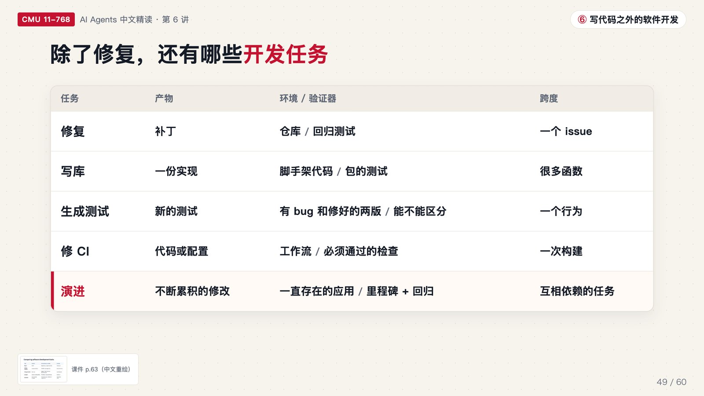

除了修复，还有哪些开发任务能交给 agent？原课件 p.63 按产物和验证方式排了一下：

| 任务 | 产物 | 环境 / 验证器 | 跨度 | 本节 |
|---|---|---|---|---|
| 修复 | 补丁 | 仓库 / 回归测试 | 一个 issue | 第 3、4 节 |
| 写库 | 一份实现 | 脚手架代码 / 包的测试 | 很多函数 | 5.7 |
| 生成测试 | 新的测试 | 有 bug 和修好的两个版本 / 能不能区分 | 一个行为 | 5.8 |
| 修 CI | 代码或配置 | 工作流 / 必须通过的检查 | 一次构建 | 5.8 |
| 演进 | 不断累积的修改 | 一直存在的应用 / 里程碑 + 回归 | 互相依赖的任务 | 5.8 |

### 5.7 定位、做应用、写库

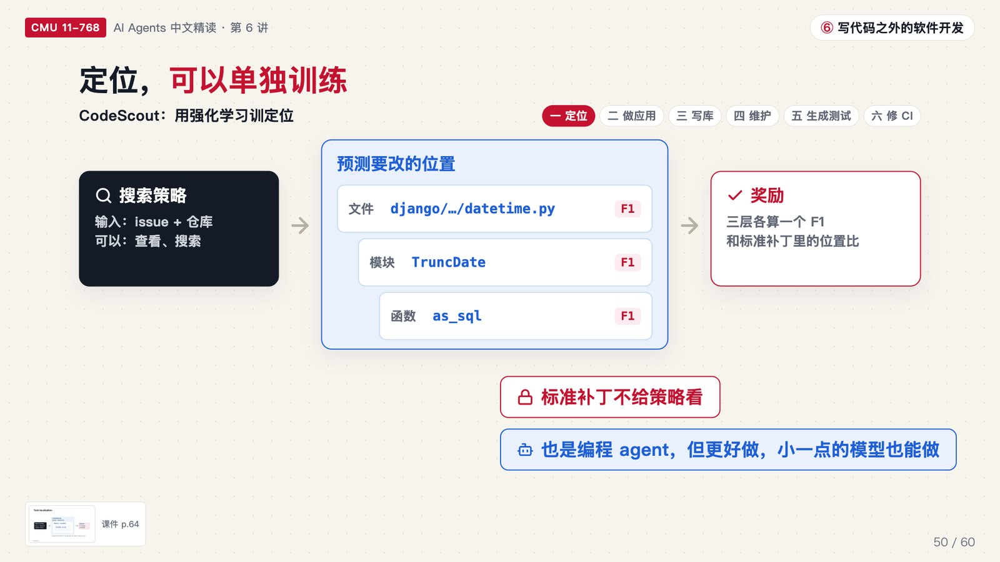

**定位**可以单独训练。**CodeScout**（2026）用强化学习训定位（原课件 p.64）：给 issue 和仓库，让策略去查看、搜索，预测要改的文件（如 `django/…/datetime.py`）、模块（`TruncDate`）和函数（`as_sql`）；三个层级各算一个 **F1**，和标准补丁里的位置比。注意**标准补丁不作为策略的输入**。它也是编程 agent，但更好做，小一点的模型也能做。


**做应用**。**ViBench** 评的是 agent 整体的"氛围编程"（vibe coding）做得怎么样（原课件 p.65，课件注明收集方式和评测定义核对于 2026-09-07）：

| 类型 | 做什么 | 数量 |
|---|---|---|
| 从零到一 | 做一个新应用 | 15 个应用 |
| 在参考版上做 | 扩展一个参考 MVP | 45 个应用 |
| 在自己的版本上做 | 扩展 agent 之前做的 MVP | 45 个应用 |

每个结果都用人写的浏览器测试计划来检查。这种基准难做，因为要有好的验证器才能正确评估。


**写库**（原课件 p.66）：

| | Commit0 | ProgramBench |
|---|---|---|
| 给什么 | 库的脚手架：`parse(…)`、`evaluate(…)` 只有签名，函数体空着；加上文档和测试 | 一个参考可执行程序 |
| 怎么做 | 一起实现 | 用输入去探它，观察输出，从头重新实现 |
| 怎么查 | 跑集成的包测试 | 和参考程序对照，可观察的行为要一致 |

**内部设计不同也可以成立**，只要可观察的行为一致。Commit0 较早，ProgramBench 是最近流行起来的。短任务越来越容易，这种很长的任务成了新的挑战之一。

### 5.8 维护、写测试、修 CI


**维护**。**SWE-Milestone**（2026）对比了两种评测方式（原课件 p.67）：

| | 独立任务评测（如 SWE-bench） | 连续任务评测（SWE-Milestone） |
|---|---|---|
| 任务 | 一个 issue | 一串互相依赖的任务（SRS 1、SRS 2、SRS 3……），有依赖图 |
| 过程 | agent 和一个仓库快照来回交互 → 补丁 | 做完 M1、M2 才解锁 M3；代码库从基础快照出发不断提交 |
| 评测 | 测一次 | 每个里程碑打一个标签（Tag-M1、Tag-M2、Tag-M3），各测一次 |

它要看的是：一个个做下来，agent 会不会把代码库越改越乱、越来越难维护。这是一些编程 agent 的大问题。


**生成测试**，这是现在另一个大问题。如果能写出很好的测试来验证 issue 修好了，仗就打赢了一半：你等于规定好了任务，而 agent 很擅长对着测试反复迭代。**SWT-Bench**（Mündler et al., 2024）的例子（原课件 p.68）：issue 说 `isValid` 现在允许结尾带换行，但它只应该接受字母和数字。

| 生成的测试 | PR 之前 | PR 之后 |
|---|---|---|
| `isValid("name\n") == False` | 失败 | 通过 |
| `isValid("name") == True` | 通过 | 通过 |
| `isValid("name") == False` | 失败 | 失败 |

只有第一行**修之前失败、修之后通过**，说明它抓到了这个 bug。第二行永远通过，区分不了两个版本；第三行永远失败，测试本身写错了。这和 4.4 节的变异测试是同一个思路：好测试要能区分坏代码和好代码。


**修 CI**（原课件 p.69，出处 LCA CI Builds Repair，数据集版本 ebf12dad）。观察到的构建失败：

```text
运行环境：Node 16
包要求：Node >=18
npm ci: EBADENGINE
```

去查这个包支持的运行环境，真正该改的是 setup-node 配置里的 Node 版本：

```yaml
# setup-node configuration
with:
  node-version: '20'
```

再重新跑安装、构建和测试。这类偏运维的任务（包括部署）还没有特别好的基准，也更难做，因为要有真的基础设施来跑；课上参考的是 JetBrains 做的这个数据集。

### 5.9 自动造练习项目

任务种类这么多，训练数据从哪来？原课件 p.70（课上没展开）先给了目标：用三类训练任务（找相关代码：搜索 / 依赖；实现函数：规格 → 代码；写 bug 的测试：issue → 可执行的检查）训练策略，再在留出的任务上测，比如新的仓库里修一个 issue、写一个库、发现一个新 bug，推理预算相同。

**SWE-Playground**（Zhu, Gandhi & Neubig）让模型自动造练习项目，分六步（原课件 p.71，视频里只说了一句）：

| 步骤 | 做什么 | 原课件的例子 |
|---|---|---|
| 1 项目提议 | 让模型想出可以用 Python 实现的计算机系统模拟类项目 | `filesystem-simulator`：支持类似 ext4 特性（inode、目录结构）的文件系统模拟器 |
| 2 任务提议 | 把项目拆成 Task 1.1.1、1.1.2、1.2.1……，每个配测试要求 | `TestBlockDeviceCreation`：大小为 0、块大小为 0 或超过最大值时应报错；写一个块不影响其他块 |
| 3 仓库搭建 | 代码结构和函数桩 | `src/`、`tests/`、`tasks.md`、`pyproject.toml`、Dockerfile；`BlockDevice.__init__` 只会抛 `NotImplementedError` |
| 4 生成单元测试 | 先写测试 | 2 个文件改动、367 行新增；跑测试收集到 21 项，因为还没实现而失败 |
| 5 实现功能 | 读测试 → 写代码 → 用测试验证 → 修改 | |
| 6 针对能力调整 | 调 API 解决问题、修 bug、设计测试和复现问题、从零写库 | |


**Hybrid-Gym**（2026）把这类训练迁移到新的开发任务上。原课件 p.72 的部分 32B 结果（成功率 %，每个任务的成功定义各不相同；视频里只讲了第一行）：

| 基准 | 任务 | Base 32B | Hybrid-Gym 32B |
|---|---|---|---|
| SWE-bench Verified | 修复 | 7 | 32.4 |
| SWT-Bench Verified | 生成测试 | 9.01 | 16.86 |
| Commit0 Lite | 写库 | 8.34 | 13.45 |

三类任务都涨了，修复涨得最多。

这一节记住一句：写代码只占开发者时间的一小块；前端要在浏览器里验，定位、写库、维护、写测试、修 CI 各有各的难处，测试通过也不等于可以发布。

---

## 6 预测代码行为的模型（课上没展开）

原课时间不够，这部分没来得及讲，视频里只按课件说了两句。下面按原课件 p.73–79 整理。

### 6.1 策略和世界模型

原课件 p.74 把一步拆成四个角色：

| 角色 | 做什么 |
|---|---|
| 历史 h | 看过的代码、工具结果 |
| **策略**（policy）π(a \| h) | 选动作，比如"跑测试" |
| **世界模型**（world model）p(o \| h, a) | 预测这个动作的结果，比如测试会不会过；预测可能出错，历史也会影响预测 |
| 真实环境 | 真的执行测试，观察到断言失败 |

agent 可以先预测测试结果，再决定要不要真跑。原课件 p.75 用一段代码说明"预测执行"难在哪：

```python
items = [1]
alias = items
alias.append(2)
result = len(items)
```

真实执行后 `items = [1, 2]`、`alias = [1, 2]`、`result = 2`。原课件指出的错误预测，是把 `alias` 当成了一份拷贝；照这个错误往下推，会以为 `items` 还是 `[1]`、`result` 是 1。

### 6.2 预测什么时候有帮助


原课件 p.76：两个修复，A 是正确的补丁，B 是错误的补丁。让模型预测测试结果，模型说 A 失败、B 通过（示意）。这个错误会导致错误的决定：选 B，扔掉 A。所以：

- 要把两个候选都真跑一遍，检查模型的判断；
- 同时比较任务成功率，**和**总延迟、token、工具调用次数。

预测能省成本，但要靠真执行兜底。

### 6.3 从程序执行里学：CWM

**CWM**（FAIR CodeGen Team et al., 2025）专门从程序执行里学。原课件 p.77 的训练流程图（表格按原图整理）：

| 阶段 | 内容 | 数据量 | 上下文 |
|---|---|---|---|
| 预训练 | 通用预训练 | 8T token | 8k |
| 预训练 | 代码世界建模的中期训练 → CWM pretrained | 5T token | 131k |
| 后训练 | 监督微调（指令和推理）→ CWM sft | 100B token | 32k |
| 后训练 | 联合强化学习（agent 和推理）→ CWM | 172B token | 131k |

另一条路是让模型**写出**一个模拟器：**Code World Models / GIF-MCTS**（Dainese et al., 2024，原课件 p.78）从环境里收集轨迹，再结合环境和任务描述，用 GIF-MCTS 生成候选的代码世界模型（比如一个 `class Environment`）；用收集的轨迹验证它能不能正确预测，不能就把预测错的地方作为反馈重新生成，能就拿这个代码世界模型去做规划（原图是倒立摆小车）。

### 6.4 开放问题

原课件 p.79：

| 问题 | 怎么检验 |
|---|---|
| 决定更好吗？ | 在同一批问题上同时测预测误差和任务成功率 |
| 成本更低吗？ | 把延迟、token、真实环境调用都算进去 |
| 新场景能用吗？ | 留出没见过的程序、依赖和环境 |
| 什么时候该真去执行？ | 改变回退阈值，既测省下的，也测失败的 |

---

## 7 源码解读：mini-SWE-agent 怎么只靠一个 bash 做编程 agent

3.4 节说，最简单的编程 agent 只给一个工具：运行 bash 命令。mini-SWE-agent 就是这么做的。它的核心代码很短，正好用来看清第 3 节那个"定位 → 修改 → 验证"的循环在代码里是什么样。

出处：[SWE-agent/mini-swe-agent](https://github.com/SWE-agent/mini-swe-agent)（MIT 许可），`main` 分支提交 `04d809c`（`04d809ceab9df28f9adaed044884180159172930`，2026-09-03），涉及这几个文件：

| 文件 | 讲什么 | 本讲对应 |
|---|---|---|
| [`src/minisweagent/agents/default.py`](https://github.com/SWE-agent/mini-swe-agent/blob/04d809ceab9df28f9adaed044884180159172930/src/minisweagent/agents/default.py) | agent 主循环：查询模型 → 执行动作 → 收观察 | 3.1 agent 式编程的循环 |
| [`src/minisweagent/exceptions.py`](https://github.com/SWE-agent/mini-swe-agent/blob/04d809ceab9df28f9adaed044884180159172930/src/minisweagent/exceptions.py) | 用异常表示"该结束了"或"格式错了" | 结束条件 |
| [`src/minisweagent/models/utils/actions_toolcall.py`](https://github.com/SWE-agent/mini-swe-agent/blob/04d809ceab9df28f9adaed044884180159172930/src/minisweagent/models/utils/actions_toolcall.py) | 唯一的工具 `bash`，以及怎么从工具调用里解析出命令 | 3.4 只给一个 shell |
| [`src/minisweagent/models/utils/actions_text.py`](https://github.com/SWE-agent/mini-swe-agent/blob/04d809ceab9df28f9adaed044884180159172930/src/minisweagent/models/utils/actions_text.py)、[`models/litellm_textbased_model.py`](https://github.com/SWE-agent/mini-swe-agent/blob/04d809ceab9df28f9adaed044884180159172930/src/minisweagent/models/litellm_textbased_model.py) | 不用工具调用时，从回答文本里用正则抠出命令 | 3.5、3.6 格式要对得上 |
| [`src/minisweagent/environments/local.py`](https://github.com/SWE-agent/mini-swe-agent/blob/04d809ceab9df28f9adaed044884180159172930/src/minisweagent/environments/local.py) | 怎么执行一条命令、怎么判断"已提交" | 3.4、结束条件 |
| [`src/minisweagent/config/default.yaml`](https://github.com/SWE-agent/mini-swe-agent/blob/04d809ceab9df28f9adaed044884180159172930/src/minisweagent/config/default.yaml)、[`config/benchmarks/swebench.yaml`](https://github.com/SWE-agent/mini-swe-agent/blob/04d809ceab9df28f9adaed044884180159172930/src/minisweagent/config/benchmarks/swebench.yaml) | 提示词和默认参数 | 3.2、4.1 |

为讲解删去了：日志、轨迹序列化（`serialize`、`save` 的实现）、模板变量合并、费用统计的细节、重试逻辑、多模态处理，以及部分 docstring。删掉的位置用 `...` 标出；中文注释是本课件加的，英文注释是源码原有的。这个仓库更新很快，读最新版时行号和细节可能已经变了。

### 7.1 主循环：查询模型，执行动作，直到出现 exit 消息

先看 agent 的配置，几个结束条件都在这里：

```python
# src/minisweagent/agents/default.py
class AgentConfig(BaseModel):
    system_template: str                     # 系统提示词模板
    instance_template: str                   # 第一条用户消息：把任务（issue）填进去
    step_limit: int = 0                      # 最多调用模型几次；0 表示不限
    cost_limit: float = ...                  # 费用上限（源码有默认值，课件略去）
    wall_time_limit_seconds: int = 0         # 墙钟时间上限；0 表示不限
    max_consecutive_format_errors: int = 3   # 连续几次格式错就退出；0 表示不限
    output_path: Path | None = None          # 轨迹存到哪里
```

（每个字段下面的英文 docstring 删掉了，意思写进了中文注释。`cost_limit` 的默认值是一个金额，这里不写。）注意这几个默认值大多是 0，也就是不限；真正跑评测时由配置文件覆盖，7.4 节会看到 SWE-bench 的配置把 `step_limit` 设成了 250。

主循环 `run()`：

```python
# src/minisweagent/agents/default.py
    def run(self, task: str = "", **kwargs) -> dict:
        """Run step() until agent is finished. Returns dictionary with exit_status, submission keys."""
        self.extra_template_vars |= {"task": task, **kwargs}
        self.messages = []
        self.add_messages(                                        # 对话一开始只有两条消息
            self.model.format_message(role="system", content=self._render_template(self.config.system_template)),
            self.model.format_message(role="user", content=self._render_template(self.config.instance_template)),
        )
        while True:
            try:
                self.step()                                       # 一步 = 问一次模型 + 执行它给的命令
                self.n_consecutive_format_errors = 0  # reset on any clean step
            except FormatError as e:                              # 模型输出格式不对（没给命令、给错工具……）
                # The call was billed before parsing failed, so query() never got to charge it.
                self.cost += e.messages[0].get("extra", {}).get("cost", 0.0)
                self.n_consecutive_format_errors += 1
                if 0 < self.config.max_consecutive_format_errors <= self.n_consecutive_format_errors:
                    self.add_messages(                            # 连续错太多次：追加一条 exit 消息
                        *e.messages,
                        {
                            "role": "exit",
                            "content": "RepeatedFormatError",
                            "extra": {"exit_status": "RepeatedFormatError", "submission": ""},
                        },
                    )
                else:
                    self.add_messages(*e.messages)                # 否则把错误提示当成一条用户消息，让模型改正
            except InterruptAgentFlow as e:                       # 提交、超限、超时都走这里（见 7.3）
                self.add_messages(*e.messages)
            except Exception as e:                                # 意料之外的错误：记一条 exit 再抛出去
                self.handle_uncaught_exception(e)
                raise
            finally:
                self.save(self.config.output_path)                # 每一步都存一次轨迹
            if self.messages[-1].get("role") == "exit":           # 唯一的退出判断：最后一条消息的角色是 exit
                break
        return self.messages[-1].get("extra", {})                 # 返回 exit_status 和 submission（补丁）
```

整个 agent 的状态就是 `self.messages` 这一个列表：系统提示词、任务、模型的每次回答、每条命令的输出，按顺序往后追加。循环什么时候停，不看别的变量，只看**最后一条消息的角色是不是 `exit`**。不管是提交成功、超限还是格式一直错，各处都只做一件事：往列表里追加一条 `role: "exit"` 的消息。

格式错误的处理也值得注意：模型没按要求给命令时，agent 不是直接失败，而是把一条说明格式要求的提示发回给模型，让它下一步改正；只有**连续** 3 次都错才放弃，中间只要有一步正常，计数就清零。

一步里做什么：

```python
# src/minisweagent/agents/default.py
    def step(self) -> list[dict]:
        """Query the LM, execute actions."""
        return self.execute_actions(self.query())

    def query(self) -> dict:
        """Query the model and return model messages. Override to add hooks."""
        if 0 < self.config.step_limit <= self.n_calls or 0 < self.config.cost_limit <= self.cost:
            raise LimitsExceeded(                                 # 调用前先查：步数或费用到上限就结束
                {
                    "role": "exit",
                    "content": "LimitsExceeded",
                    "extra": {"exit_status": "LimitsExceeded", "submission": ""},
                }
            )
        if 0 < self.config.wall_time_limit_seconds <= int(time.time() - self._start_time):
            raise TimeExceeded(...)                               # 墙钟时间到了，同样结构，exit_status 是 TimeExceeded
        self.n_calls += 1
        message = self.model.query(self.messages)                 # 把全部历史发给模型，拿回一条回答
        self.cost += message.get("extra", {}).get("cost", 0.0)
        self.add_messages(message)
        return message

    def execute_actions(self, message: dict) -> list[dict]:
        """Execute actions in message, add observation messages, return them."""
        outputs = [self.env.execute(action) for action in message.get("extra", {}).get("actions", [])]   # 逐条执行命令
        return self.add_messages(*self.model.format_observation_messages(message, outputs, self.get_template_vars()))  # 输出变成观察消息
```

（`TimeExceeded(...)` 里的消息字典和上面 `LimitsExceeded` 同样结构，删去了。）对照 3.1 节：`query()` 是模型"想下一步做什么"，`execute_actions()` 是在环境里"做"，`format_observation_messages()` 把结果变成下一轮的输入。没有单独的定位、修改、验证模块，这三步全靠模型自己在循环里用一条条 bash 命令完成。这也是它和 3.3 节 Agentless 的根本区别。

### 7.2 唯一的工具：bash，以及怎么解析出命令

默认的模型类是 `LitellmModel`（`models/__init__.py` 里没指定 `model_class` 时就回落到它），它每次调用都只把一个工具交给模型：

```python
# src/minisweagent/models/utils/actions_toolcall.py
BASH_TOOL = {
    "type": "function",
    "function": {
        "name": "bash",                                   # 整个 agent 只有这一个工具
        "description": "Execute a bash command",
        "parameters": {
            "type": "object",
            "properties": {
                "command": {
                    "type": "string",
                    "description": "The bash command to execute",
                }
            },
            "required": ["command"],                      # 唯一的参数：一条命令字符串
        },
    },
}
```

```python
# src/minisweagent/models/litellm_model.py（LitellmModel._query 里）
            return litellm.completion(
                model=self.config.model_name,
                messages=messages,
                tools=[BASH_TOOL],                        # 工具列表里只有 bash
                **(self.config.model_kwargs | kwargs),
            )
```

模型回答里的工具调用怎么变成命令：

```python
# src/minisweagent/models/utils/actions_toolcall.py
def parse_toolcall_actions(
    tool_calls: list, *, format_error_template: str, template_kwargs: dict | None = None
) -> list[dict]:
    ...
    template_kwargs = template_kwargs or {}
    if not tool_calls:                                    # 一个工具调用都没有：格式错误
        raise FormatError(
            {
                "role": "user",
                "content": Template(format_error_template, undefined=StrictUndefined).render(
                    error="No tool calls found in the response. Every response MUST include at least one tool call.",
                    actions=[],
                    has_tool_calls=False,
                    **template_kwargs,
                ),
                "extra": {"interrupt_type": "FormatError"},
            }
        )
    actions = []
    for tool_call in tool_calls:                          # 允许一次回答里有多个工具调用
        error_msg = ""
        args = {}
        try:
            args = json.loads(tool_call.function.arguments)        # 参数是 JSON 字符串
        except Exception as e:
            error_msg = f"Error parsing tool call arguments: {e}."
        if tool_call.function.name != "bash":                       # 调了不存在的工具
            error_msg += f"Unknown tool '{tool_call.function.name}'."
        if not isinstance(args, dict) or "command" not in args:     # 没给 command 参数
            error_msg += "Missing 'command' argument in bash tool call."
        if error_msg:
            raise FormatError(...)                                  # 同样结构的格式错误提示
        actions.append({"command": args["command"], "tool_call_id": tool_call.id})
    return actions                                        # 每个动作就是 {"command": "<一条 shell 命令>"}
```

（docstring 删了；第二个 `FormatError(...)` 的消息和第一个同样结构，删去了。）解析出来的"动作"只有一个字段：一条 shell 命令字符串。读文件是 `cat`，搜索是 `grep` 或 `rg`，改文件是 `sed` 或 `cat <<'EOF' > file`，跑测试是 `pytest`，都在这一个字段里。

还有一种不用工具调用的模式（`LitellmTextbasedModel`），从回答**文本**里用正则抠命令：

```python
# src/minisweagent/models/litellm_textbased_model.py
class LitellmTextbasedModelConfig(LitellmModelConfig):
    action_regex: str = r"```mswea_bash_command\s*\n(.*?)\n```"     # 只认这种特殊标记的代码块
    ...
```

```python
# src/minisweagent/models/utils/actions_text.py
def parse_regex_actions(
    content: str, *, action_regex: str, format_error_template: str, template_kwargs: dict | None = None
) -> list[dict]:
    ...
    actions = [a.strip() for a in re.findall(action_regex, content, re.DOTALL)]
    if len(actions) != 1:                                 # 文本模式要求恰好一个命令块
        error_msg = f"Expected exactly 1 action, found {len(actions)}."
        raise FormatError(...)
    return [{"command": action} for action in actions]
```

这个文件开头的说明写着，这是 v1.0 和最早的 SWE-agent 用的办法，v2.0 起强烈推荐改用工具调用。两种模式对比：

| | 工具调用模式（默认） | 文本模式 |
|---|---|---|
| 模型怎么给命令 | 调用 `bash` 工具，参数 `{"command": ...}` | 回答里写一个 ` ```mswea_bash_command ` 代码块 |
| 一次几条 | 可以多个工具调用（SWE-bench 配置里开了 `parallel_tool_calls`） | 恰好一个，多了少了都算格式错误 |
| 出错时 | 没调用、调错工具、缺参数 → `FormatError` | 命令块个数不是 1 → `FormatError` |

这正是 3.5、3.6 节说的"格式要和模型训练时见过的对得上"：现在的模型普遍训练过工具调用，用工具调用就少了一层格式风险。

### 7.3 执行一条命令，以及怎么判断"已提交"

```python
# src/minisweagent/environments/local.py
class LocalEnvironmentConfig(BaseModel):
    cwd: str = ""                        # 工作目录；空就用当前目录
    env: dict[str, str] = {}             # 额外的环境变量
    timeout: int = 30                    # 每条命令的超时（秒）


class LocalEnvironment:
    ...
    def execute(self, action: dict, cwd: str = "", *, timeout: int | None = None) -> dict[str, Any]:
        """Execute a command in the local environment and return the result as a dict."""
        command = action.get("command", "")
        cwd = cwd or self.config.cwd or os.getcwd()
        try:
            result = _run(command, cwd, os.environ | self.config.env, timeout or self.config.timeout)
            output = {"output": result.stdout, "returncode": result.returncode, "exception_info": ""}
        except Exception as e:                            # 超时等异常：不让 agent 崩，而是变成一条带错误信息的输出
            raw_output = getattr(e, "output", None)
            raw_output = (
                raw_output.decode("utf-8", errors="replace") if isinstance(raw_output, bytes) else (raw_output or "")
            )
            output = {
                "output": raw_output,
                "returncode": -1,
                "exception_info": f"An error occurred while executing the command: {e}",
                "extra": {"exception_type": type(e).__name__, "exception": str(e)},
            }
        self._check_finished(output)                      # 每条命令执行完都检查一下是不是"提交"
        return output

    def _check_finished(self, output: dict):
        """Raises Submitted if the output indicates task completion."""
        lines = output.get("output", "").lstrip().splitlines(keepends=True)
        if lines and lines[0].strip() == "COMPLETE_TASK_AND_SUBMIT_FINAL_OUTPUT" and output["returncode"] == 0:
            submission = "".join(lines[1:])               # 暗号那一行之后的全部输出，就是提交的内容
            raise Submitted(
                {
                    "role": "exit",
                    "content": submission,
                    "extra": {"exit_status": "Submitted", "submission": submission},
                }
            )


def _run(command: str, cwd: str, env: dict[str, str], timeout: int) -> subprocess.CompletedProcess[str]:
    """Like subprocess.run, but kills the whole process group on timeout so no children are orphaned."""
    process = subprocess.Popen(
        command,
        shell=True,                                       # 交给 shell 解释，所以管道、&&、重定向都能用
        text=True,
        cwd=cwd,
        env=env,
        encoding="utf-8",
        errors="replace",
        stdout=subprocess.PIPE,
        stderr=subprocess.STDOUT,                         # 标准错误并进标准输出，模型看到的是一整段
        start_new_session=os.name == "posix",             # 新开进程组，超时时能整组杀掉
    )
    try:
        stdout, _ = process.communicate(timeout=timeout)
    except subprocess.TimeoutExpired:
        os.killpg(process.pid, signal.SIGKILL) if os.name == "posix" else process.kill()
        stdout, _ = process.communicate()
        raise subprocess.TimeoutExpired(command, timeout, output=stdout)
    return subprocess.CompletedProcess(command, process.returncode, stdout=stdout)
```

（`__init__`、`get_template_vars`、`serialize` 删掉了。）三个要点：

1. **每条命令都是一个新的子进程**。`cd` 和 `export` 不会留到下一条，默认提示词里专门提醒了这一点（见 7.4）。好处是简单、可复现，每一步互不干扰；代价是 agent 要么每次在命令前加 `cd /path && ...`，要么把状态写进文件。
2. **超时不让 agent 崩**：超时后整个进程组被杀掉，结果变成一条 `returncode` 为 −1、带错误说明的输出，照样交回给模型，由模型决定下一步。
3. **怎么结束**：没有专门的"提交"工具，结束也靠 bash。模型执行 `echo COMPLETE_TASK_AND_SUBMIT_FINAL_OUTPUT`，环境发现输出第一行是这个暗号、并且退出码是 0，就抛出 `Submitted`；暗号之后的输出就是提交的内容。

本地之外还有 Docker 环境（`environments/docker.py`）：同样的 `execute()`，只是把命令包成 `docker exec ... bash -lc "<命令>"` 在容器里跑，`timeout` 默认也是 30 秒。SWE-bench 这类评测都在容器里跑，对应 2.3 节说的隔离执行环境。

结束条件的几个异常，都继承自同一个基类：

```python
# src/minisweagent/exceptions.py
class InterruptAgentFlow(Exception):
    """Raised to interrupt the agent flow and add messages."""

    def __init__(self, *messages: dict):
        self.messages = messages                          # 异常本身带着要追加进对话的消息
        super().__init__()


class Submitted(InterruptAgentFlow):
    """Raised when the agent has completed its task."""


class LimitsExceeded(InterruptAgentFlow):
    """Raised when the agent has exceeded its cost or step limit."""


class TimeExceeded(LimitsExceeded):
    """Raised when the agent has exceeded its wall-clock time limit."""


class UserInterruption(InterruptAgentFlow):
    """Raised when the user interrupts the agent."""


class FormatError(InterruptAgentFlow):
    """Raised when the LM's output is not in the expected format."""
```

把 7.1 到 7.3 合起来，循环一共有这几种结束方式：

| 结束方式 | 在哪里触发 | `exit_status` |
|---|---|---|
| 模型提交 | 命令输出第一行是暗号且退出码为 0（`_check_finished`） | `Submitted` |
| 步数或费用到上限 | 每次调用模型之前（`query`） | `LimitsExceeded` |
| 墙钟时间到上限 | 每次调用模型之前（`query`） | `TimeExceeded` |
| 连续格式错误 | 默认连续 3 次（`run`） | `RepeatedFormatError` |
| 意料之外的异常 | `run` 里兜底 | 异常的类名，然后再抛出 |

`FormatError` 和 `UserInterruption`（交互模式下用户打断）也是 `InterruptAgentFlow`，但它们追加的是普通的 `user` 消息，不是 `exit`，所以循环会继续。

### 7.4 提示词和默认参数

`config/default.yaml` 是 `default.py` 这个 agent 的默认配置（仓库 `config/README.md` 的说明），它给模型的任务模板，就是一个"定位 → 复现 → 修改 → 验证"的流程：

```yaml
# src/minisweagent/config/default.yaml（instance_template 节选）
    Please solve this issue: {{task}}
    ...
    1. Analyze the codebase by finding and reading relevant files      # 定位
    2. Create a script to reproduce the issue                          # 复现
    3. Edit the source code to resolve the issue                       # 修改
    4. Verify your fix works by running your script again              # 验证
    5. Test edge cases to ensure your fix is robust                    # 边界情况
    6. Submit your changes and finish your work by issuing the following command: `echo COMPLETE_TASK_AND_SUBMIT_FINAL_OUTPUT`.
       Do not combine it with any other command. <important>After this command, you cannot continue working on this task.</important>
    ...
    3. Directory or environment variable changes are not persistent. Every action is executed in a new subshell.
```

这和 3.2 节的 `retries` 例子是同一个顺序。提示词后面还附了改文件的 `sed -i` 用法（在 macOS 上提醒改用 `sed -i ''`）和用 `cat <<'EOF' > file` 新建文件的写法：只有 bash 时，改文件的格式全靠提示词教，这正是 3.4 节说的代价。

命令输出太长也有处理：

```yaml
# src/minisweagent/config/default.yaml（observation_template 节选）
    <returncode>{{output.returncode}}</returncode>
                # 一万字符以内，原样给模型
    <output>
    {{ output.output -}}
    </output>
    
    <warning>
    The output of your last command was too long.       # 太长：提醒换个输出更少的命令
    ...
    <output_head>
    {{ output.output[:5000] }}                          # 只留开头 5000 字符
    </output_head>
    ...
    <output_tail>
    {{ output.output[-5000:] }}                         # 和结尾 5000 字符
    </output_tail>
```

这份配置的系统提示词还是按文本模式写的（要求回答里恰好一个 ` ```mswea_bash_command ` 代码块），而仓库里的 `run/hello_world.py` 把它和工具调用模式的 `LitellmModel` 搭在一起用；读的时候要知道，提示词里的格式要求和实际交给模型的工具，不一定是同一种。

跑 SWE-bench 用的是 `config/benchmarks/swebench.yaml`，它的格式错误提示是按 `bash` 工具调用写的。和源码默认值对照：

| 参数 | 源码默认值 | SWE-bench 配置 |
|---|---|---|
| `step_limit` | 0（不限，`AgentConfig`） | 250 |
| `max_consecutive_format_errors` | 3（`AgentConfig`） | 不改 |
| 命令超时 `timeout` | 30 秒（`LocalEnvironmentConfig`、`DockerEnvironmentConfig`） | 60 秒 |
| 运行环境 | 本地 | `docker`，工作目录 `/testbed`，解释器 `bash -c` |
| 一次多条命令 | 允许 | 开 `parallel_tool_calls` |
| 提交方式 | `echo COMPLETE_TASK_AND_SUBMIT_FINAL_OUTPUT` | 先 `git diff -- <改过的源文件> > patch.txt`，检查后用 `echo COMPLETE_TASK_AND_SUBMIT_FINAL_OUTPUT && cat patch.txt` 提交 |

SWE-bench 配置要求补丁里只包含改过的源文件，不要带测试文件、复现脚本、自己写的辅助脚本。暗号之后 `cat patch.txt` 的输出就是提交内容，交给 4.1 节的测试框架去打补丁、跑测试。

### 7.5 对照本讲

| 本讲说的 | mini-SWE-agent 的做法 |
|---|---|
| agent 式编程：反复调用工具，循环几轮，交出补丁（3.1） | `run()` 的 `while True`：问模型 → 执行命令 → 输出变成观察，直到出现 exit 消息 |
| 定位、修改、验证（3.1、3.2） | 没有单独模块，写在提示词的推荐流程里，由模型用 bash 命令自己完成 |
| 只给一个 shell（3.4） | 唯一的工具 `bash`，唯一的参数 `command`；读、搜、改、测都是 shell 命令 |
| bash 改文件要转义、要想用哪种命令（3.4） | 提示词里专门教 `sed -i` 和 heredoc 的写法 |
| 编辑格式要和训练时见过的对得上（3.6） | 默认用工具调用；文本模式要求固定标记的代码块，格式不对就发回提示，连续 3 次放弃 |
| 隔离的执行环境、有时间限制（2.2、2.3） | 每条命令一个子进程，默认 30 秒超时、整组杀掉；评测时在 Docker 容器里跑 |
| SWE-bench 交补丁（4.1） | 提交暗号之后输出 `git diff` 得到的补丁 |
| 训练时要用多套脚手架（4.5） | 它本身就是一套极简的脚手架；同一个模型换到它上面，表现取决于模型会不会只用 bash 干活 |

---

## 本讲小结


回到开头的三个层次：

| 层次 | 结论 | 依据 |
|---|---|---|
| **写代码** | 模型要在混好的代码、文本和数学上预训练，分词保住空白，中期训练拉长上下文、学会填空；评测从比字面走到跑测试，再用测试结果做强化学习 | 第 1、2 节 |
| **改仓库** | 一个 agent 在定位、修改、验证的循环里干活，工具和编辑格式影响很大；用 SWE-bench 评测，用 SWE-Gym、SWE-smith 这类能跑的任务训练，还要在多套脚手架上练 | 第 3、4 节 |
| **做开发** | 写代码只占开发者时间的 15%；前端要在浏览器里验证；定位、做应用、写库、维护、写测试、修 CI 各有自己的基准，测试通过不等于可以发布 | 第 5 节 |

几条最值得记住的数字和现象：

1. 中期训练全用代码，数学和 MMLU 掉到 10.3 和 23.8；混进两成文本、一成数学，代码只掉 1.5 分，数学和 MMLU 回到 33.2 和 62.9（1.6）。
2. 直接训练填空，比从左往右生成再用后缀挑高得多（单行 69.0% 对 54.9%），普通补全也不降反升（1.9）。
3. 比字面靠不住，跑测试才算数；但测试有假阳性和假阴性，是训练编程 agent 最大的难题之一（2.1–2.3）。
4. 同一个 GPT-4 Turbo，查找替换 20%，简化的统一 diff 61%：编辑格式和模型训练时见过的对不对得上，影响大得出人意料（3.6）。
5. SWE-Gym 上只有几百条训练轨迹就明显变好，多跑几次再用验证器挑也能涨（4.3）。


**设计清单**（原课件 p.81，课上没放这一页）：要自己设计一个编程 agent，按六条来想。

| | 方面 | 要想清楚的 | 本讲 |
|---|---|---|---|
| 1 | 代码模型 | 预训练、中期训练，以及以执行结果为奖励的强化学习 | 第 1、2 节 |
| 2 | agent 式编程 | 用合适的工具去定位、修改、验证 | 第 3 节、第 7 节 |
| 3 | 训练 agent | 能跑的任务、修复的奖励、多样的脚手架 | 第 4 节 |
| 4 | 前端开发 | 浏览器交互和视觉验证 | 5.1–5.3 |
| 5 | 更广的开发 | 定位、应用、库、维护、测试、CI | 5.4–5.9 |
| 6 | 预测代码行为 | 学出来的模型，辅助执行和规划 | 第 6 节 |

## 关键术语

| 中文 | 英文 | 一句话解释 |
|---|---|---|
| 编程 agent | coding agent | 在代码仓库里反复调用工具（搜索、修改、跑测试），最后交出补丁的 agent |
| 预训练 / 中期训练 | pre-training / mid-training | 先在大语料上训，再加大代码比例、拉长上下文继续训 |
| 去重 | deduplication | 去掉 fork、第三方库、近似文件、抄来的答案这些重复代码 |
| 数据泄漏 / 去污染 | data leakage / decontamination | 评测题混进训练数据会让分数虚高；按仓库切分、把评测题清掉 |
| 字节级 BPE | byte-level BPE | 从字节出发合并常见片段得到子词的分词方法 |
| 受约束的解码 | constrained decoding | 生成时限制输出必须以用户已输入的内容开头等条件 |
| 填空训练 | fill-in-the-middle（FIM）/ infilling | 把缺口内容挪到序列末尾，让自回归模型学会用前后两边的代码补中间 |
| 哨兵符号 | sentinel token | 标记缺口位置的特殊 token，如 `[M0]` |
| 精确匹配 | exact match | 生成的代码和参考答案一字不差才算对 |
| BLEU / CodeBLEU | BLEU / CodeBLEU | 按 n 元组重叠打分；CodeBLEU 再比语法树和数据流 |
| 功能性评测 | functional evaluation | 跑单元测试看行为对不对 |
| 假阳性 / 假阴性 | false positive / false negative | 测试太松让错的也过 / 信息不够让对的也过不了 |
| pass@k | pass@k | 采样 k 个程序，至少一个通过全部测试的概率 |
| 神谕 | oracle | 假设知道哪个答案是对的来挑，表示挑选的上限 |
| 非功能需求 | non-functional requirements | 对不对之外的要求：速度、资源、可维护性、安全 |
| agent 式编程 | agentic coding | 输入 issue 和已有文件，循环搜索、修改、跑测试，交出补丁和证据 |
| 定位 / 修改 / 验证 | localize / edit / verify | 编程 agent 循环的三步：找到要改的地方、改它、确认改好了 |
| 假值 | falsy value | Python 里在条件判断中当作假的值，如 0、空字符串、None |
| 统一 diff | unified diff | 带 `---`/`+++` 文件头和 `@@` 行号的标准补丁格式 |
| 查找替换 | search / replace | 发送旧片段和新片段来改文件，旧片段要能唯一匹配 |
| 测试框架 | harness（评测语境） | SWE-bench 里打补丁、打测试、跑测试脚本、记结果的那部分 |
| 脚手架 | harness / scaffold（agent 语境） | 提示词 + 工具 + agent 循环 + 上下文管理 |
| 失败→通过 / 通过→通过 | FAIL_TO_PASS / PASS_TO_PASS | SWE-bench 的两类测试：要求的修复 / 原有行为保住 |
| 能跑的任务 | executable task | 起始状态 + issue + 检查，能自动判对错的训练任务 |
| 信用分配 | credit assignment | 只有终局奖励时，说不清是前面哪一步做错了 |
| 推理时扩展 | inference-time scaling | 多跑几次 rollout，再用验证器挑一个 |
| 验证器 | verifier | 给候选轨迹或补丁打分、用来挑选的模型 |
| 变异测试 | mutation testing | 故意弄坏代码，看测试能不能发现，用来检查测试够不够全 |
| 内循环 / 外循环 | inner loop / outer loop | 修改和测试的反复迭代 / 评审、部署、监控、维护、需求等其余一切 |
| 氛围编程 | vibe coding | 让 agent 按描述整体做出一个应用 |
| 持续集成 | continuous integration（CI） | 每次推送自动构建和测试 |
| 世界模型 | world model | 预测某个动作（如跑测试）会产生什么结果的模型 |

---

## 思考题

<details>
<summary>1. 为什么中期训练不能全用代码？如果你只想要一个"专门写代码"的模型，这个结论还成立吗？</summary>

1.6 节的表里，全用代码继续训，常见代码任务 49.8 分最高，但 MATH 只有 10.3、MMLU 只有 23.8；混进两成文本、一成数学，代码只掉到 48.3，另外两项回到 33.2 和 62.9。就算只想写代码，这个结论也大体成立：写代码要读懂用自然语言写的 issue 和需求（1.1 节"从规格推出行为"），要推理（数学被用来练逻辑推理），编程 agent 还要读报错、写提交说明、和人沟通。这些能力掉了，代码分数上那 1.5 分的优势换不回来。所以课上说"现在没人只拿一个模型写代码"，配比要靠实验在"代码涨多少"和"通用能力保住多少"之间权衡。
</details>

<details>
<summary>2. 填空训练只是把缺口挪到序列末尾，为什么能让模型学会"编辑"？它和"生成 10 个候选再用后缀挑"有什么本质区别？</summary>

挪到末尾之后，模型在生成缺口内容时，前缀和后缀都已经在它的上下文里了，所以它是**以两边为条件**在生成，正好对应 1.1 节的"编辑"能力。生成 10 个候选再挑，生成时只看左边，后缀只在事后用来打分：如果 10 个候选里一个对的都没有，挑也挑不出来。而填空模型在生成时就用上了后缀里的证据（比如 `x > 0` 说明返回 `bool`），所以单行 69.0% 对 54.9%，还不需要多次采样。补中间、推类型、写注释、重命名变量，都能写成"给定两边、填中间"，所以它们都是填空的特例。
</details>

<details>
<summary>3. 一个只有 3 个测试用例的基准，某模型拿了满分。你能从这个满分里得出什么、得不出什么？</summary>

能得出：在这 3 个输入上，它的行为和期望一致，各种写法都被接受（2.3 节的好处）。得不出：它在其他输入上也对。测试太少就是假阳性的来源，比如 2.2 节那个 `x >= 0` 的例子，如果测试里没有 0 这个输入，它就会被判对。另外还要问：测试有没有过时的依赖、有没有要求需求里没写的东西（假阴性）、题目是不是已经泄漏进了训练数据（1.2 节防泄漏）。所以看一个分数，要同时看测试有多严、环境是否稳定、数据是否干净；EvalPlus 这类工作就是专门补测试的。
</details>

<details>
<summary>4. Agentless 曾经比编程 agent 效果还好，后来又被 agent 取代。这对你选"固定工作流"还是"agent"有什么启发？</summary>

Agentless 把定位、修复、验证写死成固定的几步，每一步只要求模型做它擅长的单步任务（挑文件、生成补丁）；当时的模型被大量训练做单步修代码、没怎么训练过工具调用和验证循环，所以固定流程反而更稳（3.3 节）。模型补上了 agent 这一课以后，能自己决定下一步、根据失败修正假设的 agent 就更灵活，覆盖 Agentless 写死的流程处理不了的情况。启发是：选哪种不只看任务，也看**当前模型训练过什么**。模型还不擅长的能力，用固定流程替它兜住；模型已经擅长了，再写死流程就成了束缚。这和 3.6 节"编辑格式要和训练时见过的对得上"是一个道理。
</details>

<details>
<summary>5. 给你的编程 agent 设计改文件的工具：只给 bash、整文件写入、查找替换、Codex 式补丁，你会怎么选？各自在什么情况下会出问题？</summary>

只给 bash 最简单，理论上够用，但 agent 每次都要选 `sed`、Python 还是 `patch`，内容里反斜杠多时要层层转义（3.4 节）。整文件写入不会匹配失败，但长文件要整段重抄，费 token，也容易抄丢没改的代码。查找替换最紧凑，几乎所有编程 agent 都用，但旧片段必须唯一匹配，文件里有重复代码时要多带上下文。补丁格式能一次表达多处修改和增删文件，但要模型学过这种格式，写行号的统一 diff 还容易写错行号。实际做法通常是：一个查找替换作主力，加一个整文件写入用来新建文件，再看你用的模型训练时见过哪种格式（Aider 的 20% 对 61%）。最好在自己的任务上实测，而不是只凭直觉。
</details>

<details>
<summary>6. SWE-smith 注入的 bug 和真实 PR 里的 bug 有什么不同？用它造的数据训练，可能会让模型学偏在哪里？</summary>

SWE-smith 是程序化地改代码、留下新出现失败的测试（4.4 节），所以 bug 往往很"局部"：改一个条件、删一行、换一个运算符，而且一定能被现有测试发现。真实 bug 常常跨文件、和需求理解有关，issue 写得含糊，甚至现有测试根本测不到。用合成数据训练，模型可能学会"找到那一处被改坏的条件"这种模式，却不擅长读懂含糊的需求、在测试覆盖不到的地方自己写复现测试。所以课上说它的坏处是"不一定是你真正想解决的那种自然的 bug"；实际训练常把合成任务和真实 PR 任务（SWE-Gym、SWE-rebench）混着用。
</details>

<details>
<summary>7. 一个修复让 SWE-bench 的两类测试都过了。为什么这还不能当成"可以发布"？</summary>

两类测试只覆盖了挑出来的一小组相关测试（为了省时间，4.1 节），没跑的测试可能被改坏；测试本身也可能有假阳性。更重要的是，5.4 节说测试通过只是实现循环里的一步：后面还有评审（diff 和证据给人看）、发布决定、部署和监控、出问题时的回滚路径。前端的修复还要看外观对不对（5.2 节）；长期来看，还要看这个修改会不会让代码库越来越难维护（5.8 节 SWE-Milestone）。所以编程 agent 的产出是"补丁 + 证据"，证据是给外循环里的人和流程用的。
</details>

<details>
<summary>8. 读完第 7 节：mini-SWE-agent 为什么用"输出第一行是暗号"来表示提交，而不是加一个 submit 工具？每条命令都在新的子进程里跑，好处和代价是什么？</summary>

用暗号提交，能让工具列表保持只有一个 `bash`，和"只给一个 shell"的设计一致；提交的内容也直接来自命令输出，SWE-bench 配置里就是 `echo 暗号 && cat patch.txt`，补丁是什么，模型自己用 `git diff` 生成、检查。代价是要靠提示词教会模型这个约定，并且要求退出码为 0、暗号在第一行，防止误触发。每条命令一个新子进程：好处是每一步互不影响、可复现，超时时整组杀掉也不会留下后台进程；代价是 `cd`、`export` 不会保留，模型要在每条命令前写好 `cd /path && ...`，提示词里专门提醒了这一点。
</details>

<details>
<summary>9. "先预测测试结果，再决定要不要真跑"在什么情况下划算？</summary>

当真跑很贵（大仓库测试要五到十分钟，4.1 节）、而预测足够准的时候才划算。6.2 节的例子说明了风险：预测把正确的补丁判成失败、错误的判成通过，就会选错。所以原课件要求同时比较任务成功率和总延迟、token、工具调用次数，并在新的程序和环境上测（6.4 节）。一个合理的用法是拿预测来排序和筛掉明显不行的候选，最后保留下来的仍然真跑一遍核对，也就是"预测省成本，真执行兜底"。
</details>

## 动手练习

两个练习任选一个，或都做，每个 15–20 分钟。都只依赖 Python 3.10+ 标准库，不需要真模型：模型的位置用写死的一串动作代替（示意），重点是体会结构。

> 这两个练习只执行你自己写死的命令。如果你把练习 ① 接上真模型，让它生成的命令自动执行，请只在 Docker 等沙箱里运行（不挂载你的主目录、不给网络或只给受限网络），并且在删除文件、推送代码、安装软件这类不可撤销的命令前加人的确认。

### 练习 ①：一个只有 bash 的迷你编程 agent

仿照第 7 节 mini-SWE-agent 的结构，写一个最小的循环：问"模型"→ 执行命令 → 把输出当观察 → 直到提交或超限。用 3.2 节的 `retries` bug 当任务，在一个临时目录里做：

```python
import subprocess
import tempfile
from pathlib import Path

SUBMIT = "COMPLETE_TASK_AND_SUBMIT_FINAL_OUTPUT"

# 在临时目录里搭一个带 bug 的小仓库（照 3.2 节）
REPO = Path(tempfile.mkdtemp(prefix="mini_agent_"))
(REPO / "buggy_config.py").write_text(
    "def retry_count(config):\n"
    '    return config.get("retries") or 3\n', encoding="utf-8")
(REPO / "test_config.py").write_text(
    "import unittest\n"
    "from buggy_config import retry_count\n\n"
    "class RetryTests(unittest.TestCase):\n"
    "    def test_missing(self): self.assertEqual(retry_count({}), 3)\n"
    '    def test_none(self): self.assertEqual(retry_count({"retries": None}), 3)\n'
    '    def test_zero(self): self.assertEqual(retry_count({"retries": 0}), 0)\n'
    '    def test_positive(self): self.assertEqual(retry_count({"retries": 2}), 2)\n',
    encoding="utf-8")
subprocess.run(["git", "init", "-q"], cwd=REPO)
subprocess.run(["git", "add", "."], cwd=REPO)
subprocess.run(["git", "-c", "user.name=x", "-c", "user.email=x@x", "commit", "-qm", "init"], cwd=REPO)

# 写死的"模型"（示意）：定位 → 复现 → 修改 → 验证 → 提交
SCRIPTED = [
    "grep -n retries buggy_config.py",
    "python3 -m unittest test_config.RetryTests.test_zero",
    "python3 - <<'EOF'\n"
    "from pathlib import Path\n"
    "p = Path('buggy_config.py')\n"
    "s = p.read_text()\n"
    "s = s.replace('    return config.get(\"retries\") or 3\\n',\n"
    "              '    value = config.get(\"retries\")\\n    return 3 if value is None else value\\n')\n"
    "p.write_text(s)\n"
    "EOF",
    "python3 -m unittest -v test_config",
    f"echo {SUBMIT} && git diff",
]


def fake_model(messages: list[dict]) -> str:
    """按顺序吐出写死的命令；真实 agent 这里是一次模型调用。"""
    n_done = sum(m["role"] == "assistant" for m in messages)
    return SCRIPTED[n_done] if n_done < len(SCRIPTED) else "echo 我不知道该干什么了"


def execute(command: str, timeout: int = 30) -> dict:
    # TODO 1：用 subprocess.run(command, shell=True, cwd=REPO, ...) 执行，
    #         标准错误并进标准输出；超时时返回 returncode=-1 和一条错误说明（参考 7.3 节）
    ...


def check_submitted(output: dict) -> str | None:
    # TODO 2：输出第一行是 SUBMIT 且退出码为 0 时，返回暗号之后的内容（补丁），否则返回 None
    ...


def run(task: str, step_limit: int = 10) -> dict:
    messages = [{"role": "system", "content": "只能用 bash。"},
                {"role": "user", "content": task}]
    while True:
        # TODO 3：模型调用次数到了 step_limit 就返回 {"exit_status": "LimitsExceeded", "submission": ""}
        ...
        command = fake_model(messages)
        messages.append({"role": "assistant", "content": command})
        output = execute(command)
        print(f"$ {command.splitlines()[0]}\n{output['output'][:300]}")
        if (patch := check_submitted(output)) is not None:
            return {"exit_status": "Submitted", "submission": patch}
        # TODO 4：把输出截断到 2000 字符以内（太长就留头尾各 1000），连同 returncode 作为一条 user 消息追加
        ...


result = run("配置里 retries 写成 0，程序却按 3 次重试。修好它。")
print(result["exit_status"])
print(result["submission"])
```

做完以后回答：

- 把 `SCRIPTED` 里第 3 条（修改）删掉，再跑一次，会发生什么？你的循环靠什么结束？对照 7.3 节的结束方式表。
- 把 `step_limit` 改成 3，结果的 `exit_status` 是什么？真实 agent 为什么需要这类上限？
- 第 3 条命令用 heredoc 加 Python 来改文件，换成一条 `sed -i` 试试（注意 macOS 要写 `sed -i ''`）。哪一种更容易写错？这对应 3.4 节说的哪个代价？
- 在 `SCRIPTED` 最前面加一条 `cd /tmp`，后面的命令会在哪个目录执行？为什么 mini-SWE-agent 的提示词要专门提醒"目录变化不会保留"？

### 练习 ②：一个要求唯一匹配的查找替换工具

仿照 3.5 节，写一个专门的改文件工具，体会"唯一匹配"这条规则：

```python
from pathlib import Path
import tempfile

ROOT = Path(tempfile.mkdtemp(prefix="edit_tool_"))     # 只在临时目录里操作
(ROOT / "settings.py").write_text(
    "RETRIES = 3\n"
    "TIMEOUT = 30\n"
    "\n"
    "class Backup:\n"
    "    RETRIES = 3\n", encoding="utf-8")


def search_replace(path: str, old: str, new: str) -> str:
    """把文件里唯一的一处 old 换成 new，返回给模型看的结果。"""
    p = (ROOT / path).resolve()
    # TODO 1：p 不在 ROOT 里面（比如 "../../etc/hosts"）就返回错误
    ...
    text = p.read_text(encoding="utf-8")
    count = text.count(old)
    # TODO 2：count == 0 时返回"没找到"，并给出文件里和 old 最像的一行，帮模型改正
    # TODO 3：count > 1 时返回"匹配到 N 处，请多带几行上下文"，并列出每处所在的行号
    ...
    p.write_text(text.replace(old, new, 1), encoding="utf-8")
    return f"edited {path}"


# 模拟模型的三次尝试（示意）
print(search_replace("settings.py", "RETRIES = 3\n", "RETRIES = 5\n"))                  # 应该失败：两处
print(search_replace("settings.py", "RETRIES = 3\nTIMEOUT", "RETRIES = 5\nTIMEOUT"))  # 多带一行上下文：成功
print(search_replace("settings.py", "RETRIES=3", "RETRIES=5"))                        # 应该失败：少了空格
print((ROOT / "settings.py").read_text(encoding="utf-8"))
```

做完以后回答：

- 第一次调用为什么要报错而不是直接改第一处？如果直接改第一处，在这个文件里会改错吗？
- 你在 TODO 2、TODO 3 里给模型的错误信息，和 7.1 节 mini-SWE-agent 处理格式错误的做法有什么相似之处？错误信息写得越具体，对 agent 有什么好处？
- 再写一个"整文件写入"的工具，用它完成同样的修改。两种工具各要模型输出多少字符？文件有 2000 行时呢？

## 延伸阅读

代码模型的训练：

- Groeneveld et al.，*OLMo: Accelerating the Science of Language Models*（2024）：[arXiv:2402.00838](https://arxiv.org/abs/2402.00838)。原课件 p.7 训练目标的出处。
- Li et al.，*StarCoder: may the source be with you!*（2023）：[arXiv:2305.06161](https://arxiv.org/abs/2305.06161)。数据处理、去污染和 1.4 节的曲线。
- Lozhkov et al.，*StarCoder 2 and The Stack v2: The Next Generation*（2024）：[arXiv:2402.19173](https://arxiv.org/abs/2402.19173)。1.3 节分词例子用的是它的分词器（[tokenizer.json](https://huggingface.co/bigcode/starcoder2-3b/blob/main/tokenizer.json)）。
- Rozière et al.，*Code Llama: Open Foundation Models for Code*（2023）：[arXiv:2308.12950](https://arxiv.org/abs/2308.12950)。
- Hui et al.，*Qwen2.5-Coder Technical Report*（2024）：[arXiv:2409.12186](https://arxiv.org/abs/2409.12186)。1.6 节的配比表。
- Fried et al.，*InCoder: A Generative Model for Code Infilling and Synthesis*（ICLR 2023）：[arXiv:2204.05999](https://arxiv.org/abs/2204.05999)。
- Bavarian et al.，*Efficient Training of Language Models to Fill in the Middle*（2022）：[arXiv:2207.14255](https://arxiv.org/abs/2207.14255)。
- Muennighoff et al.，*OctoPack: Instruction Tuning Code Large Language Models*（2023）：[arXiv:2308.07124](https://arxiv.org/abs/2308.07124)。
- Yasunaga & Liang，*Graph-based, Self-Supervised Program Repair from Diagnostic Feedback*（ICML 2020）：[arXiv:2005.10636](https://arxiv.org/abs/2005.10636)。原课件里的 DrRepair。
- Le et al.，*CodeRL: Mastering Code Generation through Pretrained Models and Deep Reinforcement Learning*（2022）：[arXiv:2207.01780](https://arxiv.org/abs/2207.01780)。
- Liu et al.，*Code Execution with Pre-trained Language Models*（Findings of ACL 2023）：[arXiv:2305.05383](https://arxiv.org/abs/2305.05383)。原课件里的 CodeExecutor。

评测生成的代码：

- Yin & Neubig，*A Syntactic Neural Model for General-Purpose Code Generation*（ACL 2017）：[arXiv:1704.01696](https://arxiv.org/abs/1704.01696)。
- Ren et al.，*CodeBLEU: a Method for Automatic Evaluation of Code Synthesis*（2020）：[arXiv:2009.10297](https://arxiv.org/abs/2009.10297)。
- Zhou et al.，*CodeBERTScore: Evaluating Code Generation with Pretrained Models of Code*（EMNLP 2023）：[arXiv:2302.05527](https://arxiv.org/abs/2302.05527)。
- Chen et al.，*Evaluating Large Language Models Trained on Code*（2021）：[arXiv:2107.03374](https://arxiv.org/abs/2107.03374)。HumanEval、pass@k 和 2.5 节的图。
- Liu et al.，*Is Your Code Generated by ChatGPT Really Correct? Rigorous Evaluation of Large Language Models for Code Generation*（2023）：[arXiv:2305.01210](https://arxiv.org/abs/2305.01210)。原课件里的 EvalPlus。
- Li et al.，*Competition-Level Code Generation with AlphaCode*（2022）：[arXiv:2203.07814](https://arxiv.org/abs/2203.07814)。CodeContests 的出处。
- Singhal et al.，*NoFunEval: Funny How Code LMs Falter on Requirements Beyond Functional Correctness*（2024）：[arXiv:2401.15963](https://arxiv.org/abs/2401.15963)。
- Luo et al.，*DeepCoder*（2025）：[博客](https://www.together.ai/blog/deepcoder)。原课件 p.28 的链接。
- Jain et al.，*LiveCodeBench: Holistic and Contamination Free Evaluation of Large Language Models for Code*（2024）：[arXiv:2403.07974](https://arxiv.org/abs/2403.07974)。

编程 agent 和工具：

- Yang et al.，*SWE-agent: Agent-Computer Interfaces Enable Automated Software Engineering*（2024）：[arXiv:2405.15793](https://arxiv.org/abs/2405.15793)。
- Xia et al.，*Agentless: Demystifying LLM-based Software Engineering Agents*（2024）：[arXiv:2407.01489](https://arxiv.org/abs/2407.01489)。
- mini-SWE-agent：[文档](https://mini-swe-agent.com/latest/)、[SWE-agent/mini-swe-agent](https://github.com/SWE-agent/mini-swe-agent)；源码见第 7 节。
- Aider，*Edit formats*：[文档](https://aider.chat/docs/more/edit-formats.html)；*Unified diffs*：[文档](https://aider.chat/docs/unified-diffs.html)。3.6 节 20% 对 61% 的出处。
- Codex 的补丁语法解析器：[openai/codex `apply-patch/src/parser.rs`](https://github.com/openai/codex/blob/16ff14c266179e6a762dc8081e9dab73a96683e0/codex-rs/apply-patch/src/parser.rs)（原课件 p.42 链接的版本）。
- Chen et al.，*LocAgent: Graph-Guided LLM Agents for Code Localization*（2025）：[arXiv:2503.09089](https://arxiv.org/abs/2503.09089)。

评测和训练编程 agent：

- Jimenez et al.，*SWE-bench: Can Language Models Resolve Real-World GitHub Issues?*（ICLR 2024）：[arXiv:2310.06770](https://arxiv.org/abs/2310.06770)。
- Pan et al.，*Training Software Engineering Agents and Verifiers with SWE-Gym*（2024）：[arXiv:2412.21139](https://arxiv.org/abs/2412.21139)。
- Jain et al.，*R2E-Gym: Procedural Environments and Hybrid Verifiers for Scaling Open-Weights SWE Agents*（2025）：[arXiv:2504.07164](https://arxiv.org/abs/2504.07164)。
- Yang et al.，*SWE-smith: Scaling Data for Software Engineering Agents*（2025）：[arXiv:2504.21798](https://arxiv.org/abs/2504.21798)。
- Zan et al.，*Multi-SWE-bench: A Multilingual Benchmark for Issue Resolving*（2025）：[arXiv:2504.02605](https://arxiv.org/abs/2504.02605)；SWE-bench Multilingual：[页面](https://www.swebench.com/multilingual.html)。
- NVIDIA，*Nemotron 3 Super*（2026）：[arXiv:2604.12374](https://arxiv.org/abs/2604.12374)；*Nemotron 3 Ultra*（2026）：[arXiv:2606.15007](https://arxiv.org/abs/2606.15007)。
- Xu et al.，*Polar: Agentic RL on Any Harness at Scale*（2026）：[arXiv:2605.24220](https://arxiv.org/abs/2605.24220)。

写代码之外的软件开发：

- Yang et al.，*SWE-bench Multimodal: Do AI Systems Generalize to Visual Software Domains?*（2024）：[arXiv:2410.03859](https://arxiv.org/abs/2410.03859)。
- Koh et al.，*VisualWebArena: Evaluating Multimodal Agents on Realistic Visual Web Tasks*（ACL 2024）：[arXiv:2401.13649](https://arxiv.org/abs/2401.13649)。
- Playwright 文档：[定位器](https://playwright.dev/docs/locators)、[断言](https://playwright.dev/docs/test-assertions)、[截图比对](https://playwright.dev/docs/test-snapshots)。
- Meyer et al.，*Today was a Good Day: The Daily Life of Software Developers*（TSE 2019）：[预印本 PDF](https://www.microsoft.com/en-us/research/wp-content/uploads/2019/04/devtime-preprint-TSE19.pdf)。5.5 节时间分布的出处。
- Sutawika et al.，*CodeScout: An Effective Recipe for Reinforcement Learning of Code Search Agents*（2026）：[arXiv:2603.17829](https://arxiv.org/abs/2603.17829)。
- ViBench：[vibench.ai](https://vibench.ai/)。
- Zhao et al.，*Commit0: Library Generation from Scratch*（2024）：[arXiv:2412.01769](https://arxiv.org/abs/2412.01769)。
- Yang et al.，*ProgramBench: Can Language Models Rebuild Programs From Scratch?*（2026）：[arXiv:2605.03546](https://arxiv.org/abs/2605.03546)。
- Deng et al.，*SWE-Milestone: Evaluating AI Agents on Continuous Software Evolution*（2026）：[arXiv:2603.13428](https://arxiv.org/abs/2603.13428)。
- Mündler et al.，*SWT-Bench: Testing and Validating Real-World Bug-Fixes with Code Agents*（NeurIPS 2024）：[arXiv:2406.12952](https://arxiv.org/abs/2406.12952)。
- JetBrains Research，LCA CI Builds Repair 数据集：[README（ebf12dad 版本）](https://huggingface.co/datasets/JetBrains-Research/lca-ci-builds-repair/blob/ebf12dad7a97c3c0cdc38705403d8bc8ddde47dc/README.md)。
- Zhu, Gandhi & Neubig，*Training Versatile Coding Agents in Synthetic Environments*（2025）：[arXiv:2512.12216](https://arxiv.org/abs/2512.12216)。原课件里的 SWE-Playground。
- Xie et al.，*Hybrid-Gym: Training Coding Agents to Generalize Across Tasks*（2026）：[arXiv:2602.16819](https://arxiv.org/abs/2602.16819)。

预测代码行为的模型：

- FAIR CodeGen Team et al.，*CWM: An Open-Weights LLM for Research on Code Generation with World Models*（2025）：[arXiv:2510.02387](https://arxiv.org/abs/2510.02387)。
- Dainese et al.，*Generating Code World Models with Large Language Models Guided by Monte Carlo Tree Search*（NeurIPS 2024）：[arXiv:2405.15383](https://arxiv.org/abs/2405.15383)。原课件里的 GIF-MCTS。

## 下一讲预告：电脑操作 agent


这一讲讲的是编程 agent：模型怎么学会写代码，写出来的代码怎么评，agent 怎么在真实仓库里定位、修改、验证，怎么评测和训练它，以及写代码之外的那些开发工作。5.1 节留了一条线没展开：在浏览器里验证前端时，除了写 Playwright 脚本，还可以用一个**浏览器 agent**，每一步自己选下一个动作。下一讲就讲这类 agent：电脑操作 agent。

留个问题：编程 agent 的动作是一条条命令，结果是文字输出和退出码，对不对可以跑测试来判。换成在网页和桌面上点按钮、填表格，动作该怎么表示？是给坐标，还是给页面元素的编号？模型要看截图，还是读页面的结构？一步点错了，又怎么知道、怎么撤回？下一讲开头揭晓。
