# 第 7 讲 · 电脑操作 agent：怎么评测、怎么建模、怎么训练

> CMU 11-768 AI Agents（2026 秋）中文精读 · 配套课件
> 配套视频（29 分钟）：B 站 / 视频号 / 抖音 / 小红书搜索「竹二木SI」 · 整份幻灯片：[l07-幻灯片.pdf](./l07-幻灯片.pdf)
> 原课程：[cmu-agents.com](https://cmu-agents.com)，课程主讲 Graham Neubig、Daniel Fried，本讲由客座讲师 JY Koh 主讲。本课件是非官方的学习整理。

## 这一讲你会学到

学完这一讲，你应该能做到：

1. 说清**电脑操作 agent**（Computer Use Agent，CUA）是什么：看渲染出来的图形界面，执行动作，再看界面怎么变；用"观察 → 推理 → 动作 → 新截图"的循环走通"买一个蓝杯子"。
2. 讲出这个方向九年来的几步：MiniWoB 的玩具网页、WebShop、WebArena 和 OSWorld、用编程 agent 生成的环境（MyPCBench）、专业软件（CUA-World），以及 GPT-6 Astra 这类前沿模型。
3. 用"判动作、判结果、判过程"三种判法和"静态、网页端到端、桌面和手机端到端、长任务"四类基准，分析任何一个电脑操作分数到底量了什么；说出静态评测的假阴性、程序化验证器的漏洞和奖励投机、模型裁判的校准问题、长任务为什么要评分细则。
4. 讲清模型怎么建：目标、截图、动作交替排成一条多模态序列，切成 token 送进因果 Transformer，预测下一个动作；知道各家前沿模型的动作格式为什么不一样。
5. 讲清训练的三个阶段：预训练学定位和动作，监督微调模仿人和带特权信息的老师，强化学习在能重置的模拟环境里按结果学；知道 CUA-Gym 和 Gym-Anything 怎么造环境和奖励。
6. 读懂 OSWorld 跑一个任务、给记账表任务打分的真实代码：任务配置文件、`reset`、`step`、`evaluate` 和 `compare_table`；顺带对照 WebArena 那个"没查空不空"的验证器。

建议先看一遍视频，再对照本课件逐节复习。每节开头的图就是视频里对应的画面。

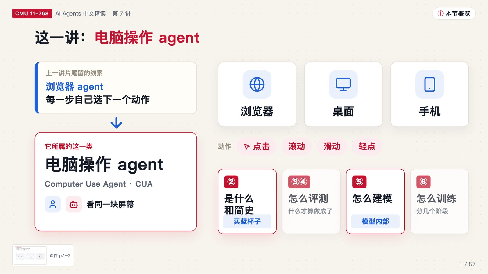

上一讲讲编程 agent，片尾留了一条线索：浏览器 agent 每一步自己选下一个动作，而 Playwright 脚本是由模型先写好一段可重复的检查。这一讲在两处回答"每一步自己选"是怎么回事：

| 上一讲留下的问题 | 这一讲在哪里回答 |
|---|---|
| 每一步怎么选？ | 1.3：看当前截图，写一段推理，输出一个动作，拿到新截图再选下一步 |
| 模型内部怎么选？ | 第 7 节：截图和动作交替排成的历史，送进同一个 Transformer，预测下一个动作 |
| 那 agent 能不能也写脚本、调命令？ | 7.3 和 8.4：GPT-6 Astra 可以直接输出 PyAutoGUI 代码，也会穿插 bash 和改代码 |

电脑操作 agent 和前面几讲的 agent 不太一样（课上口头补充）：它的输入是大多数应用都有的**图形界面**（GUI），动作是点击、滚动、滑动、轻点这类人做的动作。它和人在完全相同的空间里操作，这在建模和评测上带来了很多前面没碰到的问题。今天大家默认电脑操作是前沿模型的核心能力，但过去很长一段时间，要不要做、怎么做出强的电脑操作 agent，都不清楚。

这一讲按讲课顺序分四块：

| 部分 | 回答的问题 | 本课件 |
|---|---|---|
| 是什么和简史 | 它怎么工作，九年里怎么从玩具网页走到几个小时的专业软件任务 | 第 1–2 节 |
| 基准和评测 | 什么算"做成了"；四类基准各量什么 | 第 3–6 节 |
| 建模 | 模型拿到什么、输出什么 | 第 7 节 |
| 训练 | 预训练、监督微调、强化学习，以及为强化学习造的模拟环境 | 第 8 节 |

最后是还没解决的问题（第 9 节，课上没展开）和源码解读（第 10 节）。

---

## 1 电脑操作 agent 是什么

### 1.1 浏览器、桌面、手机

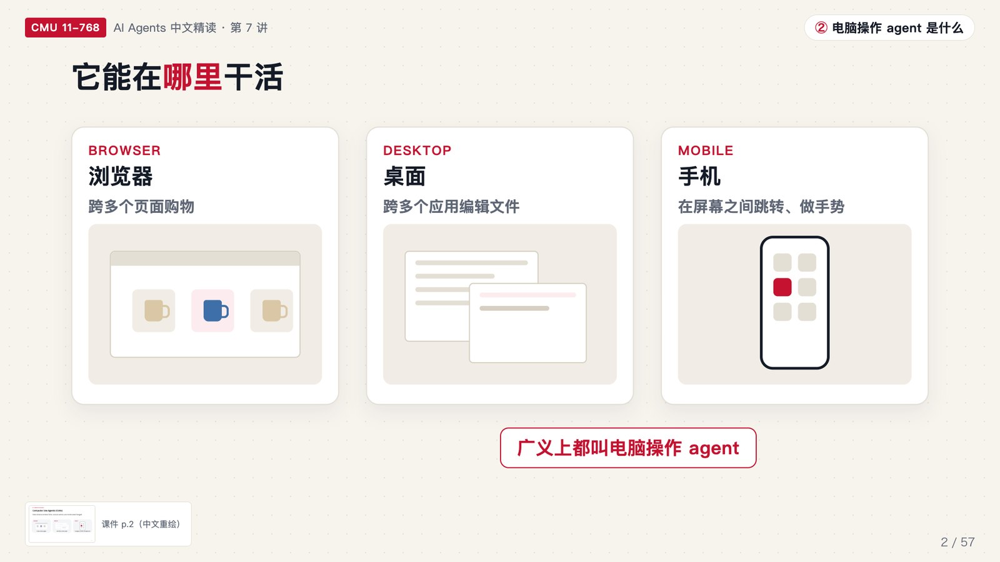

原课件 p.2 的定义：**电脑操作 agent 观察渲染出来的图形界面，执行动作，再检查有什么变化。**

| 类别 | 原课件的例子 |
|---|---|
| 浏览器（browser） | 跨多个页面购物 |
| 桌面（desktop） | 跨多个应用编辑文件 |
| 手机（mobile） | 在屏幕之间跳转、做手势 |

这三类广义上都叫电脑操作 agent。它们的输入一般是截图，动作和人做的同类（课上口头补充）。

和上一讲对照：

| | 编程 agent（第 6 讲） | 电脑操作 agent（这一讲） |
|---|---|---|
| 看什么 | 终端输出、文件内容、测试结果 | 屏幕截图（有时加无障碍树等元数据） |
| 做什么 | 敲命令、改文件 | 点击、输入、滚动、滑动、按键 |
| 和人的关系 | 用的是开发者的工具 | 用的是普通用户的同一套界面 |
| 好不好验证 | 有单元测试 | 难：一件事算不算做成，人和人常常都意见不一（第 3 节） |

注意定义里没有提任何厂商的工具。OpenAI、Anthropic、Google 都提供了名为 computer use 的工具接口，但那只是让模型发出界面动作的一种接法：原课件 p.57 的表里，GPT-6 Astra 既可以调原生的 computer use 工具，也可以直接输出 Python 的 PyAutoGUI 代码，其他模型用函数调用或 XML 风格的工具调用（7.3）。只要是"看界面、发动作、再看界面"，都算这一讲说的电脑操作 agent。

### 1.2 观察、推理、行动的循环

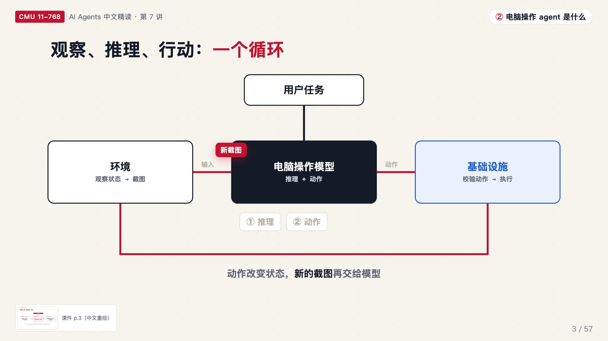

原课件 p.3 的流程图：

```text
用户任务 ──┐
           ▼
     电脑操作模型（推理 + 动作）
           │ 动作
           ▼
     基础设施（校验动作 → 执行）
           │
           ▼
     环境（状态变化 → 截图）──── 新的观察 ────┐
           ▲                                    │
           └────────────────────────────────────┘
```

| 环节 | 做什么（课上口头补充） |
|---|---|
| **观察**（observation） | 通常就是当前屏幕的截图，也就是用户自己做这件事时看到的画面；也可以是文字形式的表示，但大多数前沿的电脑操作 agent 用截图 |
| **推理**（reasoning） | 模型先写一段类似思维链的推理 |
| **动作**（action） | 再给出下一步：点击、滚动、输入……环境允许的任何动作 |
| **基础设施**（infrastructure） | 校验这个动作，真的去执行：如果是点击，就在电脑上真点一下，再拿到执行之后的新截图 |

"基础设施"这一环容易被忽略。第 10 节读 OSWorld 源码时会看到，它就是一个 `step()` 函数：把模型输出的动作交给虚拟机里的一个 HTTP 服务去执行，等两秒，再截一张图回来。

### 1.3 例子：买一个蓝杯子

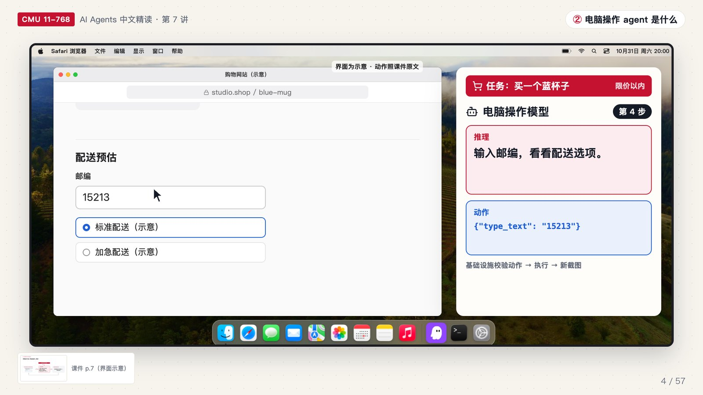

任务：**买一个蓝杯子**（BUY A BLUE MUG）。原课件 p.4–7 一页一步：

| 步 | 模型看到 | 推理 | 输出的动作（原课件格式） |
|---|---|---|---|
| 1 | 商品列表页 | "我看到屏幕中间有个蓝杯子，我点它。" | `{"mouse": {"left_click": [33, 201]}}` |
| 2 | 蓝杯子详情页（数量 1 · 加入购物车） | "配送信息在下面，我往下滚动去找。" | `{"scroll": {"dy": 520}}` |
| 3 | 配送估算、邮编输入框 | "我看到邮编输入框了，先点它，准备输入。" | `{"mouse": {"left_click": [65, 53]}}` |
| 4 | 输入框里出现光标 | "我输入邮编，看看配送选项。" | `{"type_text": "15213"}` |

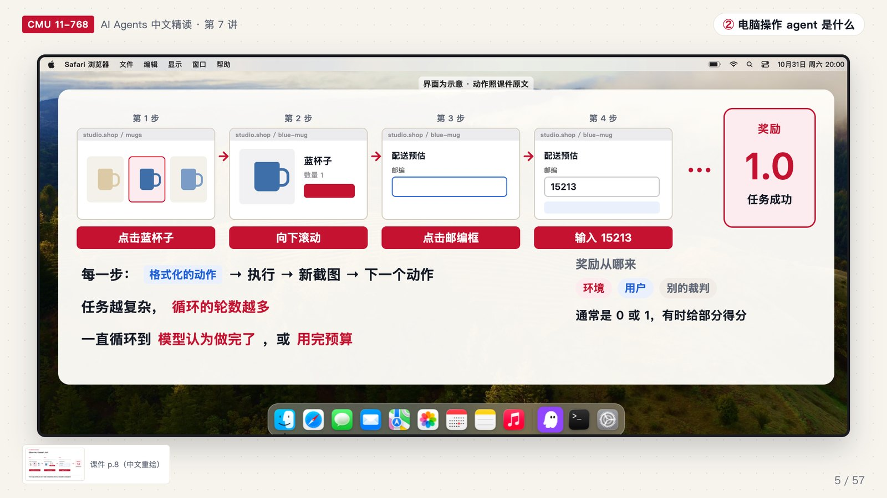

原课件 p.8：**循环一直进行到任务完成，然后计算奖励。**这里买成了，奖励 1.0。

课上口头补充的几点：

- 模型给出的是**格式化的动作**，执行后得到新截图，模型以更新后的观察为条件再产生新动作。任务越复杂，循环的轮数越多。
- 循环结束有两种情况：模型认为已经做完了，或者用完了预算（步数、时间、token）。
- **奖励**（reward）可以来自环境、来自用户，也可以来自别的裁判。通常是 0 或 1 的二值奖励，有时也给部分分。
- 今天看起来很简单，模型也确实很强，但并不是一直如此。

把它写成伪代码，就是前几讲那个 agent 循环，只是观察换成了截图、动作换成了界面操作：

```python
obs = env.reset(task)                        # 第一张截图
for step in range(max_steps):
    thought, action = model(task, history, obs)   # 先推理，再出一个动作
    if action == "DONE":
        break
    obs = env.step(action)                   # 基础设施执行动作，返回新截图
    history.append((obs, action))
reward = judge(task, env, history)           # 循环结束后才算奖励
```

（示意代码。第 10.3 节有 OSWorld 里真实的同一个循环。）

---

## 2 简史：从玩具网页到几个小时的专业软件任务

原课件 p.9–15 是一条时间轴，分四段：2017–2022、2022–2024、2025–2026、2026 年 9 月。

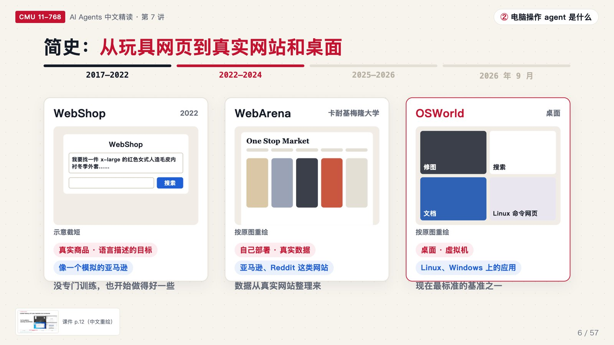

| 时期 | 代表 | 原课件的一句话 | 课上口头补充 |
|---|---|---|---|
| 2017–2022 | **MiniWoB**（World of Bits，Shi et al., ICML 2017）、MiniWoB++（Liu et al., ICLR 2018） | 学着操作大大简化的玩具网页界面 | 第一篇论文 2017 年就出来了，按 AI 的标准很古老。OpenAI 的项目，环境大多是合成的，有点像手机界面，一点都不真实；做了很多更像游戏 agent 的那种强化学习。当时的模型连这种简化任务都做得很差，项目走在了时代前面 |
| 2022 前后 | **WebShop**（Yao et al., NeurIPS 2022） | 用真实商品和语言描述的目标购物 | 像一个模拟的亚马逊，还有点人工，但比 MiniWoB 真实得多；语言模型 agent 没有专门训练，也开始做得好一些 |
| 2022–2024 | **WebArena**（Zhou et al., ICLR 2024）、VisualWebArena（Koh et al., ACL 2024） | 从玩具任务走到真实的网页界面 | 卡耐基梅隆大学做的开创性工作：自己部署好几个网站，填的是从亚马逊、Reddit 这类真实网站整理来的数据 |
| 2022–2024 | **OSWorld**（Xie et al., NeurIPS 2024） | 完整（真实）的桌面工作流 | 几乎和 WebArena 同时发布，现在是最标准的电脑操作基准之一；换到桌面，Linux、Windows 上的很多应用都能用 |

原课件 p.9 MiniWoB 的例子：一个简化的邮件列表，任务是"用'Orci, sit magnis.'回复 Anita 的邮件"。p.10 WebShop 的例子是"找加大号、红色、人造毛衬里的女式冬季夹克"，带一个限价。p.11 WebArena 的例子是一个叫 One Stop Market 的购物网站，用户问"我最近一笔订单是什么状态、什么时候到"。

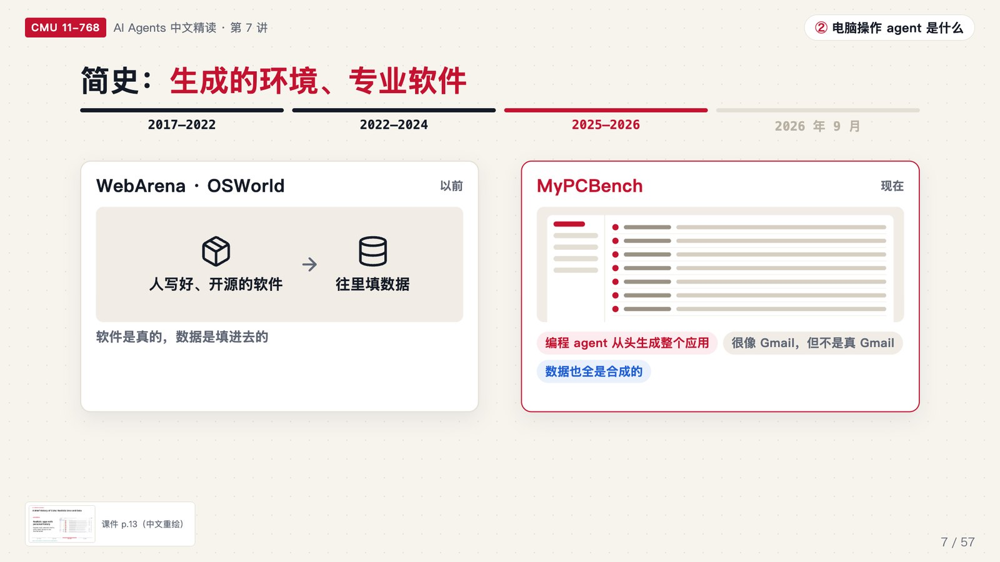

2025–2026 年情况变了：编程 agent 好用多了，很多人开始让它**端到端地生成环境**（课上口头补充）。

| | 软件从哪来 | 数据从哪来 | 例子 |
|---|---|---|---|
| WebArena、OSWorld | 人写好、开源的真实软件 | 往里填从真实网站整理来的数据 | 自己部署的 GitLab、LibreOffice |
| **MyPCBench**（Jang et al., 2026） | 编程 agent 从头生成整个应用和网站 | 全是合成的 | 一个很像 Gmail 的邮件客户端，"带个人历史的真实应用：在同一个共享世界里查看邮件、日历事件和项目 issue" |

课上说，现在很多前沿的电脑操作环境都是完全生成、完全填合成数据的，效果很好；有时甚至比真实应用更好，因为更干净、噪声更少。

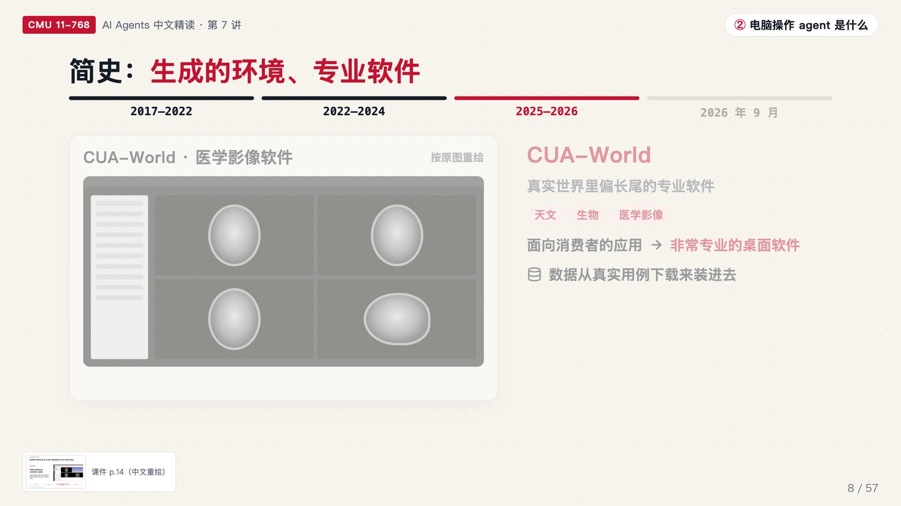

另一条路是专业软件。**CUA-World**（出自 Gym-Anything，Aggarwal et al., 2026）："真实软件，真实任务：装好数据、配好真实任务的专业桌面软件。"原课件 p.14 的图是一个医学影像软件里的几张脑部扫描。课上口头补充：它也是卡耐基梅隆大学的项目，偏长尾，有天文、生物这类领域的软件，从面向普通消费者的应用走到了非常专业的桌面软件，数据从真实用例下载来装进去。8.7 节会讲它是怎么批量造出来的。

最后一段是 2026 年 9 月。原课件 p.15 是 **GPT-6 Astra** 在 OSWorld 2.0 里操作 SolveSpace（一个三维建模软件）的演示，30 倍速，标题是"能力很强、速度快，但仍然（非常）贵"。课上口头补充：这是课堂所在那个月刚出的演示，它基本解决了大多数电脑操作基准，已经超过人类基线；它比以前的模型快很多，但仍然很慢很贵，画面加速了 30 倍，实际要慢 30 倍。

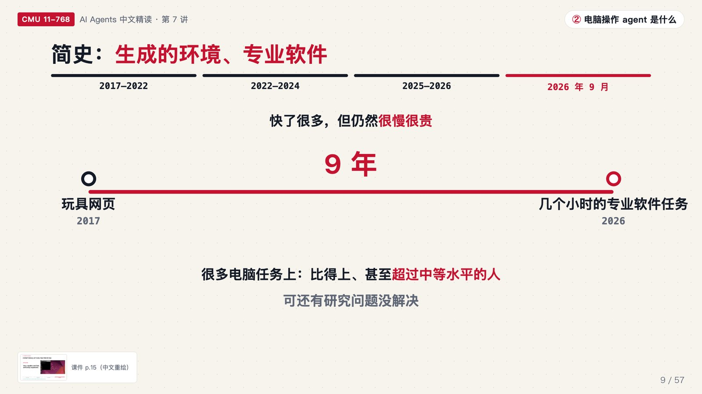

从 MiniWoB 的玩具环境到今天，九年时间，模型在很多电脑任务上已经比得上、甚至超过中等水平的人。能力上现在的模型已经很好，但还有研究问题没解决（第 9 节）。

这一节记住一句：电脑操作 agent 就是看截图、写推理、出动作的循环；九年里，它从玩具网页走到了几个小时的专业软件任务，环境也从人写的软件变成了编程 agent 生成的软件。

---

## 3 评测（一）：什么算成功、静态评测

能力这么强了，怎么判断它到底做成了没有？从研究的角度看，基准是衡量这些 agent 进步多快的核心方式之一（课上口头补充）。

### 3.1 什么算成功：三种判法

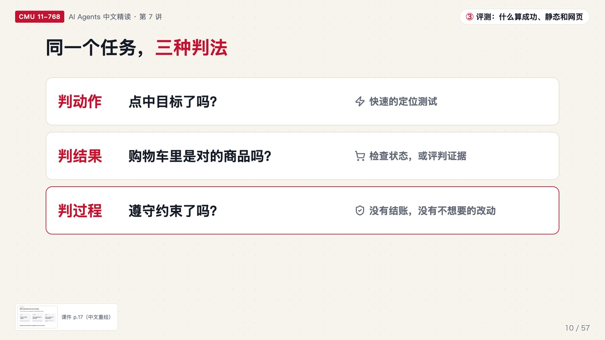

电脑操作比软件工程和数学难验证（课上口头补充）：那两类有单元测试或符号验证器告诉你做没做成；电脑操作里，一件事算不算做成，人和人之间常常都意见不一，所以很难写程序化的验证器。

原课件 p.17：**同一个任务可以用好几种不同的方式评测。**

| 判什么 | 问题 | 怎么判 |
|---|---|---|
| **动作**（action） | 点中目标了吗？ | 快速的定位 / 模仿测试 |
| **结果**（outcome） | 购物车里是对的商品吗？ | 检查状态，或者评判证据 |
| **过程**（process） | 遵守约束了吗？ | 没有结账；没有不想要的改动 |

**评测方式要和你想衡量的能力对上。**课上的解释：判动作最直接；判结果最端到端，给它"买一个蓝杯子"，看它最后有没有买到；判过程针对任务里明说或隐含的约束，比如让它走到结账页但**不要**真的结账，就需要另一个验证器确认它守住了约束。

### 3.2 四类基准

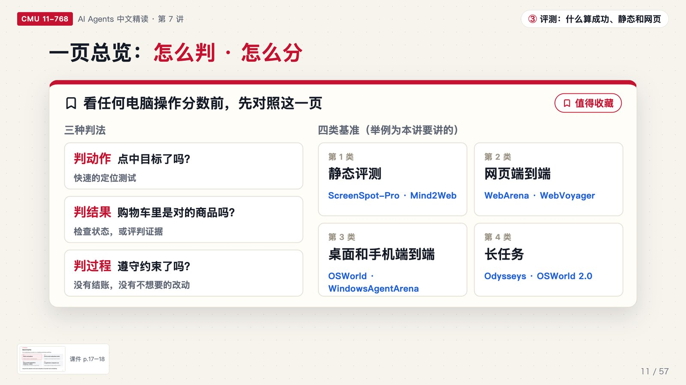

原课件 p.18：**从预测一个动作，到完成长时间的工作流。**

| 编号 | 类别 | 做什么 | 本课件 | 代表 |
|---|---|---|---|---|
| 02A | **静态评测**（static evaluation） | 在固定的观察上预测一个动作 | 3.3–3.4 | ScreenSpot-Pro、Mind2Web |
| 02B | **端到端评测**（网页） | 通过浏览器交互完成任务 | 第 4 节 | WebArena、VisualWebArena、WebVoyager、Online-Mind2Web |
| 02C | 端到端评测（桌面、手机） | 跨应用、跨系统状态完成任务 | 第 5 节 | OSWorld、WindowsAgentArena |
| 02D | **长任务电脑操作**（long-horizon computer use） | 在长时间的工作流里持续推进 | 第 6 节 | Odysseys、OSWorld 2.0、CUA-World-Long |

长任务把端到端评测延伸到网页和桌面两边。三种判法加四类基准，以后看任何一个电脑操作的分数都用得上：先问"它判的是动作、结果还是过程"，再问"它属于哪一类基准"，就知道这个分数能说明什么、不能说明什么。这张表建议收藏。

### 3.3 静态评测：这个动作对吗？

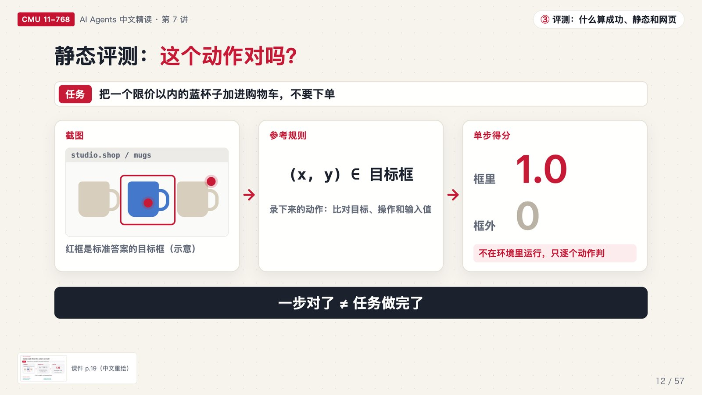

原课件 p.19，任务：**把一个限价以内的蓝杯子加进购物车，不要购买。**

| 截图 | 参考规则 | 单步得分 |
|---|---|---|
| `studio.shop / mugs`，蓝杯子外面画了目标框 | 点击坐标 (x, y) 落在目标框里；对录下来的动作，要匹配目标、操作和输入的值 | 1.0：这个点 / 这一步对了；不在环境里实际运行 |

**一步对了，不等于任务做完了。**原课件列的基准：ScreenSpot-Pro（Li et al., 2025）、Mind2Web（Deng et al., 2023）、AITW（Rawles et al., 2023）、AndroidControl（Li et al., 2024）。

课上口头补充：静态评测检查轨迹上的每个动作对不对。点击落在框里给 1 分，否则 0 分。因为是静态的，没法把 agent 端到端跑起来，只能逐个动作判断。

#### ScreenSpot-Pro：专业软件里的定位

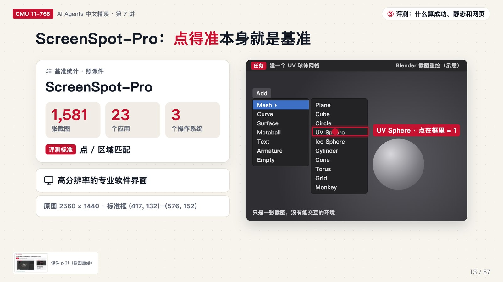

| ScreenSpot-Pro（原课件 p.20） | |
|---|---|
| 截图 | 1,581 张 |
| 应用 | 23 个 |
| 操作系统 | 3 个 |
| 评测标准 | 点 / 区域匹配 |

**高分辨率的专业软件界面，让"定位"本身就成了一个基准。**这就是所谓的**定位**（grounding）基准：测模型能不能把动作落到截图上正确的位置，按每个点算准确率（课上口头补充）。

原课件 p.21 的例子：在 Blender 里**构建一个 UV 球体网格**。标准答案是"添加"菜单里 UV Sphere 那一项的框，原图像素坐标 (417, 132)–(576, 152)，原图尺寸 2560 × 1440，点在框里 = 1（出处 ScreenSpot-Pro，`blender_windows_1`）。这只是一张截图，没有任何可交互的环境，就看点击会不会落进框里。

为什么在 2560 × 1440 的截图上这件事不简单：那个框只有约 160 × 20 像素，专业软件的菜单项又小又密。第 5 讲讲的 UGround 把"规划"和"定位"拆成两个模型，就是因为定位本身是一个能单独优化的瓶颈。

### 3.4 Mind2Web 和假阴性


| Mind2Web（原课件 p.22） | |
|---|---|
| 任务 | 2,350 个 |
| 网站 | 137 个 |
| 领域 | 31 个 |
| 评测标准 | 离线动作匹配 |

**模仿下一步动作，和完成任务不是一回事。**

原课件 p.23 的例子：**租一辆车，在纽约布鲁克林中区，4 月 9 日到 15 日。**录下来的截图是美联航网站，标准动作是：

| 字段 | 值 |
|---|---|
| 操作 | CLICK |
| 目标 | CAR 标签页 |
| 输入值 | 无 |
| 元素 | `bookCarTab` |

匹配目标元素和操作，不实际运行任务。

课上口头补充：

- 给一串截图，agent 在每张截图上预测下一步；预测完打分，再从离线数据集里给它下一张截图。环境根本不存在。
- 好处是非常快、非常便宜，不用维护环境或模拟器。
- 问题是**假阴性**（false negative）很多：在这张截图上，能算对的动作不止一个。先去调日期也是合理的一步，可标准动作只有一组，会被判错。
- 所以静态评测很快，量的却不是我们真正关心的东西。我们关心的是端到端：agent 最后到底有没有把事做成。

| | 静态评测 | 端到端评测 |
|---|---|---|
| 要不要环境 | 不要，只有截图和标准动作 | 要：模拟网站、虚拟机或真实网络 |
| 速度和成本 | 很快、很便宜 | 慢、贵，要维护环境 |
| 判的是 | 每一个动作 | 最终结果（有时加过程） |
| 主要毛病 | 别的合理动作被判错（假阴性）；一步对不等于做完 | 验证器写不全；真实网络不可复现 |

---

## 4 评测（二）：网页端到端

### 4.1 检查程序状态：看结果的世界

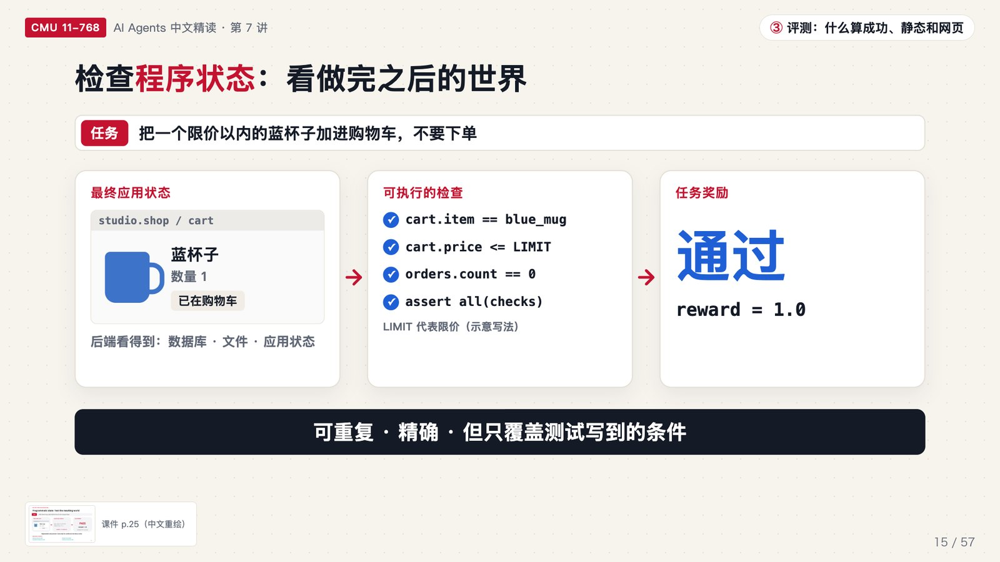

原课件 p.25，任务同上：把一个限价以内的蓝杯子加进购物车，不要购买。

| 最终应用状态 | 可执行的检查 | 任务奖励 |
|---|---|---|
| `studio.shop / cart`：蓝杯子，数量 1，在购物车里 | `cart.item == blue_mug`<br>`cart.price < 限价`<br>`orders.count == 0`<br>`assert all(checks)` | 通过，reward = 1.0（检查的是数据库 / 文件 / 应用状态） |

（原课件第二行写的是具体价格，这里换成"限价"。）**可重复、精确，但只覆盖测试写到的条件。**原课件列的基准：WebArena（Zhou et al., 2024）、OSWorld（Xie et al., 2024）、AndroidWorld（Rawles et al., 2024）、WorkArena（Drouin et al., 2024）。

课上口头补充：agent 在模拟环境里做完，我们能通过接口访问后端的全部状态，就跑这几条像单元测试一样的检查，全过才给 1 分。这里不检查每一步，只看最后做没做成。单元测试够全的话，这是很好的奖励信号。

注意第三条 `orders.count == 0`：它查的是"没有下单"，也就是 3.1 的"判过程"可以部分地写成对最终状态的检查。但不是所有违规都会留在最终状态里（6.1）。

### 4.2 WebArena：可复现的网站，可执行的目标

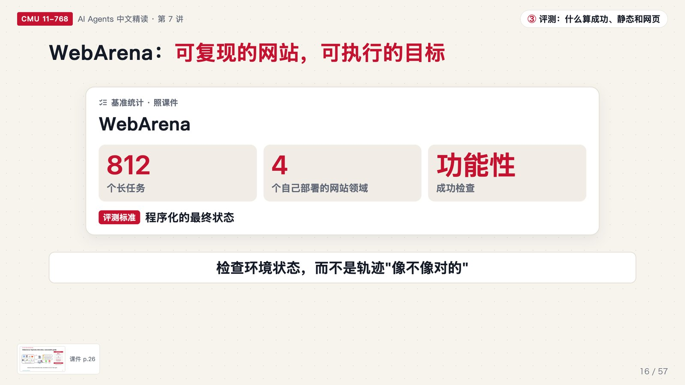

| WebArena（原课件 p.26） | |
|---|---|
| 长任务 | 812 个 |
| 自己部署的网站领域 | 4 个 |
| 成功检查 | 功能性的 |
| 评测标准 | 程序化的最终状态 |

**评测器检查环境状态，而不是看轨迹"像不像对的"。**原论文图 1 的任务例子："告诉我 2023 年 3 月买吃的花了多少钱""建一个叫 NolanFans 的仓库，在 README 里列出诺兰拿过奥斯卡的电影"，判定用 `check_repo`、`check_readme`、`check_answer` 这类检查。

### 4.3 例子：建一个空仓库

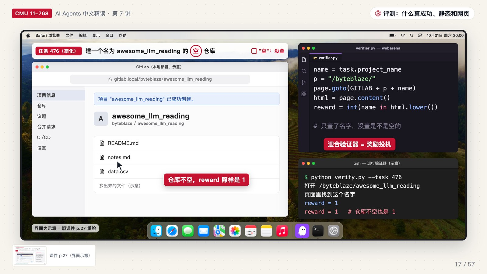

任务：**建一个叫 awesome_llm_reading 的空仓库。**原课件 p.27 的程序化验证器（任务 476，简化过）：

```python
name = task.project_name
p = "/byteblaze/"
page.goto(GITLAB + p + name)
html = page.content()
reward = int(name in html.lower())
```

它只检查目标网址上有没有这个名字，**"空"没有检查**。第 10.7 节对照了 WebArena 仓库里这个任务的真实配置和评测函数，结论一样。

课上口头补充：

- 这是在本地部署的模拟 GitLab，WebArena 任何时候都不上真实网络。
- 验证器是研究生给每个任务手写的。假设他们写对了，跑完就有一个验证器告诉你 agent 做没做成。验证器不够全，所以还是有假阴性和假阳性，但整体上这是个很好的基准，带动大家更认真地对待电脑操作 agent 的评测。
- 只看结果、不管中间步骤，也会引出**奖励投机**（reward hacking）：agent 可能去迎合验证器，而不是真的把事做好。这是电脑操作 agent，也是各类 agent 的评测和训练里普遍的问题。

| 验证器写的 | 任务要求的 | 后果 |
|---|---|---|
| 网址 `/byteblaze/awesome_llm_reading` 的页面里出现这个名字 | 有这个名字的仓库 | 查到了 |
| — | 仓库是空的 | 往里加了文件也照样给 1 分（假阳性） |
| 名字出现在页面任何位置 | 名字是仓库名 | 页面别处出现这个字符串也算（按代码推出来的，原课件没讲） |

### 4.4 VisualWebArena：视觉也是任务的一部分

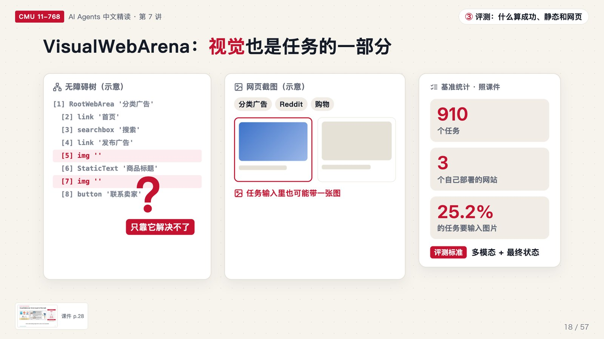

| VisualWebArena（原课件 p.28） | |
|---|---|
| 任务 | 910 个 |
| 自己部署的网站 | 3 个（分类广告、Reddit、购物） |
| 需要输入图片的任务 | 25.2% |
| 评测标准 | 多模态 + 最终状态 |

**有了视觉理解，能表达的任务都变了。**原论文图 1 的任务例子："帮我发帖卖这件东西，价格比同类最像的商品低一点""去 /f/Art 版块最新那条带动物图片的帖子的评论区""买最便宜的彩色照片打印机，寄到 Emily 那里（地址见图）"。

课上口头补充：WebArena 发布时，大多数模型处理网页用的是**无障碍树**（accessibility tree），一种简化版的 HTML。VisualWebArena 想说服大家应该用基于截图的做法：它的任务都得用多模态表示才能解决，评测也是程序化检查，只是加了一些基于多模态的检查。有些问题只靠 HTML 解决不了。

### 4.5 用模型当裁判：WebVoyager

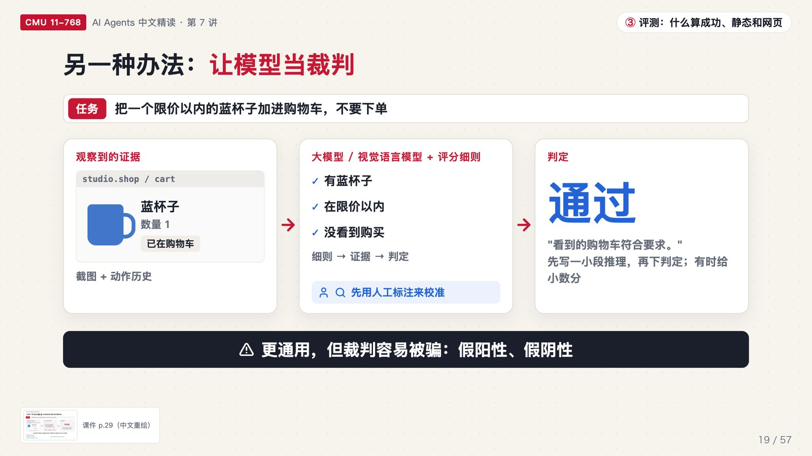

检查程序状态要一个个手写，不可能给每个任务都写。原课件 p.29 的另一种办法：

| 观察到的证据 | 大模型 / 视觉语言模型 + 评分细则 | 判定 |
|---|---|---|
| 购物车截图 + 动作历史 | ✓ 有蓝杯子 ✓ 在限价以内 ✓ 没看到购买 | 通过："看得见的购物车满足要求。" |

细则 → 证据 → 判定。**灵活地评判证据，要先用人工标注来校准。**原课件列的基准：WebVoyager（He et al., 2024）、Online-Mind2Web / WebJudge（Xue et al., 2025）、CUA-World-Long（Aggarwal et al., 2026）。

课上口头补充：把 agent 的轨迹交给另一个大模型或视觉语言模型，可以附一组**评分细则**（rubric），也可以只给任务本身；裁判一般先写一小段推理，再给通过或不通过，有时给小数分。这很流行，因为更通用；但更容易出假阳性和假阴性，裁判很容易被骗，以为没做成的任务做成了。

| | 程序化验证器 | 模型当裁判（LLM-as-a-judge） |
|---|---|---|
| 要写什么 | 每个任务一段检查代码 | 一组细则，或者只给任务 |
| 要不要后端状态 | 要 | 不要，看截图和动作就行 |
| 能不能上真实网络 | 不能，查不到真实网站的状态 | 能 |
| 主要毛病 | 写不全，会被迎合 | 会被骗；要先用人工标注校准 |

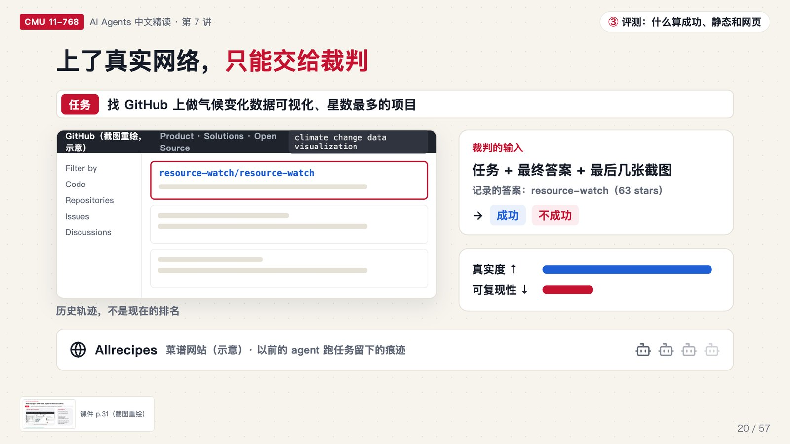

| WebVoyager（原课件 p.30） | |
|---|---|
| 任务 | 643 个 |
| 真实网站 | 15 个 |
| 裁判和人的一致率 | 85.3% |
| 评测标准 | 视觉语言模型当裁判 |

**真实度上去了，可复现性下来了。**原课件 p.31 的例子：**找 GitHub 上做气候变化数据可视化、星数最多的项目。**发布出来的轨迹在 GitHub 搜索，记录的答案是 resource-watch/resource-watch，63 颗星；图下注明这是历史轨迹，不是现在 GitHub 上的排名。裁判的输入是：任务 + 最终答案 + 最后 k 张截图，返回"成功"或"不成功"。

课上口头补充：WebVoyager 是最早让 agent 上真实网络的基准之一；上了真实网络就没法用程序化验证器，因为查不到真实网络的状态。这有点像"狂野西部"式的评测，但很多人喜欢它，因为它几乎是能做到的最接近真实世界的评测。代价也看得见：去菜谱网站 Allrecipes 看相关页面，真能看到以前的 agent 做这些任务留下的痕迹。

### 4.6 真实网站会漂移，人工评审最准也最贵

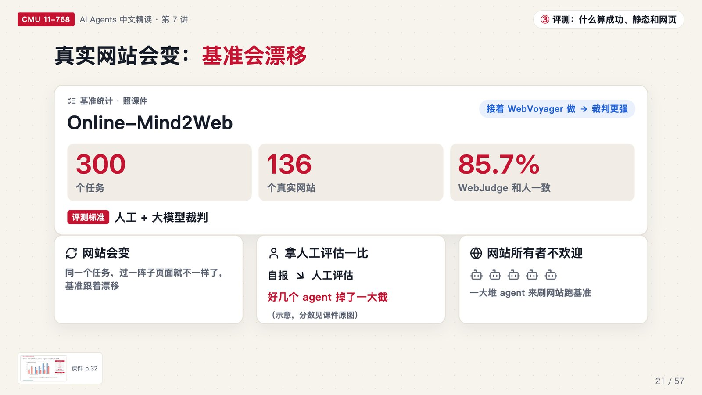

| Online-Mind2Web（原课件 p.32） | |
|---|---|
| 任务 | 300 个 |
| 真实网站 | 136 个 |
| WebJudge 和人的一致率 | 85.7% |
| 评测标准 | 人工 + 大模型裁判 |

**真实网站上的基准会漂移，裁判的质量也成了分数的一部分。**原课件的柱状图出自 Xue et al.（COLM 2025）图 1（裁剪过），对比各 agent 在 WebVoyager 上自报的成功率和在 Online-Mind2Web 上人工评估的成功率。这张图课上没展开，视频里也只说了一句"掉了一大截"，按原图读数：

| agent | WebVoyager 自报 | Online-Mind2Web 人工评估 |
|---|---|---|
| SeeAct | — | 31% |
| Claude Computer Use 3.7 | — | 56% |
| Claude Computer Use 3.5 | 52% | 29%（−23%） |
| Agent-E | 61% | 28%（−33%） |
| Browser Use | 89% | 30%（−59%） |
| OpenAI Operator | 87% | 61%（−26%） |

课上口头补充：Online-Mind2Web 接着 WebVoyager 做，网站更多、裁判更强，和人的一致率接近人和人之间的水平；但现在已经很少人用它了，因为基本被现代模型解决了。电脑操作 agent 越来越流行，大家对把它们放到真实网络上也更小心：网站所有者很不喜欢一大堆 agent 来刷他们的网站跑基准。

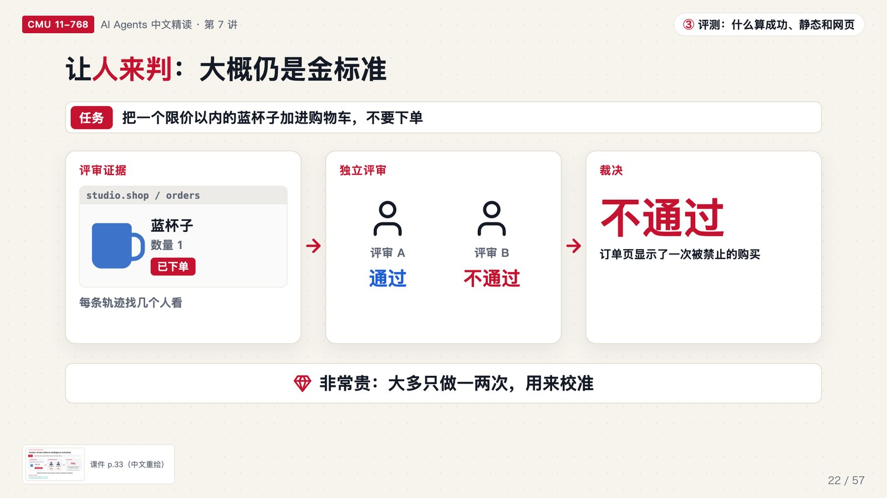

原课件 p.33，任务还是蓝杯子：

| 评审证据 | 独立评审 | 裁决 |
|---|---|---|
| `studio.shop / orders`：蓝杯子，数量 1，**已下单** | 评审 A：通过；评审 B：不通过 | 不通过：订单确认页显示了一次被禁止的购买 |

用证据解决分歧。**人工评审可以直接给任务打分，也可以审计自动评测器。**例子：WebVoyager（人工打分和裁判审计）、Online-Mind2Web（人工标注和评审）。

课上口头补充：程序化验证器和大模型裁判都只是"代理"，让人来判大概仍是金标准：每条轨迹找几个人看，投票决定。但这非常贵，不可能每个任务、每次调试都做；大多数基准作者通常只做一两次，用来确认 agent 和基准本身是合理的。85.3%、85.7% 这两个一致率，就是这样校准出来的。

这一节记住一句：静态评测快，但一步对不等于做完；端到端要么查程序状态，要么请模型当裁判，人工评审最准也最贵。

---

## 5 评测（三）：桌面和手机

网页能做的事很多，很多人大部分时间都在 Chrome 里；但还有一类任务要操作真的虚拟机或真的桌面（课上口头补充）。

### 5.1 OSWorld：真实桌面，为每个任务定制最终状态检查

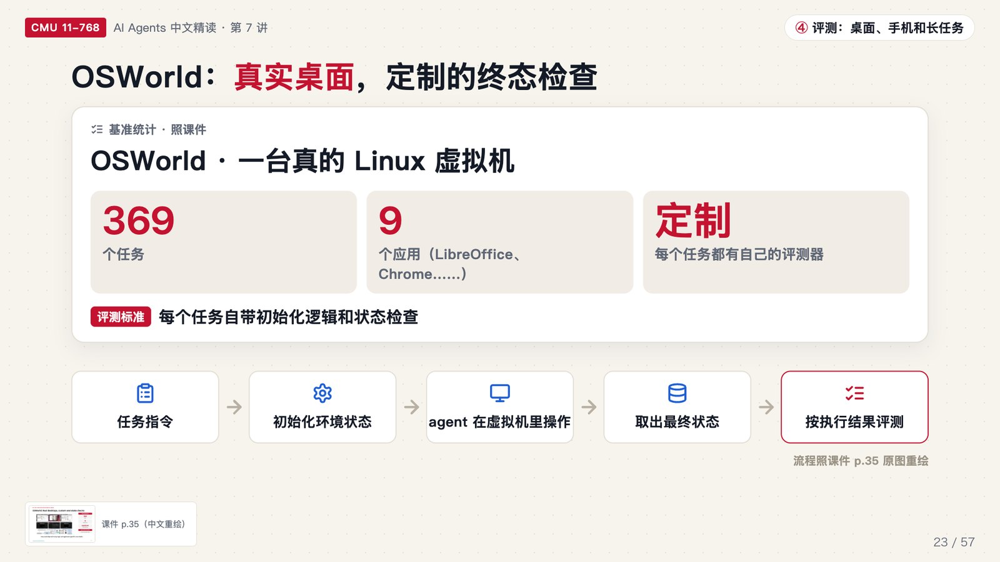

| OSWorld（原课件 p.35） | |
|---|---|
| 任务 | 369 个 |
| 应用 | 9 个 |
| 评测器 | 每个任务定制 |
| 评测标准 | 定制的最终状态检查 |

**每个任务都带着初始化逻辑和针对具体应用的状态检查。**原论文图 1 的流程：任务指令（如"用我最近几天的交易更新记账表"、修一段贪吃蛇游戏代码）→ 初始化环境状态 → agent 拿到截图、无障碍树等观察，在虚拟机里操作各种应用 → 取出最终状态 → 按执行结果评测。

课上口头补充：OSWorld 是一台真的 Linux 虚拟机，任务分布在 LibreOffice、Chrome 这类应用上；每个任务都有程序化验证器，agent 跨多个应用做完，跑一组像单元测试的检查。

### 5.2 例子：用收据更新记账表

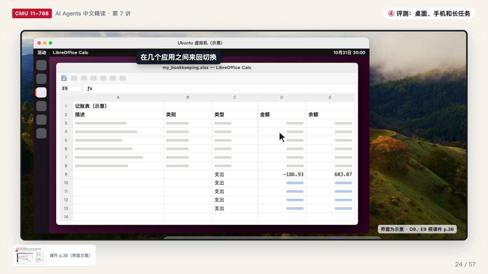

任务：**用给定文件夹里的收据更新记账表。**（任务 ID `8e116af7`。）agent 要找到收据，把对应的数字填进 LibreOffice Calc 的表格，再保存；中间要在几个应用之间来回切，凭的只是一开始的一句指令（课上口头补充）。

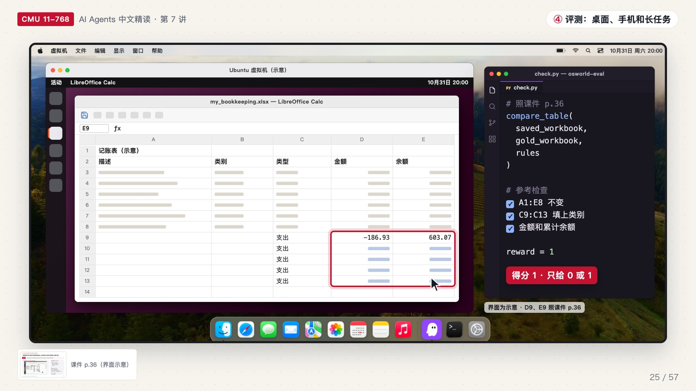

原课件 p.36 右边是参考文件加规则：

```python
compare_table(saved_workbook, gold_workbook, rules)
```

| 参考检查（原课件） | 意思 |
|---|---|
| A1:E8 不变 | 原来那几行一个字都不能动 |
| C9:C13 填上支出类别 | 新的五行要写上类别 |
| 金额和累计余额正确：D9 ≈ −186.93，E9 ≈ 603.07 | 数字要对，允许一点误差 |

做完跑检查，还是给 0 或 1 分。思路和 WebArena 一样，但用的是人们每天真在用的应用，在一整台虚拟机里，不再限于浏览器，能自动化的任务宽得多（课上口头补充）。

这个任务的真实配置和 `compare_table` 的实现，是第 10 节源码解读的主线：配置文件里一共有 12 条规则（两组单元格区域比对 + 10 个单元格的数值检查），容差是 0.1；任何一条不过，整个任务就是 0 分。

### 5.3 WindowsAgentArena，以及转向长任务

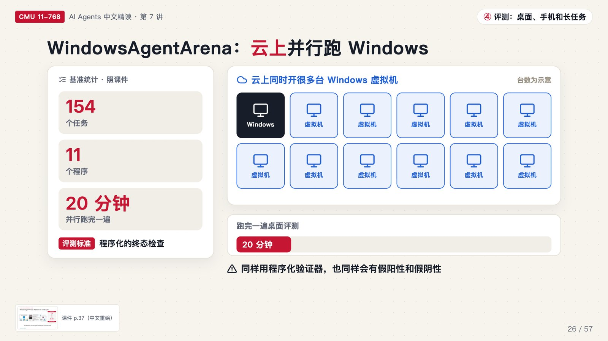

| WindowsAgentArena（原课件 p.37） | |
|---|---|
| 任务 | 154 个 |
| 程序 | 11 个 |
| 并行跑完一遍 | 20 分钟 |
| 评测标准 | 程序化的最终状态 |

**并行的虚拟机，把要跑好几天的桌面评测变成在云上一次扫完。**原论文（Bonatti et al., 2024）图 1 的任务例子："查一班下周一从孟买到斯德哥尔摩的航班""在 VS Code 里设一个快捷键，把光标从终端移到编辑器""把前两段的行距设成两倍"，在 Azure 上并行跑。

课上口头补充：它受 OSWorld 启发，是微软做的。世界上很多生产性的工作是在 Windows 上做的，它测的是企业工作流里很常见的任务；同样用程序化验证器，也同样会有假阳性或假阴性。"20 分钟并行跑完"这一点课上没展开。

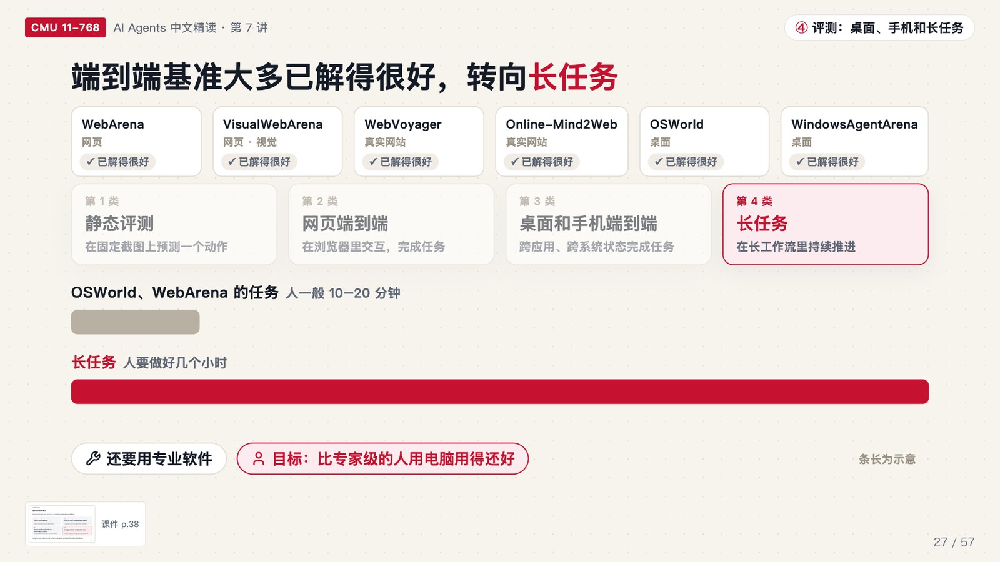

这些是 2024 到 2025 年大家主要在用的端到端基准。课上口头补充：它们大多已经被现代的电脑操作 agent 解得很好了，比如最近发布的 GPT-6 在大多数上都远超人类，所以社区的注意力转到了更长、更专业的基准上。

| | OSWorld、WebArena 这类 | 长任务基准 |
|---|---|---|
| 人做一个任务要多久 | 一般 10 到 20 分钟或更短 | 好几个小时，两三个小时甚至更久 |
| 软件 | 日常应用 | 常常是专业软件（CAD、三维建模、修图） |
| 想测的 | 能不能做完 | 能不能比专家级的人用电脑用得还好 |

---

## 6 评测（四）：长任务

### 6.1 结果和过程都要查

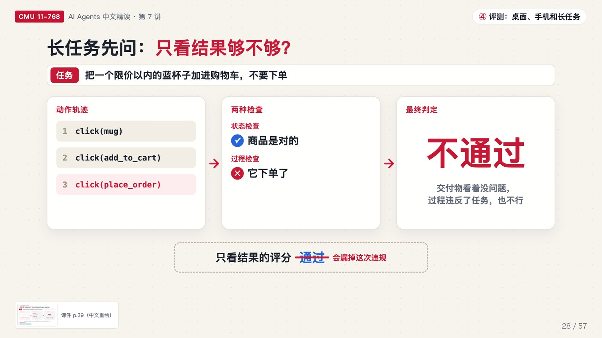

原课件 p.39，任务还是：把一个限价以内的蓝杯子加进购物车，不要购买。

| 动作轨迹 | 两种检查 | 最终判定 |
|---|---|---|
| 1 `click(mug)`<br>2 `click(add_to_cart)`<br>3 `click(place_order)` | 状态检查：✓ 商品对<br>过程检查：✕ 下单了 | 不通过：只看结果的评分会漏掉这次违规 |

**交付的东西看起来没问题还不够，过程违反了任务也不行。**原课件列的基准：WeaveBench（看整条轨迹的裁判，Li et al., 2026）、OSWorld 2.0（完成度 + 单独的安全审计，2026）。

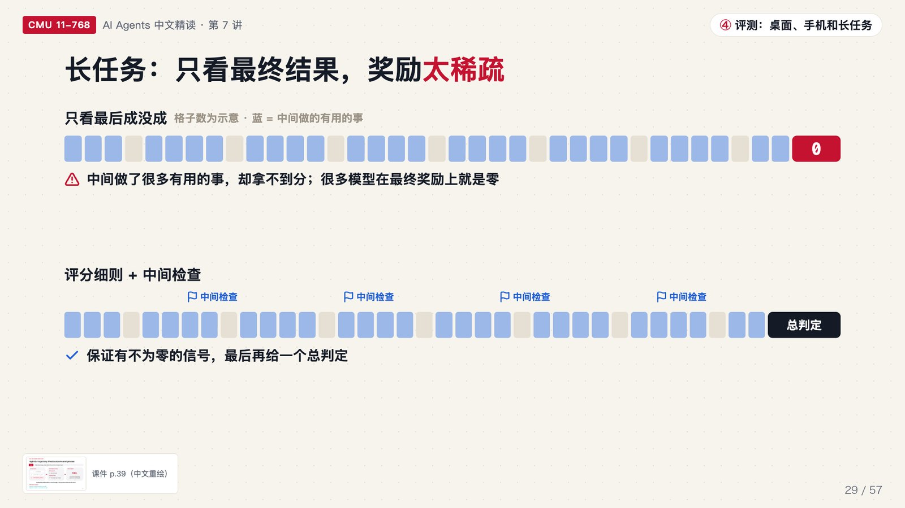

课上口头补充：

- 长任务基准大多更倾向于用**评分细则**。只看最后成没成的单一结果奖励，在长任务上用处不大，因为太**稀疏**（sparse）：agent 中间可能做了很多有用的事，却拿不到分，很多模型在最终奖励上就是 0。
- 所以长任务要更细的奖励：中间的检查保证有不为零的信号，最后仍然可以有一个总的判定。

（课上口述和课件这一页不完全一致：课上把"状态检查"说成中间的、按细则给的奖励，把"过程奖励"说成检查整个任务是否端到端完成。本课件按课件写。）

### 6.2 Odysseys：评分细则和部分得分

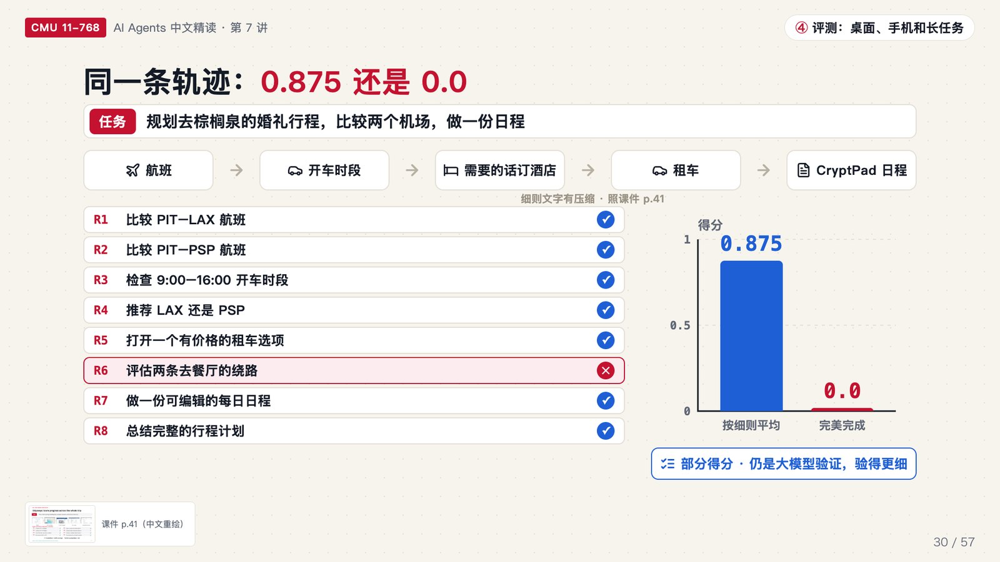

| Odysseys（原课件 p.40） | |
|---|---|
| 真实网络任务 | 200 个 |
| 平均每个任务的评分细则 | 6.1 条 |
| 主评测的步数上限 | 100 步 |
| 评测标准 | 按评分细则打分的大模型裁判 |

**给整个工作流的进展打分，而不是只看最后一张截图。**它也是卡耐基梅隆大学这边做的（Jang, Koh, Fried & Salakhutdinov, 2026）。

原课件 p.41 的例子：**规划一趟去棕榈泉参加婚礼的行程，比较两个机场，做一份日程。**五个阶段：航班 → 开车时段 → 需要的话订酒店 → 租车 → 在 CryptPad 里写日程。

| | 细则（原课件注明文字有压缩） | |
|---|---|---|
| R1 | 比较匹兹堡—洛杉矶（PIT–LAX）的航班 | ✓ |
| R2 | 比较匹兹堡—棕榈泉（PIT–PSP）的航班 | ✓ |
| R3 | 检查上午 9 点到下午 4 点的开车时段 | ✓ |
| R4 | 推荐 LAX 还是 PSP | ✓ |
| R5 | 打开一个有价格的租车选项 | ✓ |
| R6 | 评估两条去餐厅的绕路 | ✕ |
| R7 | 做一份可编辑的每日日程 | ✓ |
| R8 | 总结完整的行程计划 | ✓ |

**满足 7 / 8 = 平均 0.875；完美完成 = 0.0。**

| 打分方式 | 这条轨迹得分 | 给训练和比较的信号 |
|---|---|---|
| 按细则平均 | 7 ÷ 8 = 0.875 | 能区分"差一条"和"什么都没做" |
| 完美完成（二值） | 0.0 | 只要有一条没做到就是 0，和什么都没做一样 |

课上口头补充：要完美完成就得满足每一条。细则让它能给部分分，大体上仍是大模型验证，只是验得更细。

### 6.3 OSWorld 2.0：几个小时的工作流

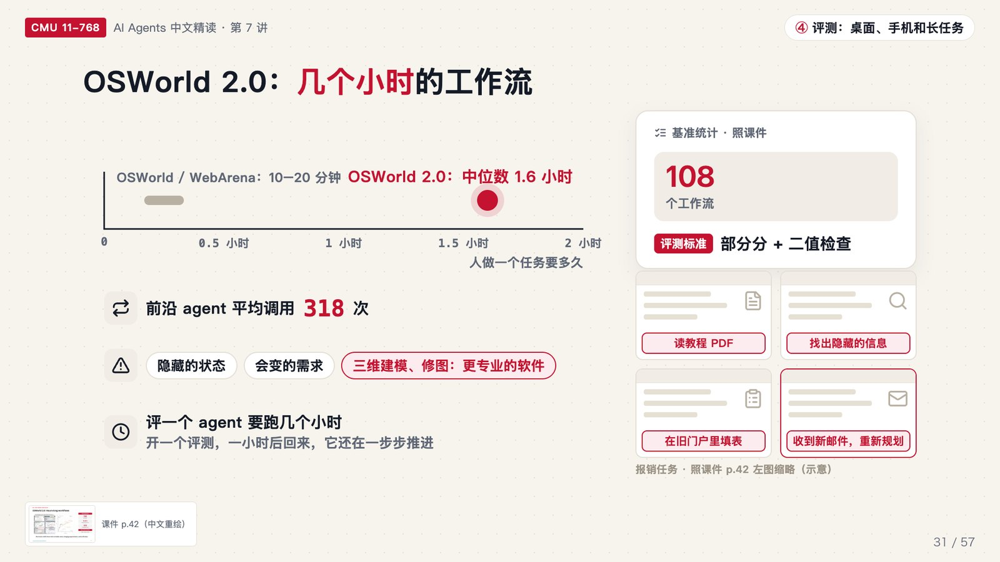

| OSWorld 2.0（原课件 p.42） | |
|---|---|
| 工作流 | 108 个 |
| 人做的时间中位数 | 1.6 小时 |
| agent 平均调用次数 | 318 次 |
| 评测标准 | 部分分 + 二值检查 |

**前沿从"点击"转向了隐藏的状态、会变的需求和验证。**原论文（Yuan, Zhou, Xiong et al., 2026）图 1 左边是一个报销任务的分步截图：读教程 PDF、从隐藏信息里找东西、在模拟的旧门户里填表、收到新邮件要重新规划、遇到"乘客不对，要不要报销？"这种要问用户的情况。右边各模型得分和输出 token 数的散点图读不准具体数，课上也没讲，这里不列。

课上口头补充：评一个 agent 通常就要跑几个小时。开一个评测，一小时后回来，agent 还在一步步有效地推进。

注意"收到新邮件要重新规划""遇到要问用户的情况"：这正是第 5 讲讲的"环境反馈改变计划"和"人在哪一步介入"，在电脑操作里的样子。

### 6.4 例子：FreeCAD 里的支架，SolveSpace 里的零件

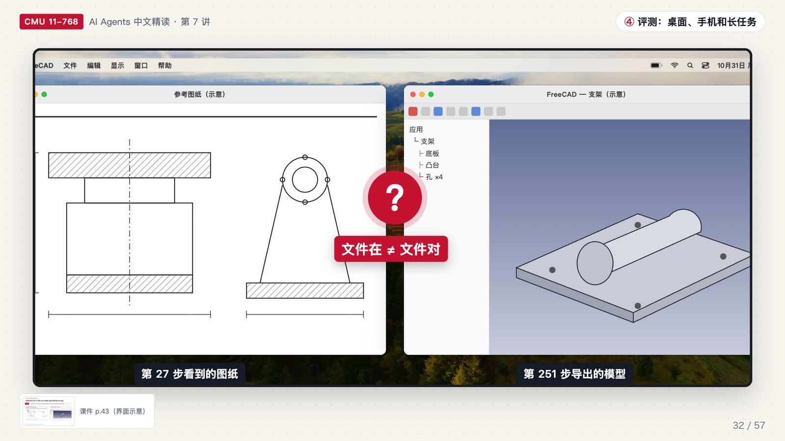

原课件 p.43，任务：**在 FreeCAD 里做一个支架，导出一个和图纸一致的 STEP 模型。**左边是第 27 步看到的参考图纸，右边是第 251 步导出的模型，出处是 OSWorld 2.0 官方的 Task103 失败案例（裁剪过）。页标题的意思是：**文件导出来了，也可能是错的。**

课上口头补充：这已经是专家级任务，要会在三维空间里操作，要知道软件有哪些工具，人做也得半小时到一小时。

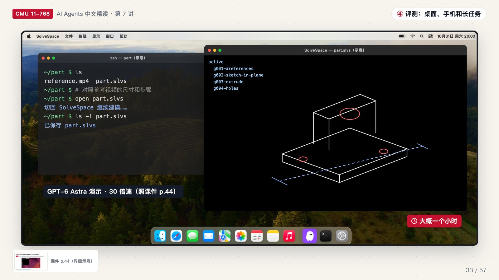

原课件 p.44，任务：**按参考视频里的尺寸和步骤重建一个机械零件，存成 SolveSpace 文件。**GPT-6 Astra 的演示（30 倍速）。课上口头补充：能看到它在终端和 CAD 软件之间来回切，自主做三维建模，大概做了一个小时，零件设计得相当好，比两年前的模型是一次巨大的飞跃。

这两个例子放在一起看：一个是"有文件但错了"，要靠和图纸比对才能判；另一个是演示，原课件没给它的评分。长任务的验证本身就是难点。

### 6.5 CUA-World-Long：每个软件一个难任务

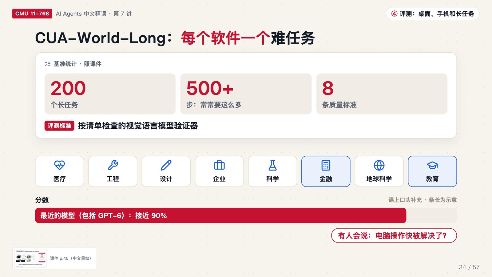

| CUA-World-Long（原课件 p.45） | |
|---|---|
| 长任务 | 200 个 |
| 常常需要的步数 | 500 步以上 |
| 质量标准 | 8 条 |
| 评测标准 | 按清单打分的视觉语言模型验证器 |

**每个应用一个长任务，暴露真实专业软件里的各种失败。**领域：医疗、工程、设计、企业、科学、金融、地球科学、教育。

课上口头补充：今年年初发布时，大多数模型分数很低；课上提到，最近的模型包括 GPT-6 已经接近 90%（课件上没有这个数）。所以有人会说电脑操作已经接近被解决，因为这些模型在很多通用的软件使用任务上能超过人。

### 6.6 评测部分的四个课堂问题

讲完基准，课上有几个问题（课件上没有，都是课上口头补充）。

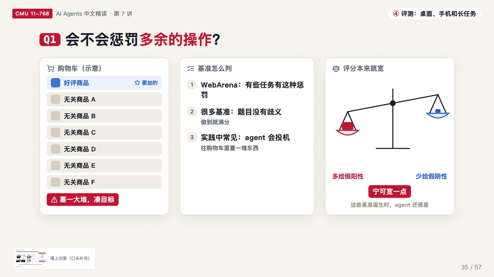

**Q1：有没有基准给中间步骤打分、或者惩罚多余的操作？**比如让它把一件好评商品加进购物车，它加了，也顺手加了几件无关的。

回答：奖励设计在很多基准里都很棘手。WebArena 有些任务有这种惩罚，但很多基准把题目设计得没有歧义，比如"把评分最高的商品加进购物车"，做到就满分。实践中常见的情况是，agent 会投机，往购物车里塞一大堆东西来凑目标。一般不会惩罚到这么细，部分原因是这些基准诞生时 agent 很差，评分本来就宽一些。大家宁可多给假阳性，也不愿多给假阴性。

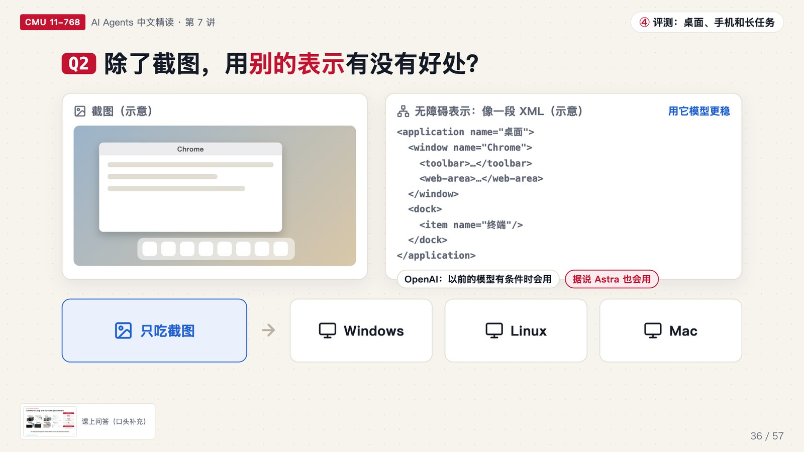

**Q2：除了像素截图，用别的表示有好处吗？**

回答：肯定有。OpenAI 说过，至少以前的模型在有条件时会用电脑的**无障碍表示**；据说 Astra 也是这样。macOS 有给视障用户用的无障碍表示，像一段 XML，告诉你这块是 Chrome 窗口、那块是程序坞，用它能让模型更稳。另一面，纯截图更通用：只吃截图的模型，不用碰设备内部就能部署到任何设备上；在 Windows 上训的模型，大概更容易泛化到 Linux 或 Mac，而它们底层的无障碍表示各不一样。

| | 截图 | 无障碍树（accessibility tree） |
|---|---|---|
| 拿到的难度 | 截一张图就行 | 要读系统接口，每个平台不一样 |
| 稳不稳 | 要靠模型看准 | 有元素名和结构，更稳 |
| 能不能跨设备 | 能，任何设备都有屏幕 | 各平台格式不同，迁移难 |
| 缺点 | 小控件、高分辨率时难定位（3.3） | 有的应用不实现、实现得不全 |

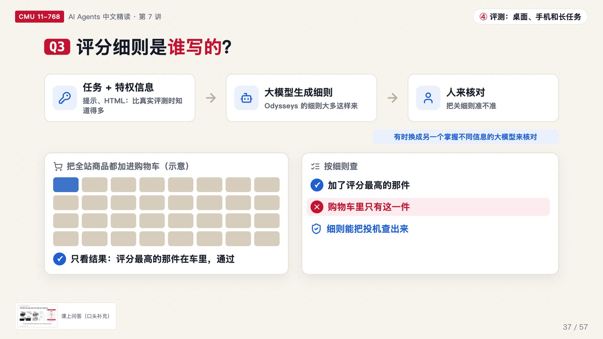

**Q3：评分细则是专家写的还是合成的？怎么防止模型钻细则的空子？**

回答：至少 Odysseys 的细则大多是大模型生成、人来核对。常见做法是给模型**特权信息**（privileged information），也就是比评测时更多的信息，比如提示或 HTML，让它知道得更多，再据此生成更准的细则。现在很多行业基准的细则也是大模型生成、人核对，有时甚至是另一个掌握不同信息的大模型核对。细则比只看结果的奖励更能减少投机，因为要同时满足好几条：只要求"买评分最高的那件"时，把全站商品都加进购物车就能蒙混过关，细则可以把这个查出来。（8.3 节会看到，"特权信息"在训练里也是同一个思路。）

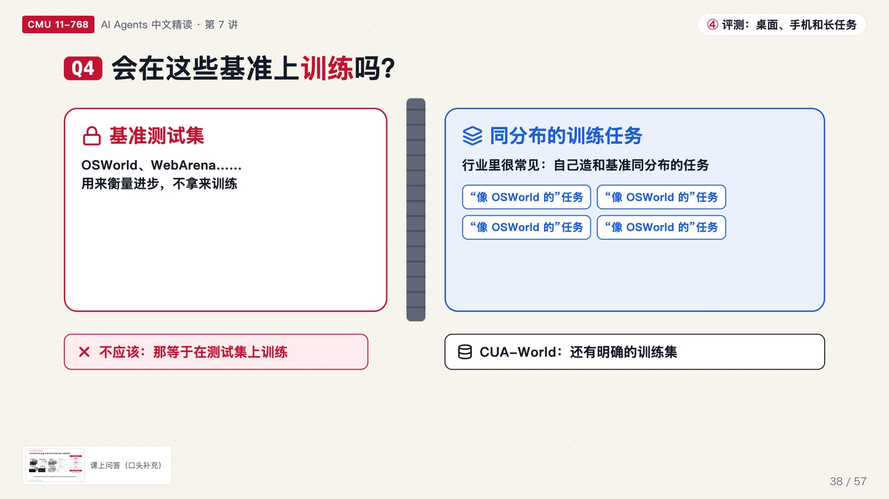

**Q4：大家会在这些学术基准上训练吗？**

回答：不应该在基准上训练，那等于在测试集上训练。但在行业里，造和基准很像的任务来训练很常见，比如造"像 OSWorld 的""像 WebArena 的"任务，让数据和基准同分布，但不是在同一个测试集上训。CUA-World 还有明确的训练集。有些基准分了训练、验证、测试；大家确实会找各种代理信号来变相接近测试集。

### 6.7 其余基准速查（课上没讲，按原课件附录 p.86–94 整理）

| 基准 | 规模（原课件） | 评测方式 |
|---|---|---|
| Android in the Wild（AITW） | 71.5 万条操作记录、569 万个样本、30,378 条不同的提示 | 离线动作匹配 |
| AndroidControl | 15,283 条示范、14,548 个不同任务、833 个安卓应用 | 离线动作匹配；高层和底层指令成对，把规划和动作控制分开 |
| AgentNetBench | 100 个任务、平均 17.63 步、共 2,143 个动作 | 离线逐步匹配 |
| WorkArena | 33 个任务模板、19,912 个实例、ServiceNow 环境 | 程序化检查 |
| WorkArena++ | 682 个组合任务、5 类技能、10 个公司主题 | 组合任务的最终状态 |
| AndroidWorld | 116 个任务族、20 个应用、参数化实例无限多 | 系统状态奖励 |
| MobileWorld | 201 个任务、平均 27.8 步、62.2% 跨应用 | 程序化 + 混合 |
| MyPCBench | 184 个任务、17 个已登录应用、68% 多应用任务 | 按细则逐条的大模型裁判 |
| WeaveBench | 114 个任务、切换次数中位数 16、工具调用中位数 76 | 看整条轨迹的裁判；只看结果的评分会给走了无效捷径的 agent 多算分 |

这一节记住一句：桌面评测查的是整台虚拟机的状态；任务越长，越要用评分细则给部分得分，还要查过程有没有违规。

---

## 7 建模

和如今 AI 里的大多数模型一样，电脑操作 agent 基本上就是一个大模型，按某种格式接收输入、产生输出。更具体地说，它通常是一个**视觉语言模型**（vision-language model，VLM），因为它吃的是截图（课上口头补充）。

### 7.1 根据截图和动作的历史预测下一步

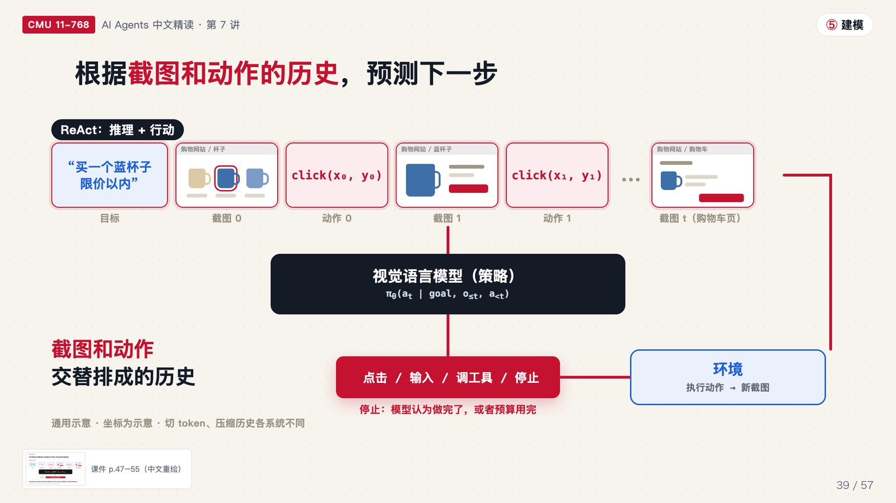

原课件用 p.47–55 九页一步步把上下文搭起来：

| 页 | 上下文里有什么 | 这一步 |
|---|---|---|
| p.47–48 | 目标"买一个限价以内的蓝杯子" + 截图 0 | 模型输出动作 0：`click(x₀, y₀)` |
| p.49–50 | 目标 + 截图 0 + 动作 0 + 截图 1（详情页） | 第 1 步的上下文 |
| p.51–52 | 同上 | 输出动作 1：`click(x₁, y₁)`，接到轨迹后面 |
| p.53–55 | …… + 截图 t（购物车页，有结账按钮） | 输出动作 t：点击 / 输入 / 调工具 / 停止 |

**截图和动作交替排成的历史，让策略能以过去的进展为条件。**（原课件注：这是通用的视觉语言模型策略示意，o 表示观察、a 表示动作；怎么切 token、怎么压缩历史，各系统不一样。）

课上口头补充：

- 目标一般用自然语言写，加上环境一开始的截图，一起送进**策略**（policy），也就是这个大模型。模型输出一个动作，通常是文字写的结构化表示，比如带 x、y 坐标的点击。
- 执行这个动作，把它接到上下文后面，再接上执行后的新截图，送回模型，得到下一个动作。一直重复，直到模型认为做完了，或者预算用完。
- 这个循环通常叫 **ReAct 循环**（推理 + 行动），前几讲的 agent 用的也是它。上下文里有自然语言，也有像素输入或别的元数据，拼成一条越来越长的**多模态序列**。

上下文越来越长是个实际问题：一张截图就是一大串视觉 token，几百步的长任务（6.5）不可能把每张截图都留着。第 3 讲讲的上下文管理在这里同样适用，原课件也注明"怎么压缩历史，各系统不一样"。

### 7.2 变成 token 送进 Transformer

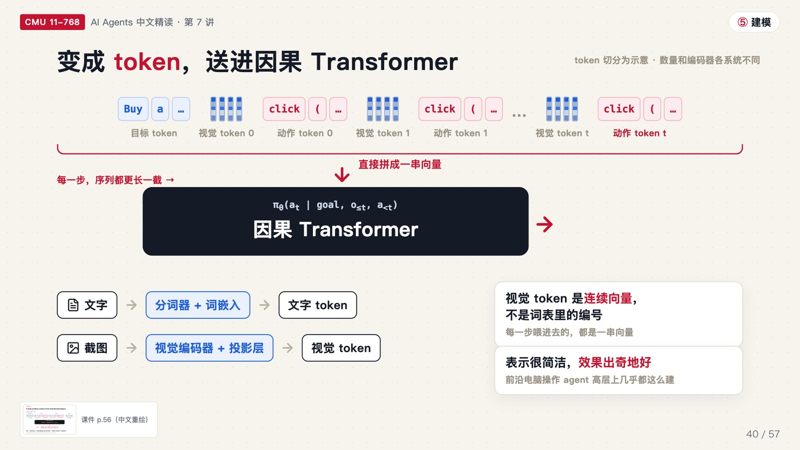

原课件 p.56，第 t 步切成 token 之后的上下文：

| 指令 | 第 0 轮 | | 第 1 轮 | | … | 第 t 轮 |
|---|---|---|---|---|---|---|
| 目标 token："Buy a …" | 视觉 token 0：v₀,₁ … v₀,N | 动作 token 0：`click ( …` | 视觉 token 1：v₁,₁ … v₁,N | 动作 token 1：`click ( …` | … | 视觉 token t：vₜ,₁ … vₜ,N |

全部送进一个**因果 Transformer**（causal Transformer），输出动作 t：`click ( xₜ , yₜ )`。写成公式是

```text
π_θ( aₜ | goal, o≤ₜ, a<ₜ )
```

意思是：参数为 θ 的策略，在给定目标、第 t 步及之前所有观察、第 t 步之前所有动作的条件下，给出第 t 个动作的概率。

| 输入 | 怎么变成向量 |
|---|---|
| 文字（目标、动作） | 分词器（tokenizer）+ 词嵌入 → 文字 token |
| 截图 | 视觉编码器（vision encoder）+ 投影层（projector）→ 视觉 token |

（原课件注：token 切分是示意；视觉 token 是连续的向量，不是词表里的编号；token 数量和编码器各系统不同。）

课上口头补充：实际送进去的不是原始像素。现代语言模型的好处是这些通常直接拼在一起：对模型来说，每一步就是喂进去一串向量，它产生一个动作，这个动作再切成 token 接到后面。这是很简洁的表示，效果出奇地好；据课上所知，几乎所有前沿的电脑操作 agent 在高层上都是这么建模的。

### 7.3 观察差不多，动作各不相同

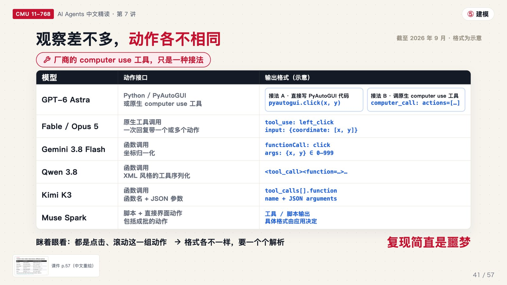

原课件 p.57（截至 2026 年 9 月）：

| 模型 | 动作接口 | 输出格式 / 示意例子 |
|---|---|---|
| GPT-6 Astra | Python / PyAutoGUI，或原生的 computer use 工具 | `pyautogui.click(x, y)`、`computer_call: actions=[…]` |
| Fable / Opus 5 | 原生的 computer use 工具调用（每次回复一个或多个） | `tool_use: left_click`、`input: {coordinate: [x, y]}` |
| Gemini 3.8 Flash | 电脑操作函数调用（坐标归一化） | `functionCall: click`、`args: {x, y} ∈ 0–999` |
| Qwen 3.8 | 函数调用（应用自己定义的界面格式） | `<tool_call><function=…>…`，XML 风格的工具序列化（27B 模板） |
| Muse Spark | 脚本 + 直接的界面动作，包括成批的动作 | 工具 / 脚本输出；具体的界面格式由应用决定（1.1 报告） |
| Kimi K3 | 函数调用（应用自己定义的界面格式） | `tool_calls[].function`，名字 + JSON 参数 |

**各家模型的输出格式和格式规范都不一样（复现简直是噩梦）。**出处：OpenAI、Anthropic、Google、Qwen、Meta、Moonshot 的文档和发布页。

从这张表能读出几件事：

- 厂商提供的 computer use 工具只是一种接法。GPT-6 Astra 那一行就有两种：调原生工具，或者直接写 PyAutoGUI 代码；其他几家用通用的函数调用。第 10 节会看到，OSWorld 的默认动作空间就是"一段 PyAutoGUI 代码"，`step()` 把它原样送进虚拟机执行。
- 坐标的约定不同：有的是屏幕像素，Gemini 是归一化到 0–999（8.4 Q1 讲为什么要归一化）。
- 有的一次回复只出一个动作，有的能出好几个，或者成批的动作。9 节"速度和成本"里，成批动作是减少轮数的一个办法。

课上口头补充：眯着眼看大体相似，都有一组能产生的动作，点击、滚动，或者环境里有的其他动作；但你得把各家的输出解析出来，变成能在环境里真正执行的东西。

### 7.4 建模部分的两个课堂问题

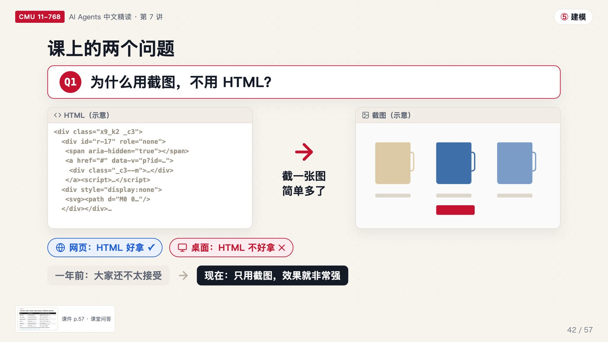

**Q1：为什么用截图而不是 HTML？**（课上口头补充）HTML 也可以，不过 HTML 很乱，大家用过各种简化版。截一张图比处理底层的无障碍元数据简单多了；网页上拿 HTML 容易，桌面上就没那么容易。而且出乎一些人意料，基于截图的做法效果非常强，用 HTML 或别的结构化表示几乎显得没必要。这一点就算一年前，大家也没那么容易接受，但多模态模型现在非常好。

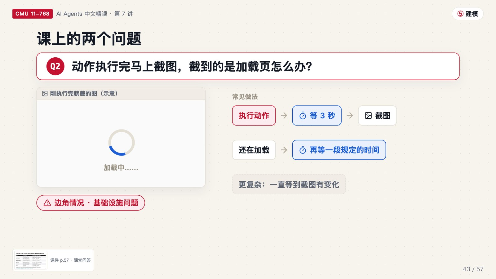

**Q2：动作执行完马上截图，截到加载页怎么办？**（课上口头补充）和数学、编程模型比，电脑操作会碰到大量这类边角情况和基础设施问题。最常见的做法是执行完动作后等几秒，比如等 3 秒再截图；如果那时还是加载页，模型一般被训练成再等一段规定的时间。更复杂的做法是一直等到截图有变化。

OSWorld 就是"等"的做法：`step()` 默认在执行动作后睡 2 秒再截图；动作空间里还有一个专门的 `WAIT` 动作，让模型自己决定再等一会儿（10.4）。

这一节记住一句：电脑操作模型就是一个视觉语言模型，把目标、截图和动作交替排成一条序列，预测下一个动作，只是各家的动作格式不同。

---

## 8 训练

### 8.1 三个训练阶段

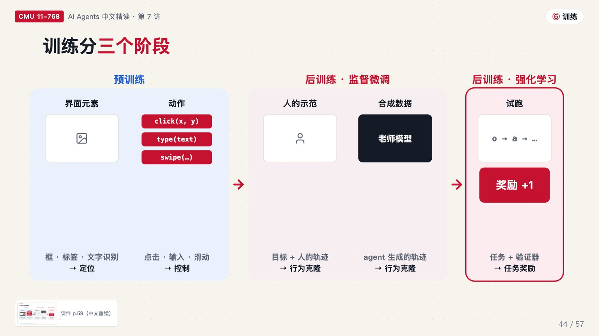

原课件 p.59：

| 阶段 | 数据 | 学到什么 |
|---|---|---|
| **预训练**（pre-training） | 界面元素：框 · 标签 · 文字识别 → 定位<br>动作：`click(x, y)`、`type(text)`、`swipe(…)` → 控制 | 认识屏幕上的东西、会发动作 |
| 后训练：**监督微调**（SFT） | 人的示范：目标 + 人的轨迹 → 行为克隆<br>合成数据：老师模型生成的轨迹 → 行为克隆 | 模仿有用的轨迹 |
| 后训练：**强化学习**（RL） | 强化学习的试跑：o → a → …，奖励 +1；任务 + 验证器 → 任务奖励 | 从结果里学 |

（原课件注：图片取自 Mind2Web、AITW，其余是示意图。）

课上口头补充：大多数电脑操作 agent 都基于预训练好的视觉语言模型。部署 GPT-6 当电脑操作 agent 时，部署的不是一个只会电脑操作的专门版本，而是一个把电脑操作当成能力之一的通用模型；后训练现在通常也和其他能力混在一起训，这里为简化只看电脑操作。

### 8.2 预训练：界面元素和动作

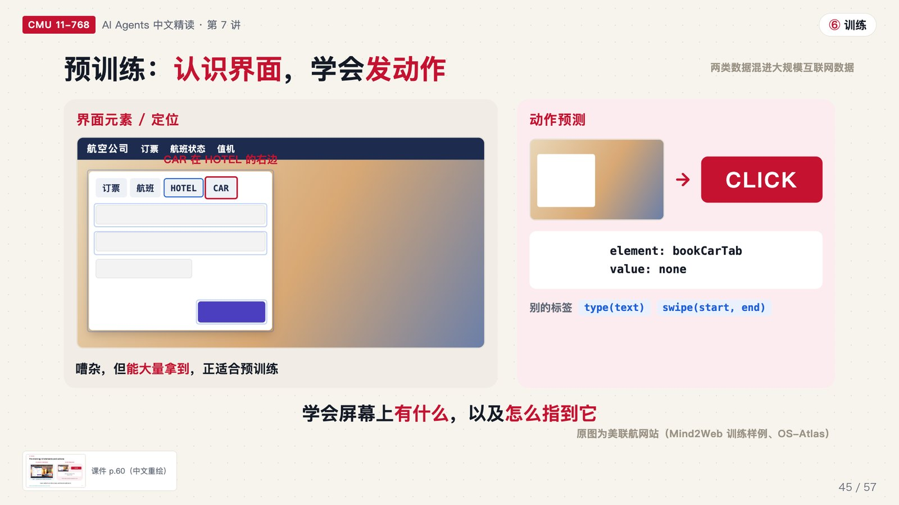

原课件 p.60：**学会屏幕上有什么，以及怎么指到它。**出处：Mind2Web 训练样例（Deng et al., 2023）、OS-Atlas（Wu et al., 2025）。

| 数据 | 例子 | 学到什么 |
|---|---|---|
| 界面元素 / 定位 | 美联航网站截图，"CAR" ↔ 元素框 / 屏幕坐标 | 屏幕上有什么、在哪 |
| 动作预测 | 截图 → CLICK；元素 `bookCarTab`，值：无；还有 `type(text)`、`swipe(start, end)` | 给一个元素，该做什么、点哪里 |

课上口头补充：

- 定位数据：给一张截图，模型对一段很长的描述做下一个 token 预测，归根到底是预测页面上各个元素的坐标，比如 CAR 标签的 x、y，或者框的 x、y、宽、高。
- 这种数据很嘈杂，但能大量拿到：在网站上跑一段简单的 JavaScript，就能把所有框和定位数据抽出来。预训练要的就是大量、嘈杂的数据。
- 动作预测更偏语义理解：从 HTML 页面拿到元素名或元信息作为输入，让模型预测要做什么、点哪里。
- 学到的都是很底层的能力：看懂截图、定位，有时还有元素之间的关系，比如 CAR 按钮在 HOTEL 按钮右边。这些数据混进前沿模型预训练的早期阶段，让模型后面学定位、学发动作更轻松。

注意 Mind2Web 同一份数据有两种用法：3.4 节它是静态评测基准，这里它是预训练数据。原课件附录也说，很多定位和示范数据集同时就是静态基准。

### 8.3 监督微调：模仿人和老师

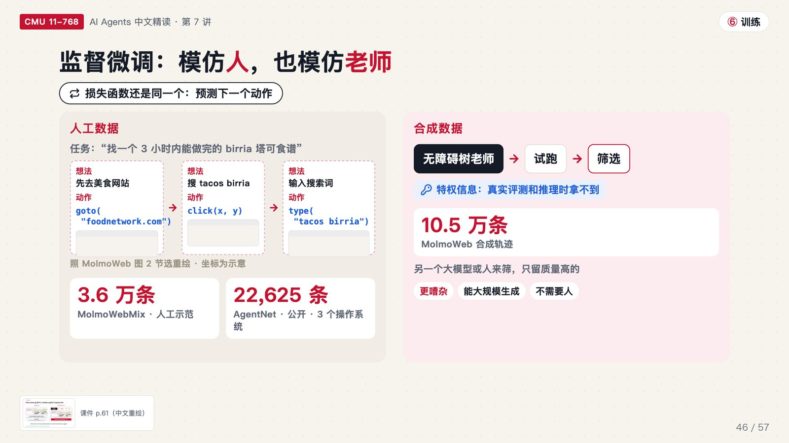

原课件 p.61：**损失函数还是同一个"预测下一个动作"；示范可以来自人，也可以来自 agent。**

| | 人工数据 | 合成数据 |
|---|---|---|
| 怎么来 | 花钱请人在浏览器里真做一遍，每一步录下截图和动作 | 让一个会用无障碍树的"老师"模型试跑 → 过滤 |
| 例子 | MolmoWebMix：3.6 万条人工示范；AgentNet：公开了 22,625 条任务轨迹，覆盖 3 个操作系统 | MolmoWebMix：10.5 万条合成轨迹 |
| 质量 | 高 | 通常更嘈杂，要用另一个大模型或人来筛 |
| 规模 | 贵，难放大 | 能大规模生成，不需要人 |

出处：MolmoWeb（Gupta et al., 2026）图 2 节选和表 2、OpenCUA（Wang et al., 2025）表 2 和 §2.3。图上的人工任务是"找一个 3 小时内能做完的 birria 塔可食谱"，轨迹从去 foodnetwork.com 开始，每一步有想法、动作和截图。

合成数据这里的关键是**特权信息**（课上口头补充）：MolmoWeb 给老师模型看网站的无障碍树，这是真实评测和推理时拿不到的信息，所以老师做得比只看截图好；收集到同样格式的"截图—动作"轨迹之后，学生只用截图来学。

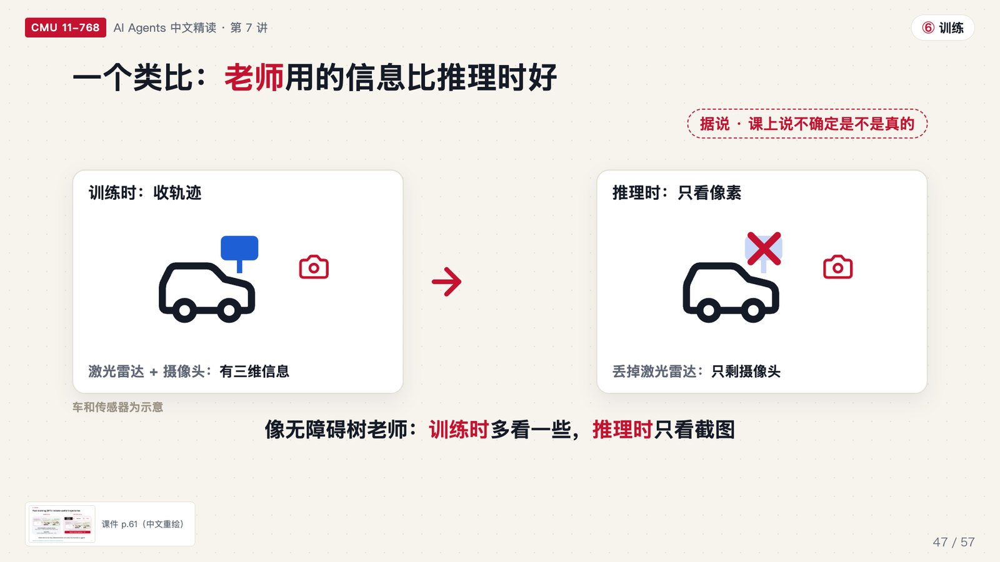

课上用了一个类比，但说不确定是不是真的：据说特斯拉训练时让车装着激光雷达跑自动驾驶，有了三维激光雷达信息当然做得好得多；收集这些轨迹后丢掉激光雷达信息，训练模型只用像素。等于有一个老师用了比推理时好得多的信息。很多电脑操作的应用也试过类似办法，注入元数据或额外信息来收集更好的轨迹。

| | 老师（收集轨迹时） | 学生（训练和部署时） |
|---|---|---|
| 自动驾驶的类比（据说） | 摄像头 + 激光雷达 | 只有摄像头 |
| MolmoWeb | 截图 + 无障碍树 | 只有截图 |
| 6.6 Q3 的评分细则 | 生成细则的模型拿到提示或 HTML | 被评测的 agent 拿不到 |

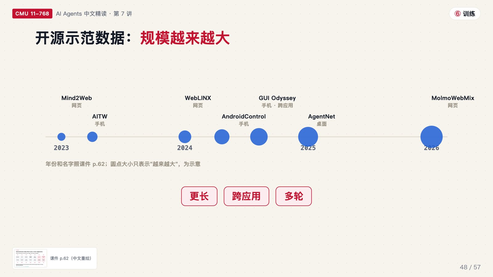

原课件 p.62：**人工和合成的轨迹，现在覆盖更长、更多样的工作流。**（课上一带而过，表里的数字课上没讲。）

| 年份 | 数据集 | 规模 | 类型 |
|---|---|---|---|
| 2023 | Mind2Web | 2,350 个任务，137 个网站 | 网页 |
| 2023 | AITW | 71.5 万条操作记录，3 万条指令 | 手机 |
| 2024 | WebLINX | 10 万次交互，2.3K 条示范 | 网页 |
| 2024 | AndroidControl | 15,283 条示范，833 个应用 | 手机 |
| 2024 | GUI Odyssey | 7,735 条操作记录，跨应用 | 手机 |
| 2025 | AgentNet | 22,625 个任务，每条轨迹 18.6 步 | 桌面 |
| 2026 | MolmoWebMix | 3.6 万人工 + 10.5 万合成的任务轨迹 | 网页 |

**规模随时间变大；数据类型也转向更长、跨应用、多轮的监督。**

### 8.4 训练部分的两个课堂问题

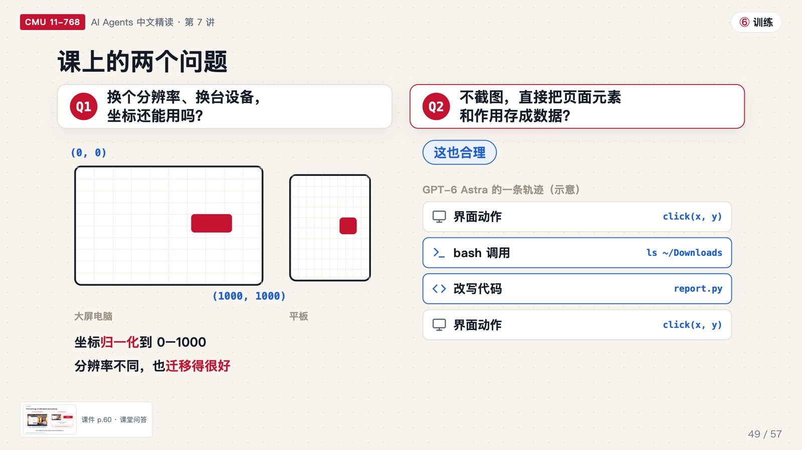

**Q1：预训练学到的坐标，换个分辨率、换台设备，还能用吗？**（课上口头补充）收集坐标数据时通常是归一化的：不用绝对值，而是 0 到 1000，(0, 0) 是屏幕左上角，(1000, 1000) 是右下角。实践中常见的情况是，即使绝对分辨率不同，这样也迁移得很好。对应 7.3 表里 Gemini 的坐标是 0–999。

换算很简单：在 1920 × 1080 的屏幕上，归一化坐标 (500, 500) 对应像素 (960, 540)；在 2560 × 1440 的屏幕上对应 (1280, 720)。模型只学"在屏幕的哪个比例位置"，执行层负责换成像素（示意计算）。

**Q2：有没有更高效的办法？比如不截图，把页面上各元素的值和作用存成数据，直接给模型？**（课上口头补充）这也是合理的做法。现在的模型不是训成只会点屏幕的电脑操作 agent：用 GPT-6 Astra 时，它不总是做界面动作，会穿插 bash 调用、改写代码，模型通常会用最高效的方式解决问题。所以这类数据在训练和推理时肯定都会用。

### 8.5 强化学习：从打过分的试跑里学

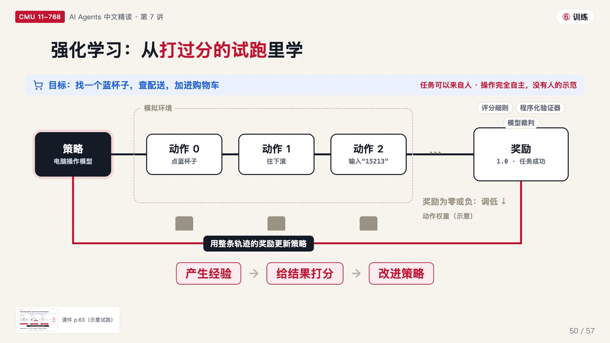

原课件 p.63，目标：**找一个蓝杯子，查配送，加进购物车。**策略动作 0 点蓝杯子 → 动作 1 往下滚 → 动作 2 输入"15213"→ …… → 奖励 1.0：任务成功 → **用整条轨迹的奖励更新策略**。

**产生经验 → 给结果打分 → 改进策略。**（原课件注：这是示意的试跑；CUA-Gym / Gym-Anything 提供可交互的任务和验证器。）

课上口头补充：

- 一年前还不常见，现在电脑操作 agent 普遍要过这一关：把模型丢进模拟环境，给它一件事做，最后用评分细则、程序化验证器或大模型裁判给个奖励。也可以放到真实网络上，但现在没人真这么做。
- 大体上，奖励为正，就把这条轨迹里动作的权重调高一点；为 0 或为负，就调低。
- 这些任务没有人的示范，任务可以来自人，但操作完全自主，从成功和失败里学。前面两个阶段给强化学习打下了基础。

原课件 p.64 把监督微调和强化学习放在一起对比（课上没展开），任务"把一个限价以内的蓝杯子加进购物车；不要结账"，三步动作：历史 + 屏幕 → 点商品；→ 加入购物车；→（购物车页）核对 / 停止。

| | 监督微调 | 强化学习 |
|---|---|---|
| 学的是 | **预测下一个动作**：每一步都有标准答案 | **按结果评价整条轨迹** |
| 信号从哪来 | 示范（人或老师） | 奖励（验证器、细则、裁判） |
| 第三步"核对 / 停止"怎么学到 | 示范里有人在这一步停下 | 停下的轨迹拿到奖励，继续点下单的轨迹被判违规 |
| 需要什么 | 示范数据 | 能反复试、能打分的环境 |

这里可以看出第 3–6 节的评测和训练是连着的：评测时用的验证器、细则和裁判，在强化学习里就是奖励函数。验证器有漏洞（4.3 的"空"没查），强化学习就会学会钻这个漏洞，这就是奖励投机为什么在训练里是大问题。

### 8.6 为什么要模拟环境

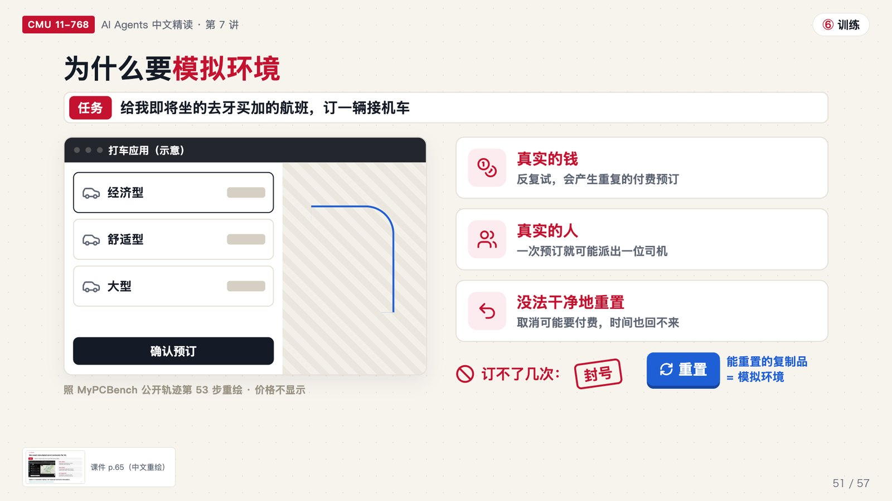

原课件 p.65，任务：**给我即将坐的去牙买加的航班订一辆接机车。**图是 MyPCBench 任务 `bounded_action-f041` 公开轨迹的第 53 步，一个打车应用里列着几档车型。

| 风险 | 说明 |
|---|---|
| 真实的钱 | 反复尝试会产生重复的付费预订 |
| 真实的人 | 一次预订就可能派出一位司机；探索会影响别人 |
| 没法干净地重置 | 取消可能要付费；花掉的时间回不来 |

**在能重置的复制品里探索，而不是一遍遍地和真实世界交互。**课上口头补充：在 Uber 上订接机，订不了几次就会被封号，或者钱花光了。所以要模拟环境来做强化学习。

第 10.2 节会看到"能重置"在代码里是什么样：OSWorld 每次 `reset()` 都先把虚拟机回滚到一个快照，再按任务配置下载文件、打开应用。

### 8.7 专门造模拟环境：CUA-Gym 和 Gym-Anything（课上没展开）


课上说这部分不细讲，可以看课件。视频里各用一句话带过，这里按原课件 p.66–73 展开。

#### CUA-Gym（Wang et al., 2026）

**造应用**（p.66，出自论文图 2 和 §2.2）：94 个模拟网页应用，"规划 → 实现 → 测试"。

| 角色 | 做什么 |
|---|---|
| 来源 | Google 文档、Teams、Notion、亚马逊、Slack、微信、YouTube 等真实产品 |
| 规划 agent | 上网搜索、头脑风暴，起草开发文档 |
| 开发 agent | 按 TODO.md 和 DESIGN.md 做前端开发，在本地部署和预览，来回多轮 |
| 网页 agent | 用 Playwright 检查界面和交互，把实际页面和标准对比 |
| 工程 | 起草数据库结构、设计 API，交付 SKILL.md |

每个模拟应用要做到三件事：**注入初始状态、检查最终状态、每个会话重置**。一个模拟应用通过受控、隔离的状态支持很多个任务。

**造任务和奖励**（p.67，出自论文图 1 和 §2.1）：约 3.2 万个验证过的元组，110 个环境。

| 环节 | 做什么 |
|---|---|
| 任务生成 | 搜索网页、找文档和教程、读准备好的素材。例子："给 Notion 页面里列出的每个客户发一封邮件，附上他们在桌面上 clients.xlsx 里的交易" |
| 编排器 | 加载任务和上下文，标注难度、领域、涉及的应用，准备虚拟机，启动 agent 循环 |
| 生成器 | 写出初始化脚本 `initial_setup.py` 和标准答案 `golden_patch.py` |
| 判别器 | 拆出奖励标准（邮件在已发送里、内容符合模板、收件人和 Notion 数据库一致），写出 `reward.py`，在真实环境里验证；没满足就反馈重试。**生成器和判别器之间信息隔离** |
| 过滤 | 大模型多数投票（一致性、可执行性、能否被投机、清晰度、难度）；老师模型试跑，算奖励、查奖励日志、视觉语言模型复核 |
| 产出 | 每条是（任务, 初始化, 奖励），奖励在 0 到 1 之间 |

**把世界和它的奖励分开独立生成，再测两者是否一致。**为什么要隔离：如果写奖励的和写标准答案的是同一个，它很可能写出一个"恰好让自己的答案通过"的奖励，查不出任务本身有没有说清楚。分开写、再互相验证，才能发现"奖励能被投机"这类问题（这是按流程推出来的理由，原课件没逐条讲）。

**规模**（p.68，出自论文图 8(a) 和 §2.3）：

| | |
|---|---|
| 环境 | 110 个（94 个模拟网页应用 + 16 个桌面应用） |
| 验证过的可验证奖励强化学习（RLVR）元组 | 32,112 个 |
| 跨应用任务 | 38% |

模拟的应用按类别有：开发运维（AWS、Azure、GCP、Vercel……）、办公和沟通（Slack、Teams、Discord、微信、钉钉、飞书）、项目管理（Asana、Jira、Trello、Notion、Monday、Linear）、商务、人力、电商、内容、医疗法律地产、中文和国际（12306、微博、小红书、知乎），以及桌面应用（Calc、Writer、Impress、GIMP、VS Code、Chrome、VLC、Blender 等）。**一个大而广的环境池，支撑很多个独立验证过的任务。**

#### Gym-Anything / CUA-World（Aggarwal et al., 2026）

| 阶段（原课件 p.70–71，论文图 2） | 做什么 |
|---|---|
| 1 按 GDP 选软件 | 从 894 种职业和 GDP 数据出发，一边优先高影响（高 GDP 的软件、医疗教育等战略领域、工程科学等 STEM 领域），一边保证覆盖面；图上有 QGIS、3D Slicer、FreeCAD、Odoo、Blender、GIMP 等 |
| 2 把任意软件变成 agent 环境 | **创建 agent** 用 bash、Python、图形界面写代码库、启动软件；**审计 agent** 做质量检查；两者共用一份记忆，来回迭代 |
| 3 扩充任务 | 每个软件先提 5 个种子任务，执行；再以种子为示例，用大模型生成 75 倍的任务，按执行结果过滤 |
| 4 在 CUA-World 上评测 | agent 执行任务留下截图，视觉语言模型验证器拿着**加权清单和特权信息**打分，给部分分，再做完整性检查 |

**创建 agent 负责搭，独立的审计负责核验证据。**图上的评分例子："导入的病人数据集正确 3/3、CT 扫描标注没对齐（打叉）、报告导出成 PDF 2/2"，得分 5/7。

规模（p.70、p.72）：200 个软件应用、3 个操作系统（Linux、Windows、Android）、12,103 个任务和环境（CUA-World 里 1 万个以上任务），覆盖美国标准职业分类（SOC）的 22 / 22 个大类。

**蒸馏成功的轨迹**（p.73，论文图 6(a)、表 3 和 §6.1–7.1；CUA-World-Test，界面动作，最多 200 步，用 Gemini 3 Flash 按清单评判）：

| Kimi-K2.5 当老师 → Qwen3-VL-2B-Thinking 当学生 | |
|---|---|
| 成功的监督微调轨迹 | 约 2,000 条 |
| 平均清单得分（满分 100） | 12.7 → 22.5 |
| 清单全部满足的比例 | 1.6% → 4.4% |

图上的曲线：横轴是用了多少比例的训练数据，两条线分别按软件数和按任务数扩充。图上标的数：0% 时 12.7；25% 时按软件 16.3、按任务 14.6；50% 时按软件 17.6、按任务 18.3；100% 时 22.5。**软件更多、任务更多，都对监督式后训练有帮助。**注意这一组是监督微调（蒸馏），不是强化学习；而"全部满足"只有 4.4%，和平均分 22.5 一比，又是 6.2 节那个"部分分和完美完成差很远"。

### 8.8 验证过的试跑让策略变好：CUA-Gym 的结果


原课件 p.69 的标题数字：**3,578 条监督微调示范 → 在 10,858 个验证过的元组上做 GSPO（一种强化学习算法）。OSWorld 上的表现：62.2% → 72.6%。**（OSWorld-Verified，界面调用，模型最多 100 步，程序化检查；出自 CUA-Gym §3 的主要结果。）

同一页的图是另一组实验：论文图 9 的**数据规模消融**。两组数字不要连起来读。

| | 主结果（标题数字） | 数据规模消融（图） |
|---|---|---|
| 出处 | CUA-Gym §3 | CUA-Gym 图 9 |
| 比的是什么 | 强化学习前后 | 用 12K、3K、1.4K 个元组做强化学习，各自涨多少 |
| 数字 | 62.2% → 72.6% | 监督微调起点 0.53（图上虚线标注"SFT init (0.53)"），见下 |

图的读法：左边纵轴是 OSWorld-Verified 得分，右边纵轴是训练奖励，横轴都是强化学习训练步数（1 到 100）。按原图读数，只作趋势参考：

| | 12K 个元组 | 3K 个元组 | 1.4K 个元组 |
|---|---|---|---|
| 左图：第 100 步的 OSWorld-Verified 得分 | 约 0.60 | 约 0.57 | 约 0.57 |
| 右图：训练奖励 | 从约 0.33 升到约 0.58 | 从约 0.44 先降后升，到约 0.46 | 从约 0.21 升到约 0.58 |

元组越多，评测分涨得越多；1.4K 那条训练奖励涨得和 12K 一样高，评测分却不如 12K，说明训练奖励涨得多不等于泛化得好（这是读图得出的观察，原课件没讲）。

课上口头补充：课上只在这张图上停了一下，说强化学习这部分后训练对练出强的电脑操作能力非常重要：监督微调之后大约 0.5 几，做完强化学习爬到大约 0.6 或更高（这是左图的读数）。课上还说，按实践中常见的情况，强化学习还能带来光靠人的示范很难练出的能力：很长的任务通常没有人的示范，收集起来太贵，用强化学习训就容易得多。

### 8.9 三个阶段回顾


原课件 p.74 和 p.59 同一张图，最后多了一个箭头指向**强的电脑操作 agent**。课上口头补充：预训练；后训练里先在人的示范和合成数据上做行为克隆；最后像蛋糕上的樱桃，做强化学习，让模型在模拟环境里跑、拿环境给的奖励。在高层上，这就是大多数实验室现在训练电脑操作模型的流程。

| 阶段 | 数据从哪来 | 本讲的例子 | 和评测的关系 |
|---|---|---|---|
| 预训练 | 网页上抽出来的框和坐标，嘈杂但量大 | Mind2Web 训练样例、OS-Atlas | 定位能力，正是 ScreenSpot-Pro 量的 |
| 监督微调 | 人的示范、带特权信息的老师 | MolmoWebMix、AgentNet、Gym-Anything 的蒸馏 | 学"每一步该做什么"，像静态评测 |
| 强化学习 | 能重置的模拟环境 + 验证器 | CUA-Gym | 验证器就是端到端评测的那一套 |

这一节记住一句：预训练学认界面、学发动作，监督微调模仿人和带特权信息的老师，强化学习在能重置的模拟环境里按结果来学。

---

## 9 还没解决的问题（课上没展开）


课上时间只够点一句：速度仍然是个问题；个性化是很值得做研究的方向；基础设施和用户体验是大问题；多 agent 系统也很让人期待。下面按原课件 p.77–80 整理。

### 9.1 速度和成本（p.77）

**更快的电脑操作 agent，系统和模型两边都要改进。任务时间 ≈ 轮数 × 每轮时间。**

| 做法 | 节奏 |
|---|---|
| 每一步都推理 | 想 · 做 · 想 · 做 · 想 · 做 |
| Game-TARS：稀疏推理 | 想 · 做 · 做 · 做 · 想 · 做 |
| FDM-1：直接预测动作 | 做 · 做 · 做 · 做 · 做 · 做 |

- **长上下文很贵**：截图和推理都增加预填充和生成的成本。
- **Game-TARS 的稀疏思考**（ByteDance Seed, 2025）：只在关键决策时推理，常规步骤直接做。
- **更少、更便宜的轮次**：改进规划和动作批量化；探索直接预测动作的模型（FDM-1，Standard Intelligence, 2026）。

拿 6.3 的数字体会一下：OSWorld 2.0 的 agent 平均调用 318 次，每次调用都要带上越来越长的截图历史。轮数和每轮时间，两边都值得砍。

### 9.2 个性化：适应用户（p.78）

| | |
|---|---|
| 个人上下文会改变答案 | 用用户自己的文件、历史和偏好，而不是通用的默认值 |
| 记忆必须能修改 | GUM（Shaikh et al., 2025）检索并更新带置信度的用户事实 |
| 用户必须能控制 | MyPCBench 测个人上下文；授权和遗忘是必不可少的 |

GUM 图 1 的例子：从用户的屏幕活动推出"约翰和艾米丽邀请你参加婚礼""是斯坦福的博士生"这类命题，每条带一个置信度，再用来找"适合参加朋友婚礼、符合博士生预算的西装租赁"。这和第 4 讲的记忆是同一类问题，只是记忆的来源变成了屏幕。

### 9.3 基础设施和交互（p.79）

图是 OpenAI 2026 年"Codex for (almost) everything"的演示截图：Codex 在后台操作一个井字棋小应用。

- **别挡着用户**：在隔离的后台会话里运行，用户手上的工作照常进行。
- **实时协作**：展示进度；接受纠正、审批和打断。
- **为电脑操作 agent 设计新的界面和交互**：还有很多可以探索。

**主动做事，需要用户授权、过程看得见、随时能一键关掉。**

### 9.4 多 agent 系统（p.80）

**MACU：规划 → 并行 → 重新规划。**图出自 MACU（Koh, Salakhutdinov & Fried, 2026）图 1 / §3（改画）：用户任务 → 管理者建一张任务依赖图 → 调度循环把准备好的子任务派给并行的电脑操作子 agent，每个在虚拟机池里自己的虚拟机上跑 → 子任务完成后进入跟进循环，管理者决定继续还是更新指令 → 最后输出总结和交付物。

- **按依赖关系分工**：把准备好的子任务派给在隔离环境里运行的电脑操作 agent。
- **共享证据，再重新规划**：交接文件和结果；核验工作，从失败中恢复。
- **不只用同一种电脑操作 agent**：把电脑操作 agent、写代码的 agent、调工具的 agent 组合起来；控制冲突和开销。

**只有协调能保证正确，并行才有用。**MACU 第 5 讲第 5 节已经详细讲过（强管理者、弱执行者、规划预算那几组实验），这里是同一个系统从电脑操作这一侧看。

---

## 10 源码解读：OSWorld 怎么跑一个任务、怎么判记账表

5.2 节那个"用收据更新记账表"的任务，原课件 p.36 直接链到了 OSWorld 仓库里的任务文件。下面顺着它读：任务怎么描述，环境怎么重置、怎么执行动作，最后怎么打分。

出处：[xlang-ai/OSWorld](https://github.com/xlang-ai/OSWorld)（Apache-2.0 许可），`main` 分支提交 `044bc33`（`044bc33901cb893808e3f91ebc9a17ed8e54b44c`，2026-10-24），涉及这几个文件：

| 文件 | 讲什么 | 本讲对应 |
|---|---|---|
| [`evaluation_examples/examples/multi_apps/8e116af7-7db7-4e35-a68b-b0939c066c78.json`](https://github.com/xlang-ai/OSWorld/blob/044bc33901cb893808e3f91ebc9a17ed8e54b44c/evaluation_examples/examples/multi_apps/8e116af7-7db7-4e35-a68b-b0939c066c78.json) | 记账表任务：指令、初始化、评测规则 | 5.1"每个任务带着初始化逻辑和定制的状态检查"、5.2 |
| [`lib_run_single.py`](https://github.com/xlang-ai/OSWorld/blob/044bc33901cb893808e3f91ebc9a17ed8e54b44c/lib_run_single.py) | 跑一个任务的主循环 | 1.2 观察—推理—行动的循环 |
| [`desktop_env/desktop_env.py`](https://github.com/xlang-ai/OSWorld/blob/044bc33901cb893808e3f91ebc9a17ed8e54b44c/desktop_env/desktop_env.py) | `reset`、`step`、`evaluate` | 8.6 能重置；1.2 基础设施；4.1 检查程序状态 |
| [`desktop_env/controllers/python.py`](https://github.com/xlang-ai/OSWorld/blob/044bc33901cb893808e3f91ebc9a17ed8e54b44c/desktop_env/controllers/python.py) | 动作怎么送进虚拟机执行、截图怎么拿 | 7.3 PyAutoGUI 动作 |
| [`desktop_env/controllers/setup.py`](https://github.com/xlang-ai/OSWorld/blob/044bc33901cb893808e3f91ebc9a17ed8e54b44c/desktop_env/controllers/setup.py) | 按配置初始化环境 | 5.1 初始化逻辑 |
| [`desktop_env/evaluators/metrics/table.py`](https://github.com/xlang-ai/OSWorld/blob/044bc33901cb893808e3f91ebc9a17ed8e54b44c/desktop_env/evaluators/metrics/table.py)、[`utils.py`](https://github.com/xlang-ai/OSWorld/blob/044bc33901cb893808e3f91ebc9a17ed8e54b44c/desktop_env/evaluators/metrics/utils.py) | `compare_table` 和数值比较 | 5.2 的检查 |

最后 10.7 节对照 WebArena 仓库（[web-arena-x/webarena](https://github.com/web-arena-x/webarena)，Apache-2.0，`main` 分支提交 `dce0468`，即 `dce04686a56253aefba7b18a4fa0937cf1dc987b`，2025-11-26）里 4.3 节那个"空仓库"任务。

为讲解删去了：日志、重试和超时处理、代理（proxy）配置、云厂商快照的细节、录屏、无关的规则类型和部分 docstring。删掉的位置用 `...` 标出；中文注释是本课件加的，英文注释是源码原有的。这两个仓库都还在更新，读最新版时行号和细节可能已经变了。

### 10.1 任务文件：指令、初始化、评测规则都在一个 JSON 里

```json
// evaluation_examples/examples/multi_apps/8e116af7-7db7-4e35-a68b-b0939c066c78.json（节选）
{
  "id": "8e116af7-7db7-4e35-a68b-b0939c066c78",
  "snapshot": "libreoffice_calc",
  "instruction": "Please update my bookkeeping sheet with the recent transactions from the provided folder, detailing my expenses over the past few days.",
  "config": [                                   // 初始化：reset 时按顺序执行
    {"type": "download", "parameters": {"files": [
      {"path": "/home/user/Desktop/my_bookkeeping.xlsx", "url": "https://huggingface.co/.../my_bookkeeping.xlsx"},
      {"path": "/home/user/Desktop/receipt_0.jpeg",     "url": "..."},
      ...                                       // 删：receipt_1.jpg、receipt_2.jpg、receipt_3.pdf、receipt_4.jpg
    ]}},
    {"type": "open", "parameters": {"path": "/home/user/Desktop/my_bookkeeping.xlsx"}}   // 先把表打开
  ],
  "related_apps": ["libreoffice_calc", "os", "image", "pdf"],
  "evaluator": {
    "postconfig": [                             // 评测前先替 agent 做的事
      {"type": "activate_window", "parameters": {"window_name": "my_bookkeeping.xlsx - LibreOffice Calc", "strict": true}},
      {"type": "sleep", "parameters": {"seconds": 0.5}},
      {"type": "execute", "parameters": {"command": ["python", "-c",
        "import pyautogui; pyautogui.hotkey(\"ctrl\", \"s\");"]}},   // 按一次 Ctrl+S 保存
      {"type": "sleep", "parameters": {"seconds": 1.0}}
    ],
    "func": "compare_table",                    // 用哪个评测函数
    "result":   {"type": "vm_file",    "path": "/home/user/Desktop/my_bookkeeping.xlsx", "dest": "my_bookkeeping.xlsx"},
    "expected": {"type": "cloud_file", "path": "https://huggingface.co/.../my_bookkeeping%20Gold.xlsx", "dest": "my_bookkeeping_gold.xlsx"},
    "options": {"rules": [
      {"type": "sheet_fuzzy", "sheet_idx0": "RNSheet1", "sheet_idx1": "ENSheet1",
       "rules": [{"range": ["A1:A8", "B1:B8", "C1:C8", "D1:D8", "E1:E8"], "type": "exact_match"}]},       // 原来的 8 行和参考表一字不差
      {"type": "sheet_fuzzy", "sheet_idx0": "RNSheet1", "sheet_idx1": "ENSheet1",
       "rules": [{"range": ["C9:C13"], "type": "exact_match", "ignore_case": true}]},                    // 新 5 行的类别，大小写不敏感
      {"type": "check_cell", "sheet_idx": 0, "coordinate": "D9",
       "props": {"value": {"method": "approx:0.1", "ref": -186.93}}},                                   // 金额，误差 0.1 以内
      ...                                       // 删：D10–D13 四条，ref 依次是 -3670、-5.7、-154.06、-8.1
      {"type": "check_cell", "sheet_idx": 0, "coordinate": "E9",
       "props": {"value": {"method": "approx:0.1", "ref": 603.07}}},                                    // 累计余额
      ...                                       // 删：E10–E13 四条，ref 依次是 -3066.93、-3072.63、-3226.69、-3234.79
    ]}
  },
  ...                                           // 删：trajectory、proxy、fixed_ip、possibility_of_env_change
}
```

（JSON 本身不允许注释，`//` 是本课件为讲解加的；两个下载地址的前缀用 `...` 省略了。）

和原课件 p.36 对照：

| 原课件写的 | 配置里实际是 |
|---|---|
| A1:E8 不变 | 五列 A1:A8 … E1:E8，和参考表**完全相同**（`exact_match`） |
| C9:C13 填上支出类别 | 和参考表完全相同，但**不区分大小写** |
| D9 ≈ −186.93，E9 ≈ 603.07 | D9–D13、E9–E13 共 10 个单元格，每个和参考值相差不超过 **0.1** |

几点值得注意：

- **一个任务就是一份数据**。指令、要下载哪些文件、先打开什么、评测前做什么、用哪个函数怎么比，都写在这个 JSON 里，环境代码对所有任务通用。这就是 5.1 说的"每个任务带着初始化逻辑和定制的状态检查"。
- 收据有 jpeg、jpg 和一个 pdf，`related_apps` 写着表格、系统、图片、PDF 四类：agent 得在看图软件、PDF 阅读器和 Calc 之间来回切。
- `postconfig` 里环境**替 agent 按了一次 Ctrl+S**。所以这个任务判的是"表里的内容对不对"，不判"agent 记不记得保存"。评测设计者在这里选了宽一点，正是 6.6 Q1 说的"宁可多给假阳性"的一个具体例子。
- `result` 是从虚拟机里取回的文件，`expected` 是预先放在网上的参考答案。比的是**文件内容**，不看 agent 的任何一步动作：这是 3.1 里的"判结果"，没有"判过程"。

### 10.2 reset：回滚快照，再按配置初始化

```python
# desktop_env/desktop_env.py
class DesktopEnv(gym.Env):
    def __init__(self, provider_name: str = "vmware", ..., snapshot_name: str = "init_state",
                 action_space: str = "pyautogui",                       # 默认动作空间：一段 PyAutoGUI 代码
                 screen_size: Tuple[int] = (int(os.environ.get("SCREEN_WIDTH", 1920)),
                                            int(os.environ.get("SCREEN_HEIGHT", 1080))),
                 require_a11y_tree: bool = True,                         # 默认观察里带无障碍树
                 require_terminal: bool = False, ...):
        ...
        assert action_space in [
            "computer_13",            # 一组固定的结构化动作
            "pyautogui",
            "claude_computer_use",
            "autoglm_computer_use",
            "gemini_computer_use",    # 各家原生 computer use 工具的接法
        ]

    def reset(self, task_config: Optional[Dict[str, Any]] = None, seed=None, options=None) -> Dict[str, Any]:
        ...
        self._step_no = 0
        self.action_history.clear()
        for attempt in range(MAX_RETRIES):                     # MAX_RETRIES = 5
            ...                                                # 删：代理相关
            if self.is_environment_used:                       # 上一个任务动过这台机器
                self._revert_to_snapshot()                     # 回滚到快照 init_state：没法干净重置的问题在这里解决
                self._start_emulator()
                self.is_environment_used = False
            ...
            if task_config is not None:
                ...
                self._set_task_info(task_config)               # 读指令、config、evaluator
                success = self.setup_controller.setup(self.config, ...)   # 按 config 逐条执行：download、open……
                if success:
                    break
        ...
        observation = self._get_obs()
        return observation

    def _get_obs(self):
        # We provide screenshot, accessibility_tree (optional), terminal (optional), and instruction.
        return {
            "screenshot": self.controller.get_screenshot(),
            "accessibility_tree": self.controller.get_accessibility_tree() if self.require_a11y_tree else None,
            "terminal": self.controller.get_terminal_output() if self.require_terminal else None,
            "instruction": self.instruction
        }
```

`setup_controller.setup` 怎么把 `"type": "download"` 变成一次函数调用：

```python
# desktop_env/controllers/setup.py
    def setup(self, config: List[Dict[str, Any]], use_proxy: bool = False) -> bool:
        ...                                                    # 删：先确认虚拟机里的服务能连上
        for i, cfg in enumerate(config):
            config_type: str = cfg["type"]
            parameters: Dict[str, Any] = cfg["parameters"]
            # Assumes all the setup the functions should follow this name protocol
            setup_function: str = "_{:}_setup".format(config_type)   # "download" → _download_setup
            assert hasattr(self, setup_function), f'Setup controller cannot find init function {setup_function}'
            try:
                if getattr(self, setup_function)(**parameters) is False:
                    raise RuntimeError("Setup step explicitly returned False")
            except Exception as e:
                ...
                raise Exception(f"Setup step {i+1} failed: {setup_function} - {e}") from e
        return True
```

对照本讲：

| 代码里 | 对应 |
|---|---|
| `_revert_to_snapshot()` | 8.6"在能重置的复制品里探索"：每个任务开始前，虚拟机回到同一个干净状态 |
| `config` 里的 `download`、`open` | CUA-Gym 说的"注入初始状态"（8.7）；CUA-Gym 的生成器写的 `initial_setup.py` 是同一件事 |
| `_get_obs` 默认带 `accessibility_tree` | 6.6 Q2：截图之外，环境也能给无障碍树，用不用由 agent 决定 |
| 默认屏幕 1920 × 1080 | 8.4 Q1：模型看到的分辨率由环境决定，坐标要换算 |

### 10.3 主循环：预测、执行、截图，最后才打分

```python
# lib_run_single.py
def run_single_example(agent, env, example, max_steps, instruction, args, example_result_dir, scores):
    ...
    env.reset(task_config=example)
    ...
    time.sleep(60) # Wait for the environment to be ready
    obs = env._get_obs() # Get the initial observation
    done = False
    step_idx = 0
    ...
    while not done and step_idx < max_steps:                  # 两种结束：模型说做完了，或步数用完
        response, actions = agent.predict(instruction, obs)   # 模型：看指令和观察，出推理和一个或多个动作
        for action in actions:
            ...
            obs, reward, done, info = env.step(action, args.sleep_after_execution)
            ...                                               # 删：存截图、写 traj.jsonl
            if done:
                break
        step_idx += 1
    time.sleep(20) # Wait for the environment to settle
    result = env.evaluate()                                   # 循环结束后才算奖励
    scores.append(result)
    ...
```

这就是 1.3 节伪代码的真实版本。两点：

- `agent.predict` 返回的是一个**动作列表**：一次回复可以带好几个动作，对应 7.3 表里"每次回复一个或多个"。
- `step` 返回的 `reward` 一直是 0（见下一节），真正的分数只在最后 `evaluate()` 给一次。OSWorld 的奖励是 6.1 说的那种**稀疏**的最终奖励。

### 10.4 step：动作是一段代码，送进虚拟机执行

```python
# desktop_env/desktop_env.py
    def step(self, action, pause=2):
        self._step_no += 1
        self.action_history.append(action)                    # 记下每一步，evaluate 时要看最后一个
        self.is_environment_used = True                       # 动过了，下次 reset 要回滚快照
        reward = 0  # todo: Define reward calculation for each example
        done = False  # todo: Define episode termination condition for each example
        info = {}
        # handle the special actions
        if action in ['WAIT', 'FAIL', 'DONE'] or (type(action) == dict and action['action_type'] in ['WAIT', 'FAIL', 'DONE']):
            if action == 'WAIT' or ...:
                time.sleep(pause)                             # 模型自己要求再等一会儿
            elif action == 'FAIL' or ...:
                done = True
                info = {"fail": True}                         # 模型声明"这个任务做不了"
            elif action == 'DONE' or ...:
                done = True
                info = {"done": True}                         # 模型声明"做完了"
        if self.action_space == "computer_13":
            self.controller.execute_action(action)
        elif self.action_space in ["pyautogui", "claude_computer_use", "gemini_computer_use"]:
            if action in ['WAIT', 'FAIL', 'DONE'] or ...:
                self.controller.execute_action(action)
            else:
                # the set of all possible python commands insides `pyautogui`
                if type(action) == str:
                    command = action
                    self.controller.execute_python_command(command)   # 一段 Python 代码，比如 pyautogui.click(960, 540)
                elif type(action) == dict:
                    command = action['command']
                    self.controller.execute_python_command(command)
        time.sleep(pause)                                     # 默认等 2 秒再截图
        observation = self._get_obs()
        return observation, reward, done, info
```

`execute_python_command` 把这段代码发给虚拟机里的一个 HTTP 服务：

```python
# desktop_env/controllers/python.py
PYAUTOGUI_PKGS_PREFIX = (
    "import pyautogui; import time; import platform; "
    "pyautogui.FAILSAFE = False; "
    ...                                                       # 删：修正 Shift 字符判断的两行
    "{command}"
)
...
    def execute_python_command(self, command: str) -> None:
        """
        Executes a python command on the server.
        It can be used to execute the pyautogui commands, or... any other python command. who knows?
        """
        command_list = ["python", "-c", self.pkgs_prefix.format(command=command)]   # 前面拼上 import pyautogui
        payload = json.dumps({"command": command_list, "shell": False})
        # These commands synthesise keyboard and mouse input, which is not
        # idempotent: replaying one that already reached the guest types the
        # text a second time. So only retry when the request provably never
        # arrived, and whenever a command may have been cut off partway,
        # release whatever it left held down.
        for _ in range(self.retry_times):
            try:
                response = requests.post(self.http_server + "/execute", headers={'Content-Type': 'application/json'},
                                         data=payload, timeout=120, allow_redirects=False)
                if response.status_code == 200:
                    return response.json()
                ...
                self.release_stranded_input()                 # 执行到一半失败：把按住的键和鼠标松开
                return None
            ...                                               # 删：超时和连接错误的分支
```

逐条对照：

| 源码里的做法 | 意思 | 对应本讲 |
|---|---|---|
| 默认 `action_space = "pyautogui"`，动作就是一段代码 | 模型直接写 `pyautogui.click(x, y)`，环境原样执行 | 7.3 GPT-6 Astra 那一行；厂商工具只是另一种接法（`claude_computer_use`、`gemini_computer_use` 走的也是同一条执行路径） |
| `WAIT`、`DONE`、`FAIL` 三个特殊动作 | 等一会儿、声明做完、声明做不了 | 7.4 Q2 加载页；1.3 循环结束的条件 |
| `time.sleep(pause)`，默认 2 秒 | 执行完固定等一会儿再截图 | 7.4 Q2"最常见的做法是等几秒" |
| `reward = 0  # todo` | 每一步不给奖励 | 6.1 稀疏奖励 |
| 注释"or... any other python command. who knows?" | 动作空间是任意 Python 代码，不只是点鼠标 | 8.4 Q2：模型会穿插 bash、改代码；也说明为什么必须在虚拟机里跑 |
| 不重放已经送到的输入，失败时松开按键 | 键盘鼠标输入**不是幂等的**：重放一次就会多打一遍字 | 8.6 真实世界的动作没法撤回，连环境自己的重试逻辑都要小心 |

### 10.5 evaluate：先 postconfig，再取文件，再调评测函数

```python
# desktop_env/desktop_env.py
    def evaluate(self):
        """
        Evaluate whether the task is successfully completed.
        """
        postconfig = self.evaluator.get("postconfig", [])
        ...
        if self.setup_controller.setup(postconfig, self.enable_proxy) is False:   # 10.1 那次 Ctrl+S 在这里按
            raise RuntimeError("Postconfig setup failed")

        if self.evaluator['func'] == "infeasible":           # 本来就做不了的任务：
            if len(self.action_history) > 0:
                last_action = self.action_history[-1]
                if last_action == "FAIL" or ...:
                    return 1                                  # 模型说"做不了"才算对
            return 0
        else:
            if len(self.action_history) > 0:
                last_action = self.action_history[-1]
                if last_action == "FAIL" or ...:
                    return 0                                  # 能做的任务，模型放弃就是 0
        if type(self.metric) == list:
            ...                                               # 删：多个评测函数用 and / or 组合的分支
        else:
            # Single metric to evaluate whether the task is successfully completed
            try:
                result_state = self.result_getter(self, self.evaluator["result"])   # get_vm_file：从虚拟机取回 xlsx
            except FileNotFoundError:
                return 0
            if "expected" in self.evaluator and self.expected_getter and self.evaluator["expected"]:
                expected_state = self.expected_getter(self, self.evaluator["expected"])   # get_cloud_file：下载参考表
                metric: float = self.metric(result_state, expected_state, **self.metric_options)  # compare_table(..., rules=[...])
            else:
                metric: float = self.metric(result_state, **self.metric_options)
        return metric
```

（`"type": "vm_file"` 怎么变成 `get_vm_file`：`_set_evaluator_info` 里用 `getattr(getters, "get_{:}".format(...))` 按名字取函数，和 10.2 的 `_{type}_setup` 是同一个约定。）

两点：

- 有一类任务的评测函数叫 `infeasible`：任务本身做不到，只有模型最后一个动作是 `FAIL` 才得 1 分。这是在测 agent 会不会**承认做不到**，而不是硬做一个看起来像的结果。
- 反过来，能做的任务里模型放弃就是 0，不再看文件。

### 10.6 compare_table：规则一条条过，有一条不过就是 0

```python
# desktop_env/evaluators/metrics/table.py
def compare_table(result: str, expected: str = None, **options) -> float:
    """
    Args:
        result (str): path to result xlsx
        expected (str): path to golden xlsx
        rules (List[Dict[str, Any]]): list of dict like
          {
            "type": str,
            <str as parameters>: anything
          }
          as sequential rules

    Returns:
        float: the score
    """
    if result is None:
        return 0.0
    if not os.path.exists(result):                     # agent 把文件删了、改名了：0 分
        return 0.0
    try:
        xlworkbookr: Workbook = openpyxl.load_workbook(filename=result)
        pdworkbookr = pd.ExcelFile(result)
    except Exception as e:
        return 0.0                                     # 文件打不开：0 分
    ...                                                # 删：同样加载参考表，准备 parse_idx
    passes = True
    for r in options["rules"]:
        if r["type"] == "sheet_name":
            ...                                        # 删：二十多种规则类型，这里只留本任务用到的两种
        elif r["type"] == "sheet_fuzzy":
            sheet1: Tuple[BOOK, str] = parse_idx(r["sheet_idx0"], result, expected)   # "RNSheet1"：结果文件里名叫 Sheet1 的表
            sheet2: Tuple[BOOK, str] = parse_idx(r["sheet_idx1"], result, expected)   # "ENSheet1"：参考文件里名叫 Sheet1 的表
            total_metric = True
            for rl in r["rules"]:
                for rng in MultiCellRange(rl["range"]):
                    for cdn in rng.cells:              # 区域里的每一个单元格
                        coordinate: str = "{:}{:d}".format(get_column_letter(cdn[1]), cdn[0])
                        value1: str = str(read_cell_value(*sheet1, coordinate))
                        value2: str = str(read_cell_value(*sheet2, coordinate))
                        ...                            # 删：normalization、trim、ignore_chars 等预处理
                        if rl.get("ignore_case", False):
                            value1 = value1.lower()
                            value2 = value2.lower()
                        if rl["type"] == "includes":
                            metric: bool = value2 in value1
                        ...                            # 删：included_by、fuzzy_match、phone_match、domain_match
                        elif rl["type"] == "exact_match":
                            metric: bool = value1 == value2      # 转成字符串后逐字相等
                        total_metric = total_metric and metric   # 一个单元格不对，这条规则就不过
            metric: bool = total_metric
        elif r["type"] == "check_cell":
            try:
                sheet: Worksheet = _load_sheet(*parse_idx(r["sheet_idx"], xlworkbookr, xlworkbooke))
                ...
                metric: bool = True
                for prpt, rule in r["props"].items():
                    if prpt == "value":
                        ...
                        val = read_cell_value(*parsed_result, r["coordinate"])   # 读结果表里的这个单元格
                    else:
                        val = _read_cell_style(prpt, cell)                       # 也能查字体、颜色等样式
                    metric = metric and _match_value_to_rule(val, rule)
            except Exception as e:
                return 0.0
        else:
            raise NotImplementedError("Unimplemented sheet check: {:}".format(r["type"]))

        passes = passes and metric
        if not passes:
            break                                      # 一条不过，后面的不用看了
    return float(passes)                               # 只有 0.0 或 1.0
```

```python
# desktop_env/evaluators/metrics/utils.py
def _match_value_to_rule(value: V, rule: Dict[str, Union[str, V]]) -> bool:
    ...
    if rule["method"].startswith("re"): # re.FLAGs
        ...                                            # 删：正则匹配
    if rule["method"] in {"eq", "ne", "le", "lt", "ge", "gt"}:
        return getattr(operator, rule["method"])(value, rule["ref"])
    if rule["method"].startswith("approx"): # approx:THRESHOLD
        threshold: float = float(rule["method"].split(":")[1])   # "approx:0.1" → 0.1
        try:
            value = float(value)
        except (ValueError, TypeError):
            return False                               # 单元格里是"-186.93 元"这种文字：不过
        else:
            return abs(value - rule["ref"]) <= threshold
    ...                                                # 删：spreadsheet_range 等其他方法
```

（`sheet_fuzzy` 的空行和缩进为排版做了调整，`metric: bool = value1 == value2` 前后的几个分支合并成了 `...`。）

把 10.1 的 12 条规则放进去，几种 agent 的结果会怎么判（按代码推出来的，示意）：

| agent 做了什么 | 哪条规则 | 结果 |
|---|---|---|
| 全对，类别写成全大写 `FOOD` | C9:C13 有 `ignore_case` | 1 |
| 金额写成 −186.9（少一位小数） | `approx:0.1`，差 0.03 | 1 |
| 顺手把第 1 行表头改了个错别字 | A1:E8 `exact_match` | 0 |
| D9 填对了，但 E9 余额没填 | E9 `approx` 读到空值，`float` 失败 | 0 |
| 在第 14 行多加了一行备注 | 没有规则查第 14 行 | 1 |
| 把数字填在一个新建的工作表里 | 规则只看名叫 Sheet1 的表 | 0 |

对照本讲：

| 源码里的做法 | 对应 |
|---|---|
| 所有规则逻辑与，`return float(passes)` | 5.2"还是给零分或者一分"；6.2 的"完美完成"那种打分 |
| 原来 8 行要求逐字相同 | 3.1"判过程"的一部分（没有不想要的改动）被写成了最终状态检查，和 4.1 的 `orders.count == 0` 一样 |
| 第 14 行以后没人查 | 4.1"只覆盖测试写到的条件"；4.3 那个没查"空"的验证器是同一类漏洞 |
| `approx:0.1`、`ignore_case` | 验证器写得太严会冤枉合理的答案（3.4 的假阴性），所以要放宽到"足够接近" |

### 10.7 对照：WebArena 任务 476 的真实验证器

4.3 节原课件说那段验证器是"简化过"的。WebArena 仓库里这个任务的配置：

```json
// config_files/test.raw.json 里 task_id 为 476 的那一条（节选）
{
  "intent": "Set up a new, empty repository with the name awesome_llm_reading?",
  "start_url": "__GITLAB__",
  "eval": {
    "eval_types": ["program_html"],
    "reference_answers": null,
    "program_html": [{
      "url": "__GITLAB__/byteblaze/awesome_llm_reading",     // 打开这个仓库的网址
      "locator": "",                                         // 空：取整页内容
      "required_contents": {"must_include": ["awesome_llm_reading"]}   // 页面里要出现这个名字
    }]
  },
  "sites": ["gitlab"]
}
```

评测函数：

```python
# evaluation_harness/evaluators.py
class HTMLContentEvaluator(Evaluator):
    """Check whether the contents appear in the page"""
    def __call__(self, trajectory, config_file, page, client=None) -> float:
        ...
        targets = configs["eval"]["program_html"]
        score = 1.0
        for target in targets:
            target_url: str = target["url"]  # which url to check
            ...
            locator: str = target["locator"]  # js element locator
            # navigate to that url
            if target_url != "last":
                page.goto(target_url)
                time.sleep(3)  # TODO [shuyanzh]: fix this hard-coded sleep
            # empty, use the full page
            if not locator.strip():
                selected_element = page.content()             # 整页 HTML
            ...                                               # 删：用 JS 选元素、调辅助函数的分支
            selected_element = html.unescape(selected_element)
            if "exact_match" in target["required_contents"]:
                ...
            elif "must_include" in target["required_contents"]:
                required_contents = target["required_contents"]["must_include"]
                for content in required_contents:
                    content_or = content.split(" |OR| ")
                    cur_score = any([StringEvaluator.must_include(ref=content, pred=selected_element, tokenize=False)
                                     for content in content_or])
                    score *= float(cur_score)                  # 有一项没找到，分数就变 0
        return score
```

```python
# evaluation_harness/evaluators.py（StringEvaluator 里）
    def clean_answer(answer: str) -> str:
        answer = answer.strip()
        ...                                                   # 删：去掉首尾引号
        return answer.lower()                                 # 转小写

    def must_include(ref: str, pred: str, tokenize: bool = False) -> float:
        clean_ref = StringEvaluator.clean_answer(ref)
        clean_pred = StringEvaluator.clean_answer(pred)
        ...                                                   # 删：单个词时按词切分的分支（这里 tokenize=False）
        return float(clean_ref in clean_pred)                 # 子串在不在
```

（`__call__` 的参数类型注解和 `@beartype` 装饰器为排版删掉了。）真实代码和原课件的简化版是一回事：打开 `/byteblaze/awesome_llm_reading`，把整页 HTML 转小写，看里面有没有 `awesome_llm_reading`。任务描述里写了 "empty"，`must_include` 里只有名字一项，**确实没查"空"**。另外，`time.sleep(3)` 和它旁边的 TODO 注释，正是 7.4 Q2 说的"等几秒再看"，评测器自己也得这么做。

### 10.8 对照本讲

| 本讲说的 | OSWorld / WebArena 源码里的做法 |
|---|---|
| 观察—推理—行动的循环，循环结束再算奖励（1.2–1.3） | `run_single_example`：`predict` → `step` → … → `evaluate` |
| 基础设施校验并执行动作（1.2） | `step` 把一段 PyAutoGUI 代码 POST 到虚拟机里的 `/execute` |
| 各家动作格式不同（7.3） | `action_space` 有五种，前沿模型的原生工具各占一种 |
| 截到加载页就等（7.4 Q2） | `step` 默认等 2 秒；`WAIT` 动作；WebArena 评测器 `sleep(3)` |
| 能重置的环境（8.6） | `reset` 先回滚快照，再按 `config` 下载文件、打开应用 |
| 每个任务定制初始化和状态检查（5.1） | 一个任务一个 JSON：`config` + `evaluator` |
| 判结果，不判过程（3.1、6.1） | `evaluate` 只看最终文件；Ctrl+S 由 `postconfig` 代按 |
| 只覆盖测试写到的条件（4.1、4.3） | `compare_table` 不查第 14 行以后；WebArena 476 不查"空" |
| 稀疏的二值奖励（6.1） | `step` 的 `reward = 0`；`compare_table` 返回 0.0 或 1.0 |
| 会不会承认做不到 | `infeasible` 任务只有最后一步是 `FAIL` 才得分 |

---

## 本讲小结


原课件 p.75 的四条小结：

1. **电脑操作 agent 直接在图形界面上操作**：它在和人相同的界面里观察、行动。
2. **评测要瞄准对的指标和对的行为层次**：静态动作、端到端任务、长任务工作流，衡量方式各不相同。
3. **模型根据截图和动作交替排列的视觉历史预测动作**：电脑操作 agent 是输出界面动作的视觉语言模型，有些还会用代码和工具。
4. **预训练 → 监督微调 → 强化学习**：用大规模数据预训练，用人工标注和合成的轨迹做监督微调，再在模拟环境里做强化学习。

按标题的三个问题归一下：

| 问题 | 结论 | 依据 |
|---|---|---|
| **怎么评测** | 同一个任务可以判动作、判结果、判过程。静态评测（ScreenSpot-Pro、Mind2Web）又快又便宜，但一步对不等于做完，还会把别的合理动作判错；端到端要么在模拟环境里检查程序状态（WebArena、OSWorld），要么上真实网络让模型当裁判（WebVoyager、Online-Mind2Web），人工评审是贵的金标准；长任务（Odysseys、OSWorld 2.0、CUA-World-Long）要用评分细则给部分分，还要查过程有没有违规 | 第 3–6 节、10.6 |
| **怎么建模** | 一个视觉语言模型，把目标、每一步的截图和已经做过的动作交替排成一条序列，切成 token 送进因果 Transformer，预测下一个动作；各家的动作格式不一样 | 第 7 节、10.4 |
| **怎么训练** | 预训练学认界面元素、学发动作；监督微调模仿人的示范和用特权信息生成的合成轨迹；强化学习在能重置的模拟环境里按结果打分，CUA-Gym、Gym-Anything 专门造这样的环境和验证器 | 第 8 节、10.2 |

几个最值得记住的数字和现象：

1. Odysseys 的同一条轨迹，按细则平均是 0.875，按完美完成是 0.0（6.2）。
2. Online-Mind2Web 上人工评估的成功率，比各 agent 在 WebVoyager 上自报的低一大截，Browser Use 从 89% 掉到 30%（按原图读数，4.6）。
3. OSWorld 2.0 的工作流，人做中位数 1.6 小时，agent 平均调用 318 次（6.3）。
4. CUA-Gym：强化学习让 OSWorld 从 62.2% 涨到 72.6%（论文主结果）；另一组数据规模消融里，监督微调起点 0.53，元组越多涨得越多（8.8）。
5. OSWorld 记账表任务的 12 条规则里，任何一条不过就是 0 分，第 14 行以后却没人查（10.6）。

评测和训练是连着的：评测用的验证器、细则和裁判，到了强化学习就是奖励函数；验证器的漏洞，在训练里就会变成奖励投机。这是这一讲贯穿始终的一条线。

## 关键术语

| 中文 | 英文 | 一句话解释 |
|---|---|---|
| 电脑操作 agent | computer use agent（CUA） | 看渲染出来的图形界面、执行动作、再看界面变化的 agent，浏览器、桌面、手机都算 |
| 图形界面 | graphical user interface（GUI） | 人用鼠标、键盘、手指操作的那套窗口和控件 |
| 观察 | observation | agent 每一步看到的东西，通常是一张截图 |
| 基础设施 | infrastructure | 校验并真正执行动作、再拿回新截图的那一层 |
| 奖励 | reward | 告诉你任务做没做成的信号，通常是 0 或 1 |
| 静态评测 | static evaluation | 在固定的截图上判一个动作对不对，不实际运行环境 |
| 定位 | grounding | 把"点这个按钮"落到截图上正确的坐标 |
| 端到端评测 | end-to-end evaluation | 让 agent 在环境里完整做一遍，看最后成没成 |
| 程序化验证器 | programmatic verifier | 读后端状态或文件、像单元测试一样判结果的检查代码 |
| 假阴性 / 假阳性 | false negative / false positive | 做对了被判错 / 没做对被判对 |
| 奖励投机 | reward hacking | 迎合验证器而不是真把事做好，比如把全站商品都加进购物车 |
| 模型当裁判 | LLM-as-a-judge | 把轨迹交给另一个大模型或视觉语言模型判断成没成 |
| 评分细则 | rubric | 一组列出任务各部分该做到什么的条目，能给部分分 |
| 稀疏奖励 | sparse reward | 只在最后给一次、而且大多是 0 的奖励 |
| 基准漂移 | benchmark drift | 真实网站一直在变，同一个基准的分数不可复现 |
| 无障碍树 | accessibility tree | 系统给辅助功能用的界面结构表示，类似简化的 HTML 或 XML |
| 视觉语言模型 | vision-language model（VLM） | 同时吃图像和文字的模型，电脑操作 agent 的底座 |
| 策略 | policy | 给定目标和历史、输出下一个动作的模型 |
| ReAct 循环 | ReAct loop | 推理加行动，一步一步交替进行 |
| 视觉 token | visual token | 截图经过视觉编码器和投影层变成的一串连续向量 |
| 因果 Transformer | causal Transformer | 每个位置只能看到它之前内容的 Transformer |
| 动作空间 | action space | 环境允许 agent 发出的动作集合和格式 |
| 坐标归一化 | normalized coordinates | 不用像素值，而是 0 到 1000（或 0–999）的相对坐标 |
| 行为克隆 | behavior cloning | 监督微调里模仿示范、预测下一个动作 |
| 特权信息 | privileged information | 收集数据或写细则时能用、真实推理时拿不到的信息，如无障碍树 |
| 模拟环境 | simulated environment | 能注入初始状态、检查最终状态、随时重置的复制品 |
| 快照 | snapshot | 虚拟机的一个保存点，OSWorld 每个任务前都回滚到它 |
| 可验证奖励强化学习 | RL with verifiable rewards（RLVR） | 用能程序化验证的奖励做强化学习 |
| 稀疏推理 | sparse reasoning | 只在关键决策时推理，常规步骤直接做（Game-TARS） |

## 思考题

<details>
<summary>1. 有人说"厂商提供了 computer use 工具，用它的才叫电脑操作 agent"。这句话哪里不对？</summary>

原课件 p.2 的定义只说了三件事：观察渲染出来的图形界面、执行动作、检查有什么变化，没有规定动作用什么格式发出来。p.57 的表里，GPT-6 Astra 既能调原生的 computer use 工具，也能直接输出 PyAutoGUI 代码；Gemini、Qwen、Kimi 用函数调用或 XML 风格的工具调用；Muse Spark 写脚本、出成批动作。OSWorld 的默认动作空间就是一段 PyAutoGUI 代码（10.4），`claude_computer_use`、`gemini_computer_use` 只是同一条执行路径上的另外两种接法。所以厂商工具是"把动作送进环境"的一种接口，是不是电脑操作 agent，看的是它是不是以图形界面为观察、以界面操作为动作。
</details>

<details>
<summary>2. Mind2Web 上一个模型的单步准确率很高，能不能说明它在真实网站上能把任务做完？</summary>

不能。第一，一步对不等于做完：静态评测每一步都从数据集里拿下一张截图，模型走错一步不会把自己带进坏状态，真实环境里错一步后面就全变了（第 5 讲的自我条件化也是这个道理）。第二，它有大量假阴性：先调日期这种合理动作也会被判错，所以准确率本身也不精确（3.4）。第三，它测不到过程约束，比如"不要下单"。要知道能不能做完，得看端到端评测；Online-Mind2Web 那张图也说明，就算是端到端的分数，换一个裁判、换到真实网站上，也可能掉一大截（4.6）。
</details>

<details>
<summary>3. 给"把一个限价以内的蓝杯子加进购物车，不要购买"写一个程序化验证器，至少要查哪几条？哪些违规查状态也查不出来？</summary>

按 4.1 的写法至少三条：购物车里是蓝杯子、价格在限价以内、订单数是 0，全过才给分。还可以补：购物车里只有这一件（防止 6.6 Q1 那种"塞一大堆东西"的投机）、数量是 1。查不出来的是那些不留在最终状态里的过程违规，比如下了单又取消、中途改了收货地址又改回来、往客服发了一条消息。这时要么让环境记一份操作日志、在日志上检查，要么像 6.1 那样单独做过程检查，或者交给看整条轨迹的裁判（WeaveBench）。以上是按本讲内容推出来的，原课件只给了三条检查的例子。
</details>

<details>
<summary>4. WebVoyager 的裁判和人的一致率是 85.3%。这能说明 WebVoyager 上报的成功率误差在 15% 以内吗？</summary>

不能直接这么说。一致率是"裁判和人在多少比例的轨迹上给出相同结论"，不一致的那部分可能偏向一边：如果裁判主要是把没做成的判成做成（4.5 说裁判很容易被骗），成功率就会被系统性地高估，而不是上下随机抖动。Online-Mind2Web 的图（4.6）就显示了这种方向性：各 agent 在 WebVoyager 上自报的分数，到了用人工评估的 Online-Mind2Web 上全都更低。另外，一致率是在某一批 agent 的轨迹上校准的，agent 变强、行为变了，裁判的错误分布也可能变。所以要看的不只是一致率，还有假阳性和假阴性各占多少。
</details>

<details>
<summary>5. Odysseys 那条轨迹按细则平均是 0.875，按完美完成是 0.0。做强化学习时你会用哪一个当奖励？做排行榜呢？</summary>

强化学习更适合用细则平均这类部分分：长任务里大多数轨迹拿不到完美完成，二值奖励几乎全是 0，策略学不到"哪条轨迹更好"（6.1 的稀疏奖励）；细则平均能区分"差一条"和"什么都没做"。但要注意细则本身会被投机，所以 CUA-Gym 在过滤时专门检查"能否被投机"（8.7）。排行榜上两个都该报：平均分说明 agent 走了多远，完美完成率说明它能不能真正交付。Gym-Anything 的数字就是例子：平均清单得分 22.5，但全部满足只有 4.4%（8.7），只看前者会高估它的可用程度。
</details>

<details>
<summary>6. OSWorld 记账表任务的评测前，环境替 agent 按了一次 Ctrl+S。这是好设计还是坏设计？</summary>

两面都有。好处是：这个任务想测的是"能不能从收据里读出数字、填对表"，保存不保存不是重点；不代按的话，填对了只差一步保存的 agent 会被判 0，这是一种假阴性。代价是：真实用户确实需要文件被保存，一个从不保存的 agent 在这个基准上看不出这个毛病。这就是 6.6 Q1 说的"宁可多给假阳性，也不愿多给假阴性"的一个具体取舍。如果你要用它做强化学习的奖励，就要想清楚：代按 Ctrl+S 之后，模型永远学不到"做完要保存"。
</details>

<details>
<summary>7. 为什么强化学习一定要在模拟环境里做？OSWorld 的代码里，哪几处是在解决"能重置"这件事？</summary>

强化学习要让模型反复试，大量失败；在真实世界里试，会花真实的钱、影响真实的人、而且没法干净地撤回（8.6 的接机例子）。OSWorld 里：`reset` 先判断 `is_environment_used`，用过就 `_revert_to_snapshot()` 回到同一个快照；`step` 和 `postconfig` 都会把这个标记设成真，保证下一个任务一定从干净状态开始；`config` 里的 `download`、`open` 负责注入初始状态（10.2）。另外 `execute_python_command` 不重放已经送到的输入、失败时松开按键（10.4），说明连环境自己的重试都要当心"动作做了就收不回"。
</details>

<details>
<summary>8. MolmoWeb 让老师模型看无障碍树、学生只看截图。为什么不直接让部署的模型也看无障碍树？</summary>

两件事都对：6.6 Q2 说无障碍表示能让模型更稳，据说 Astra 有条件时也会用。但它不是到处都有、格式也各平台不同：网页上拿 HTML 容易，桌面上就难（7.4 Q1）；只吃截图的模型不用碰设备内部，就能部署到任何设备上，在 Windows 上训的也更容易泛化到 Linux 或 Mac。所以合理的做法是：收集数据时尽量用特权信息让老师做得更好，训练出一个只靠截图也能做好的学生；部署时如果环境恰好给了无障碍树（OSWorld 默认就给，10.2），再拿来用。这和据说特斯拉的激光雷达做法是同一个思路（8.3）。
</details>

<details>
<summary>9. CUA-Gym 图上 1.4K 个元组那条线的训练奖励涨得和 12K 一样高，评测分却更低。这说明什么？</summary>

训练奖励是在训练用的那批任务上算的，评测分是在 OSWorld-Verified 上算的。任务少时，模型可以在这批任务上越做越好（甚至学会钻它们奖励的空子），却泛化不到没见过的任务；任务多、覆盖的应用多，提升才更能迁移到评测集上。这也是 CUA-Gym 和 Gym-Anything 都在拼命扩大环境和任务池（110 个环境、200 个软件）的原因。注意这是按原图读数得出的观察，曲线数值只作趋势参考；而且 1.4K 和 3K 两条线终点接近，"元组越多越好"在这两个点之间并不明显。
</details>

## 动手练习

两个练习任选一个，或都做，每个 15–20 分钟。都只依赖 Python 3.10+ 标准库，不需要真模型，也不驱动真实电脑：环境、"模型"的动作和数据都是写死的（示意），重点是体会评测和环境的结构。

### 练习 ①：仿写一个记账表检查器，再试着骗过它

仿照 10.6 节的 `compare_table`，在一个用字典表示的工作簿上实现三种规则，然后用几份"agent 交上来的表"去测。数据是写死的（示意，不是 OSWorld 那份真实的表）：

```python
import re

# 参考表（示意）：前 3 行是原有内容，第 4–5 行是 agent 要补的
GOLD = {
    "A1": "日期", "B1": "说明", "C1": "类别", "D1": "金额", "E1": "余额",
    "A2": "10-01", "B2": "工资", "C2": "收入", "D2": 1000.0, "E2": 1000.0,
    "A3": "10-02", "B3": "房租", "C3": "住房", "D3": -600.0, "E3": 400.0,
    "A4": "10-05", "B4": "超市", "C4": "Food", "D4": -86.5, "E4": 313.5,
    "A5": "10-06", "B5": "地铁", "C5": "Transport", "D5": -4.0, "E5": 309.5,
}

RULES = [
    {"type": "exact_match", "range": "A1:E3"},                       # 原有内容一字不差
    {"type": "exact_match", "range": "C4:C5", "ignore_case": True},  # 类别，不区分大小写
    {"type": "approx", "cells": {"D4": -86.5, "D5": -4.0, "E4": 313.5, "E5": 309.5}, "tol": 0.1},
]


def cells_in(rng: str) -> list[str]:
    """'A1:E3' → ['A1', 'B1', ..., 'E3']"""
    (c1, r1), (c2, r2) = [re.match(r"([A-Z])(\d+)", x).groups() for x in rng.split(":")]
    return [f"{chr(c)}{r}" for r in range(int(r1), int(r2) + 1) for c in range(ord(c1), ord(c2) + 1)]


def compare_table(result: dict, gold: dict, rules: list[dict]) -> float:
    for r in rules:
        if r["type"] == "exact_match":
            # TODO 1：对区域里的每个单元格，把 result 和 gold 的值都转成 str 比较；
            #         ignore_case 为真时先 lower()。有一个不等就 return 0.0
            ...
        elif r["type"] == "approx":
            # TODO 2：对每个单元格，先 float(result.get(cell))（转不了就算失败），
            #         再看和参考值之差是否 <= tol。有一个不过就 return 0.0
            ...
    return 1.0


def submission(**changes) -> dict:
    """在参考答案上改几格，模拟不同 agent 交上来的表。值为 None 表示清空。"""
    t = dict(GOLD)
    for k, v in changes.items():
        t.pop(k, None) if v is None else t.__setitem__(k, v)
    return t


CASES = {
    "全对":               submission(),
    "类别写成全大写":       submission(C4="FOOD", C5="TRANSPORT"),
    "金额少写一位小数":     submission(D4=-86.45),
    "改了表头一个字":       submission(B1="摘要"),
    "余额没填":             submission(E5=None),
    "金额写成带单位的文字": submission(D4="-86.5 元"),
    "第 6 行多写了一句备注": submission(A6="备注", B6="这个月超支了"),
}
for name, table in CASES.items():
    print(f"{name:12s} → {compare_table(table, GOLD, RULES)}")
```

做完以后回答：

- 七种情况各得几分？哪几种你觉得判得不合理，是假阳性还是假阴性？对照 3.4 和 4.3。
- 第 6 行多写的那句备注没被扣分。如果它是"已经替你把房租转出去了"这种越权操作的记录，你会加一条什么规则？这条规则查的是结果还是过程？对照 6.1。
- 把 `tol` 从 0.1 改成 10，或者把第二条规则的 `ignore_case` 去掉，各会多出哪一类误判？如果这个检查器拿来做强化学习的奖励，哪一种改法更容易被模型钻空子？

### 练习 ②：一个迷你商店环境，三种判法

仿照 1.3 和 10.3–10.5，写一个能重置的迷你商店环境，用写死的"模型动作"（示意）跑两条轨迹，再用判结果、判过程、评分细则三种方式打分。

```python
import copy
from dataclasses import dataclass, field

TASK = "把一个限价以内的蓝杯子加进购物车，不要购买"
LIMIT = 20                                         # 限价（示意数值，不带单位）
CATALOG = {"cream_mug": 16, "blue_mug": 18, "blue_set": 28}   # 商品价格（示意数值）


@dataclass
class ShopState:
    page: str = "list"                            # list | detail | cart | orders
    selected: str | None = None
    cart: list[str] = field(default_factory=list)
    orders: list[list[str]] = field(default_factory=list)


class ShopEnv:
    SNAPSHOT = ShopState()

    def reset(self) -> str:
        self.state = copy.deepcopy(self.SNAPSHOT)  # 回到快照：每次都从同一个干净状态开始
        self.log: list[str] = []                   # 环境自己记的操作日志，给"判过程"用
        return self.render()

    def render(self) -> str:
        """代替截图：返回一段描述当前页面的文字。"""
        s = self.state
        return f"[{s.page}] selected={s.selected} cart={s.cart} orders={len(s.orders)}"

    def step(self, action: str) -> str:
        self.log.append(action)
        s = self.state
        if action.startswith("click:") and s.page == "list":
            s.selected, s.page = action.split(":")[1], "detail"
        elif action == "add_to_cart" and s.page == "detail":
            s.cart.append(s.selected)
            s.page = "cart"
        elif action == "place_order" and s.page == "cart":
            # TODO 1：把购物车内容记成一笔订单、清空购物车、跳到 orders 页
            ...
        elif action == "WAIT":
            pass
        # 其他动作在当前页面上不起作用：环境不报错，就像真实界面点了空白处
        return self.render()


def run(env: ShopEnv, actions: list[str]) -> list[tuple[str, str]]:
    obs = env.reset()
    traj = []
    for a in actions:                              # 真实 agent 这里是 model(TASK, history, obs)
        if a == "DONE":
            break
        obs = env.step(a)
        traj.append((a, obs))
    return traj


def judge_outcome(env: ShopEnv) -> float:
    """判结果：只看最终状态，像 4.1 的程序化检查。"""
    s = env.state
    # TODO 2：购物车里恰好一件蓝色商品、价格 <= LIMIT，全满足给 1.0，否则 0.0
    ...


def judge_process(env: ShopEnv) -> float:
    """判过程：看操作日志里有没有违反约束的动作。"""
    # TODO 3：日志里出现过 place_order 就给 0.0，否则 1.0
    ...


def judge_rubric(env: ShopEnv) -> float:
    """评分细则：几条检查取平均，像 6.2 的 Odysseys。"""
    s = env.state
    checks = [
        # TODO 4：至少写四条，比如：选中过蓝杯子、加进过购物车、价格在限价以内、没有下单
    ]
    return sum(checks) / len(checks)


env = ShopEnv()
GOOD = ["click:blue_mug", "add_to_cart", "DONE"]
BAD = ["click:blue_mug", "add_to_cart", "place_order", "DONE"]   # 6.1 那条违规轨迹
for name, actions in [("守规矩", GOOD), ("下了单", BAD)]:
    traj = run(env, actions)
    print(name, traj[-1][1], "结果", judge_outcome(env), "过程", judge_process(env), "细则", judge_rubric(env))
```

做完以后回答：

- "下了单"那条轨迹，三种判法各给几分？你写的 `judge_outcome` 有没有漏掉这次违规？如果下单后订单页还能"取消订单"让 `orders` 变回空，`judge_outcome` 和 `judge_process` 谁还能发现？
- 再写一条"投机"轨迹：把三件商品全加进购物车（需要让 `cart` 页能回到 `list`，自己加一个 `back` 动作）。你的三个判法各给几分？对照 6.6 Q1、Q3。
- 把 `reset` 里的 `copy.deepcopy` 去掉，连跑两次会发生什么？这对应 OSWorld `reset` 里的哪一行（10.2）？为什么强化学习离不开它（8.6）？
- 加一个 50% 概率的"加载中"：`step` 后页面先显示 `[loading]`，要再收到一次 `WAIT` 才显示真正的页面。你的固定动作序列还能成功吗？对照 7.4 Q2。

> 这两个练习都不执行模型生成的动作，也不碰真实的电脑。如果你想接上真模型、让它输出 PyAutoGUI 代码去操作桌面，只在虚拟机或沙箱里运行（OSWorld 就是在虚拟机里跑的，10.4 的 `execute_python_command` 会执行任意 Python 代码）；不要在自己的日常电脑、已登录真实账号的浏览器里跑，涉及付款、发送、删除的动作前加人的确认。

## 延伸阅读

链接都取自原课件里的超链接和附录参考文献页（p.82–85）。2026 年的几篇只写课件给出的作者和年份，标题以链接页面为准。

讲师自己的总结：

- JY Koh，*What's the point of computer use agents?*：[博客](https://jykoh.com/blog/whats-the-point-of-computer-use-agents/)。原课件 p.15、p.44 链到这里。

简史和网页基准：

- Shi et al.，*World of Bits: An Open-Domain Platform for Web-Based Agents*（ICML 2017）：[论文](https://proceedings.mlr.press/v70/shi17a.html)。MiniWoB 的出处。
- Liu et al.（ICLR 2018），MiniWoB++：[项目页](https://stanfordnlp.github.io/wge/)。
- Yao et al.，*WebShop*（NeurIPS 2022）：[arXiv:2207.01206](https://arxiv.org/abs/2207.01206)。
- Zhou et al.，*WebArena*（ICLR 2024）：[arXiv:2307.13854](https://arxiv.org/abs/2307.13854)；任务配置 [config_files/test.raw.json](https://github.com/web-arena-x/webarena/blob/main/config_files/test.raw.json)。
- Koh et al.，*VisualWebArena*（ACL 2024）：[arXiv:2401.13649](https://arxiv.org/abs/2401.13649)。
- He et al.，*WebVoyager*（ACL 2024）：[论文](https://aclanthology.org/2024.acl-long.371/)。
- Xue et al.，Online-Mind2Web / WebJudge（COLM 2025）：[arXiv:2504.01382](https://arxiv.org/abs/2504.01382)、[代码](https://github.com/OSU-NLP-Group/Online-Mind2Web)。
- Drouin et al.，*WorkArena*（2024）：[arXiv:2403.07718](https://arxiv.org/abs/2403.07718)；WorkArena++：[arXiv:2407.05291](https://arxiv.org/abs/2407.05291)。
- Jang, Koh, Fried & Salakhutdinov，Odysseys（2026）：[项目页](https://odysseysbench.com/)、[论文](https://odysseysbench.com/paper)。

静态评测和定位：

- Li et al.，*ScreenSpot-Pro*（2025）：[arXiv:2504.07981](https://arxiv.org/abs/2504.07981)、[数据](https://huggingface.co/datasets/likaixin/ScreenSpot-Pro)。
- Deng et al.，*Mind2Web*（NeurIPS 2023）：[arXiv:2306.06070](https://arxiv.org/abs/2306.06070)、[代码](https://github.com/OSU-NLP-Group/Mind2Web)。
- Rawles et al.，*Android in the Wild*（2023）：[arXiv:2307.10088](https://arxiv.org/abs/2307.10088)。
- Li et al.，AndroidControl（2024）：[arXiv:2406.03679](https://arxiv.org/abs/2406.03679)。

桌面、手机和长任务：

- Xie et al.，*OSWorld*（NeurIPS 2024）：[arXiv:2404.07972](https://arxiv.org/abs/2404.07972)、[代码](https://github.com/xlang-ai/OSWorld)；源码见第 10 节。
- Bonatti et al.，*Windows Agent Arena*（2024）：[arXiv:2409.08264](https://arxiv.org/abs/2409.08264)。
- Rawles et al.，*AndroidWorld*（2024）：[arXiv:2405.14573](https://arxiv.org/abs/2405.14573)。
- MobileWorld：[arXiv:2512.19432](https://arxiv.org/abs/2512.19432)。
- Yuan, Zhou, Xiong et al.，OSWorld 2.0（2026）：[arXiv:2606.29537](https://arxiv.org/abs/2606.29537)、[项目页](https://osworld-v2.xlang.ai/)。
- Li et al.，WeaveBench（2026）：[arXiv:2606.09426](https://arxiv.org/abs/2606.09426)。
- Jang et al.，MyPCBench（2026）：[arXiv:2606.16748](https://arxiv.org/abs/2606.16748)、[项目页](https://mypcbench.com/)。

建模和动作接口：

- Yao et al.，*ReAct*（ICLR 2023）：[arXiv:2210.03629](https://arxiv.org/abs/2210.03629)。
- 各家 computer use 文档：[OpenAI](https://developers.openai.com/api/docs/guides/tools-computer-use)、[Anthropic](https://platform.claude.com/docs/en/agents-and-tools/tool-use/computer-use-tool)、[Google Gemini](https://ai.google.dev/gemini-api/docs/computer-use)。原课件 p.57 那张表的出处。
- Wu et al.，*OS-Atlas*（2025）：[arXiv:2410.23218](https://arxiv.org/abs/2410.23218)。
- UI-TARS：[arXiv:2501.12326](https://arxiv.org/abs/2501.12326)。

训练数据和环境：

- Wang et al.，*OpenCUA* / AgentNet（2025）：[arXiv:2508.09123](https://arxiv.org/abs/2508.09123)。
- Gupta et al.，MolmoWeb / MolmoWebMix（2026）：[arXiv:2604.08516](https://arxiv.org/abs/2604.08516)。
- Wang et al.，CUA-Gym（2026）：[arXiv:2605.25624](https://arxiv.org/abs/2605.25624)、[项目页](https://cua-gym.xlang.ai/)。
- Aggarwal et al.，Gym-Anything / CUA-World（2026）：[arXiv:2604.06126](https://arxiv.org/abs/2604.06126)、[项目页](https://cmu-l3.github.io/gym-anything/)。
- BrowserGym 生态：[arXiv:2412.05467](https://arxiv.org/abs/2412.05467)。

还没解决的问题：

- ByteDance Seed，Game-TARS（2025）：[arXiv:2510.23691](https://arxiv.org/abs/2510.23691)。
- Standard Intelligence，FDM-1（2026）：[技术博客](https://si.inc/posts/fdm1/)。
- Shaikh et al.，GUM（2025）：[arXiv:2505.10831](https://arxiv.org/abs/2505.10831)。
- OpenAI，*Codex for (almost) everything*（2026）：[文章](https://openai.com/index/codex-for-almost-everything/)。
- Koh, Salakhutdinov & Fried，MACU（2026）：[arXiv:2606.01533](https://arxiv.org/abs/2606.01533)。第 5 讲第 5 节详细讲过。
- Cua（开源的电脑操作框架）：[trycua/cua](https://github.com/trycua/cua)。

## 下一讲预告：agent 的监督微调


这一讲讲的是电脑操作 agent：它怎么在图形界面上观察、推理、行动，九年里从玩具网页走到几个小时的专业软件任务，怎么评测它，模型怎么根据截图和动作的历史预测下一步，以及怎么分三个阶段训练它。

第 8 节的监督微调只讲了一句"损失函数还是预测下一个动作，示范可以来自人，也可以来自 agent"。下一讲 *Supervised Fine-Tuning for Agents*（副标题 *Turning recorded trajectories into weights*，把录下来的轨迹变成模型权重）就专门展开这一句。

留个问题：MolmoWebMix 有 3.6 万条人工轨迹和 10.5 万条合成轨迹。一条轨迹里有目标、几十张截图、每一步的想法和动作，真正拿去训练时，模型要学的是哪几段？截图和过去的动作算不算进损失？那些最后失败了的合成轨迹，是直接扔掉，还是还能用？下一讲开头揭晓。
