# 第 8 讲 · agent 的监督微调：把录下的轨迹变成模型权重

> CMU 11-768 AI Agents（2026 秋）中文精读 · 配套课件
> 配套视频（29 分钟）：B 站 / 视频号 / 抖音 / 小红书搜索「竹二木SI」 · 整份幻灯片：[l08-幻灯片.pdf](./l08-幻灯片.pdf)
> 原课程：[cmu-agents.com](https://cmu-agents.com)，课程主讲 Graham Neubig、Daniel Fried，本讲由 Yueqi Song 主讲。本课件是非官方的学习整理。

## 这一讲你会学到

学完这一讲，你应该能做到：

1. 说清更新一个 agent 的三个位置（上下文窗口、外部产物、模型权重）各自的代价，以及**监督微调**（Supervised Fine-Tuning，SFT）在"预训练 → 中训练 → 监督微调 → 强化学习"这条流程里的位置；知道它为什么常被叫作强化学习的**冷启动**（cold start）。
2. 把一条多轮 agent 轨迹套上**聊天模板**（chat template）变成一串 token，写出"只在助手 token 上算交叉熵"的损失，并说清**损失掩码**（loss mask）是怎么从"渲染 → 分词 → 掩码"三步造出来的。
3. 说出掩码里最容易弄错的几处：**结束符**（end-of-turn token）必须算损失、角色头不算；**推理块**（reasoning block）"留不留在上下文"和"训不训"是两个开关；数据配比要按 token 数看，不能只按样本数看。
4. 用"谁跑的任务 × 留不留失败的"四格表给轨迹来源分类；读懂 SWE-Gym 和 OpenThoughts-Agent 的几张表：只用 491 条轨迹的提升、条数饱和、按轮数过滤、最强的模型不是最好的老师、任务来源影响最大、扩数据要加新任务。
5. 讲清 Agent Data Protocol 为什么要先把各家数据集统一成一种表示，再按目标脚手架渲染；以及混合数据为什么能赢过单一领域的数据。
6. 知道真实训练时要注意的事：混合专家模型的路由、打包时不切开对话、训练和部署的模板一字不差；知道怎么判断训好了（先过拟合 20 个样本，在目标脚手架里评，跨脚手架、跨领域都要看），以及冷启动检查点为什么故意没训到自己的最好分数。
7. 读懂 Hugging Face Transformers 和 TRL 里"只在助手 token 上算损失"的真实实现：模板里的 `` 标记、`apply_chat_template(return_assistant_tokens_mask=True)`、`SFTTrainer` 的 `assistant_only_loss`。

建议先看一遍视频，再对照本课件逐节复习。每节开头的图就是视频里对应的画面。

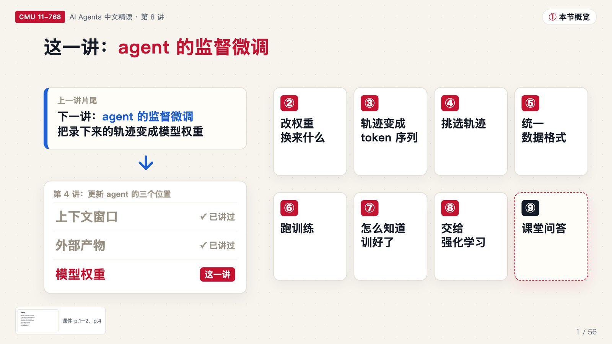

上一讲（电脑操作 agent）片尾说："用人的示范和合成轨迹做监督微调，下一讲专门展开。"第 7 讲只说了一句"监督微调模仿人和模型的轨迹，损失函数还是预测下一个动作"。这一讲把这句话拆开讲透：

| 第 7 讲留下的问题 | 这一讲在哪里回答 |
|---|---|
| 一条多轮轨迹怎么变成训练数据？ | 第 2 节：套聊天模板，变成一串 token |
| "预测下一个动作"具体在哪些 token 上算？ | 2.2–2.4：只在助手 token 上算，掩码由模板渲染时记下 |
| 示范从哪来、该留哪些？ | 第 3 节：四格来源表、过滤、选老师、选任务来源、扩数据 |
| 训完怎么知道有用、怎么接强化学习？ | 第 6、7 节 |

再往前，第 4 讲（记忆和技能）讲过"更新一个 agent 有三个位置"，当时在"模型权重"那一行写的是"后面讲 SFT 的那一讲"，就是这一讲。原课件 p.4 每行下面还标了日期，对应本课程其他几讲（按课程主页课表核对）：

| 位置 | 原课件标记 | 对应哪一讲 |
|---|---|---|
| 上下文窗口 | SEP 1 | 第 3 讲：长上下文和上下文管理 |
| 外部产物 | SEP 3 | 第 4 讲：记忆和技能 |
| 模型权重 | THIS LECTURE | 这一讲 |

原课件里还有几处日期：p.22 的 SEP 10 指第 6 讲（编程 agent，当时提过 SWE-Gym），p.6、p.9、p.21 的 Sep 22、Sep 29、Oct 1 指强化学习那三讲（第 9、11、12 讲）。

这是训练部分的第一讲（课上口头补充）：先说训练 agent 是什么意思，再讲监督微调本身，最后讲怎么过渡到强化学习。按原课件目录分七块：

| 部分 | 回答的问题 | 本课件 |
|---|---|---|
| 改权重是一种能力 | 和改上下文、改外部文件比，改权重换来什么、付出什么；监督微调在训练流程里的位置 | 第 1 节 |
| 轨迹变成 token 序列 | 一条多轮轨迹怎么套模板变成一串 token，哪些 token 算损失 | 第 2 节 |
| 挑选轨迹 | 轨迹从哪来、留哪些、老师怎么选、任务来源怎么选、数据怎么扩 | 第 3 节 |
| 一种格式装下所有数据集 | 各家数据集格式不一，怎么统一再渲染给不同的脚手架 | 第 4 节 |
| 跑训练 | 真实配置、混合专家路由、打包、模板漂移 | 第 5 节 |
| 怎么知道训好了 | 损失低不代表能用，评测要在目标脚手架里做 | 第 6 节 |
| 交给强化学习 | 监督微调做多少，才最适合接强化学习 | 第 7 节 |

讲完之后的课堂问答整理在第 8 节，源码解读在第 9 节。

---

## 1 改权重：一种更新 agent 的办法

### 1.1 一条轨迹就是录下来的数据

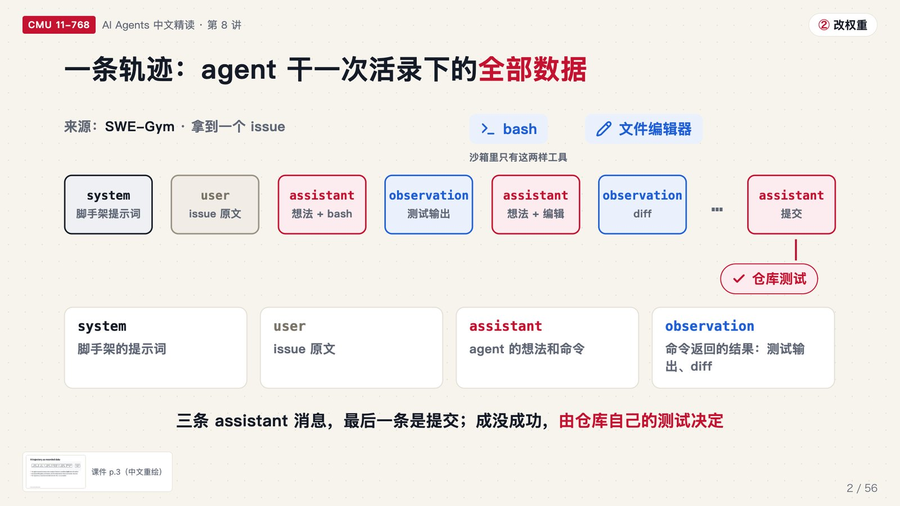

先看要训的东西长什么样。一条**轨迹**（trajectory）就是 agent 干一次活录下来的全部数据。原课件 p.3 画的这条来自 SWE-Gym（Pan et al., 2024 §4.2）：

```
system（脚手架的提示词）
→ user（issue 原文）
→ assistant（想法 + bash）
→ observation（测试输出）
→ assistant（想法 + 编辑）
→ observation（diff）
→ ……
→ assistant（提交）
```

- agent 拿到一个 GitHub issue，沙箱里有两样工具：**bash** 和一个文件编辑器。
- 它产生想法和命令，还有这些命令返回的**观察**（observation）。
- 这次运行算不算成功，由仓库自己的测试决定。

轨迹里有四种角色：

| 角色 | 是什么 | 谁产生的 |
|---|---|---|
| system | 脚手架的提示词 | 脚手架 |
| user | issue 原文 | 用户 / 任务 |
| assistant | agent 的想法和命令（工具调用） | 模型 |
| observation | 命令返回的结果：测试输出、一段 diff | 环境 |

这条轨迹里只有三条 assistant 消息（课上口头补充），最后一条是提交。记住"谁产生的"这一列，第 2 节决定哪些 token 算损失时就靠它。

### 1.2 更新 agent 的三个位置

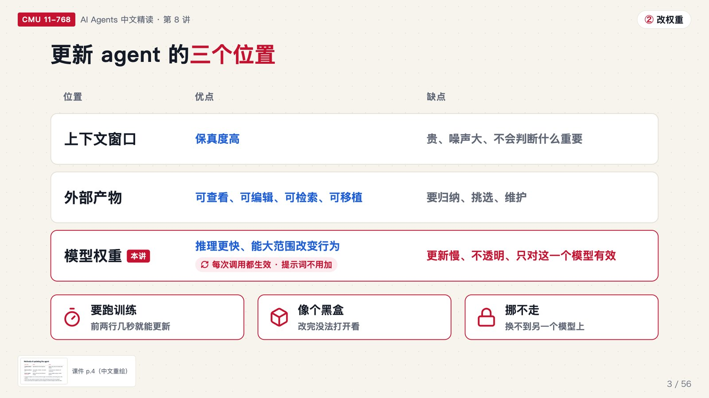

有了轨迹，可以把它放进上下文、写成外部文件，也可以训进权重。原课件 p.4：

| 位置 | 优点 | 缺点 |
|---|---|---|
| **上下文窗口**（context window） | 对发生过的事保真度高 | 贵、噪声大，自己不会判断什么重要 |
| **外部产物**（external artifacts，如记忆文件、技能） | 可查看、可编辑、可检索、可移植 | 得归纳出来、挑出来，还要维护 |
| **模型权重**（model weights） | 推理更快，能大范围改变行为 | 更新慢、不透明、只对这一个模型有效 |

- 权重改一次，之后每次调用都带着新行为，提示词里什么都不用多加。
- 前两行几秒钟就能更新；权重这一行每改一次就要跑一次训练。
- 改完没法打开权重看改了什么，像个黑盒；这个改动也挪不到另一个模型上。

外部产物对人很好读；改权重是单向的、不透明的（课上口头补充）。所以"要不要训"本身是一个取舍：行为要稳定地跟着每次调用走、推理要快，才值得付训练的代价。

### 1.3 轨迹教会模型什么

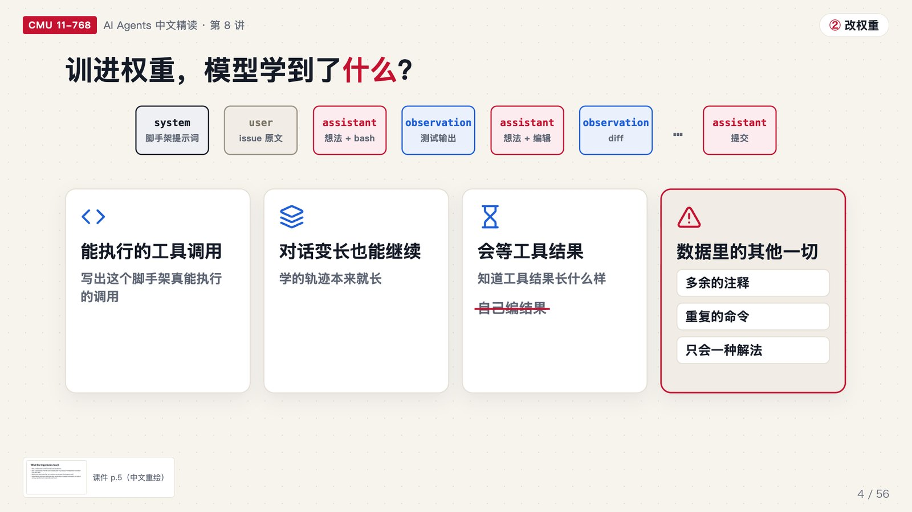

拿轨迹训进权重，模型学到的东西（原课件 p.5）：

1. 怎么写出这个脚手架真能执行的**工具调用**（tool call）。
2. 对话变长时怎么继续做下去，因为它学的轨迹本来就长。
3. 工具结果长什么样，这样它会**等**工具结果，而不是自己把结果编出来。
4. 还有数据里其他的一切：多余的注释、重复的命令、明明有好几种解法却只用其中一种。

第 4 条是这一讲后半段反复回来的主题：损失函数分不清好习惯和坏习惯，录下来什么就学什么（见 3.4）。

### 1.4 完整的训练流程

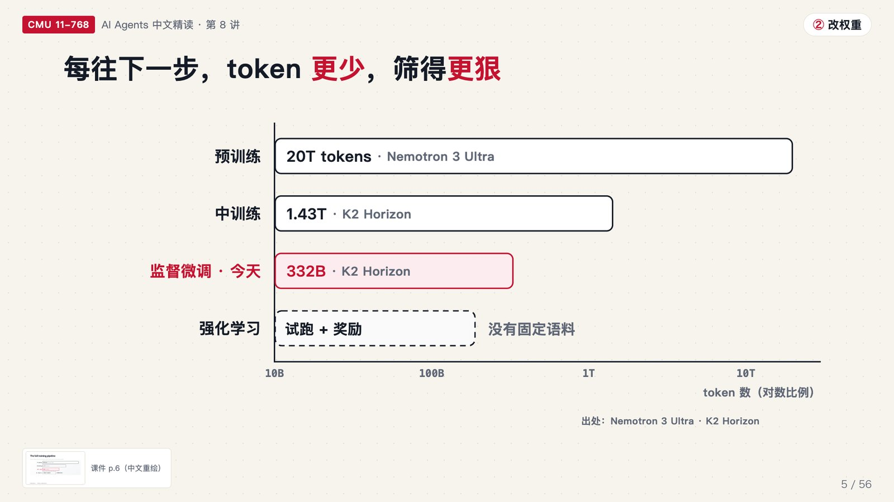

原课件 p.6 按 token 数画了四个阶段（视频里用对数比例画横条）：

| 阶段 | 规模 | 出处 |
|---|---|---|
| **预训练**（pre-training） | 20T token | Nemotron 3 Ultra |
| **中训练**（mid-training） | 1.43T | K2 Horizon |
| 监督微调（这一讲） | 332B | K2 Horizon |
| **强化学习**（reinforcement learning，RL，Sep 22 起） | 试跑 + 奖励，没有固定语料 | — |

标题就一句话：**每往下一步，token 更少，筛得更狠。**

课上口头补充：

- 预训练 token 最多，语言模型在这一步学最基本的下一个 token 预测。
- 中训练各家定义很不一样，大致是预训练和后训练之间发生的一切；现在有人把监督微调也算进中训练，但一般还是把监督微调算**后训练**（post-training）。
- 预训练、中训练、监督微调都有固定的语料可训；强化学习通常没有固定语料，是在模型自己的**试跑**（rollout）上学。

注意这张表里的数字来自三个不同的模型（Nemotron 3 Ultra 和 K2 Horizon），是"量级示意"的拼图，不是同一个模型的三个阶段。

### 1.5 强化学习之前的冷启动

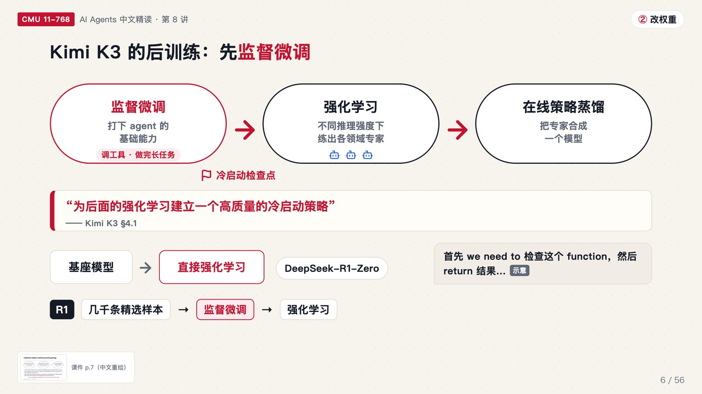

"冷启动"指强化学习开始时用的那个检查点（checkpoint）。原课件 p.7 用 Kimi K3 的后训练做例子，三步：

| 第一步：监督微调 | → 第二步：强化学习 | → 第三步：**在线策略蒸馏**（on-policy distillation） |
|---|---|---|
| 打下 agent 的基础能力 | 在不同推理强度下练出各领域的专家 | 把这些专家合并成一个模型 |

- 在 Kimi K3 里，调工具、做完长任务，都是在监督微调阶段、任何强化学习之前就学会的。
- 报告原话："监督微调这一步为后面的强化学习建立一个高质量的冷启动策略。"（Kimi K3 §4.1）

有人会问：为什么不跳过监督微调，直接做强化学习？

- DeepSeek-R1-Zero 就是这么做的：在基座模型上直接强化学习，完全没有监督微调。
- 可他们的下一个模型 R1 又把监督微调加了回来：从几千条精选样本开始，因为 R1-Zero 的回答会混着几种语言，很难读。

这代表了今天最常见的后训练流程之一（课上口头补充）。第二、三步留给后面几讲。

### 1.6 监督微调和强化学习对比

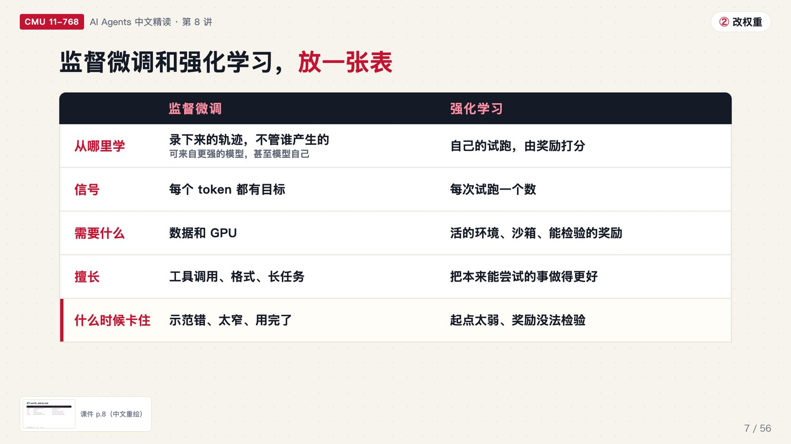

原课件 p.8（出处：OpenThoughts-Agent 表 11、Kimi K3、Kimi K2 §3.2）：

| | 监督微调 | 强化学习 |
|---|---|---|
| 从哪里学 | 录下来的轨迹，不管是谁产生的 | 自己的试跑，由**奖励**（reward）打分 |
| 信号 | 每个 token 都有目标 | 每次试跑一个数 |
| 需要什么 | 数据和 GPU | 活的环境、沙箱、能检验的奖励 |
| 擅长 | 学工具调用、格式、长任务 | 把模型本来就能尝试的事做得更好 |
| 什么时候卡住 | 示范是错的、太窄，或者用完了 | 起点太弱，或者奖励没法检验 |

录下来的轨迹可以来自更强的模型，甚至来自模型自己（课上口头补充）。

读这张表的一个角度：两列的"卡住"互补。强化学习怕起点太弱，监督微调正好负责把起点抬起来；监督微调怕示范用完、受限于老师，强化学习不依赖现成示范。第 7 节的表 11 就是这个互补关系的实测。

原课件 p.9 是训练这几讲的安排：监督微调是今天；强化学习在 Sep 22、Sep 29、Oct 1 三讲。

**这一节记住一句：**改权重让新行为跟着每次调用走，代价是慢、不透明、换不了模型；监督微调给后面的强化学习打底。

---

## 2 轨迹变成 token 序列

### 2.1 把聊天模板套到轨迹上

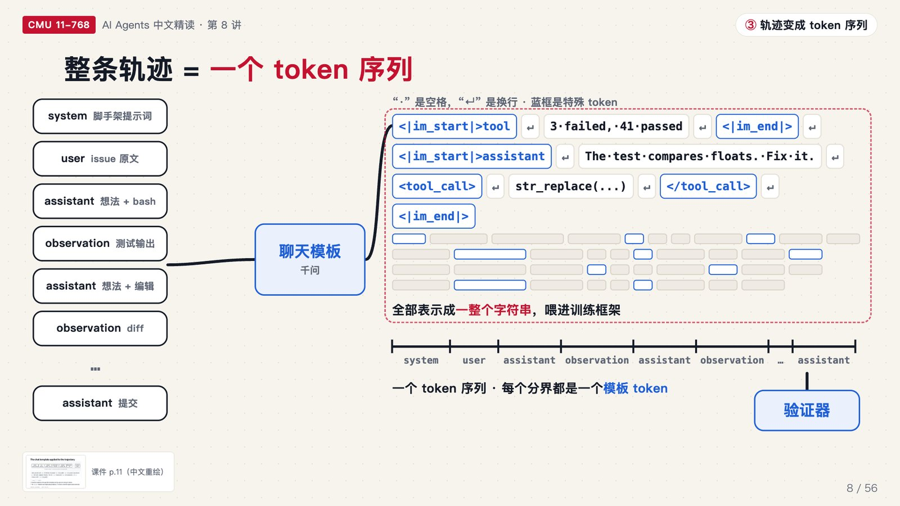

轨迹先过一遍**聊天模板**。每个模型的模板都不一样，原课件 p.11 用的是千问（Qwen）的。套完模板的一段长这样（"·"是空格，"↵"是换行）：

```
<|im_start|>tool ↵ 3·failed,·41·passed ↵ <|im_end|> ↵ <|im_start|>assistant
↵ The·test·compares·floats.·Fix·it. ↵ <tool_call> ↵ str_replace(...) ↵
</tool_call> ↵ <|im_end|>
```

- 每一轮前面有个开始标记 `<|im_start|>`，后面写角色，接着是内容，最后一个结束标记 `<|im_end|>`；工具调用包在 `<tool_call>…</tool_call>` 里。
- `<|…|>` 这种标记各是**一个**特殊 token（special token）；其余就是 agent 写的和看到的内容。
- 一条轨迹可能经过十次工具调用，最后提交给验证器，但全部表示成一整个字符串，喂进训练框架（课上口头补充）。

所以：**整条轨迹是一个 token 序列，上面每个分界都是一个模板 token。**

出处：Transformers 的 chat templating 文档、Kimi K3 §4.1.1。

> 小提示：千问不同版本的模板细节不同。比如第 9 节读的 TRL 仓库里那份 Qwen2.5 模板，工具结果是放在 `<|im_start|>user` 下、包在 `<tool_response>…</tool_response>` 里的，不是原课件这张图上的 `<|im_start|>tool`。看哪个模型就以它自己的模板为准（这是本课件对照源码补的，课上没讲）。

### 2.2 哪些 token 算损失

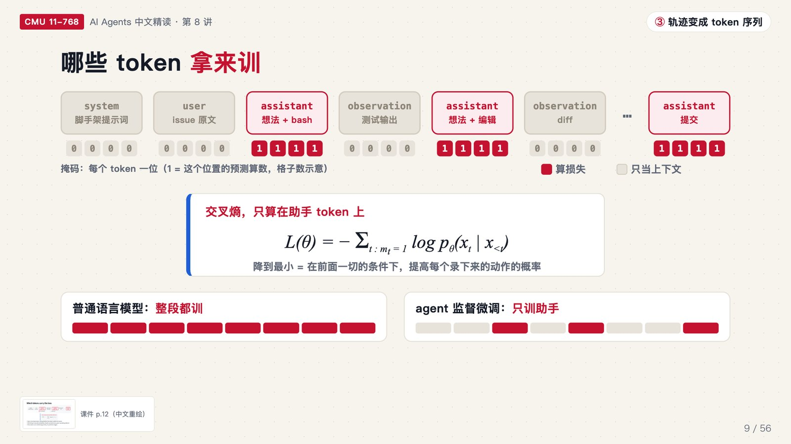

同一条轨迹，三段 assistant 标红（算损失），system、user 和两段 observation 标灰（只当上下文）。原课件 p.12 的损失：

```
L(θ) = − Σ_{t : m_t = 1} log p_θ(x_t | x_<t)
```

逐项读：

| 符号 | 意思 |
|---|---|
| x_t | 序列里第 t 个 token |
| x_<t | 它前面的所有 token（上下文） |
| p_θ(x_t ∣ x_<t) | 参数为 θ 的模型，在给定前文时预测出 x_t 的概率 |
| m_t | 第 t 个 token 的**掩码位**，1 表示这个位置的预测算数，0 表示不算 |
| Σ_{t : m_t = 1} | 只对掩码为 1 的位置求和 |

- 损失还是**交叉熵**（cross-entropy），和预训练一样；区别只是加了一个掩码。
- 把它降到最小，就是在给定前面一切的条件下，提高每个录下来的动作的概率。
- 观察是用来做条件的上下文，不是预测目标。

和训普通语言模型不同，agent 的监督微调不一定训整条轨迹（课上口头补充）。

一个容易混的点：掩码为 0 的 token 并没有从序列里删掉，它们照样在前向计算里当上下文，只是那个位置的预测不进损失。实现上通常把这些位置的标签设成 `-100`，PyTorch 的交叉熵默认忽略这个值（见 9.5）。

### 2.3 课堂问答：为什么不训模型去预测观察

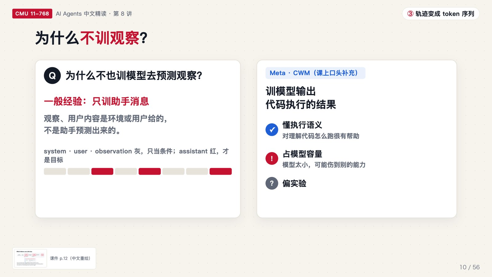

课上口头补充：

- **为什么不也在观察上训练？**只训助手消息是 agent 监督微调的一般经验，因为观察和用户内容是用户或环境给的，不是助手预测出来的。确实有论文在观察上训练，发现对预测世界状态有用。这里讲的是通用做法，具体场景可以做消融实验看什么最好。
- 例子：Meta 发布的 **CWM**（Code World Model），训模型输出代码执行的结果，在需要理解执行语义的任务上很有帮助。但它会占掉模型的一部分容量，模型太小的话可能伤到别的能力。它对 agent 基本能力的影响还是开放问题，偏实验性质。

（这一讲的原课件上没有 CWM，它在第 6 讲的课件里出现过。）

### 2.4 掩码是怎么造出来的

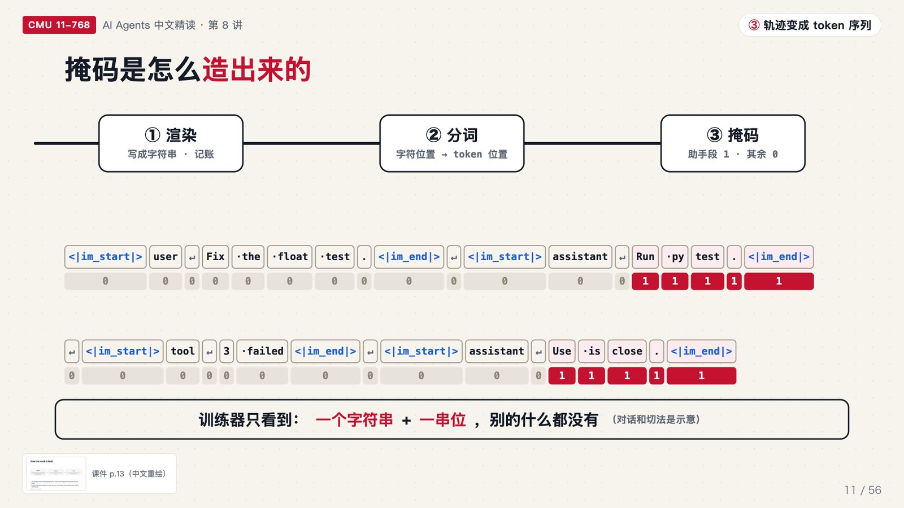

原课件 p.13（出处：Transformers `apply_chat_template`）：

| 第一步：渲染 | → 第二步：分词 | → 第三步：掩码 |
|---|---|---|
| 模板把整段对话写成一个字符串，同时记下每段助手文本从哪开始、到哪结束 | 这些字符位置变成 token 位置 | 助手段里的 token 记 1，其余记 0 |

- 模板在写字符串的同时**记账**：助手文本从第几个字符开始、在第几个字符停。
- 等到训练开始，角色已经没了。**训练器只看到字符串和这一串位，别的什么都没有。**

为什么非得在渲染时记，而不是渲染完再去字符串里找？因为渲染完以后"哪段是助手说的"这个信息只剩特殊 token 这一条线索，而模板之间写法各异（有的角色头后带换行，有的不带；有的把结束符算给下一条消息）。在模板里直接标出助手段，最不容易错。这正是 9.1–9.3 那几段源码做的事。

### 2.5 各框架的掩码开关

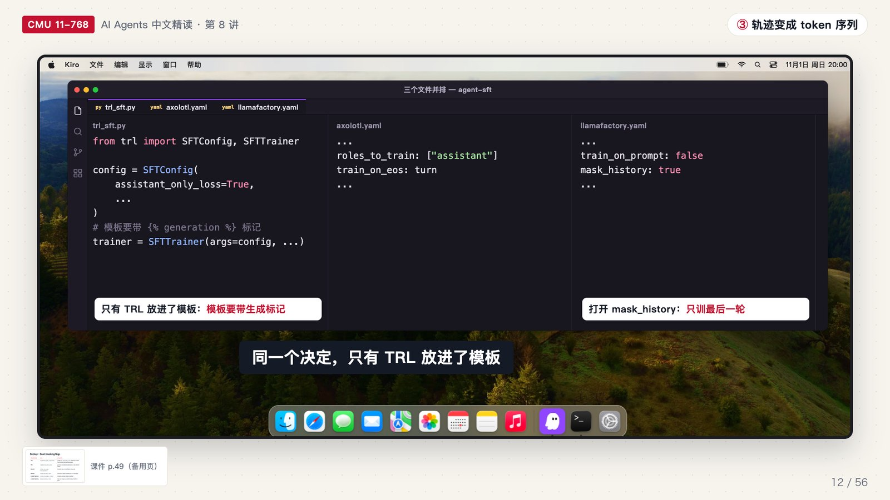

实际训练时，掩码由框架帮你造。原课件 p.14：

| 框架 | 要设什么 | 掩码怎么产生 |
|---|---|---|
| **TRL** | `assistant_only_loss=True` | 模板在渲染时标出助手段 |
| **Axolotl** | `roles_to_train`、`train_on_eos` | 在渲染好的字符串里找每一轮的角色头 |
| **LLaMA-Factory** | `train_on_prompt`、`mask_history` | 编码时把整轮标成训或不训 |

**三个框架做的是同一个决定，只有 TRL 把它放进了模板里。**（出处：TRL SFTTrainer、Axolotl conversation formats、LLaMA-Factory data args。）

原课件最后一页是备用页 p.49，列了精确的参数（课上没展开）：

| 框架 | 参数 | 行为 |
|---|---|---|
| TRL | `assistant_only_loss=True` | 需要模板里有 `` 标记；已知的模型家族有打过补丁的模板 |
| TRL | `completion_only_loss` | 用于 prompt–completion 格式的数据集；在那里默认打开 |
| Axolotl | `roles_to_train: ["assistant"]` | 默认；只在列出的角色上算损失 |
| Axolotl | `train_on_eos: turn` | 每个被训的轮次的结束符算进损失 |
| LLaMA-Factory | `train_on_prompt: false` | 默认；提示部分的 token 被遮掉 |
| LLaMA-Factory | `mask_history: true` | 只训最后一轮；截断时保留最后一轮 |

TRL 这两行在第 9 节对照源码看：`assistant_only_loss` 的默认值是 `False`，`completion_only_loss` 默认是 `None`，意思是"数据是 prompt–completion 格式就打开，否则关掉"。

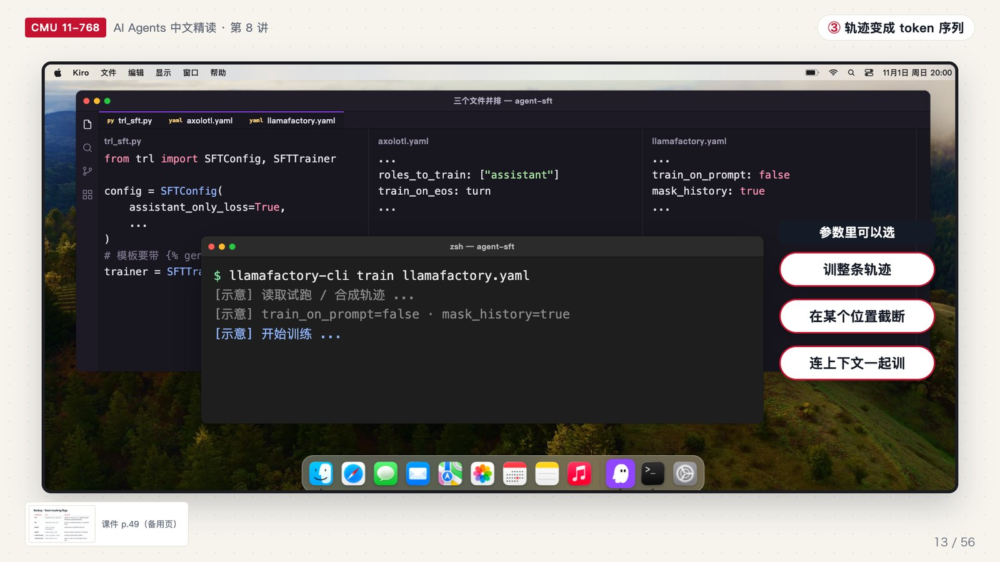

课上还打开 LLaMA-Factory 演示了一下真实用法（课件上没有这段演示）：做 agent 监督微调时，把生成好的试跑或合成轨迹放进去，指定要训的模型就可以开训；参数里可以设训整条轨迹、在某个位置截断，还是把上下文也一起训。视频画面里的命令和配置是示意。

### 2.6 结束符

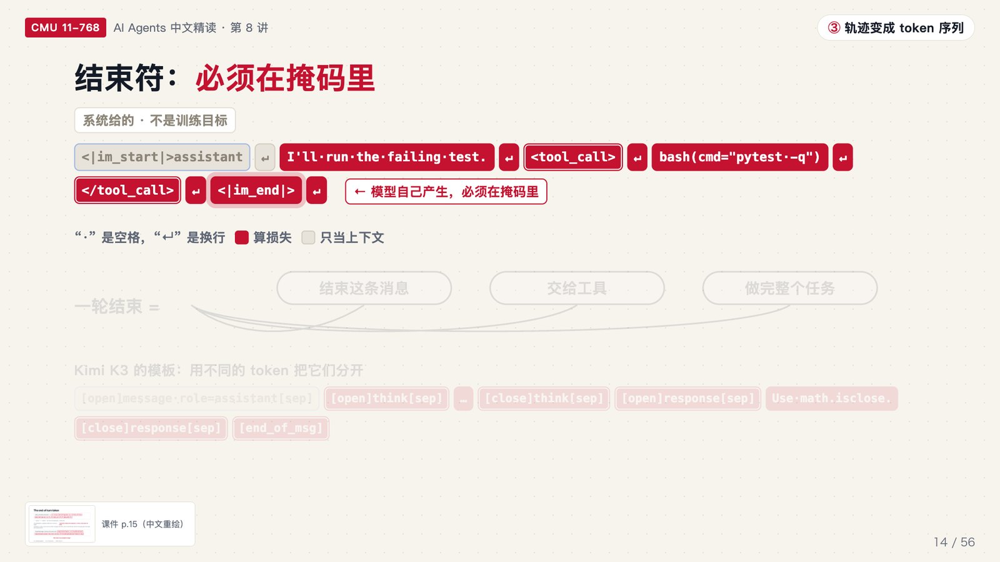

开关之外，最容易弄错的第一个地方是结束符。原课件 p.15 的一个助手轮（红色算损失，灰色只是上下文）：

```
<|im_start|>assistant ↵ I'll·run·the·failing·test. ↵ <tool_call> ↵
bash(cmd="pytest·-q") ↵ </tool_call> ↵ <|im_end|> ↵
```

`<|im_start|>assistant` 和它后面的换行是灰的；从"I'll run the failing test."一直到 `<|im_end|>` 和最后的换行都是红的。

- **角色头是推理时由系统给的**，它从来不是训练目标。
- **结束符是模型自己产生的，所以必须在掩码里。**不然，"模型可能学不会停下来"。
- "一轮结束"其实是三件事：结束这条消息、交给工具、做完整个任务。Kimi K3 的模板用不同的 token 把它们分开：

```
[open]message·role=assistant[sep] [open]think[sep] … [close]think[sep]
[open]response[sep] Use·math.isclose. [close]response[sep] [end_of_msg]
```

（图上第一个 `[open]message·role=assistant[sep]` 是灰的，后面全是红的。）

出处：TRL training chat templates、TRL SFTTrainer 源码、Kimi K3 §F。

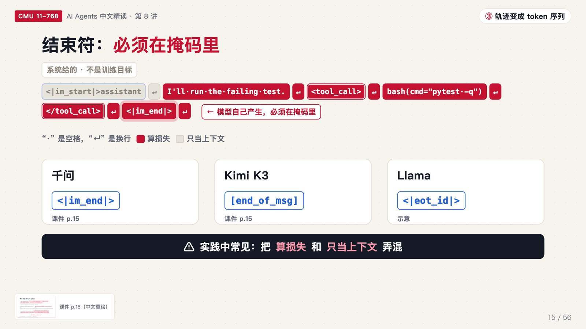

结束符每个模型都不一样，千问是 `<|im_end|>`，Kimi、Llama 各有各的。要训一个模型，得先看清它的聊天模板（课上口头补充）。实践中常见的情况是，大家搭训练数据时经常把"哪些算损失、哪些只当上下文"弄混。

"学不会停下来"为什么危险：训练损失看起来完全正常，因为结束符本来就占比极小；问题要到推理时才暴露，模型一直往下写。TRL 专门为这件事加了一个检查（见 9.4）。

> 对照源码的一处细节（课上没讲）：TRL 给 Qwen2.5 打补丁的训练模板，`` 是紧跟在 `<|im_start|>assistant` 之后开始的，所以角色头后面那个换行在这份模板里**算进**了助手段；原课件 p.15 的图上这个换行是灰的。角色头 token 本身不算损失，这一点两边一致。换行算不算，各家模板的写法不同，自己训时要打印掩码看一眼。

### 2.7 推理块要不要遮

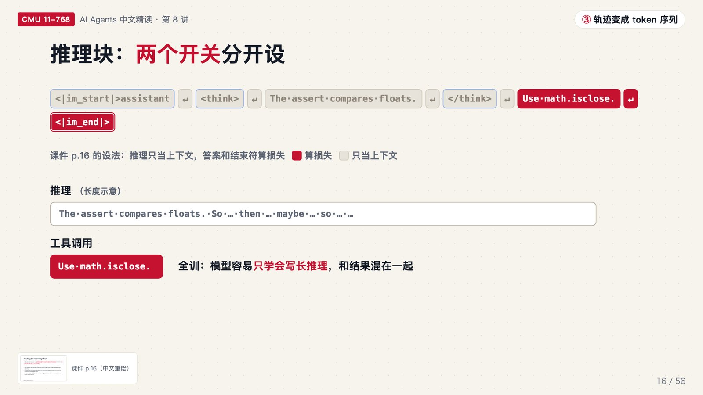

最容易弄错的第二个地方是推理块。现在很多模型先在思考标记里写一段推理，再给答案。原课件 p.16：

```
<|im_start|>assistant ↵ <think> ↵ The·assert·compares·floats. ↵ </think> ↵
Use·math.isclose. ↵ <|im_end|>
```

图上灰色是 `<|im_start|>assistant` 后的部分和 `</think>`；`<think>`、推理内容、答案、`<|im_end|>` 是红的。（为什么 `</think>` 标成灰色，课上没讲。）

**两个开关，分开设：**

| 开关 | 打开时 | 关掉时 |
|---|---|---|
| 推理留不留在上下文里 | 推理解释了后面那个动作，模型看得到"为什么这么做" | 后面的动作失去了依据 |
| 推理要不要训（算不算损失） | 它变成模型自己写推理的风格 | 只训实际的工具调用和答案 |

- Nemotron 3 Ultra 把按预算截断的推理留在上下文里，但把人为截断的那一刀从损失里遮掉（§3.1.1）。
- 推理块很长，有时大家只训非推理部分，也就是实际的工具调用。这些是各家实验室各自的决定，差别很大（课上口头补充）。

课堂问答（课上口头补充）：**遮掉推理和不遮推理，效果差多少？**推理可能比实际的工具调用长得多，全训的话，模型容易只学会写长推理，和最后的结果混在一起。所以有时遮掉推理，有时训推理。下一小节的 BalanceSFT 就是想让两部分平衡。

### 2.8 助手轮内部的加权

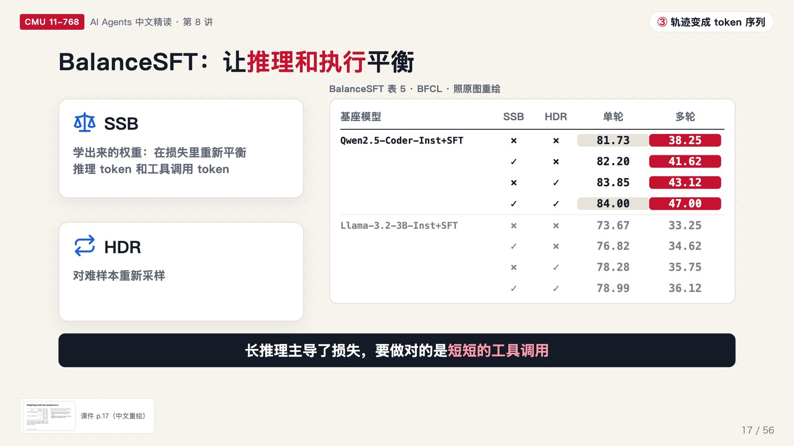

BalanceSFT（Hao et al., 2025）的两个组件：

- **SSB**：一个学出来的权重，在损失里重新平衡推理 token 和工具调用 token。
- **HDR**：对难样本重新采样。

原课件 p.17，BalanceSFT 表 5（工具调用基准 BFCL 上的单轮和多轮结果，按原图读数）：

| 模型 | SSB | HDR | 单轮 | 多轮 |
|---|---|---|---|---|
| Qwen2.5-Coder-Inst+SFT | × | × | 81.73 | 38.25 |
| | ✓ | × | 82.20 | 41.62 |
| | × | ✓ | 83.85 | 43.12 |
| | ✓ | ✓ | 84.00 | **47.00** |
| Llama-3.2-3B-Inst+SFT | × | × | 73.67 | 33.25 |
| | ✓ | × | 76.82 | 34.62 |
| | × | ✓ | 78.28 | 35.75 |
| | ✓ | ✓ | 78.99 | 36.12 |

- 长推理主导了损失，而真正需要做对的，是那个短短的工具调用。
- 原课件的结论：重新平衡在多轮上比单轮上帮助更大，两个基座模型都是。

自己算一下这句结论（课件没有算）：

| 两项都开 vs 都不开 | 单轮绝对涨幅 | 多轮绝对涨幅 | 单轮相对涨幅 | 多轮相对涨幅 |
|---|---|---|---|---|
| Qwen2.5-Coder | +2.27 | +8.75 | 约 +2.8% | 约 +22.9% |
| Llama-3.2-3B | +5.32 | +2.87 | 约 +7.2% | 约 +8.6% |

千问那组无论按哪种算法都符合"多轮帮助更大"；Llama 那组按绝对点数是单轮涨得多，按相对涨幅才是多轮略高。读论文结论时，值得自己回到表里核一遍"更大"是按什么量的。

比如软件工程任务，我们希望模型推理下一步做什么，但不希望它只推理不动手（课上口头补充）。推理和执行都重要。

### 2.9 按样本数还是按 token 数

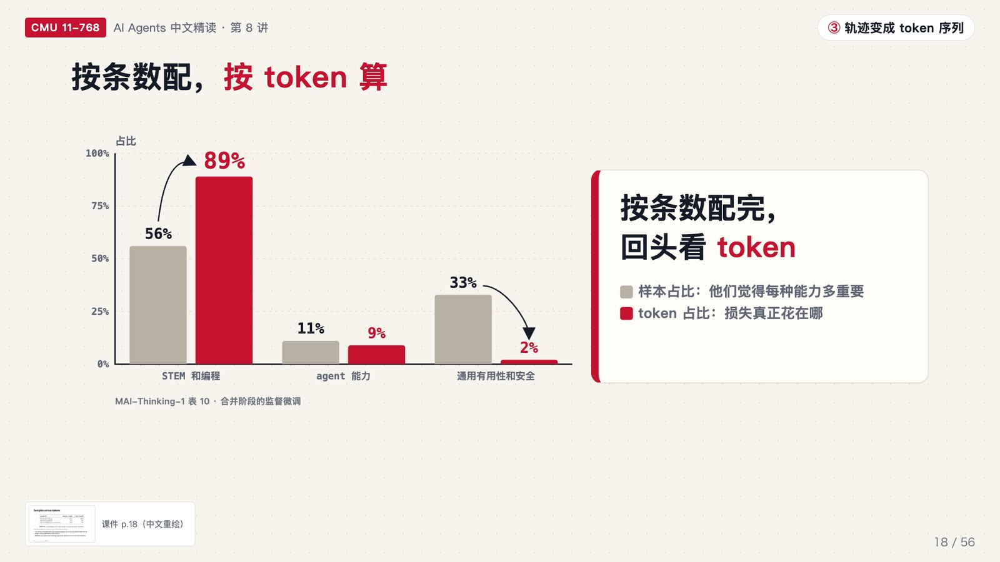

配平还有另一层。原课件 p.18，MAI-Thinking-1 表 10（合并阶段监督微调的数据配比，按原图读数）：

| 能力 | 样本占比 | token 占比 |
|---|---|---|
| STEM 和编程 | 56% | **89%** |
| agent 能力 | 11% | 9% |
| 通用有用性和安全 | 33% | 2% |

- **他们按样本数选配比，损失却是按 token 算的。**
- 配比是按样本数平衡的，但 STEM 和编程的轨迹长得多，几乎吃掉了所有 token。
- 不管你按轨迹条数怎么平衡，都要回头看看它变成 token 之后是什么样。

从样本占比能看出他们觉得每种能力有多重要；但不同能力的轨迹长度不同，token 占比和样本占比差得很远（课上口头补充）。

把这个表和 2.2 的公式连起来：损失是对**每个算损失的 token**求和的，所以一类数据对梯度的"话语权"大致正比于它贡献的、掩码为 1 的 token 数，而不是它的条数。更精确地说，看的应该是掩码为 1 的 token；同样长的轨迹，观察占比高的那条，算损失的 token 反而少。这一句是本课件的推断，原课件只说"看它变成 token 之后是什么样"。

### 2.10 监督一条轨迹，还有哪些没解决的问题

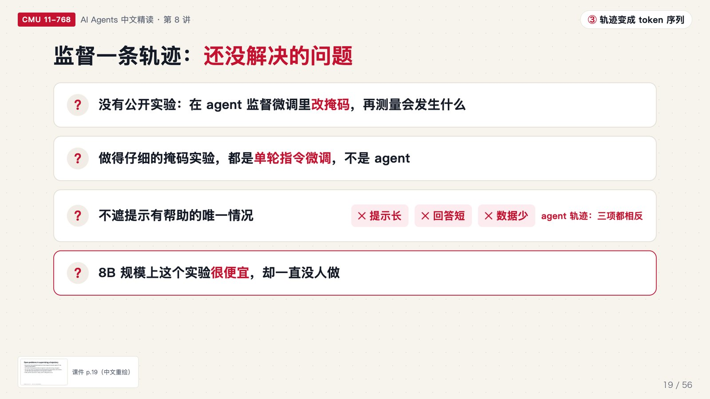

原课件 p.19（出处：WIT，Chatterjee et al., 2025；Instruction Modelling，Shi et al., 2024）：

- 没找到哪篇公开的实验，在 agent 监督微调里改掩码、再测量会发生什么。
- 做得仔细的掩码实验都是单轮的**指令微调**（instruction tuning），不是 agent。
- 唯一一个"不遮提示反而有帮助"的情况，是提示长、回答短、数据少。agent 轨迹在这三点上都正好相反。
- 在 8B 规模上这个实验很便宜，却一直没人做。

前面问答里提到的 CWM 也在观察上训练过，这是一个值得做实验的开放问题（课上口头补充）。

**这一节记住一句：**轨迹套上模板变成一串 token，掩码只让助手的部分算损失；结束符要算，角色头不算，推理训不训要单独决定，配比要按 token 看。

---

## 3 挑选轨迹

知道了一条轨迹怎么训，下一个问题是训哪些轨迹。对 agent 的监督微调来说，这一步同样关键（课上口头补充）。

### 3.1 轨迹从哪里来

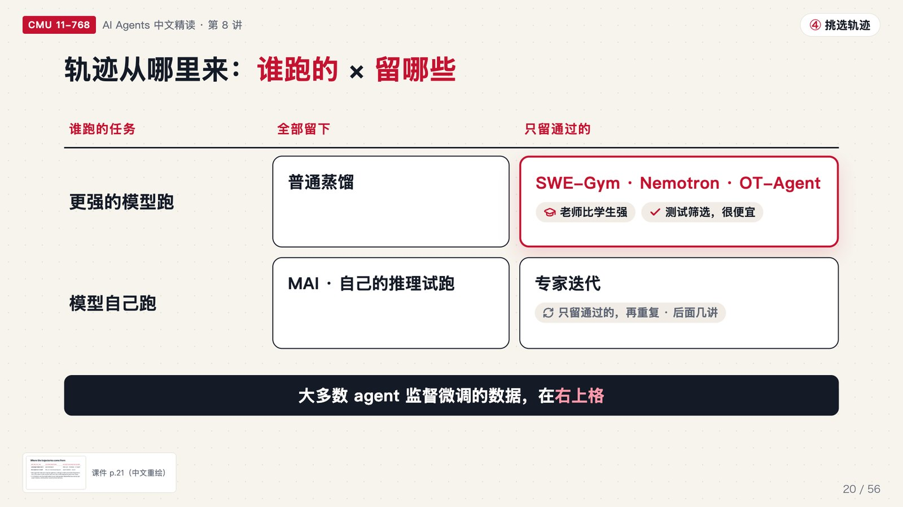

原课件 p.21 按两件事分成四格：

| 谁跑的任务 | 全部留下 | 只留通过的 |
|---|---|---|
| 更强的模型 | 普通**蒸馏**（distillation） | SWE-Gym · Nemotron · OT-Agent |
| 模型自己 | MAI，用它自己的推理试跑 | **专家迭代**（expert iteration）· Sep 22 |

- 大多数 agent 监督微调的数据都在右上角这一格：更强的模型写出的轨迹比学生自己能写的好，任务自带的测试又让"只留好的"变得很便宜。
- 下面一行是模型自己造训练数据。只留通过的、再把这个循环重复下去，就是专家迭代，后面几讲会讲。

"只留通过的"也叫**拒绝采样**式的过滤：跑很多次，只留过了某个阈值或验证器的（课上说的是"过了某个阈值或验证器"，"拒绝采样"这个名字是本课件补的通用叫法）。

### 3.2 从更强的模型蒸馏：SWE-Gym

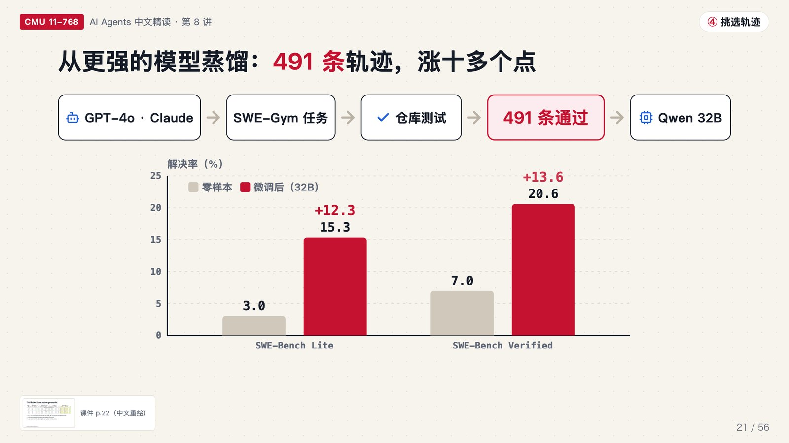

先看最常见的那一格。原课件 p.22（Pan et al., 2024，SWE-Gym §4.2 和表 3）：

- GPT-4o 和 Claude 跑了 SWE-Gym 的任务，其中 **491 次**通过了仓库测试。
- 一个 32B 的千问模型只用这 491 条轨迹做微调。
- 它在 SWE-Bench 两个划分上的分数都涨了十多个点。

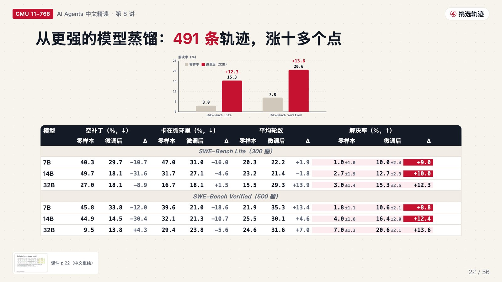

SWE-Gym 表 3（按原图读数，零样本 → 微调后；解决率括号里的误差省略）：

| 划分 | 模型 | 空补丁（%，越低越好） | 卡在循环里（%，越低越好） | 平均轮数 | 解决率（%，越高越好） |
|---|---|---|---|---|---|
| SWE-Bench Lite（300 个实例） | 7B | 40.3 → 29.7 | 47.0 → 31.0 | 20.3 → 22.2 | 1.0 → 10.0（+9.0） |
| | 14B | 49.7 → 18.1 | 31.7 → 27.1 | 23.2 → 21.4 | 2.7 → 12.7（+10.0） |
| | 32B | 27.0 → 18.1 | 16.7 → 18.1 | 15.5 → 29.3 | 3.0 → **15.3**（+12.3） |
| SWE-Bench Verified（500 个实例） | 7B | 45.8 → 33.8 | 39.6 → 21.0 | 21.9 → 35.3 | 1.8 → 10.6（+8.8） |
| | 14B | 44.9 → 14.5 | 32.1 → 21.3 | 25.5 → 30.1 | 4.0 → 16.4（+12.4） |
| | 32B | 9.5 → 13.8 | 29.4 → 23.8 | 24.6 → 31.6 | 7.0 → **20.6**（+13.6） |

课上只讲了解决率一列。另外三列课上没展开，自己读一下能看到几件事：

- 微调后平均轮数大多变多（只有 Lite 的 14B 少了 1.8 轮），模型更愿意多干几步再提交。
- 32B 在 Verified 上的空补丁比例反而从 9.5 升到 13.8，Lite 上卡在循环里的比例从 16.7 升到 18.1；解决率涨了，不代表每个过程指标都变好。

这两条是本课件从表里读出来的，原课件没有下这个结论。

### 3.3 轨迹条数和饱和

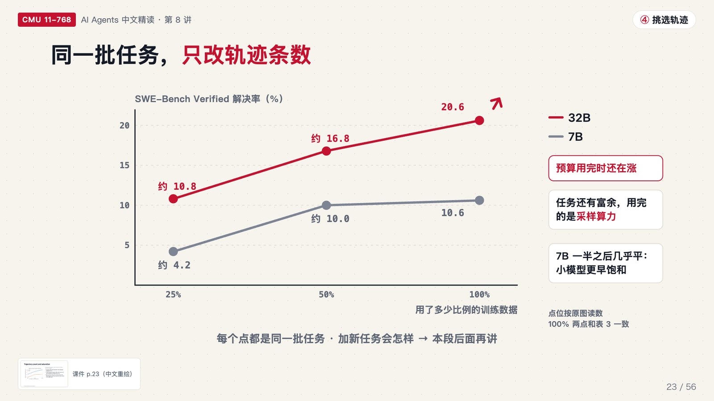

491 条就有这么大的用处，那多采一些会怎样？原课件 p.23（SWE-Gym §5.2 和图 5）：**任务集合始终不变，只改采样的轨迹条数。**

横轴是用了多少比例的训练数据，纵轴是 SWE-Bench Verified 解决率（按原图读数）：

| 训练数据 | 32B | 7B |
|---|---|---|
| 25% | 约 10.8 | 约 4.2 |
| 50% | 约 16.8 | 约 10.0 |
| 100% | 约 20.6 | 约 10.6 |

- 采样预算用完的时候，准确率还在涨。
- 他们任务还有富余，用完的是采更多轨迹的算力。
- 这张图上每个点用的都是同一批任务。加新任务会怎样，见 3.8。

增加轨迹条数能提升表现，但到某个点可能**饱和**；训练的模型越小，越容易饱和（课上口头补充）。图上 7B 那条线在 50% 之后几乎平了，32B 还在涨。

### 3.4 成功轨迹里的坏习惯

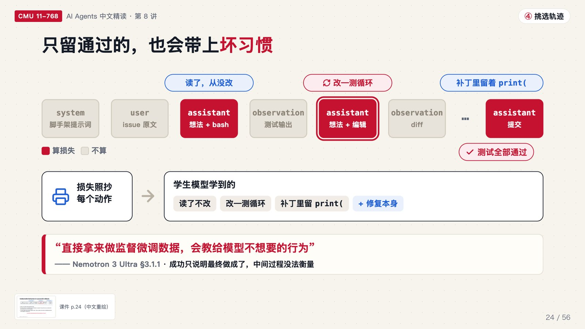

只留通过的，是不是就干净了？原课件 p.24 在 1.1 那条轨迹上挂了三个标签：

| 位置 | 标签 |
|---|---|
| 第一条 assistant | 读了，从没改 |
| 第二条 assistant | 改—测循环 |
| 最后的提交 | 补丁里留着 `print(` |

- 这页上每次运行都通过了测试。
- 但看它们怎么过的：一个大部分轮次都在改代码、重跑测试地循环；另一个在最终补丁里留下了 print 语句。
- 损失会照抄每个动作，不管好坏。拿这些轨迹训，模型会把乱七八糟的过程和修复一起学走。

> "如果直接拿来做监督微调数据，会教给模型不想要的行为。"（Nemotron 3 Ultra §3.1.1）

这里的"成功"只说明最终任务做成了，中间有些东西没法衡量（课上口头补充）。这就是 1.3 第 4 条的具体样子。

### 3.5 按形状过滤轨迹

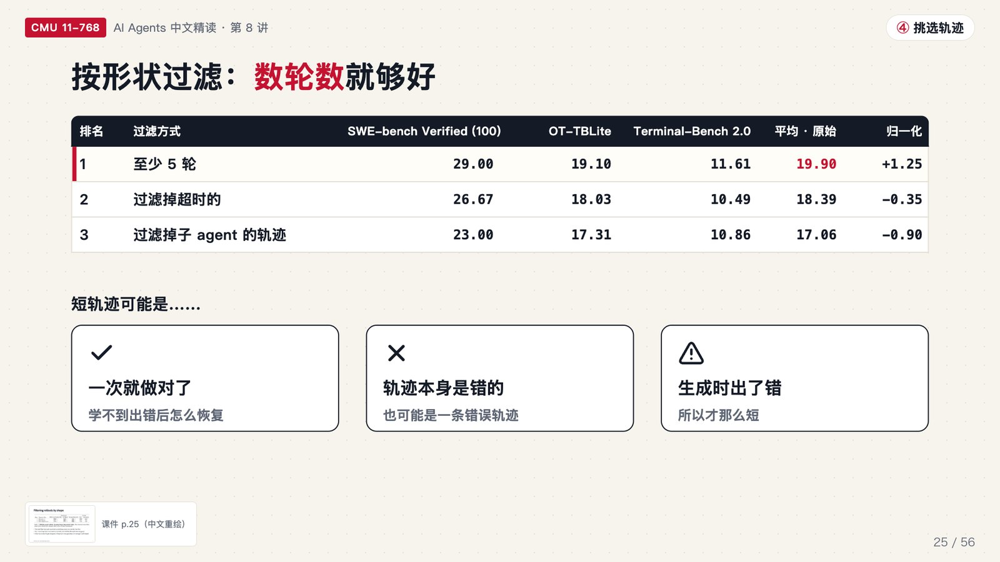

那怎么筛掉坏习惯？原课件 p.25，OpenThoughts-Agent 表 7（按原图读数；三个基准分数旁的小号数字是误差，这里省略）：

| 排名 | 轨迹过滤方法 | SWE-bench Verified (100) | OT-TBLite | Terminal-Bench 2.0 | 平均（原始） | 平均（归一化） |
|---|---|---|---|---|---|---|
| 1 | 至少 5 轮 | 29.00 | 19.10 | 11.61 | **19.90** | +1.25 |
| 2 | 过滤掉超时的 | 26.67 | 18.03 | 10.49 | 18.39 | −0.35 |
| 3 | 过滤掉子 agent 的轨迹 | 23.00 | 17.31 | 10.86 | 17.06 | −0.90 |

表题：**过滤 agent 的试跑：留下更长的轨迹有帮助。**最少轮数这个过滤在三个基准上都好过另外两种。

- 这里最好的过滤器只是数轮数，把少于 5 轮的都扔掉。
- 轮数只说明一次运行做了多少活，不说明活干得好不好。
- 一个 4 轮的干净修复被扔掉，一个 40 轮的乱摊子被留下。但平均下来，它还是有帮助。

按轨迹长度过滤是现在常用的办法之一（课上口头补充）。短轨迹可能有几种情况：

| 短轨迹可能是 | 对训练意味着什么 |
|---|---|
| 一次就做对了 | agent 学不到出错后怎么恢复 |
| 轨迹本身是错的 | 本来就不该留 |
| 生成轨迹时 agent 遇到了错误 | 数据是坏的 |

### 3.6 选老师

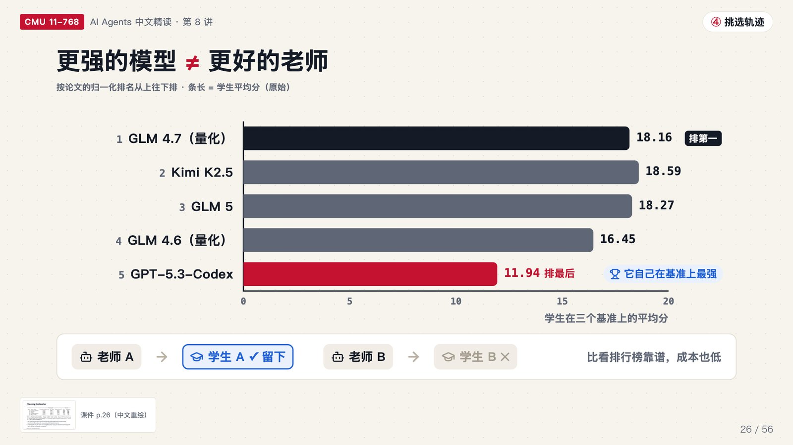

过滤看的是轨迹本身，另一个变量是谁来写轨迹。原课件 p.26，OpenThoughts-Agent 表 6（按原图读数，误差省略）：

| 排名 | 老师模型 | SWE-bench Verified (100) | OT-TBLite | Terminal-Bench 2.0 | 平均（原始） | 平均（归一化） |
|---|---|---|---|---|---|---|
| 1 | GLM 4.7（量化） | 28.00 | 17.86 | 8.61 | 18.16 | +0.73 |
| 2 | Kimi K2.5 | 33.33 | 14.19 | 8.24 | 18.59 | +0.66 |
| 3 | GLM 5 | 33.00 | 14.30 | 7.50 | 18.27 | +0.66 |
| 4 | GLM 4.6（量化） | 26.00 | 16.99 | 6.37 | 16.45 | +0.08 |
| 5 | GPT-5.3-Codex | 21.67 | 10.42 | 3.75 | 11.94 | −1.47 |

表题：**老师模型消融：更强的模型 ≠ 更好的老师。**GPT-5.3-Codex 在这些基准上是最强的模型，却是最弱的老师，在 Terminal-Bench 2.0 上比 GLM 4.7 AWQ 低约 5 个百分点（8.61 对 3.75）。

- 论文说，这五个模型里 GPT-5.3-Codex 自己在这些基准上最强；用它的轨迹训出来的学生却最弱。
- 排行榜名次在这里给了错误的信号。相比之下，试两个老师、留下更好的那个学生，成本低得多。

两个读表细节：排名按归一化平均排，所以原始平均 18.59 的 Kimi K2.5 排在 18.16 的 GLM 4.7 后面；"量化"指老师模型用的是量化版本（GLM 4.7 那行表题里写作 AWQ）。

课堂问答（课上口头补充）：**Codex 产生的工具调用是对的，为什么拿来训别的模型效率最低？**原因可能有很多。一种解释是，GPT-5.3-Codex 很会解决任务本身，但它的思考方式、解决任务的方法可能和学生模型很不一样，轨迹对学生不一定那么管用。要从强模型蒸馏，得好好挑老师。

### 3.7 选任务来源

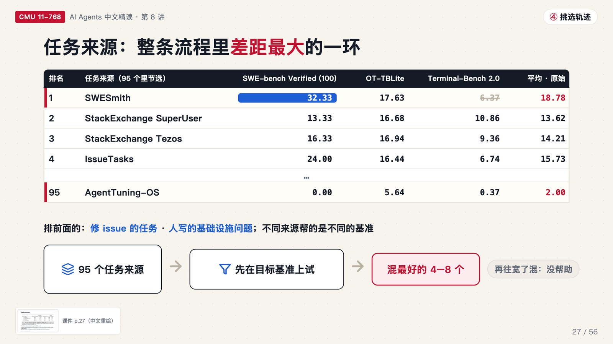

老师之外，影响最大的是任务来源。原课件 p.27，OpenThoughts-Agent 表 2（按原图读数，误差省略）：

| 排名 | 任务来源 | SWE-bench Verified (100) | OT-TBLite | Terminal-Bench 2.0 | 平均（原始） | 平均（归一化） |
|---|---|---|---|---|---|---|
| 1 | SWESmith | **32.33** | 17.63 | 6.37 | 18.78 | +1.92 |
| 2 | StackExchange SuperUser | 13.33 | 16.68 | **10.86** | 13.62 | +1.51 |
| 3 | StackExchange Tezos | 16.33 | 16.94 | 9.36 | 14.21 | +1.45 |
| 4 | IssueTasks | 24.00 | 16.44 | 6.74 | 15.73 | +1.37 |
| …… | | | | | | |
| 95 | AgentTuning-OS | 0.00 | 5.64 | 0.37 | 2.00 | −2.31 |

表题：**在整条流程的各个环节里，任务来源的选择造成的差距最大。**排在前面的是修 issue 的任务和人写的基础设施问题，但在不同基准上的提升忽高忽低。完整排名在原论文附录 A.1。

- 任务来源的选择，对结果影响最大。
- 不同来源帮的是不同的基准，所以先在这里花力气，再去调别的。
- 混合最好的四到八个来源。再往宽了混，对他们没有帮助。

外面的监督微调数据集太多了，不一定都适合你要训的任务（课上口头补充）。比如 SWESmith 对 SWE-bench Verified 贡献最大，对 Terminal-Bench 就少；SuperUser 正好反过来，Terminal-Bench 2.0 那一列最高。先试哪些任务适合你的目标基准，再在那些数据上训，而不是能拿到什么就训什么。

### 3.8 扩数据：加同样的任务，还是加新任务

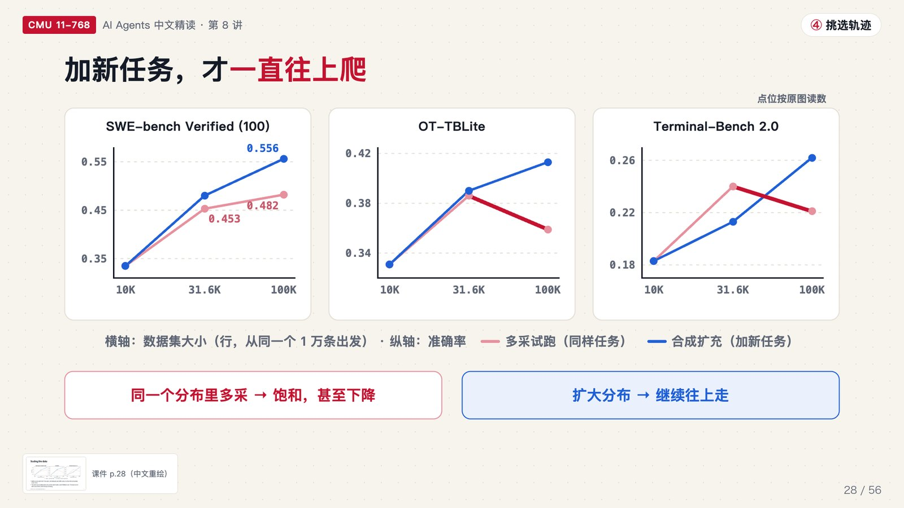

选好了来源，数据还想再多。原课件 p.28，OpenThoughts-Agent 图 3：三张小图，横轴是数据集大小（10K、31.6K、100K 行），纵轴是准确率。粉线是"方法 1：对已有任务多采几次试跑"，蓝线是"方法 3：合成扩充（加新任务）"。按原图读数：

| 基准 | 10K（两条线同一起点） | 31.6K 粉 / 蓝 | 100K 粉 / 蓝 |
|---|---|---|---|
| SWE-bench Verified (100) | 约 0.335 | 约 0.453 / 0.48 | 约 0.482 / 0.556 |
| OT-TBLite | 约 0.331 | 约 0.386 / 0.39 | 约 0.359 / 0.413 |
| Terminal-Bench 2.0 | 约 0.183 | 约 0.24 / 0.213 | 约 0.221 / 0.262 |

- 两条曲线从同一个 10K 的数据集出发，只差在多出来的数据是从哪来的。
- 粉线加的是同样任务的更多试跑，它变平了；蓝线加的是新任务，一直往上爬。

直觉上扩规模就能涨分，实证却相反（课上口头补充）：只从同一个分布里多采试跑，随着条数增加，表现可能饱和甚至下降；扩大分布，准确率还会随样本增加往上走。图上 OT-TBLite 和 Terminal-Bench 2.0 的粉线在 100K 时确实掉了下来。

也要看到图里的一个细节：Terminal-Bench 2.0 在 31.6K 时粉线（约 0.24）其实高于蓝线（约 0.213），蓝线是到 100K 才反超的。所以"加新任务更好"是看到头的结论，中间某个规模上不一定成立。

把 3.3 和 3.8 放在一起看：

| | 改的是什么 | 结果 |
|---|---|---|
| SWE-Gym 图 5（3.3） | 任务不变，只加轨迹条数 | 32B 还在涨，7B 早早饱和 |
| OpenThoughts-Agent 图 3（3.8） | 同样任务多采 vs 加新任务 | 多采会平甚至掉，加新任务一直涨 |

### 3.9 课堂讨论：三条轨迹留哪条

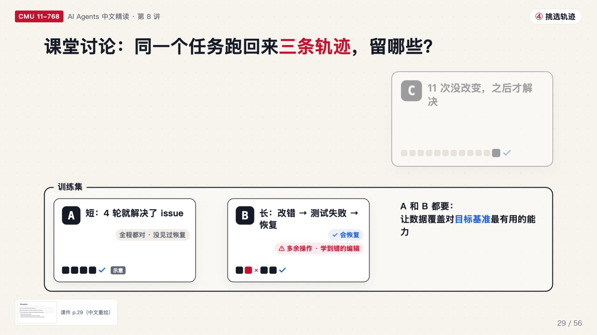

原课件 p.29：同一个任务刚跑回来三条轨迹，你在决定哪些进训练集。

| 轨迹 | 内容 |
|---|---|
| **A** | 一条短的，4 轮就解决了 issue |
| **B** | 一条长的，先改错了，看到测试失败，又恢复过来 |
| **C** | 在 11 次什么都没改变的尝试之后，才解决了 issue |

问题：留哪几条？留下的那些，哪些动作算损失？你的哪些答案会被"最少轮数"过滤器判错？

课上的讨论（课上口头补充）：

- 一位同学选 B：能看测试、出错后恢复，在更难的情况下拿到结果，比 4 轮就解决更有价值。
- B 的潜在坏处：数据更多、训练算力更多，模型可能学会做多余的操作；还可能学到了那次错误的编辑，却没学会恢复。
- A 从头到尾都是对的行为、对的结果；但如果第一轮就遇到错误，只学 A 可能学不会怎么恢复。
- 结论：最好 A 和 B 都要，让数据尽量覆盖对目标基准最有用的能力。

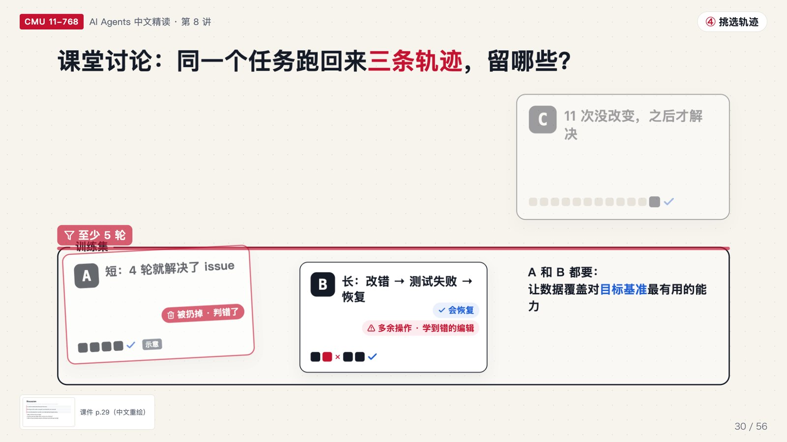

对照 3.5 的规则：至少 5 轮的过滤器，会把 4 轮的 A 扔掉，正好扔掉了讨论里认为该留的那条。

C 和"哪些动作算损失"这一问，课上没有单独回答。思考题 4 给了一个参考思路。

**这一节记住一句：**只留通过的轨迹也会带坏习惯；老师不是越强越好，任务来源影响最大，扩数据要加新任务。

---

## 4 一种格式装下所有数据集

### 4.1 agent 数据集各不相同

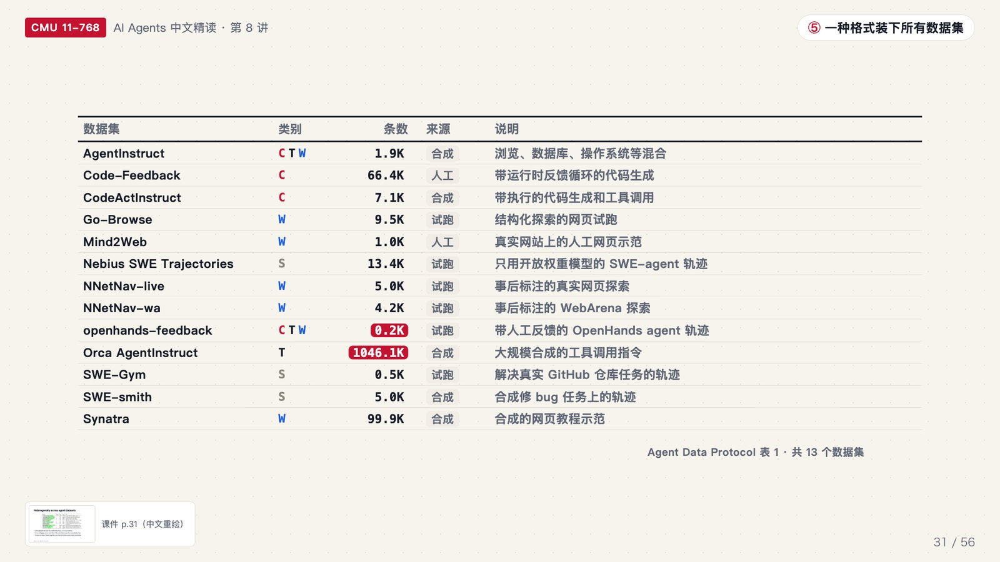

任务来源要混着用，马上碰到一个工程问题：各家数据集的格式都不一样。原课件 p.31，Agent Data Protocol 表 1 列了 13 个数据集（按原图读数，课上一笔带过）：

| 数据集 | 类别标记 | 条数 | 来源 | 说明 |
|---|---|---|---|---|
| AgentInstruct（Zeng et al., 2023） | C T W | 1.9K | 合成 | 浏览、数据库、操作系统等的混合 |
| Code-Feedback（Zheng et al., 2024a） | C | 66.4K | 人工 | 带运行时反馈循环的代码生成 |
| CodeActInstruct（Wang et al., 2024b） | C | 7.1K | 合成 | 代码生成和带执行的工具使用 |
| Go-Browse（Gandhi & Neubig, 2025） | W | 9.5K | 试跑 | 结构化探索的网页试跑 |
| Mind2Web（Deng et al., 2023） | W | 1.0K | 人工 | 真实网站上的人工网页示范 |
| Nebius SWE Trajectories（Golubev et al., 2024） | S | 13.4K | 试跑 | 只靠开源权重模型的 SWE-agent 轨迹 |
| NNetNav-live（Murty et al., 2024） | W | 5.0K | 试跑 | 事后标注的真实网页探索 |
| NNetNav-wa（Murty et al., 2024） | W | 4.2K | 试跑 | 事后标注的 WebArena 探索 |
| openhands-feedback（All Hands AI, 2024） | C T W | 0.2K | 试跑 | 带人工反馈的 OpenHands agent 轨迹 |
| Orca AgentInstruct（Mitra et al., 2024） | T | 1046.1K | 合成 | 大规模合成的工具使用指令数据 |
| SWE-Gym（Pan et al., 2025） | S | 0.5K | 试跑 | 解决真实 GitHub 仓库任务的 agent 轨迹 |
| SWE-smith（Yang et al., 2025b） | S | 5.0K | 合成 | 在合成的修 bug 任务上的 agent 轨迹 |
| Synatra（Ou et al., 2024） | W | 99.9K | 合成 | 从教程合成的网页示范 |

（类别标记 C、T、W、S 原课件页上没有图例，这里不解释。）

- 每个数据集由不同的团队做，各用各的格式。
- 同一个网页，有的存 HTML，有的存**无障碍树**（accessibility tree）。
- 想把其中两个放在一起训，先得写两个定制的转换器。

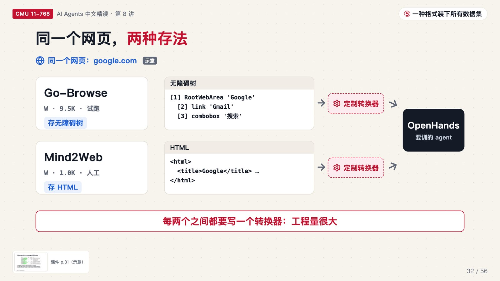

具体例子（课上口头补充）：想同时用 Go-Browse 和 Mind2Web 训。Go-Browse 的网页观察用无障碍树，Mind2Web 用 HTML。要训 OpenHands agent，就得写一个 Go-Browse 到 OpenHands 的转换器，再写一个 Mind2Web 到 OpenHands 的转换器，工程量很大。

### 4.2 一条轨迹，一种表示

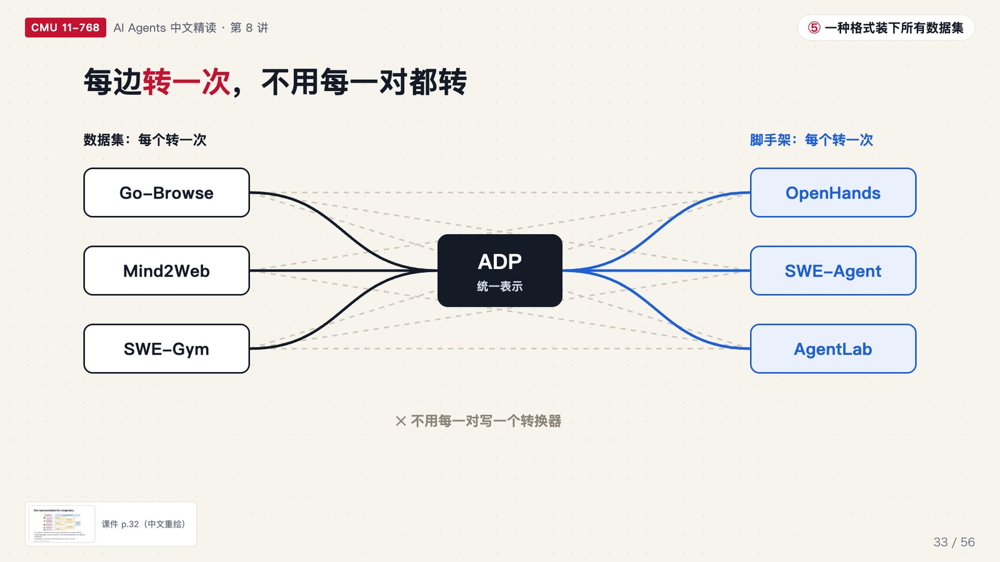

**Agent Data Protocol**（ADP，Song et al., 2026，ICLR oral）的办法是先统一成一种表示。原课件 p.32 的示意图，左边是原始数据，右边是标准化之后：

| 原始数据 | ADP 标准化数据 |
|---|---|
| agent 发出 `goto(url=google.com)` | `APIAction(function=goto, kwargs={url: google.com})` |
| 返回的一段 HTML | `WebObservation(url=google.com, html=<html>..., axtree=RootWebArena 'Google', focused ...)` |
| agent 写的 python `print("Hello World")` | `CodeAction(language=python, content=print("Hello World"))` |
| 执行结果 Hello World | `TextObservation(content=Hello World, source=environment)` |
| agent 说的 How can I help you? | `MessageAction(content=How can I help you?)` |

最后合成一个 `Trajectory(id=sample, content=[...], details=...)`。

- 每个数据集只读一次，改写成带类型的动作和观察。
- 前面说的网页，HTML 和无障碍树都留下，不用二选一，下游训练时想用哪种就挑哪种。
- 每个数据集转一次，每个脚手架转一次，不用每一对都转一次。

最后一条可以算一下：假设有 D 个数据集、H 个脚手架（这两个字母是本课件为说明自定的）。两两写转换器要 D × H 个；先统一再分发只要 D + H 个。13 个数据集配 3 个脚手架，就是 39 个对 16 个。

### 4.3 按脚手架渲染

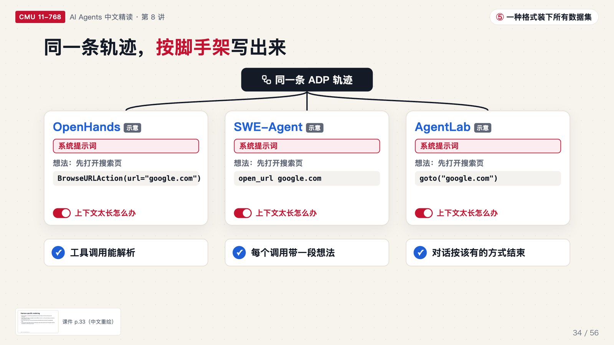

原课件 p.33（ADP §3.3）：

- 数据统一成一种格式之后，还要再按你要训的脚手架写出来。
- OpenHands、SWE-Agent 和 AgentLab 的动作不一样，所以同一条轨迹写出来，在每个里看起来都不一样。
- 系统提示词也是在这一步设的，上下文变长时怎么办也在这一步决定。
- 然后检查结果：工具调用能不能解析，每个调用有没有带一段想法，对话有没有按该有的方式结束。

这一步和第 2 节接上了：按脚手架写出来的，就是 2.1 里要套模板的那条轨迹。所以完整的数据流水线是：

```
各家数据集 → ADP 统一表示 → 按目标脚手架渲染 → 套模型的聊天模板 → token + 损失掩码
```

最后一个箭头是第 2 节的内容，前面几个是这一节的内容。（这条串联是本课件为复习整理的，原课件没有画成一张图。）

### 4.4 多样的数据，还是针对任务的数据

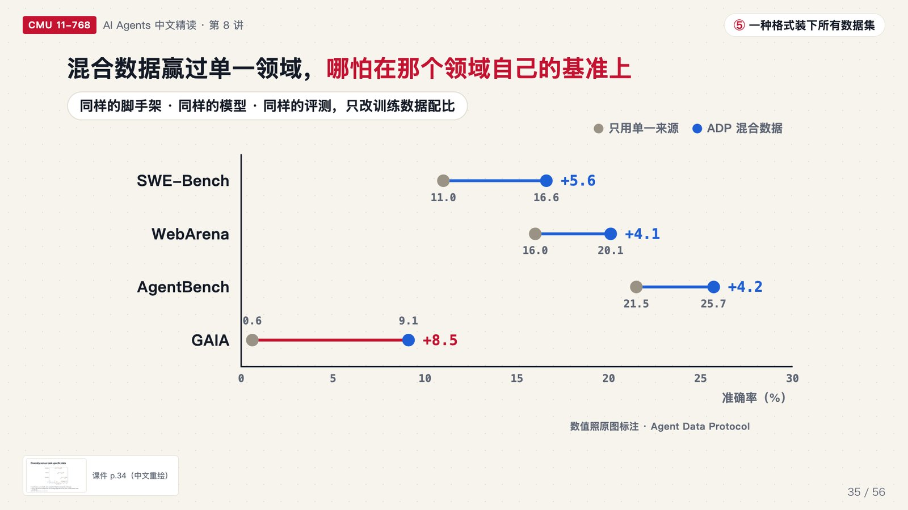

费这么大劲统一格式，值不值？原课件 p.34，ADP 跨任务迁移的结果（按原图读数，准确率 %）：

| 基准 | 只用单一来源 | ADP 混合数据 | 提升 |
|---|---|---|---|
| SWE-Bench | 11.0 | 16.6 | +5.6 |
| WebArena | 16.0 | 20.1 | +4.1 |
| AgentBench | 21.5 | 25.7 | +4.2 |
| GAIA | 0.6 | 9.1 | +8.5 |

- 同样的脚手架、同样的模型、同样的评测，只改训练数据的配比。
- 用混合数据训，能赢过对应的单一领域数据集，哪怕是在那个领域自己的基准上。

前面 OpenThoughts-Agent 看的是在单一任务来源上训练对各基准的效果；这里看的是混合多个来源是否比只用一个来源好（课上口头补充）。结果几乎每个 agent 基准上，混合训练都更好，提高数据多样性很有帮助。

和 3.7 的"混最好的四到八个来源，再往宽了混没有帮助"放在一起读：多样性有用，但不是越宽越好。两篇论文的设置不同，不能直接比数字。

**这一节记住一句：**数据先转成一种统一的表示，再按目标脚手架渲染；多来源混在一起训，比单一领域更好。

---

## 5 跑训练

### 5.1 真实的监督微调配置

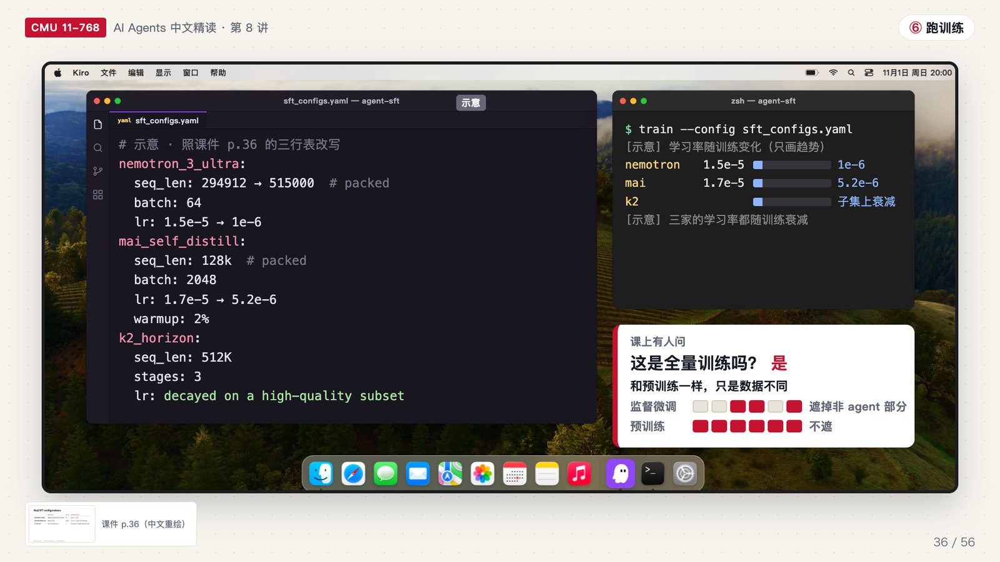

数据准备好了，终于开训。原课件 p.36（出处：Nemotron 3 Ultra §3.1、MAI-Thinking-1 §3.1.4 和 §3.5、K2 Horizon 模型卡）：

| | 序列 | 批大小 | 学习率 |
|---|---|---|---|
| Nemotron 3 Ultra | 打包到 294,912，之后 515,000 | 64 | 1.5e-5 → 1e-6 |
| MAI 自蒸馏 | 打包到 128k | 2,048 | 1.7e-5 → 5.2e-6，2% 预热 |
| K2 Horizon | 512K，分三个阶段 | — | 在一个高质量子集上衰减 |

- 学习率都随训练衰减；MAI 在正式训练前做了 2% 的**预热**（warmup）（课上口头补充）。
- K2 Horizon 是最近发布的模型，课上说它具体的监督微调配置数字还没公开，表里只写了学习率在高质量子集上衰减，批大小一格是"—"。

序列长度一列值得停一下：29 万到 51.5 万 token 一条序列，比常见的入门配置大几个数量级。作为对照，TRL `SFTConfig` 的 `max_length` 默认是 1024（见 9.6）。agent 轨迹长，这个默认值几乎一定要改。

课堂问答（课上口头补充）：**这不是参数高效的方法吧？就是在轨迹上做全量训练，和预训练一样，只是数据不同？**是的。不过预训练时大家不会把非 agent 的部分遮掉。

### 5.2 监督微调时的专家路由

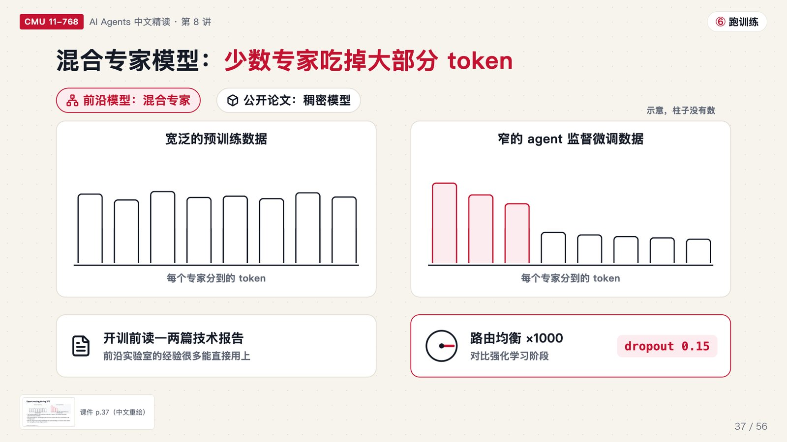

配置之外，**混合专家模型**（Mixture of Experts，MoE）还有个特别的问题。原课件 p.37 画了两张示意柱状图（柱子上没有数），纵轴都是"每个专家分到的 token"：左边是宽泛的预训练数据，8 个专家分到的差不多；右边是窄的 agent 监督微调数据，前 3 个专家分到大部分。

- 这一讲里的前沿模型都是混合专家模型；公开论文里微调的模型是稠密模型。
- 在窄的 agent 数据上微调一个混合专家模型，少数几个专家会吃掉大部分 token。
- MAI 的办法：监督阶段把**路由均衡**（routing balance）压得很紧，比强化学习阶段紧一千倍，并把 **dropout** 提到 0.15（MAI-Thinking-1 §3.1.5）。

开始做监督微调之前，读一两篇前沿实验室的技术报告或公开论文很重要，里面有很多能直接用上的经验（课上口头补充）。

### 5.3 打包整段对话

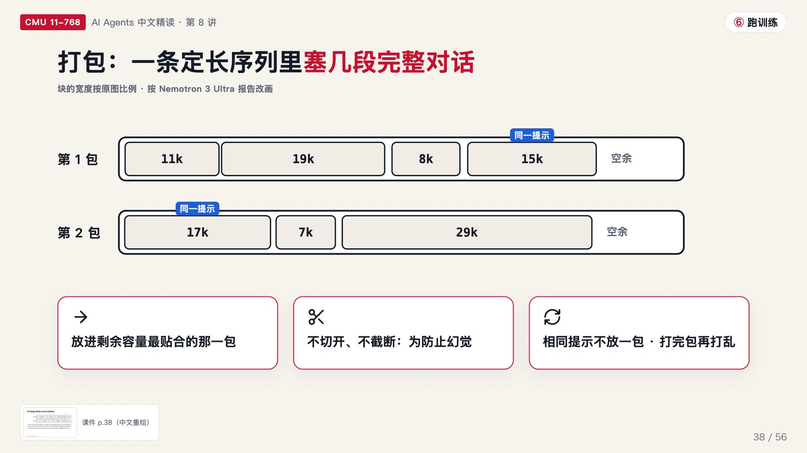

原课件 p.38（Nemotron 3 Ultra §3.1.2）：**训练用的是定长序列。打包（packing）是把几段对话塞进一条序列，而不是把大半条都填成空白。**

示意图：

| | 内容 |
|---|---|
| 第 1 包 | 19k 的轨迹 · 15k 的轨迹 · 11k 的轨迹 · 8k 的轨迹 · 空余 |
| 第 2 包 | 29k 的轨迹 · 17k 的轨迹 · 7k 的轨迹 · 空余 |

- 每段对话放进剩余容量和它最贴合的那个包（这种做法叫 best-fit）。
- 没有一段对话被切开或截断，这是为了防止幻觉而特意做的选择。
- 完全相同的提示不放进同一个包，打完包之后再打乱顺序。

一般不希望截断或切开，因为要完整的轨迹；这张图是按 Nemotron 技术报告改画的，打完包再打乱，训练效果更好（课上口头补充）。

为什么切开会和"幻觉"扯上关系？课上没解释。一种理解（本课件的推断）：如果一条轨迹被从中间切断，后半截就成了一段没有前因的训练样本，模型要在看不到 issue、看不到之前工具结果的情况下"预测"后面的动作，等于在教它凭空编造上下文。

打包还有一个实现细节课上没讲：几段对话挤在一条序列里时，后一段不该"看见"前一段。常见实现会重置每段的位置编号，并让注意力只在段内计算。TRL 里这叫 padding-free，打包时用的 `position_ids` 就是为这个准备的（见 9.6）。

### 5.4 模板漂移

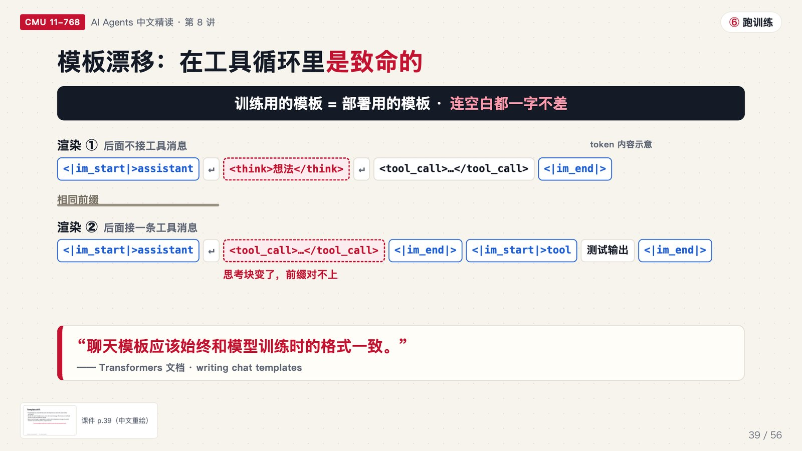

原课件 p.39（出处：Transformers writing chat templates、TRL training chat templates）：

- 训练用的模板必须就是部署时用的模板，连空白都不能差。
- 同一条轨迹渲染两次，一次后面接一条工具消息、一次不接，可能得到两个不同的字符串。
- 接上一条工具消息时，一个有条件的思考块会改掉前面那个助手轮，前缀就对不上了。

> "聊天模板应该始终和模型训练时的格式一致。"

在工具循环里，这个问题是致命的（课上口头补充）。

第三条讲的"有条件的思考块"，在 9.7 能看到真实的例子：Qwen3 的原版模板会把"最后一个用户问题之前"的助手轮里的思考块去掉。它还有一个更隐蔽的条件：没有推理内容的助手轮，如果是最后一条消息，会写出一个空的 `<think>` 块；后面接上一条工具消息之后，这个空块就不写了。同一个助手轮，后面接不接工具消息，渲染出来不一样。TRL 给它打的训练模板去掉了这个条件，让思考块总是保留。用"同一条对话，后面多接一条消息，前面的 token 是否不变"来检查模板，TRL 把这个性质叫**前缀保持**（prefix-preserving）。

### 5.5 公开的训练产物

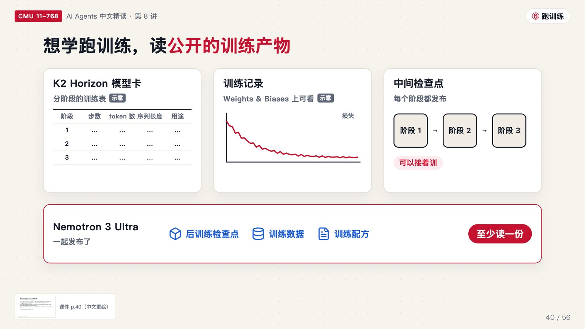

原课件 p.40（出处：Nemotron 3 Ultra、K2 Horizon）：

- K2 Horizon 的模型卡里有一张分阶段的训练表：步数、token 数、序列长度，以及每个阶段是干什么的。原课件说前面配置那页的数字就来自这张表。
- 它还链接了 **Weights & Biases** 上的训练记录（一个常用来监控训练损失的平台），能看到工业级模型真实的损失曲线；每个阶段的中间检查点也都发布了，可以拿来接着训。
- Nemotron 把后训练的检查点和训练数据、训练配方一起发布了。
- 读一份这样的材料，能学到很多。

**这一节记住一句：**混合专家模型要压住路由，打包不切对话，训练和部署的模板要一字不差。

---

## 6 怎么知道训好了

### 6.1 训练和运行之间的错位

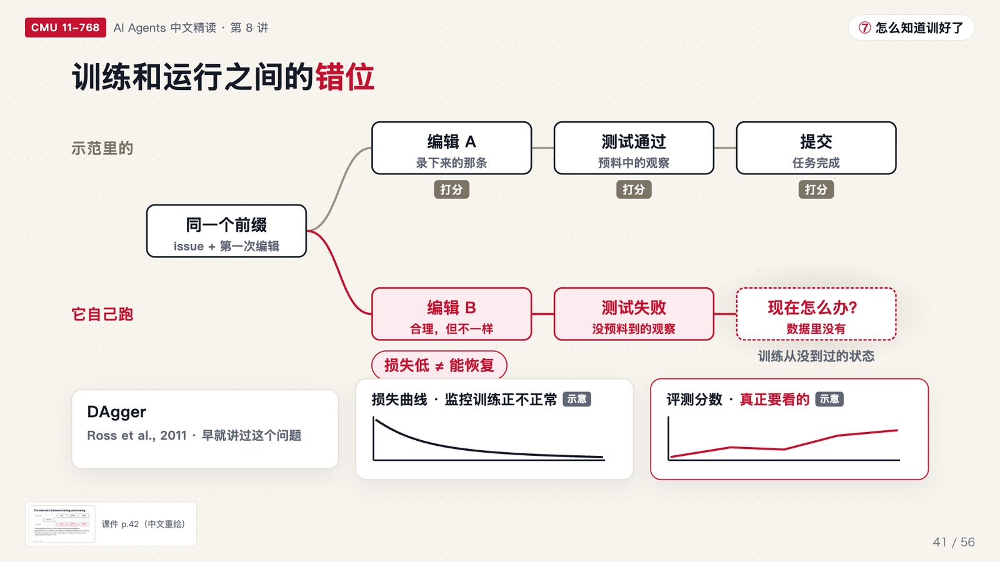

训完了，损失也降了，怎么知道它真的能用？原课件 p.42（出处：Ross et al., 2011，DAgger）：

| | 共同的前缀 | 第 1 步 | 第 2 步 | 第 3 步 |
|---|---|---|---|---|
| 示范里的 | issue + 第一次编辑 | 编辑 A（录下来的那个） | 测试通过（预期中的观察） | 提交（任务完成） |
| 它自己跑 | issue + 第一次编辑 | 编辑 B（合理，但不一样） | 测试失败（没预料到的观察） | 现在怎么办（数据里没有） |

- 训练时一次只给一个动作打分，而且总是接着录下来的那条往下走。
- 部署时没有录像，模型的每个动作都会改变它接下来看到的东西。
- 只要一次编辑不一样，它就进入了任何一次训练都没到过的状态。在那里，损失低什么也保证不了。

这时候就很依赖前面讲的出错恢复能力（课上口头补充）。训练的损失曲线可以用来监控训练是否正常，但不能代替真正的评测：训练是接着录像走，部署是接着它自己走。损失和评测结果都要看。

这个现象在模仿学习里叫**分布偏移**（distribution shift），或者叫误差累积（compounding error），DAgger 那篇论文讲的就是它。这两个名字是本课件补的通用术语，原课件只引用了 DAgger。它也解释了 3.9 为什么想留 B：带"出错再恢复"的轨迹，正好覆盖了一部分"自己跑会走到的状态"。

### 6.2 在目标脚手架里评测

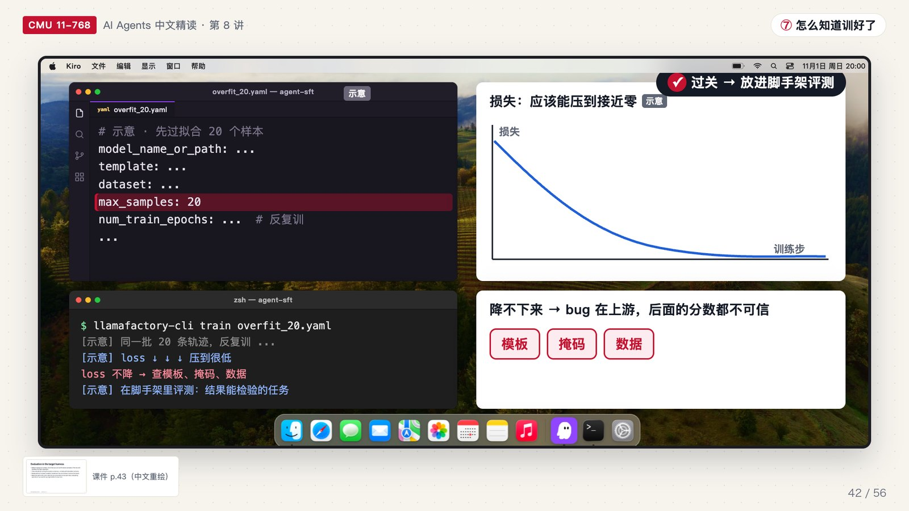

原课件 p.43（出处：OpenThoughts-Agent 表 1、SWE-Gym §5.2），四条检查：

1. 相信任何数字之前，先确认你能把 **20 个样本过拟合**。损失降不下来，说明 bug 在上游。
2. 然后把模型放进脚手架里跑，在结果能检验的任务上评测。
3. 读公开的数字要仔细，有时它是几种脚手架里最好的那个。
4. 划分要和结论对得上：同一个任务的所有轨迹放在同一边；想说它能泛化到新仓库，就按仓库来划分。

第 1 条怎么理解（本课件的展开，原课件只有那一句）：拿 20 条轨迹反复训，一个正常工作的训练管线应该能把损失压得很低。压不下来，往往是数据进模型之前就错了，比如掩码全是 0、模板和分词器对不上、标签错位。第 2 节讲的每一处细节，都能在这一步暴露出来。

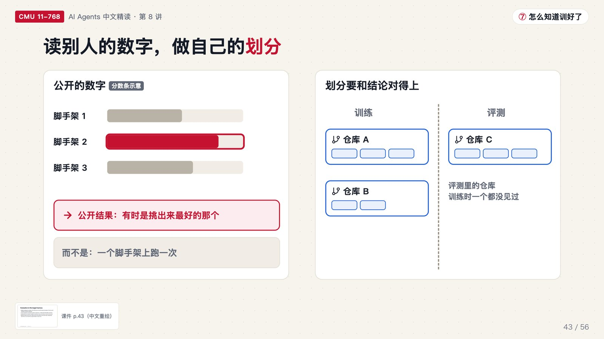

第 3、4 条展开（课上口头补充）：公开的数字有时是几种脚手架里挑出来最好的，而不是在一个脚手架上跑一次能拿到的结果。划分不当的典型问题是：同一个任务的几条轨迹，一条进了训练集、另一条进了测试集，测出来的就是记忆而不是能力。

### 6.3 跨脚手架的稳健性

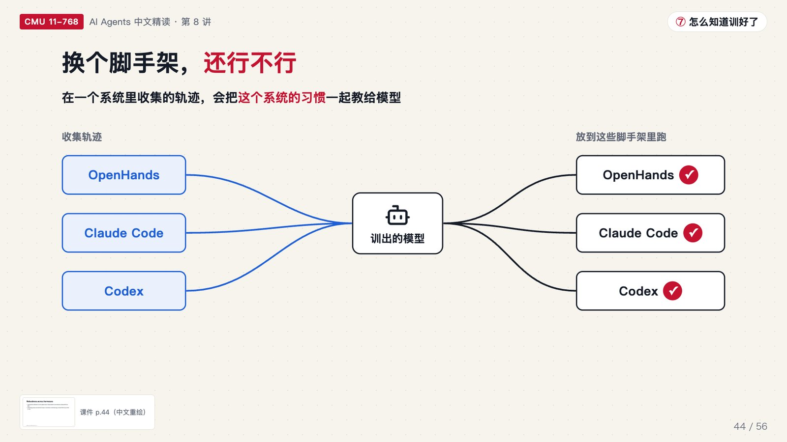

原课件 p.44（Nemotron 3 Ultra §3.1.1）：

- 在一个系统里收集的轨迹，除了教任务，也会把这个系统的习惯一起教给模型。
- 各家实验室避免训出"只在一个脚手架里能用"的模型，办法就是跨好几个脚手架收集。

比如全用 OpenHands 收集轨迹，训出来的模型可能泛化不到 Claude Code 或 Codex 上（课上口头补充）。

### 6.4 目标领域外的退化

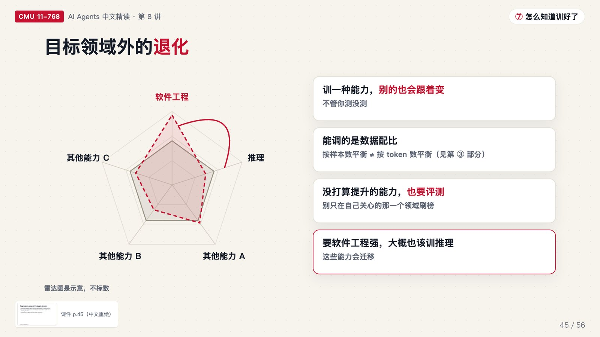

原课件 p.45（MAI-Thinking-1 §3.5）：

- 训一种能力，其他能力也会跟着变，不管你测没测。
- 这里能调的就是数据配比；按样本数平衡和按 token 数平衡不是一回事（见 2.9）。
- 所以那些你没打算提升的能力，也要评测。

比如想要一个软件工程很强的模型，大概也还是应该训推理能力，因为这些能力会迁移（课上口头补充）。别只在自己关心的那一个领域刷榜。

**这一节记住一句：**损失低不代表它自己跑时能恢复；先过拟合 20 个样本，再在目标脚手架里评，跨脚手架收集，领域外也要测。

---

## 7 交给强化学习

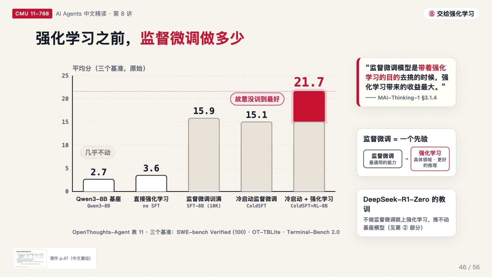

评测过关了，最后一步是交给强化学习。问题是：强化学习之前，监督微调做多少？原课件 p.47，OpenThoughts-Agent 表 11（按原图读数，误差省略）：

| 排名 | 模型（训练配方） | SWE-bench Verified (100) | OT-TBLite | Terminal-Bench 2.0 | 平均（原始） | 平均（归一化） |
|---|---|---|---|---|---|---|
| 1 | OT-Agent-ColdSFT+RL-8B | 35.7 | 16.0 | 13.5 | **21.7** | +1.2 |
| 2 | OT-Agent-SFT-8B (10K) | 24.3 | 15.6 | 7.9 | 15.9 | +0.5 |
| 3 | OT-Agent-ColdSFT | 23.7 | 14.8 | 6.7 | 15.1 | +0.4 |
| 4 | 在 Qwen3-8B 上直接做强化学习（不做监督微调） | 1.0 | 7.8 | 1.9 | 3.6 | −0.9 |
| 5 | Qwen3-8B（基座） | 5.3 | 1.3 | 1.5 | 2.7 | −1.1 |

- 完全不做监督微调就上强化学习，基座模型几乎不动（2.7 → 3.6）。
- 只做监督微调，离两者合起来能到的地方还差得远（15.9 对 21.7）。
- 赢的配方，是从一个**故意没训到它自己最好分数**的检查点开始做强化学习：冷启动用的 ColdSFT 平均 15.1，比单独训满的 SFT-8B 的 15.9 低，接上强化学习后到 21.7。

> "当监督微调模型是带着强化学习的目的去挑选时，强化学习带来的收益最大。"（MAI-Thinking-1 §3.1.4）

表里还有一个值得注意的数：第 4 行在 SWE-bench Verified 上只有 1.0，比基座的 5.3 还低。不做监督微调直接强化学习，在这个基准上反而退步了。这一条是本课件从表里读出来的，课上没讲。

课上口头补充：

- 从整个训练流程看，监督微调是 agent 获得最通用能力的地方；强化学习是练特定领域、或者让推理更好的地方。Nemotron、K2 Horizon 这些前沿实验室的做法都是这样。
- "不做监督微调直接强化学习，几乎推不动基座模型"，这也是从 DeepSeek-R1-Zero 那里得到的教训（见 1.5）。
- 可以把监督微调看成一个**先验**（prior）：给 agent 能力做冷启动，为后面的强化学习打好底子。训它的目的就是让后面的强化学习更好，而不是自己的分数最高。

为什么"没训满"的起点反而更好？原课件和课上都没有给出机制解释，只给了结果和 MAI 的那句话。这里留成思考题 7。

**这一节记住一句：**监督微调给强化学习做冷启动，最好的起点故意没训到自己的最好分数。

---

## 8 课堂问答

讲完之后的课堂问题，原课件上没有这部分（课上口头补充）。

### 8.1 没有更强的老师怎么办

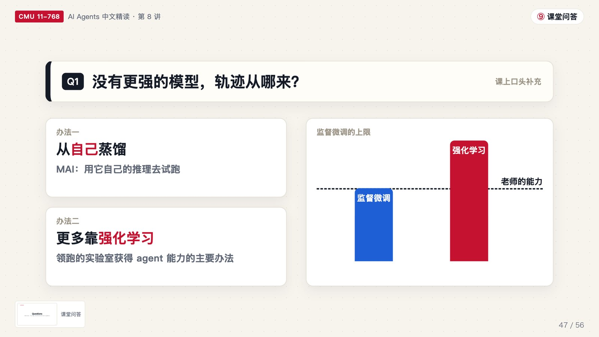

**轨迹靠更强的模型来生成，那如果没有更强的模型呢？**

- 一种办法是 MAI 那样从自己蒸馏。
- 另一种是像 OpenAI、Anthropic 这些领跑的实验室，更多靠强化学习获得 agent 能力。
- 监督微调多数时候是冷启动，agent 在这里学到通用能力，但提升不会太多，因为监督微调从根本上受限于老师模型的能力。没有更好的老师，可能就得靠强化学习来训。

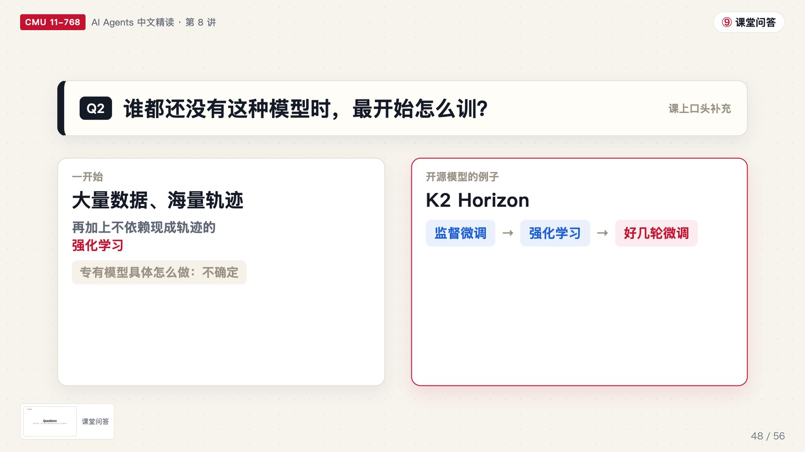

**那 OpenAI 这些实验室最开始是怎么训的，在还没有谁有这种模型的时候？**他们有大量数据、海量的轨迹，再加上强化学习；强化学习不依赖现成的轨迹，靠的是模型自己的试跑。专有模型具体怎么做不确定；最近发布的开源模型 K2 Horizon，在监督微调和强化学习阶段之后，又做了好几轮微调。

### 8.2 LoRA

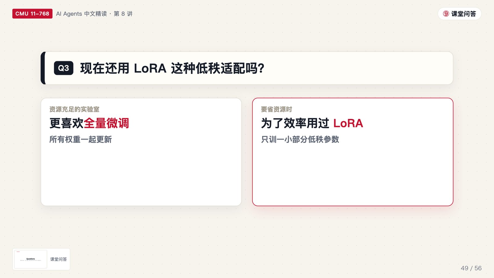

**现在还用低秩适配（LoRA）吗，还是只训某些层？**资源充足的实验室更喜欢全量微调；为了效率，也有人用低秩适配。

### 8.3 错误的步骤要不要监督

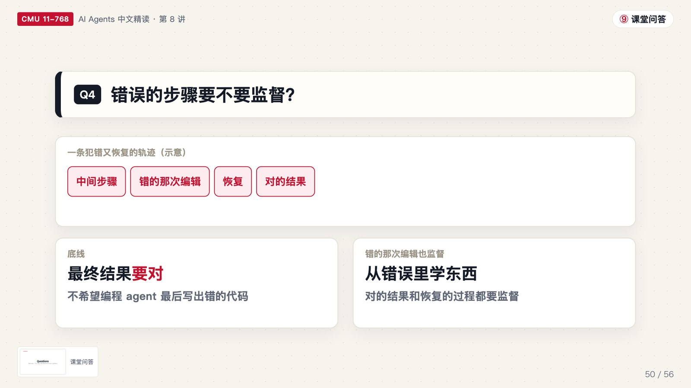

**要不要在错误的答案上做监督？**中间步骤可以监督，但最终结果还是要对，比如编程 agent 写代码，你不希望它最后写错。错误的那次编辑也要监督，因为这是从过去的错误行为里学东西的方式。所以对的结果和恢复的过程都要监督。


**错误轨迹和正确轨迹有没有一个比例？**一般靠实验定。先在一小部分同分布、同任务的数据上，用小一点的模型试，看有没有用，再扩大规模。MAI 选 STEM 和编程占 56%（见 2.9），也是他们试出来对自己模型最好的设置。

### 8.4 强化学习会自动重新加权


课上还补充了一点：

- 用正确与否来决定一个样本的权重，强化学习其实会自动做这件事。大致是模型在一个样本上拿的奖励越多，这个样本的梯度权重越高，所以有正确性信号时，强化学习会在轨迹层面隐式地重新加权。
- 但这样一来，如果模型犯了错又恢复了，它也会强化"犯这些错"。如果你知道那些是错误、又有更聪明的方式监督损失，可能做得更好，但这类方法不好搭。
- 最常见的还是用整条轨迹的总奖励：要么只筛出正确的轨迹做监督微调，要么在强化学习里交给算法去重新加权。


- 按"这个样本和下游任务是否对口"来挑数据，更依赖实验。一种办法是在评测集上算模型的损失，拿它当挑数据的信号，但这都只是近似，因为没有在那批数据上完整训一遍。

### 8.5 训练目标和 teacher forcing


**训练目标是什么？**可以把监督微调看成和预训练一样，只是把数据整理成带角色标签的聊天格式，再给损失加一个掩码，通常不监督模型去输出工具调用的结果。用的损失函数和预训练一样，是交叉熵，只是用在不同的数据上、只用在一部分 token 上。


**有人在做"模仿"吗？**这就是带 **teacher forcing** 的**模仿学习**（imitation learning）：上下文是固定的，训练时不从模型里采样，大多数监督微调方法都是这样。让模型自己产生训练数据的方法，接下来几讲会讲。

teacher forcing 和 6.1 是一体两面：训练时每一步的上下文都是"录下来的那条"，从不是模型自己生成的，所以模型从没见过自己犯错之后的状态。

---

## 9 源码解读：只在助手 token 上算损失，真实代码怎么写

第 2.4 节说掩码由"渲染 → 分词 → 掩码"三步造出来，2.5 节说 TRL 把这个决定放进了模板。这一节读两个仓库的原文件，把这条链从头走到尾：

| 步骤 | 仓库 | 文件 | 本节 |
|---|---|---|---|
| 模板里标出助手段 | huggingface/trl | `trl/chat_templates/qwen2_5_training.jinja` | 9.1 |
| 渲染时记下助手段的字符位置 | huggingface/transformers | `src/transformers/utils/chat_template_utils.py` | 9.2 |
| 字符位置 → token 位置 → 0/1 掩码 | huggingface/transformers | `src/transformers/tokenization_utils_base.py` | 9.3 |
| 换上训练模板、检查结束符 | huggingface/trl | `trl/trainer/sft_trainer.py` | 9.4 |
| 掩码 → 标签里的 `-100` | huggingface/trl | `trl/trainer/sft_trainer.py` | 9.5 |
| 默认值 | huggingface/trl | `trl/trainer/sft_config.py` | 9.6 |
| 模板漂移的真实例子 | huggingface/trl | `trl/chat_templates/qwen3.jinja`、`qwen3_training.jinja` | 9.7 |

版本：

- TRL：[huggingface/trl](https://github.com/huggingface/trl) 提交 `a03b8fe31d5f68b645ccf0d6b95c1f1245b5006e`（2026-11-02 读取的 main）。
- Transformers：[huggingface/transformers](https://github.com/huggingface/transformers) 提交 `ca8c871ede62b521a75a2ddfc5e1968ac9c8e097`（2026-11-02 读取的 main）。

下面的代码都是原文件节选，行号是这两个提交里的行号；中文注释是本课件加的，删掉的部分用 `# ……（删去：……）` 标出。

### 9.1 模板里标出助手段：``

TRL 给常见模型家族准备了"训练版"模板。Qwen2.5 的训练版和原版只差两处，文件开头自己写明了改动：

```jinja
{#- trl/chat_templates/qwen2_5_training.jinja，第 1–5 行 -#}
{#- Training variant of the Qwen2.5 chat template (see qwen2_5.jinja for the original).
    Modifications vs the original:
    - Added  /  around assistant message output to support
      assistant-only loss masking in SFT training.
-#}
```

助手轮那一段（第 26–62 行，删去了开头处理 system 和工具列表的第 6–25 行）：

```jinja

    
        {#- 用户和非首条 system：整轮原样写出，不在 generation 里 → 掩码 0 -#}
        {{- '<|im_start|>' + message.role + '\n' + message.content + '<|im_end|>' + '\n' }}
    
        {{- '<|im_start|>assistant' }}          {#- 角色头在 generation 外面 → 不算损失 -#}
                              {#- 从这里开始是助手段 -#}
        
            {{- '\n' + message.content + '<|im_end|>\n' }}   {#- 结束符 <|im_end|> 在里面 → 算损失 -#}
        
            
                {{- '\n' + message.content }}
            
            
                
                    
                
                {{- '\n<tool_call>\n{"name": "' }}           {#- 工具调用整段算损失 -#}
                {{- tool_call.name }}
                {{- '", "arguments": ' }}
                {{- tool_call.arguments | tojson }}
                {{- '}\n</tool_call>' }}
            
            {{- '<|im_end|>\n' }}
        
                           {#- 助手段到这里结束 -#}
    
        {#- 工具结果：放在 user 角色下，包进 <tool_response>，不在 generation 里 → 掩码 0 -#}
        
            {{- '<|im_start|>user' }}
        
        {{- '\n<tool_response>\n' }}
        {{- message.content }}
        {{- '\n</tool_response>' }}
        
            {{- '<|im_end|>\n' }}
        
    

```

对照原课件：

| 原课件的说法 | 这份模板里 |
|---|---|
| 角色头不是训练目标（p.15） | `'<|im_start|>assistant'` 写在 `` 之前 |
| 结束符必须在掩码里（p.15） | `'<|im_end|>\n'` 写在 `` 之前 |
| 观察只当上下文（p.12） | tool 分支整个在 generation 外面 |
| 只有 TRL 把决定放进了模板（p.14） | 训不训，就看这段文字有没有被 `` 包住 |

和原课件 p.15 不一样的一处：这里角色头后面的那个 `\n` 写在 generation 里面，所以这个换行会算损失；原课件图上它是灰的。上面 2.6 的提示说的就是这个。

### 9.2 渲染时记下助手段的字符位置

`` 不是 Jinja 自带的语法，是 Transformers 注册的一个扩展。它做的事情和 2.4 的"渲染时记账"一字不差：

```python
# src/transformers/utils/chat_template_utils.py，第 510–525 行
def _render_with_assistant_indices(
    compiled_template, messages, tools, documents, add_generation_prompt, **template_kwargs
):
    rendered_blocks = []          # 已经写出的字符串片段
    generation_indices = []       # 每段助手文本的 (起始字符, 结束字符)
    with compiled_template.environment.activate_tracker(rendered_blocks, generation_indices):
        for block in compiled_template.generate(     # 一块一块地渲染模板
            messages=messages,
            tools=tools,
            documents=documents,
            add_generation_prompt=add_generation_prompt,
            **template_kwargs,
        ):
            rendered_blocks.append(block)
        rendered_chat = "".join(rendered_blocks)
    return rendered_chat, generation_indices      # 字符串 + 账本
```

```python
# 同一文件，第 540–565 行（在 _cached_compile_jinja_template 内部定义）
    class AssistantTracker(Extension):
        # This extension is used to track the indices of assistant-generated tokens in the rendered chat
        tags = {"generation"}                     # 注册  这个标签

        def __init__(self, environment: ImmutableSandboxedEnvironment):
            # ……（删去：初始化，把 activate_tracker 挂到 environment 上）

        def parse(self, parser: jinja2.parser.Parser) -> jinja2.nodes.CallBlock:
            lineno = next(parser.stream).lineno
            # 一直读到 ，中间那段模板就是 body
            body = parser.parse_statements(["name:endgeneration"], drop_needle=True)
            return jinja2.nodes.CallBlock(self.call_method("_generation_support"), [], [], body).set_lineno(lineno)

        @jinja2.pass_eval_context
        def _generation_support(self, context: jinja2.nodes.EvalContext, caller: jinja2.runtime.Macro) -> str:
            rv = caller()                         # 先把 generation 里那段渲染出来
            if self.is_active():
                # 起点 = 到目前为止已写出的字符数
                start_index = len("".join(self._rendered_blocks))
                end_index = start_index + len(rv)
                self._generation_indices.append((start_index, end_index))   # 记账
            return rv                             # 原样返回，不改变渲染结果

        # ……（删去：is_active、activate_tracker 两个辅助方法，第 566–580 行）
```

要点：`` 对渲染出的字符串**没有任何影响**，同一个模板推理时照样能用；它只是在旁边记一本账。这也是为什么 TRL 可以把训练模板换上去而不改变模型看到的格式（前提是除 generation 标记之外的改动不改变渲染结果，见 9.7）。

### 9.3 字符位置 → token 位置 → 0/1 掩码

`apply_chat_template` 拿到字符串和账本，分词之后用分词器的偏移量把字符位置换成 token 位置：

```python
# src/transformers/tokenization_utils_base.py，第 3120–3121 行
        if return_assistant_tokens_mask and not (return_dict and tokenize):
            raise ValueError("`return_assistant_tokens_mask=True` requires `return_dict=True` and `tokenize=True`")
```

```python
# 同一文件，第 3205–3228 行
        if tokenize:
            if return_dict:
                if return_assistant_tokens_mask:
                    assistant_masks = []
                    # ……（删去：is_batched / return_tensors 时取 input_ids 的分支）
                    for i in range(len(input_ids)):
                        current_mask = [0] * len(input_ids[i])          # 先全记 0
                        for assistant_start_char, assistant_end_char in generation_indices[i]:
                            # 助手段第一个字符、最后一个字符各落在哪个 token 上
                            start_token = out.char_to_token(i, assistant_start_char)
                            end_token = out.char_to_token(i, assistant_end_char - 1)
                            if start_token is None:
                                # start_token is out of bounds maybe due to truncation.
                                break                                     # 被截断了，后面的助手段不要了
                            for token_id in range(start_token, end_token + 1 if end_token else len(input_ids[i])):
                                current_mask[token_id] = 1              # 这一段记 1
                        assistant_masks.append(current_mask)
                    # ……（删去：非批量时去掉外层列表）
                    out["assistant_masks"] = assistant_masks
```

和原课件 p.13 的三步一一对应：

| 原课件 p.13 | 代码 |
|---|---|
| 渲染，同时记下助手文本的起止 | `_render_with_assistant_indices` 返回 `generation_indices` |
| 字符位置变成 token 位置 | `out.char_to_token(...)` |
| 助手段的 token 记 1，其余记 0 | `current_mask = [0] * ...`，再把区间置 1 |

两个容易踩的地方：

- `char_to_token` 依赖"快速分词器"（Rust 实现）提供的偏移量；同一文件第 579 行写明 Python 实现的分词器不支持它。
- 截断时，第一个落在截断点之后的助手段直接 `break`，它和它后面的助手段都记 0。被截断的轨迹，后半段的动作不会被训到。这也是 5.3 不想切开对话的一个现实理由（本课件的推断）。

### 9.4 SFTTrainer：换上训练模板，检查结束符

`SFTTrainer.__init__` 里，打开 `assistant_only_loss` 之后会先做三件事：

```python
# trl/trainer/sft_trainer.py，第 981–1005 行（在 SFTTrainer.__init__ 里）
        if args.assistant_only_loss and not is_conversational(dataset_sample):
            raise ValueError(                         # 1. 只支持对话格式的数据
                "You set `assistant_only_loss=True`, but the dataset is not conversational. This option is only "
                "supported for conversational datasets."
            )

        # When assistant_only_loss is enabled, swap in a training chat template with  markers
        # if the current template doesn't already have them.
        if args.assistant_only_loss and not has_generation_markers(processing_class.chat_template):
            self.chat_template = get_training_chat_template(processing_class)   # 2. 模型自带模板没有标记，换成训练版
        else:
            self.chat_template = None

        # A template can define generation markers and still attribute the assistant's end-of-turn token to the next
        # message, leaving it out of the assistant mask so the model is never trained to stop.
        if args.assistant_only_loss and not is_chat_template_stop_token_trained(
            processing_class, chat_template=self.chat_template
        ):
            logger.warning(                           # 3. 结束符不在掩码里：只警告，不报错
                "The chat template does not include the assistant turn's end-of-turn token in the loss mask; "
                "the model may not learn to stop. The training loss still looks healthy, so this usually only "
                "surfaces at inference. Either set `assistant_only_loss=False` to train on the full sequence, "
                "or edit the chat template so the end-of-turn token falls inside "
                "`...`."
            )
```

第 3 件事就是原课件 p.15 那句"模型可能学不会停下来"在代码里的样子。警告原文还多说了一句："训练损失看起来仍然正常，所以这个问题通常要到推理时才暴露。"

第 2 件事里的 `get_training_chat_template`（`trl/chat_template_utils.py` 第 1174 行起）先检查模板是否已经满足两个条件：前缀保持（只在模板支持工具调用时才检查）和带 `` 标记。都满足就不换；不满足就按模板全文去匹配一张已知模板表，命中就返回对应的训练版，没命中就报错，让你自己改模板：

```python
# trl/chat_template_utils.py，第 1250–1252 行
    prefix_ok = not supports_tool_calling(processing_class) or is_chat_template_prefix_preserving(processing_class)
    if prefix_ok and has_generation_markers(chat_template):
        return None  # No patching needed

    # ……（删去：第 1254–1351 行，逐个比对 cohere、deepseek、gemma、llama3、qwen2_5、qwen3 等已知模板，
    #        命中就 return 对应的 *_training_chat_template）

# 第 1353–1356 行
    raise ValueError(
        "The chat template is not training-compatible (missing prefix-preservation or `` markers) "
        "and patching is not supported for this template. Please manually modify the chat template for training."
    )
```

这就是备用页 p.49 那句"已知的模型家族有打过补丁的模板"。注意匹配是**整段模板字符串完全相等**才算命中，模型作者改过一个空格，这张表就认不出来了。

### 9.5 掩码变成标签里的 `-100`

预处理数据集时，TRL 对每条对话调一次 `apply_chat_template(..., return_assistant_tokens_mask=True)`，再把掩码变成标签：

```python
# trl/trainer/sft_trainer.py，第 1419–1442 行（tokenize_fn 里"语言模型格式"的分支）
                    else:  # language modeling case
                        if is_conversational(example):
                            processed = _tokenize(
                                processing_class,
                                example["messages"],
                                return_assistant_tokens_mask=assistant_only_loss,   # 9.3 那段代码在这里被调用
                                **apply_chat_template_kwargs,
                            )
                            output = {k: processed[k] for k in ("input_ids", "assistant_masks") if k in processed}
                        # ……（删去：纯文本数据集的分支）

                    if "assistant_masks" in output and 1 not in output["assistant_masks"]:
                        raise RuntimeError(               # 一整条轨迹一个 1 都没有：多半是模板缺 
                            "You're using `assistant_only_loss=True`, but at least one example has no assistant "
                            "tokens. This usually means the tokenizer's chat template doesn't generate assistant "
                            "masks — it may be missing the `` keyword. Please check the template and "
                            "ensure it's correctly configured to support assistant masking."
                        )
                    return output
```

```python
# 同一文件，第 1461–1475 行
                mask_columns = []
                if self.completion_only_loss and "completion_mask" in column_names:
                    mask_columns.append("completion_mask")
                if "assistant_masks" in column_names:
                    mask_columns.append("assistant_masks")
                # ……（删去：给 map 设置进度条说明）

                def build_labels(example, mask_columns):
                    masks = [example[column] for column in mask_columns]
                    labels = [
                        token_id if all(bits) else -100      # 所有掩码都是 1 才保留，否则记 -100
                        for token_id, *bits in zip(example["input_ids"], *masks, strict=False)
                    ]
                    return {"labels": labels}
```

- `-100` 是 PyTorch 交叉熵默认的 `ignore_index`：这些位置照样参与前向计算（当上下文），只是不进损失。这就是 2.2 公式里的 m_t = 0。
- 有两种掩码时取"与"：两种都说算，才算。
- 上面那个 `RuntimeError` 是"一整条一个 1 都没有"才报。如果只是结束符没进掩码，这里不会报，靠的是 9.4 的警告。

（视觉语言模型走另一条路：`DataCollatorForVisionLanguageModeling._collate_language_modeling` 在组 batch 时现场调 `apply_chat_template`，第 414–418 行用同样的办法把 `assistant_masks == 0` 的位置设成 `-100`。）

### 9.6 默认值

对照 `trl/trainer/sft_config.py` 核对的几个默认值：

| 参数 | 默认值 | 源码位置 | 说明 |
|---|---|---|---|
| `assistant_only_loss` | `False` | 第 273–274 行 | 默认整条序列都算损失；agent 轨迹要手动打开 |
| `completion_only_loss` | `None` | 第 261–262 行 | `None` 表示看数据：prompt–completion 格式就只训 completion，语言模型格式就训全序列（`sft_trainer.py` 第 1009–1012 行） |
| `max_length` | `1024` | 第 202–203 行 | 超长截断；打包时就是包长 |
| `packing` | `False` | 第 222–223 行 | 默认不打包 |
| `packing_strategy` | `"bfd"` | 第 229–230 行 | best-fit decreasing；帮助文本写的是"truncates overflow"（超长的截断）；另有 `"bfd_split"`（超长的切开）和 `"wrapped"`（中途切断） |
| `learning_rate` | `2e-5` | 第 140–141 行 | 文档注明比 `TrainingArguments` 的 `5e-5` 小 |

和原课件对照：

- 5.3 里 Nemotron 的选择是"没有一段对话被切开或截断"。TRL 三种打包策略里没有"绝不切"的选项：`bfd` 截断超长的，`bfd_split` 切开超长的。想做到 Nemotron 那样，得自己保证没有一条超过 `max_length`，比如把 `max_length` 设得足够大，或者事先丢掉超长的（本课件根据源码说明的推断，没有跑实验）。
- 5.1 里三家的序列长度在 12.8 万到 51.5 万 token，默认的 1024 差得很远。

### 9.7 模板漂移的真实例子：Qwen3 的思考块

5.4 说"一个有条件的思考块会改掉前面那个助手轮"。TRL 仓库里的 Qwen3 原版模板就有这样一个条件：

```jinja
{#- trl/chat_templates/qwen3.jinja，第 17–24 行：倒着找"最后一个真正的用户问题"在哪 -#}


    
    
        
        
    

```

```jinja
{#- 同一文件，第 43–51 行：只有在那之后的助手轮，才写出 <think> 块 -#}
        
            
                {{- '<|im_start|>' + message.role + '\n<think>\n' + reasoning_content.strip('\n') + '\n</think>\n\n' + content.lstrip('\n') }}
            
                {{- '<|im_start|>' + message.role + '\n' + content }}
            
        
            {{- '<|im_start|>' + message.role + '\n' + content }}   {#- 更早的助手轮：思考块被丢掉 -#}
        
```

这就是 2.7 的"推理留不留在上下文里"这个开关，被模板悄悄替你设了：更早轮次的推理不留在上下文里。推理时这样做省上下文；可放在训练里，同一个助手轮带不带 `<think>`，取决于它后面还有没有新的用户消息；第 44 行的 `loop.last` 又让"是不是最后一条"也会改变结果（没有推理内容时，最后一条写空的 `<think>` 块，不是最后一条就不写）。这两处都会让前缀不稳定。

TRL 的训练版把这个条件删掉了，文件开头写明了理由：

```jinja
{#- trl/chat_templates/qwen3_training.jinja，第 1–7 行 -#}
{#- Training variant of the Qwen3 chat template (see qwen3.jinja for the original).
    Modifications vs the original:
    - Removed the loop.index0 > ns.last_query_index conditional; always include thinking block.
      This makes the template prefix-preserving for the [user, assistant] → [user, assistant, tool] transition.
    - Added  /  around assistant message output to support
      assistant-only loss masking in SFT training.
-#}
```

```jinja
{#- 同一文件，第 50–52 行：思考块总是写出，且整段在 generation 里 → 推理也算损失 -#}
        {{- '<|im_start|>' + message.role + '\n' }}
        
        {{- '<think>\n' + reasoning_content.strip('\n') + '\n</think>\n\n' + content.lstrip('\n') }}
```

两个读后要注意的地方：

- 这份训练模板把推理放进了 ``，也就是"推理要训"。如果你想像 2.7 说的那样只训工具调用，得自己再改模板。
- 训练版和原版渲染出的字符串**并不完全相同**（早期助手轮多了思考块）。这正是 5.4 要警惕的情况：训练时模型看到的历史，和部署时用原版模板渲染的历史可能不一样。前缀保持解决的是"训练内部"的一致性，和"训练与部署一致"是两件事。这一条是本课件读源码后的提醒，原课件没有讨论这份模板。

TRL 怎么检查前缀保持（`trl/chat_template_utils.py` 第 953–1009 行，节选）：

```python
    messages1 = [
        {"role": "user", "content": "dummy"},
        {"role": "assistant", "content": "", "tool_calls": dummy_tool_calls},
    ]
    messages2 = [                                     # 同一段对话，后面多接一条工具消息
        {"role": "user", "content": "dummy"},
        {"role": "assistant", "content": "", "tool_calls": dummy_tool_calls},
        {"role": "tool", "name": "dummy", "content": "dummy"},
    ]
    # ……（删去：视觉语言模型的特殊处理）
    ids1 = processing_class.apply_chat_template(messages1, tokenize=True, return_dict=False)
    ids2 = processing_class.apply_chat_template(
        messages2, tokenize=True, return_dict=False, add_generation_prompt=True
    )
    # ……（删去：异常处理和批量输出拆包）
    return ids2[: len(ids1)] == ids1                  # 前面那段的 token 一个都不能变
```

这就是原课件 p.39 第二条"同一条轨迹渲染两次，一次后面接一条工具消息、一次不接"的检查，写成了一行比较。

### 9.8 对照本讲

| 本讲的说法 | 源码里 |
|---|---|
| 模板在渲染时记账（2.4） | `AssistantTracker._generation_support` 记 `(start_index, end_index)` |
| 训练器只看到字符串和这串位（2.4） | `build_labels` 之后数据集里只剩 `input_ids` 和 `labels` |
| 只有 TRL 把决定放进模板（2.5） | 训不训看 `` 包住了什么 |
| 结束符必须在掩码里（2.6） | `is_chat_template_stop_token_trained` + 警告 |
| 推理训不训是单独的开关（2.7） | Qwen3 训练模板把推理放进 generation，即"训" |
| 打包不切对话（5.3） | TRL 的 `bfd` 截断超长、`bfd_split` 切开超长，要自己保证不超长 |
| 模板漂移（5.4） | Qwen3 原版的 `last_query_index` 条件；`is_chat_template_prefix_preserving` |

---

## 本讲小结


- **改权重是一种能力**：权重改一次，以后每次调用都带着新行为；代价是每次改都要训练、看不见改了什么、换不了模型。监督微调排在预训练、中训练之后，给强化学习做冷启动；DeepSeek-R1-Zero 跳过它，下一代 R1 又把它加了回来。
- **轨迹变成 token 序列**：套上聊天模板变成一串 token，掩码只让助手 token 算交叉熵；掩码由"渲染 → 分词 → 掩码"三步造出来。结束符要在掩码里，角色头不在；推理块留不留、训不训是两个开关；配比要按 token 看（MAI：56% 的样本占了 89% 的 token）。
- **挑选轨迹**：多数数据来自更强模型的、通过测试的轨迹（SWE-Gym 只用 491 条就涨了十多个点）；通过测试的轨迹也会带坏习惯；至少 5 轮的过滤平均有用；最强的模型不一定是最好的老师；任务来源影响最大，混最好的四到八个；扩数据要加新任务，不是多采同样的任务。
- **一种格式**：各数据集先转成 Agent Data Protocol 的统一表示，再按目标脚手架渲染；混合多来源的数据胜过单一领域。
- **跑训练**：混合专家模型要压住路由；打包不切开对话；训练和部署的模板一字不差。
- **怎么知道训好了**：训练接着录像走，部署接着自己走，损失低不保证能恢复；先过拟合 20 个样本，再在目标脚手架里评，跨脚手架收集，领域外也要测。
- **交给强化学习**：不做监督微调直接强化学习推不动基座模型，只做监督微调又不够；最好的冷启动检查点故意没训到自己的最好分数。
- **源码**：TRL 用模板里的 `` 标出助手段，Transformers 渲染时记下字符区间、分词后换成 token 掩码，TRL 再把掩码为 0 的位置标签设成 `-100`。

## 关键术语

| 中文 | 英文 | 一句话解释 |
|---|---|---|
| 监督微调 | Supervised Fine-Tuning（SFT） | 在录下来的示范上用交叉熵训练，让模型模仿示范里的动作 |
| 轨迹 | trajectory | agent 干一次活录下来的全部消息：system、user、assistant、observation |
| 观察 | observation | 工具或环境返回的结果，只当上下文，不当预测目标 |
| 聊天模板 | chat template | 把多轮消息写成一个字符串的规则，各模型不同 |
| 特殊 token | special token | `<|im_start|>` 这类模板标记，各自只占一个 token |
| 损失掩码 | loss mask | 每个 token 一位，1 表示这个位置的预测算进损失 |
| 只在助手 token 上算损失 | assistant-only loss | TRL 的 `assistant_only_loss=True`；观察、用户、系统都记 0 |
| 结束符 | end-of-turn token | 模型自己产生、表示这一轮结束的 token，必须算损失 |
| 角色头 | role header | `<|im_start|>assistant` 这类开头，推理时由系统给，不算损失 |
| 推理块 | reasoning block | 思考标记里的推理文字；留不留在上下文、训不训是两个开关 |
| 生成标记 | generation markers | 模板里的 `…`，标出助手段 |
| 前缀保持 | prefix-preserving | 对话后面多接一条消息，前面渲染出的 token 不变 |
| 模板漂移 | template drift | 训练和部署用的模板不一致，或同一轮被渲染成不同字符串 |
| 预训练 | pre-training | 在海量文本上学下一个 token 预测 |
| 中训练 | mid-training | 预训练和后训练之间的阶段，各家定义不一 |
| 后训练 | post-training | 预训练之后的阶段，一般包括监督微调和强化学习 |
| 冷启动 | cold start | 强化学习开始时用的那个检查点 |
| 在线策略蒸馏 | on-policy distillation | Kimi K3 后训练第三步，把多个专家合并成一个模型 |
| 蒸馏 | distillation | 用更强的模型（老师）产生的数据训练学生模型 |
| 专家迭代 | expert iteration | 模型自己跑、只留通过的、再训，循环下去 |
| 试跑 | rollout | 模型在环境里实际跑一遍任务 |
| 打包 | packing | 把几段对话塞进一条定长序列，减少空白 |
| 混合专家模型 | Mixture of Experts（MoE） | 每个 token 只路由给少数几个"专家"子网络的模型 |
| 路由均衡 | routing balance | 让各专家分到的 token 不要太偏的约束 |
| 无障碍树 | accessibility tree | 网页的结构化表示，Go-Browse 存它，Mind2Web 存 HTML |
| Agent Data Protocol | ADP | 把各家 agent 数据集统一成带类型的动作和观察的表示 |
| 分布偏移 | distribution shift | 部署时走到训练从没见过的状态；DAgger 讨论的问题 |
| teacher forcing | teacher forcing | 训练时每一步的上下文都用录下来的真实前文，不用模型自己的输出 |
| 模仿学习 | imitation learning | 从示范里学策略；监督微调是它的一种 |
| 低秩适配 | LoRA（Low-Rank Adaptation） | 只训一小组低秩矩阵的参数高效微调方法 |

## 思考题

<details>
<summary>1. 2.2 的损失公式里，掩码为 0 的 token 还参与计算吗？如果把观察 token 直接从序列里删掉，和把它们的掩码设成 0，有什么区别？</summary>

掩码为 0 的 token 仍然参与前向计算，它们是后面助手 token 的条件上下文，只是自己那个位置的预测不进损失（实现上是标签设成 `-100`，见 9.5）。如果把观察直接删掉，模型在训练时就看不到工具返回了什么，后面那个动作失去了依据：它要在不知道测试结果的情况下"预测"下一步编辑。这会教模型无视工具结果，正好和 1.3 第 3 条"会等工具结果"相反。所以观察要留在序列里，只是不当预测目标。
</details>

<details>
<summary>2. 为什么结束符必须算损失，而角色头不算？如果把两者弄反了，各会出什么问题？</summary>

角色头 `<|im_start|>assistant` 在推理时是系统写进去、提示模型"该你说了"的，模型永远不需要自己生成它，所以训它没有用。结束符是模型自己要产生的，产生它才代表"这一轮说完了"（交给工具、结束消息或结束任务）。

- 结束符没算损失：模型从没被训练去产生它，推理时可能停不下来，一直往下写，甚至自己编出工具结果和下一轮。训练损失却看起来正常，TRL 为此专门加了警告（9.4）。
- 角色头算了损失：多数情况下浪费一点梯度；更麻烦的是模型可能学会在自己的输出里主动写出 `<|im_start|>user` 之类的角色头，冒充用户或环境继续对话。（后一条是推断。）
</details>

<details>
<summary>3. MAI 的配比是按样本数定的：STEM 和编程 56%、agent 能力 11%。如果你想让 agent 能力在损失里占到 30%，应该怎么调？要看哪个量？</summary>

要看的是"掩码为 1 的 token 数"，不是条数。先统计每类数据每条轨迹平均有多少算损失的 token，再反推条数。按表 10，agent 能力 11% 的样本只占 9% 的 token；要让它到 30%，在 token 层面要大约是现在的三倍多，同时压低 STEM 和编程的 token 占比。可以加 agent 轨迹的条数，也可以减少 STEM、编程的条数或截短它们的推理。调完要回头再算一遍 token 占比。还要记得 6.4：改配比会影响领域外的能力，没打算提升的能力也要评测。（具体数字是示意。）
</details>

<details>
<summary>4. 3.9 的轨迹 C：在 11 次什么都没改变的尝试之后才解决了 issue。你会留吗？如果留，哪些动作该算损失？</summary>

课上没有回答这一问，下面是一种参考思路。C 最后成功了，但 11 次无效尝试正是 3.4 说的"坏习惯"，全训的话模型会学会原地打转。几种做法：

- 不留：最简单，代价是丢掉一条成功轨迹。
- 留，但只让有效的步骤算损失：把那 11 次无效尝试的助手轮掩码设成 0，它们留在上下文里，最后几步有效动作算损失。这是"助手轮之间也可以不同掩码"的做法，要自己改掩码，三个框架的开关都不直接支持（LLaMA-Factory 的 `mask_history` 只能训最后一轮）。
- 改写：把无效尝试从轨迹里删掉，重新拼成一条干净的轨迹。风险是删掉之后后面的观察对不上了。

另外，"至少 5 轮"的过滤器会留下 C、扔掉 A，正好和多数人的直觉相反，这就是原课件问"哪些答案会被最少轮数过滤器判错"的用意。
</details>

<details>
<summary>5. OpenThoughts-Agent 表 6 里，GPT-5.3-Codex 是最强的模型，却是最弱的老师。除了课上给的解释，你还能想到哪些可能？怎么验证？</summary>

课上的解释是：Codex 的思考方式、解题路线可能和学生很不一样。其他可能（都是推断，原课件和课上没有给）：

- 轨迹形状：如果强模型很快就做对，轨迹短、很少出错再恢复，学生学不到恢复能力（对照 3.5、3.9）。
- 格式：老师的工具调用格式、推理风格和学生要用的脚手架差得远，渲染后的轨迹对学生不自然。
- 数量：同样的任务预算下，不同老师通过测试的轨迹条数可能不同。

验证办法：统计各个老师留下的轨迹的轮数分布、通过条数、平均 token 数；控制条数一致再比一次；或者把 Codex 的轨迹按轮数过滤后再训，看差距是否缩小。
</details>

<details>
<summary>6. 用 TRL 训一个模型，模板是作者自己改过的版本，打开 assistant_only_loss=True 后训练损失下降很正常，部署后模型却总是停不下来。最可能是哪里出了问题？怎么排查？</summary>

最可能是结束符没进掩码：模板有 `` 标记（所以 9.5 的 `RuntimeError` 没触发），但 `<|im_end|>` 写在了 `` 外面，或者被算给了下一条消息。9.4 的 `is_chat_template_stop_token_trained` 会为此打一条警告，先去日志里找这条。

排查：取一条样本，调 `apply_chat_template(..., return_dict=True, return_assistant_tokens_mask=True)`，把掩码为 1 的 token 解码出来打印，看每个助手段最后一个 token 是不是结束符。修法是把结束符挪进 `…`。另一个可能是模型作者改过模板，`get_training_chat_template` 的整串匹配没认出来，用的是你自己的版本，所以 TRL 的补丁没生效（9.4）。
</details>

<details>
<summary>7. 表 11 里，冷启动用的 ColdSFT（15.1）比训满的 SFT-8B（15.9）分低，接上强化学习后却最高。你怎么理解"故意没训到最好"？</summary>

原课件和课上都没有给机制解释，只给了结果和 MAI 的一句话："监督微调模型是带着强化学习的目的去挑选时，强化学习收益最大。"一种可能的理解（推断）：强化学习靠模型自己试跑、在奖励高的试跑上学，它需要模型的输出还有变化、能探索出不同的路。监督微调训得越满，模型越贴着示范走，输出越集中，强化学习能挑的"好的意外"就越少。所以冷启动检查点要的是"会用工具、格式对、能做完长任务"这些基础，而不是在基准上的最高分。

注意表 11 的名字只写了 ColdSFT 和 SFT-8B (10K)，两者具体差在哪（数据量、训练步数还是别的），要去读原论文确认，不能只凭名字推断。
</details>

<details>
<summary>8. 9.7 里 TRL 的 Qwen3 训练模板"总是保留思考块"，原版模板会丢掉早期轮次的思考块。用训练模板训完，部署时用原版模板，会有什么风险？</summary>

训练时模型看到的每个助手轮都带着思考块；部署时用原版模板，一旦对话里来了新的用户消息，之前那些助手轮的推理就被丢掉，模型看到的历史和训练时不一样。这是 5.4 说的"训练和部署的模板不一致"。影响多大要实测：在部署用的模板下跑目标脚手架的评测（6.2），而不是只看训练损失。

反过来，用原版模板训练也有问题：同一个助手轮，在"后面接工具消息"和"后面不接"两种情况下渲染结果不同，前缀不稳定。两边各有代价，所以 TRL 选了前缀保持的一边，并在文件开头写明了改动。
</details>

## 动手练习

### 练习：手写聊天模板渲染、0/1 损失掩码和打包

20–30 分钟，只依赖 Python 3.10+ 标准库，不需要真模型和真分词器。仿照 9.1–9.5 的链路，自己实现"渲染时记账 → 分词 → 掩码"，再实现一个不切开对话的 best-fit decreasing 打包。轨迹内容、分词规则和长度都是示意，不是真实的千问分词结果。

```python
"""第 8 讲动手练习：手写聊天模板渲染 + 0/1 损失掩码 + 打包（示意，只用标准库）。"""
import re

SPECIAL = ["<|im_start|>", "<|im_end|>", "<tool_call>", "</tool_call>", "<think>", "</think>"]

# 一条示意轨迹，角色和内容照原课件 p.3、p.11 的样子编写（示意）
TRAJ = [
    {"role": "system", "content": "You are a coding agent."},
    {"role": "user", "content": "Fix the failing test in test_math.py."},
    {"role": "assistant", "content": "I'll run the failing test.", "tool_call": 'bash(cmd="pytest -q")'},
    {"role": "tool", "content": "3 failed, 41 passed"},
    {"role": "assistant", "content": "The test compares floats. Fix it.", "tool_call": "str_replace(...)"},
    {"role": "tool", "content": "diff: +math.isclose"},
    {"role": "assistant", "content": "Use math.isclose. Done."},
]


def render(messages, train_eos=True):
    """把消息写成一个字符串，同时记账：每段助手文本的 [起, 止) 字符位置。"""
    out, spans = [], []
    pos = 0

    def emit(s):
        nonlocal pos
        out.append(s)
        pos += len(s)

    for m in messages:
        emit("<|im_start|>" + m["role"] + "\n")          # 角色头：推理时由系统给，不算损失
        start = pos
        body = m["content"]
        if m.get("tool_call"):
            body += "\n<tool_call>\n" + m["tool_call"] + "\n</tool_call>"
        emit(body)
        if m["role"] == "assistant" and not train_eos:
            spans.append((start, pos))                     # 结束符留在掩码外（错误示范）
            emit("<|im_end|>\n")
        else:
            emit("<|im_end|>\n")
            if m["role"] == "assistant":
                spans.append((start, pos))                 # 结束符和换行都算进助手段
    return "".join(out), spans


TOKEN_RE = re.compile("|".join(re.escape(s) for s in SPECIAL) + r"|\w+|\s|[^\w\s]")


def tokenize(text):
    """玩具分词器：特殊标记各算一个 token，其余按词、空白、标点切。返回 (token, 起始字符)。"""
    return [(m.group(), m.start()) for m in TOKEN_RE.finditer(text)]


def build_mask(tokens, spans):
    """字符位置 -> token 位置：token 的起点落在某段助手文本里就记 1。"""
    mask = []
    for _, s in tokens:
        mask.append(1 if any(a <= s < b for a, b in spans) else 0)
    return mask


def pack(lengths, cap):
    """best-fit decreasing：每段放进剩余容量最贴合的包，不切开任何一段。"""
    bins = []  # 每个包: [剩余容量, [长度...]]
    for n in sorted(lengths, reverse=True):
        if n > cap:
            raise ValueError(f"长度 {n} 超过包长 {cap}：要么丢掉，要么调大包长，但不切开")
        best = None
        for b in bins:
            if b[0] >= n and (best is None or b[0] < best[0]):
                best = b
        if best is None:
            best = [cap, []]
            bins.append(best)
        best[0] -= n
        best[1].append(n)
    return bins


if __name__ == "__main__":
    text, spans = render(TRAJ)
    toks = tokenize(text)
    mask = build_mask(toks, spans)
    print(f"{len(toks)} 个 token，其中 {sum(mask)} 个算损失")
    print("".join(t if m else "·" * len(t) for (t, _), m in zip(toks, mask))[:400])
    end_ids = [i for i, (t, _) in enumerate(toks) if t == "<|im_end|>"]
    print("每个 <|im_end|> 的掩码:", [mask[i] for i in end_ids])
    _, spans2 = render(TRAJ, train_eos=False)
    print("train_eos=False 时:", [build_mask(toks, spans2)[i] for i in end_ids])
    # 示意长度，照原课件 p.38 那张示意图；包长 56k 是自编的
    for i, b in enumerate(pack([19, 15, 11, 8, 29, 17, 7], cap=56), 1):
        print(f"第 {i} 包 {b[1]}，空余 {b[0]}k")
```

照原样运行，会看到 135 个 token 里 67 个算损失；七个 `<|im_end|>` 的掩码是 `[0, 0, 1, 0, 1, 0, 1]`（只有三个助手轮的结束符算），`train_eos=False` 时全变成 0；打包结果是 `[29, 19, 8]` 和 `[17, 15, 11, 7]` 两个包。

做完回答：

1. 打印出来的那行里，`<|im_start|>assistant` 后面的换行算不算损失？改一行代码，让它的行为和 9.1 的 TRL 训练模板一致；再改回来，和原课件 p.15 一致。
2. 统计掩码为 1 的 token 里，工具调用（`<tool_call>` 到 `</tool_call>`）占多少。给第三个助手轮加一段 `<think>…</think>` 推理（写长一点），再统计一次，体会 2.8 说的"长推理主导了损失"。
3. 给 `render` 加一个参数 `train_reasoning`，让推理留在上下文里、但不算损失（2.7 的两个开关之一）。提示：一个助手轮可以记两个区间，跳过中间那段。
4. 实现 LLaMA-Factory 的 `mask_history: true`：只有最后一个助手轮算损失。和全训比，算损失的 token 少了多少？
5. 打包结果和原课件 p.38 的示意图分组不一样（图上是 19/15/11/8 和 29/17/7）。为什么？把 `cap` 改成 30，会发生什么？这对应 9.6 里 TRL 的哪种策略？
6. 写一个函数 `is_prefix_preserving(render)`：分别渲染 `TRAJ[:3]` 和 `TRAJ[:4]`，检查前者是不是后者的前缀。然后故意改坏 `render`，让"最后一条助手消息"多写一个空的 `<think>\n\n</think>`（模仿 9.7 里 Qwen3 原版模板的 `loop.last` 条件），看检查能不能抓到。

> 这个练习不调用任何模型，也不执行模型生成的命令。如果你把它接到真模型上，让模型生成 bash 命令再去执行（像 SWE-Gym 那样跑测试），只在容器或沙箱里运行；不要在自己的日常电脑、装着真实凭证的环境里执行模型写出来的命令。

## 延伸阅读

链接取自原课件的引用和课程主页第 8 讲的参考文献。2026 年的几篇只写课件给出的作者和年份，标题以链接页面为准。

训练流程和冷启动：

- Kimi Team，Kimi K3（2026）：[arXiv:2607.24653](https://arxiv.org/abs/2607.24653)。§4.1 冷启动，§F 模板。
- DeepSeek-AI，DeepSeek-R1（2025）：[arXiv:2501.12948](https://arxiv.org/abs/2501.12948)。R1-Zero 和 R1 的对比。
- NVIDIA，Nemotron 3 Ultra 技术报告（2026）：[PDF](https://research.nvidia.com/labs/nemotron/files/NVIDIA-Nemotron-3-Ultra-Technical-Report.pdf)。§3.1 配置、推理截断、打包、跨脚手架收集。
- Microsoft AI，MAI-Thinking-1（2026）：[PDF](https://microsoft.ai/pdf/mai-thinking-1.pdf)。表 10 配比，§3.1.4 冷启动，§3.1.5 混合专家路由。
- K2 Horizon 模型卡：[Hugging Face](https://huggingface.co/IFM/K2-Horizon-375B-A23B)。分阶段训练表、训练记录、中间检查点。
- Kimi Team，Kimi K2（2025）：[arXiv:2507.20534](https://arxiv.org/abs/2507.20534)。§3.2。

轨迹的来源和挑选：

- Pan et al.，SWE-Gym（2024）：[arXiv:2412.21139](https://arxiv.org/abs/2412.21139)。表 3、图 5。
- Raoof et al.，OpenThoughts-Agent（2026）：[arXiv:2606.24855](https://arxiv.org/abs/2606.24855)。表 2、6、7、11，图 3，附录 A.1 完整的任务来源排名。
- Song et al.，Agent Data Protocol（2026，ICLR oral）：[arXiv:2510.24702](https://arxiv.org/abs/2510.24702)。表 1、§3.3、跨任务迁移。

掩码和加权：

- Hao et al.，BalanceSFT（2025）：[arXiv:2505.20192](https://arxiv.org/abs/2505.20192)。表 5。
- Shi et al.，Instruction Modelling（2024）：[arXiv:2405.14394](https://arxiv.org/abs/2405.14394)。
- Chatterjee et al.，Weighted Instruction Tuning（WIT，2025）：[arXiv:2507.07817](https://arxiv.org/abs/2507.07817)。

评测：

- Ross, Gordon & Bagnell，DAgger（AISTATS 2011）：[论文](https://proceedings.mlr.press/v15/ross11a.html)。训练和运行的错位。

框架文档和源码：

- Transformers：[chat templates](https://huggingface.co/docs/transformers/en/chat_templating)、[apply_chat_template](https://huggingface.co/docs/transformers/en/main_classes/tokenizer)；源码 [chat_template_utils.py](https://github.com/huggingface/transformers/blob/ca8c871ede62b521a75a2ddfc5e1968ac9c8e097/src/transformers/utils/chat_template_utils.py)、[tokenization_utils_base.py](https://github.com/huggingface/transformers/blob/ca8c871ede62b521a75a2ddfc5e1968ac9c8e097/src/transformers/tokenization_utils_base.py)。
- TRL：[SFTTrainer](https://huggingface.co/docs/trl/en/sft_trainer)、[training chat templates](https://huggingface.co/docs/trl/en/chat_templates)；源码 [sft_trainer.py](https://github.com/huggingface/trl/blob/a03b8fe31d5f68b645ccf0d6b95c1f1245b5006e/trl/trainer/sft_trainer.py)、[sft_config.py](https://github.com/huggingface/trl/blob/a03b8fe31d5f68b645ccf0d6b95c1f1245b5006e/trl/trainer/sft_config.py)、[chat_template_utils.py](https://github.com/huggingface/trl/blob/a03b8fe31d5f68b645ccf0d6b95c1f1245b5006e/trl/chat_template_utils.py)、[chat_templates/](https://github.com/huggingface/trl/tree/a03b8fe31d5f68b645ccf0d6b95c1f1245b5006e/trl/chat_templates)。
- Axolotl：[conversation datasets](https://docs.axolotl.ai/docs/dataset-formats/conversation.html)。
- LLaMA-Factory：[GitHub](https://github.com/hiyouga/LLaMA-Factory)。

## 下一讲预告：强化学习基础

这一讲反复碰到监督微调的边界：它受限于老师的能力（8.1），训练时总是接着录像走、没见过自己出错后的状态（6.1），一条轨迹里好习惯和坏习惯一起学（3.4）。表 11 也说明，只做监督微调到不了最好。

下一讲是训练部分的第 2 讲：强化学习基础（Training 2: Reinforcement Learning Basics）。这一讲里多次提到的"从模型自己的试跑里学""专家迭代""强化学习在轨迹层面隐式地重新加权"，都从下一讲开始展开。

留一个问题：8.4 说，强化学习会让奖励高的轨迹梯度权重更高，可一条"犯了错又恢复"的成功轨迹，连那些错也会被强化。如果你只有"整条轨迹成功或失败"这一个数，有没有办法只奖励其中做对的那几步？
