# 第 9 讲 · 强化学习基础：从监督微调到策略梯度

> CMU 11-768 AI Agents（2026 秋）中文精读 · 配套课件
> 配套视频（31 分钟）：B 站 / 视频号 / 抖音 / 小红书搜索「竹二木SI」 · 整份幻灯片：[l09-幻灯片.pdf](./l09-幻灯片.pdf)
> 原课程：[cmu-agents.com](https://cmu-agents.com)，课程主讲 Graham Neubig、Daniel Fried，本讲由 Daniel Fried 主讲。本课件是非官方的学习整理。

## 这一讲你会学到

学完这一讲，你应该能做到：

1. 用一个能手算的**猜数字**（Number Search）任务，说清只在示范上做**监督微调**（Supervised Fine-Tuning，SFT）的三个局限：**任务错位**（task mismatch）、**数据错位**（data mismatch）、**曝光偏差**（exposure bias）；以及**强化学习**（Reinforcement Learning，RL）"生成、打分、更新"的循环怎么一一对上它们。
2. 把 agent 和环境的交互写成**轨迹**（trajectory）：观察、动作、奖励交替排下去；写出轨迹的概率（策略部分 × 环境部分），把训练目标写成**期望奖励**（expected reward）`J(θ)`，并解释为什么"不知道环境的概率，只要能采样"就够了。
3. 讲清最简单的**专家迭代**（expert iteration）和**强化自训练**（Reinforced Self-Training，ReST）：自己生成、只留成功的、再做监督微调；分清 ReST（数据集越滚越大）和 ReST-EM（每轮从基座模型重新微调、只用这一轮的数据）。
4. 自己推一遍**策略梯度**（policy gradient）`∇J = E[R(τ) ∇ log p_θ(τ)]`，知道环境项为什么在求导时消掉、一个动作的对数概率为什么是它所有 token 的对数概率之和，并能把实现讲成一句话：在监督微调的损失上**加掩码、乘奖励**；说出二值奖励下 REINFORCE 为什么和 ReST 一样。
5. 解释**基线**（baseline）和**优势**（advantage）：为什么奖励应该是相对的，为什么只依赖历史的基线不改变期望梯度、只改变方差；能用双臂老虎机自己算出 0.75 / 0 → 0.375 / 0.125、期望都是 0.1875、标准差 0.325 → 0.108；知道基线还解决不了**信用分配**（credit assignment）。
6. 算出 **GRPO**（Group Relative Policy Optimization，组内相对策略优化）的组内优势（+1.73、−0.58 这类数是怎么来的），说清 **DrGRPO** 的两处改动（不除以组内标准差、不按各自长度平均而除以一个常数）各自修的是什么偏差，以及一组奖励全相同时为什么没有梯度、可以怎么办。
7. 读懂 Hugging Face TRL `GRPOTrainer` 里组内优势、`scale_rewards`、`loss_type="grpo"` / `"dr_grpo"` 的真实实现，知道它的几个默认值和原论文、课上说法的差别。

建议先看一遍视频，再对照本课件逐节复习。每节开头的图就是视频里对应的画面。


### 接上一讲

第 8 讲（agent 的监督微调）片尾说："今天多次提到的从自己的试跑里学、专家迭代、在轨迹层面重新加权，都从下一讲开始展开。"这一讲把这三个词一一兑现：

| 第 8 讲留下的说法 | 这一讲在哪里讲 |
|---|---|
| 监督微调给强化学习做**冷启动**（cold start）：先用录下来的轨迹把模型教到"能做成一些事" | 第 3 节起：接手之后怎么训；第 9 节 Q3：一条成功轨迹都跑不出来时，冷启动就是办法之一 |
| 四格来源表里"模型自己跑、只留通过的"那一格叫专家迭代（原课件标着 Sep 22，就是这一讲） | 第 5 节 |
| 强化学习会按奖励在轨迹层面重新加权，奖励越高的样本梯度权重越高 | 第 6 节推导出来；第 7 节说明为什么还要减基线 |
| 第 8 讲留的问题：只有"整条轨迹成功或失败"一个数，能不能只奖励做对的那几步 | 第 7.9 节：这就是信用分配问题，基线解决不了；7.10 节的"往后的奖励之和"只在有中间奖励时有用 |

这一讲是强化学习三讲里的第一讲（课上口头补充）：

| 讲次 | 课表名 | 讲什么 |
|---|---|---|
| 第 9 讲（这一讲） | Training 2: Reinforcement Learning Basics | 最基本的策略梯度方法 |
| 第 11 讲 | Training 3: Advanced RL Algorithms | 进阶算法：离策略（off-policy）方法，以及让训练稳下来的那些做法 |
| 第 12 讲 | Training 4: RL Systems | 强化学习系统：实际用的框架、要注意的事和超参数 |

中间的第 10 讲是另一个主题：深度研究 agent（见文末预告）。

### 这一讲的路线

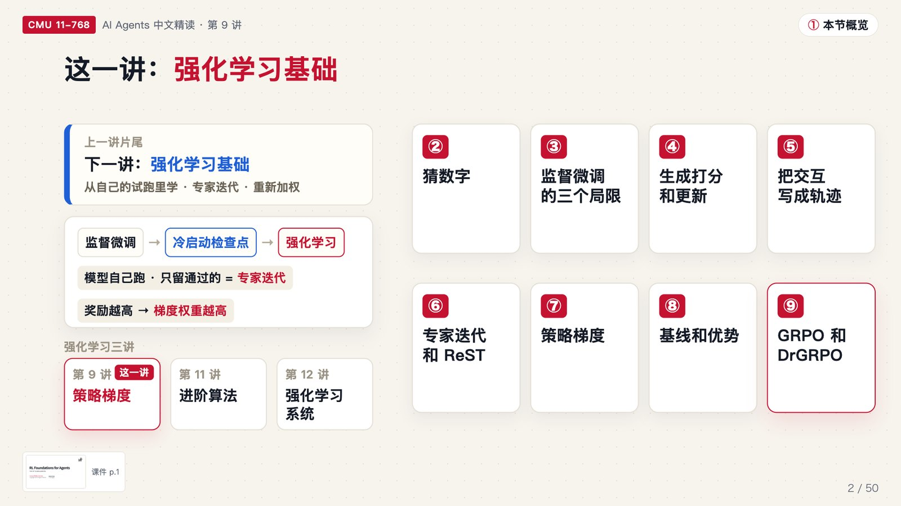

原课件没有目录页，按页标题走的是一条直线。每一步都回到同一组四条猜数字轨迹上算一遍：

| 节 | 回答的问题 |
|---|---|
| 1 猜数字 | 用一个小到能手算的任务，把后面所有概念落到同一组轨迹上 |
| 2 监督微调的三个局限 | 只模仿示范为什么不够 |
| 3 生成、打分、更新 | 强化学习换了一种什么训法 |
| 4 把交互写成轨迹 | 轨迹、轨迹的概率、期望奖励 |
| 5 专家迭代和 ReST | 最简单的做法：自己生成、只留成功的、再做监督微调 |
| 6 策略梯度 | 期望奖励怎么求导；实现上就是加掩码、乘奖励 |
| 7 基线和优势 | 奖励要和"平时能拿多少"比；减掉基线，期望不变、方差变小 |
| 8 GRPO 和 DrGRPO | 不另训模型，用同一道题的多次采样当基线 |
| 9 课堂问答 | POMDP、自蒸馏、一条成功轨迹都没有、GRPO 有没有偏差 |
| 10 源码解读 | TRL 的 `GRPOTrainer` 怎么算组内优势、怎么汇总损失 |

### 本课件用的符号

公式都放在代码块里，后面跟一句中文说明。先把符号对一遍：

| 符号 | 读作 | 在猜数字里是什么 |
|---|---|---|
| `x` | 任务实例 | 藏着的那个数，比如 11 |
| `π_θ` | 策略，θ 是语言模型的参数 | agent 本身 |
| `o_t` | 第 t 个观察 | 提示、"往上"、"往下"、"猜中" |
| `a_t` | 第 t 个动作 | 一次猜的数，比如"猜 8" |
| `r_t` | 第 t 步的奖励 | 猜中记 1，其他都记 0 |
| `h_t` | 历史：到第 t 步为止的所有观察和动作 | "提示，猜 8，往上，猜 12，往下" |
| `τ` | 一条轨迹 | 开头的 τ1–τ4 |
| `R(τ)` | 整条轨迹的奖励 | 1 或 0 |
| `J(θ)` | 期望奖励 | 一直反复跑，平均能拿多少 |
| `b(h_t)` | 基线 | "平时大概能拿多少"的估计 |
| `Â` | 优势的估计 | 这条轨迹比预期好多少 |
| `G` | 组的大小 | 同一道题采样几条 |

---

## 1 运行例子：猜数字

### 1.1 任务

原课件 p.2 定下了贯穿全讲的例子：

- 一个藏起来的整数在 1 到 16 之间，agent 有四次机会。
- 猜错了，环境只回答"往上"（higher）或"往下"（lower）。
- 只有猜中才拿到奖励 1，否则是 0。
- 这一个任务实例里，藏着的数是 **11**。

隐藏的数是环境的一部分，agent 不知道。猜中任务就结束，拿奖励 1；四次用完还没猜中，奖励 0（课上口头补充）。

课上问大家：最好的第一次猜几？答案是中间，8。这有点像"二十个问题"游戏，每次把范围切一半。课上还提到纽约时报的猜词游戏 Wordle，它也有一个能最快缩小范围的最佳首猜，道理相似，这里更简单（课上口头补充）。

### 1.2 四条示例轨迹

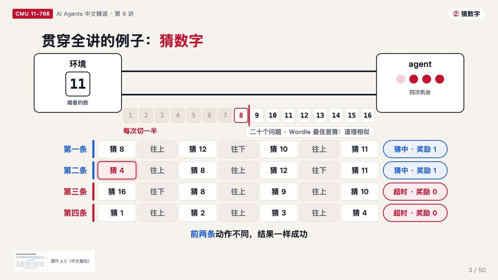

| 轨迹 | 第 1 次 | 回答 | 第 2 次 | 回答 | 第 3 次 | 回答 | 第 4 次 | 结果 | 奖励 |
|---|---|---|---|---|---|---|---|---|---|
| τ1 | 8 | 往上 | 12 | 往下 | 10 | 往上 | 11 | 猜中 | R = 1 |
| τ2 | 4 | 往上 | 8 | 往上 | 12 | 往下 | 11 | 猜中 | R = 1 |
| τ3 | 16 | 往下 | 8 | 往上 | 9 | 往上 | 10 | 超时 | R = 0 |
| τ4 | 1 | 往上 | 2 | 往上 | 3 | 往上 | 4 | 超时 | R = 0 |

- **τ1 和 τ2：动作不同，结果一样成功。** τ2 第一次猜 4 不是最优的，但只要会利用反馈，往上、再往上、再往下，最后还是能猜中。
- τ3 一上来猜 16 很糟：除非正好猜中，回答一定是"往下"，等于白白用掉一次机会。
- τ4 从 1 开始一个个往上数，完全没用上反馈，也超时失败。

视频里成功的两行是蓝色，失败的两行是红色。这张四行表后面每一节都会复用：第 2 节用它讲监督微调的局限，第 5 节用它筛选，第 7 节用它讲基线，第 8 节用它算组内优势，小结里用它对比四种方法的权重。

### 1.3 奖励是什么

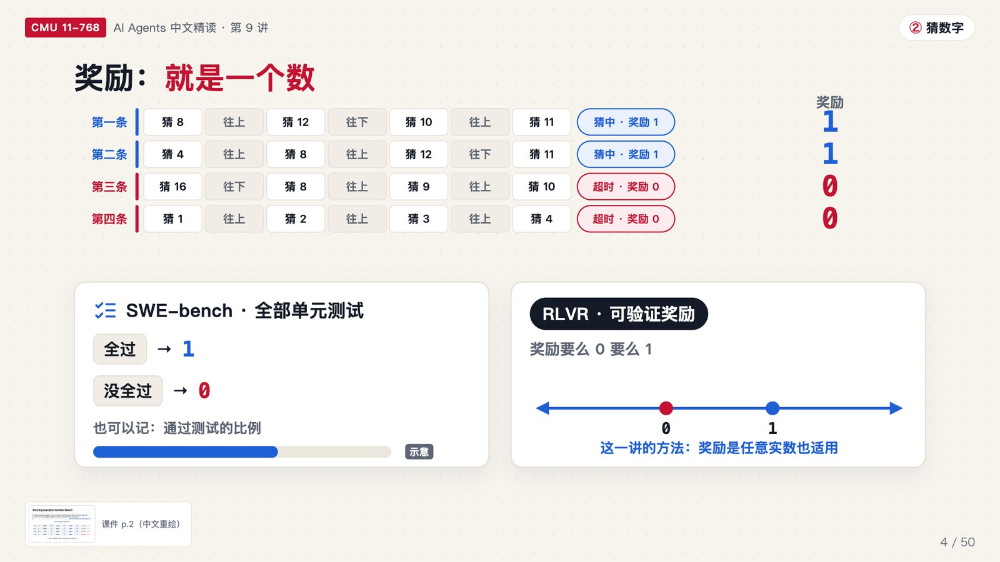

课上口头补充：

- **奖励**（reward）就是一个数，说明这条轨迹有多好或多坏。
- 放到 agent 里，可能是"写的代码有没有通过 SWE-bench 里的全部单元测试"：全过记 1，没全过记 0。也可以不是 0 或 1，比如记通过测试的比例。
- 现在很多人在训的领域里，用的是 **RLVR**，即用**可验证的奖励**做强化学习（reinforcement learning with verifiable rewards），奖励要么 0 要么 1。
- 这一讲的方法更一般，奖励是任意实数也适用。

| 奖励的形式 | 例子 | 这一讲的方法适用吗 |
|---|---|---|
| 二值（0 / 1） | 猜中与否、测试是否全过 | 适用；第 5.2、6.7 节会看到二值时几种方法变得一样 |
| 比例（0 到 1 之间） | 通过测试的比例 | 适用 |
| 任意实数 | 评判模型给的分 | 适用 |

这一节记住一句：猜数字的四条轨迹，两条成功、两条超时，后面每个概念都在它们身上算。

---

## 2 监督微调的三个局限

### 2.1 回顾：在示范上做监督微调

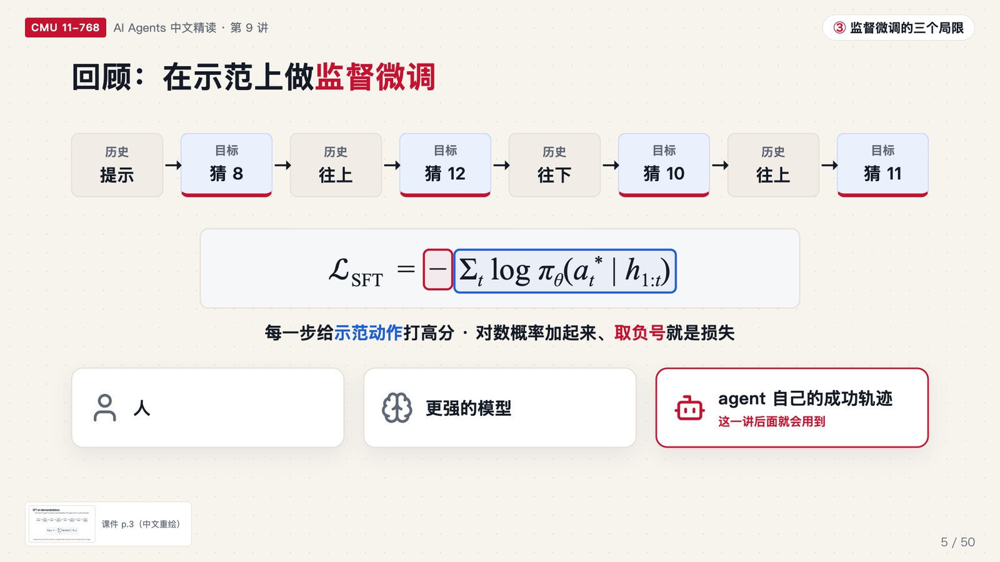

原课件 p.3：**监督微调训练 agent，让示范里所有目标动作的概率最大。**

把 τ1 拆成一串"历史 → 目标动作"：

| 历史 h₀ | 目标 a₀* | 历史 h₁ | 目标 a₁* | 历史 h₂ | 目标 a₂* | 历史 h₃ | 目标 a₃* |
|---|---|---|---|---|---|---|---|
| 提示 | 猜 8 | 往上 | 猜 12 | 往下 | 猜 10 | 往上 | 猜 11 |

```
L_SFT = − Σ_t log π_θ(a*_t | h_1:t)
```

在每一步，给定到这一步为止发生的一切，让模型给示范里那个动作打出尽量高的概率；把每一步的对数概率加起来，取负号就是损失。上标 `*` 表示"示范里的那个动作"。

- 目标动作可以来自人、来自更强的模型，或者（这一讲）来自这个 agent 自己的一条成功轨迹。
- 整条序列的对数概率，等于各个动作对数概率之和（课上口头补充）。这一点第 6.4 节还会用到。

这就是第 8 讲那一整讲的内容；第 8 讲 2.2 节"只在助手 token 上算交叉熵"，就是这个式子落到 token 上的样子。

### 2.2 任务错位

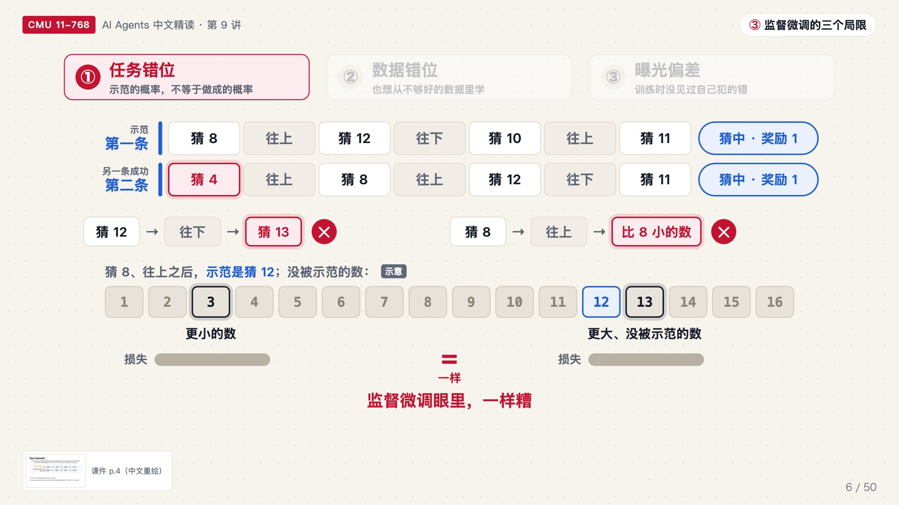

原课件 p.4：**监督微调最大化的是示范动作的概率。我们真正想最大化的，是 agent 把任务做成的概率。（这两件事不完全一样！）**

| | 第 1 次 | 回答 | 第 2 次 | 回答 | 第 3 次 | 回答 | 第 4 次 | 结果 |
|---|---|---|---|---|---|---|---|---|
| 示范 τ1 | 8 | 往上 | 12 | 往下 | 10 | 往上 | 11 | 猜中 |
| 另一条成功 τ2 | **4** | 往上 | 8 | 往上 | 12 | 往下 | 11 | 猜中 |

问题分两面：

1. **完成一个任务的办法不止一种。** 先猜 8 最好，但先猜 4 也合理，只要会利用反馈；第一轮反馈之后，也有好几个合理的下一步。一条示范只展示了一种做法，我们希望 agent 也能用别的做法（课上口头补充）。
2. **有的动作比别的糟得多。** 原课件的例子：在"12 → 往下"之后，绝不该再猜 13。课上换了一个意思相同的例子：反馈说"往上"，却输出一个比 8 还小的数。

可对监督微调来说，**没被示范的动作看起来一样糟**：模型把最高概率放在一个更小的数上，还是放在一个更大、只是没被示范的数上，损失一样。

| 在"猜 8 → 往上"之后，模型把最高概率放在 | 好不好 | 监督微调的损失 |
|---|---|---|
| 12（示范的动作） | 好 | 低 |
| 10（合理，但没被示范） | 也不错 | 高 |
| 3（比 8 还小，完全无视反馈） | 很糟 | 和上一行一样高 |

（表里 10、3 两个数是本课件为说明编的例子，示意。）

### 2.3 数据错位

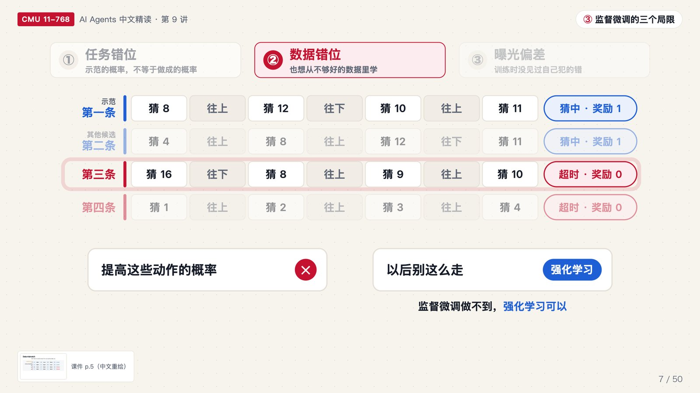

原课件 p.5：**我们也希望能从不够好的数据里学。** 示范是 τ1，其他候选是 τ2、τ3、τ4。

就算假设示范是完成任务的最好方式，那些不那么好、甚至没成功的轨迹，也能给模型有用的信号。我们知道 τ3 是一条坏轨迹，超时了，当然不想在它上面做监督微调、提高这些动作的概率；但我们可能想要一种学习方法，让模型以后**别走这样的轨迹**。强化学习就是一种办法（课上口头补充）。

| 轨迹 | 监督微调怎么用 | 我们希望怎么用 |
|---|---|---|
| τ1（示范） | 提高它的动作的概率 | 同左 |
| τ2（另一条成功） | 用不上（不是示范） | 也提高 |
| τ3、τ4（失败） | 用不上；更不能拿来训 | 压低这些动作 |

### 2.4 曝光偏差

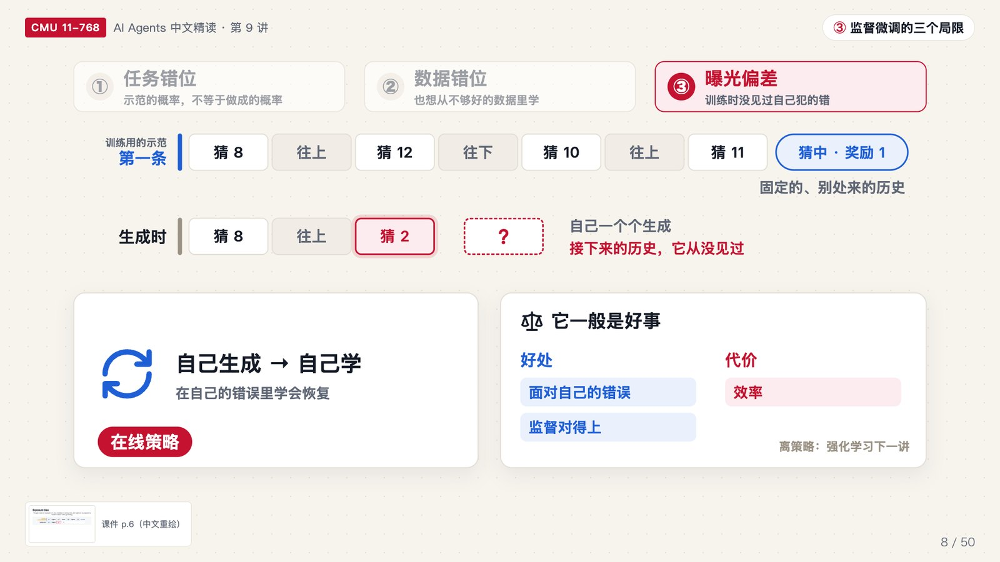

原课件 p.6：**训练时，agent 从来没见过自己犯的错，生成时可能就不知道怎么应付错误。**

| | 第 1 次 | 回答 | 第 2 次 | 回答 | … |
|---|---|---|---|---|---|
| 训练用的示范 | 8 | 往上 | 12 | 往下 | 10 往上 11 猜中 |
| 生成时 | 8 | 往上 | **2** | ? | |

生成那一行的 2：明明说了"往上"，却猜了 2。课上口头补充：

- 监督微调里，模型是在一串**固定的、别处来的**历史后面预测下一个动作；评测时，前面的动作是**模型自己一个个生成的**，这是一个和环境交互的自回归过程。
- 如果 agent 生成了一个和训练时见过的历史差得很远的动作，它接下来的反应可能就不靠谱，因为它从没见过这样的数据。比如只在"反馈说往上、下一个数就更大"的示范上训练过，生成时一旦采样出一个更小的数，就可能整个乱掉。
- 看强化学习的一种角度是：让模型自己生成训练数据，也学会从自己的错误里恢复。训练数据由模型当前的策略自己生成，这个性质叫**在线策略**（on-policy）。它一般是好事：模型要面对的正是自己的错误，拿到的监督也正好对得上模型现在会做的事；代价在效率上。强化学习的下一讲（第 11 讲）会讲很多放宽这个假设、更偏**离策略**（off-policy）的方法。
- 这三个问题不只出现在 agent 的监督微调里，一般的序列预测都有。

第 8 讲 6.1 节讲"训练和运行之间的错位"、提到 DAgger，说的就是曝光偏差这件事。

三个局限并排看：

| 局限 | 一句话 | 猜数字里的例子 |
|---|---|---|
| 任务错位 | 优化的是"像示范"，不是"做成" | τ2 先猜 4 也成功，监督微调却把它当错 |
| 数据错位 | 只能用示范，用不上别的轨迹 | τ3 超时，监督微调学不到"别这么走" |
| 曝光偏差 | 训练时没见过自己的错 | 往上之后猜了 2，接下来的历史从没见过 |

这一节记住一句：监督微调只看示范，分不出别的做法好坏，学不了失败的轨迹，也没见过自己的错。

---

## 3 强化学习：生成、打分、更新

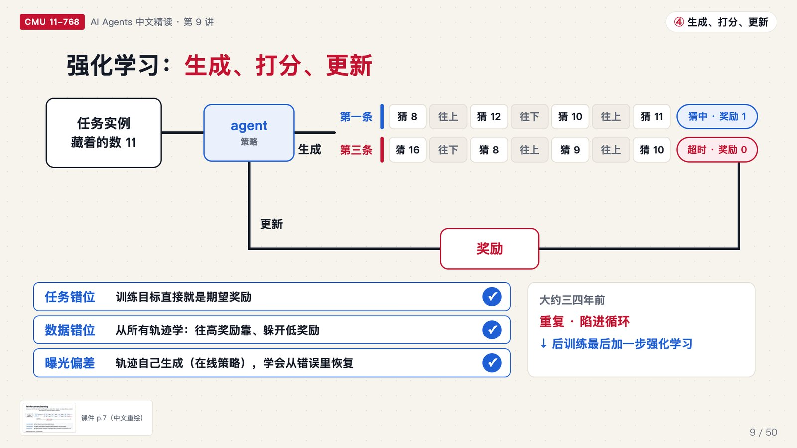

原课件 p.7（注明改编自 Sean Welleck 的 RL Fundamentals）：**让 agent 自己生成动作和轨迹，评估它们的奖励，再调整 agent 的参数，让期望奖励最大。**

```
任务实例（藏着的数 11）→ agent π_θ ──生成──→ τ1（R = 1）、τ3（R = 0）
        ↑                                              │
        └────────────更新 ←──────奖励─────────────────┘
```

不再拿一条固定的轨迹去模仿，而是让模型按平时在环境里评测 agent 的方式，每一步采样一个可能的动作，跑出几条轨迹；每条轨迹在环境里执行，得到一个奖励；再用这个奖励去改参数，让高奖励的轨迹更可能、低奖励的轨迹更不可能。然后用新参数再跑一轮（课上口头补充）。

| 局限 | 强化学习怎么解决 |
|---|---|
| 任务错位 | 训练目标直接就是期望奖励 |
| 数据错位 | agent 能从所有轨迹里学：往高奖励靠，躲开低奖励 |
| 曝光偏差 | 训练时用的轨迹就是 agent 自己生成的（在线策略），所以它学会从错误里恢复 |

两点说明（课上口头补充）：

- 这一讲前半部分就是讲怎么做到：先写出期望奖励，对它求导，直接优化它。"从坏轨迹里也能学到信号"这一点，要到第 7 节加了基线才看得到。
- 大约三四年前，语言模型常有重复的毛病，会陷进循环里。后来大家在后训练最后加一步强化学习，模型能从自己的错误里恢复了，很多这类问题就解决了。（课上口头说的，没给出处。）

这一节记住一句：强化学习是生成、打分、更新的循环，正好对上监督微调的三个局限。

---

## 4 把交互写成轨迹

要对期望奖励求导，先得把交互写清楚。这一部分是课程第一部分的复习，但符号后面每一节都要用。

### 4.1 agent 和环境的循环

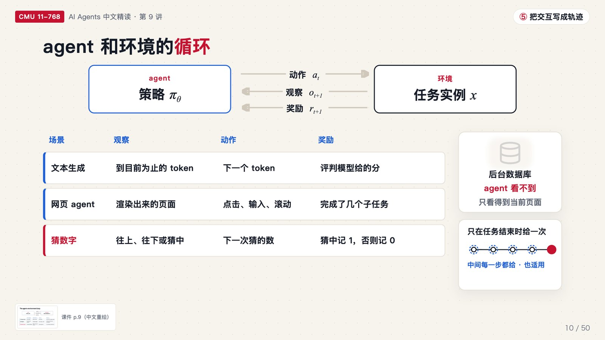

原课件 p.9：agent（策略 `π_θ`）发出动作 `a_t` → 环境（任务实例 `x`）返回观察 `o_{t+1}` 和奖励 `r_{t+1}` → 回到 agent。

agent 表示成一个策略 `π_θ`，θ 是驱动 agent 的语言模型的参数。agent 从语言模型里采样，再交给它所在的脚手架变成动作，在环境里执行（课上口头补充）。

| 场景 | 任务实例 x | 观察 o | 动作 a | 奖励 r |
|---|---|---|---|---|
| 文本生成 | 提示 | 到目前为止的 token | 下一个 token | 评判模型给的分 |
| 网页 agent | 任务和网站 | 渲染出来的页面 | 点击、输入、滚动 | 完成了几个子任务 |
| 猜数字 | 那个（隐藏的）数 | 往上、往下或猜中 | 下一次猜的数 | 猜中记 1，否则 0 |

课上口头补充：

- 文本生成这一行，奖励来自评判模型，比如**基于人类反馈的强化学习**（RLHF）。
- 网页 agent 这一行要区分**环境的状态**和**agent 能观察到的东西**：后台数据库里有什么是隐藏的，agent 只能看到当前所在的页面。
- 猜数字里，每个任务在开始时对 agent 来说都一模一样，因为那个数是藏起来的。
- 很多场景只在任务结束时给一次奖励，比如真正跑测试用例的时候；但这一讲讲的几乎所有东西，也适用于中间每一步都有奖励的场景。

### 4.2 历史

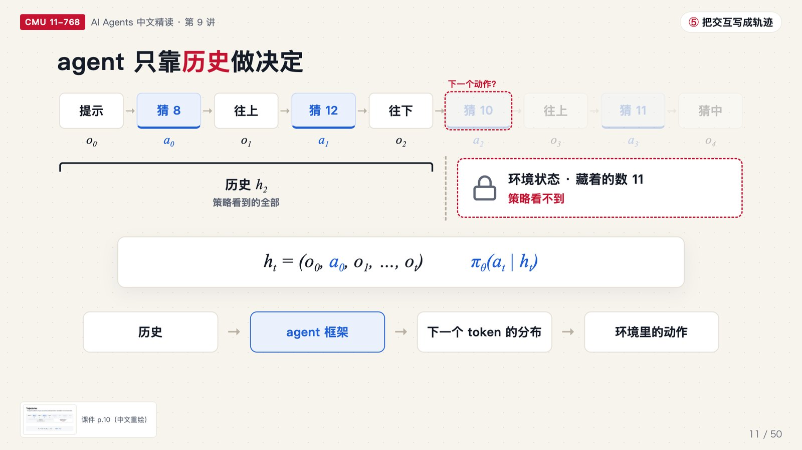

原课件 p.10：**agent 只以过去的动作和观察为条件，看不到环境隐藏的状态。**

```
提示 → 猜 8 → 往上 → 猜 12 → 往下 → 猜 10 → 往上 → 猜 11 → 猜中
 o₀     a₀     o₁      a₁      o₂      a₂      o₃      a₃      o₄

h_t = (o₀, a₀, o₁, …, o_t)          π_θ(a_t | h_t)
```

到第 t 步为止的所有观察和动作合起来叫**历史**（history）；策略就是"给定历史，给出下一个动作的概率分布"。

- 图上标着：历史 `h₂` 是策略能看到的东西；环境状态 `s₂` 里那个隐藏的数 11，它看不到。
- 把历史塞进 agent 框架，得到下一个 token 的分布，这些 token 对应环境里的动作（课上口头补充）。

| | 历史 h_t | 状态 s_t |
|---|---|---|
| 包括什么 | agent 发出过的动作、收到过的观察 | 环境的全部情况，包括藏着的数、后台数据库 |
| 策略能不能看到 | 能 | 不能 |

这种"状态看不到、只能看观察"的设定，就是第 9 节 Q1 里说的部分可观测马尔可夫决策过程（POMDP）。

### 4.3 轨迹和奖励

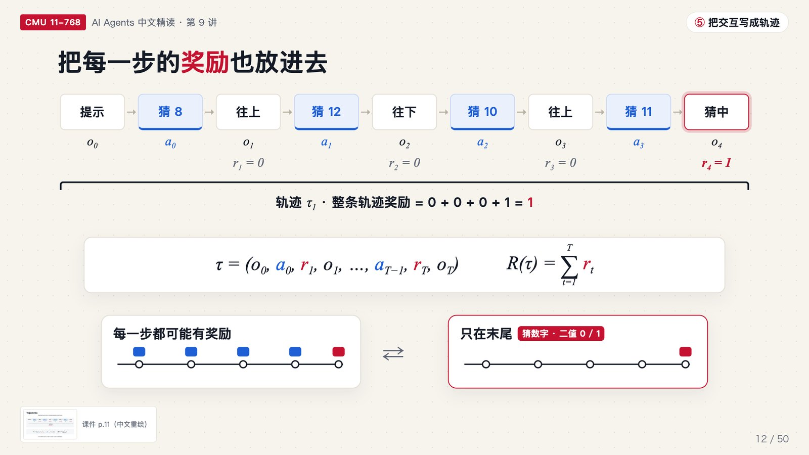

原课件 p.11：**轨迹里也可以包含每一步的奖励。**

τ1 的每一步：`o₁` 处 `r₁ = 0`，`o₂` 处 `r₂ = 0`，`o₃` 处 `r₃ = 0`，`o₄`（猜中）处 `r₄ = 1`，整条轨迹的奖励 `R(τ1) = 1`。

```
τ = (o₀, a₀, r₁, o₁, …, a_{T−1}, r_T, o_T)          R(τ) = Σ_{t=1}^{T} r_t
```

一条轨迹就是观察、动作、奖励交替排下去；整条轨迹的奖励是每一步奖励的总和。

最一般的情况下，每个动作或观察之后都可能有奖励，两种写法（每步都有奖励 / 只在末尾）可以互相转换。猜数字只在超时或猜中时给奖励，所以奖励是二值的，而且只出现在轨迹末尾（课上口头补充）。

### 4.4 轨迹的概率

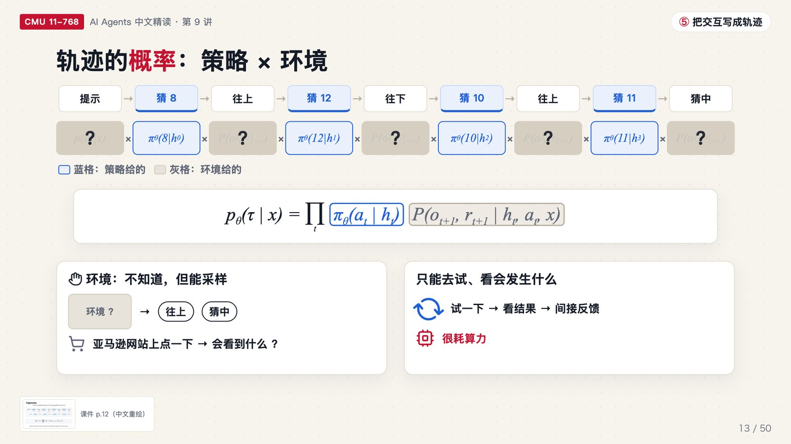

原课件 p.12：**轨迹的概率既取决于策略，也取决于环境。**

τ1 下面按顺序排着一串概率：

| p(o₀\|x) | π_θ(8\|h₀) | P(o₁,r₁\|…) | π_θ(12\|h₁) | P(o₂,r₂\|…) | π_θ(10\|h₂) | P(o₃,r₃\|…) | π_θ(11\|h₃) | P(o₄,r₄\|…) |
|---|---|---|---|---|---|---|---|---|
| 环境 | **策略** | 环境 | **策略** | 环境 | **策略** | 环境 | **策略** | 环境 |

```
p_θ(τ | x) = Π_t π_θ(a_t | h_t) · P(o_{t+1}, r_{t+1} | h_t, a_t, x)
```

一条轨迹出现的概率，是每一步"模型选这个动作的概率"乘上"环境回这个观察和奖励的概率"，一路乘下去（链式法则）。图里蓝格是策略给的，灰格是环境给的。

> 原课件 p.12 的公式里漏了环境那一项前面的 `P`，课上当场两次指出并更正。上面是更正后的写法。

**我们不知道 P，但可以通过和环境交互，从它里面采样。** 课上口头补充：

- 强化学习的关键是，我们不需要知道环境的任何事：不需要知道下一个观察是"猜中"的概率，也不需要知道在亚马逊网站上操作时下一个观察是什么的概率。只要在环境里采取动作，就是在从这个观察和奖励的分布里采样，这些样本就足以对依赖它的目标求导、更新参数。
- 这在某种意义上很神奇，但也让强化学习算法比较慢：只能去试、看会发生什么。这就是强化学习很耗算力的原因：要在环境里做实验，把结果当作"奖励怎样随参数变化"的间接反馈。

### 4.5 目标：期望奖励最大

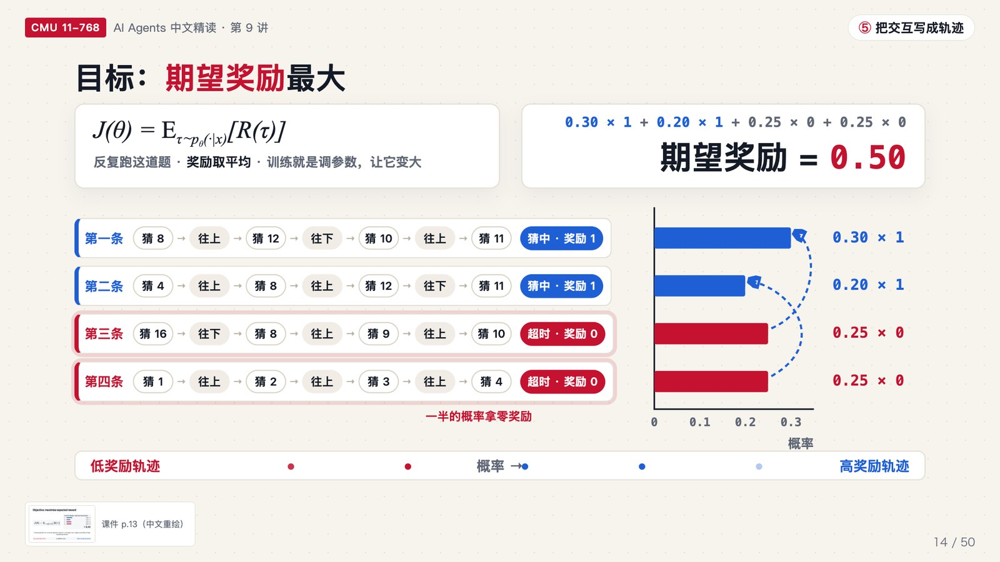

原课件 p.13：

```
J(θ) = E_{τ ∼ p_θ(·|x)} [ R(τ) ]
```

让 agent 在这个任务上反复跑，每次得到的奖励取平均，这个平均值就是目标；训练就是调参数，让它变大。J 是参数的函数，所以写成 `J(θ)`。

假设 agent 只会跑出这四条轨迹：

| 轨迹 | 概率 | × 奖励 | = |
|---|---|---|---|
| τ1 | 0.30 | × 1 | 0.30 |
| τ2 | 0.20 | × 1 | 0.20 |
| τ3 | 0.25 | × 0 | 0 |
| τ4 | 0.25 | × 0 | 0 |
| **期望奖励 J** | | | **0.30 + 0.20 = 0.50** |

- 训练调整 θ 让期望奖励最大，也就是让 agent 有更高的概率跑出高奖励的轨迹。图底部一根横轴：概率质量从左边的"低奖励轨迹"往右边的"高奖励轨迹"移。
- 这是个不太好的 agent，有 0.5 的概率跑出零奖励的轨迹。我们想把这部分概率，最好是全部，从失败的轨迹挪到成功的轨迹上（课上口头补充）。
- 这当然是简化：这个例子里模型学到了一个很尖锐的策略，只会产生这四条；真实的 agent 能产生的轨迹数量是组合爆炸的（课上口头补充）。

这一节记住一句：轨迹的概率由策略和环境共同决定，环境不用知道，只要能采样；目标是期望奖励最大。

---

## 5 专家迭代和 ReST

### 5.1 ReST 的循环，和 ReST-EM 的不同

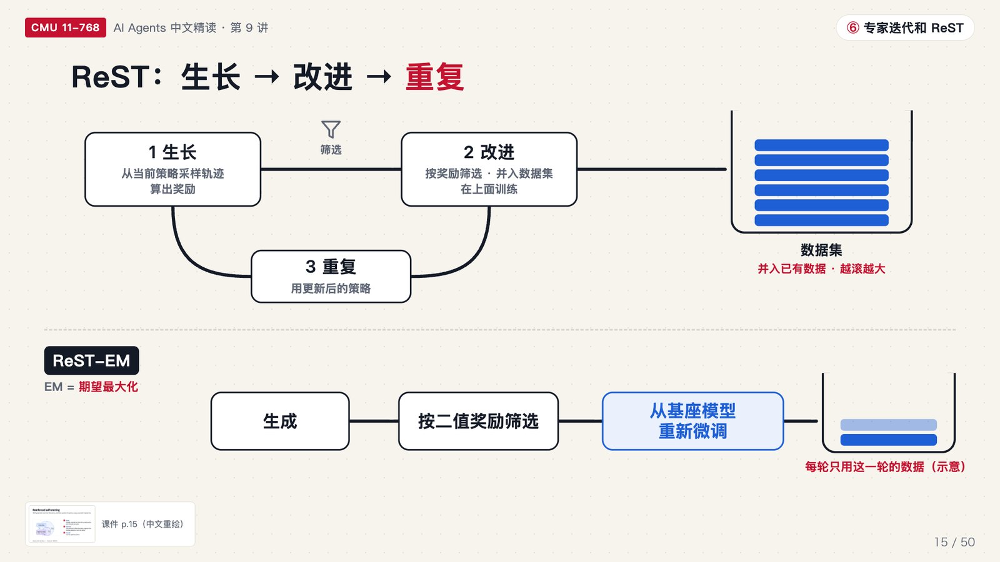

要让期望奖励变大，有一个对监督微调很简单的改动，动机也很清楚，叫**专家迭代**。专家迭代里的一种叫**强化自训练**（reinforced self-training），简称 **ReST**（课上口头补充）。

原课件 p.15：**ReST 先从策略里生成数据，再用成功的轨迹更新策略。**

| 1 生长（Grow） | 2 改进（Improve） | 3 重复 |
|---|---|---|
| 从当前策略采样轨迹，算出奖励 | 用奖励筛选数据，并入已有的数据集，训练策略 | 用更新后的策略接着做 |

做法是：用当前参数的模型生成数据，挑出成功的轨迹当微调数据，在上面更新模型。"强化"二字就是这么来的：把 agent 已经会做的正确行为强化一遍。然后从新策略再采一批，并入已有的好轨迹集合，在全部数据上训练。数据集越滚越大，模型一轮轮越来越会产生它们（课上口头补充）。

ReST 的变体 **ReST-EM**，名字里的 EM 是**期望最大化**（expectation maximization），因为它看起来很像机器学习课上学过的 EM 算法。两者的区别要分清（按 ReST、ReST-EM 原文核对）：

| | ReST（Gulcehre et al.） | ReST-EM（Singh et al.） |
|---|---|---|
| 生成 | 从当前策略采样，算奖励 | 生成多个样本（E 步） |
| 筛选 | 按奖励筛选；改进步可以随轮次提高筛选阈值 | 用**二值奖励**筛选 |
| 训练 | 并入**已有的数据集**，在累积起来的数据上训练 | 监督微调（M 步）；每一轮都**从基座预训练模型重新微调**，只用**这一轮**生成的数据 |
| 数据集 | 越滚越大 | 每轮清空重来 |

> 原课件 p.24 括号里"ReST 是攒一批再更新、会把数据集累积起来"、课上"把新轨迹并进已有的好轨迹集合"，说的都是 ReST。ReST-EM 原文明确写了每轮从基座重新微调；不要把"累积数据集"安到 ReST-EM 头上。

### 5.2 损失就是成功轨迹上的监督微调损失

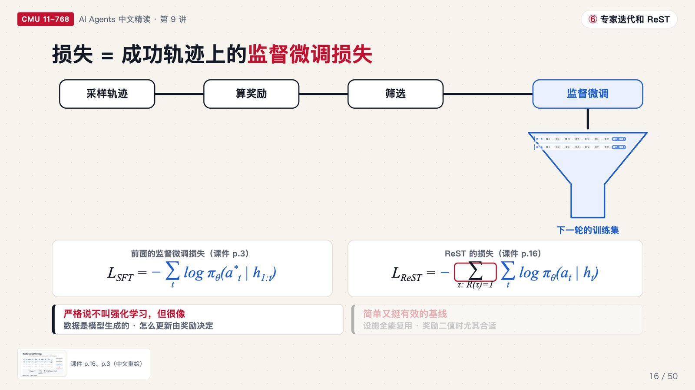

原课件 p.16：**损失就是标准的监督微调损失，只是用在高奖励的轨迹上。**

| 轨迹 | 奖励 | 处理 |
|---|---|---|
| τ1 | R = 1 | 留下 |
| τ2 | R = 1 | 留下 |
| τ3 | R = 0 | 扔掉 |
| τ4 | R = 0 | 扔掉 |

```
L_ReST = − Σ_{τ : R(τ)=1} Σ_t log π_θ(a_t | h_t)
```

只在奖励为 1 的轨迹上，把每一步动作的对数概率加起来，取负号。和 2.1 的监督微调损失一模一样，区别只在于这些轨迹是**模型自己跑出来、又按奖励挑过的**。

和 2.1 对照：

| | 监督微调（2.1） | ReST（这里） |
|---|---|---|
| 轨迹从哪来 | 人或更强的模型的示范 | 模型自己生成 |
| 用哪些 | 全部示范 | 只用奖励过了阈值的 |
| 损失 | 动作对数概率之和取负 | 同左 |

课上口头补充：

- 生成一批轨迹，算出每条的奖励，按一个阈值筛选。奖励是二值时最简单：留下奖励 1 的，扔掉奖励 0 的。把各个任务实例上留下的轨迹合起来，就是下一轮的训练集。
- 严格说这不叫强化学习，但和强化学习很像：数据是模型生成的，在数据上怎么更新由轨迹的奖励决定。后面会看到强化学习用更细的方式做这件事。
- 这是一个简单又挺有效的基线，可以从它开始，监督微调的整套设施全都能复用；奖励是二值的时候尤其合适。

ReST-EM 原文把损失写成按奖励加权的负对数似然 `J(θ) = E[r(x, y) log p_θ(y | x)]`；奖励二值时，就等于只在留下的轨迹上做监督微调。这个式子和第 6 节的策略梯度长得几乎一样，6.7 节会把两者连起来。

这一节记住一句：专家迭代就是自己生成、只留成功的、再做监督微调。

---

## 6 策略梯度

### 6.1 为什么不能直接反向传播

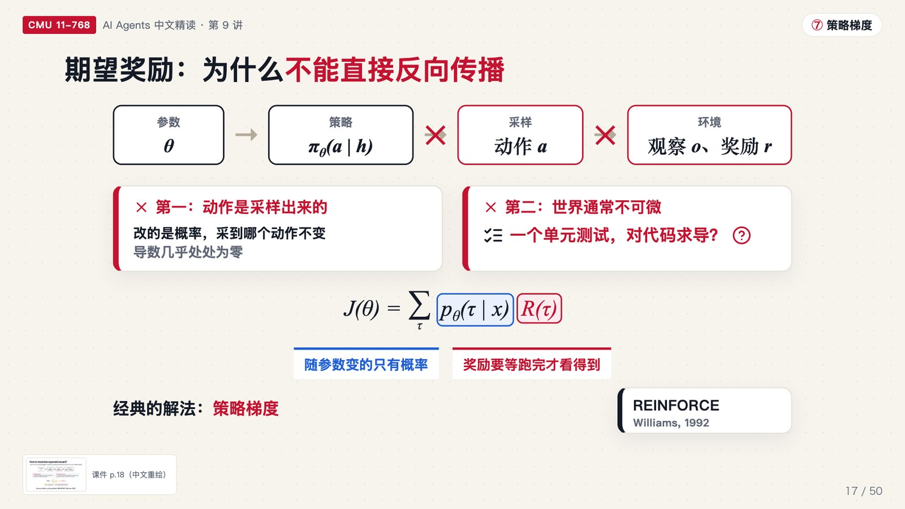

专家迭代只用了成功的轨迹。想直接优化期望奖励，就要对它求导。原课件 p.18：**不能直接用反向传播：采样和环境都是不可微的。**

```
参数 θ → 策略 π_θ(a|h) →（✕ 采样）→ 动作 a →（✕ 环境）→ 观察 o、奖励 r
```

| 断在哪 | 为什么不可微 |
|---|---|
| **采样出来的动作** | 改 θ 会改变动作的**概率**，但动作是离散的、采样出来的。在跳到另一个动作之前，采到哪个动作不会变，导数几乎处处为零（课上口头补充） |
| **任务环境** | 世界（通常！）是不可微的。一个单元测试对代码求导，怎么求？环境几乎总是黑盒 |

```
J(θ) = Σ_τ p_θ(τ | x) R(τ)
```

期望奖励就是"每条可能轨迹的概率 × 它的奖励"全部加起来。随 θ 变的只有概率那一项，奖励要等跑完才看得到。

一般的解法是**策略梯度**，最经典的是 **REINFORCE**（Williams, 1992）：用期望奖励的定义加上一点代数技巧，得到一个能用模型样本估计、又能用熟悉的反向传播来算的梯度（课上口头补充）。

### 6.2 推导策略梯度

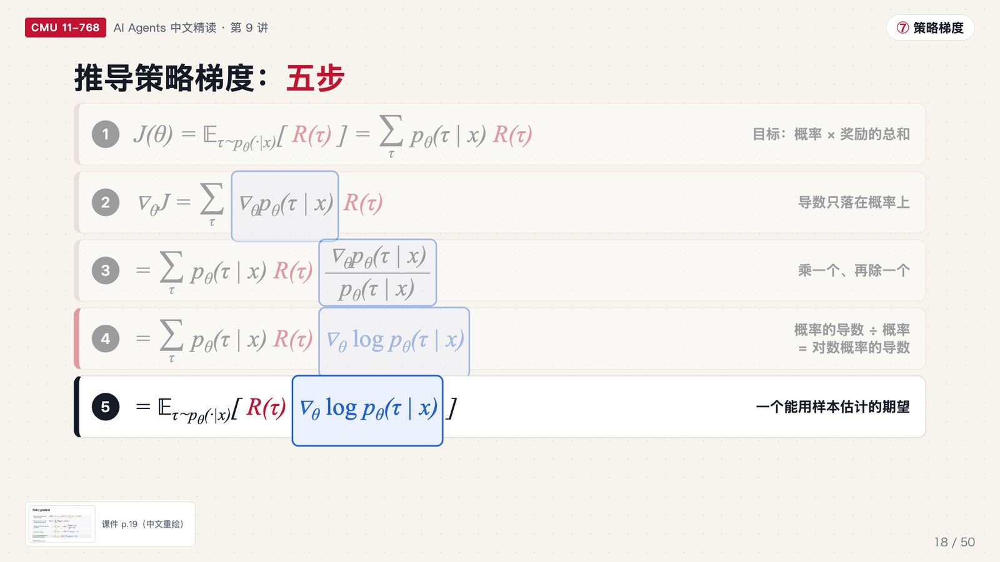

原课件 p.19 左边是每一步在做什么，右边是式子：

```
J(θ)   = E_{τ∼p_θ(·|x)} [ R(τ) ] = Σ_τ p_θ(τ|x) R(τ)            ① 在策略下最大化期望奖励
∇_θ J  = Σ_τ ∇_θ p_θ(τ|x) R(τ)                                ② 求梯度：只有概率依赖 θ
∇_θ J  = Σ_τ p_θ(τ|x) R(τ) · ∇_θ p_θ(τ|x) / p_θ(τ|x)           ③ 乘一个、再除一个轨迹概率
∇_θ J  = Σ_τ p_θ(τ|x) R(τ) ∇_θ log p_θ(τ|x)                    ④ 用 ∇p / p = ∇ log p
∇_θ J  = E_{τ∼p_θ(·|x)} [ R(τ) ∇_θ log p_θ(τ|x) ]               ⑤ 这是一个能用样本估计的期望
```

一步一句：

| 步 | 做了什么 | 为什么成立 |
|---|---|---|
| ① | 目标是所有轨迹"概率 × 奖励"的总和 | 期望就是按概率加权求和。这里对所有可能轨迹求和，空间非常大，几乎永远算不出精确值，但写出来就是这样 |
| ② | 梯度移进求和号，只落在概率上 | 奖励只看轨迹本身，和参数无关 |
| ③ | 乘一个、再除一个同样的概率 | 值不变 |
| ④ | 把"概率的导数 ÷ 概率"换成"对数概率的导数" | 对数的导数：`∇ log p = ∇p / p`。课上把这一步叫 score ratio trick，更常见的叫法是**对数导数技巧**（log-derivative trick）或**得分函数**（score function） |
| ⑤ | 又写回期望 | 第 ④ 行又是"按轨迹概率加权求和"，所以能从策略里采几条轨迹、对里面那一项取平均来估计 |

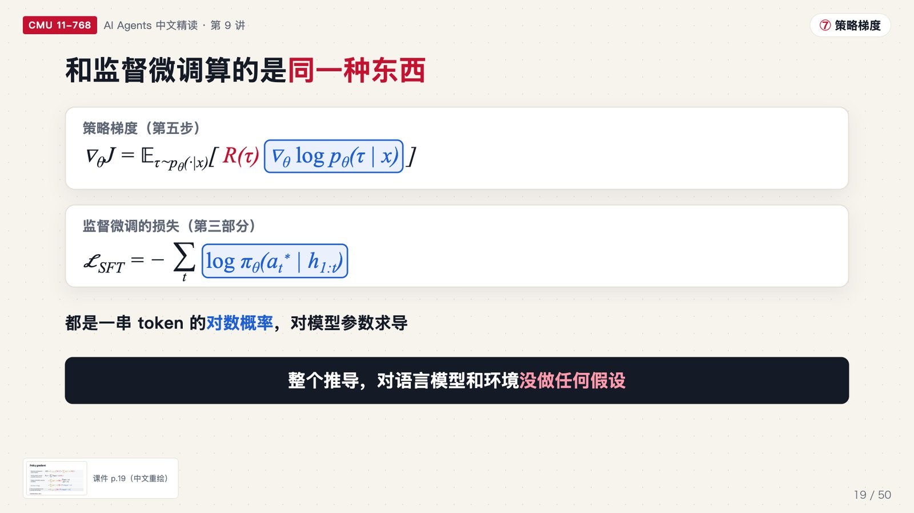

推到最后，我们得到一个对轨迹的期望，里面是**奖励乘以对数概率的梯度**。这一项和监督微调里算的是同一种东西：监督微调也是对一串 token 的对数概率、关于语言模型参数求偏导。而且这个结论很一般，对语言模型和环境没有做任何假设（课上口头补充）。

> 自己动手验证一下 ④：设一个动作的概率 `p = σ(θ)`，`log p` 对 θ 的导数是 `σ'(θ)/σ(θ) = (1 − σ(θ))`。第 7.5 节老虎机里的"斜率 1 − p = 0.75"就是这么来的。

### 6.3 用采样代替期望

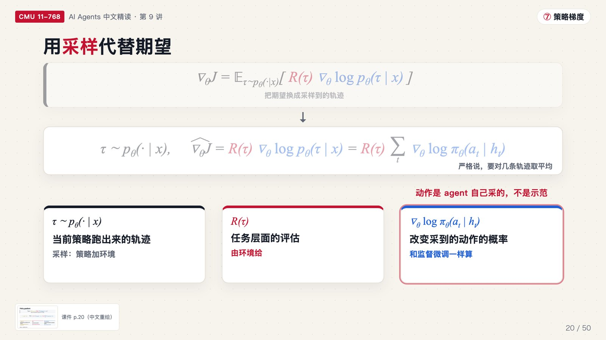

原课件 p.20：**把期望换成我们采样到的轨迹。**

```
τ ∼ p_θ(·|x),    ∇̂_θ J = R(τ) ∇_θ log p_θ(τ|x) = R(τ) Σ_t ∇_θ log π_θ(a_t | h_t)
```

采一条轨迹，把它的奖励乘到这条轨迹里每个动作的对数概率梯度上，就得到期望奖励梯度的一个估计。帽子 `^` 表示"估计"。

| 这一项 | 是什么 | 从哪来 |
|---|---|---|
| `τ ∼ p_θ(·|x)` | 当前策略跑出来的轨迹和历史 | 采样：策略加环境 |
| `R(τ)` | 任务层面的评估 | 环境给 |
| `∇_θ log π_θ(a_t|h_t)` | 改变采到的那些动作的概率 | 和监督微调的计算方式一样 |

课上口头补充：轨迹的来源，和平时运行这个 agent 是同一个过程。严格说这里应该是对若干条轨迹取平均。关键在于，这里的动作是 **agent 自己采样出来的**，而不是某个标准答案示范的。

上式第二个等号用到了下一节的结论：轨迹对数概率的梯度只剩策略那部分。

### 6.4 轨迹的对数概率：两笔账

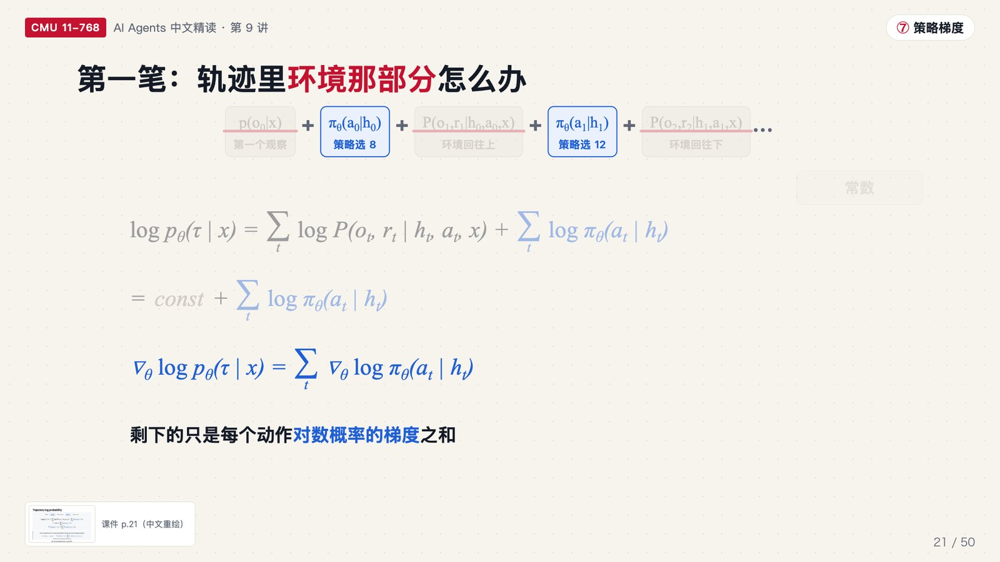

**第一笔：环境那部分怎么办？** 原课件 p.21：

```
log p_θ(τ|x) = Σ_t log P(o_t, r_t | h_t, a_t, x) + Σ_t log π_θ(a_t | h_t)
             = const + Σ_t log π_θ(a_t | h_t)
∇_θ log p_θ(τ|x) = Σ_t ∇_θ log π_θ(a_t | h_t)
```

取对数后，乘积变成求和；环境那些项和模型参数无关，求导时当常数直接消掉，剩下的只是每个动作对数概率的梯度之和。

> 原课件 p.21 第一行环境项的下标写成 `P(o_t, r_t | h_t, a_t, x)`，和 p.12 的 `P(o_{t+1}, r_{t+1} | h_t, a_t, x)` 对不上，也没写 `p(o₀|x)` 那一项。这些项都和参数无关、最后都并进常数，不影响结论。这一页课上说"讲得快一些，主要是为了严谨记账"。

**和监督微调的计算一样：把 token 的对数概率加起来。区别是这里的 token 是策略自己采样的。**

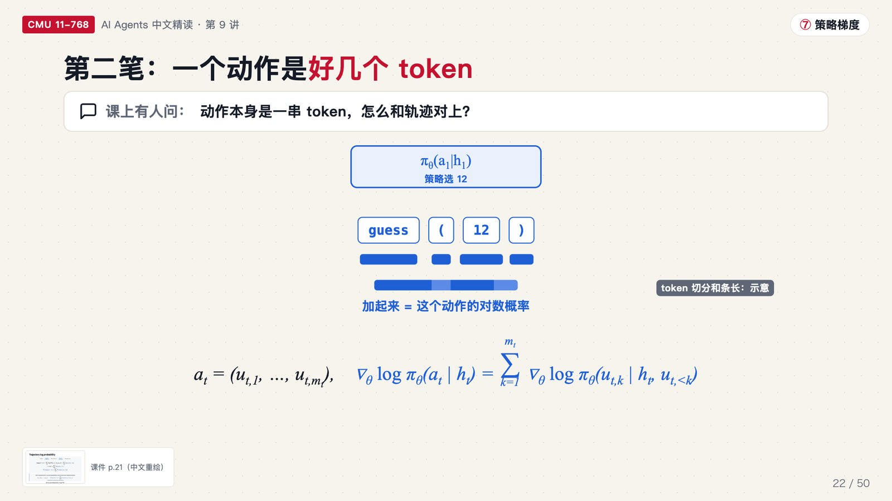

**第二笔：一个动作可能是好几个 token**，比如一次复杂的工具调用。课上有同学问：轨迹是一串动作，但动作本身也是一串 token，怎么对上？

```
a_t = (u_{t,1}, …, u_{t,m_t}),    ∇_θ log π_θ(a_t | h_t) = Σ_{k=1}^{m_t} ∇_θ log π_θ(u_{t,k} | h_t, u_{t,<k})
```

动作的对数概率，就是组成它的每个 token 的对数概率之和。t 数的是动作，k 数的是一个动作里的 token，`m_t` 是第 t 个动作的 token 数。比如"猜 12"写成 `guess(12)`，可能被分成 `guess`、`(`、`12`、`)` 几个 token（视频里的拆法是示意，真实分词以模型的分词器为准）。

再乘上 `R(τ)`，就得到梯度的估计。

### 6.5 实现：就是给监督微调的损失加掩码、乘奖励

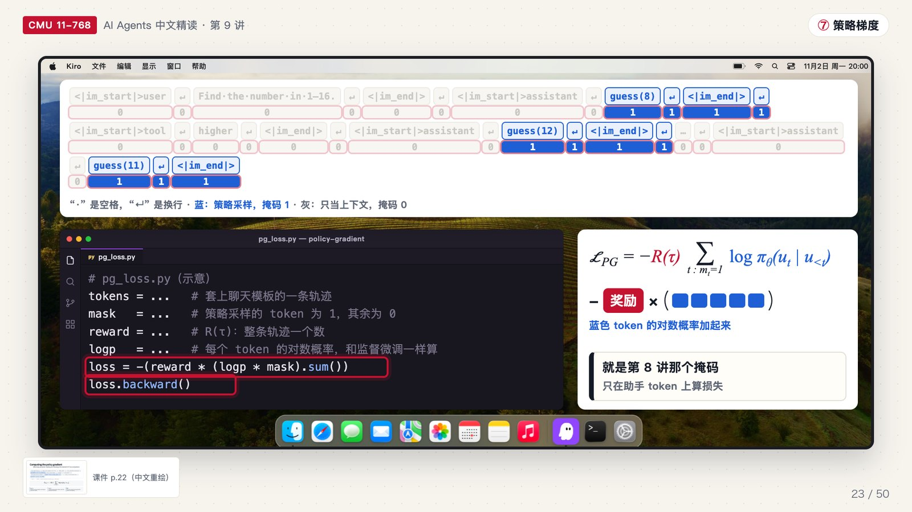

原课件 p.22：**实际上，我们就是在标准的监督微调损失计算上，做掩码和缩放。**

套上模板的一条猜数字轨迹（"·"是空格，"↵"是换行）：

```
<|im_start|>user ↵ Find·the·number·in·1–16. ↵ <|im_end|> ↵ <|im_start|>assistant ↵
guess(8) ↵ <|im_end|> ↵ <|im_start|>tool ↵ higher ↵ <|im_end|> ↵
<|im_start|>assistant ↵ guess(12) ↵ <|im_end|> ↵ … ↵ <|im_start|>assistant ↵
guess(11) ↵ <|im_end|>
```

按原图：`guess(8)`、`guess(12)`、`guess(11)` 和它们后面的换行、`<|im_end|>` 是蓝色（策略采样的）；`<|im_start|>assistant`、user 和 tool 两段是灰色（只当上下文）。

```
L_PG = − R(τ) Σ_{t : m_t = 1} log π_θ(u_t | u_<t)
```

只挑出模型自己生成的那些 token（掩码 `m_t = 1`），把它们的对数概率加起来，再整体乘上这条轨迹的奖励，取负号。注意这里的 t 数的是 token，不是动作。

| m_t = 1 | m_t = 0 | R(τ) |
|---|---|---|
| 策略采样的 token，包括一轮结束的结束符 | 提示和观察的 token，以及脚手架加的角色头，不是策略选的 | 一个数，整条轨迹里每个生成的 token 共用 |

视频里这一段用了一个示意的 `pg_loss.py`（图中编辑器窗口），核心就两行：

```python
# 示意代码，不是哪个库的原文
loss = -(reward * (logp * mask).sum())   # 掩码挑出策略采样的 token，再整体乘奖励
loss.backward()                          # 梯度穿进去，就是 奖励 × 对数概率的梯度
```

课上口头补充：

- 蓝色 token 是模型真正生成的，灰色的要么是提示、要么是环境返回的、要么是脚手架加上的。只有蓝色的算进策略梯度的损失。对它们取对数概率，再全部乘上这条轨迹的奖励；求梯度时，梯度穿进去作用在对数概率上，得到的就是奖励乘梯度。
- 课上讲了自己第一次读到在一个挺复杂的任务上实现 REINFORCE 的代码时的感受：那是一篇叫 Deal or No Deal 的论文，用强化学习优化对话模型。实现简单得出人意料：基本就是算一遍监督微调的梯度，再乘上奖励，或者先把损失乘上奖励再求梯度。但它确实管用，数学上也成立。

这个掩码和第 8 讲 2.2 节"只在助手 token 上算损失"是同一个掩码（这一句是本课件把两讲对上的推断，课上没这么说）。第 10 节会看到，TRL 的 `GRPOTrainer` 里也有一个把工具返回的 token 记成 0 的 `tool_mask`。

### 6.6 策略梯度的训练循环

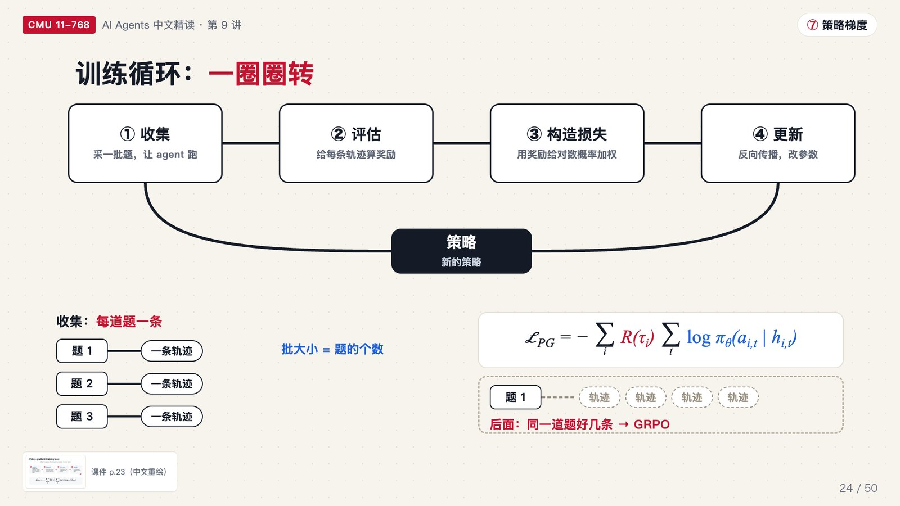

原课件 p.23：**一次更新之后，新的策略去收集下一批数据。**

| 1 收集 | → 2 评估 | → 3 构造损失 | → 4 更新 | ↺ |
|---|---|---|---|---|
| 采样任务实例，让 agent 在上面跑 | 给每条轨迹算奖励 | 用奖励给动作的对数概率加权 | 反向传播，改 θ，再去收集 | |

```
L_PG = − Σ_i R(τ_i) Σ_t log π_θ(a_{i,t} | h_{i,t})
```

一批里有好几个任务实例，i 数的是批里的样本，每个跑一条轨迹；每条轨迹的对数概率乘上自己的奖励，全加起来。

标准的 REINFORCE 每个任务实例只用一条轨迹，批大小就是任务实例的个数。后面讲 GRPO 时，同一个任务实例会生成好几条轨迹，一起用来更新（课上口头补充）。

### 6.7 二值奖励下，这和 ReST 很像

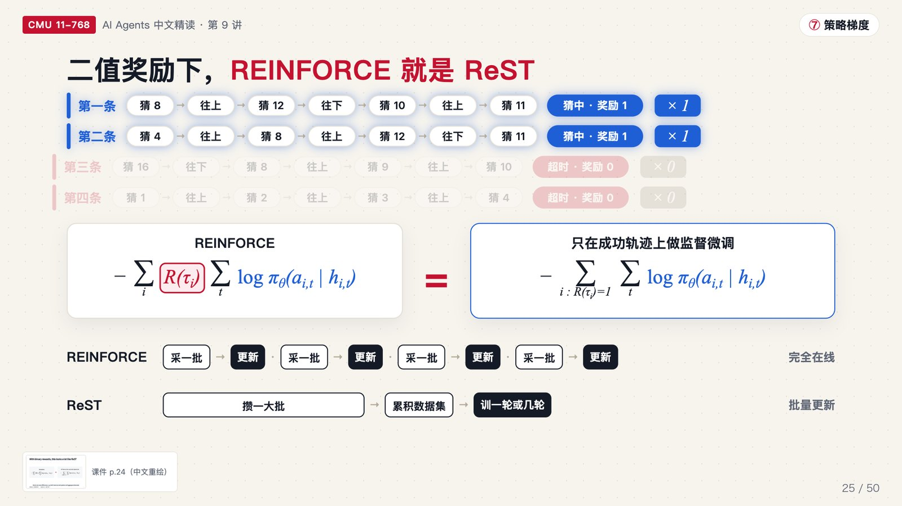

原课件 p.24：

```
REINFORCE:  − Σ_i R(τ_i) Σ_t log π_θ(a_{i,t} | h_{i,t})  =  − Σ_{i : R(τ_i)=1} Σ_t log π_θ(a_{i,t} | h_{i,t})
                                                              （成功轨迹上的监督微调损失）
```

奖励只有 0 和 1 时，乘上 0 的轨迹直接消失，乘上 1 的轨迹原样留下，结果就是 5.2 那个"只在成功轨迹上做监督微调"的损失。

也有些不同（原课件括号里的话）：

| | REINFORCE | ReST |
|---|---|---|
| 节奏 | 完全在线：采一批轨迹就直接在上面更新 | 先攒一个很大的数据集，再训一轮甚至几轮 |
| 数据 | 每批用完就换 | 数据集累积起来 |
| 直觉 | 用奖励去缩放动作的对数概率 | 同左 |

这一节记住一句：策略梯度就是奖励乘对数概率的梯度，实现上是给监督微调的损失加掩码、乘奖励。

---

## 7 基线和优势

### 7.1 奖励应该是相对的

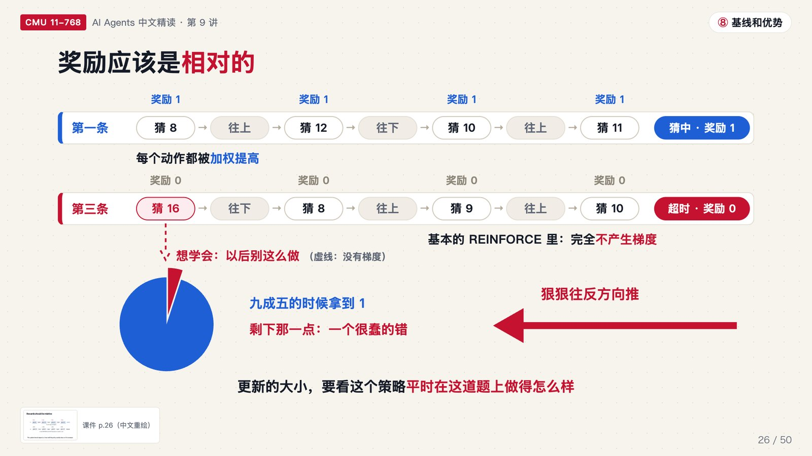

原课件 p.26：

| | 猜 8 | 往上 | 猜 12 | 往下 | 猜 10 | 往上 | 猜 11 | 猜中 |
|---|---|---|---|---|---|---|---|---|
| τ1 每个动作的权重 | R = 1 | | R = 1 | | R = 1 | | R = 1 | |

| | 猜 16 | 往下 | 猜 8 | 往上 | 猜 9 | 往上 | 猜 10 | 超时 |
|---|---|---|---|---|---|---|---|---|
| τ3 每个动作的权重 | R = 0 | | R = 0 | | R = 0 | | R = 0 | |

- **所有动作都被加权提高**（τ1）。
- **在最基本的 REINFORCE 里，和 ReST 一样，τ3 完全不产生梯度！** 可 τ3 一上来猜 16，我们其实想学会"别这么做"。
- **更新的大小，应该取决于这个策略平时在这道题上做得怎么样。**

课上口头补充：这套最朴素的方法问题也不少，很少有人直接拿标准的 REINFORCE 来跑。另一种想法：假设一道题很简单，模型 95% 的时候都能拿到奖励 1；那剩下 5% 的时候犯了一个很蠢、代价很大的错，就应该狠狠地往反方向更新。基线和优势就是做这件事的：把奖励和"策略在这道题上预期能拿多少"比。

### 7.2 优势：这个动作比策略的平均水平好多少

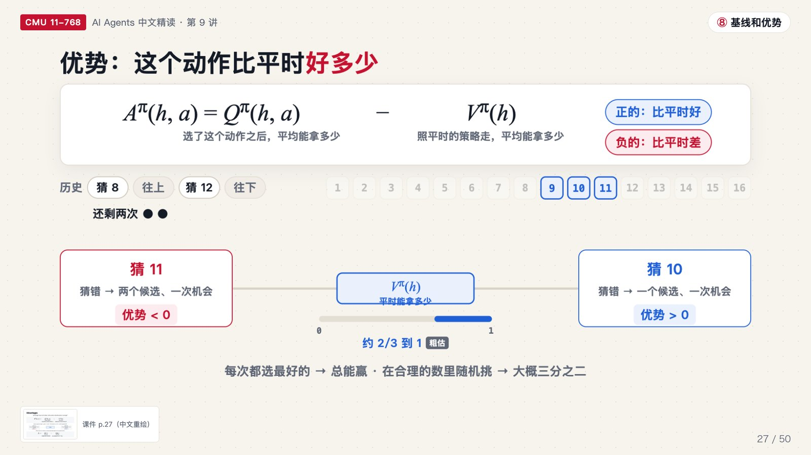

原课件 p.27：

```
A^π(h, a) = Q^π(h, a) − V^π(h)
            （做了 a 之后的期望奖励）  （从 h 出发的期望奖励）
```

| 量 | 英文 | 意思 |
|---|---|---|
| `Q^π(h, a)` | 动作价值（action value） | 在历史 h 下先做动作 a，之后照策略 π 走，平均能拿多少 |
| `V^π(h)` | 价值（value） | 在历史 h 下照策略 π 走，平均能拿多少 |
| `A^π(h, a)` | **优势**（advantage） | 两者之差：正数说明这个动作比平时好，负数说明比平时差 |

用猜数字说：历史是"猜 8 → 往上，猜 12 → 往下"，那个数只能是 9、10 或 11，还剩两次机会。

| 猜 11 | V^π(h) | 猜 10 |
|---|---|---|
| 猜错的话，还剩两个候选、一次机会 | | 猜错的话，只剩一个候选、一次机会 |
| `A^π(h, 11) < 0` | | `A^π(h, 10) > 0` |

猜 11 不好，因为它在范围的一端，猜错还剩两个候选、只有一次机会；猜 10 好，因为就算猜错，剩下的只有一个数，下一次一定能猜中（"一定能猜中"是本课件按图上"一个候选、一次机会"补的一句）。

`V^π(h)` 是多少我们不确切知道，它取决于策略。课上口头估计大概在三分之二到一之间：如果策略每次都做最好的选择，从这里总能赢；如果它在合理的数里随机挑，可能接近三分之二。（这两个数是课上口头估的，课件上没有。）

`Q^π` 和 `V^π` 都不知道，所以用采样到的奖励来估计优势：

```
Â_t = R(τ) − b(h_t)
     （轨迹奖励）（对 V^π(h_t) 的一个估计）
```

拿这条轨迹实际拿到的奖励，减去一个"平时大概能拿多少"的估计，这个估计叫**基线**。很多强化学习算法，就是在用不同的办法估计优势和价值（课上口头补充）。

### 7.3 减掉基线，四种选法

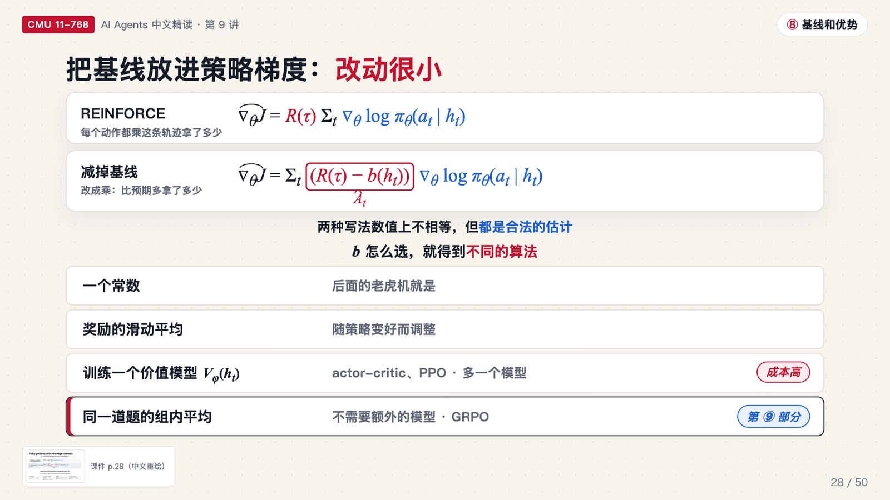

原课件 p.28：**把奖励重新居中，就把优势放进去了。**

```
REINFORCE：   ∇̂_θ J = R(τ) Σ_t ∇_θ log π_θ(a_t | h_t)               一条轨迹的奖励给每个动作加权
减掉基线：    ∇̂_θ J = Σ_t (R(τ) − b(h_t)) ∇_θ log π_θ(a_t | h_t)      权重变成 Â_t
```

原来每个动作都乘"这条轨迹拿了多少"，现在改成乘"这条轨迹比预期多拿了多少"。两行在数值上不相等，但都是合法的策略梯度估计（课上口头补充）。

`Â_t = R(τ) − b(h_t)`。b 选法不同，就得到不同的算法：

| 基线 b 选什么 | 说明 | 代价 |
|---|---|---|
| 一个常数 | 后面老虎机的例子（7.5–7.8） | 几乎为零，但不随题目变 |
| 奖励的滑动平均 | 随策略变好而调整 | 小 |
| 训练一个价值模型 `V_φ(h_t)` | **actor–critic** 方法、**PPO** 的做法 | 要另训一个和策略分开的模型，成本高 |
| 组内平均 | 不需要额外的模型：GRPO（第 8 节） | 同一道题要采样多次 |

### 7.4 基线不会让梯度估计产生偏差

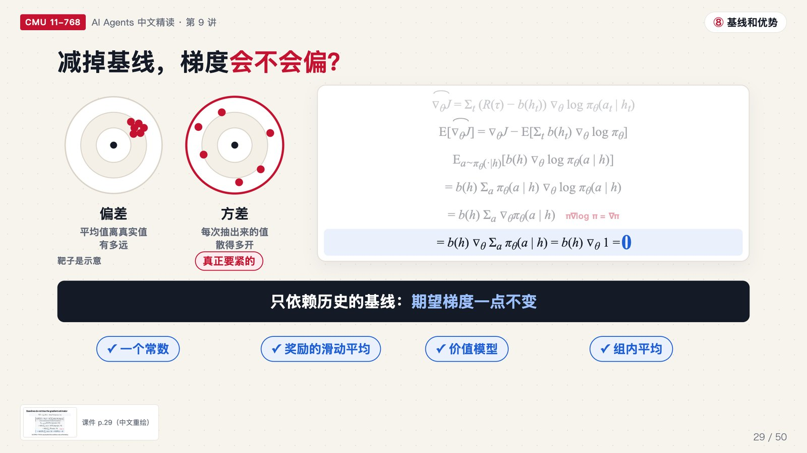

先分清两个词（课上口头补充）：

| | **偏差**（bias） | **方差**（variance） |
|---|---|---|
| 是什么 | 估计的平均值离真实值有多远 | 每次抽出来的值散得多开 |
| 打靶的比喻（视频画面） | 弹孔整体偏离靶心 | 弹孔围着靶心散得很开 |

原课件 p.29 的推导：

```
∇̂_θ J = Σ_t (R(τ) − b(h_t)) ∇_θ log π_θ(a_t | h_t)
E[∇̂_θ J] = ∇_θ J − Σ_t E[ b(h_t) ∇_θ log π_θ ]

只要后一项期望为 0，这就是 J 的梯度的无偏估计：

E_{a∼π_θ(·|h)} [ b(h) ∇_θ log π_θ(a|h) ]
  = b(h) Σ_a π_θ(a|h) ∇_θ log π_θ(a|h)
  = b(h) Σ_a ∇_θ π_θ(a|h)          （π ∇ log π = ∇π）
  = b(h) ∇_θ Σ_a π_θ(a|h) = b(h) ∇_θ 1 = 0
```

逐行说：

1. 基线只看历史、不看这一步选了什么动作，所以可以提到对动作的求和外面。
2. "概率 × 对数概率的导数"等于"概率的导数"（就是 6.2 第 ④ 步倒过来用）。
3. 求导和求和可以交换，剩下的是"所有动作的概率之和"的导数。
4. 概率之和永远是 1，1 的导数是 0。

**所以对任何只依赖历史的基线，`E[∇̂_θ J] = ∇_θ J`。** 7.3 表里四种基线都满足这个条件（组内平均有一个细节，见第 9 节 Q4 和思考题 6）。

真正重要的是方差：强化学习里大量的工作，就是在降低梯度估计的方差，让学习在策略和环境带来的各种随机性下也稳定（课上口头补充）。下面四节用一个能精确算的例子把"期望不变、方差变小"算出来。

### 7.5 简单例子：双臂老虎机

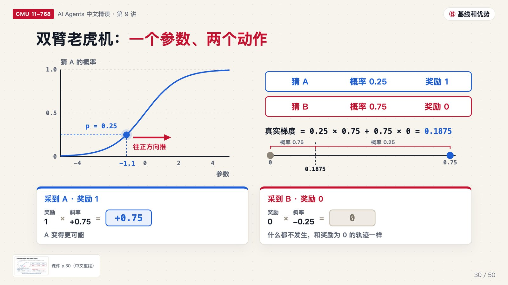

原课件 p.30：**只有一个策略参数、两个动作，梯度可以精确算出来。** 没有多步，只有一次决策（课上口头补充）。这种只有一次决策、几个动作的问题叫**多臂老虎机**（multi-armed bandit）。

- 一个参数 θ，经过 **sigmoid** σ 变成一个概率：`p = π_θ(猜 A) = σ(θ)`。sigmoid 把任意实数压到 0 到 1 之间。
- 现在 θ = −1.1，于是：

| 动作 | 概率 | 奖励 |
|---|---|---|
| 猜 A | p = σ(θ) = 0.25 | 1 |
| 猜 B | 1 − p = 0.75 | 0 |

（σ(−1.1) ≈ 0.2497，原课件写成 0.25。下面的练习里取 θ = ln(1/3) ≈ −1.0986，让 p 正好是 0.25。）

- 提高 θ，会提高猜 A 的概率、降低猜 B 的概率。
- 课上问：这是好策略还是坏策略？坏的，因为它把更高的概率放在没有奖励的那个动作上。θ 应该往正的方向变，在曲线上越往右，猜 A 的概率越高。

两个动作的对数概率对 θ 的斜率：

| 动作 | log π_θ(a) | 对 θ 的斜率 |
|---|---|---|
| 猜 A | log σ(θ) | 1 − p = +0.75 |
| 猜 B | log(1 − σ(θ)) | −p = −0.25 |

不加基线，按 6.3 的公式算一次采样给出的梯度：

| 采到 | 奖励 R(τ) | × 斜率 | = θ 上的梯度 | 结果 |
|---|---|---|---|---|
| 猜 A，奖励 1 | R = 1 | +0.75 | **+0.75** | 采到 A，A 变得更可能 |
| 猜 B，奖励 0 | R = 0 | −0.25 | **0** | 采到 B，什么都不发生 |

- **这个梯度是对的，但基线或优势能让它更有用。**
- 采到 B 时梯度是 0，和 7.1 奖励为 0 的轨迹不产生梯度是一回事。

真正的策略梯度是对两个动作取期望，这里能精确算：

```
E[ĝ] = 0.25 × 0.75 + 0.75 × 0 = 0.1875
```

但单次估计非常吵：四分之一的时候拿到 0.75，比 0.1875 大得多；四分之三的时候拿到 0。（课上口头说"大约 0.18"，课件上是 0.1875。）

### 7.6 加一个基线

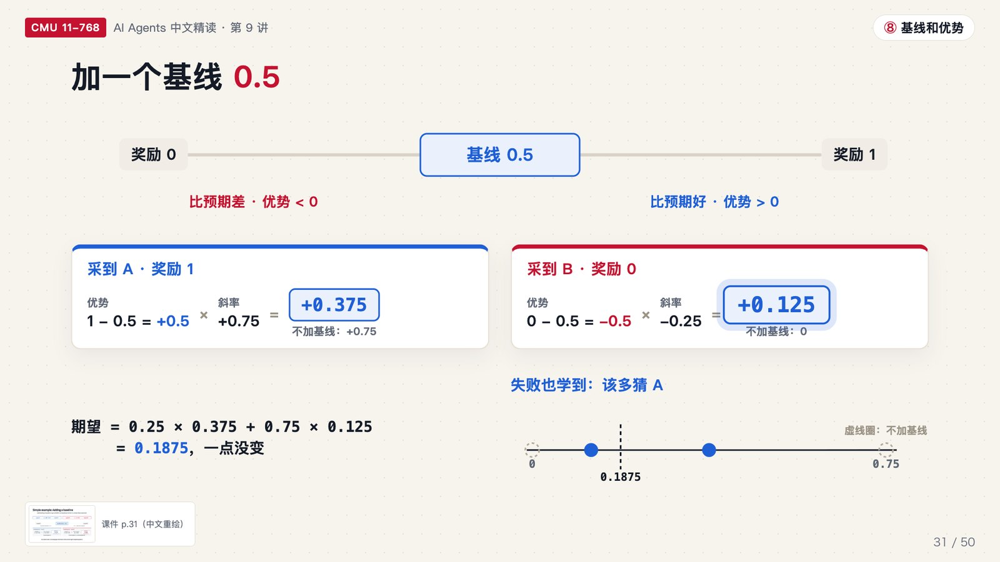

原课件 p.31：**减掉基线，说明这个奖励是比预期好还是比预期差。**

基线 `b(h₀) = 0.5`，放在奖励 0 和奖励 1 中间：奖励 0 那边是"比预期差，Â < 0"，奖励 1 那边是"比预期好，Â > 0"。

| 采到 | 优势 Â = R − b | × 斜率 | = θ 上的梯度 | 不加基线时 | 结果 |
|---|---|---|---|---|---|
| 猜 A，奖励 1 | 1 − 0.5 = +0.5 | +0.75 | **+0.375** | +0.75 | 提高猜 A 的概率 |
| 猜 B，奖励 0 | 0 − 0.5 = −0.5 | −0.25 | **+0.125** | 0 | 提高猜 A 的概率，也就是降低猜 B 的概率 |

```
E[ĝ] = 0.25 × 0.375 + 0.75 × 0.125 = 0.09375 + 0.09375 = 0.1875
```

- **基线让失败也能带来学习信号，同时保持期望梯度不变。**
- 猜错的时候，奖励 0 比预期的 0.5 少，优势是负的，再乘上一个负的斜率，结果是正的：模型从失败里也学到了"该多猜 A"。
- 期望还是 0.1875，和之前一样；但每一次采样都离真实值近得多。在真实数据上一次次估计、一次次更新时，你不希望梯度把你甩来甩去（课上口头补充）。

### 7.7 改变基线

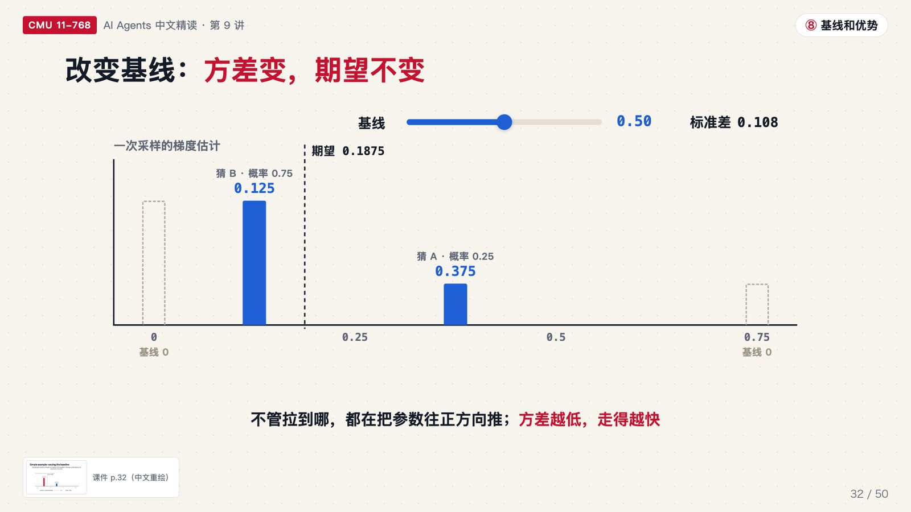

原课件 p.32：**改变基线会改变梯度估计的方差，但期望保持不变。** 单次采样的梯度估计是 `ĝ = (R − b) · ∇_θ log π_θ(a)`。图上是一根数轴（0 到 0.75），一条虚线标着 `E[ĝ] = 0.1875`；基线滑块拉在 0.50 时：

| 采到 | 概率 | ĝ |
|---|---|---|
| 猜 B | 0.75 | 0.125 |
| 猜 A | 0.25 | 0.375 |

- ĝ 的标准差 0.108。
- 数轴两端的虚线框是 b = 0 时的位置：0 和 0.75。

课上拖动了滑块（交互演示）：不管基线拖到哪，更新都在让模型变对，把 θ 往正方向推、提高猜 A 的概率；方差越低，走得越快。

自己把标准差算一遍（两点分布：`SD = √(E[ĝ²] − E[ĝ]²)`）：

```
不加基线：√(0.25 × 0.75² + 0.75 × 0² − 0.1875²)          = √(0.140625 − 0.035156) ≈ 0.325
基线 0.5：√(0.25 × 0.375² + 0.75 × 0.125² − 0.1875²)     = √(0.046875 − 0.035156) ≈ 0.108
```

动手练习第 1 部分会把 b = 0.25、b = 1.0 也算出来。留一个课上没讲的问题：标准差最小的基线是多少？（思考题 4。）

### 7.8 梯度估计里的噪声

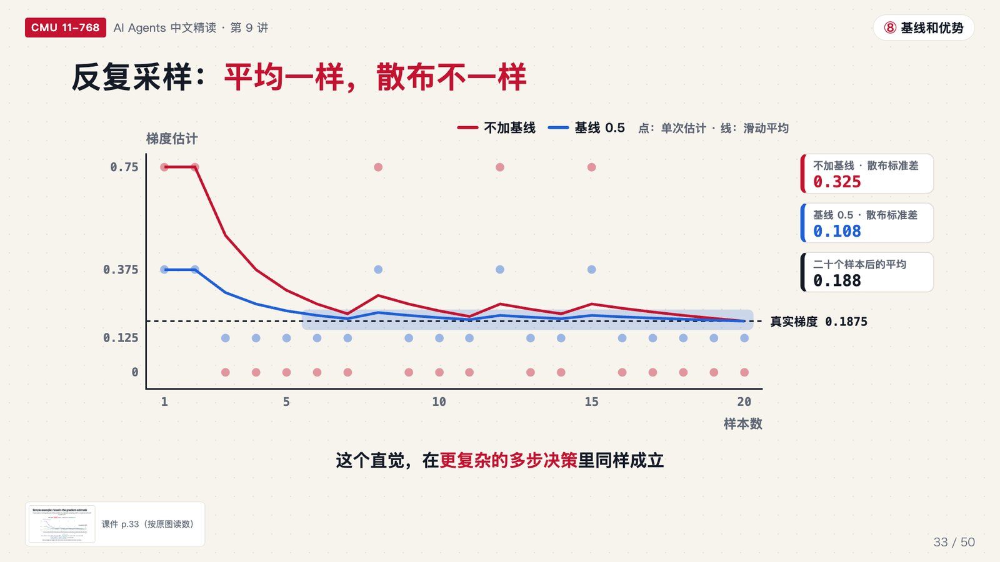

原课件 p.33：**反复采样，算梯度的滑动平均：一条不加基线，一条基线取 0.5。**

图（按原图读数）：横轴是抽了多少个样本（1 到 20），纵轴是梯度估计 ĝ；点是每次的单次估计，线是到当前为止的滑动平均；虚线是真实梯度 0.1875。原课件里不加基线是紫色、基线 0.5 是绿色；视频重绘时改成了红色（不加基线）和蓝色（基线 0.5）。

| | 单次估计的取值 | 散布的标准差 | 20 个样本后的滑动平均 |
|---|---|---|---|
| 不加基线 | 0.75 或 0 | 0.325 | 0.188 |
| 基线 0.5 | 0.375 或 0.125 | 0.108 | 0.188 |

- 图上第 1、2、8、12、15 个样本采到猜 A，其余采到猜 B（按原图读数）；最后一个样本是猜 B，不加基线给 0.000，加基线给 0.125。
- 20 个样本里正好 5 个是 A，四分之一，所以 20 个样本的平均正好是 0.1875，图上写 0.188。
- **两条平均线收敛到同一个值，但加基线的方差小。**

课上口头补充：一开始连续采到 A，不加基线的那一步迈得很大；后来连续采到好几个 B，又跌回来；再采到 A，又跳上去。最后都会收敛，但加了基线的时候，大部分时间都离真实值更近。课上还说，基线自己一直觉得有点神秘，做这些可视化，也是为了说服自己它到底怎么起作用；这个双臂老虎机的直觉，在更复杂的多步决策里同样成立。

### 7.9 基线和信用分配

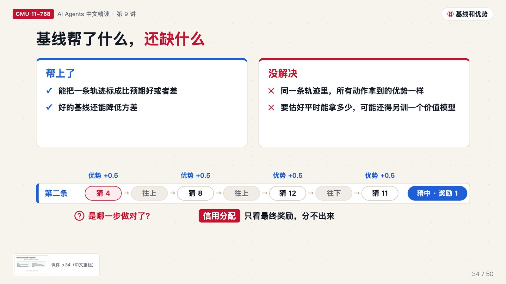

原课件 p.34：**到目前为止，基线带来了什么？**

| 帮上了 | 没解决 |
|---|---|
| 把一条轨迹标成比预期好或比预期差 | 所有动作的优势 Â 都一样 |
| 好的基线能降低梯度的方差 | 估计 `V^π(h)` 可能需要另一个价值模型 |

图底部：`Â = +0.5`，后面跟着一条成功轨迹的四个动作，四个格子一模一样。

"所有动作的优势都一样"课上没展开。拿 τ2 来说（这个例子是本课件补的推断）：第一次猜 4 不是好动作，但因为整条轨迹成功了，它和后面的好动作拿到同样的正优势。只看最终奖励，分不出是哪一步做对了，这就是**信用分配**问题。强化学习很大一部分工作，就是想好办法来表示这个优势函数（课上口头补充）。

第 8 讲片尾留的问题（"只有整条轨迹成功或失败一个数，能不能只奖励做对的那几步"）在这一讲没有解决；这一页把它点名为"没解决"。

### 7.10 有中间奖励怎么办（课上一笔带过）

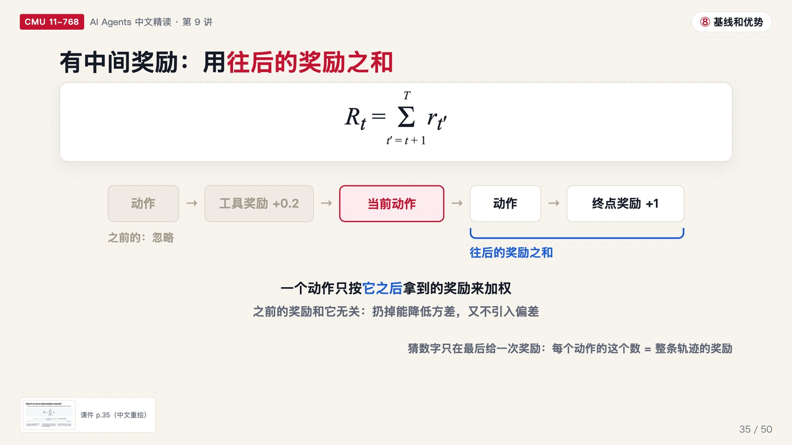

原课件 p.35：**如果环境在最后一步之前就给奖励，就用"往后的奖励之和"（reward-to-go）来降低方差。**

```
R_t = Σ_{t′=t+1}^{T} r_{t′}
```

一个动作只按它之后拿到的奖励来加权，它之前已经拿到的奖励不算。

示意（原课件图上的例子）：动作 → 工具奖励 +0.2 → **动作 a_t** → 动作 → 终点奖励 +1。a_t 之前的部分标"忽略"，之后的部分标"算进 R_t"。

- 之前的奖励和 a_t 无关，扔掉它们能降低方差，又不引入偏差。
- 猜数字只在最后给一次奖励：每个动作的 R_t 都等于 R(τ)。

课上说这页跳过，只说了一句：如果你的场景在中间步骤也给奖励，就把乘的奖励换成往后的奖励之和，也能降低方差。

这一节记住一句：奖励要和平时比，减掉只看历史的基线，期望不变、方差变小，失败也能带来信号。

---

## 8 组内相对优势：GRPO 和 DrGRPO

### 8.1 用同一道题的多次试跑当基线

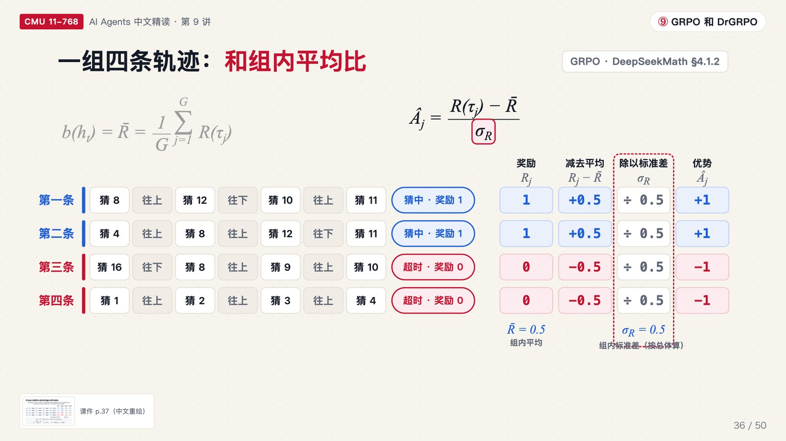

原课件 p.37：**优势：这条轨迹比预期好多少？可以通过让策略跑好几次来算。不需要另外的模型！**

好的基线就是策略的期望奖励，而估计它的一个好办法，就是让策略在同一道题上多跑几次、对奖励取平均（课上口头补充）。这就是 **GRPO**，全称 Group Relative Policy Optimization，组内相对策略优化，出自 DeepSeekMath（Shao et al.，§4.1.2）。

课上口头补充：以前把强化学习用到语言模型上，很多工作要另训一个模型来预测基线。预测基线、降低方差很重要，但很难，另一个模型也很耗算力。DeepSeek 很在意用少量算力训模型，于是去掉了另外那个模型，只用同一个模型的多次采样来估计期望奖励。

同一道题（藏着的数 11）跑四次，就是开头那四条轨迹：

| 轨迹 | 奖励 R_j | 居中 R_j − R̄ | 除以 σ_R | 优势 Â_j |
|---|---|---|---|---|
| τ1 | 1 | +0.5 | ÷ 0.5 | +1 |
| τ2 | 1 | +0.5 | ÷ 0.5 | +1 |
| τ3 | 0 | −0.5 | ÷ 0.5 | −1 |
| τ4 | 0 | −0.5 | ÷ 0.5 | −1 |
| 组内 | R̄ = 0.5 | | σ_R = 0.5 | |

```
b(h_t) = R̄ = (1/G) Σ_{j=1}^{G} R(τ_j)        对组里每一个 h_t 都一样
Â_j = (R(τ_j) − R̄) / σ_R,    σ_R = std{ R(τ_1), …, R(τ_G) }
```

同一道题让模型做 G 次，这几次的平均奖励就当作基线；每条轨迹的优势，是它的奖励减去平均，再除以这几次奖励的标准差。

> 标准差的算法：表里的 σ_R = 0.5 是**总体标准差**（除以 G）算出来的：`√((4 × 0.5²) / 4) = 0.5`。如果按样本标准差（除以 G − 1），σ_R ≈ 0.577，优势会是 ±0.87。DeepSeekMath 原文只说"减去组内平均、除以组内标准差"，没说用哪一种。第 10 节会看到 TRL 用的是样本标准差。

课上口头补充：原始的 GRPO 论文不只平移，还除以组内奖励的标准差。但看起来这一步并不必要，很多自称 GRPO 的实现其实去掉了除以标准差，只减均值，这样更贴近优势本来的意思。8.3 节的 DrGRPO 会说明理由。

### 8.2 GRPO 的更新

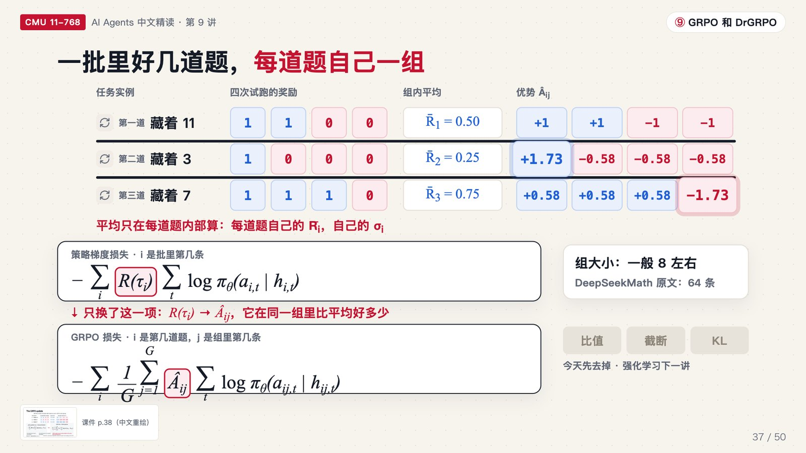

原课件 p.38：**一批里有好几个任务实例，每个有自己的一组。**

| 任务实例 | G 次试跑的奖励 | 组内平均 | 优势估计 Â_ij |
|---|---|---|---|
| x₁ · 藏着 11 | 1 1 0 0 | R̄₁ = 0.50 | +1 +1 −1 −1 |
| x₂ · 藏着 3 | 1 0 0 0 | R̄₂ = 0.25 | +1.73 −0.58 −0.58 −0.58 |
| x₃ · 藏着 7 | 1 1 1 0 | R̄₃ = 0.75 | +0.58 +0.58 +0.58 −1.73 |

自己核算 x₂（按总体标准差）：

```
平均   R̄₂ = (1 + 0 + 0 + 0) / 4 = 0.25
标准差 σ₂ = √(((1 − 0.25)² + 3 × (0 − 0.25)²) / 4) = √0.1875 ≈ 0.433
成功那条 (1 − 0.25) / 0.433 ≈ +1.73
失败三条 (0 − 0.25) / 0.433 ≈ −0.58
```

x₃ 正好反过来。

```
策略梯度损失（i 数批里的样本）：  − Σ_i R(τ_i) Σ_t log π_θ(a_{i,t} | h_{i,t})
→ GRPO 损失（i 数批，j 数组）：    − Σ_i (1/G) Σ_{j=1}^{G} Â_ij Σ_t log π_θ(a_{ij,t} | h_{ij,t})
```

和 6.6 的策略梯度损失比，只换了一处：每条轨迹的权重不再是它自己的奖励，而是它在同一道题的那一组里比平均好多少。

- 每个任务实例有自己的 R̄_i 和 σ_i，单独做归一化。
- **GRPO 给的是同一个策略梯度项里的组内相对权重。**
- 这里写的是当前策略跑出的轨迹，去掉了论文里的比值、截断和 KL 项（原课件 p.38 的说明）。

课上口头补充：

- 一个任务实例就是一道要解的强化学习题。同一道题做好几次，每次重置环境，从 agent 采样一条完整轨迹。
- **组的大小**：课上说"一般 8 左右"（原话是"我想是"），第 12 讲会给一些怎么选的建议。DeepSeekMath 原文 §4.2 的设置是**每题采样 64 条**。第 10 节会看到 TRL 的默认值是 8。
- GPU 装得下的话，可以给更多任务实例各采一组同样大小的。组内平均只在每道题内部算，这很重要：价值函数估计的是"这一道题上能拿多少奖励"，所以优势只看这道题自己的奖励。
- 这里写的不是论文里定义的 GRPO 损失。论文里的损失还有别的项：一个是**截断**（clipping），不让一步迈得太远；一个是**正则**，不让策略离一开始的策略太远（KL 项）。两者都是帮训练稳定的，强化学习的下一讲会讲，今天只讲 GRPO 里的优势。

| 和 REINFORCE 比 | REINFORCE（6.6） | GRPO（这里） |
|---|---|---|
| 每道题几条轨迹 | 1 | G 条（一组） |
| 每条轨迹的权重 | 自己的奖励 R(τ) | 组内相对的优势 Â |
| 基线 | 没有 | 组内平均 |
| 失败的轨迹 | 不产生梯度 | 被往下压 |

### 8.3 DrGRPO 的两处改动

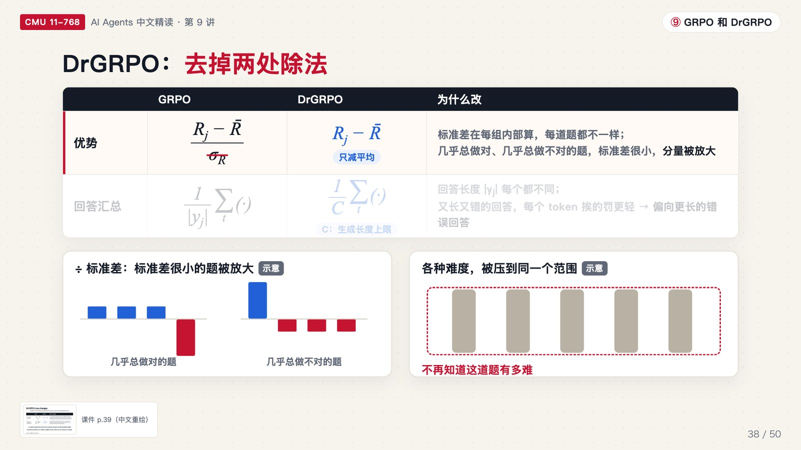

原课件 p.39：**DrGRPO 去掉了"除以组内标准差"和"除以回答长度"。** DrGRPO 原文写作 Dr. GRPO（GRPO Done Right），出自 Liu et al.，图 1、§3.2。

| | GRPO | DrGRPO | 为什么改 |
|---|---|---|---|
| 优势估计 | `(R_j − R̄) / σ_R` | `R_j − R̄` | σ_R 是在每组内部算的，所以每个任务实例都不一样。策略几乎总能做对、或几乎总做不对的题，σ_R 很小，于是它们的分量被放大 |
| 回答怎么汇总 | `(1/|y_j|) Σ_t (·)` | `(1/C) Σ_t (·)` | 每个回答的长度 `|y_j|` 不同。一个又长又错的回答，每个 token 受到的惩罚比短的少，所以策略会慢慢偏向更长的错误回答 |

- C 是一个全局常数，对每个回答都一样；论文用的是生成长度上限。
- **奖励不变，变的是各个任务实例、各个回答之间的相对权重。**

**第一处：除以标准差。** 课上口头补充：除以标准差之后，优势就不再知道这道题有多难，因为把各种难度都标准化到了同一个范围，这其实可能是坏事。用 8.2 的三道题看一眼（DrGRPO 那列是自己按"只减平均"算的）：

| 题 | 奖励 | GRPO 的优势（除以 σ） | DrGRPO 的优势（只减平均） |
|---|---|---|---|
| 藏着 11 | 1 1 0 0 | +1 +1 −1 −1 | +0.5 +0.5 −0.5 −0.5 |
| 藏着 3 | 1 0 0 0 | +1.73 −0.58 −0.58 −0.58 | +0.75 −0.25 −0.25 −0.25 |
| 藏着 7 | 1 1 1 0 | +0.58 +0.58 +0.58 −1.73 | +0.25 +0.25 +0.25 −0.75 |

把 G 加大，差别更明显：如果一组 8 条里只有 1 条成功，组内标准差更小，GRPO 给成功那条的优势会比 1.73 更大（思考题 5 让你算具体数）。

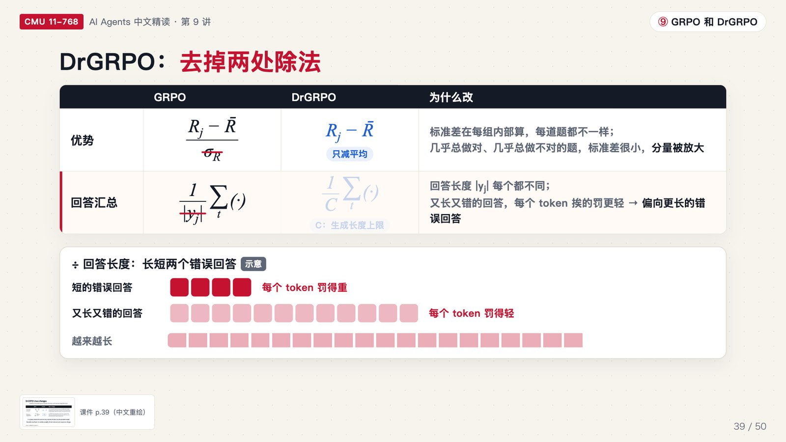

**第二处：除以回答长度。** GRPO 先在每个回答内部对 token 求平均（除以这个回答自己的长度 |y_j|），再对回答求平均。DrGRPO 原文 §3.1 把这叫"回答层面的长度偏差"：优势为负时，长的回答每个 token 罚得更轻，策略偏向更长的错误回答；原文还说优势为正时，短的回答每个 token 更新更大（原课件只写了错的那一半）。DrGRPO 只除以一个常数，就是最多能生成的 token 数（课上口头补充）。

用一个示意的数算一下：两个答错的回答，优势都是 −0.5，一个 10 个 token、一个 100 个 token，C 取 512（这些数都是示意，512 是第 10 节 TRL 的默认值）：

| 回答 | GRPO：每个 token 的系数 | DrGRPO：每个 token 的系数 |
|---|---|---|
| 短，10 个 token | −0.5 / 10 = −0.05 | −0.5 / 512 ≈ −0.00098 |
| 长，100 个 token | −0.5 / 100 = −0.005 | −0.5 / 512 ≈ −0.00098 |

GRPO 下，长的错误回答每个 token 挨的罚只有短的十分之一；整条回答合计都是 −0.5。DrGRPO 下每个 token 挨的罚一样，长的回答合计挨的罚更多。

### 8.4 DrGRPO 里每个 token 的系数

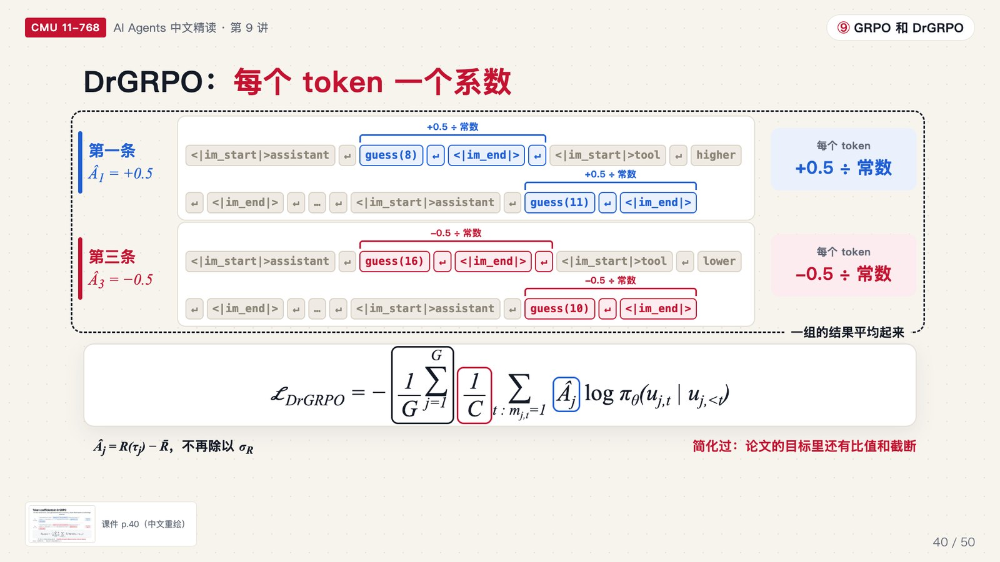

原课件 p.40：**对同一个任务实例，第 j 条轨迹里每个生成的 token，都共用这条轨迹的优势估计。**

| 轨迹 | 优势 | 每个 token |
|---|---|---|
| τ1（猜 8 … 猜 11，蓝色） | Â₁ = +0.5 | +0.5 / C |
| τ3（猜 16 … 猜 10，红色） | Â₃ = −0.5 | −0.5 / C |

按原图：两条轨迹都套着模板，`guess(...)`、换行和 `<|im_end|>` 上色，角色头和 tool 那段是灰的，和 6.5 的掩码一样。

```
L_DrGRPO = − (1/G) Σ_{j=1}^{G} (1/C) Σ_{t : m_{j,t}=1} Â_j log π_θ(u_{j,t} | u_{j,<t})
Â_j = R(τ_j) − R̄，不除以 σ_R
```

每条轨迹的优势就是"奖励减组内平均"；这条轨迹里模型生成的每个 token，都乘上同一个"优势除以常数"的系数，再把所有轨迹的结果平均。C 通常就是最多能生成的 token 数。同一组里的轨迹，奖励可正可负，都这样处理（课上口头补充）。

- 简化过：论文里的目标还有比值和截断（出处：DrGRPO §3.2；DeepSeekMath 式 3）。

把三个损失并排看，差别只在"权重"和"除以什么"：

| | 每条轨迹的权重 | token 怎么汇总 |
|---|---|---|
| 策略梯度（6.5） | R(τ) | 求和 |
| GRPO（本讲简化版） | (R_j − R̄) / σ_R | 先除以各自长度 |y_j|，再对组平均 |
| DrGRPO | R_j − R̄ | 除以常数 C，再对组平均 |

### 8.5 奖励全相同时，优势为零

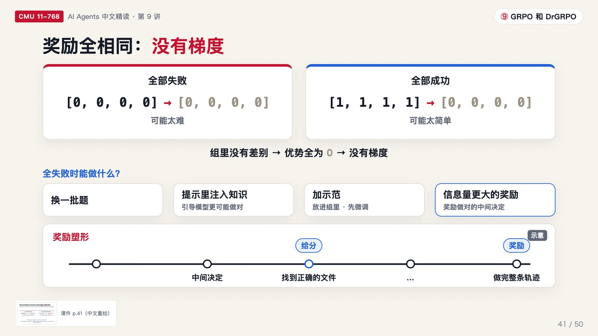

原课件 p.41：**一组里所有奖励都一样，这组就退化了，不贡献任何梯度。**

| 全部失败 | 全部成功 |
|---|---|
| [0, 0, 0, 0] → [0, 0, 0, 0] | [1, 1, 1, 1] → [0, 0, 0, 0] |
| 对当前策略可能太难 | 对当前策略可能太简单 |

全失败，说明题对当前策略可能太难，就算有基线也拿不到信号；全成功，说明太简单。奖励是二值的、1 已经是最好，组里没有任何差别，GRPO 估出的优势就给不了信号（课上口头补充）。

> 实现细节：这时组内标准差是 0，`(R − R̄) / σ_R` 是 0 / 0。第 10 节会看到 TRL 在分母上加了 `1e-4`，所以结果是 0，不会报错。

**如果每条采样的轨迹都失败，我们能改什么？** 原课件列了四个办法，课上展开讲了：

| 办法 | 课上怎么说 |
|---|---|
| 换一批任务实例 | 换成当前策略做得出来的题 |
| 扩大探索 | 在提示里注入一些知识，引导模型产生更可能对的解法 |
| 加示范 | 有一些离策略的强化学习方法会把正确的示范放进组里；或者更简单，先在正确示范上微调，再做强化学习 |
| 给一个信息量更大的奖励 | 鼓励模型在完成整条轨迹之前先做对中间的决定，这叫**奖励塑形**（reward shaping），比如模型找到了正确的文件就给奖励 |

第 9 节 Q3 是同一个问题的另一次回答。

### 8.6 GRPO 对 PPO（课上没展开）

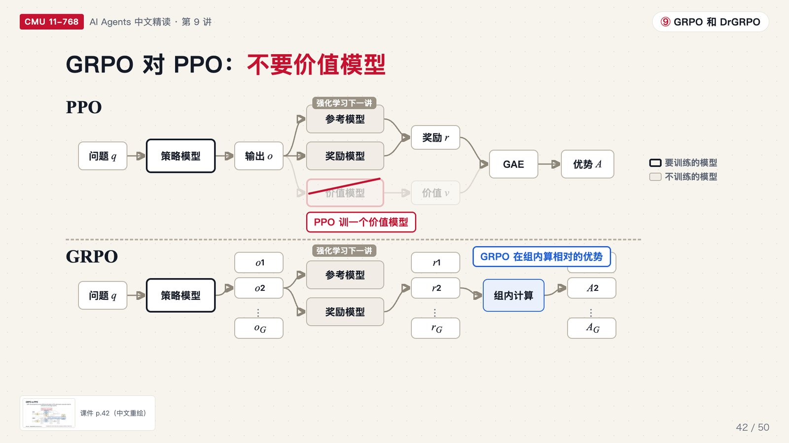

原课件 p.42：**GRPO 被提出来，是作为 PPO 的一个更高效的替代：PPO 要用另一个模型来估计优势的基线。** 图是照 DeepSeekMath 图 4 重绘的两条流程：

| | PPO | GRPO |
|---|---|---|
| 一个问题生成几个输出 | 一个输出 o | 一组输出 o₁…o_G |
| 参考模型（KL） | 有 | 有 |
| 奖励模型 | 给出 r | 给出 r₁…r_G |
| 价值模型 | **有**，给出 v；r 和 v 进 GAE 算出优势 A | **没有** |
| 优势怎么算 | GAE | 组内计算，得到 A₁…A_G |
| 图上的标注 | "PPO 要训一个价值模型" | "GRPO 算组内相对的优势" |

课上说这页跳过，只说了一句：PPO 不是用轨迹来算优势，而是用一个单独的模型来预测基线，这个模型通常和策略共用主干。进阶强化学习那一讲（第 11 讲）会讲比值、截断和参考模型那几项。GAE 原课件只出现在图上，没有解释，这一讲也不展开。

这一节记住一句：GRPO 用同一道题多跑几次的平均当基线，不用另训模型；DrGRPO 再去掉除以标准差和除以长度这两处除法。

---

## 9 课堂问答

原课件上没有这部分，都是课上的提问和回答。

### Q1 经典强化学习的马尔可夫假设呢？


- **问**：经典强化学习有马尔可夫假设，下一个状态只取决于上一个状态和动作。4.4 节的写法是什么关系？
- **答**：这里其实是**部分可观测马尔可夫决策过程**（Partially Observable Markov Decision Process，POMDP）：底下的状态看不到，能看到的只有观察。在 POMDP 里，你拿不到状态，所以下一个观察的概率要以之前所有的观察和动作为条件。对 POMDP 来说两种写法应该是等价的，这一种在这里更好用。

| | 经典写法（MDP） | 这一讲的写法 |
|---|---|---|
| 条件是什么 | 上一个状态和动作 | 整个历史（所有观察和动作） |
| 能不能看到状态 | 能 | 不能，只能看观察 |
| 猜数字里 | 状态里有"藏着 11" | 只有"往上、往下" |

### Q2 ReST 和自蒸馏有什么区别？

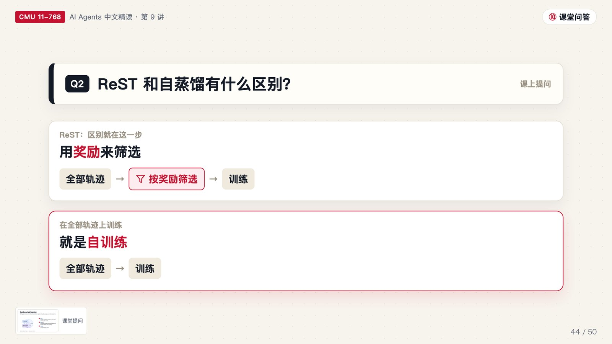

- **问**：ReST 和**自蒸馏**（self-distillation）有什么不同？
- **答**：区别就在于用奖励来筛选。自蒸馏也可以指在模型产生的全部轨迹上训练，那其实就是**自训练**（self-training）。ReST 叫"自训练"，因为它看起来很像；叫"强化"，因为它用了奖励，强化的是好的轨迹。

### Q3 如果一条成功的轨迹都跑不出来呢？


- **问**：怎么保证有些轨迹的奖励是正的？最坏情况下全是坏轨迹，会不会原地打转？
- **答**：如果模型产生不了好奖励的轨迹，强化学习和 ReST 大概都不太合适。可以做几件事：

| 办法 | 怎么做 |
|---|---|
| 先在示范上训 | 比如 R1 论文和很多推理模型，开始强化学习之前都有一个"冷启动"阶段，先在推理轨迹上训练，让强化学习更容易跑出高奖励的轨迹（就是第 8 讲的监督微调） |
| **课程学习**（curriculum） | 先挑那些有足够多轨迹能拿到奖励的题训练，模型变强了再上更难的题 |
| 中间奖励 | 如果你对问题有些了解，比如知道先探索代码仓库是有用的，就为这个给奖励；学会了这一步，希望能带着它解开整个任务 |

这是强化学习算法必须面对的一个大问题。8.5 节又回到了这个问题。

### Q4 GRPO 有偏差吗？

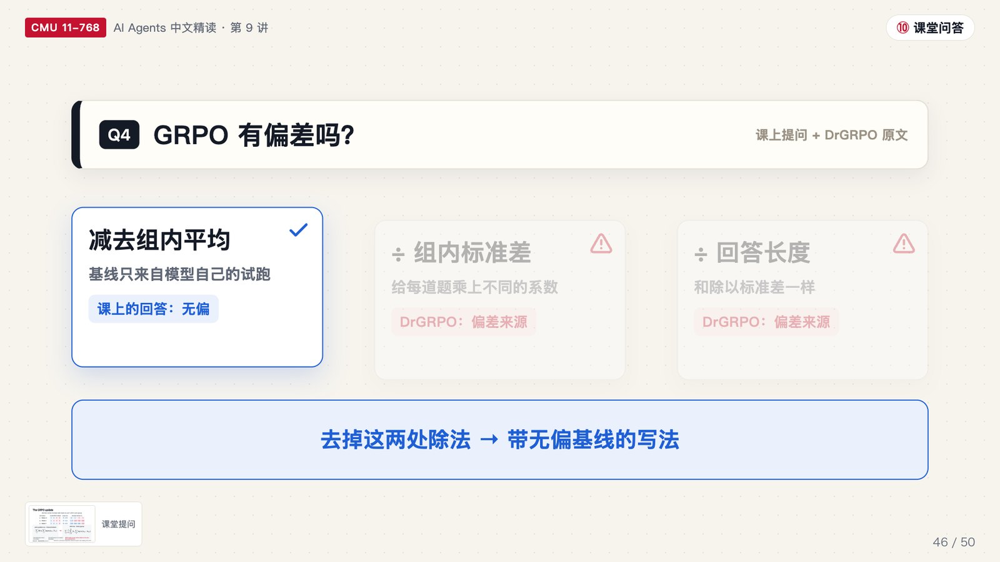

- **问**：GRPO 这样做是无偏的吗？
- **课上的回答**：是无偏的，因为这里的优势只依赖提示和模型；从奖励里减掉的基线，就是语言模型自己的试跑。

这个回答要读准：它对**只减均值**的写法成立。按 DrGRPO 原文：

| GRPO 的哪一步 | DrGRPO 原文怎么说 |
|---|---|
| 减去组内平均 | 保留；§3.2 说去掉下面两处除法后，得到的是"带无偏基线的蒙特卡洛回报" |
| 除以组内标准差 | §3.1 叫"题目层面的难度偏差"：等于给每道题乘了一个不同的系数 |
| 除以回答长度 | §3.1 叫"回答层面的长度偏差" |

所以不能说"GRPO 完全无偏"：除以标准差、除以长度都是偏差的来源，只有把这两处去掉、只减组内平均，才是无偏基线的写法。（组内平均里还包含这条轨迹自己的奖励，这一点见思考题 6。）

另外几处是课上向大家提的问题，不算学生提问，已经写进正文：最好的第一次猜几（1.1）、老虎机里这个策略是好是坏、θ 该往哪边变（7.5）。还有一个学生提问"动作本身是一串 token，怎么对上"，答案在 6.4。

---

## 10 源码解读：TRL 的 GRPOTrainer 怎么算组内优势、怎么汇总损失

课程主页第 9 讲只列了论文，没有推荐源码。这一节读 Hugging Face TRL 的 `GRPOTrainer`，它把第 8 节的几个开关都做成了参数：

| 本讲的说法 | TRL 里的参数 | 本节 |
|---|---|---|
| 组的大小 G | `num_generations` | 10.1 |
| 组内平均当基线、要不要除以组内标准差（8.1、8.3 第一处） | `scale_rewards` | 10.2 |
| 掩码只留策略生成的 token（6.5） | `completion_mask`、`tool_mask` | 10.3 |
| 比值和截断（8.2 说"今天先去掉"的那几项） | `epsilon`、`epsilon_high` | 10.4 |
| 按各自长度平均，还是除以常数（8.3 第二处） | `loss_type="grpo"` / `"dr_grpo"` | 10.5 |
| 默认值 | `trl/trainer/grpo_config.py` | 10.6 |

版本：[huggingface/trl](https://github.com/huggingface/trl) 提交 `c734c60d85766aff4542a00643a2ca7e4a3c72ac`（2026-11-02 读取的 main）。

下面的代码都是原文件节选，行号是这个提交里的行号；中文注释是本课件加的，删掉的部分用 `# ……（删去：……）` 标出。

### 10.1 两个关键量：G 和长度上限

```python
# trl/trainer/grpo_trainer.py，第 828–830 行（GRPOTrainer.__init__ 里）
        # Training arguments
        self.max_completion_length = args.max_completion_length  # = |o_i| in the GRPO paper
        self.num_generations = args.num_generations  # = G in the GRPO paper
```

- `num_generations` 就是组的大小 G：同一个提示采样几条回答。
- `max_completion_length` 是生成长度上限。源码注释把它对到 GRPO 论文里的 `|o_i|`（回答长度）；它在 10.5 节还会当作 DrGRPO 的那个常数 C。

### 10.2 组内优势：减平均，要不要除以标准差

奖励算出来以后，`_generate_and_score_completions` 里按组算优势：

```python
# trl/trainer/grpo_trainer.py，第 2880–2907 行
        if self.multi_objective_aggregation == "sum_then_normalize":
            # Apply weights to each reward function's output and sum
            rewards = (rewards_per_func * self.reward_weights.to(device).unsqueeze(0)).nansum(dim=1)
            # 多个奖励函数时先加权求和，得到每条回答一个奖励
            rewards[unscorable_mask] = torch.nan
            # 所有奖励函数都打不了分的回答记 NaN，不进平均
            mean_grouped_rewards = torch.nanmean(rewards.view(-1, num_generations), dim=1)
            # view(-1, G)：每 G 条回答排成一行，就是一组（同一道题）；按行求平均 = R̄
            mean_grouped_rewards = mean_grouped_rewards.repeat_interleave(num_generations, dim=0)
            # 把每组的平均复制 G 份，和每条回答对齐
            if self.scale_rewards in ["group", "none"]:
                # If self.scale_rewards = "none", we'll only use std_rewards to check for zero std for logging
                if num_generations > 1:
                    std_rewards = nanstd(rewards.view(-1, num_generations), dim=1)
                    # 组内标准差 σ_R（每道题一个）
                    std_rewards = std_rewards.repeat_interleave(num_generations, dim=0)
                else:  # doesn't occur during training, but could occur in eval when num_generations_eval=1
                    std_rewards = torch.zeros_like(rewards)
            elif self.scale_rewards == "batch":
                # Compute global std
                if rewards.numel() > 1:
                    std_rewards = nanstd(rewards).expand_as(rewards)
                    # 整个批一个标准差：每道题之间的相对大小不被拉平
                else:  # doesn't occur during training, but could occur in eval when num_generations_eval=batch_size=1
                    std_rewards = torch.zeros_like(rewards)
            else:
                raise ValueError(
                    f"Invalid value for scale_rewards: {self.scale_rewards}. Must be one of 'batch', 'group', or 'none'."
                )

            advantages = rewards - mean_grouped_rewards
            # Â = R − R̄：减组内平均，这一步三种设置都做
            if self.scale_rewards != "none":
                advantages = advantages / (std_rewards + 1e-4)
                # "group"：除以组内标准差，就是 GRPO 原文的写法
                # "none"：不除，就是 DrGRPO 的第一处改动
                # + 1e-4：一组奖励全相同时 σ = 0，避免 0 / 0（8.5 节）
            is_std_zero = torch.isclose(std_rewards, torch.zeros_like(std_rewards))  # for logging
            # 记下"整组奖励全相同"的比例，只用于日志
```

删掉的部分：第 2909–2925 行的另一个分支 `multi_objective_aggregation == "normalize_then_sum"`（多个奖励函数时先各自在组内归一化再求和），和本讲无关。紧接着第 2929 行把 NaN 优势换成 0：

```python
# 同一文件，第 2929 行
        advantages = torch.nan_to_num(advantages, nan=0.0)
```

对照本讲：

| `scale_rewards` | 优势 | 对应本讲 |
|---|---|---|
| `"group"`（默认，`True` 也是它） | (R − R̄) / (σ_组 + 1e-4) | GRPO 原文，8.1 |
| `"none"`（`False` 也是它） | R − R̄ | DrGRPO 的第一处改动，8.3 |
| `"batch"` | (R − R̄) / (σ_整批 + 1e-4) | 本讲没讲；帮助文本说来自 PPO Lite 论文 |

`True` / `False` 的换算在 `grpo_config.py` 第 1095 行：`self.scale_rewards = {True: "group", False: "none"}.get(self.scale_rewards, self.scale_rewards)`。

**`nanstd` 用的是样本标准差。** 它定义在 `trl/trainer/utils.py`：

```python
# trl/trainer/utils.py，第 1032–1039 行（nanstd 函数体）
    # Compute variance ignoring NaNs
    mean = torch.nanmean(tensor, dim=dim, keepdim=True)
    variance = torch.nanmean((tensor - mean) ** 2, dim=dim, keepdim=True)
    # 先算总体方差（除以 n）
    count = torch.sum(~torch.isnan(tensor), dim=dim, keepdim=True)  # count of non-NaN values
    correction = count / (count - 1)
    correction = torch.where(count > 1, correction, torch.full_like(correction, float("nan")))
    variance *= correction  # Bessel's correction
    # 再乘 n / (n − 1)：变成样本方差（除以 n − 1）
    std = torch.sqrt(variance)
```

删掉的部分：第 1016–1031 行的函数签名和文档字符串，第 1040 行以后按 `keepdim`、`dim` 整理形状的几行。

所以 TRL 默认设置下，原课件 p.37 那组 `[1, 1, 0, 0]` 算出来是 ±0.87，不是 ±1；p.38 的藏着 3 那组是 +1.50 / −0.50，不是 +1.73 / −0.58。动手练习第 3 部分会把两种都打印出来。两种都只差一个对整组相同的系数，减平均、组内相对的意思不变。

### 10.3 掩码：只留策略生成的 token

```python
# trl/trainer/grpo_trainer.py，第 3141–3148 行（_compute_loss 开头）
    def _compute_loss(self, model, inputs):
        # Compute the per-token log probabilities for the model
        prompt_ids, prompt_mask = inputs["prompt_ids"], inputs["prompt_mask"]
        completion_ids, completion_mask = inputs["completion_ids"], inputs["completion_mask"]
        input_ids = torch.cat([prompt_ids, completion_ids], dim=1)
        # 提示 + 回答拼起来做一次前向
        attention_mask = torch.cat([prompt_mask, completion_mask], dim=1)
        logits_to_keep = completion_ids.size(1)  # we only need to compute the logits for the completion tokens
        # 只要回答部分的 logits：提示 token 本来就不算损失
        mask = completion_mask if "tool_mask" not in inputs else completion_mask * inputs["tool_mask"]
        # 回答里如果夹着工具返回的内容，再乘一个 tool_mask，把它们记成 0
```

`tool_mask` 在多轮工具调用的生成里建起来，第 2028 行的注释写得很直白：

```python
# 同一文件，第 2028 行
        tool_mask = [[1] * len(ids) for ids in completion_ids]  # 0 for tool result tokens, 1 elsewhere
```

这就是 6.5 节那张表：策略采样的 token 记 1，提示和环境返回的 token 记 0。删掉的部分：第 3150–3174 行算每个 token 的对数概率 `per_token_logps`（调用 `_get_per_token_logps_and_entropies`）和高熵 token 掩码。

### 10.4 比值和截断：第一次更新时就是策略梯度

```python
# trl/trainer/grpo_trainer.py，第 3177–3188 行
        advantages = inputs["advantages"]
        # In the base GRPO implementation, advantages are expected to have shape (B,). To support subclasses that
        # provide advantages with shape (B, T), we *conditionally* unsqueeze the tensor.
        if advantages.dim() == 1:
            advantages = advantages.unsqueeze(1)
            # 每条回答一个优势，扩成 (B, 1)，乘的时候广播到这条回答的每个 token：8.4 节的"共用这条轨迹的优势"
        # ……（删去：第 3182–3186 行的注释）
        old_per_token_logps = inputs.get("old_per_token_logps")
        old_per_token_logps = per_token_logps.detach() if old_per_token_logps is None else old_per_token_logps
        # 生成这批数据时的旧策略的对数概率；没有存的话，就用当前值并切断梯度
```

```python
# 同一文件，第 3205–3207 行、第 3217 行
        log_ratio = per_token_logps - old_per_token_logps
        if self.importance_sampling_level == "token":
            log_importance_weights = log_ratio
        # ……（删去：第 3208–3216 行 "sequence" 级别的分支和报错）
        coef_1 = torch.exp(log_importance_weights)
        # 新旧策略的概率比 π_θ / π_旧（逐个 token）
```

```python
# 同一文件，第 3234–3242 行
        elif self.loss_type in ["grpo", "bnpo", "dr_grpo", "dapo", "luspo"]:
            coef_2 = torch.clamp(coef_1, 1 - self.epsilon_low, 1 + self.epsilon_high)
            # 截断：比值只许在 [1 − ε, 1 + ε] 里，默认 ε = 0.2
            # Two-sided clipping
            if self.args.delta is not None:
                coef_1 = torch.clamp(coef_1, max=self.args.delta)

            per_token_loss1 = coef_1 * advantages
            per_token_loss2 = coef_2 * advantages
            per_token_loss = -torch.min(per_token_loss1, per_token_loss2)
            # 取两者中更保守的那个，再取负号
```

删掉的部分：第 3190–3203 行的离策略掩码（OPSM），第 3219–3227 行的 KL 项（默认 `beta=0.0` 时不算），第 3231–3233 行 `cispo` 和第 3243–3260 行 `sapo`、`vespo` 等其他损失。

这里没有直接出现 `log π`，那策略梯度去哪了？在默认的 `num_iterations=1` 下，每批数据只更新一次，`old_per_token_logps` 就是当前对数概率切断梯度后的值，于是：

| 量 | 数值 | 梯度 |
|---|---|---|
| `coef_1 = exp(logp − logp.detach())` | 1 | `1 × ∇logp = ∇logp` |
| `coef_2 = clamp(coef_1, 0.8, 1.2)` | 1（在区间内，截断不起作用） | 同上 |
| `per_token_loss = −min(coef_1·Â, coef_2·Â)` | −Â | `−Â ∇logp` |

每个 token 的梯度正好是 `−Â ∇ log π_θ(u_t)`，就是 8.4 节的式子去掉常数之后的样子（这是本课件按源码推的，课上没讲；截断、比值什么时候起作用，是强化学习下一讲的内容）。

### 10.5 汇总：`"grpo"` 和 `"dr_grpo"` 只差分母

```python
# trl/trainer/grpo_trainer.py，第 3275–3289 行
        if self.loss_type in ["grpo", "sapo"]:
            loss = ((per_token_loss * mask).sum(-1) / mask.sum(-1).clamp(min=1.0)).mean()
            # 先在每条回答内部，用掩码求和、再除以这条回答自己的 token 数 |y_j|；再对回答求平均
            normalizer = self.current_gradient_accumulation_steps if mode == "train" else 1.0  # no accum in eval
            policy_loss = loss.detach()
            loss = loss / normalizer
        elif self.loss_type == "bnpo":
            loss = (per_token_loss * mask).sum() / mask.sum().clamp(min=1.0)
            # 整个本地批的 token 一起平均
            normalizer = self.current_gradient_accumulation_steps if mode == "train" else 1.0  # no accum in eval
            policy_loss = loss.detach()
            loss = loss / normalizer
        elif self.loss_type == "dr_grpo":
            loss = (per_token_loss * mask).sum() / (per_token_loss.size(0) * self.max_completion_length)
            # 全部 token 求和，除以 回答条数 × 生成长度上限：对每条回答都是同一个常数 C
            normalizer = self.current_gradient_accumulation_steps if mode == "train" else 1.0  # no accum in eval
            policy_loss = loss.detach()
            loss = loss / normalizer
```

删掉的部分：第 3290–3306 行 `dapo`、`cispo`、`vespo`、`luspo` 的汇总和报错；第 3262–3272 行乘上离策略掩码、高熵掩码、vLLM 重要性采样修正和加 KL 项的几步。`normalizer` 是梯度累积的步数，和本讲无关。

| `loss_type` | 分母 | 对应本讲 |
|---|---|---|
| `"grpo"` | 每条回答自己的 token 数，再对回答平均 | GRPO 的 `(1/|y_j|) Σ_t`，8.3 第二处的"改前" |
| `"dr_grpo"` | 回答条数 × `max_completion_length` | DrGRPO 的 `(1/C) Σ_t`，C = 生成长度上限 |
| `"dapo"`（默认） | 整个累积批里有效 token 的总数 | 本讲没讲；帮助文本说来自 DAPO 论文，也是为了去掉长度偏差 |
| `"bnpo"` | 本地批里有效 token 的总数 | 本讲没讲 |

`grpo_config.py` 第 808–810 行对 `"grpo"` 的说明，和 DrGRPO 原文一致：

```python
# trl/trainer/grpo_config.py，第 808–810 行（loss_type 的帮助文本节选）
            "'grpo': Aggregates token-level losses by normalizing over sequence length. Not recommended due to length "
            "bias—this approach tends to prefer shorter completions with positive advantages and longer ones with "
            "negative advantages. "
```

（"按序列长度归一化。不推荐，因为有长度偏差：优势为正时偏向更短的回答，优势为负时偏向更长的回答。"）

**要完整复现本讲的 DrGRPO，两个开关都要改**：`scale_rewards="none"`（不除以标准差）加 `loss_type="dr_grpo"`（除以常数）。只改一个，只去掉了一处除法。

### 10.6 默认值

对照 `trl/trainer/grpo_config.py` 核对的几个默认值：

| 参数 | 默认值 | 源码位置 | 和本讲对照 |
|---|---|---|---|
| `num_generations` | `8` | 第 482–483 行 | 组大小 G。和课上"一般 8 左右"一致；DeepSeekMath 原文每题 64 条 |
| `scale_rewards` | `"group"` | 第 791–792 行 | 默认**除以**组内标准差（GRPO 原文写法）；帮助文本写明 DrGRPO 建议不缩放 |
| `loss_type` | `"dapo"` | 第 803–804 行 | 默认既不是 `"grpo"` 也不是 `"dr_grpo"` |
| `max_completion_length` | `512` | 第 496–497 行 | `"dr_grpo"` 用它当常数 C |
| `beta` | `0.0` | 第 683–684 行 | KL 系数；0 时不加载参考模型（帮助文本还写了 DeepSeek-R1 用的是 0.001） |
| `epsilon` | `0.2` | 第 695–696 行 | 截断的下界 ε |
| `epsilon_high` | `None` | 第 707–708 行 | 不设就等于 `epsilon`；帮助文本写 DAPO 论文建议 0.28 |
| `num_iterations` | `1` | 第 691–692 行 | 每批数据更新几次；1 时比值恒为 1（10.4） |
| `importance_sampling_level` | `"token"` | 第 762–763 行 | 比值逐个 token 算 |
| `multi_objective_aggregation` | `"sum_then_normalize"` | 第 779–780 行 | 10.2 读的那个分支 |
| `temperature` | `1.0` | 第 534–535 行 | 采样温度 |
| `learning_rate` | `1e-6` | 第 425–426 行 | 覆盖了 `TrainingArguments` 的默认值 |

和本讲对照，几处容易踩的地方：

- 用 `GRPOTrainer` 的默认参数跑，得到的**既不是 GRPO 原文，也不是 DrGRPO**：优势除以组内标准差（GRPO 原文那样），汇总却用 `"dapo"` 的按总 token 数平均。
- 默认 `beta=0.0`，没有 KL 项；8.2 节说 GRPO 论文的损失里有 KL 项，要和论文一致得自己设。
- 组内标准差是样本标准差加 `1e-4`，和原课件 p.37、p.38 的总体标准差不同（10.2）。

### 10.7 对照本讲

| 本讲的说法 | 源码里 |
|---|---|
| 同一道题采样 G 条（8.2） | `num_generations`，`rewards.view(-1, num_generations)` 每行一组 |
| 组内平均当基线（8.1） | `mean_grouped_rewards = torch.nanmean(...)` |
| 除以组内标准差，或者不除（8.1、8.3） | `scale_rewards="group"` / `"none"` |
| 一组奖励全相同时优势为零（8.5） | 分母加 `1e-4`，结果是 0；`is_std_zero` 记进日志 |
| 掩码只留策略生成的 token（6.5） | `completion_mask * tool_mask` |
| 每个 token 共用这条轨迹的优势（8.4） | `advantages.unsqueeze(1)` 广播 |
| 比值和截断今天先去掉（8.2） | `num_iterations=1` 时比值为 1、截断不起作用 |
| 按各自长度平均，还是除以常数（8.3） | `loss_type="grpo"` 的 `mask.sum(-1)` / `"dr_grpo"` 的 `max_completion_length` |

---

## 本讲小结

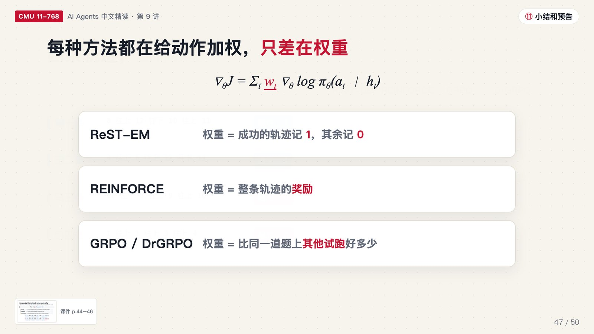

原课件 p.44：**今天讲的每种方法，都是给 agent 自己做过的动作加权。它们（主要）只差在权重上。**

```
∇̂_θ J = Σ_t w_t ∇_θ log π_θ(a_t | h_t)
```

三种方法用的是同一个式子，都是"权重 × 动作对数概率的梯度"，只是权重的给法不同：

| 方法 | 权重 w_t |
|---|---|
| ReST-EM | 成功的轨迹上记 1，其余记 0（就是在留下的轨迹上做监督微调） |
| REINFORCE | R(τ)，这个动作所在轨迹的奖励 |
| GRPO / DrGRPO | Â_j，相对于同一任务实例上其他试跑的奖励 |

这些方法看起来都像某种自训练，差别只在怎么给生成出来的动作重新加权（课上口头补充）。

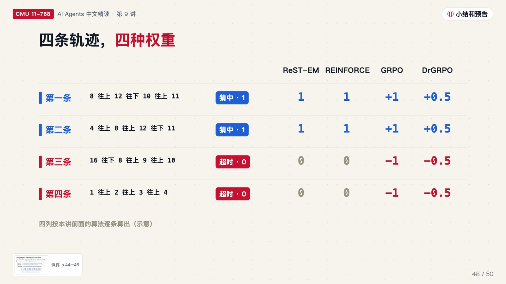

用开头那四条轨迹对一下（原课件没逐条算，课上也没算，是本课件按前面的数对出来的）：

| 轨迹 | 奖励 | ReST-EM | REINFORCE | GRPO | DrGRPO |
|---|---|---|---|---|---|
| τ1 | 1 | 1 | 1 | +1 | +0.5 |
| τ2 | 1 | 1 | 1 | +1 | +0.5 |
| τ3 | 0 | 0 | 0 | −1 | −0.5 |
| τ4 | 0 | 0 | 0 | −1 | −0.5 |

前两种对失败轨迹没有任何动作，后两种会把失败轨迹里的动作往下压。

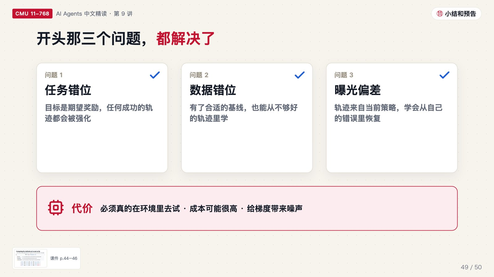

原课件 p.45：**从策略里采样轨迹、按奖励给它们加权，解决了一开始那三个问题。**

| 问题 | 怎么解决的 |
|---|---|
| 任务错位 | 目标是期望奖励，所以任何成功的轨迹都会被强化 |
| 数据错位 | agent 也能按奖励，从不够好的轨迹里学（前提是基线用得合适，奖励为 0 的轨迹才能学到东西） |
| 曝光偏差 | 轨迹来自当前策略，所以 agent 在训练中就学会从自己的错误里恢复：训练时就是模型自己在开车 |

代价是必须真的在环境里去试，成本可能很高，也会给梯度带来噪声（课上口头补充）。

逐节回顾：

- **猜数字**：1 到 16、四次机会、藏着 11；四条轨迹两条成功、两条超时，全讲都在它们身上算。
- **监督微调的三个局限**：只优化"像示范"（任务错位），用不上别的轨迹（数据错位），训练时没见过自己的错（曝光偏差）。
- **生成、打分、更新**：让 agent 自己跑、用奖励改参数；在线策略。
- **轨迹和目标**：轨迹的概率 = 策略部分 × 环境部分；环境不用知道，只要能采样；目标是期望奖励 `J(θ)`，例子里是 0.30 + 0.20 = 0.50。
- **专家迭代**：自己生成、只留成功的、再做监督微调。ReST 累积数据集；ReST-EM 每轮从基座模型重新微调、只用这一轮的数据。
- **策略梯度**：采样和环境都不可微；用对数导数技巧得到 `∇J = E[R(τ) ∇ log p_θ(τ)]`；环境项求导时消掉，一个动作的对数概率是它的 token 对数概率之和；实现就是在监督微调损失上加掩码、乘奖励；二值奖励下就是 ReST。
- **基线和优势**：奖励要和平时比；只依赖历史的基线不改变期望梯度；双臂老虎机里 0.75 / 0 变成 0.375 / 0.125，期望都是 0.1875，标准差 0.325 降到 0.108；同一条轨迹里所有动作的优势一样，这是没解决的信用分配问题；有中间奖励时用往后的奖励之和。
- **GRPO 和 DrGRPO**：同一道题采样一组（课上说一般 8 左右，DeepSeekMath 原文 64），组内平均当基线，不用另训价值模型；GRPO 还除以组内标准差，并按各自长度平均；DrGRPO 两处都去掉，只减平均、除以常数。一组奖励全相同时没有梯度。
- **"GRPO 无偏"只对只减均值成立**：按 DrGRPO 原文，除以标准差、除以长度都是偏差来源。
- **源码**：TRL 的 `scale_rewards` 控制除不除标准差（默认除，且用样本标准差），`loss_type` 控制汇总（`"grpo"` 按各自长度、`"dr_grpo"` 除以 `max_completion_length`，默认是 `"dapo"`）；复现 DrGRPO 要两个都改。

## 关键术语

| 中文 | 英文 | 一句话解释 |
|---|---|---|
| 强化学习 | Reinforcement Learning（RL） | 让 agent 自己生成、按奖励打分、再更新参数，使期望奖励最大 |
| 监督微调 | Supervised Fine-Tuning（SFT） | 在示范上用交叉熵训练，让示范动作的概率最大 |
| 任务错位 | task mismatch | 监督微调优化"像示范"，我们要的是"做成任务" |
| 数据错位 | data mismatch | 监督微调只能用示范，用不上不够好的轨迹 |
| 曝光偏差 | exposure bias | 训练时只见过示范的历史，生成时遇到自己的错不会应付 |
| 在线策略 | on-policy | 训练数据由模型当前的策略自己生成 |
| 离策略 | off-policy | 训练数据不完全来自当前策略；强化学习下一讲展开 |
| 策略 | policy（π_θ） | 给定历史，给出下一个动作的概率分布 |
| 观察 | observation | 环境返回给 agent 的信息 |
| 动作 | action | agent 发出的东西；可能由好几个 token 组成 |
| 奖励 | reward | 一个数，说明这条轨迹有多好或多坏 |
| 可验证奖励的强化学习 | RL with verifiable rewards（RLVR） | 奖励由可检查的结果（测试、答案）给出，通常 0 或 1 |
| 基于人类反馈的强化学习 | RLHF | 奖励来自根据人类偏好训出的评判模型 |
| 历史 | history（h_t） | 到第 t 步为止的所有观察和动作 |
| 状态 | state | 环境的全部情况，策略看不到 |
| 部分可观测马尔可夫决策过程 | POMDP | 状态看不到、只能看观察的决策过程 |
| 轨迹 | trajectory（τ） | 观察、动作、奖励交替排下去的一整条记录 |
| 期望奖励 | expected reward（J(θ)） | 按策略反复跑，平均能拿到的奖励 |
| 专家迭代 | expert iteration | 自己生成、只留成功的、再做监督微调，循环下去 |
| 强化自训练 | Reinforced Self-Training（ReST） | 专家迭代的一种：生长、改进、重复，数据集累积 |
| ReST-EM | ReST with Expectation–Maximization | 二值奖励筛选 + 监督微调，每轮从基座模型重新微调 |
| 期望最大化 | expectation maximization（EM） | 在期望步和最大化步之间交替的经典算法 |
| 自训练 | self-training | 在模型自己产生的全部数据上训练，不按奖励筛选 |
| 自蒸馏 | self-distillation | 课上说也可以指在模型产生的全部轨迹上训练 |
| 策略梯度 | policy gradient | 期望奖励对策略参数的梯度，`E[R ∇ log p]` |
| REINFORCE | REINFORCE（Williams, 1992） | 最经典的策略梯度方法：奖励乘对数概率梯度 |
| 对数导数技巧 | log-derivative trick / score function | `∇p = p ∇ log p`；课上叫 score ratio trick |
| 损失掩码 | loss mask（m_t） | 每个 token 一位，策略采样的记 1，提示和观察记 0 |
| 基线 | baseline（b） | 对"平时能拿多少"的估计，从奖励里减掉 |
| 优势 | advantage（A） | 这个动作比策略平时的水平好多少：Q − V |
| 价值 | value（V^π） | 从某个历史出发，照策略走平均能拿多少 |
| 动作价值 | action value（Q^π） | 先做某个动作、再照策略走，平均能拿多少 |
| 偏差 | bias | 估计的平均值离真实值有多远 |
| 方差 | variance | 每次估计的值散得多开 |
| 双臂老虎机 | two-armed bandit | 只有一次决策、两个动作的最简单强化学习问题 |
| sigmoid | sigmoid（σ） | 把任意实数压到 0 到 1 之间的函数 |
| 信用分配 | credit assignment | 只看最终奖励，分不出是哪一步做对了 |
| 往后的奖励之和 | reward-to-go | 一个动作只按它之后拿到的奖励来加权 |
| 价值模型 | value model / critic | 另训的一个模型，用来预测基线 |
| actor–critic | actor–critic | 策略（actor）加价值模型（critic）的一类方法 |
| PPO | Proximal Policy Optimization | 用价值模型估基线、带比值截断的策略梯度方法 |
| GRPO | Group Relative Policy Optimization | 同一道题采样一组，用组内平均当基线、再除以组内标准差 |
| DrGRPO | Dr. GRPO（GRPO Done Right） | GRPO 去掉除以组内标准差和按各自长度平均两处 |
| 组大小 | group size（G） | 同一道题采样几条；TRL 的 `num_generations` |
| 截断 | clipping | 不让新旧策略的概率比离 1 太远 |
| 参考模型 / KL 项 | reference model / KL term | 不让策略离一开始的策略太远的正则 |
| 奖励塑形 | reward shaping | 给中间的正确决定也发奖励 |
| 课程学习 | curriculum learning | 先训能拿到奖励的简单题，再上难题 |
| 冷启动 | cold start | 强化学习开始前先用示范做监督微调 |

## 思考题

<details>
<summary>1. 6.1 说采样和环境都不可微。策略梯度是怎么绕开这两处的？它对环境做了什么假设？</summary>

策略梯度不对"采到哪个动作"求导，而是对"采到这个动作的概率"求导：6.2 第 ② 步把梯度移到概率上，第 ④ 步换成对数概率的梯度，第 ⑤ 步写回期望，就能用采样估计。环境那一项在 6.4 取对数后变成和参数无关的常数，求导时消掉，所以既不需要环境可微，也不需要知道环境的概率，只需要能在环境里跑、拿到奖励（4.4 的"不知道 P，但能采样"）。整个推导对语言模型和环境没做任何假设。
</details>

<details>
<summary>2. 6.7 说二值奖励下 REINFORCE 的损失就是 ReST 的损失。那两者还有什么区别？ReST-EM 又在哪里不同？</summary>

损失的形式一样，区别在节奏和数据：REINFORCE 完全在线，采一批轨迹就马上更新，用完就换；ReST 先攒一大批，把留下的轨迹并进已有的数据集，再训一轮甚至几轮，数据集越滚越大。ReST-EM 也是生成、二值奖励筛选、监督微调，但每一轮都从基座模型重新微调，只用这一轮生成的数据，不累积（5.1）。所以"累积数据集"只能说 ReST，不能说 ReST-EM。
</details>

<details>
<summary>3. 7.4 说只依赖历史的基线不改变期望梯度。如果基线依赖了这一步采到的动作，会出什么事？举一个极端的例子。</summary>

推导里"把 b 提到对动作的求和外面"那一步就不成立了，`E[b ∇ log π]` 不再一定是 0，估计就有偏。极端例子：直接让基线等于这次拿到的奖励，b = R(τ)。那么 R − b 永远是 0，梯度永远是 0，模型什么都学不到，而真实梯度（老虎机里是 0.1875）不是 0。所以基线可以看历史、看题目，不能看这一步选了什么、拿了多少。
</details>

<details>
<summary>4. 双臂老虎机里，基线取多少时单次梯度估计的方差最小？最小是多少？（课上没讲，本课件补充的计算）</summary>

采到 A 的估计是 (1 − b) × 0.75，采到 B 的是 (0 − b) × (−0.25) = 0.25b。两点分布的方差是 `p(1 − p) × (两个值之差)² = 0.1875 × (0.75 − b)²`。所以 b = 0.75 时方差是 0：两个动作给的估计都是 0.1875，每次采样都正好等于真实梯度。练习第 1 部分里 b = 0.5 和 b = 1.0 的标准差都是 0.108，正好关于 0.75 对称。注意 0.75 不是期望奖励（期望奖励是 0.25）：方差最小的基线不一定等于期望奖励，"用期望奖励当基线"是一个好用、但不一定最优的选择。
</details>

<details>
<summary>5. 一组 8 条轨迹里只有 1 条成功。按总体标准差，GRPO 给成功那条和失败那些的优势各是多少？DrGRPO 呢？和 8.2 里"一组 4 条只有 1 条成功"比，说明了 8.3 的哪个问题？</summary>

平均 0.125，总体标准差 `√(0.125 × 0.875) ≈ 0.331`。GRPO：成功那条 (1 − 0.125) / 0.331 ≈ +2.65，失败的 (0 − 0.125) / 0.331 ≈ −0.38。DrGRPO：+0.875 和 −0.125。一组 4 条只有 1 条成功时，GRPO 是 +1.73 / −0.58，DrGRPO 是 +0.75 / −0.25。成功越罕见（题对当前策略越难），组内标准差越小，GRPO 给成功那条的放大就越厉害；DrGRPO 的优势始终在 −1 到 1 之间。这就是 8.3 第一处说的：几乎总做不对的题，σ_R 很小，分量被放大，优势也不再知道这道题有多难。
</details>

<details>
<summary>6. GRPO 的组内平均 R̄ 里也包含这条轨迹自己的奖励 R_j，所以严格说基线依赖了这条轨迹自己的动作。这会让只减均值的写法产生偏差吗？（课上没讲，本课件补充的推导）</summary>

把 Â_j 拆开：`R_j − R̄ = (1 − 1/G) R_j − (1/G) Σ_{k≠j} R_k`。同一组的 G 条轨迹是独立采样的，所以 `E[R_k ∇ log p(τ_j)] = E[R_k] × E[∇ log p(τ_j)] = 0`（k ≠ j，后一个期望和 7.4 一样是 0）。剩下 `(1 − 1/G) E[R_j ∇ log p(τ_j)] = (1 − 1/G) ∇J`。期望梯度方向不变，只是整体乘了一个固定的系数 (1 − 1/G)，比如 G = 8 时是 0.875；这个系数可以并进学习率。所以只减均值的写法方向上没偏；而除以标准差会给每道题乘一个**不同的**系数（8.3、Q4），那才会改变各道题之间的相对权重。
</details>

<details>
<summary>7. 你的一批题里有一半的组奖励全是 0。这一半对梯度贡献多少？列出至少三种改法，并说说各自的代价。</summary>

贡献为 0（8.5）：组内没有差别，减掉平均全是 0，这一半的采样算力白花了。改法：换一批当前策略做得出来的题，或者用课程学习先上简单题（代价：要有难度分级的题库）；在提示里注入知识、引导模型更可能做对（代价：训练时的提示和部署时不一样）；加示范，先在正确示范上微调再做强化学习，或用离策略方法把正确示范放进组里（代价：要有示范，又回到了监督微调的那些局限）；奖励塑形，比如找到正确的文件就给分（代价：中间奖励设计得不好，模型可能只学会拿中间分）。
</details>

<details>
<summary>8. 用 TRL 的 GRPOTrainer、全部默认参数训练，得到的是 GRPO 原文、DrGRPO，还是别的？要完整复现本讲的 DrGRPO，要改哪几个参数？</summary>

都不是。默认 `scale_rewards="group"`，优势除以组内（样本）标准差，这一点和 GRPO 原文一样；默认 `loss_type="dapo"`，按整个累积批里有效 token 的总数汇总，既不是 GRPO 的"按各自长度平均"，也不是 DrGRPO 的"除以常数"；默认 `beta=0.0`，也没有 GRPO 论文里的 KL 项。要复现 DrGRPO 的两处改动，设 `scale_rewards="none"` 和 `loss_type="dr_grpo"`，常数 C 就是 `max_completion_length`（10.5、10.6）。
</details>

<details>
<summary>9. 第 8 讲说监督微调"接着录像走"、DAgger 讨论的是分布偏移。这一讲的哪个性质对上了这个问题？代价是什么？</summary>

在线策略（2.4、3）：强化学习的训练轨迹是当前策略自己跑出来的，模型在训练中就会走到自己犯错后的状态，并按奖励学会从那里恢复，这正好对上曝光偏差。代价是必须真的在环境里去试：每轮都要重新采样、重新跑环境，算力和时间都高，梯度也更吵（小结）。强化学习的下一讲会讲放宽在线策略、更偏离策略的方法，来换效率。
</details>

## 动手练习

### 练习：双臂老虎机的方差、组内优势和长度偏差

20–30 分钟，只依赖 Python 3.10+ 标准库，不调用任何模型。把 7.5–7.8 的老虎机、8.1–8.3 的组内优势、10.2 的 TRL 写法自己算一遍，再真的拿老虎机训练一次。

```python
"""第 9 讲练习：双臂老虎机的策略梯度、基线和组内优势（只用 Python 标准库）。"""
import math
import random
import statistics

# ---------- 第 1 部分：双臂老虎机，精确算梯度 ----------
def sigmoid(x):
    return 1 / (1 + math.exp(-x))

def grad_log_pi(theta, action):
    """d/dθ log π_θ(action)。π(A) = σ(θ)，π(B) = 1 − σ(θ)。"""
    p = sigmoid(theta)
    return 1 - p if action == "A" else -p

REWARD = {"A": 1.0, "B": 0.0}

def single_estimate(theta, action, baseline):
    """一次采样给出的梯度估计 ĝ = (R − b) · ∇θ log π(a)。"""
    return (REWARD[action] - baseline) * grad_log_pi(theta, action) + 0.0  # +0.0 去掉 −0.0

def exact_stats(theta, baseline):
    p = sigmoid(theta)
    probs = {"A": p, "B": 1 - p}
    vals = {a: single_estimate(theta, a, baseline) for a in probs}
    mean = sum(probs[a] * vals[a] for a in probs)
    var = sum(probs[a] * (vals[a] - mean) ** 2 for a in probs)
    return vals, mean, math.sqrt(var)

THETA = math.log(0.25 / 0.75)   # 让 σ(θ) 正好等于 0.25（原课件写 θ = −1.1，σ(−1.1) ≈ 0.2497）
print(f"θ = {THETA:.4f}，σ(θ) = {sigmoid(THETA):.4f}；σ(−1.1) = {sigmoid(-1.1):.4f}")
for b in (0.0, 0.5, 0.25, 1.0):
    vals, mean, sd = exact_stats(THETA, b)
    print(f"基线 {b:<4}: 采到 A → {vals['A']:+.4f}，采到 B → {vals['B']:+.4f}，"
          f"期望 {mean:.4f}，标准差 {sd:.4f}")

# ---------- 第 2 部分：反复采样，看滑动平均 ----------
rng = random.Random(0)
draws = ["A" if rng.random() < 0.25 else "B" for _ in range(2000)]
for b in (0.0, 0.5):
    est = [single_estimate(THETA, a, b) for a in draws]
    print(f"基线 {b}: 2000 次采样平均 {statistics.fmean(est):.4f}，"
          f"标准差 {statistics.pstdev(est):.4f}")

# ---------- 第 3 部分：组内优势 ----------
def grpo_adv(rewards, std="population", eps=0.0):
    mean = statistics.fmean(rewards)
    if std == "none":
        return [r - mean for r in rewards]
    sd = statistics.pstdev(rewards) if std == "population" else statistics.stdev(rewards)
    if sd + eps == 0:
        return [0.0 for _ in rewards]
    return [(r - mean) / (sd + eps) for r in rewards]

groups = {"藏着 11": [1, 1, 0, 0], "藏着 3": [1, 0, 0, 0], "藏着 7": [1, 1, 1, 0],
          "全失败": [0, 0, 0, 0], "全成功": [1, 1, 1, 1]}
fmt = lambda xs: "[" + ", ".join(f"{x:+.2f}" for x in xs) + "]"
for name, rs in groups.items():
    print(f"{name:<6} 奖励 {rs}  "
          f"GRPO(总体标准差) {fmt(grpo_adv(rs))}  "
          f"TRL 写法(样本标准差+1e-4) {fmt(grpo_adv(rs, 'sample', 1e-4))}  "
          f"DrGRPO {fmt(grpo_adv(rs, 'none'))}")

# ---------- 第 4 部分：长度偏差 ----------
# 两个答错的回答（优势同为 −0.5，示意），一个 10 个 token，一个 100 个 token；生成长度上限 512（TRL 默认）
adv, lengths, C = -0.5, (10, 100), 512
for L in lengths:
    print(f"长 {L:>3} 个 token：GRPO 每个 token 的系数 {adv / L:+.4f}，"
          f"DrGRPO 每个 token 的系数 {adv / C:+.5f}，整条回答合计 GRPO {adv:+.2f} / DrGRPO {adv * L / C:+.4f}")

# ---------- 第 5 部分：真的拿它训练 ----------
def train(baseline, steps=30, lr=0.5, seed=0):
    rng = random.Random(seed)
    theta = THETA
    for _ in range(steps):
        a = "A" if rng.random() < sigmoid(theta) else "B"
        theta += lr * single_estimate(theta, a, baseline)   # 梯度上升：让期望奖励变大
    return sigmoid(theta)

for b in (0.0, 0.5):
    ps = [train(b, seed=s) for s in range(200)]
    print(f"基线 {b}: 训练 30 步后猜 A 的概率，200 次重复的平均 {statistics.fmean(ps):.3f}，"
          f"最低 {min(ps):.3f}，最高 {max(ps):.3f}")
```

照原样运行（Python 3.12 实测），输出是：

```
θ = -1.0986，σ(θ) = 0.2500；σ(−1.1) = 0.2497
基线 0.0 : 采到 A → +0.7500，采到 B → +0.0000，期望 0.1875，标准差 0.3248
基线 0.5 : 采到 A → +0.3750，采到 B → +0.1250，期望 0.1875，标准差 0.1083
基线 0.25: 采到 A → +0.5625，采到 B → +0.0625，期望 0.1875，标准差 0.2165
基线 1.0 : 采到 A → +0.0000，采到 B → +0.2500，期望 0.1875，标准差 0.1083
基线 0.0: 2000 次采样平均 0.1826，标准差 0.3219
基线 0.5: 2000 次采样平均 0.1859，标准差 0.1073
藏着 11  奖励 [1, 1, 0, 0]  GRPO(总体标准差) [+1.00, +1.00, -1.00, -1.00]  TRL 写法(样本标准差+1e-4) [+0.87, +0.87, -0.87, -0.87]  DrGRPO [+0.50, +0.50, -0.50, -0.50]
藏着 3   奖励 [1, 0, 0, 0]  GRPO(总体标准差) [+1.73, -0.58, -0.58, -0.58]  TRL 写法(样本标准差+1e-4) [+1.50, -0.50, -0.50, -0.50]  DrGRPO [+0.75, -0.25, -0.25, -0.25]
藏着 7   奖励 [1, 1, 1, 0]  GRPO(总体标准差) [+0.58, +0.58, +0.58, -1.73]  TRL 写法(样本标准差+1e-4) [+0.50, +0.50, +0.50, -1.50]  DrGRPO [+0.25, +0.25, +0.25, -0.75]
全失败    奖励 [0, 0, 0, 0]  GRPO(总体标准差) [+0.00, +0.00, +0.00, +0.00]  TRL 写法(样本标准差+1e-4) [+0.00, +0.00, +0.00, +0.00]  DrGRPO [+0.00, +0.00, +0.00, +0.00]
全成功    奖励 [1, 1, 1, 1]  GRPO(总体标准差) [+0.00, +0.00, +0.00, +0.00]  TRL 写法(样本标准差+1e-4) [+0.00, +0.00, +0.00, +0.00]  DrGRPO [+0.00, +0.00, +0.00, +0.00]
长  10 个 token：GRPO 每个 token 的系数 -0.0500，DrGRPO 每个 token 的系数 -0.00098，整条回答合计 GRPO -0.50 / DrGRPO -0.0098
长 100 个 token：GRPO 每个 token 的系数 -0.0050，DrGRPO 每个 token 的系数 -0.00098，整条回答合计 GRPO -0.50 / DrGRPO -0.0977
基线 0.0: 训练 30 步后猜 A 的概率，200 次重复的平均 0.858，最低 0.327，最高 0.913
基线 0.5: 训练 30 步后猜 A 的概率，200 次重复的平均 0.868，最低 0.823，最高 0.920
```

对一下正文：

- 第 1 部分的前两行就是原课件 p.30–p.33 的数：不加基线 0.75 / 0、加基线 0.375 / 0.125，期望都是 0.1875，标准差 0.325 和 0.108（四舍五入）。
- 第 3 部分"GRPO(总体标准差)"那一列就是原课件 p.37、p.38 的表；"TRL 写法"那一列是 10.2 说的样本标准差版本。
- 第 4 部分就是 8.3 节那张长度偏差的示意表。
- 第 5 部分的学习率 0.5、30 步、200 次重复都是练习自己定的（示意），不是课件里的数。

做完回答：

1. 第 1 部分里，b = 0.5 和 b = 1.0 的标准差一样。再试 b = 0.75，标准差是多少？为什么（对照思考题 4）？
2. 第 2 部分把 2000 改成 20，换几个随机种子，看看两条估计离 0.1875 有多远。哪条更常离得远？这对应原课件 p.33 的哪句话？
3. 第 5 部分里两种设置的平均差不多，但"最低"差很多（0.327 对 0.823）。这说明基线主要改善了什么？把 `steps` 改成 100 再看。
4. 给 `grpo_adv` 加一个 `leave_one_out` 选项：每条轨迹的基线用"组里除了它自己以外"的平均。对 `[1, 0, 0, 0]` 算一次，和只减均值的结果比，差了什么系数？（对照思考题 6。）
5. 把第 3 部分改成 G = 8、只有 1 条成功，验证思考题 5 的数。
6. 把第 4 部分扩成一个小实验：一组 4 个回答，奖励 `[1, 0, 0, 0]`，长度分别是 `[20, 20, 200, 20]`。分别按 `"grpo"`（每条回答先除以自己的长度）和 `"dr_grpo"`（全部除以 4 × 512）算每条回答对总损失的贡献，看那个 200 个 token 的错误回答在两种写法下各挨了多少罚。

> 这个练习不调用任何模型，也不执行模型生成的命令。如果你把它换成真模型、真环境（比如让模型写代码再跑测试来给奖励），模型生成的代码和命令只在容器或沙箱里运行；不要在自己的日常电脑、装着真实凭证的环境里执行。

## 延伸阅读

链接取自课程主页第 9 讲的必读和参考。

必读：

- Gulcehre et al.，ReST（Reinforced Self-Training，2023）：[arXiv:2308.08998](https://arxiv.org/abs/2308.08998)。图 1 的生长、改进两步；改进步可以随轮次提高筛选阈值。
- Singh et al.，ReST-EM（2023）：[arXiv:2312.06585](https://arxiv.org/abs/2312.06585)。期望步和最大化步；按奖励加权的负对数似然；每轮从基座模型重新微调。
- Shao et al.，DeepSeekMath（2024）：[arXiv:2402.03300](https://arxiv.org/abs/2402.03300)。§4.1 GRPO，§4.1.2 结果监督下的组内优势，式 3 完整目标（比值、截断、KL），图 4 PPO 和 GRPO 的对比，§4.2 每题采样 64 条。
- Liu et al.，Dr. GRPO（Understanding R1-Zero-Like Training，2025）：[arXiv:2503.20783](https://arxiv.org/abs/2503.20783)。图 1 两处改动，§3.1 两种偏差，§3.2 改成常数后的无偏写法。

参考：

- Sean Welleck，RL Fundamentals（CMU ANLP 2026 春季课件）：[PDF](https://cmu-l3.github.io/anlp-spring2026/static_files/anlp-s2026-16-rl.pdf)。原课件 p.7 注明改编自它。
- Williams，REINFORCE（Machine Learning, 1992）：[doi:10.1007/BF00992696](https://doi.org/10.1007/BF00992696)。

源码和文档：

- TRL：[GRPO Trainer 文档](https://huggingface.co/docs/trl/en/grpo_trainer)；源码 [grpo_trainer.py](https://github.com/huggingface/trl/blob/c734c60d85766aff4542a00643a2ca7e4a3c72ac/trl/trainer/grpo_trainer.py)、[grpo_config.py](https://github.com/huggingface/trl/blob/c734c60d85766aff4542a00643a2ca7e4a3c72ac/trl/trainer/grpo_config.py)、[utils.py](https://github.com/huggingface/trl/blob/c734c60d85766aff4542a00643a2ca7e4a3c72ac/trl/trainer/utils.py)。

本系列相关的几讲：

- 第 8 讲：agent 的监督微调（冷启动、专家迭代、只在助手 token 上算损失的掩码）。
- 第 11 讲：进阶强化学习算法（离策略数据、重要性加权、比值和截断）。
- 第 12 讲：强化学习系统（框架、超参数、组大小怎么选）。

## 下一讲预告：深度研究 agent


这一讲讲的是 agent 强化学习的基础：从监督微调的三个局限出发，把交互写成轨迹、把目标换成期望奖励；最简单的专家迭代只在成功轨迹上做监督微调；策略梯度把它推成"给模型自己生成的 token 加掩码、乘奖励"；基线和优势让失败也能带来信号、让梯度更稳；GRPO 用同一道题的多次采样当基线，DrGRPO 再去掉两处除法。

下一讲是第 10 讲：深度研究 agent（Domains 3: Deep Research Agents），是 agent 的又一个应用领域，和前面几个领域互相补充。强化学习的下一讲是第 11 讲：进阶强化学习算法。原课件最后一页写着"接下来：异步强化学习、离策略数据、重要性加权"（课上没展开），也就是这一讲刻意略掉的比值、截断、参考模型那几项。

留一个问题：猜数字的奖励很好定，猜中记 1；写代码的奖励也还好定，测试全过记 1。如果 agent 的任务是上网查资料、写一份带引用的调研报告，"猜中"换成什么？这一讲的方法还能直接用吗？
