# 第 10 讲 · 深度研究 agent：任务、基准和方法

> CMU 11-768 AI Agents（2026 秋）中文精读 · 配套课件
> 配套视频（30 分钟）：B 站 / 视频号 / 抖音 / 小红书搜索「竹二木SI」 · 整份幻灯片：[l10-幻灯片.pdf](./l10-幻灯片.pdf)
> 原课程：[cmu-agents.com](https://cmu-agents.com)，课程主讲 Graham Neubig、Daniel Fried，本讲由 Akari Asai 主讲。本课件是非官方的学习整理。

## 这一讲你会学到

学完这一讲，你应该能做到：

1. 说清**深度研究 agent**（deep research agent）和一次性的**检索增强生成**（Retrieval-Augmented Generation，RAG）差在哪：前者反复**计划、搜索、反思、再搜索**，最后把很多份证据综合成一个**带引用**的答案。
2. 用一道 Natural Questions 的题，指出经典问答基准的四个局限，并把它们对上深度研究基准要补的四个维度：**搜索复杂度**、**领域专长**、**答案质量**、**证据支撑**；每一格说出一两个代表基准（BrowseComp / BrowseComp-Plus、FinSearchComp / MedBrowseComp、ScholarQABench / ResearchQA、DeepResearch Bench）。
3. 讲清 BrowseComp 怎么"从答案倒着出题"、为什么答案短反而好判分；读懂"人类 25.3%"到底是什么意思（两小时内解出、且和参考答案一致）；说出 BrowseComp-Plus 为什么要把语料库冻结。
4. 解释为什么相似度指标（ROUGE、BERTScore、BLEURT）评不了长篇回答，会用**细则**（rubric）给一个答案加权打分（课件例子算出 0.67），知道模型生成的细则本身也会出错、要先审。
5. 说出 DeepResearch Bench 的 **FACT** 怎么检查引用：抽论断和网址、读被引页面、判断支不支持。
6. 描述深度研究 agent 的三阶段训练配方：**中训练**（mid-training）、**监督微调**、**强化学习**；会用知识图谱造一道多线索的题；知道短答案题怎么用**可验证奖励的强化学习**（RLVR）加 GRPO 训练，开放式报告为什么要换成细则奖励，DR Tulu 的**演化细则**（evolving rubrics）是怎么在训练中长出来的。
7. 讲清深度研究的检索：本地检索和黑盒接口、嵌入检索的点积打分和对比学习；说出 AgentIR 的两个改动（把当前推理和查询一起交给检索器、用 DR-Synth 给中间搜索造标签）和两组消融的结论。
8. 读懂 OpenAI simple-evals 里 BrowseComp 评测的真实实现：题目怎么加密存放、判分提示怎么写、怎么从判分回复里抽出对错，以及这份代码里一处会让准确率恒为 0 的正则取组问题。

建议先看一遍视频，再对照本课件逐节复习。每节开头的图就是视频里对应的画面。


### 接上一讲

第 9 讲（强化学习基础）片尾说："下一讲是第 10 讲：深度研究 agent，是 agent 的又一个应用领域。"第 9 讲留了一个问题：如果 agent 的任务是上网查资料、写一份带引用的调研报告，"猜中"换成什么？这一讲正面回答它：

| 第 8、9 讲留下的说法 | 这一讲在哪里用上 |
|---|---|
| 第 9 讲 8 节推出的 GRPO：同一道题采一组，比组内平均好就往上推 | 第 10 节：用答案对错当奖励，拿 GRPO 训搜索 agent |
| 第 9 讲 8.2 节说"今天先去掉论文里的比值、截断和 KL 项" | 第 10.2 节：这几项在深度研究的训练目标里加回来了 |
| 第 9 讲 8.5 节"给一个信息量更大的奖励" | 第 11 节：开放式报告没有对错，用细则当奖励 |
| 第 9 讲 5 节 ReST：自己生成、只留成功的、再监督微调 | 第 8.4 节：老师跑、只留成功的，几乎是同一个流程 |
| 第 8 讲 1.5 节：监督微调给强化学习做冷启动 | 第 11.5 节：DR Tulu 的实验，不做监督微调起点只有 27 分 |
| 第 2 讲的工具调用循环 | 第 7 节：深度研究的推理流程就是这个循环，工具换成了搜索和浏览 |

### 这一讲的路线

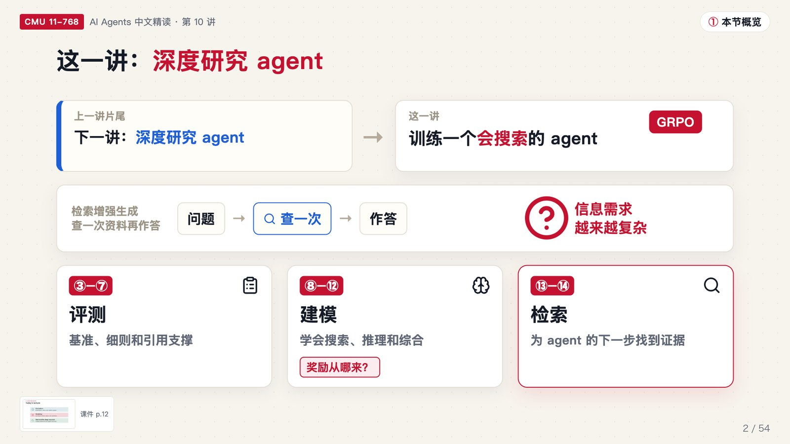

原课件 p.12 把这一讲分成三部分：

| 部分 | 课件上的一句话 | 回答的问题 | 本课件的节 |
|---|---|---|---|
| 评测 | 基准、细则和引用支撑 | 任务长什么样，怎么判断做得好 | 1–6 |
| 建模 | 学会搜索、推理和综合 | 怎么训出一个能做这些任务的 agent | 7–11 |
| 深度研究的检索 | 为 agent 的下一步找到证据 | 搜索系统本身怎么为 agent 做得更好 | 12–13 |

课上口头补充：深度研究 agent 要回答的信息需求越来越复杂，光靠一个简单的检索增强生成流水线已经不够，需要更 agentic 的系统。它带来了很多新的研究问题，从评测、模型训练，到怎么做更好的检索系统。

逐节对照：

| 节 | 回答的问题 |
|---|---|
| 1 什么是深度研究 agent | 一次搜索和反复搜索差在哪 |
| 2 经典问答基准的四个局限 | 为什么老的问答基准不够用 |
| 3 搜索复杂度 | BrowseComp 怎么出难题；BrowseComp-Plus 为什么冻结语料 |
| 4 领域专长 | 金融、医学、论文检索的基准 |
| 5 答案质量 | 长篇回答怎么评：从相似度到专家细则 |
| 6 证据支撑 | 引用怎么检查 |
| 7 推理流程 | 推理时上下文里一步步发生了什么 |
| 8 训练配方和训练数据 | 三阶段配方；题目和老师轨迹从哪来 |
| 9 agentic 中训练 | 继续预训练能给监督微调多好的起点 |
| 10 用答案对错做强化学习 | RLVR、GRPO、异步 rollout |
| 11 DR Tulu 和演化细则 | 开放式报告的奖励从哪来 |
| 12 深度研究的检索 | 本地检索、黑盒接口、嵌入和对比学习 |
| 13 AgentIR | 让检索器看到 agent 的推理 |
| 14 课堂问答 | 小模型和前沿模型的差距、最大的瓶颈、防背答案 |
| 15 源码解读 | simple-evals 的 BrowseComp 评测怎么加密、判分、抽结果 |

两个贯穿全讲的例子：

| 例子 | 用在哪 |
|---|---|
| 研究问题"AI agent 能不能像人类专家一样综合科学文献？" | 第 1 节的计划—搜索—反思循环、第 5 节的细则、第 6 节的引用检查、第 7 节的推理流程 |
| 知识图谱造出来的题"哪位 CMU 研究者……？答案 Allen Newell" | 第 8 节造题、第 10 节 RLVR 和 GRPO、第 12 节嵌入检索 |

---

## 1 什么是深度研究 agent

原课件分隔页：**01 什么是深度研究 agent？**

### 1.1 简单问题：一次搜索就够


原课件 p.3–5：**一个简单的问题，只需要一次搜索。**

例子：查某位教授在学校的办公室门牌号。

| 做法 | 步骤 |
|---|---|
| 直接用搜索引擎 | 搜一次 → 进到这位教授的主页 → 地址一栏写着门牌号 |
| 最简单的检索增强流水线 | 问题 → 调一次检索 → 读检索回来的网页 → 语言模型把门牌号抽出来作答 |

（视频里的教师主页、"示意楼 0000"都是示意画面，不是真实页面。）

课上口头补充：整个过程一次搜索、看一个网页就解决了。这种问题，第 2 讲的单次工具调用就够用。

### 1.2 研究问题：反复计划、搜索、反思

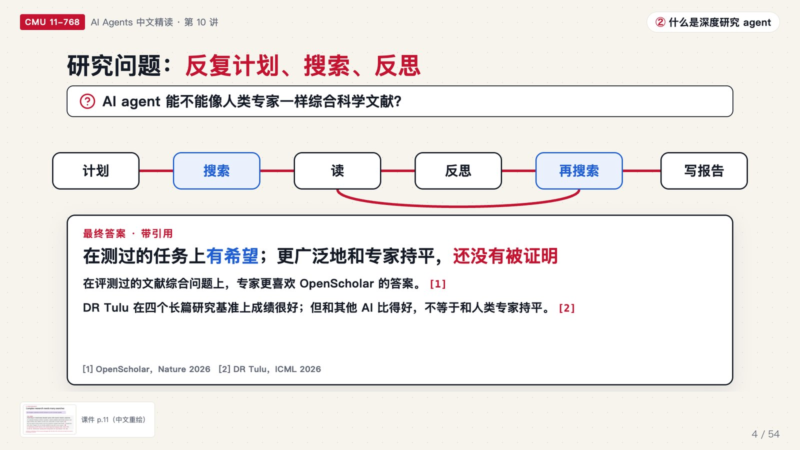

原课件 p.6–11：**复杂的研究需要很多次搜索。**

研究问题：**AI agent 能不能像人类专家一样综合科学文献？**

p.7 上加了一个红色提示：**没有哪一个结果能单独回答这个问题。** 课上口头补充：要回答它，得查很多网站和论文，比如找到 OpenScholar 的论文，收集关于这类评测的信息；难点在于，没有哪一篇文档能完美回答它。

原课件把一轮研究拆成四页：

| 步骤 | 课件上的内容 |
|---|---|
| 计划（p.8） | 我需要把"基准上的好成绩"和"直接与人类专家比较"分开。① 找文献综合方面的研究；② 查专家和 agent 是怎么比较的；③ 下结论之前，比较任务和局限 |
| 搜索（p.9） | 查询：`AI agent literature synthesis human expert evaluation`。结果 A：一个研究基准，报告的是和其他 AI 系统比的答案分数；结果 B：一项专家评测，把 agent 的答案和人写的答案比 |
| 反思 + 再搜索（p.10） | 这两项研究比的东西不一样。基准分数更高，还回答不了关于人类专家的问题。测了哪些任务、哪些领域？再搜：`literature synthesis expert comparison tasks domains evaluation protocol` |
| 最终答案（p.11） | **在测过的任务上有希望；更广泛地和专家持平，还没有被证明。** |

最终答案下面两句，每句挂一个引用：

- 在评测过的文献综合问题上，专家更喜欢 OpenScholar 的答案，胜过专家自己写的；引用准确度和人类专家相当。[1]
- DR Tulu 在四个长篇研究基准上成绩很好。但和其他 AI agent 比，并不能直接说明和人类专家持平。[2]
- [1] OpenScholar（Nature 2026）；[2] DR Tulu（ICML 2026）。

和 1.1 并排看：

| | 简单问题 | 研究问题 |
|---|---|---|
| 搜索次数 | 1 次 | 很多次，每轮按上一轮的结果改写查询 |
| 一篇文档能不能答 | 能 | 不能，要综合好几份证据 |
| 中间有没有判断 | 没有 | 有：计划、反思"这些结果真的回答了问题吗" |
| 答案形式 | 一个短事实 | 有结论、有限定、每句带引用 |

本课件的补充（课上没这么说）：p.11 这个答案本身就是一个好答案该有的样子：有结论，有限定（"在测过的任务上"），每一句都挂着引用。第 5 节的专家细则、第 6 节的引用检查，评的正是这几样东西。

这一节记住一句：深度研究就是反复计划、搜索、反思，再把很多份证据综合成一个带引用的答案。

---

## 2 经典问答基准的四个局限

原课件分隔页：**02 基准和评测。**

### 2.1 一道 Natural Questions 的题

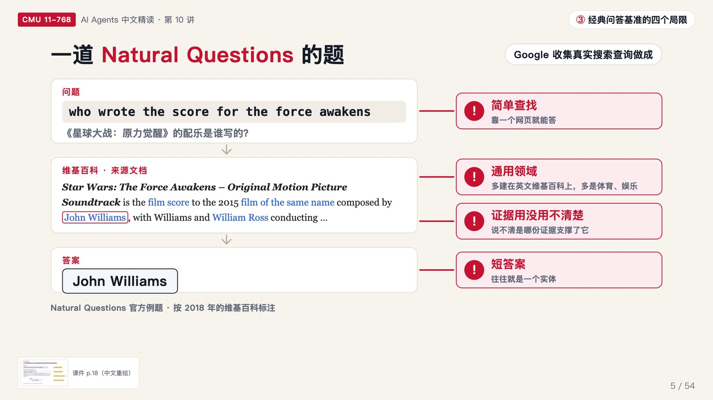

原课件 p.14–18 用 **Natural Questions** 的官方例题（Google 收集真实搜索查询做成的问答基准）：

| | 内容 |
|---|---|
| 问题 | who wrote the score for the force awakens（《星球大战：原力觉醒》的配乐是谁写的？） |
| 来源文档 | 一页维基百科（链接到 2018 年的修订版） |
| 答案 | John Williams |

四页动画依次在题目上贴出四个红色感叹号：

| 贴在哪 | 标签 | 课上的解释（课上口头补充） |
|---|---|---|
| 问题旁 | 简单查找 | 这道题靠一个网页就能回答，很多深度研究的问题不行 |
| 来源文档旁 | 通用领域 | 很多基准建在英文维基百科上，题目基本是体育、娱乐；而深度研究 agent 用在复杂得多的专业领域，或长期的信息需求上 |
| 答案旁 | 短答案 | 答案往往就是一个实体；研究问题要长篇、开放式的回答 |
| 来源文档和答案之间 | 证据用没用不清楚 | 模型能给出答案，但还想知道它为什么这么答、什么证据支撑了它 |

课上口头补充：**问答**（question answering）是自然语言处理里一个历史很长的方向：给一个问题，找外部证据，再回答。但很多现有基准，比起人们现在用 agent 系统做的事，简单得多。

### 2.2 四个维度

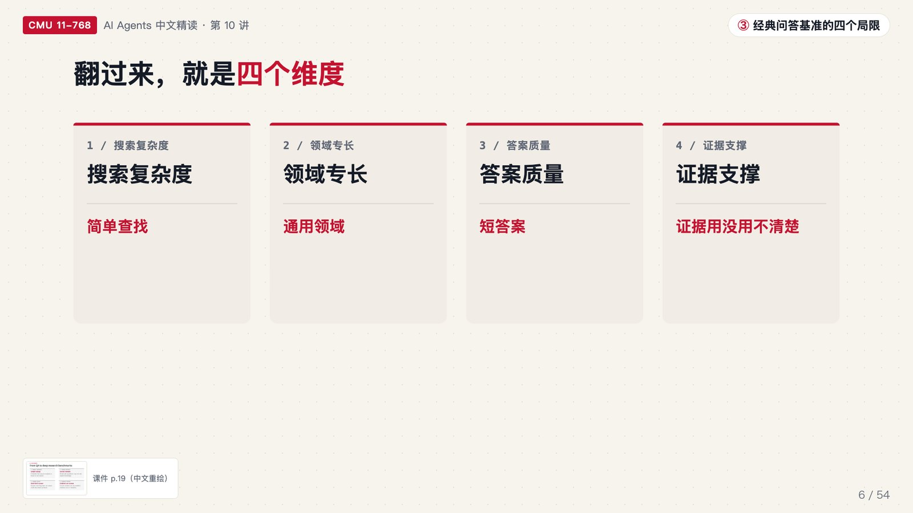

原课件 p.19–20：**从问答基准到深度研究基准。**

| 维度 | 经典问答的状况 | 问题在哪 |
|---|---|---|
| 1 搜索复杂度 | 简单查找 | 熟悉的事实可能靠记忆或一次搜索就找到 |
| 2 领域专长 | 通用领域 | 宽泛的网络问题未必考到专家知识 |
| 3 答案质量 | 短答案 | 答案匹配评不了多文档的综合 |
| 4 证据支撑 | 证据用没用不清楚 | 答对不代表用了证据，也不代表可靠 |

这张四格表是第 3–6 节的目录：每讲完一类基准，就回到这张表把一格换掉（原课件 p.29、p.33、p.45、p.50）。第 6.2 节是填满后的总表。

这一节记住一句：经典问答题太简单、太通用、答案太短，也看不出证据。

---

## 3 搜索复杂度：BrowseComp 和 BrowseComp-Plus

### 3.1 BrowseComp：从答案倒着出题

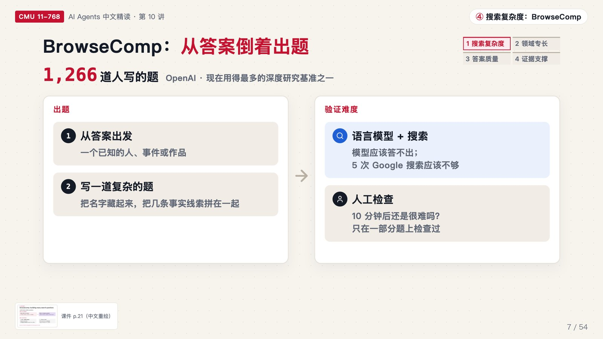

原课件 p.21：**BrowseComp：造出要搜很多次的问题。共 1,266 道人写的题。** 出自 OpenAI（arXiv 2025）。

| 出题 | | 验证难度 | |
|---|---|---|---|
| 1 从答案出发 | 一个已知的人、事件或作品 | 语言模型 + 搜索检查 | 模型应该答不出；5 次 Google 搜索应该不够 |
| 2 写一道复杂的题 | 把名字藏起来，把几条事实线索拼在一起 | 人工检查 | 10 分钟后还是很难吗？只在一部分题上检查过 |

课上口头补充：BrowseComp 是现在用得最多的深度研究基准之一。作者从一个已知答案倒着往回做：先定一个人、一个事件或一件作品当标准答案，收集一组线索，把好几条拼起来组成一道复杂的题；再验证：光提示语言模型、或搜五次 Google 答不出来；一部分题请人确认，十分钟内答不出来。

按 BrowseComp 原文核对：出题时要求 GPT-4o（带不带浏览）、o1 和早期深度研究模型都答不出；做 5 次简单 Google 搜索，答案不在第一页结果里；第二位训练员 10 分钟内答不出，这一条原文说没严格执行，只在一部分题上请人试过，对上课件"只在一部分题上检查过"。

### 3.2 一道由五条线索拼成的题

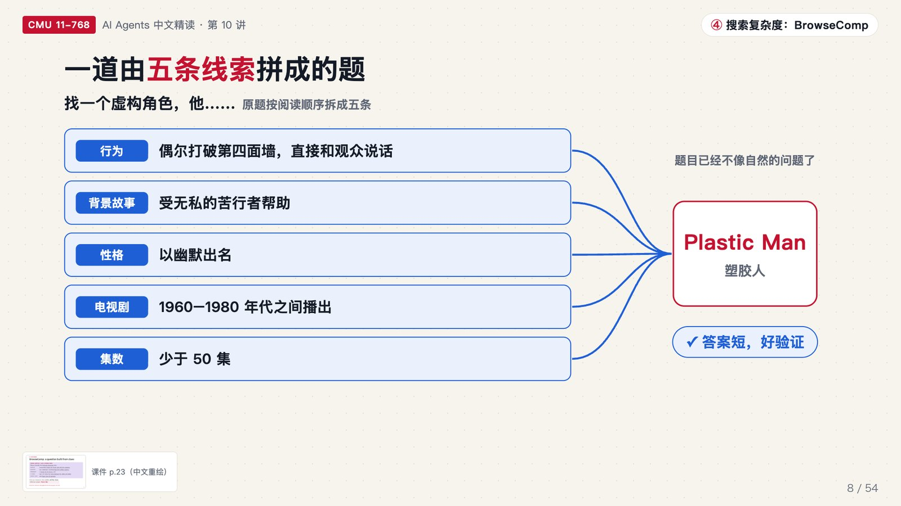

原课件 p.22–23 的原题，线索按阅读顺序排列：

> 请找出这样一个虚构角色：
> - 【行为】偶尔会打破第四面墙，直接和观众说话，
> - 【背景故事】有一段受无私的苦行者帮助的经历，
> - 【性格】以幽默出名，
> - 【电视剧】有一部在 1960 到 1980 年代之间播出的电视节目，
> - 【集数】少于 50 集。

参考答案：**Plastic Man**（塑胶人）。

课上口头补充：这些题看起来已经不像自然的问题了，答案要同时满足五六个条件。但答案本身是短的，所以很容易验证：看模型的回答里有没有这个答案就行。第 15 节会看到，官方评测实现里"验证"是交给一个判分模型做的，判断"抽出来的答案和参考答案有没有实质差别"。

| 设计选择 | 好处 | 代价 |
|---|---|---|
| 多条线索的交集 | 单条线索搜不到，必须拆开搜、交叉核对 | 题目很人工，不像真实用户会问的话（第 14 节 Q2） |
| 答案是一个短实体 | 判分简单，可以当强化学习的奖励（第 10 节） | 评不了综合和写作的质量（第 5 节） |

### 3.3 BrowseComp 的结果

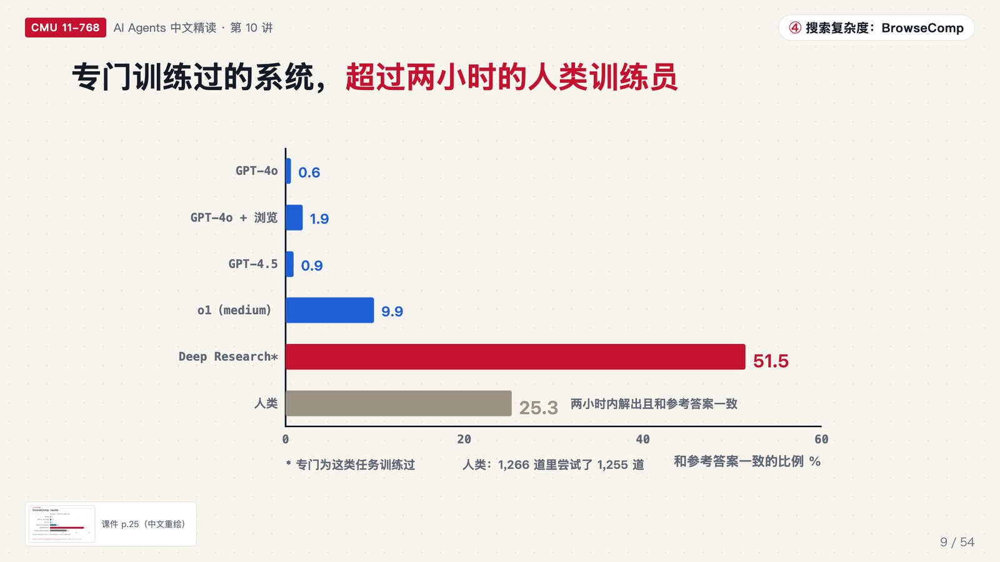

原课件 p.24–25，准确率即"和参考答案一致的比例"（%，课件图上印着的数）：

| 系统 | 准确率（%） |
|---|---|
| GPT-4o | 0.6 |
| GPT-4o + 浏览 | 1.9 |
| GPT-4.5 | 0.9 |
| OpenAI o1（medium） | 9.9 |
| Deep Research* | **51.5** |
| 人类（和参考答案一致） | 25.3 |

- 1,266 道题里人类尝试了 1,255 道，11 道没尝试。
- \* 专门为 BrowseComp 这类任务训练过。

**"人类 25.3%"怎么读。** 按 BrowseComp 原文表 2：训练员每道题最多花两个小时；1,255 道里两小时内解出 367 道（29.2%），其中 86.4% 和参考答案一致；另外 70.8% 两小时后放弃。

```
29.2% × 86.4% ≈ 25.3%        （即 317 / 1,255）
```

所以 25.3% 是"两小时内解出、而且和参考答案一致"的比例，不是"人类专家的正确率只有四分之一"。课上口头说"连人类专家也只有大约 25%"，读的时候要带上"两小时"这个条件。

课上口头补充：当时最好的模型就算能用网页搜索也很吃力；专门为深度研究任务训练一个强模型，能把成绩推到 50% 左右。第二部分会讲怎么训练这样的 agent，做法有点像模仿出这些题的过程（第 8.3 节）。

### 3.4 搜得越多越准

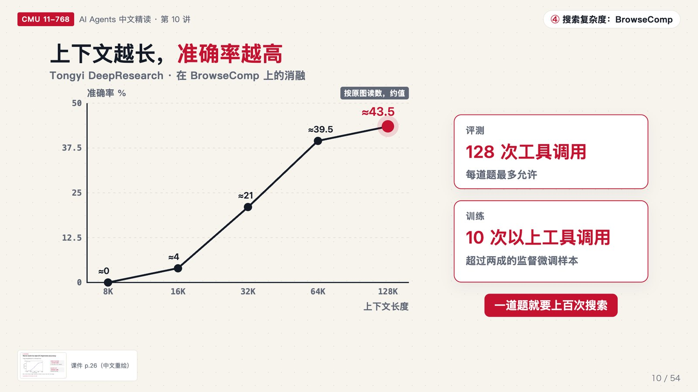

原课件 p.26：**给更多搜索空间，准确率就上去。** 通义 DeepResearch（阿里巴巴通义团队的深度研究 agent）在 BrowseComp 上的消融，出自它的技术报告图 10(a)。

折线上的点课件没标数，下表按原图读数，约值：

| 上下文长度 | 8K | 16K | 32K | 64K | 128K |
|---|---|---|---|---|---|
| 准确率（%，约） | 0 | 4 | 21 | 39.5 | 43.5 |

右边两张卡（课件上印着的）：

- 训练轨迹：超过 20% 的监督微调样本里，工具调用超过 10 次。
- 评测上限：每道题最多 128 次工具调用。

课上口头补充：BrowseComp 原论文没怎么交代这些模型用了多少 token、调了多少次搜索。后续很多工作说明，要做好得增加上下文长度和最大工具调用次数；通义这篇里上下文只给 8K 时成绩几乎是 0，给到 128K 能到四成多。这类基准一道题要上百次搜索，交互非常长。

按技术报告核对：原文是"超过 20% 的监督微调样本超过 32K token、工具调用超过 10 次"，课件只写了后半句。

### 3.5 BrowseComp-Plus：把语料库固定下来

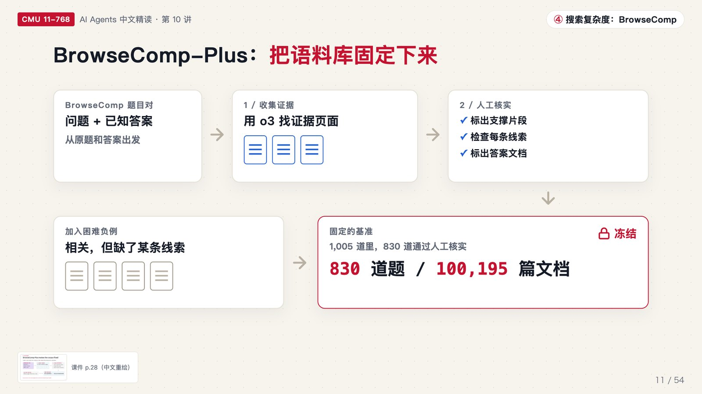

上百次搜索带来两个实际问题（课上口头补充）：

| 问题 | 为什么 |
|---|---|
| 慢、有成本 | 每条轨迹上百次工具调用，每次都走外部网页搜索接口 |
| 不能复现 | 生产环境的搜索结果几乎每天都在变 |

原课件 p.27–28：**先收集、核实证据，再把文档集冻结。** 出自 BrowseComp-Plus（ACL 2026）。

| 步 | 做什么 |
|---|---|
| 0 | BrowseComp 的题目对：问题 + 已知答案 |
| 1 收集证据 | 用 o3 找证据页面（离线输入） |
| 2 人工核实 | 标出支撑的文字片段、检查每一条线索、标出答案所在的文档 |
| 3 加入困难负例 | 相关、但缺了某条线索的页面 |
| 4 固定的基准 | **830 道题 / 100,195 篇文档** |

按 BrowseComp-Plus 原文 §3.3–3.4 核对（课上没展开）：1,005 个题目对里 830 个通过人工核实；去重后语料库 100,195 篇；平均每题 6.1 篇证据文档、76.28 篇负例、2.9 篇答案文档。

课上口头补充：语料库固定了，结果就能复现；还能拿它做检索系统的研究（第 13 节 AgentIR 就在它上面评测）。

| | BrowseComp | BrowseComp-Plus |
|---|---|---|
| 题目 | 1,266 道 | 830 道（通过人工核实的） |
| agent 搜什么 | 真实的网页搜索接口 | 一个固定的、约十万篇的语料库 |
| 能不能复现 | 难，搜索结果每天在变 | 能 |
| 能不能比检索器 | 难，接口是黑盒 | 能，换检索器、语料不变 |

### 3.6 回到四格表


原课件 p.29–30，第 1 格换成：**BrowseComp / BrowseComp-Plus：答案难找；固定语料库，方便受控比较。**

课上口头补充：这两个基准考的仍然是通用知识，题目集中在娱乐、人物这些实体上。本课件按官方测试集的 `problem_topic` 列数了一下（2026-11-03 读取，不解密题目）：1,266 道里"TV shows & movies"205 道最多，其次是"Other"197、"Science & technology"173、"Art"127、"History"125、"Sports"123、"Music"116。

这一节记住一句：BrowseComp 从答案倒着出题，逼 agent 搜上百次；BrowseComp-Plus 把语料冻结，让评测能复现。

---

## 4 领域专长：金融、医学和论文检索

### 4.1 FinSearchComp：专家出题、专家核

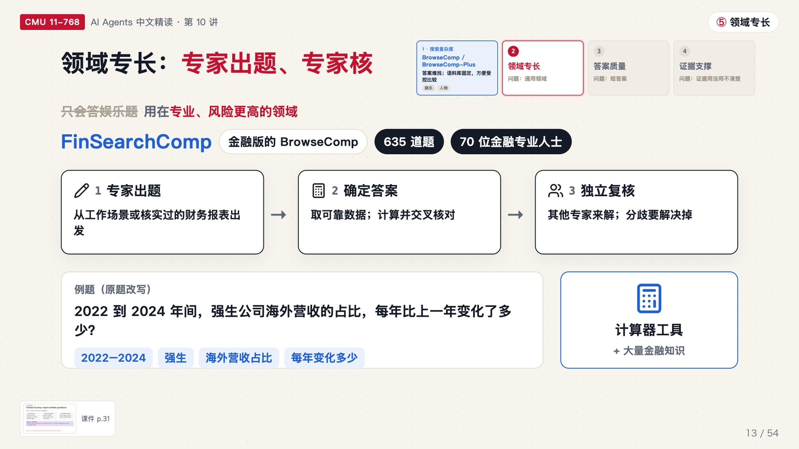

原课件 p.31：**FinSearchComp：专家写的题。重点看"复杂的历史调查"类。** 出自 FinSearchComp（ICLR 2026）。

| 1 专家出题 | 2 确定答案 | 3 独立复核 |
|---|---|---|
| 从工作场景或核实过的财务报表出发 | 取可靠数据；计算并交叉核对 | 其他专家来解；分歧要解决掉 |

例题（意译）：2022 到 2024 年间，强生公司来自海外的营收占比，每年比上一年变化了多少？

课上口头补充：FinSearchComp 基本就是金融领域的 BrowseComp。题目同样复杂，但已经不像 BrowseComp：需要大量金融知识，还得用外部计算器工具算出准确的数。

按原文摘要和 §3 核对（课上没展开）：共 635 道题，请了 70 位金融专业人士；分三类任务：时效数据获取、简单历史查找、复杂历史调查；强生那道是"复杂历史调查"类的例子，原题还要求以百分点给出、保留两位小数。

### 4.2 其他带领域专长的搜索基准


原课件 p.32：**领域知识 + 多步收集证据。**

| 基准 | 领域 | 做什么 |
|---|---|---|
| MedBrowseComp | 医学 | 把临床试验、药物和监管方面的事实串起来 |
| FinSearchComp | 金融 | 在多个金融来源之间调查事实 |
| ScholarSearch | 论文检索 | 学术搜索 |
| AutoResearchBench | 论文检索 | 找一篇论文，或者找出全部符合条件的论文 |

课上口头补充：这些基准的一个共同经验是，要做高质量的专业领域基准，得请专家来标注、核实最终答案。

### 4.3 回到四格表


原课件 p.33–34，第 2 格换成：**MedBrowseComp / FinSearchComp：用专家知识引导医学和金融搜索。**

课上口头补充：到这里，两类基准都还是"复杂、但答案很短"的问答，和今天人们实际用语言模型的方式不太一样。下一格就要处理长篇回答。

这一节记住一句：专业领域的题，得靠专家出、专家核。

---

## 5 答案质量：从相似度到专家细则

### 5.1 正确答案不止一种，相似也可能是错的


原课件 p.35–37：**评准确性、覆盖面、限定条件和证据支撑。** 还是那个研究问题：

| | 答案 | 说明了什么 |
|---|---|---|
| 一份参考摘要 | 在一项研究里专家更喜欢 OpenScholar。各领域都持平**还没被证明**。 | |
| 另一份同样正确的摘要 | 一项研究支持 OpenScholar；它没有证明各领域都等同。 | 正确答案不止一种，参考答案标不全 |
| 相似，但是错的 | 在一项研究里专家更喜欢 OpenScholar。各领域都持平**已经被证明**。 | 和参考答案字面很像，要点却错了 |

**OpenScholar** 是一个用检索来综合科学文献的语言模型系统（Nature 2026）。

课上口头补充：评长篇答案本身就是自然语言处理界的难题。传统做法是标一个或几个**参考答案**（reference answer），再算模型输出和它的相似度。用在开放式生成上有两个问题：可接受的答案太多，标不全；就算标全，相似度也抓不到"只差一个词、意思全反"这种关键错误。

### 5.2 相似度指标几乎在随机猜

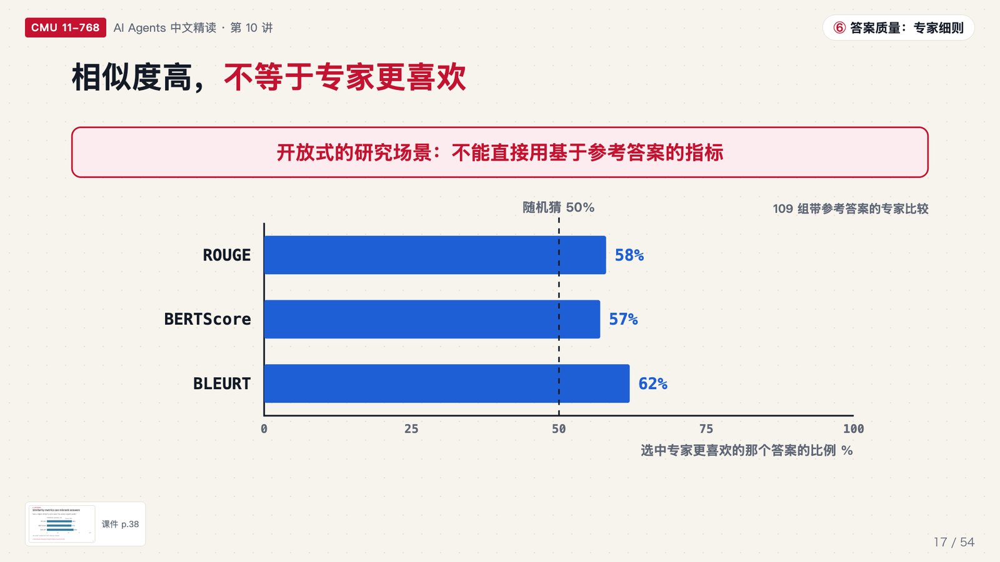

原课件 p.38：**相似度分数更高，选中的是不是专家更喜欢的那个答案？** 出自 A Critical Evaluation of Evaluations for Long-form Question Answering（ACL 2023）。

做法（课上口头补充）：给两个回答，用指标各打一个分，同时请专家挑更喜欢的那个；指标给专家那个打了更高分，就算"选对"。

| 指标 | 偏好准确率（课件图上印着的数） |
|---|---|
| ROUGE | 58% |
| BERTScore | 57% |
| BLEURT | 62% |
| 随机猜 | 50% |

- 109 组带参考答案的专家比较。
- 58% / 57% / 62% 和"109 组"是课件原话；本课件只核到这篇论文摘要的结论（现有自动指标都不能预测人的偏好判断），没核到正文表格。

| 指标 | 怎么算相似（课上没展开） |
|---|---|
| ROUGE | 和参考答案重合的词或词串有多少 |
| BERTScore | 用 BERT 的词向量做逐词软匹配 |
| BLEURT | 在人工打分上训过的学习式指标 |

结论（课上口头补充）：在开放式的深度研究场景里，不能直接用这些**基于参考答案的指标**（reference-based metrics）。

### 5.3 ScholarQABench：用专家细则来评

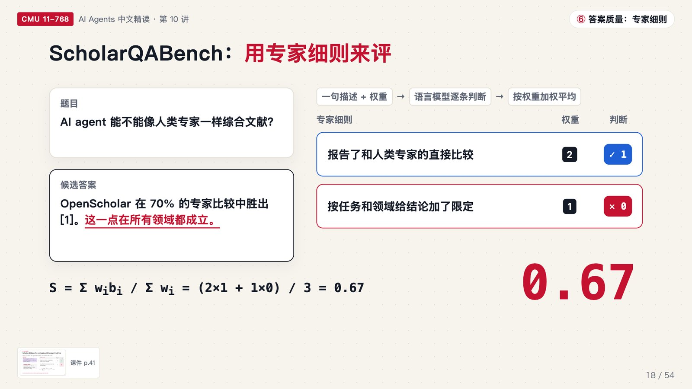

原课件 p.39–41：**拿每条细则去对照答案，再把分数合起来。** 出自 OpenScholar 论文提出的评测 ScholarQABench。

**细则**（rubric）就是一组评分标准：每条是一句具体描述，说明好答案应该包含什么，再带一个**权重**（重要性分数）。评的时候，让语言模型逐条判断这条满足了没有，最后加权平均（课上口头补充）。

| 细则条目 | 权重 w | 候选答案是否满足 b |
|---|---|---|
| 报告了和人类专家的直接比较 | 2 | 1 |
| 按任务和领域给结论加了限定 | 1 | 0 |

候选答案：**OpenScholar 在 70% 的专家比较中胜出 [1]。这一点在所有领域都成立。**

```
S_c = Σ_i w_i b_i / Σ_i w_i = (2 × 1 + 1 × 0) / 3 = 0.67
```

每条细则满足记 1、不满足记 0，用权重加权平均。这个答案报告了直接比较，拿到权重 2 的那条；但它说"所有领域都成立"，没加限定，丢了权重 1 的那条，所以是三分之二。

| | 相似度指标 | 细则 |
|---|---|---|
| 要标什么 | 一个或几个参考答案 | 一组"好答案该有什么"的标准 |
| 换一种说法的正确答案 | 可能被扣分 | 只要满足标准就给分 |
| 只差一个关键词的错误答案 | 可能得高分 | 对应的那条细则判 0 |
| 谁来判 | 公式 | 语言模型逐条判 |

### 5.4 细则判断和专家一致吗

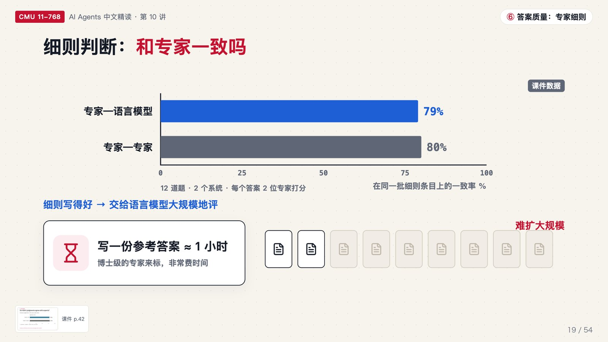

原课件 p.42：**在同一批细则条目上比较判断结果。**

| | 一致率（课件图上印着的数） |
|---|---|
| 专家—语言模型 | 79% |
| 专家—专家 | 80% |

- 12 道题；2 个系统；每个答案 2 位专家打分。
- "专家—专家 80%"是课件原话：在 OpenScholar 的 arXiv v1 里没找到这个数，可能来自 Nature 版。79% 在 v1 里对应"带通用标准时一致率 79.3"。

课上口头补充：细则写得好，语言模型和专家的判断就差不多一致，能用语言模型把细则评测规模化。难点在于好细则从哪来：请博士级的专家来标非常费时间。按 OpenScholar 的 arXiv v1 核对，原文写的"一小时"是**专家写一份参考答案**的平均时间；想把这套办法用到多得多的题上，不管是评测还是训练，都很难扩大规模。

### 5.5 ResearchQA：让模型写细则

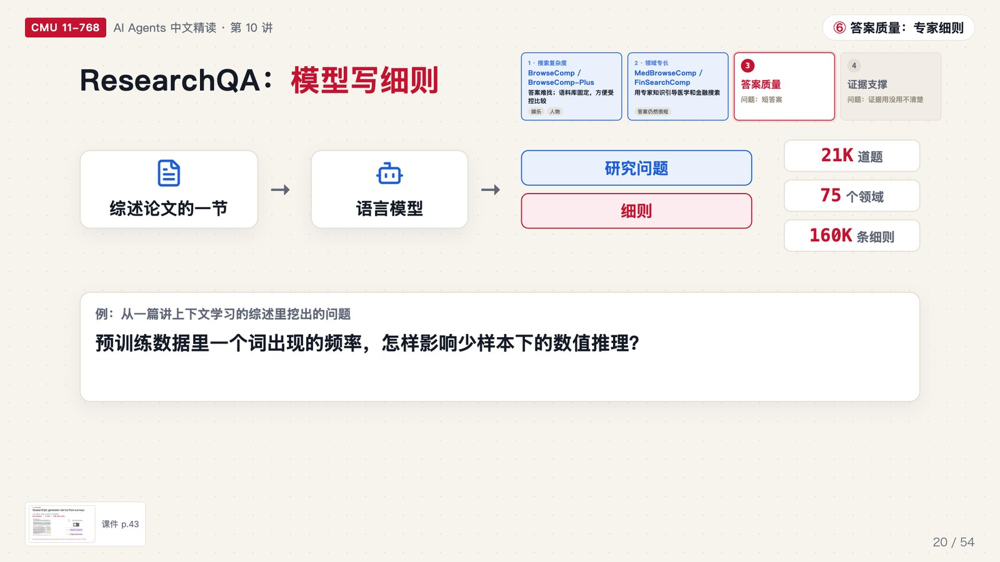

原课件 p.43：**用语言模型扩大细则标注的规模。21K 道题 / 75 个领域 / 160K 条细则。** 出自 ResearchQA（TACL 2026）。

流程：综述论文的一节 → 语言模型 → 研究问题 + 语言模型生成的细则。

原论文图 1 的例子：从一篇关于上下文学习的综述里挖出的问题"预训练数据里词项出现的频率，怎样影响少样本设置下的数值推理表现？"，下面三条细则的判分分别是 0/4（完全没覆盖）、4/4（完全覆盖）、1/4（勉强覆盖）。

（课上口头说细则"12 万条"，课件和原论文摘要都是 160K，即 16 万条，以课件为准。）

### 5.6 生成的细则会把目标写错

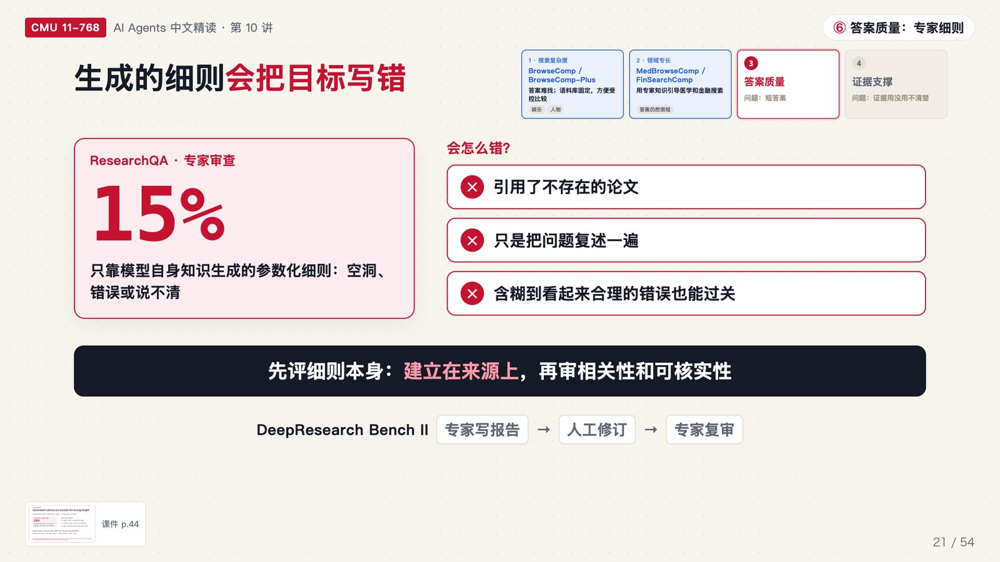

原课件 p.44：**在用细则评答案之前，先评细则本身。**

- ResearchQA 的专家审查：**15%** 的**参数化细则**条目是空洞的、错误的或不清楚的。
- 可能出什么错：一条标准引用了一篇不存在的论文；一条标准只是把问题复述了一遍；一条含糊的标准，让看起来合理的错误也能过关。
- **把标准建立在来源上，再审查它们相不相关、能不能核实。**
- DeepResearch Bench II 用的是专家报告 + 人工修订 + 专家复审（课件原话，本课件没核）。

**15% 说的是哪种细则。** 按 ResearchQA 原文 §3.2：参数化细则是模型只凭自己的知识生成的那种，原文说它是几种细则里出错率最高的；ResearchQA 最终用的是结合综述内容的"混合细则"，很少出现不存在的论文和空洞复述。所以不要读成"ResearchQA 的细则 15% 都有错"。

| 细则从哪来 | 规模 | 质量风险 |
|---|---|---|
| 专家写（ScholarQABench） | 小，很费时间 | 低；和语言模型判断一致率 79% |
| 模型凭自身知识写（参数化细则） | 大 | 15% 空洞、错误或不清楚 |
| 模型结合来源写（ResearchQA 的混合细则） | 大 | 原文说很少编造论文 |

### 5.7 回到四格表


原课件 p.45–46，第 3 格换成：**ScholarQABench / ResearchQA：用细则评回答的质量。**

这一节记住一句：相似度评不了长篇回答，细则可以，但细则本身也得先审。

---

## 6 证据支撑：检查引用

### 6.1 DeepResearch Bench 的 FACT

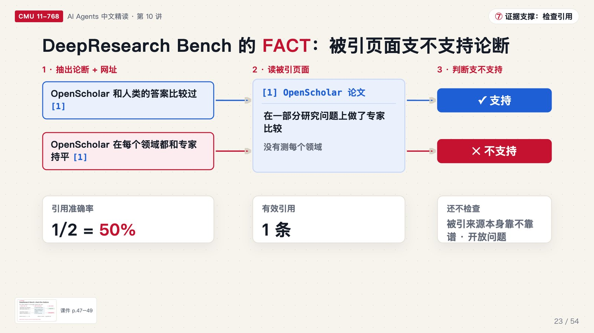

原课件 p.47–49：**FACT 检查被引用的页面是不是真的支撑每一条论断。** 出自 DeepResearch Bench（ICLR 2026）。

| 1 抽出论断 + 网址 | 2 读被引页面 | 3 判断支不支持 |
|---|---|---|
| OpenScholar 和人类的答案比较过。[1] | [1] OpenScholar 论文：在一部分研究问题上做了专家比较；没有测每个领域。 | 支持 |
| OpenScholar 在每个领域都和专家持平。[1] | （同上） | 不支持 |

| 指标 | 这个例子 | 意思 |
|---|---|---|
| 引用准确率 | 1/2 = 50% | 被支持的"论断—引用"对占全部的比例 |
| 有效引用 | 1 条 | 被支持的"论断—引用"对有多少 |

（这两个数是课件自己编的示意例子；按原文核对，FACT 的两个指标确实是引用准确率和每题平均有效引用数。）

课上口头补充：

- 模型能写出流畅、看似合理的回答，有时却歪曲了证据，所以还要评证据的质量。ScholarQABench 也评引用质量。
- FACT 的做法：抽出所有论断和它引用的网址，把来源抓下来，检查论断是不是被对应的网页支撑。
- 它还不检查被引证据本身靠不靠谱，这是另一个开放问题。

两个指标为什么要一起看（本课件的补充，课上没展开）：只看准确率，一份报告只放一条稳妥的引用就能拿 100%；只看有效引用数，堆很多引用也能涨。两个一起看，才知道"引得准"又"引得够"。

### 6.2 四格表全部填满

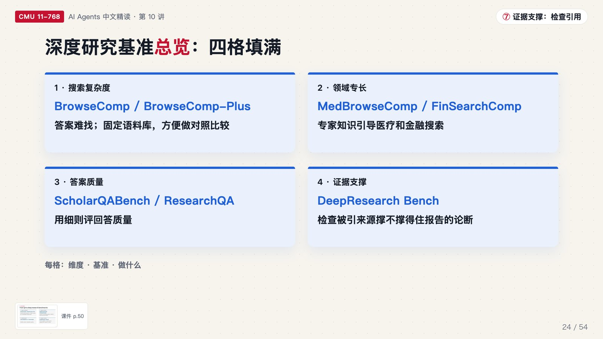

原课件 p.50（这张表建议收藏）：

| 维度 | 基准 | 做什么 |
|---|---|---|
| 1 搜索复杂度 | BrowseComp / BrowseComp-Plus | 答案难找；固定语料库，方便受控比较 |
| 2 领域专长 | MedBrowseComp / FinSearchComp | 用专家知识引导医学和金融搜索 |
| 3 答案质量 | ScholarQABench / ResearchQA | 用细则评回答的质量 |
| 4 证据支撑 | DeepResearch Bench | 检查被引来源是否支撑报告里的论断 |

每个基准怎么判分（本课件按前几节整理）：

| 基准 | 判分方式 | 能不能直接当强化学习奖励 |
|---|---|---|
| BrowseComp / BrowseComp-Plus | 短答案和参考答案比（判分模型判一致） | 能，二值奖励（第 10 节） |
| FinSearchComp | 短答案（数值）和参考答案比 | 能 |
| ScholarQABench / ResearchQA | 细则加权平均 | 能，但细则要先有（第 11 节） |
| DeepResearch Bench | 报告质量 + FACT 引用检查 | 引用部分可以做辅助奖励（第 11.2 节 DR Tulu 有引用奖励） |

这一节记住一句：评深度研究，要看搜得够不够深、懂不懂行、答得好不好，还要看引用撑不撑得住。

---

## 7 深度研究 agent 的推理流程

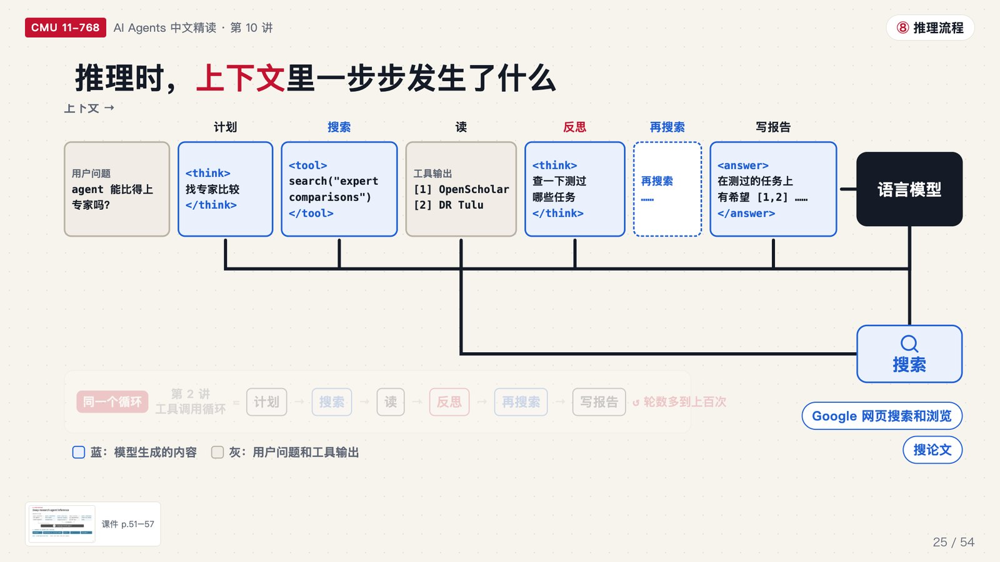

原课件分隔页：**03 agent 建模。** p.51–57 六页动画逐步展开（蓝色是模型生成的文本，灰色是用户输入和工具输出）：

| 步骤 | 模型生成或发生的事 | 上下文里多了什么 |
|---|---|---|
| 1 生成推理 | `<think> 找专家比较 </think>` | 用户问题：agent 能和专家持平吗？ |
| 2 生成工具调用 | `<tool> search("expert comparisons") </tool>` | agent 推理 |
| 3 执行搜索调用 | 搜索工具运行模型生成的查询 | agent 工具调用 |
| 4 把工具输出接上 | 检索到的文本成为上下文的一部分 | 工具输出：[1] OpenScholar、[2] DR Tulu |
| 5 继续推理 | `<think> 查一下测过哪些任务 </think>` | agent 推理 |
| 6 带引用作答 | `<answer> 在测过的任务上有希望 [1,2] …… </answer>` | |

课上口头补充：模型先生成推理 token、讨论计划；再生成工具调用；外部搜索返回的文档进入上下文；模型接着生成，对证据做反思，决定要不要继续搜。不同系统用的工具不一样，比如 Google 网页搜索、浏览，甚至论文搜索。迭代够多轮后给出最终答案，最好带着引用。

本课件的补充：这就是第 2 讲的工具调用循环，只是工具换成了搜索和浏览，轮数多到上百次（3.4 节）。一条轨迹里只有蓝色块是模型生成的，这正是第 9 讲 6.5 节说的损失掩码：训练时只在蓝色 token 上算损失。

下面是这个循环的示意代码（**示意**，不是哪个库的原文；`llm`、`search` 是假设的函数）：

```python
# 示意：深度研究 agent 的推理循环
def deep_research(question, llm, search, max_calls=128):
    context = [("user", question)]
    for _ in range(max_calls):                 # 评测上限，3.4 节通义用 128 次
        step = llm(context)                    # 生成 <think>…</think> 再接 <tool> 或 <answer>
        context.append(("assistant", step.text))
        if step.answer is not None:            # 生成了 <answer>：带引用的最终答案
            return step.answer
        docs = search(step.query)              # 执行模型写的查询
        context.append(("tool", docs))         # 工具输出接到上下文末尾（灰色块）
    return None                                # 调用次数用完还没作答
```

这一节记住一句：推理、搜索、把结果接进上下文，转够了再带引用作答。

---

## 8 训练配方和训练数据

### 8.1 三阶段训练配方

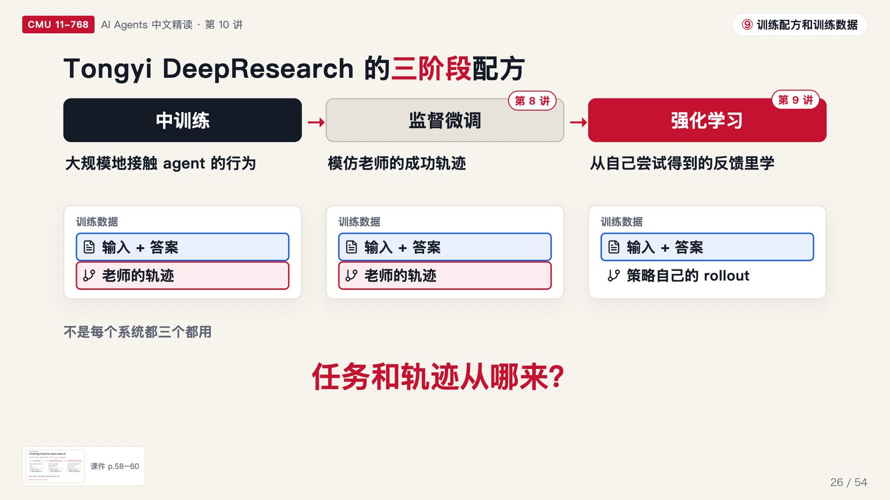

原课件 p.58–60：**先从老师的示范里学，再从自己的尝试里学。** 出自 Tongyi DeepResearch 技术报告。

| 阶段 | 学什么 | 训练数据 | 本系列哪讲讲过 |
|---|---|---|---|
| 中训练 | 大规模地学 agent 的行为 | 输入 + 答案；老师的轨迹 | 本讲第 9 节 |
| 监督微调 | 模仿成功的示范 | 输入 + 答案；老师的轨迹 | 第 8 讲 |
| 强化学习 | 从自己尝试得到的反馈里学 | 输入 + 答案；策略自己的 rollout | 第 9 讲 |

课上口头补充：不是每个深度研究系统都三个阶段全用。关键是三个阶段都要高质量的数据：都需要可验证问题的输入和答案，前两个阶段还需要高质量的轨迹。

原课件 p.60 底部：**下一个问题：任务和轨迹从哪来？** 下面两小节分别回答"任务"和"轨迹"。

### 8.2 知识图谱：实体和关系

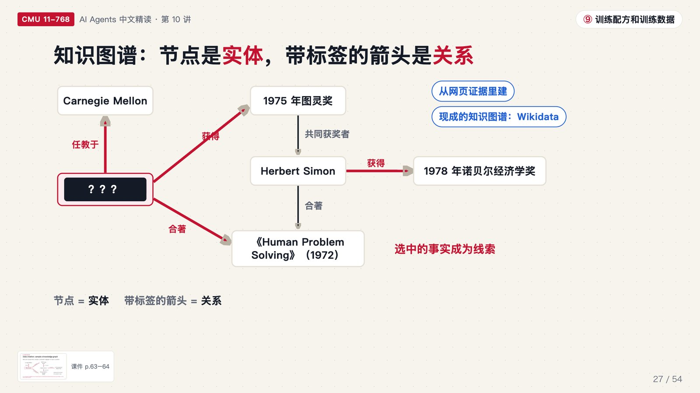

原课件 p.61–64。**知识图谱**（knowledge graph）把实体表示成节点，把关系表示成带标签的有向边：

| 主语 | 关系 | 宾语 |
|---|---|---|
| Allen Newell | 任教于 | Carnegie Mellon |
| Allen Newell | 获得 | 1975 年图灵奖 |
| Herbert Simon | 共同获得 | 1975 年图灵奖 |
| Herbert Simon | 获得 | 1978 年诺贝尔经济学奖 |
| Allen Newell、Herbert Simon | 合著 | 《Human Problem Solving》（1972） |

出处：CMU 档案馆；诺贝尔奖官网（1978）。

课上口头补充：图可以从网页证据里建，也可以用现成的大规模知识图谱，比如 Wikidata。有些训练流水线从目标实体出发，用随机游走采一组连在一起的事实（"随机游走"是课上的说法；WebSailor-V2 原文本课件只核到"从稠密互联的知识图谱上采样"）。原课件 p.63–64：**从有出处的事实出发，采一个连通的子图来造题；选中的事实成为这道题的线索。** 方法来自 WebSailor-V2（ICLR 2026）。

### 8.3 把事实变成一道题

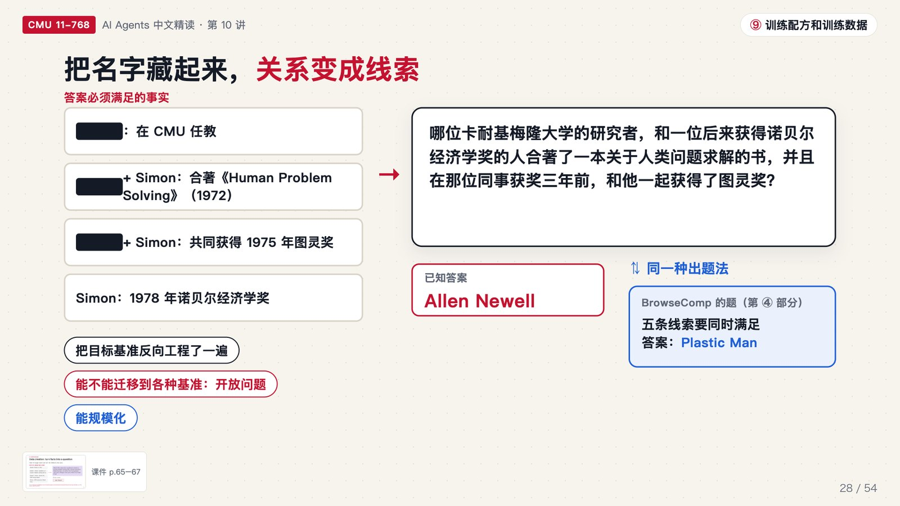

原课件 p.65–67：**把目标的名字藏起来，把它的关系变成线索。**

答案必须满足的事实：Newell 是 CMU 教员；Newell 和 Simon 合著《Human Problem Solving》（1972）；两人共同获得 1975 年图灵奖；Simon 获 1978 年诺贝尔经济学奖。

生成的题：

> 哪位 CMU 研究者，和一位后来获得诺贝尔经济学奖的人合著了一本关于人类问题求解的书，并且在那位同事获诺贝尔奖三年前，和他一起获得了图灵奖？

已知答案：**Allen Newell**。

每条事实怎么变成线索（本课件的补充，课上没逐条讲）：

| 事实 | 变成的线索 | 改写手法 |
|---|---|---|
| Newell 任教于 CMU | "哪位 CMU 研究者" | 宾语保留，主语藏起来 |
| 合著《Human Problem Solving》 | "合著了一本关于人类问题求解的书" | 书名换成描述 |
| Simon 获 1978 年诺贝尔经济学奖 | "一位后来获得诺贝尔经济学奖的人" | 人名换成描述 |
| 两人共同获 1975 年图灵奖 | "在那位同事获诺贝尔奖三年前，和他一起获得了图灵奖" | 年份换成相对时间：1978 − 1975 = 3 |

课上口头补充：这和 BrowseComp 的出题过程很像，相当于把目标基准**反向工程**了一遍。这样造的数据能不能迁移到各种深度研究基准，还是开放问题；但它给了一个能规模化的办法。

（Newell、Simon 这组事实是课件自己编的示意例子，不是 WebSailor-V2 论文里的题。）

### 8.4 收集、过滤、模仿老师轨迹

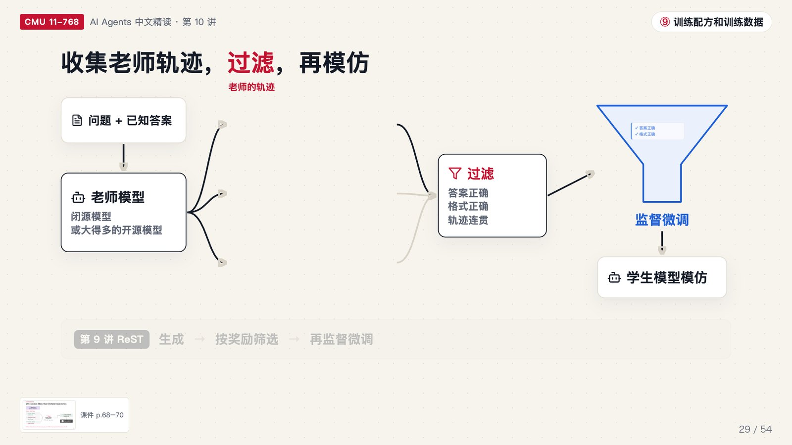

原课件 p.68–70，出自 WebDancer（NeurIPS 2025）和 Tongyi DeepResearch 技术报告。流程：问题 + 已知答案 → 老师的轨迹 → 过滤 → 收集留下的轨迹 → 用监督微调训练。

| 老师的轨迹 | 留不留 |
|---|---|
| 答案正确、格式正确 | 留下（还要求轨迹连贯） |
| 答案错误、格式正确 | 扔掉 |
| 答案正确、格式错误 | 扔掉 |

课上口头补充：老师通常是更强的模型，比如闭源模型，或者大得多的开源模型；有的轨迹找到了正确答案，有的在工具调用上出错，或者就是没答对；按答案匹配或格式奖励把不成功的过滤掉。

和前几讲对照：

| | 谁来跑 | 怎么筛 | 怎么训 |
|---|---|---|---|
| 第 8 讲 3.2 节 SWE-Gym 蒸馏 | 更强的老师模型 | 测试通过 | 监督微调 |
| 第 9 讲 5 节 ReST | 模型自己 | 奖励过阈值 | 监督微调，循环多轮 |
| 这里 | 更强的老师模型 | 答案对、格式对、轨迹连贯 | 监督微调 |

这一节记住一句：先在知识图谱上造出难题，再让老师跑、只留成功的，拿来做监督微调。

---

## 9 agentic 中训练

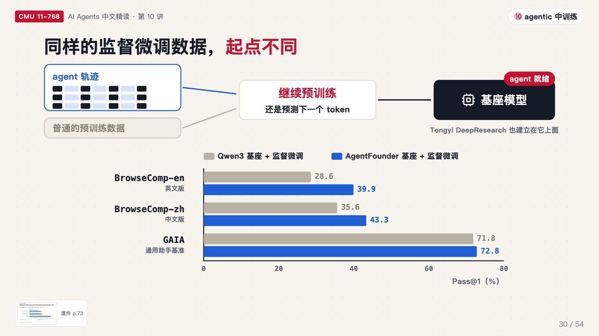

原课件 p.71–72：**通义用继续预训练，让基座模型为 agent 工作流做好准备。** 出自 Scaling Agents via Continual Pre-training（AgentFounder，ICLR 2026）。

流程：agent 轨迹 + 通用预训练数据 → **继续预训练**（continual pre-training，还是下一个 token 预测）→ 准备好做 agent 的基座模型。

课上口头补充：思路很简单，把大量 agent 轨迹和普通预训练数据混在一起做继续预训练，然后再做同样的下游监督微调。这篇也是通义 DeepResearch 的基础之一。

原课件 p.73：**同样的下游监督微调数据（SFT-B），不同的基座初始化。** Pass@1（%，课件图上印着的数）：

| 基准 | Qwen3 基座 + 监督微调 | AgentFounder 基座 + 监督微调 | 差 |
|---|---|---|---|
| BrowseComp-en | 28.6 | **39.9** | +11.3 |
| BrowseComp-zh | 35.6 | **43.3** | +7.7 |
| GAIA | 71.8 | **72.8** | +1.0 |

（"差"一列是本课件算的。按原文消融表核对：SFT-B 一组和课件一致，基座分别是 Qwen3-30B-A3B-Base 和 AgentFounder-30B-Base；原表还有 SFT-A、SFT-C 两组，差值方向相同。）

本课件的补充（课上没这么说）：涨幅和任务难度有关，最难的 BrowseComp-en 涨 11.3 点，接近饱和的 GAIA 只涨 1 点。

**Pass@1** 是每道题只看一次尝试的通过率。

这一节记住一句：同样的监督微调数据，中训练过的基座起点更好，最后也更好。

---

## 10 用答案对错做强化学习

### 10.1 RLVR：从答案对不对里学

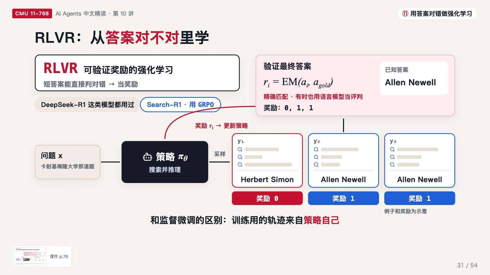

原课件 p.74–76。监督微调和中训练都是模仿老师；最终希望学生模型从自己的尝试里学（课上口头补充）。短答案能直接判对错，就可以用**可验证奖励的强化学习**（Reinforcement Learning with Verifiable Rewards，RLVR），DeepSeek-R1 这类模型都用过这套配方。

流程：问题 x（第 8.3 节那道 CMU 题）→ 策略 π_θ（搜索并推理）→ 采样三条搜索轨迹 → 最终答案分别是 Herbert Simon、Allen Newell、Allen Newell → 核对最终答案 → 奖励 → 更新策略。

```
r_i = EM(a_i, a_gold)        奖励：0, 1, 1        已知答案：Allen Newell
```

每条轨迹的奖励，就是它最后的答案和标准答案是不是**精确匹配**（exact match，EM）：答成 Simon 记 0，答成 Newell 记 1。课上口头补充：有时也用语言模型当评判，比如第 15 节 BrowseComp 的官方评测。

- 出处：Search-R1（COLM 2025）用最终答案精确匹配当奖励；CMU 这个例子和奖励是示意。
- 课上说 Search-R1 用 GRPO 做了这套强化学习；按 Search-R1 原文，论文里 PPO 和 GRPO 都试了。

和监督微调的关键区别（课上口头补充）：训练用的轨迹来自策略自己。

精确匹配通常先做一点规范化（本课件的补充，课上没展开）：去首尾空格、统一大小写、合并多余空格，否则" allen  newell "这种写法也会被判错。规范化做得太松，又可能把错的判成对的。动手练习第 4 部分可以自己试。

### 10.2 GRPO：从更好的尝试里学

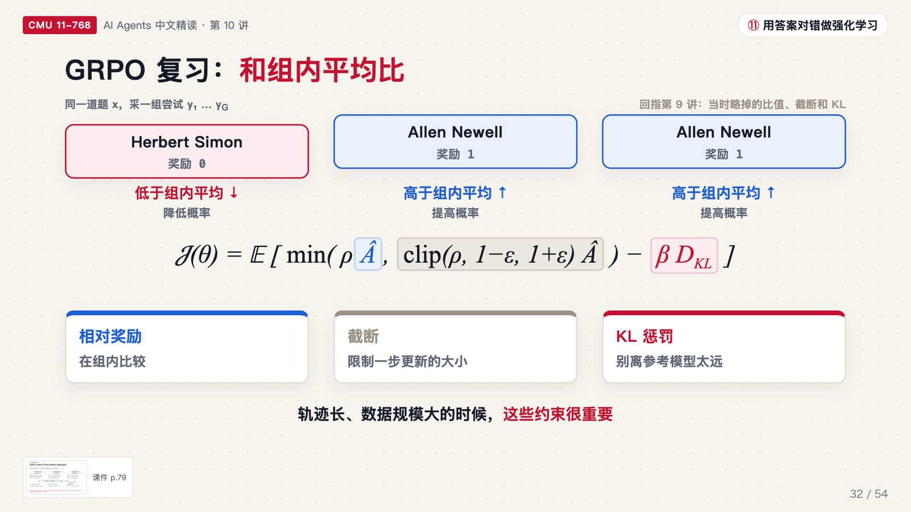

原课件 p.77–79：**一道题 x；采一组尝试 y1……yG。**

| 尝试 | 奖励 | 和组内平均比 | 怎么更新 |
|---|---|---|---|
| Herbert Simon | 0 | 低于组内平均 | 降低它的概率 |
| Allen Newell | 1 | 高于组内平均 | 提高它的概率 |
| Allen Newell | 1 | 高于组内平均 | 提高它的概率 |

课件只写了"高于 / 低于平均"，没算数。按第 9 讲 8.1 节的写法自己算一遍：

```
组内平均     R̄ = (0 + 1 + 1) / 3 = 0.667
只减平均     −0.67, +0.33, +0.33
总体标准差   σ = √((0.667² + 2 × 0.333²) / 3) ≈ 0.471
除以 σ       −1.41, +0.71, +0.71
```

（动手练习第 4 部分会打印这几个数。）

原课件 p.79 的目标函数：

```
J(θ) = E[ ⟨ min( ρ Â, clip(ρ, 1−ε, 1+ε) Â ) − β D_KL ⟩_model tokens ]
```

| 这一项 | 是什么 | 作用 |
|---|---|---|
| Â | 相对奖励（优势） | 在组内比较 |
| ρ | 新旧策略的概率比 | 第 9 讲 10.4 节：每批只更新一次时恒为 1 |
| clip | 截断的更新 | 限制一步更新的大小 |
| β D_KL | KL 惩罚 | 别离参考模型太远 |
| ⟨·⟩_model tokens | 只在模型生成的 token 上平均 | 第 7 节的蓝色块 |

每条尝试的权重是它比同组平均好多少；在这个基础上给每一步的更新幅度设上下限，并罚它离一开始的模型太远。出处：DeepSeekMath（arXiv 2024）；DR Tulu（ICML 2026）。

课上口头补充：训练语言模型 agent、尤其数据规模大的时候，截断和 KL 这些约束其实很重要。这正好补上第 9 讲 8.2 节说的"今天先去掉比值、截断和 KL 项"。截断和 KL 的来龙去脉在第 11 讲。

### 10.3 异步 rollout：做完一条、打分、再训

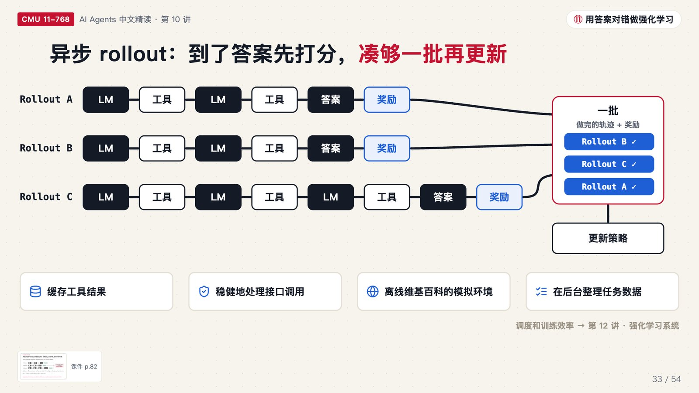

原课件 p.80–82：**给完成的轨迹打分；凑成一批再更新策略。**

- 三条 **rollout**（一次完整的试跑）A、B、C 各自交替"LM → 工具 → LM → 工具 → ……"，长度不一样（C 比 A、B 多一轮）。
- 每条到达答案就拿到奖励 → 凑成一批完成的轨迹和奖励 → 更新策略。
- 其他效率手段：缓存工具结果、稳健地处理接口调用、在后台整理任务数据。
- 出处：Tongyi DeepResearch 技术报告；DR Tulu。

课上口头补充：agent 的强化学习又贵又不稳定：轨迹很长，上百次搜索工具调用，每次都有成本也慢，有时要等好几秒。每次都干等，训练会非常慢。所以很多系统异步地执行 rollout：一条在等工具回复，其他的接着生成；一条结束就给它打分，凑出训练要的批。

按 Tongyi 技术报告 §3.4.3 核对（课上没展开）：原文有"在线策略异步 rollout 框架"一节；工具层有限流、结果缓存、超时重试、降级、切换备用搜索接口；还有一个用离线维基百科做的模拟环境，训练时不调真实的外部接口。

| | 同步 | 异步 |
|---|---|---|
| 一条轨迹在等工具时 | 整批一起等 | 别的轨迹接着生成 |
| 什么时候打分 | 整批都结束 | 哪条到了答案就打哪条 |
| 什么时候更新 | 整批都结束 | 凑够一批完成的轨迹 |

调度和训练效率的细节在第 12 讲（强化学习系统）。课上说"下一讲"，按课表和原课件 p.82 的写法，是强化学习系统那一讲，即第 12 讲。

### 10.4 通义：强化学习越训越好

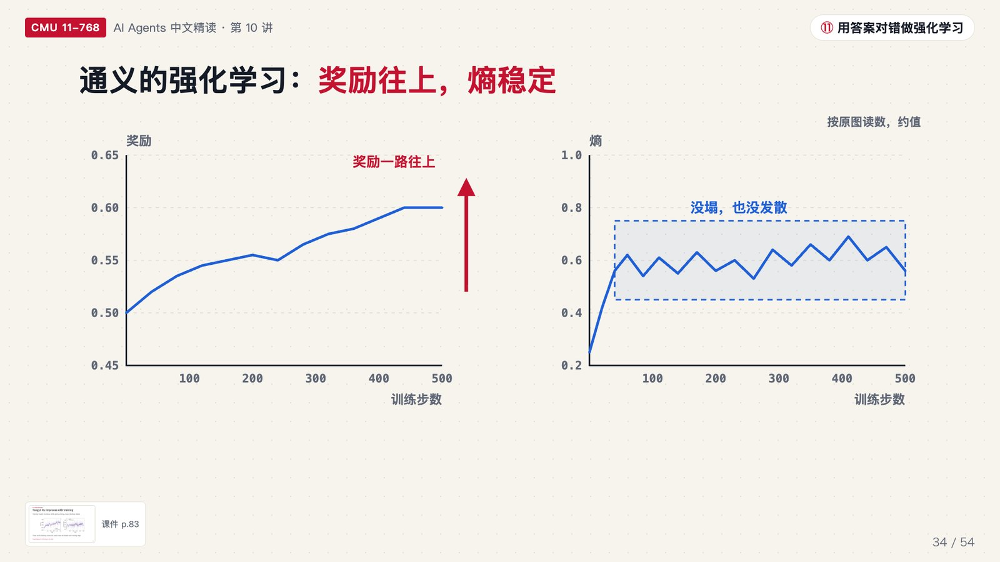

原课件 p.83：**训练奖励上升，策略熵保持相对稳定。** 出自 Tongyi DeepResearch 技术报告图 8。

| 曲线 | 按原图读数，约值 |
|---|---|
| 奖励（平滑后） | 从第 0 步附近约 0.50，涨到第 500 步约 0.60 |
| 熵损失（平滑后） | 前几十步从约 0.25 升到约 0.6，之后在约 0.45–0.75 之间来回 |

- 原课件底部：**这些是强化学习的训练曲线；技术报告没有把各个训练阶段单独拆开看。**
- **策略熵**（policy entropy）衡量策略输出有多分散。熵塌到很低，模型只会重复同几种做法，不再探索；熵一路升高，输出越来越乱。原文说熵"短暂上升后收敛到一个稳定值，既没塌也没爆"。

这一节记住一句：短答案用答案对错当奖励，GRPO 加上异步 rollout，就能把搜索 agent 训起来。

---

## 11 开放式报告：DR Tulu 和演化细则

### 11.1 奖励该衡量什么


原课件 p.84–85：**奖励应该衡量什么？**

| 可验证的短答案 | 开放式的综合 |
|---|---|
| Allen Newell | 一份研究报告 |
| 答案对不对 | 覆盖面、相关性、事实性、有引用支撑的论断 |

课上口头补充：答案是短实体时，精确匹配就够了；但一份好的文献综合要看覆盖面、相关性、事实性和恰当的引用，没法只用一个二值的对错分数。**DR Tulu**（Deep Research Tulu）是一个开源的 8B 深度研究模型，就是为这个问题训的，配方叫**用演化细则做强化学习**（Reinforcement Learning with Evolving Rubrics，RLER）。出自 DR Tulu（ICML 2026）。

### 11.2 细则当奖励，细则跟着训练演化

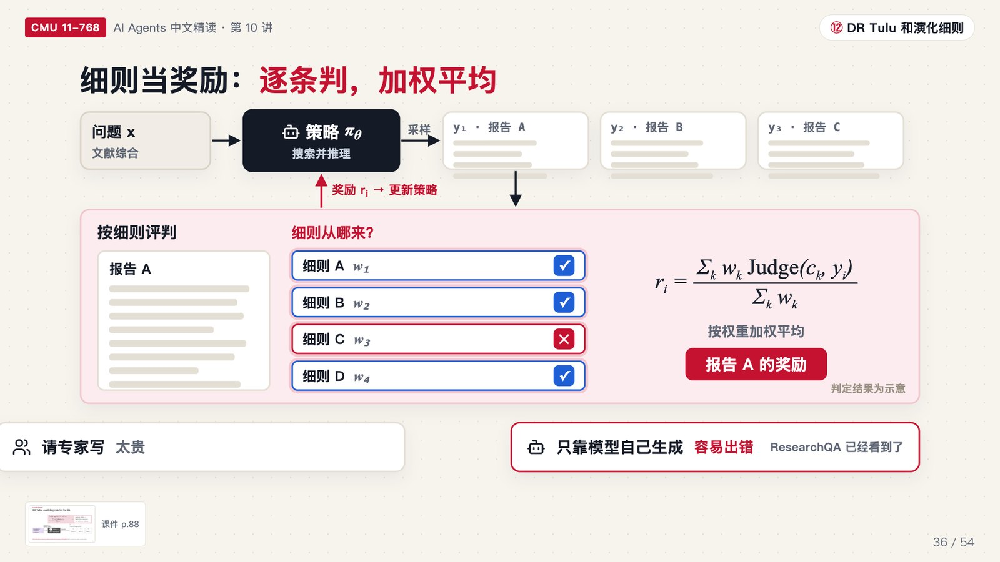

原课件 p.86–89。流程和 10.1 节一样，只是答案卡换成三份报告 A、B、C，奖励换成按细则评判：

```
r_i = Σ_k w_k · Judge(c_k, y_i) / Σ_k w_k
```

每条细则 c_k 有一个权重，评判模型看报告 y_i 满不满足这一条；按权重加权平均，就是这份报告的奖励。和 5.3 节 ScholarQABench 的打分方式一样，只是从评测搬到了训练里。原课件页脚：图上只画了细则奖励，辅助奖励省略了。

难点还是细则从哪来（课上口头补充）：请专家写太贵；ResearchQA 也看到，只靠提示语言模型生成的细则错误多，或者没什么用（5.6 节）。

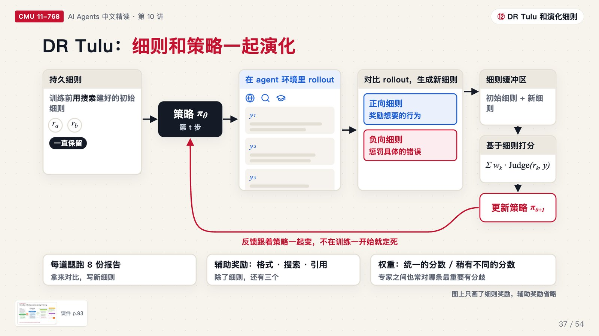

DR Tulu 的做法是让细则和策略一起演化（课上口头补充，并按原文 §3 核对）：

| 环节 | 做什么 |
|---|---|
| 持久细则 | 训练前用搜索结果建一组初始细则，一直保留 |
| 生成 rollout | 当前策略对同一道题跑出一组报告（原文表 9：每题 8 条，每批 32 道不同的题） |
| 对比生成新细则 | 语言模型看问题、这一组报告和现有细则，写出新的**正向细则**（当前策略探索到、现有细则还没体现的优点或新知识）和**负向细则**（多份报告里共同的不良行为，比如奖励作弊） |
| 细则缓冲区 | 持久细则 + 训练中收集的细则一起给报告打分 |
| 更新策略 | 用细则奖励（加上格式、搜索、引用三个辅助奖励）做强化学习 |

核心想法（课上口头补充）：反馈和策略一起发展，而不是在训练一开始就定死。

课上没展开、按 DR Tulu 原文补的一步：缓冲区大小固定，按每条细则在这一组 rollout 上打分的**标准差**排序，只保留区分度最高的前若干条。一条细则如果给 8 份报告都打一样的分，它对这一组就没有区分度，和第 9 讲 8.5 节"奖励全相同时没有梯度"是同一个道理。

细则的权重（课上口头补充，回答课堂提问）：DR Tulu 没在这上面花太多功夫，试过统一的分数，也试过稍有不同的分数；连专家之间都常常对哪条细则最重要有分歧，这也是可以研究的方向。

### 11.3 论文里的例子：从 rollout 里长出新细则

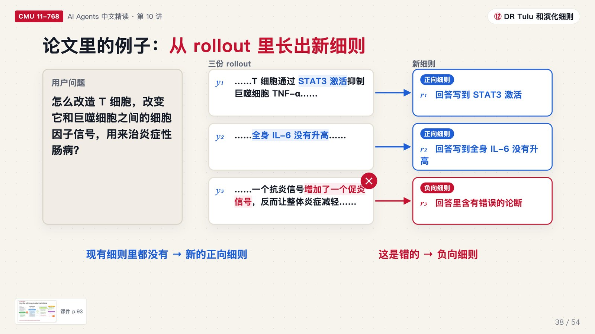

原课件 p.90–93 是 DR Tulu 论文图 2 逐块出现（视频里压成了三份 rollout 和三条新细则）：

**用户问题**：描述如何通过基因工程改造 T 细胞、改变 T 细胞和巨噬细胞之间的细胞因子信号，把它用作炎症性肠病（IBD）的抗炎疗法。

**持久细则**（训练前用搜索建好）：

- rₐ：引用"IL-10 工程化 T 细胞减轻了结肠炎严重程度"；
- r_b：陈述"改造 T 细胞过量表达 IL-10，会抑制巨噬细胞的 TNF-α"。

**第 t 步的策略在 agent 环境（网页浏览、学术搜索、Google 搜索）里的三份 rollout，和由此生成的新细则**：

| rollout 里写了什么 | 生成的新细则 | 类型 |
|---|---|---|
| y1：……T 细胞通过 STAT3 激活抑制巨噬细胞 TNF-α…… | r₁：回答指出工程化 T 细胞分泌的 IL-10 通过 STAT3 激活抑制巨噬细胞 TNF-α | 正向 |
| y2：……全身 IL-6 没有升高，也没有观察到细胞因子释放综合征…… | r₂：回答指出全身 IL-6 没有升高，输注后也没有观察到细胞因子释放综合征 | 正向 |
| y3：……一个抗炎信号增加了一个促炎信号，出人意料地反而让整体炎症减轻……（错的） | r₃：回答含有错误的论断，说一个抗炎细胞因子会上调…… | 负向 |

新细则进缓冲区，和 rₐ、r_b 一起打分：`S(x, y) = Σ_{k=1}^{K} w_k · JUDGE(r_k, y)` → 更新 → π_θt+1。

### 11.4 成本和研究表现

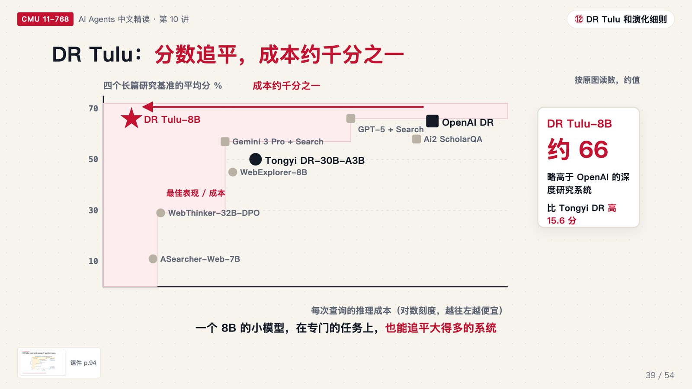

原课件 p.94：**几个深度研究基准上的平均表现。** 纵轴是平均分（%），横轴是每次查询的推理成本（对数刻度，越往左越便宜）。点上没标数，下表按原图读数，约值：

| 系统 | 类型 | 平均分（约） |
|---|---|---|
| DR Tulu-8B | 开源 | 66 |
| GPT-5 + Search | 闭源 | 66 |
| OpenAI DR | 闭源 | 65 |
| Ai2 ScholarQA（Claude Sonnet） | 闭源 | 58 |
| Gemini 3 Pro + Search | 闭源 | 57 |
| Tongyi DR-30B-A3B | 开源 | 50 |
| WebExplorer-8B | 开源 | 44 |
| WebThinker-32B-DPO | 开源 | 29 |
| ASearcher-Web-7B | 开源 | 11 |

- 图上一块浅色阶梯区域标着"最佳表现/成本"，DR Tulu-8B 在它的左上角，也是全图最靠左的点之一。

按 DR Tulu 原文摘要和表 1 核对：四个长篇基准是 ScholarQA-CSv2、HealthBench、ResearchQA、DeepResearch Bench；DR Tulu-8B（RL）平均 65.6，比最好的开源基线 Tongyi DeepResearch-30B 高 15.6 分，比 OpenAI DR 平均高 0.7 分；每次查询的成本约为 OpenAI DR 的千分之一。

课上口头补充：训练做得仔细，一个 8B 的小模型在专门的 agent 任务上，也能追平甚至超过大得多的模型。

### 11.5 监督微调是强化学习的热启动

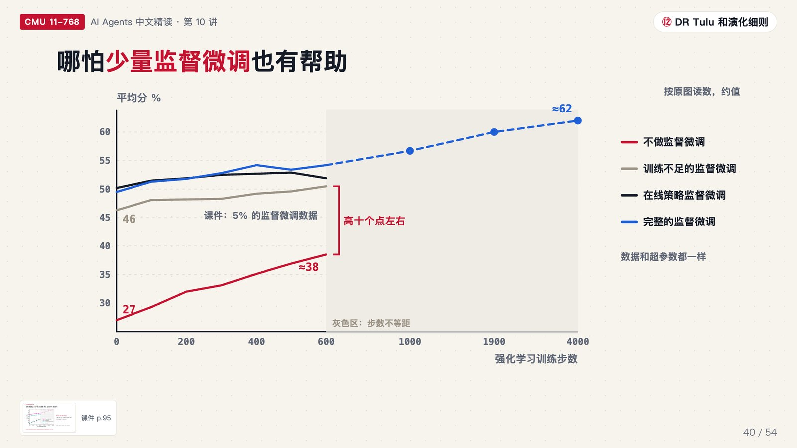

原课件 p.95：**哪怕 5% 的监督微调数据也有帮助；完整的监督微调混合数据给出最强的强化学习结果。**

横轴是强化学习训练步数（0–600 等距，之后 1000、1900、4000 不等距，灰色区域），纵轴是平均分（%）。按原图读数，约值：

| 起点 | 第 0 步 | 第 600 步 | 之后 |
|---|---|---|---|
| 不做监督微调 | 27 | 38.5 | — |
| 训练不足的监督微调 | 46 | 50.5 | — |
| 在线策略监督微调 | 50 | 52 | — |
| 完整的监督微调 | 49.5 | 54 | 1000 步约 56.7，1900 步约 60，4000 步约 62 |

课上口头补充：从基座直接做强化学习的那条很吃力，600 步只到 40% 左右；只用 5% 的监督微调数据，600 步强化学习之后能高 10 个点左右。受算力限制，只有一条跑了几千步。

两处要读准：

- **"训练不足的监督微调 = 5% 数据"** 是课件和课上的说法；DR Tulu 原文图 5 只写"训练不足的模型"，本课件没在原文里找到它等于 5% 数据的明确句子（5% 在原文图 4 里是监督微调数据量的消融）。
- 原文另说在线策略监督微调略微提高了监督微调后的成绩，但到强化学习后期反而更弱。

本课件的补充：这就是第 8 讲 1.5 节"冷启动"的实验证据：不做监督微调，强化学习从 27 分起步，600 步也追不上别人的起点。

### 11.6 演化细则让强化学习更好

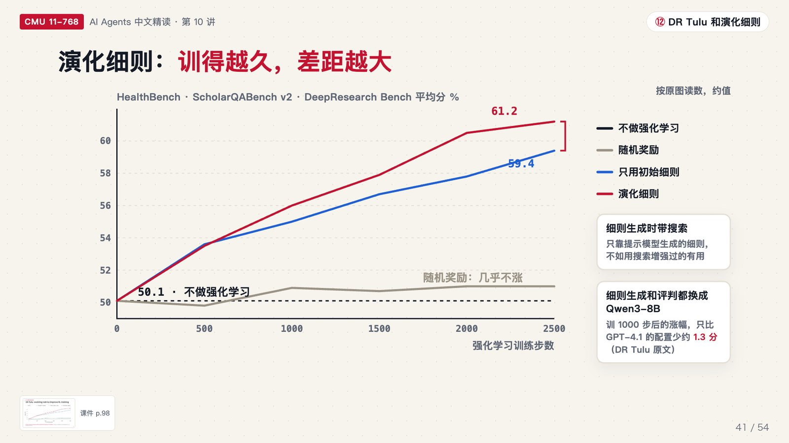

原课件 p.96–98，纵轴是 HealthBench、ScholarQABench v2、DeepResearch Bench 三个基准的平均分（%）。按原图读数，约值：

| 奖励设计 | 0 步 | 500 | 1000 | 1500 | 2000 | 2500 |
|---|---|---|---|---|---|---|
| 不做强化学习（虚线） | 50.1 | — | — | — | — | 50.1 |
| 随机奖励 | 50.1 | 49.8 | 50.9 | 50.7 | 51.0 | 51.0 |
| 只用初始细则 | 50.1 | 53.6 | 55.0 | 56.7 | 57.8 | 59.4 |
| 演化细则 | 50.1 | 53.5 | 56.0 | 57.9 | 60.5 | 61.2 |

| 对比 | 说明了什么 |
|---|---|
| 随机奖励 vs 不做强化学习 | 几乎不涨：提升不是"随便训一训就涨"的伪效应（原文特意排除了 Qwen 系模型在随机奖励下的这种现象） |
| 初始细则 vs 随机奖励 | 基于细则的强化学习有效 |
| 演化细则 vs 初始细则 | 再好一点，训得越久差距越大；原文说去掉演化细则平均最多掉 2 分（按原图读数 61.2 − 59.4 = 1.8） |

另外两组消融（课件没放图）：

- **细则生成时带不带搜索**（课上口头补充）：只靠提示模型生成的细则，不如用搜索增强过的细则有用。原文消融表里"通用细则""闭卷细则""初始搜索细则"几行就是这组。
- **用弱一点的模型生成细则**：按 DR Tulu 原文（arXiv v3），正式训练用 GPT-4.1 生成细则、GPT-4.1-mini 当评判；把两者都换成 Qwen3-8B 后，1000 步强化学习比监督微调检查点平均涨 4.4 分，GPT 配置涨 5.7 分，只少约 1.3 分。课上回答提问时说"大约差 10 个点"，和论文最新版对不上，以论文为准。

这一节记住一句：开放式报告用细则当奖励，细则跟着训练一起演化，再加上监督微调热启动，8B 的模型也能写出好报告。

---

## 12 深度研究的检索

原课件分隔页：**04 深度研究的检索。** 课上口头补充：搜索这一层不好，agent 模型再强也找不到好文档。

### 12.1 搜索工具分两类


原课件 p.100：

| 本地搜索 | | 黑盒接口 | |
|---|---|---|---|
| 词法检索器 | 比如 BM25 | 网页搜索接口 | `web_search` |
| 嵌入模型 | 学出来的相似度 | 浏览 | `browse` |

- 其他工具：Python 执行（通义）；学术搜索（通义、DR Tulu）。
- 出处：DPR（EMNLP 2020）；Tongyi DeepResearch；DR Tulu。

课上口头补充：

- 知道该从哪批文档里找，就搭本地搜索。Search-R1 就用嵌入模型的本地系统，拿 2018 年的维基百科当语料库（按原文核对：检索器是 E5，每次取 3 段）。
- 题目更开放（BrowseComp、ScholarQABench 这种），就用黑盒接口：网页搜索、网页浏览；通义、DR Tulu 还接了论文搜索（比如 Semantic Scholar、Google Scholar 的接口）。按 DR Tulu 原文，它统一用 google_search、web_browse、paper_search 三个工具。
- 按任务决定接哪些工具。比如想做 FinSearchComp，也许该收集金融文档建一个本地库，或者接更领域化的接口。

| | 本地搜索 | 黑盒接口 |
|---|---|---|
| 语料 | 自己定、固定 | 整个互联网，每天在变 |
| 能不能复现 | 能 | 难 |
| 成本和速度 | 本地算，快 | 每次调接口，慢、有成本 |
| 能不能训练检索器 | 能 | 不能 |
| 例子 | Search-R1 + 2018 年维基百科；BrowseComp-Plus | 通义、DR Tulu 的网页搜索和论文搜索 |

**BM25** 是一种按词匹配打分的经典检索方法：查询里的词在文档里出现得越多、越稀有，分数越高（这句解释是本课件补的，课上没展开）。

### 12.2 嵌入检索：找离得近的文档

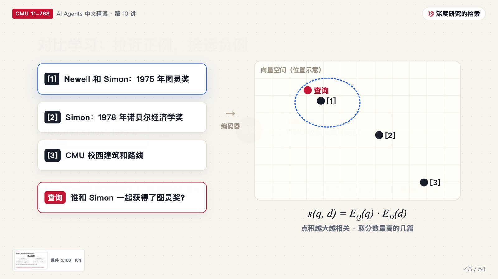

原课件 p.101–102：**先把文档集编码好，建一个向量索引。**

- 三篇文档：[1] Newell 和 Simon：1975 年图灵奖。[2] Simon：1978 年诺贝尔经济学奖。[3] CMU 校园建筑和路线。
- 每篇过一遍文档编码器 E_d，放进向量索引。
- 查询"谁和 Simon 一起获得了图灵奖？"过查询编码器 E_q，在索引里离 [1] 最近：**最匹配的是 [1]。**（视频里的向量空间是位置示意。）

```
s(q, d) = E_q(q)ᵀ E_d(d)        取分数最高的 k 篇
```

查询和文档各自变成一个向量，两个向量做点积就是相关分数，取前几名返回。这种查询、文档各用一个编码器的结构叫**双编码器**（bi-encoder），代表是 DPR。

课上口头补充：文档编码器离线把所有文档编码好，就是向量数据库；推理时只编码问题，用最近邻搜索找分数高的文档。查询编码器和文档编码器可以一样，也可以不一样。

### 12.3 训练嵌入：对比学习


原课件 p.103–104：**对比学习：拿一篇相关段落和若干负例段落比。**

- 查询 q：谁和 Simon 一起获得了图灵奖？
- 相关段落 d⁺：Newell 和 Simon：1975 年图灵奖。→ 提高相似度
- 负例 d⁻：CMU 校园建筑和路线。→ 降低相似度

```
L = − log [ exp s(q, d⁺) / ( exp s(q, d⁺) + Σ_{d⁻} exp s(q, d⁻) ) ]
```

把正例的分数和所有负例的分数一起放进 softmax，损失就是正例那一份概率取负对数。正例分数比负例越高，损失越小。

负例从哪来（课上口头补充）：

| 负例来源 | 做法 |
|---|---|
| 批内负例（in-batch negatives） | 同一个小批里其他问题的正例，当这个问题的负例；DPR 这么做 |
| 难负例（hard negatives） | 用 BM25 这种更弱的检索器挖出"看着相关、其实没用"的段落 |

动手练习第 5 部分会看到：示意向量下，[2]（也提到 Simon）比 [3] 难分得多，这就是"难负例"。编码器设计、负例采样和建索引的细节，原课件说去看高级自然语言处理和信息检索的课。

这一节记住一句：检索分本地和黑盒两类，嵌入检索靠向量距离，训练时拉近正例、推远负例。

---

## 13 AgentIR：让检索器看到 agent 的推理

### 13.1 检索器只看到查询

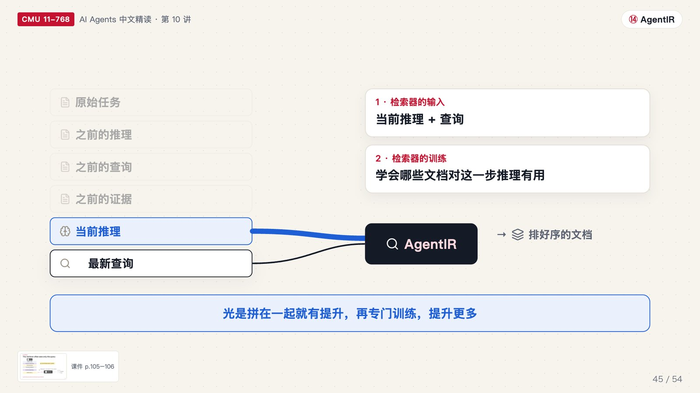

原课件 p.105–106，出自 AgentIR（COLM 2026）。

- agent 这边有：原始任务、之前的推理、之前的查询、之前的证据……、当前推理 τ_t、最新查询 q_t。
- **只有最新的查询被传给了检索器。推理不传给检索器。**

AgentIR 的两个改动：

| 1 检索器的输入 | 2 检索器的训练 |
|---|---|
| 当前推理 τ_t + 查询 q_t | 学会哪些文档对这一步推理有帮助 |

课上口头补充：嵌入模型通常是为"拿一个查询当输入"优化的；深度研究 agent 的历史丰富得多，最终那个查询不总能体现它。当前推理能把要找的目标说得更完整，总结前面的发现，也说清这一步到底缺什么。光是把查询和推理拼在一起就有提升，再专门训练，提升更多。

举个例子（**示意**，本课件编的，不是论文里的轨迹）：

| | 交给检索器的文本 |
|---|---|
| 只用查询 | `Turing Award 1975` |
| 推理 + 查询 | `已确认合著者是 Simon，Simon 1978 年获诺贝尔奖；要找和他一起获图灵奖、在 CMU 任教的人。查询：Turing Award 1975` |

### 13.2 DR-Synth：给中间搜索造标签

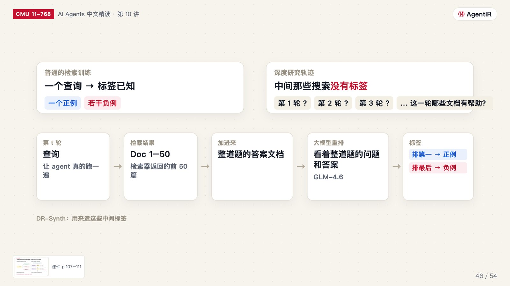

原课件 p.107：**中间搜索需要局部标签。**

| 标准的检索器训练 | 深度研究轨迹 |
|---|---|
| 一个查询 → 一个正例 d⁺、若干负例 d⁻ | 全局问题 → 每一轮有自己的推理、查询和检索到的文档 → …… |
| 相关性标签是已知的 | 这一轮哪些文档有帮助？正例？负例？ |

BrowseComp 这类题只知道整道题的答案和答案文档，不知道第 5 轮那次中间搜索该返回什么，所以 12.3 的对比学习缺中间轮次的正负例（这一页课上没单独讲，这句是本课件的解释）。

原课件 p.108–111，**DR-Synth 用 agent 自己产生的信息需求来训练检索器**：

| 步 | 做什么 |
|---|---|
| 1 | 第 t 轮的查询 q_t → 检索结果 Doc 1 到 Doc 50 |
| 2 | 加入全局正例：整道题的答案文档（课件图上是 Global Gold 1–5 加 Doc 1–45） |
| 3 | 列表式重排：以全局问题和全局答案为参考，对候选重新排序 |
| 4 | 排第 1 的标为正例，排第 49、50 的标为负例 |

按 AgentIR 原文 §3.3、附录 B 核对：让通义 DR 配一个普通检索器（Qwen3-Embedding-8B）真的跑一遍；每一轮取前 50 篇，把全局答案文档也放进候选池（当前这一轮在解题的一部分，全局答案文档很可能和它相关）；做列表式重排的是 GLM-4.6。训练数据来自 **WebShaper 的 500 道题**。AgentIR-4B 是在 Qwen3-Embedding-4B 上用对比学习微调的。

### 13.3 更准，搜得还更少

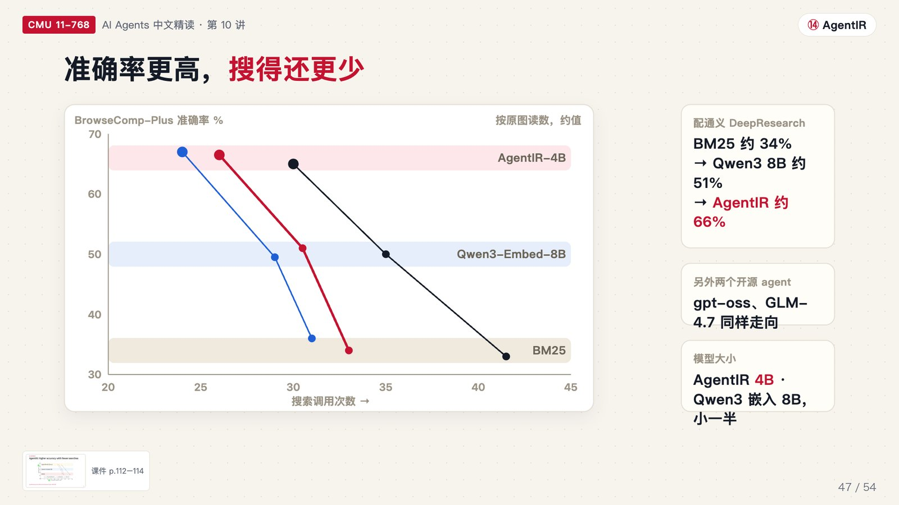

原课件 p.112–114：**AgentIR 用更少的搜索找到更多证据。** 横轴是搜索调用次数，纵轴是 BrowseComp-Plus 上的准确率。点上没标数，下表按原图读数，约值：

| agent | BM25 | Qwen3-Embed-8B | AgentIR-4B |
|---|---|---|---|
| Tongyi-DeepResearch | 34%，33 次 | 51%，30.5 次 | 66.5%，26 次 |
| oss-120b-high | 36%，31 次 | 49.5%，29 次 | 67%，24 次 |
| GLM-4.7 | 33%，41.5 次 | 50%，35 次 | 65%，30 次 |

- 每个 agent 的三个点都往左上走：准确率更高，搜索次数更少。
- AgentIR 是 4B 的嵌入模型，比 8B 的 Qwen3 嵌入模型小一半（课上口头补充）。
- AgentIR 摘要说"配通义 DR 准确率 68%，而大一倍的普通嵌入模型是 52%"；散点图上通义那个点约 66%。68.1 对得上 13.4 表里的"Tongyi-DR（visit）"一列。"visit"是什么设置，课件和课上都没解释。

为什么搜得更少（本课件的补充）：检索器每次给的证据更准，agent 就不用一遍遍改写查询重搜。第 3.4 节说上百次搜索又慢又贵，检索变好直接省下这部分成本。

### 13.4 消融一：推理输入和 DR-Synth 训练，哪个有用

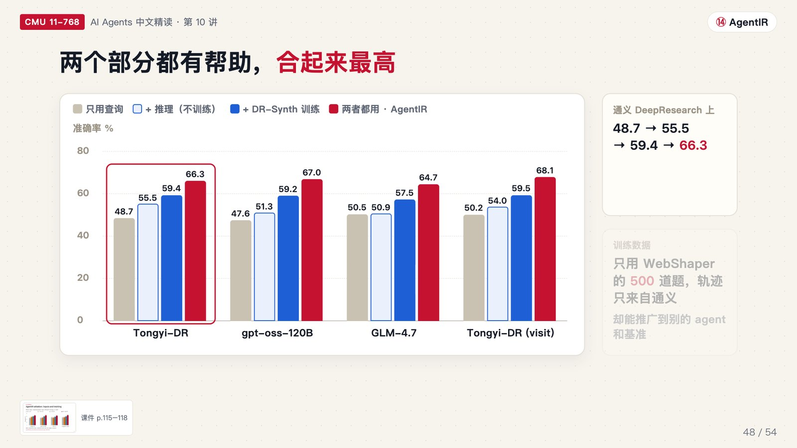

原课件 p.115–118：**感知推理的输入、DR-Synth 训练，还是两者都要？** 准确率（%，课件图上印着的数）：

| agent | 只用查询 | + 推理（不训练） | + DR-Synth 训练（只用查询） | 两者都用（AgentIR） |
|---|---|---|---|---|
| Tongyi-DR | 48.7 | 55.5 | 59.4 | **66.3** |
| gpt-oss-120B | 47.6 | 51.3 | 59.2 | **67.0** |
| GLM-4.7 | 50.5 | 50.9 | 57.5 | **64.7** |
| Tongyi-DR（visit） | 50.2 | 54.0 | 59.5 | **68.1** |

- **两个部分都有帮助；合起来准确率最高。**
- 课上口头补充：训练数据规模很小，轨迹也只来自通义 DR，评测却跨了不同的 agent 和基准，结果仍然能推广。（课上说训练数据"原本是为 BrowseComp-Plus 设计的"，原文附录 B 写的是 WebShaper 的 500 道题，以原文为准。）

本课件的补充（课上没算）：GLM-4.7 只加推理几乎没涨（50.5 → 50.9），训练之后两者合起来却涨了 14.2 分。不训练的话，检索器不知道怎么用这段推理。

### 13.5 消融二：哪部分历史对检索有用

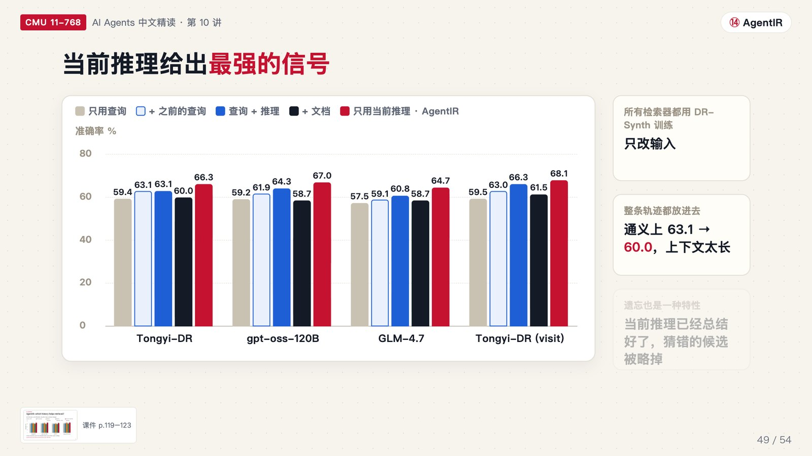

原课件 p.119–123：**所有检索器都用 DR-Synth 训练，只改输入的上下文。** 准确率（%，课件图上印着的数）：

| agent | 只用查询 | + 之前的查询 | 查询 + 推理 | 查询 + 推理 + 文档 | 只用当前推理（AgentIR） |
|---|---|---|---|---|---|
| Tongyi-DR | 59.4 | 63.1 | 63.1 | 60.0 | **66.3** |
| gpt-oss-120B | 59.2 | 61.9 | 64.3 | 58.7 | **67.0** |
| GLM-4.7 | 57.5 | 59.1 | 60.8 | 58.7 | **64.7** |
| Tongyi-DR（visit） | 59.5 | 63.0 | 66.3 | 61.5 | **68.1** |

- **当前推理在这几种 agent 设置下给出最强的信号。**
- 两张表对得上：这里"只用查询"一列 = 13.4 表的"+ DR-Synth 训练"一列；"只用当前推理"一列 = 13.4 表的 AgentIR 一列。

| 加了什么 | 结果 | 为什么（课上口头补充） |
|---|---|---|
| 之前的查询 | 有一点用 | 说明模型过去想搜什么，却说明不了它找到了什么 |
| 之前的查询 + 对应的推理 | 有帮助，但不稳定 | |
| 再加上工具输出（整条轨迹） | 反而变差，通义上 63.1 → 60.0 | 对嵌入模型来说上下文太长 |
| 只用当前推理 | 最好 | 当前推理本身就是看着整段历史写出来的，已经把任务和之前的发现总结好了 |

AgentIR 原文 §5.3 还给了第二个理由（课上只讲了第一个）：**遗忘也是一种特性**。早期推理里猜错的候选，答案确定后就成了噪声；当前推理的总结会自然略掉这些错的猜测。

这一节记住一句：检索器要看 agent 当前的推理，而不是整条轨迹，再用 DR-Synth 造的标签专门训练。

---

## 14 课堂问答

原课件上没有这部分，都是课上的提问和回答（课上口头补充）。提问的人离麦克风远，问题有时没录全，下面按回答整理。视频里讲了三个，另外几个课上的问题放在本节最后，简要列出。

### Q1 专门训练的 8B 小模型，和前沿大模型差在哪？


- **答**：要看基准。

| 基准类型 | 差距 | 课上的解释 |
|---|---|---|
| BrowseComp 这类长程任务 | 前沿模型好得多 | 它们管理长上下文、做计划和推理的能力强得多；最好的 8B 甚至 20B、32B 模型，就算做了大量监督微调，也打不过最好的 GPT 模型，甚至打不过最好的开源模型（比如 GLM） |
| HealthBench、ScholarQABench、DeepResearch Bench 这类开放式基准 | 没看到大差距 | 难点是认真收集信息、综合成高质量的长篇回答，不是管理大量上下文；也可能是长篇回答还评得不够好 |

- 想做出打败前沿模型的深度研究 agent，得先想清楚目标基准和任务；在给定算力下缩小差距，本身也是个有意思的方向。

### Q2 深度研究 agent 现在最大的瓶颈是什么？


- **答**：课上的回答是评测。

| 要点 | 课上怎么说 |
|---|---|
| 短答案基准分数已经很高 | 知道基准和目标，大家大致知道怎么优化；BrowseComp 这类题可以反向工程，也能直接套用数学、编程推理里成功的配方 |
| 开放式深度研究做得少 | 连评它的好基准都没有 |
| 评测是训练的基础 | 会评，才能造大规模基准和监督微调数据、做**拒绝采样**（rejection sampling）、拿评测函数当奖励 |
| 细则评测有自己的偏差 | 比如偏向更长的回答 |
| BrowseComp 很人工 | 能不能反映用户真实的信息需求，还是开放问题 |
| 只评最终报告 | 人们用深度研究 agent 是为了做决定、理解自己代码里的 bug；还没有基准测它到底帮人把事做成了多少 |

### Q3 评测时，怎么保证模型不是把答案背下来了？


- **答**：
  - BrowseComp 刚建时，最好的模型凭自己的知识答不出来；最新的前沿模型有没有背下答案就不好说了，预训练、后训练的数据污染可能很严重。
  - 有论文在不给搜索的条件下测新模型做 BrowseComp，课上的印象是"还不到 20%"（没给出处）。
  - 还有一个坑：模型会直接搜到原始数据集。DR Tulu 训练时，不设屏蔽名单的话，模型真的会去 Hugging Face 或 OpenAI 的原始数据集里找答案。所以评搜索 agent，至少先把 Hugging Face 这类放数据集的网站屏蔽掉。

BrowseComp 自己怎么防（按原文和源码核对）：数据集里的题目和答案是加密存放的，每行带一个 **canary 字符串**；canary 既是解密口令，也方便别人从训练语料里把这份数据过滤掉；原文还请大家不要在网上用明文或图片公开例题。第 15 节会读到解密的代码。注意这防的是"网上搜到明文答案"和"训练数据混进明文"，防不了有人解密后再公开。

### 课上的其他问题（视频里没讲，简要列出）

| 问题 | 课上回答的要点 |
|---|---|
| 做课程项目选哪个基准 | 短答案可验证选 BrowseComp；想省推理成本、或研究检索，选 BrowseComp-Plus；开放式的 DeepResearch Bench 用得广，但分数已经很高；专业领域可以看 FinSearchComp |
| 做项目用多大的模型当基线 | Qwen3 8B 这类模型是不错的基线；能说明自己训的模型打败更强、更大的专门系统更有说服力 |
| 检索和 agent 各用什么 | 起步时用网页搜索接口（课上提到 Serper）；强化学习要跑很多 rollout，会很贵，可以用 BrowseComp-Plus 或本地索引（BM25、Qwen3 4B/8B 嵌入）；嵌入模型可以看 MTEB 排行榜；做检索器要证明它在不同 agent 上都好用 |
| 演化细则能用到深度研究以外吗 | 后续有论文把它用在一般的开放式生成上；基于细则的强化学习很通用 |

---

## 15 源码解读：simple-evals 里的 BrowseComp 评测

课程主页第 10 讲只列了论文，没有推荐源码。这一节读 OpenAI 的 [simple-evals](https://github.com/openai/simple-evals) 里 BrowseComp 的参考实现，它把第 3 节的"答案短、好判分"和第 14 节 Q3 的"别让答案被搜到"都落成了代码：

| 本讲的说法 | 源码里 | 本节 |
|---|---|---|
| 答案短，看回答里有没有它就能判（3.2） | 让模型按固定格式写 `Exact Answer:`，再交给判分模型 | 15.1、15.3 |
| 判分模型判"有没有实质差别" | `GRADER_TEMPLATE` | 15.1 |
| 题目和答案加密存放，canary 当口令（14 Q3） | `derive_key`、`decrypt` | 15.2 |
| 准确率 = 和参考答案一致的比例（3.3） | `is_correct` 求平均 | 15.4 |
| 默认值 | `simple_evals.py`、`sampler/chat_completion_sampler.py` | 15.5 |

版本：[openai/simple-evals](https://github.com/openai/simple-evals) 提交 `652c89d0ca9df547706735883097e9537d40dc47`（2026-11-03 读取的 main，提交日期 2026-04-22）。`browsecomp_eval.py` 最后一次改动是提交 `5e623c2b`（2025-05-12）。仓库 README 写着：2025 年 7 月起不再为新模型和新结果更新，但继续托管 HealthBench、BrowseComp、SimpleQA 的参考实现。

下面的代码都是原文件节选，行号是这个提交里的行号；中文注释是本课件加的，删掉的部分用 `# ……（删去：……）` 标出。

### 15.1 两个提示：让被测模型怎么答，让判分模型怎么判

```python
# browsecomp_eval.py，第 15–23 行
# from: https://github.com/centerforaisafety/hle/blob/7b6be5aad6f9b43af3857de7867f3b52f6e4acb3/hle_eval/run_model_predictions.py#L11
QUERY_TEMPLATE = """
{Question}

Your response should be in the following format:
Explanation: {{your explanation for your final answer}}
Exact Answer: {{your succinct, final answer}}
Confidence: {{your confidence score between 0% and 100% for your answer}}
""".strip()
# 被测模型拿到的提示：题目 + 固定的三段格式
# Exact Answer 要求"简洁的最终答案"：BrowseComp 的答案是一个短实体，这样才好判
# Confidence：让模型自报把握，原论文拿它算校准误差（这份代码里没算）
# {{ }} 是 str.format 的转义，输出时是单个花括号
```

两个模板都注明了来源：抄自另一个基准 HLE（Humanity's Last Exam）的评测代码。

```python
# browsecomp_eval.py，第 25–45 行
# from: https://github.com/centerforaisafety/hle/blob/7b6be5aad6f9b43af3857de7867f3b52f6e4acb3/hle_eval/run_judge_results.py#L16-L33
GRADER_TEMPLATE = """
Judge whether the following [response] to [question] is correct or not based on the precise and unambiguous [correct_answer] below.

[question]: {question}

[response]: {response}

Your judgement must be in the format and criteria specified below:

extracted_final_answer: The final exact answer extracted from the [response]. Put the extracted answer as 'None' if there is no exact, final answer to extract from the response.

[correct_answer]: {correct_answer}

reasoning: Explain why the extracted_final_answer is correct or incorrect based on [correct_answer], focusing only on if there are meaningful differences between [correct_answer] and the extracted_final_answer. Do not comment on any background to the problem, do not attempt to solve the problem, do not argue for any answer different than [correct_answer], focus only on whether the answers match.

correct: Answer 'yes' if extracted_final_answer matches the [correct_answer] given above, or is within a small margin of error for numerical problems. Answer 'no' otherwise, i.e. if there if there is any inconsistency, ambiguity, non-equivalency, or if the extracted answer is incorrect.


confidence: The extracted confidence score between 0|\%| and 100|\%| from [response]. Put 100 if there is no confidence score available.
""".strip()
```

判分提示让判分模型按顺序写四样东西：

| 字段 | 要求 | 为什么这样设计（本课件的解读） |
|---|---|---|
| `extracted_final_answer` | 从回答里抽出最终答案，抽不到写 None | 被测模型的回答很长，先抽出答案再比，判分只看答案 |
| `reasoning` | 只说两者有没有实质差别；不准评论背景、不准自己解题、不准替别的答案辩护 | 判分模型只做"比对"，不做"研究"，否则它可能用自己的知识改判 |
| `correct` | 一致或数值在小误差内答 yes，否则 no | 二值结果，正好是 10.1 节 RLVR 要的那种奖励；"语言模型当评判"的精确匹配 |
| `confidence` | 抄出被测模型自报的把握，没有就写 100 | 给算校准用 |

和 10.1 节的 `EM(a, a_gold)` 比：字符串精确匹配会把 "Plastic Man" 和 "Plastic Man (DC Comics)" 判成不同；判分模型能认出它们没有实质差别。代价是多一次模型调用，判分本身也可能出错。

### 15.2 题目加密：canary 当口令

```python
# browsecomp_eval.py，第 50–63 行
def derive_key(password: str, length: int) -> bytes:
    """Derive a fixed-length key from the password using SHA256."""
    hasher = hashlib.sha256()
    hasher.update(password.encode())
    key = hasher.digest()
    # 口令的 SHA256 摘要，32 个字节
    return key * (length // len(key)) + key[: length % len(key)]
    # 把 32 字节反复拼接，截到和密文一样长


def decrypt(ciphertext_b64: str, password: str) -> str:
    """Decrypt base64-encoded ciphertext with XOR."""
    encrypted = base64.b64decode(ciphertext_b64)
    # 数据集里存的是 base64 文本
    key = derive_key(password, len(encrypted))
    decrypted = bytes(a ^ b for a, b in zip(encrypted, key))
    # 逐字节异或；异或两次等于没做，所以加密和解密是同一个运算
    return decrypted.decode()
```

```python
# browsecomp_eval.py，第 96–98 行（__call__ 里的 fn）
            def fn(row: dict):
                problem = decrypt(row.get("problem", ""), row.get("canary", ""))
                answer = decrypt(row.get("answer", ""), row.get("canary", ""))
                # 题目和答案都用这一行的 canary 当口令解密
```

本课件下载官方测试集核对过（2026-11-03，只数行数和列名，不解密、不公开题目）：共 1,266 行，列是 `problem`、`answer`、`problem_topic`、`canary`；1,266 行用的是**同一个** canary。

这是什么级别的保护：

| 防得住 | 防不住 |
|---|---|
| 搜索引擎和爬虫按明文抓到题目和答案 | 任何拿到数据集和这段代码的人解密 |
| 训练语料里直接混进明文答案（还能按 canary 字符串过滤整份数据） | 有人解密后把答案贴到网上 |

所以它是"别让答案被随手搜到"的措施，不是安全意义上的加密（XOR 加重复的密钥）。这和第 14 节 Q3 说的"评搜索 agent，先屏蔽放数据集的网站"是同一件事的两面。

### 15.3 判分：抽出 yes / no

```python
# browsecomp_eval.py，第 79–93 行
    def grade_sample(self, question: str, correct_answer: str, response: str) -> str:
        grader_prompt = GRADER_TEMPLATE.format(
            question=question,
            correct_answer=correct_answer,
            response=response,
        )
        # 把题目、参考答案、被测模型的完整回答填进判分提示

        prompt_messages = [
            self.grader_model._pack_message(content=grader_prompt, role="user")
        ]
        sampler_response = self.grader_model(prompt_messages)
        grading_response = sampler_response.response_text
        # 判分模型的回复，按模板应该含一行 "correct: yes" 或 "correct: no"

        match = re.search(r"correct: (yes|no)", grading_response)
        return match.group(0) if match else "no"  # Default to "no" if no match
        # 抽不到这一行，默认判错
```

```python
# browsecomp_eval.py，第 105–111 行
                grade_result = self.grade_sample(problem, answer, response_text)

                # Metrics based on grading response
                is_correct = grade_result == "yes"
                is_incorrect = grade_result == "no"
                
                score = is_correct
```

**这两段放在一起有问题。** 正则 `correct: (yes|no)` 的 `group(0)` 是整段匹配 `"correct: yes"`，`group(1)` 才是括号里的 `"yes"`。`grade_sample` 返回的是 `group(0)`，下面却拿它和 `"yes"` 比：

| 判分模型的回复 | `grade_sample` 返回 | `is_correct` | `is_incorrect` |
|---|---|---|---|
| 含 `correct: yes` | `"correct: yes"` | False | False |
| 含 `correct: no` | `"correct: no"` | False | False |
| 两者都没有 | `"no"` | False | True |

也就是说，照这个提交原样跑，`is_correct` 永远是 False，算出来的准确率恒为 0。动手练习第 1 部分会把 `group(0)` 和 `group(1)` 打印出来。仓库里有一个修这处的 [PR #93](https://github.com/openai/simple-evals/pull/93)（2025-07-04 提交，把 `group(0)` 改成 `group(1)`），2026-11-03 查看时仍是 open 状态。自己用这份代码评测时，要先改这一行。

另外两处小细节（本课件读源码看到的）：

- 正则区分大小写，判分模型要是写成 `correct: Yes`，就匹配不上，按"判错"算。
- 第 113–120 行生成 HTML 报告时，`correct_answer=row["answer"]` 传的是**加密前的那一列**，即密文，`extracted_answer=response_text` 传的是完整回答，所以报告里看不到明文参考答案和抽出来的答案。这只影响报告，不影响分数。

### 15.4 汇总：准确率

```python
# browsecomp_eval.py，第 127–141 行
            # Run evaluation and collect results
            results = common.map_with_progress(fn, self.examples)
            # 多线程跑所有题；common.py 第 222 行默认线程数是 CPU 核数（取不到时为 10）

            # Aggregate metrics
            aggregate_metrics = {
                "is_correct": sum(result.metrics["is_correct"] for result in results) / len(results),
                "is_incorrect": sum(result.metrics["is_incorrect"] for result in results) / len(results),
            }
            # 准确率 = 判对的题数 / 总题数，就是原课件 p.25 那一栏"和参考答案一致的比例"
            # ……（删去：第 135–137 行的打印）

            output_d = {
                "accuracy": aggregate_metrics["is_correct"],
            }
```

删掉的部分：第 113–125 行生成 HTML 报告和对话记录（见 15.3 的小细节），第 142–145 行打印和返回。

### 15.5 默认值

```python
# browsecomp_eval.py，第 66–77 行
class BrowseCompEval(Eval):
    def __init__(self, grader_model: SamplerBase, num_examples: int | None = None, n_repeats: int = 1):
        df = pandas.read_csv(
            "https://openaipublic.blob.core.windows.net/simple-evals/browse_comp_test_set.csv"
        )
        examples = [row.to_dict() for _, row in df.iterrows()]
        if num_examples:
            assert n_repeats == 1, "n_repeats only supported when max_examples = None"
            rng = random.Random(0)
            examples = rng.sample(examples, num_examples)
            # 只评一部分时，用固定种子 0 抽样，每次抽到同一批题
        self.examples = examples * n_repeats
```

```python
# simple_evals.py，第 333–337 行
    grading_sampler = ChatCompletionSampler(
        model="gpt-4.1-2025-04-14",
        system_message=OPENAI_SYSTEM_MESSAGE_API,
        max_tokens=2048,
    )
```

```python
# simple_evals.py，第 385–389 行（get_evals 里）
            case "browsecomp":
                return BrowseCompEval(
                    grader_model=grading_sampler,
                    num_examples=10 if debug_mode else num_examples,
                )
```

```python
# sampler/chat_completion_sampler.py，第 21–27 行
    def __init__(
        self,
        model: str = "gpt-3.5-turbo",
        system_message: str | None = None,
        temperature: float = 0.5,
        max_tokens: int = 1024,
    ):
```

逐个对照源码核对的默认值：

| 参数 | 默认值 | 源码位置 | 说明 |
|---|---|---|---|
| `num_examples` | `None`（评全部 1,266 道） | `browsecomp_eval.py` 第 67 行 | `simple_evals.py` 第 351–353 行：没给 `--examples` 时为 None |
| debug 模式题数 | 10 | `simple_evals.py` 第 388 行 | `--debug` 时只评 10 道 |
| `n_repeats` | `1` | `browsecomp_eval.py` 第 67 行 | `simple_evals.py` 调 BrowseComp 时没传，用这个默认值 |
| 抽样种子 | `random.Random(0)` | `browsecomp_eval.py` 第 74 行 | 只在 `num_examples` 非空时用 |
| 判分模型 | `gpt-4.1-2025-04-14` | `simple_evals.py` 第 334 行 | 和 HealthBench 默认共用这个判分器 |
| 判分 `max_tokens` | `2048` | `simple_evals.py` 第 336 行 | 覆盖了 sampler 的默认 1024 |
| 判分 `temperature` | `0.5` | `chat_completion_sampler.py` 第 25 行 | 没覆盖，用默认值；所以同一个回答判两次，结果可能不同 |
| 抽不到 yes/no 时 | 判为 `"no"` | `browsecomp_eval.py` 第 93 行 | |
| 并发线程数 | CPU 核数，取不到为 10 | `common.py` 第 222 行 | |

### 15.6 对照本讲

| 本讲的说法 | 源码里 |
|---|---|
| 从答案倒着出题，答案短好判（3.1、3.2） | `Exact Answer: {{your succinct, final answer}}` |
| 精确匹配，有时用语言模型当评判（10.1） | `GRADER_TEMPLATE` 让 GPT-4.1 判"有没有实质差别" |
| 准确率 = 和参考答案一致的比例（3.3） | `is_correct` 求平均 |
| 别让模型搜到原始数据集（14 Q3） | 题目和答案 XOR 加密，canary 当口令 |
| 奖励信号出错，训练和评测都会错（14 Q2"评测是训练的基础"） | `group(0)` 一处取错组，准确率就恒为 0 |

最后一行是本课件的引申：第 10 节用答案对错当奖励时，奖励函数就是这样一段判分代码。判分代码里一个字符的错，评测时是"分数全 0"，一眼能看出来；训练时如果错成"总给 1"，就变成奖励作弊，不一定能马上发现。第 11.6 节 DR Tulu 专门用随机奖励做对照，就是为了确认提升来自奖励本身。

---

## 本讲小结


原课件 p.124：

| | 一句话 |
|---|---|
| 01 任务 | 深度研究 = 很多次搜索 + 综合证据。 |
| 02 评测 | 既评回答质量，也评引用有没有支撑；细则本身也要审查。 |
| 03 训练 | 先从示范里学，再通过任务反馈改进。 |
| 04 检索 | 把 agent 的信息需求交给检索器，并为它训练检索器。 |

课上口头补充：这几块都还有很多开放问题：细则评测怎么做得更好、有效的信息查找基准怎么做、没有清晰二值信号的任务奖励怎么设计、检索系统怎么为更 agentic 的系统设计。

逐节回顾：

- **什么是深度研究 agent**：简单问题一次搜索就够；研究问题要反复计划、搜索、反思、再搜索，没有哪一篇文档能单独回答，最后给出有结论、有限定、带引用的答案。
- **经典问答基准的四个局限**：简单查找、通用领域、短答案、证据用没用不清楚，对上四个维度：搜索复杂度、领域专长、答案质量、证据支撑。
- **搜索复杂度**：BrowseComp 从答案倒着出题，1,266 道；Deep Research 51.5%，人类 25.3% 是"两小时内解出且和参考答案一致"（29.2% × 86.4%）；上下文 8K 几乎 0、128K 约 43.5（按原图读数）；BrowseComp-Plus 冻结成 830 道题、100,195 篇文档。
- **领域专长**：FinSearchComp 635 道题、70 位金融专业人士；专业领域要专家出、专家核。
- **答案质量**：ROUGE、BERTScore、BLEURT 的偏好准确率只有 57%–62%；专家细则加权打分（例子 0.67）；语言模型和专家一致 79%，专家之间 80%（课件原话）；ResearchQA 21K 题、16 万条细则，参数化细则 15% 有问题，细则要先审。
- **证据支撑**：FACT 抽论断和网址、读被引页面、判断支不支持；引用准确率和有效引用数一起看。
- **推理流程**：推理 → 工具调用 → 搜索结果接进上下文 → 再推理 → 带引用作答，是第 2 讲工具调用循环的长版本。
- **训练配方**：中训练、监督微调、强化学习三阶段；在知识图谱上采子图造题（相当于反向工程 BrowseComp）；老师轨迹按答案、格式、连贯过滤再做监督微调。
- **agentic 中训练**：同样的监督微调数据，AgentFounder 基座在 BrowseComp-en 上 28.6 → 39.9。
- **RLVR**：短答案用精确匹配（或语言模型判分）当二值奖励；GRPO 组内比较，实际训练加回截断和 KL；异步 rollout 让长轨迹训练不干等。
- **DR Tulu**：开放式报告用细则当奖励；细则和策略一起演化，分正向和负向，放进缓冲区；8B 模型平均约 66，追平闭源系统，成本约千分之一；不做监督微调起点只有 27；随机奖励不涨、初始细则 59.4、演化细则 61.2（按原图读数）；换成 Qwen3-8B 生成细则只少约 1.3 分。
- **检索**：本地（BM25、嵌入）和黑盒（网页搜索、浏览、论文搜索）；嵌入靠点积打分，用对比学习训练。
- **AgentIR**：把当前推理和查询一起交给检索器，用 DR-Synth 给中间搜索造标签；4B 模型比 8B 嵌入更准、搜得更少；两个部分都有用；给整条轨迹反而变差，只用当前推理最好。
- **源码**：simple-evals 的 BrowseComp 评测让被测模型写 `Exact Answer`，交给 GPT-4.1 判分；题目和答案用 canary 做 XOR 加密；这一提交里 `group(0)` 取错组，原样跑准确率恒为 0。

## 关键术语

| 中文 | 英文 | 一句话解释 |
|---|---|---|
| 深度研究 agent | deep research agent | 反复计划、搜索、反思，把很多份证据综合成带引用答案的 agent |
| 检索增强生成 | Retrieval-Augmented Generation（RAG） | 模型查一次资料、再根据查到的内容作答 |
| 问答 | question answering（QA） | 给一个问题，找证据，再回答 |
| 搜索复杂度 | search complexity | 找到答案要搜多少次、多难 |
| 领域专长 | domain expertise | 题目需不需要专家知识 |
| 答案质量 | answer quality | 长篇回答写得好不好 |
| 证据支撑 | evidence grounding | 答案里的论断有没有被引用的来源支撑 |
| BrowseComp | BrowseComp | OpenAI 的 1,266 道多线索短答案搜索题，从答案倒着出 |
| BrowseComp-Plus | BrowseComp-Plus | 把 BrowseComp 的 830 道题配上固定语料库，方便复现和比检索器 |
| 困难负例 | hard negative | 看着相关、其实缺了关键线索的文档 |
| canary 字符串 | canary string | 数据集里的标记字符串，方便从训练语料里过滤；在 BrowseComp 评测代码里也当解密口令 |
| 参考答案 | reference answer | 人标的标准答案，相似度指标拿它来比 |
| 基于参考答案的指标 | reference-based metrics | ROUGE、BERTScore、BLEURT 这类和参考答案比相似度的指标 |
| 细则 | rubric | 一组"好答案该有什么"的标准，每条带权重 |
| 参数化细则 | parametric rubric | 模型只凭自己的知识生成的细则 |
| 判分模型 | grader / judge model | 用来判断答案对不对、满不满足细则的语言模型 |
| 引用准确率 | citation accuracy | 被支持的"论断—引用"对占全部的比例 |
| 有效引用 | effective citations | 被支持的"论断—引用"对的数量 |
| FACT | FACT | DeepResearch Bench 的引用检查框架 |
| 中训练 | mid-training | 预训练和监督微调之间的一段继续训练 |
| 继续预训练 | continual pre-training | 在已有基座上接着做下一个 token 预测 |
| agentic 中训练 | agentic mid-training | 把 agent 轨迹混进继续预训练 |
| 知识图谱 | knowledge graph | 节点是实体、带标签的有向边是关系的图 |
| 随机游走 | random walk | 从一个节点出发、沿边随机走，用来采连通的子图 |
| 反向工程 | reverse engineering | 照目标基准的出题方式造训练数据 |
| 老师模型 | teacher model | 生成示范轨迹的更强模型 |
| 拒绝采样 | rejection sampling | 生成很多、只留通过检查的 |
| 可验证奖励的强化学习 | RLVR | 奖励由可检查的结果给出，比如答案对错 |
| 精确匹配 | exact match（EM） | 答案和标准答案（规范化后）一字不差记 1 |
| GRPO | Group Relative Policy Optimization | 同一道题采一组，用组内平均当基线 |
| 截断 | clipping | 限制新旧策略的概率比，不让一步迈太远 |
| KL 惩罚 | KL penalty | 不让策略离参考模型太远 |
| rollout | rollout | 一次完整的试跑，产生一条轨迹 |
| 异步 rollout | asynchronous rollout | 每条轨迹各跑各的，到了答案就打分，凑够一批再更新 |
| 策略熵 | policy entropy | 策略输出有多分散；塌了不再探索，涨太高输出变乱 |
| 演化细则 | evolving rubrics | 训练中对比 rollout 不断生成的新细则 |
| RLER | RL with Evolving Rubrics | DR Tulu 的配方：用演化细则做强化学习 |
| 持久细则 | persistent rubrics | 训练前用搜索建好、一直保留的细则 |
| 正向细则 / 负向细则 | positive / negative rubrics | 奖励想要的行为 / 惩罚具体的错误 |
| 细则缓冲区 | rubric buffer | 存放当前在用的细则，按区分度保留 |
| 热启动 | warm start | 强化学习之前先做监督微调，和第 8 讲的冷启动说的是同一步 |
| 奖励作弊 | reward hacking | 模型钻奖励函数的空子拿高分，实际没做好 |
| BM25 | BM25 | 按词匹配打分的经典检索方法 |
| 嵌入模型 | embedding model | 把文本变成向量的模型 |
| 双编码器 | bi-encoder | 查询和文档各用一个编码器，点积打分 |
| 向量索引 | vector index | 存所有文档向量、支持最近邻搜索的结构 |
| 对比学习 | contrastive learning | 拉近正例、推远负例的训练方法 |
| 批内负例 | in-batch negatives | 同一批里别的问题的正例当负例 |
| DPR | Dense Passage Retrieval | 经典的双编码器嵌入检索方法 |
| AgentIR | AgentIR | 把 agent 当前推理和查询一起交给检索器的方法 |
| DR-Synth | DR-Synth | 给 agent 中间搜索造正负例标签的方法 |
| 列表式重排 | listwise reranking | 让大模型一次对一组候选整体排序 |
| Pass@1 | Pass@1 | 每道题只看一次尝试的通过率 |
| 校准 | calibration | 模型自报的把握和实际正确率对不对得上 |

## 思考题

<details>
<summary>1. 有人说"BrowseComp 上人类只有 25%，Deep Research 有 51.5%，所以 AI 已经比人强一倍"。这句话哪里不严谨？</summary>

25.3% 是"训练员每道题最多花两小时，两小时内解出、而且和参考答案一致"的比例（29.2% × 86.4%），有 70.8% 的题是两小时后放弃的，不是答错。Deep Research 没有这个时间上限，而且专门为 BrowseComp 这类任务训练过（课件 p.25 的星号）。两边的条件不同：能说的是"在这个基准上，专门训练的系统比两小时内的人类训练员解出得多"，不能说"比人强一倍"。另外 BrowseComp 的题集中在影视、人物这类实体上，题目也很人工（第 14 节 Q2），不能推到一般的研究能力。
</details>

<details>
<summary>2. 为什么 BrowseComp 要"从答案倒着出题"，而且坚持答案是一个短实体？如果改成"写一份调研报告"，评测和训练各会多出什么麻烦？</summary>

从答案倒着出，出题人手里就有确定的标准答案，再用多条线索的交集把题做难；答案短，判分就简单：看回答里的最终答案和参考答案有没有实质差别（第 15 节的判分提示）。这也让它能直接当强化学习的二值奖励（第 10 节）。改成调研报告，正确答案不止一种，参考答案标不全、相似度指标几乎随机（第 5.1–5.2 节），评测要换成细则；训练时奖励也得换成细则，又要回答"细则从哪来"（第 11 节）。
</details>

<details>
<summary>3. 用 5.3 节的打分方式，给下面这个答案打分：细则 A"报告了和人类专家的直接比较"（权重 2），细则 B"按任务和领域给结论加了限定"（权重 1），细则 C"每条论断都有引用"（权重 2）。答案是"在测过的文献综合任务上，专家更喜欢 OpenScholar 的答案 [1]；各领域是否都持平还没被证明。"</summary>

A 满足（报告了专家比较），B 满足（"在测过的任务上""各领域还没被证明"），C：第一句有 [1]，第二句是对证据范围的限定，可以算不需要引用，也可以严格要求有引用，这正是细则写得不够具体时判分会摇摆的地方。按满足算：(2 + 1 + 2) / 5 = 1.0；按不满足算：(2 + 1 + 0) / 5 = 0.6。这道题想说明的是：细则本身要写到能无歧义判断，5.6 节说的"含糊的标准"就是这类问题。（细则 C 是本题编的，示意。）
</details>

<details>
<summary>4. FACT 只检查"被引页面支不支持论断"。举一个 FACT 会给高分、但报告其实很差的例子。</summary>

例如报告里每句话都引得准，但只写了两三句无关紧要的事实，漏掉了问题的核心：引用准确率 100%，答案质量很差。或者引用的页面本身就是错的（一篇被撤稿的论文、一个内容农场网站），页面"支持"了论断，论断却是假的；课上说 FACT 还不检查被引证据本身的质量。所以 DeepResearch Bench 要把 FACT 和报告质量评分一起用，引用准确率也要和有效引用数一起看（6.1）。
</details>

<details>
<summary>5. 8.3 节用知识图谱造题的做法，课上说"相当于把 BrowseComp 反向工程了一遍"。这样训出来的模型在 BrowseComp 上分数高，可能有哪些不代表真实能力的原因？</summary>

训练题和测试题的出题方式一样（多条线索的交集、答案是一个实体），模型可能学会的是"这一类题的解法套路"，比如先拆线索、对着某几类网站搜，而不是一般的研究能力；课上也说能不能迁移到各种基准还是开放问题。另外两个风险：知识图谱和 BrowseComp 的答案可能来自同一批网页，有重叠；评测时模型可能直接搜到原始数据集（第 14 节 Q3）。要说明真实能力，得在出题方式不同的基准上也测，比如 FinSearchComp 或开放式的 DeepResearch Bench。
</details>

<details>
<summary>6. 10.2 节那组奖励 [0, 1, 1]，按 TRL 默认的样本标准差（除以 G − 1）算，三条的优势各是多少？如果这组变成 [1, 1, 1]，会怎样？</summary>

平均 2/3；样本标准差 √((0.667² + 2 × 0.333²) / 2) = √(0.6667 / 2) ≈ 0.577；优势 (0 − 0.667) / 0.577 ≈ −1.15，(1 − 0.667) / 0.577 ≈ +0.58，两条都是 +0.58（第 9 讲 10.2 节：TRL 用样本标准差）。变成 [1, 1, 1]，减掉平均全是 0，这组不贡献梯度（第 9 讲 8.5 节）。对深度研究来说，这说明太简单的题（全对）和太难的题（全错）都白花了采样，而每次采样都是几十上百次搜索，成本比数学题高得多，所以选题的难度更要紧。
</details>

<details>
<summary>7. DR Tulu 为什么要让细则"演化"，只用训练前定好的细则有什么问题？为什么还要负向细则？</summary>

训练前定好的细则只覆盖当时能想到的要点。策略在训练中会探索出新内容（11.3 节 y1 写到 STAT3、y2 写到 IL-6 没有升高），固定的细则给不出区分；策略也会钻固定细则的空子，比如反复堆砌细则里出现的词。演化细则让反馈跟着策略变，正向细则奖励新出现的好内容，负向细则专门惩罚这一组回答里共同的错误或奖励作弊（11.2 节）。按区分度保留细则，又保证每条细则对当前这组回答有用。消融上，演化细则比只用初始细则高约 1.8 分（按原图读数），训得越久差距越大（11.6）。
</details>

<details>
<summary>8. 13.5 节里给检索器看整条轨迹（包括工具输出）反而变差。除了"上下文太长"，还有什么原因？如果让你设计检索器的输入，你会怎么做？</summary>

原文给的第二个理由是"遗忘也是一种特性"：早期推理里猜错的候选，答案确定后就成了噪声，整条轨迹会把这些错的猜测也交给检索器，把它往错的方向拉。工具输出里还有大量和当前这一步无关的文档文本，稀释了"这一步要找什么"。当前推理是看着整段历史写出来的，已经做了一次总结和筛选。设计上可以只给当前推理加查询；如果想用更多历史，可以让 agent 自己写一句"这一步要找什么"的摘要再交给检索器，而不是原样拼接。
</details>

<details>
<summary>9. 第 15.3 节说 simple-evals 的这一版判分代码准确率恒为 0。如果同样一段代码被当作强化学习的奖励函数（第 10 节），会发生什么？如果错误换成"总是返回 yes"呢？</summary>

恒为 0：一组里所有奖励都相同，GRPO 的优势全是 0，模型完全学不到东西（第 9 讲 8.5 节），训练曲线是平的，比较容易发现。总是返回 yes：奖励全是 1，同样没有梯度；如果错误只发生在部分情况，比如某种格式的回答总被判对，模型就会学会写那种格式，这就是奖励作弊：训练奖励一路往上，真实准确率不动甚至下降。所以要像 DR Tulu 那样做随机奖励的对照（11.6），并定期抽样人工看判分结果，而不是只看训练奖励曲线（10.4 节通义的曲线也只是训练奖励）。
</details>

<details>
<summary>10. 第 14 节 Q1 说，在开放式长篇基准上 8B 模型和前沿模型"没看到大差距，也可能是长篇回答还评得不够好"。结合第 5 节，说说评测可能在哪些方面"评得不够好"。</summary>

细则评测依赖细则的质量：细则写得笼统，看着合理的回答都能过关（5.6）；细则只覆盖少数要点，回答之间的差别体现不出来。判分模型有偏差，课上提到细则评测偏向更长的回答（第 14 节 Q2）。细则一般只评最终报告的内容和引用，不评推理是否严谨、搜得是否全面。最后，这些基准评的是报告本身，没有评它能不能帮人把事做成（第 14 节 Q2 的最后一点）。这些都可能让"写得像样"的小模型和真正更强的大模型拿到相近的分。
</details>

## 动手练习

### 练习：BrowseComp 式判分、细则打分、组内优势和对比学习损失

20–30 分钟，只依赖 Python 3.10+ 标准库，不调用任何模型、不联网。把第 15 节的加密和判分、5.3 节的细则打分、6.1 节的 FACT、10.1–10.2 节的精确匹配和组内优势、12.3 节的对比学习损失自己算一遍。

```python
"""第 10 讲练习：深度研究 agent 的评测、奖励和检索打分（只用 Python 标准库）。"""
import base64
import hashlib
import math
import re
import statistics

# ---------- 第 1 部分：BrowseComp 式的加密存题 + 判分 ----------
def derive_key(password: str, length: int) -> bytes:
    # 和 simple-evals 的 browsecomp_eval.py 同一个写法：SHA256 摘要重复拼到需要的长度
    key = hashlib.sha256(password.encode()).digest()
    return key * (length // len(key)) + key[: length % len(key)]

def xor_b64(data: bytes, password: str) -> bytes:
    key = derive_key(password, len(data))
    return bytes(a ^ b for a, b in zip(data, key))

def encrypt(plain: str, password: str) -> str:      # 源码里没有，异或是对称的，自己补一个
    return base64.b64encode(xor_b64(plain.encode(), password)).decode()

def decrypt(cipher_b64: str, password: str) -> str:  # 和源码的 decrypt 等价
    return xor_b64(base64.b64decode(cipher_b64), password).decode()

CANARY = "DEMO-CANARY-0000"   # 示意：真实数据集的 canary 字符串不在这里贴
row = {"problem": encrypt("哪位 CMU 研究者……一起获得了图灵奖？", CANARY),
       "answer": encrypt("Allen Newell", CANARY), "canary": CANARY}
print("密文前 16 个字符:", row["answer"][:16])
print("解出来的答案:", decrypt(row["answer"], row["canary"]))

grader_reply = "extracted_final_answer: Allen Newell\nreasoning: 一致。\ncorrect: yes\nconfidence: 90"
m = re.search(r"correct: (yes|no)", grader_reply)
print("group(0) =", repr(m.group(0)), "→ == 'yes' 是", m.group(0) == "yes")
print("group(1) =", repr(m.group(1)), "→ == 'yes' 是", m.group(1) == "yes")

# ---------- 第 2 部分：细则加权打分（ScholarQABench / DR Tulu 的形式） ----------
def rubric_score(items):
    """items: [(权重, 满足与否 0/1)]，返回加权平均。"""
    return sum(w * b for w, b in items) / sum(w for w, _ in items)

print("课件 p.41 的例子:", round(rubric_score([(2, 1), (1, 0)]), 2))

# ---------- 第 3 部分：FACT 式的引用检查 ----------
claims = [("OpenScholar 和人类的答案比较过", "[1]", True),
          ("OpenScholar 在每个领域都和专家持平", "[1]", False)]
supported = sum(ok for _, _, ok in claims)
print(f"引用准确率 {supported}/{len(claims)} = {supported / len(claims):.0%}，有效引用 {supported} 条")

# ---------- 第 4 部分：RLVR 的精确匹配奖励 + GRPO 组内优势 ----------
def norm(s):
    return re.sub(r"\s+", " ", s.strip().lower())

gold = "Allen Newell"
answers = ["Herbert Simon", "Allen Newell", " allen  newell "]
rewards = [1.0 if norm(a) == norm(gold) else 0.0 for a in answers]
mean, sd = statistics.fmean(rewards), statistics.pstdev(rewards)
print("奖励:", rewards)
print("只减平均:", [round(r - mean, 2) for r in rewards])
print("再除以总体标准差:", [round((r - mean) / sd, 2) for r in rewards])

# ---------- 第 5 部分：点积检索 + 对比学习损失 ----------
# 示意：手写的 3 维向量，不是任何真实嵌入模型的输出
docs = {"[1] Newell 和 Simon：1975 年图灵奖": [0.9, 0.4, 0.1],
        "[2] Simon：1978 年诺贝尔经济学奖": [0.5, 0.8, 0.1],
        "[3] CMU 校园建筑和路线": [0.1, 0.1, 0.9]}
query = [0.8, 0.5, 0.0]
dot = lambda u, v: sum(a * b for a, b in zip(u, v))
scores = {d: dot(query, v) for d, v in docs.items()}
for d, s in sorted(scores.items(), key=lambda x: -x[1]):
    print(f"  {s:.2f}  {d}")

def info_nce(pos, negs):
    """L = −log( e^{s+} / (e^{s+} + Σ e^{s−}) )"""
    z = math.exp(pos) + sum(math.exp(n) for n in negs)
    return -math.log(math.exp(pos) / z)

s = list(scores.values())
print("正例 [1]、负例 [2][3] 的损失:", round(info_nce(s[0], s[1:]), 3))
print("正例分数加 1 之后的损失:", round(info_nce(s[0] + 1, s[1:]), 3))
```

照原样运行（Python 3.15 实测），输出是：

```
密文前 16 个字符: aRgIp1XXOsZs1Y74
解出来的答案: Allen Newell
group(0) = 'correct: yes' → == 'yes' 是 False
group(1) = 'yes' → == 'yes' 是 True
课件 p.41 的例子: 0.67
引用准确率 1/2 = 50%，有效引用 1 条
奖励: [0.0, 1.0, 1.0]
只减平均: [-0.67, 0.33, 0.33]
再除以总体标准差: [-1.41, 0.71, 0.71]
  0.92  [1] Newell 和 Simon：1975 年图灵奖
  0.80  [2] Simon：1978 年诺贝尔经济学奖
  0.13  [3] CMU 校园建筑和路线
正例 [1]、负例 [2][3] 的损失: 0.85
正例分数加 1 之后的损失: 0.401
```

对一下正文：

- 第 1 部分：`derive_key` 和第 15.2 节源码同一个写法，解密后还原出 Allen Newell；`group(0)` 那一行就是第 15.3 节的问题，`group(1)` 是 PR #93 的改法。canary 是练习自己编的，不是数据集里的真实字符串。
- 第 2 部分的 0.67 就是原课件 p.41 的例子；第 3 部分的 50%、1 条就是 p.49 的例子。
- 第 4 部分的 −1.41、+0.71、+0.71 就是 10.2 节算的数。`norm()` 的规范化（去空格、统一小写）是练习自己定的，所以第三条" allen  newell "也算对。
- 第 5 部分的三维向量是手写的（示意），不是任何嵌入模型的输出；[2] 也提到 Simon，分数 0.80 和正例 0.92 很接近，是一个"难负例"。

做完回答：

1. 把第 1 部分的 `grader_reply` 改成 `correct: Yes`（大写 Y），`group(1)` 的写法还能判对吗？怎么改正则最稳妥？（提示：`re.IGNORECASE`，或者先 `.lower()`。）
2. 第 1 部分里，同一个 canary 加密两段不同的明文，把两段密文解 base64 后逐字节异或，会得到什么？这说明"所有题共用一个 canary 的 XOR 加密"防不住什么？（提示：密钥被消掉了。）
3. 第 2 部分：给 `rubric_score` 加一条权重 2、判为 0 的负向细则"回答含有错误的论断"。负向细则该怎么计分才合理：满足时扣分，还是不满足时得分？写出你的实现，并说说 DR Tulu 这种"正负细则混在一个缓冲区里"时要注意什么。
4. 第 4 部分：把 `norm()` 改成只做 `strip()`，三条的奖励会怎么变？再想一个规范化太松、把错答案判对的例子（比如只比姓氏）。
5. 第 4 部分：把 `answers` 改成三个都是 "Allen Newell"，打印的优势是多少？除以标准差那一行会怎样？加一个判断，让标准差为 0 时优势直接取 0（第 9 讲 TRL 的做法是分母加 `1e-4`）。
6. 第 5 部分：把负例 [2] 的向量改成 `[0.85, 0.45, 0.1]`，损失怎么变？再写一个循环：每次把正例分数加 0.2、把 [2] 的分数减 0.2，打印 10 步的损失，看它怎么下降（这就是对比学习训练时在做的事）。
7. 选做：照 7 节的示意代码，写一个假的 `search()`（从第 5 部分的三篇文档里按点积取第一名）和一个假的 `llm()`（按固定剧本先搜"图灵奖"、再搜"诺贝尔"、最后作答），让 `deep_research()` 跑通一次，并统计调用了几次搜索。

> 这个练习不调用任何模型，也不执行模型生成的命令。如果你把第 7 题换成真模型、真搜索接口（让模型自己写查询、甚至写代码再执行），模型生成的代码和命令只在容器或沙箱里运行；不要在自己的日常电脑、装着真实凭证的环境里执行。评测 BrowseComp 时，也不要把解密后的题目和答案贴到网上（BrowseComp 原文的要求）。

## 延伸阅读

链接取自课程主页第 10 讲的必读和参考。

必读：

- OpenScholar（Synthesizing scientific literature with retrieval-augmented language models，Nature 2026）：[Nature](https://www.nature.com/articles/s41586-025-10072-4)。ScholarQABench 的专家细则评测、专家和语言模型判断的一致率。
- Wei et al.，BrowseComp（2025）：[arXiv:2504.12516](https://arxiv.org/abs/2504.12516)。出题和验证流程；表 2 人类训练员的结果（两小时内解出 29.2%，其中 86.4% 和参考答案一致）；校准误差的结果。
- DeepResearch Bench（ICLR 2026）：[arXiv:2506.11763](https://arxiv.org/abs/2506.11763)。FACT 引用检查框架。
- Tongyi DeepResearch 技术报告（2025）：[arXiv:2510.24701](https://arxiv.org/abs/2510.24701)。三阶段配方、图 10 上下文长度消融、§3.4.3 异步 rollout 和工具层、图 8 训练曲线。
- DR Tulu（Reinforcement Learning with Evolving Rubrics for Deep Research，ICML 2026）：[arXiv:2511.19399](https://arxiv.org/abs/2511.19399)。§3 演化细则、图 5 监督微调热启动、图 6 细则消融、表 1 主结果。
- AgentIR（Reasoning-Aware Retrieval for Deep Research Agents，COLM 2026）：[arXiv:2603.04384](https://arxiv.org/abs/2603.04384)。§3.3 DR-Synth、§5.1 和 §5.3 两组消融。

参考：

- 搜索复杂度：[BrowseComp-Plus](https://arxiv.org/abs/2508.06600)。
- 领域专长：[FinSearchComp](https://arxiv.org/abs/2509.13160)、[MedBrowseComp](https://arxiv.org/abs/2505.14963)、[ScholarSearch](https://arxiv.org/abs/2506.13784)、[AutoResearchBench](https://arxiv.org/abs/2604.25256)。
- 答案质量：[A Critical Evaluation of Evaluations for Long-form Question Answering](https://aclanthology.org/2023.acl-long.181/)（ACL 2023）、[ResearchQA](https://arxiv.org/abs/2509.00496)、[DeepResearch Bench II](https://arxiv.org/abs/2601.08536)。
- Natural Questions：[官方例题浏览器](https://ai.google.com/research/NaturalQuestions/databrowser)、[例题对应的维基百科修订版](https://en.wikipedia.org/w/index.php?oldid=824425456)。
- 造题和训练：[WebSailor-V2](https://arxiv.org/abs/2509.13305)、[WebDancer](https://arxiv.org/abs/2505.22648)、[Scaling Agents via Continual Pre-training](https://arxiv.org/abs/2509.13310)（AgentFounder）、[Search-R1](https://arxiv.org/abs/2503.09516)、[DeepSeekMath](https://arxiv.org/abs/2402.03300)（GRPO）。
- 检索：[Dense Passage Retrieval](https://aclanthology.org/2020.emnlp-main.550/)（DPR，EMNLP 2020）。
- 例子里的事实：[CMU 档案馆：Herbert Simon](https://digitalcollections.library.cmu.edu/cmu-collection/herbert-simon)、[1978 年诺贝尔经济学奖](https://www.nobelprize.org/prizes/economic-sciences/1978/summary/)。

源码：

- simple-evals：[browsecomp_eval.py](https://github.com/openai/simple-evals/blob/652c89d0ca9df547706735883097e9537d40dc47/browsecomp_eval.py)、[simple_evals.py](https://github.com/openai/simple-evals/blob/652c89d0ca9df547706735883097e9537d40dc47/simple_evals.py)、[sampler/chat_completion_sampler.py](https://github.com/openai/simple-evals/blob/652c89d0ca9df547706735883097e9537d40dc47/sampler/chat_completion_sampler.py)；修判分取组问题的 [PR #93](https://github.com/openai/simple-evals/pull/93)。

本系列相关的几讲：

- 第 2 讲：工具调用循环（第 7 节的推理流程是它的长版本）。
- 第 8 讲：agent 的监督微调（老师轨迹、冷启动）。
- 第 9 讲：强化学习基础（ReST、策略梯度、GRPO、组内优势）。
- 第 11 讲：进阶强化学习算法（截断、KL、离策略数据）。
- 第 12 讲：强化学习系统（异步 rollout、调度和训练效率）。

## 下一讲预告：强化学习进阶算法


这一讲讲的是深度研究 agent：任务从"一次搜索"变成"上百次搜索 + 综合证据"；评测从答案匹配扩到搜索复杂度、领域专长、细则评的回答质量和引用检查；训练沿用中训练、监督微调、强化学习三阶段，短答案用答案对错当奖励，开放式报告用演化细则当奖励；检索这一层，要让检索器看到 agent 当前的推理。

下一讲是第 11 讲：强化学习进阶算法（Training 3: Advanced RL Algorithms），接着第 9 讲往下讲离策略数据、重要性加权，以及 10.2 节 GRPO 目标函数里的截断和 KL 那几项。10.3 节的异步 rollout 和训练调度，在第 12 讲强化学习系统里展开。

留一个问题：10.3 节的异步 rollout 里，一条轨迹开始生成时用的是第 t 步的策略，等它跑完上百次搜索、拿到奖励，策略可能已经更新到第 t + 2 步了。拿"旧策略生成的轨迹"去更新"新策略"，第 9 讲推出来的策略梯度还成立吗？10.2 节目标函数里的概率比 ρ 和截断，是不是就是为这件事准备的？
