# 第 11 讲 · 强化学习进阶算法：信用分配、稳定更新和可靠的奖励

> CMU 11-768 AI Agents（2026 秋）中文精读 · 配套课件
> 配套视频（31 分钟）：B 站 / 视频号 / 抖音 / 小红书搜索「竹二木SI」 · 整份幻灯片：[l11-幻灯片.pdf](./l11-幻灯片.pdf)
> 原课程：[cmu-agents.com](https://cmu-agents.com)，课程主讲 Graham Neubig、Daniel Fried，本讲由 Graham Neubig 主讲。本课件是非官方的学习整理。

## 这一讲你会学到

学完这一讲，你应该能做到：

1. 用一道修 bug 的题和两条轨迹 A（成功、中间有错）、B（失败、中间有好的一步），说清**信用分配**（credit assignment）问题：组内比较让失败也有信号，但只靠终局奖励分不出一条轨迹里哪一步立了功。
2. 解释**价值函数**（value function）和**评论家**（critic）：价值是"站在这里往后平均能拿多少分"；评论家用平方误差训练（课件例子 0.30 → 0.21）；知道单独价值网络和挂在策略上的价值头两种搭法。
3. 手算**时序差分误差**（TD error）和**广义优势估计**（GAE）：价值 0.3 → 0.6 → 0.4 → 0，TD 误差 +0.3、−0.2、−0.4，λ = 0.5 时权重 1、0.5、0.25，第三步的优势是 0.1；说出 λ = 0 和 λ = 1 两个特例。知道**过程奖励模型**（PRM）是价值的一个替代品。
4. 说清同步和**异步强化学习**的取舍：同步要等最慢的那条，异步不用等，但有一部分数据来自旧策略。
5. 用**重要性采样**（importance sampling）修正旧策略的数据（1.75、0.50），说出长轨迹上比值连乘为什么会爆（1.05¹⁰⁰ ≈ 132）、为什么方差随位置线性增长而标准差按平方根增长，以及 PPO/GRPO、CTPO、完整比值、GSPO 各用哪些动作算权重。
6. 讲清**截断**（clipping）：一次真实训练里最大重要性权重冲到约 1,350 倍；比值截到 0.8–1.2；PPO 取最小和 CISPO 固定权重两种用法的差别；PPO 截断图在正负优势下分别是什么形状。
7. 分清三个策略：采数据的旧策略 μ、正在学的 πθ、当锚的参考模型 π_ref；知道 **KL 惩罚**和**熵奖励**各管什么。
8. 读懂六个常用算法（REINFORCE、PPO、GRPO、CISPO、GSPO、DAPO）的对比表，说出 DAPO 截断下界 0.2、上界 0.28，放宽上界是为了避免**熵坍缩**。
9. 诊断"一组奖励全一样"：全 0、全 1 没有梯度；先查验证器、能力还是探索。说清**假阴性**（正确的解被拒，SWE-bench Verified 和 τ-bench 卡在天花板上）和**假阳性**（`return 0` 也拿满分、**奖励投机**），以及编程 agent 的四种捷径、怎么独立检查进展。
10. 说出 DAPO 的**动态采样**、部分奖励和辅助奖励的用法和风险（计算器、哥布林），以及向老师学的几条路：热启动、课程、蒸馏、**在线策略蒸馏**（反向 KL ≈ 0.223）和在线策略**自蒸馏**（OPSD）。
11. 读懂 volcengine/verl 里 GAE、PPO 截断损失和 CISPO 损失的真实实现，对照默认值，说出代码和课件、论文不一样的地方。

建议先看一遍视频，再对照本课件逐节复习。每节开头的图就是视频里对应的画面。


### 接上一讲

强化学习一共三讲：第 9 讲打基础（采样几次尝试、打分、更新策略），这一讲讲算法，第 12 讲讲系统（内存、并行和大规模执行）。第 9 讲推到 GRPO 时留了几个尾巴，第 10 讲片尾又留了一个问题，这一讲逐个接上：

| 前两讲留下的说法 | 这一讲在哪里接上 |
|---|---|
| 第 9 讲 8.2 节：GRPO 的更新"去掉了论文里的比值、截断和 KL 项" | 第 6–8 节：重要性比值、截断、参考模型 KL |
| 第 9 讲 8.6 节：PPO 要用另一个模型估计基线 | 第 3–4 节：评论家、TD 误差和 GAE |
| 第 9 讲 8.5 节：奖励全相同时优势为零，列了换任务、扩大探索、加示范、给信息量更大的奖励几条出路 | 第 10–14 节逐条展开 |
| 第 9 讲 2.4 节：曝光偏差 | 第 14.2 节：蒸馏为什么要换成在线策略 |
| 第 9 讲 6.5 节：损失只算在模型生成的 token 上 | 第 15 节 Q4、第 16.1 节 verl 的 `response_mask` |
| 第 10 讲 10.3 节和片尾的问题：异步 rollout 里，"旧策略生成的轨迹"去更新"新策略"，策略梯度还成立吗？ | 第 5–7 节：不能直接用，要乘重要性比值，再截断 |

### 这一讲的路线

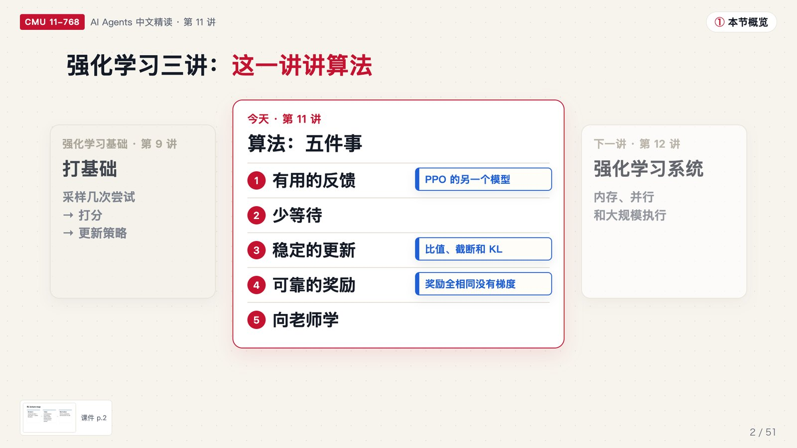

这一讲的写法是：每讲一个训练 agent 时真会碰到的问题，就给一个解法。没有解决真实问题的东西有意没放进来，所以都是实用的建议，做作业、做项目卡住了，可以回来翻。一共五件事：

| 五件事 | 要解决的问题 | 本课件 |
|---|---|---|
| 有用的反馈 | 失败的尝试也给信号；分清一条轨迹里哪一步有用 | 1–4 节 |
| 少等待 | 同步训练里大家都在等最慢的那条 | 5 节 |
| 稳定的更新 | 异步带来旧策略的数据；权重爆掉、模型跑偏 | 6–9 节 |
| 可靠的奖励 | 奖励全一样、验证器判错、模型钻空子 | 10–13 节 |
| 向老师学 | 学生太弱，几乎做不对 | 14 节 |

### 本课件用的符号

公式都用课件的写法（原课件 p.57–58 的符号表，课上没讲）。读的时候可以对照：

| 符号 | 意思 |
|---|---|
| x，τ，T | 任务（初始状态和提示）；一条采样的轨迹；动作个数 |
| h_t，a_t | 第 t 步之前的历史；这一步的动作 |
| u_t，u_{<t} | 第 t 个位置生成的 token；它前面的上下文 |
| πθ，μ | 当前（正在学的）策略；生成 rollout 的策略 |
| π_ref | 参考模型，训练中固定不动 |
| R(τ)，r_{t+1}，R_t | 最终奖励；a_t 之后拿到的奖励；从 h_t 开始的 reward-to-go |
| V_μ(h)，V_φ(h) | μ 下的期望 reward-to-go；评论家（参数 φ）的估计 |
| δ_t，Â_t | TD 误差；优势估计（这个动作比预期好多少） |
| ρ_t，c_t | 一个 token 的策略比值；它截断后的值 |
| γ，λ | 奖励折扣（本讲例子里 γ = 1）；GAE 里后面误差的权重 |
| q，d_μ | 老师给的目标分布；学生收集到的历史的分布 |

---

## 1 运行例子：修一个 bug

整讲只用一个例子：让编程 agent 修一个 bug。第 6 讲的编程 agent 修过同一个 bug。后面讲信用分配、重要性采样、验证器的假阴性和假阳性、蒸馏，都回到这道题。换成数学题、网页导航、深度研究也一样，用它只是因为简单。

### 1.1 任务和测试

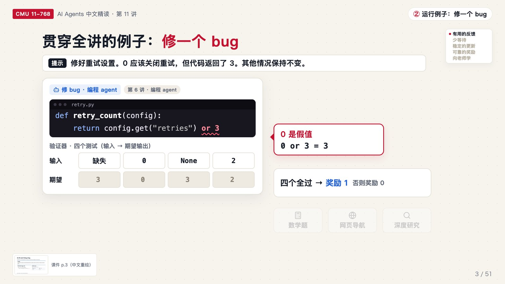

原课件 p.3：**我们要训练一个编程 agent 修 bug，用测试来判断每次尝试。**

- 提示：修好重试设置。0 应该关闭重试，但代码返回了 3。其他情况保持不变。
- 初始状态，有 bug 的代码：

```python
def retry_count(config):
    return config.get("retries") or 3
```

毛病出在 `or` 上：0 在 Python 里是假值，`0 or 3` 得到 3。

- 验证器：四个测试，直接测输入和输出。

| 输入 | 缺失 | 0 | None | 2 |
|---|---|---|---|---|
| 期望输出 | 3 | 0 | 3 | 2 |

四个全过奖励才是 1，否则是 0。

一种能过四个测试的修法（示意，课件没给）：

```python
def retry_count(config):
    value = config.get("retries")
    return 3 if value is None else value
```

### 1.2 一条成功的轨迹

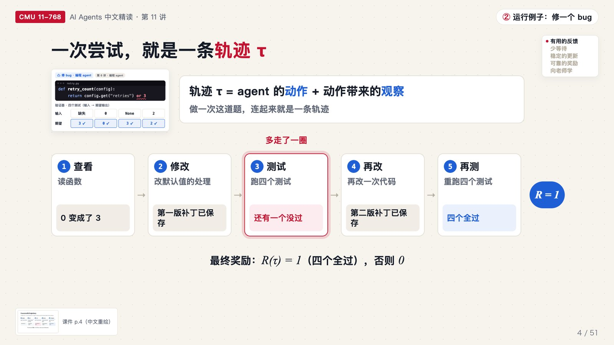

原课件 p.4：**轨迹 τ 就是一次尝试：agent 的动作，加上这些动作产生的观察。**

| 步 | 动作 | 观察 |
|---|---|---|
| 1 查看 | 读这个函数 | 0 变成了 3 |
| 2 修改 | 改默认值的处理 | 第一版补丁已保存 |
| 3 测试 | 跑四个测试 | 还有一个没过 |
| 4 再改 | 再改一次代码 | 第二版补丁已保存 |
| 5 再测 | 重跑四个测试 | 四个全过 |

最终奖励：四个测试全过 R(τ) = 1，否则为 0。这条轨迹最终奖励当然是 1，但它中间犯了一个错：没犯这个错的话，它能做得更好，也能更快做完。这一点在第 2 节会变成问题。

### 1.3 训练循环

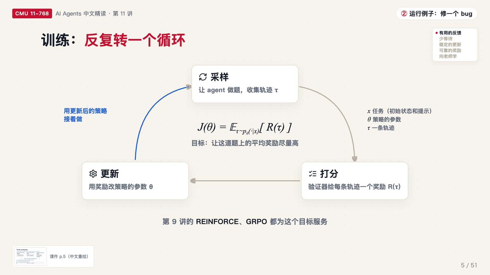

原课件 p.5：**训练不断重复这个循环，让很多次尝试的平均奖励变高。**

采样（让 agent 做任务，收集轨迹 τ）→ 打分（验证器给每条轨迹一个奖励 R(τ)）→ 更新（用奖励改策略的参数）→ 用更新后的策略收集新的尝试。

```
目标：让任务 x 上的平均奖励最大
J(θ) = E_{τ∼p_θ(·|x)} [ R(τ) ]
```

大白话：参数是 θ 的策略去做任务 x，会做出各种轨迹；把这些轨迹的奖励取平均，要让这个平均值尽量大。第 9 讲的 REINFORCE、GRPO 都是为这个目标服务的，这一讲会多用一点数学，但目标始终是这一个。

### 1.4 REINFORCE 回顾：失败的尝试不给信号

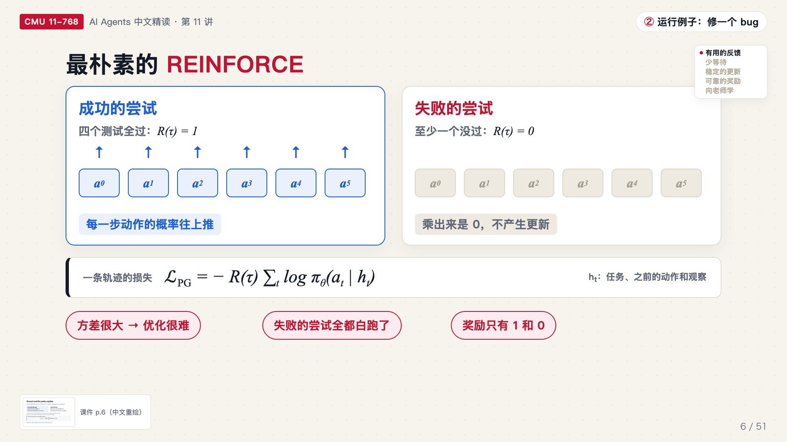

原课件 p.6：**朴素的 REINFORCE 用最终奖励给一次尝试里的每个动作加权。**

| 成功的尝试 | 失败的尝试 |
|---|---|
| 四个测试全过：R(τ) = 1 | 至少一个没过：R(τ) = 0 |
| 提高它的动作的概率 | 这次尝试不产生任何更新 |

```
一条采样轨迹上要最小化的损失：
L_PG = − R(τ) Σ_t log π_θ(a_t | h_t)
π_θ(a_t | h_t)：给定历史 h_t（任务、之前的动作和观察）时，策略选动作 a_t 的概率
```

成功的轨迹，把它每一步动作的概率往上推；失败的轨迹奖励是 0，乘出来什么都没有。这能用，但第 9 讲说过它方差很大，方差大会让优化很难；而且失败的尝试全都白跑了。

**问题：失败的尝试，怎样也能给出学习信号？** 我们也希望奖励比 1 和 0 更细。

---

## 2 信用分配：哪些动作该记功

原课件 p.7 分隔页：**信用分配和更密集的反馈。哪些动作该记功？**

### 2.1 组内比较：失败也有信号

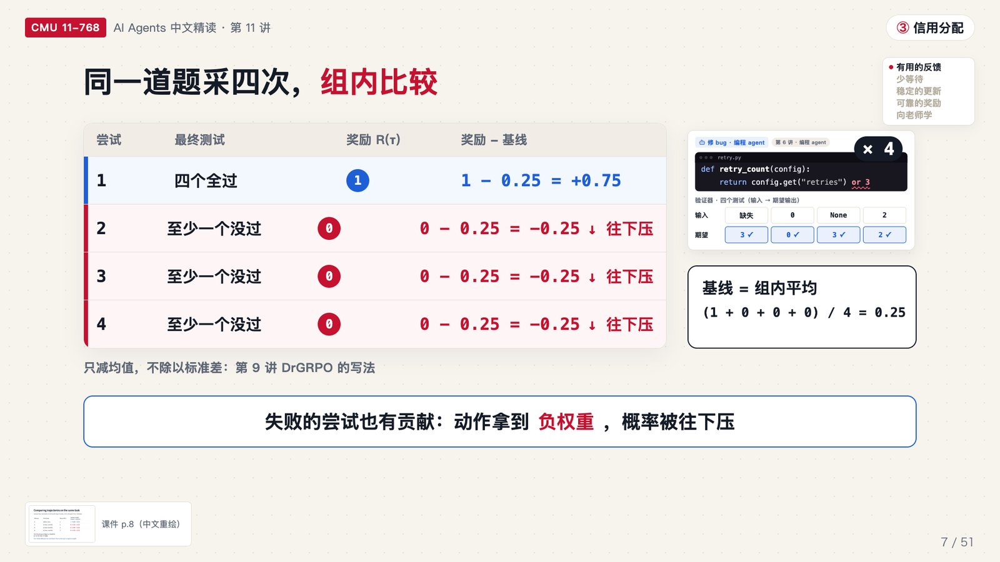

原课件 p.8：**在同一道修 bug 的题上采四次，比较它们的奖励。**

| 尝试 | 最终测试 | 奖励 R(τ) | 更新权重：奖励 − 基线 |
|---|---|---|---|
| 1 | 四个全过 | 1 | 1 − 0.25 = +0.75 |
| 2 | 至少一个没过 | 0 | 0 − 0.25 = −0.25 |
| 3 | 至少一个没过 | 0 | 0 − 0.25 = −0.25 |
| 4 | 至少一个没过 | 0 | 0 − 0.25 = −0.25 |

- 用组内平均当**基线**（baseline）：(1 + 0 + 0 + 0) / 4 = 0.25。
- **失败的尝试现在也有贡献：它们的动作拿到负权重，概率被往下压。**

这就是第 9 讲 8.1 节的组内相对优势。这里只减均值、不除以标准差，也就是第 9 讲 8.3 节 DrGRPO 的写法；原始 GRPO 还会再除以这一组奖励的标准差（第 9 节总表）。

### 2.2 成功里有错，失败里有好的一步

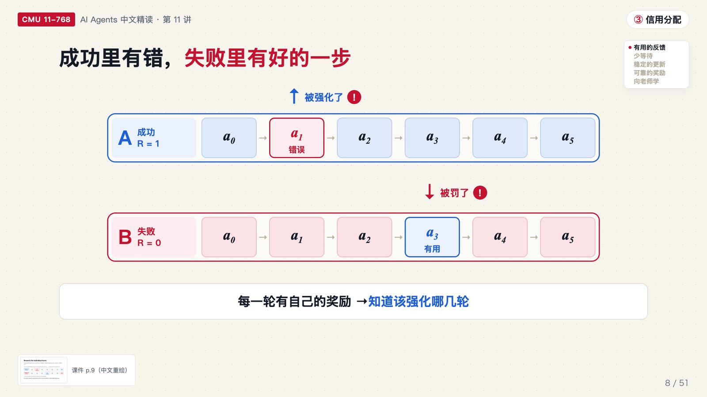

原课件 p.9：**成功的轨迹里可能有错，失败的轨迹里可能有好的一步。**

同一道题上两条示意轨迹（课件自己的示意），每个动作 a₀…a₅ 代表 agent 的一轮：

| 轨迹 | a₀ | a₁ | a₂ | a₃ | a₄ | a₅ | 奖励 |
|---|---|---|---|---|---|---|---|
| A 成功 | | **错误** | | | | | R = 1 |
| B 失败 | | | | **有用** | | | R = 0 |

组内权重对一条轨迹里的每一轮都一样。给 A 的每一步都加正权重，a₁ 那个错误也被强化了；它最后改回来了，问题也许不大，但能避免的错还是希望它别犯。B 可能一直做得很好，到最后才突然脱轨，因为最后那一下失败，就把前面所有有用的工作都罚掉，也不划算。

**要是每一轮有自己的奖励，就知道每条轨迹里该强化哪几轮。**

### 2.3 reward-to-go

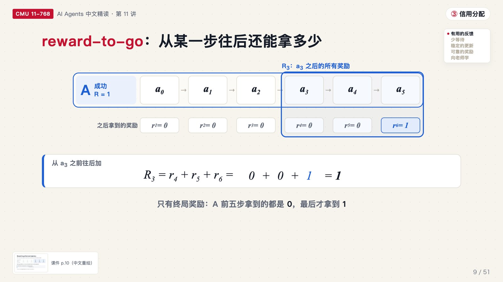

原课件 p.10：**只有最终奖励时，A 在成功之前每一步拿到的都是 0。**

| 动作前的历史 | h₀ | h₁ | h₂ | h₃ | h₄ | h₅ |
|---|---|---|---|---|---|---|
| 动作 | a₀ | a₁ | a₂ | a₃ | a₄ | a₅ |
| 动作后的奖励 | r₁ = 0 | r₂ = 0 | r₃ = 0 | r₄ = 0 | r₅ = 0 | r₆ = 1 |

从 a₃ 之前开始，这条轨迹上还剩多少奖励？把剩下的三个奖励加起来：R₃ = r₄ + r₅ + r₆ = 0 + 0 + 1 = 1。这个和叫 **reward-to-go**（往后还能拿多少奖励），R_t 就是 h_t 之后拿到的所有奖励。第 9 讲 7.10 节讲过它。

### 2.4 只有终局奖励时分不出来

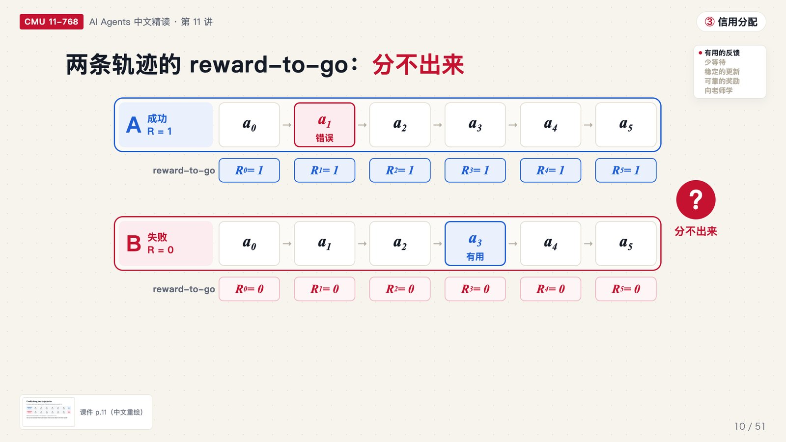

原课件 p.11：**B 每一步拿到的都是 0。把它的 reward-to-go 和 A 比。**

| 轨迹 | R₀ | R₁ | R₂ | R₃ | R₄ | R₅ |
|---|---|---|---|---|---|---|
| A 成功（R = 1） | 1 | 1 | 1 | 1 | 1 | 1 |
| B 失败（R = 0） | 0 | 0 | 0 | 0 | 0 | 0 |

A 上每一步的 reward-to-go 都是 1，B 上每一步都是 0。拿它去奖励 A 里那个错、B 里那一步好棋，两处还是分不出来：没有做到逐个动作的细粒度。

**问题：环境只告诉你测试过没过，怎么判断某一个动作是好是坏？**

课上这里让大家出主意，几个同学的想法（课上口头补充）：

| 同学的想法 | 课上的回应 |
|---|---|
| 写细则（rubric），拿到更细的奖励 | 好主意，后面会讲（对应第 13.2 节的部分奖励；第 10 讲 11 节讲过用细则当奖励） |
| 把所有 R = 1 的 rollout 放在一起，找共同的动作 | 很好的主意，但不好落地：要判断哪些动作序列是共有的，要么看完全重合，要么用语言模型判断 |
| 奖励不止一种定义，比如看轨迹是不是更短 | 后面也会讲 |

接下来讲的是最常用的做法：训练一个模型，看着当前局面预测 agent 接下来会不会成功，这就是价值函数。

**这一节记住一句**：组内比较让失败也有信号，但只靠终局奖励，分不清一条轨迹里哪一步立了功。

---

## 3 价值函数和评论家

### 3.1 从一个历史往后跑十次

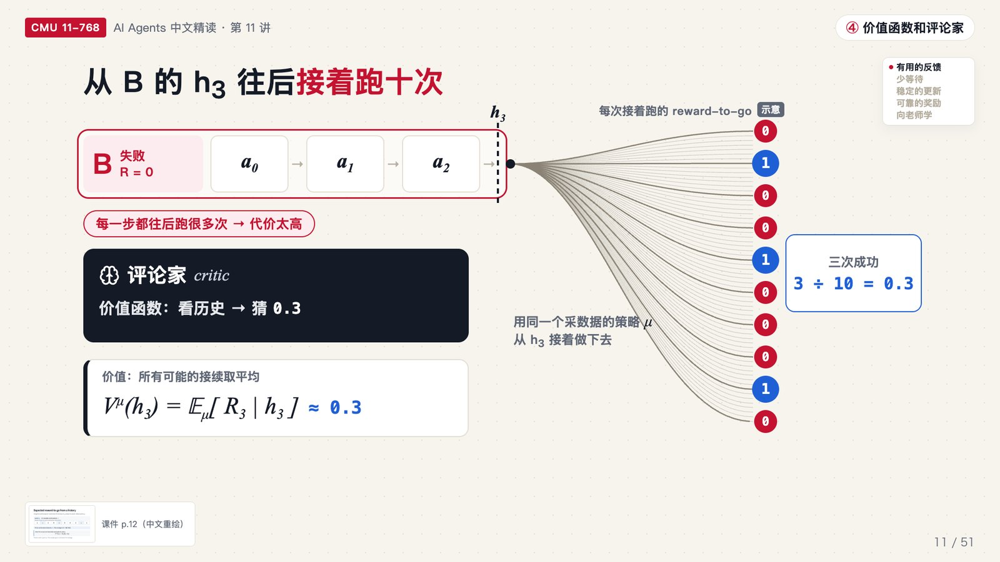

原课件 p.12：**设想从 B 的历史 h₃ 出发，用同一个 rollout 策略 μ 接着跑十次。**

十次接着跑的 reward-to-go（课件标"示意"）：

| 0 | 1 | 0 | 0 | 1 | 0 | 0 | 0 | 1 | 0 |
|---|---|---|---|---|---|---|---|---|---|

有三次 R₃ = 1，平均 3 ÷ 10 = 0.3。

```
价值：在 μ 下，对所有可能的接着跑取平均
V_μ(h₃) = E_μ[ R₃ | h₃ ]        竖线读作"给定 h₃"；十个样本给出这个平均的一个估计
```

**价值**（value）就是：站在 h₃ 这个位置，让同一个策略接着做下去很多次，平均能拿到多少奖励。跑十次是一种估计，跑无穷多次就是真正的期望。

问题是每一步都往后跑很多次，代价高得没法接受。所以学一个模型来直接预测这个期望 reward-to-go，这个模型叫**评论家**（critic），也就是价值函数。

μ 是什么（课堂提问，课上口头补充）：μ 是 **rollout 策略**，就是推理时用来采数据的那个策略。完全在线策略学习时，它就是正在更新的那个策略；第 5 节讲异步时，rollout 和更新会用不同的策略。

### 3.2 用平方误差训评论家

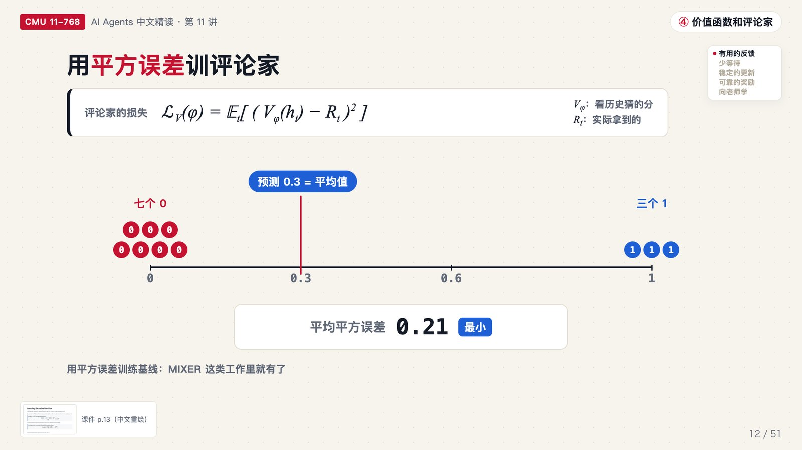

原课件 p.13：**训练一个评论家，用平方误差，从历史预测 reward-to-go。**

它的预测记作 V_φ(h)，φ 是要学的参数。还是用 h₃ 上那十个结果：三个 1、七个 0。

```
在 φ 上最小化；E_t 对采样 rollout 里的历史取平均
L_V(φ) = E_t[ (V_φ(h_t) − R_t)² ]
```

| 评论家的预测 | 平均平方误差 | 算式 |
|---|---|---|
| 0.6 | 0.30 | [3 × (0.6 − 1)² + 7 × (0.6 − 0)²] / 10 = (0.48 + 2.52) / 10 |
| 0.3（样本平均） | 0.21 | [3 × (0.3 − 1)² + 7 × 0.3²] / 10 = (1.47 + 0.63) / 10 |

对这几个样本，平方误差最小的预测就是它们的平均 0.3。所以用平方误差训出来，评论家会猜到平均值上，也就是猜到价值上。用平方误差训练基线，出处是 MIXER（Ranzato et al.，ICLR 2016，§3.2.1）。

### 3.3 评论家的两种搭法

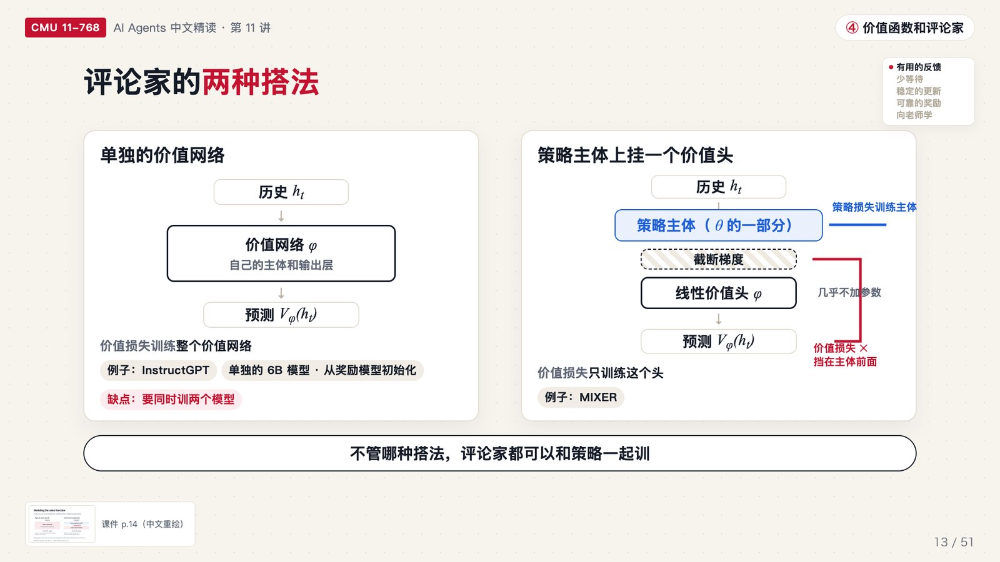

原课件 p.14：**评论家可以用自己的网络，也可以读策略的隐藏表示。**

| | 单独的价值网络 | 挂在策略主体上的价值头 |
|---|---|---|
| 结构 | 历史 h_t → 价值网络 φ（自己的主体和输出层）→ V_φ(h_t) | 历史 h_t → 策略主体（θ 的一部分）→ 截断梯度 → 线性价值头 φ → V_φ(h_t) |
| 价值损失训练什么 | 整个价值网络 | 只训练这个头 |
| 例子 | InstructGPT | MIXER |
| 代价 | 要同时训两个模型，训一个就已经够难了 | 头很小，几乎不加参数 |

- **截断梯度**（stop-gradient）挡住价值损失，不让它更新策略主体；策略损失照样训练主体。
- InstructGPT（Ouyang et al. 2022，附录 C）：价值函数是一个单独的 6B 模型，从奖励模型初始化。
- 不管哪种搭法，评论家都可以在用强化学习训练策略的同时一起训。

课上还提到单独价值网络的另一种做法（课上口头补充）：不加回归头，而是问模型"这条轨迹好不好？是或否"，用"是"的概率除以"是"和"否"的概率之和当预测。这只在奖励是 0 到 1 之间的概率时才行得通，但能复用模型做这类判断时已有的先验。

### 3.4 课堂问答：能判断对错，为什么不直接做对

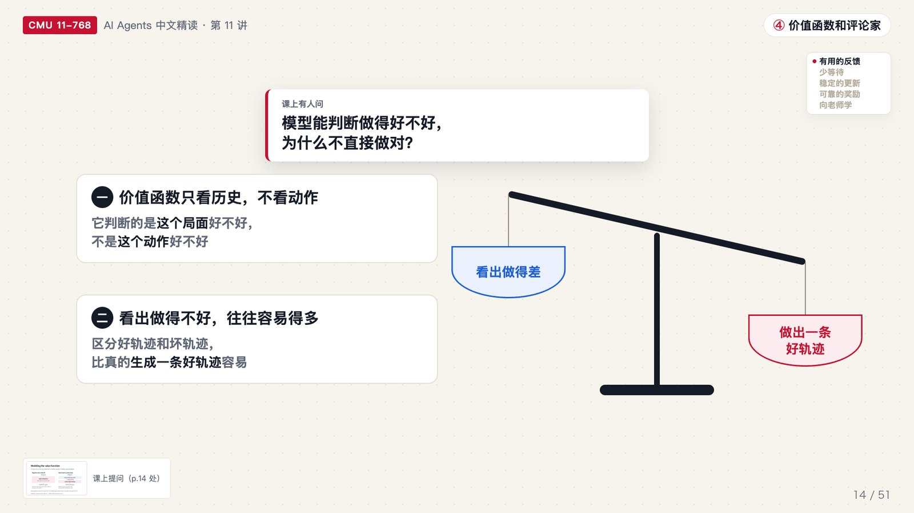

**问**：模型既然能判断做得好不好，为什么不直接做对？

**答**（课上口头补充），两个理由：

1. 价值函数只看历史，不看动作。它判断的是"这个局面好不好"，不是"这个动作好不好"。
2. 看出自己做得不好，往往比知道下一步怎么做才好容易得多。区分好轨迹和坏轨迹，比真的生成一条好轨迹容易。

**这一节记住一句**：价值就是站在这里往后平均能拿多少分，评论家用平方误差来学它。

---

## 4 TD 误差、GAE 和过程奖励模型

### 4.1 时序差分误差

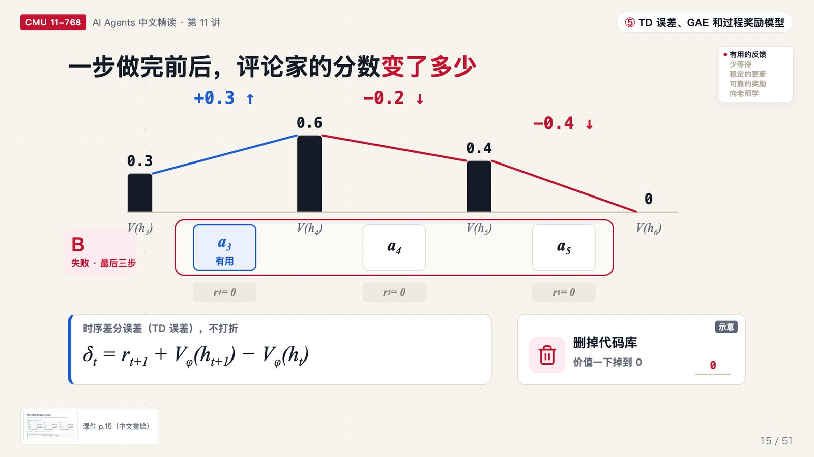

原课件 p.15：**这里奖励都是 0。比较评论家在每个动作前后给的价值。**

轨迹 B 的最后三个动作（课件的示意数值）：

| 动作 | 动作前 V_φ | 奖励 | 动作后 V_φ | TD 误差 |
|---|---|---|---|---|
| a₃ | V_φ(h₃) = 0.3 | r₄ = 0 | V_φ(h₄) = 0.6 | 0 + 0.6 − 0.3 = **+0.3** |
| a₄ | V_φ(h₄) = 0.6 | r₅ = 0 | V_φ(h₅) = 0.4 | 0 + 0.4 − 0.6 = **−0.2** |
| a₅ | V_φ(h₅) = 0.4 | r₆ = 0 | V_φ(h₆) = 0 | 0 + 0 − 0.4 = **−0.4** |

B 在 a₅ 之后结束，h₆ 之后不再有奖励，所以 V_φ(h₆) = 0。

```
时序差分（TD）误差，不对奖励打折
δ_t = r_{t+1} + V_φ(h_{t+1}) − V_φ(h_t)
```

这一步拿到的奖励，加上做完后的价值，减去做之前的价值，叫**时序差分误差**（temporal difference error，TD 误差）。涨了说明这一步让局面变好，跌了说明变坏。比如一不小心把代码库删了，价值会一下掉到 0，一看就知道这一步让价值掉了很多。

### 4.2 广义优势估计（GAE）

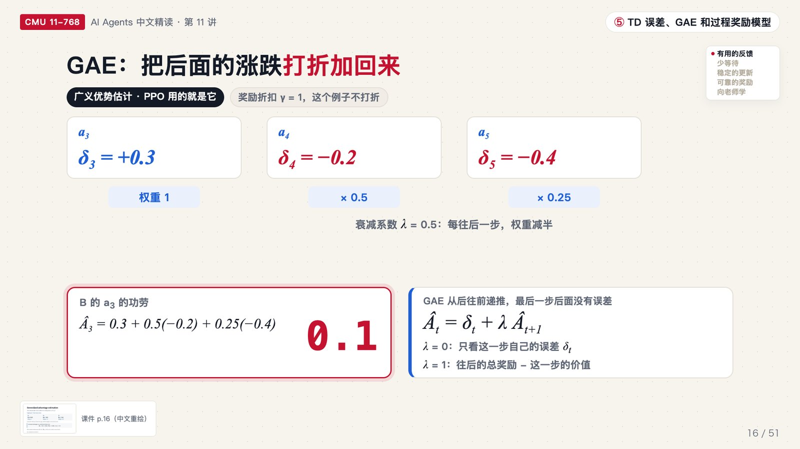

原课件 p.16：**后面的误差，应该怎样影响 B 的 a₃ 得到的信用？**

| | δ₃ = +0.3 | δ₄ = −0.2 | δ₅ = −0.4 |
|---|---|---|---|
| 权重（λ = 0.5） | 1 | 0.5 | 0.25 |
| 加权后 | +0.3 | −0.1 | −0.1 |

a₃ 的优势估计，把三个误差合起来：

```
Â₃ = 0.3 + 0.5 × (−0.2) + 0.25 × (−0.4) = 0.3 − 0.1 − 0.1 = 0.1

GAE 从后往前重复这一步：Â_t = δ_t + λ Â_{t+1}；到最后，后面没有误差了
```

从后往前递推一遍，结果一样：

| 步 | 递推 | 优势 |
|---|---|---|
| a₅ | Â₅ = δ₅ | −0.4 |
| a₄ | Â₄ = −0.2 + 0.5 × (−0.4) | −0.4 |
| a₃ | Â₃ = 0.3 + 0.5 × (−0.4) | **0.1** |

**广义优势估计**（Generalized Advantage Estimation，GAE）：一个动作的功劳，先看它自己那一步让局面变好了多少，再把后面每一步的好坏按 λ 的幂次打折加进来。a₃ 自己看着是好的一步，可后面两步都在变坏，它可能让后来做了坏的决定，所以功劳被打了折，从 0.3 降到 0.1。PPO 这个很常用的强化学习算法用的就是 GAE。

按 GAE 原文（Schulman et al.，ICLR 2016，式 16–18）补充两点：

- 原文的写法是 Â_t = Σ_l (γλ)^l δ_{t+l}，γ 是奖励折扣；本讲例子里 γ = 1，不打折。
- λ 是一个超参数，两个特例：

| λ | Â_t 等于 | a₃ 上的值（动手练习会打印） |
|---|---|---|
| 0 | 只看这一步自己的 TD 误差 δ_t | +0.3 |
| 0.5 | 本节的例子 | +0.1 |
| 1 | 往后的总奖励减去这一步的价值 V(h_t)，中间各步的价值两两抵消 | 0 − 0.3 = −0.3 |

λ = 1 时，当前这一步的价值 V(h_t) 还留着，起基线的作用。λ 越小，越依赖评论家的估计（方差小，评论家不准时偏差大）；λ 越大，越依赖真实拿到的奖励（偏差小，方差大）。这是本课件按 GAE 原文"在偏差和方差之间取舍"的说法补的，课上没展开。课上说，如果你有一个好的价值函数，或者有中间奖励，就可以设一个衰减。

### 4.3 过程奖励模型

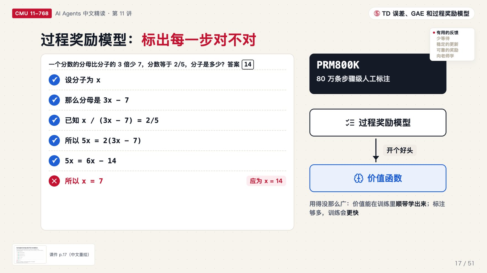

原课件 p.17：**一个替代品：从标注里学价值。过程奖励模型（PRM）学习每一步对不对，当作价值的替代。**

例题（Let's Verify Step by Step 图 1）：一个分数的分母比分子的 3 倍少 7。如果这个分数等于 2/5，分子是多少？（答案：14）

| 步骤 | 标注 |
|---|---|
| 设分子为 x。 | 对 |
| 那么分母是 3x − 7。 | 对 |
| 我们知道 x / (3x − 7) = 2/5。 | 对 |
| 所以 5x = 2(3x − 7)。 | 对 |
| 5x = 6x − 14。 | 对 |
| 所以 x = 7。 | **错** |

5x = 6x − 14 推出的是 x = 14，标注员把"x = 7"标成错误。核对：14 / (3 × 14 − 7) = 14 / 35 = 2/5。

| | 价值函数 | **过程奖励模型**（process reward model，PRM） |
|---|---|---|
| 怎么来 | 训练过程中顺带学出来 | 事先、和学习过程分开训，用人工的步骤级标注 |
| 代表 | PPO 的评论家 | Lightman et al. 2023；配套数据集 PRM800K 有 80 万条步骤级人工标注 |

课上说过程奖励模型用得没那么广，因为价值可以在训练里顺带学出来；但标注够多的话，它能给价值函数开个好头，训练会更快。

**这一节记住一句**：TD 误差看一步让价值涨了多少，GAE 把后面的涨跌打折加回来，算出每一步的功劳。

---

## 5 同步和异步强化学习

原课件 p.18 分隔页：**同步和异步强化学习。** 这是五件事里的"少等待"。给 agent 做强化学习可能非常慢，做作业时一定会碰到。

### 5.1 同步：大家等最慢的那条

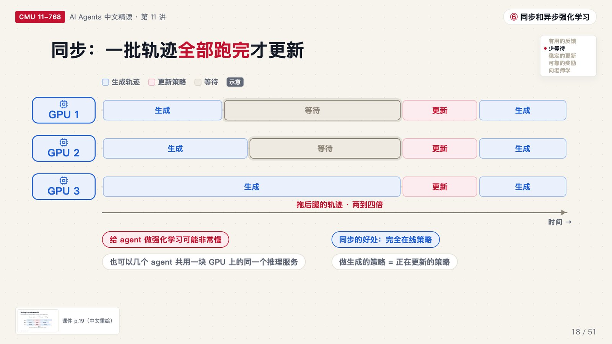

原课件 p.19：**一批里的每条轨迹都跑完，策略更新才开始。**

示意图（三块 GPU，横轴是时间）：每块 GPU 先生成轨迹，跑得快的先跑完，就在那里等；最慢的一条跑完，三块一起更新策略，再开始下一批生成。下一批要等策略更新完才开始。

- 不一定按 GPU 分，也可以几个 agent 共用一块 GPU 上的同一个推理服务；不管怎么分，你都想同时跑好几个 agent，因为 agent 跑起来很慢。
- 这张示意图还算客气。实际训编程 agent 时，常有一条拖后腿的轨迹，花的时间是别的两倍甚至四倍，其他的全闲着等它（课上口头补充）。
- 同步的好处（课上问大家，有同学答"在线策略"）：它是完全**在线策略**（on-policy）的，做生成的策略和正在更新的策略一模一样，μ 就是 πθ。

出处：AReaL，Fu et al. 2026，§3.2。

### 5.2 异步：边生成边更新

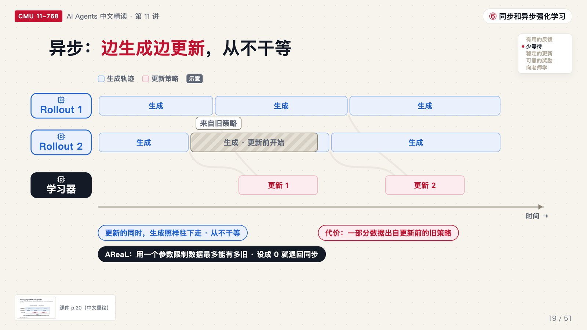

原课件 p.20：**异步强化学习让 rollout 工作进程一直生成，学习器同时用已经跑完的轨迹做更新。**

示意图：两块 rollout GPU 连续生成，不停；一块学习器 GPU 依次做更新 1、更新 2。**现在有些跑完的轨迹，来自更早版本的策略。**

| | 同步 | **异步**（asynchronous） |
|---|---|---|
| 等待 | 快的等慢的 | 从不干等 |
| 数据来自 | 当前策略（在线策略） | 有一部分来自更新前的旧策略（**离策略**，off-policy） |
| 稳定性 | 稳 | 会让训练很不稳定 |

课上说，认真做 agent 强化学习的，现在基本都用异步，软件也已经很好地支持了。代价就是第 6 节要处理的旧策略数据。

按 AReaL 原文（§5.1）：AReaL 用一个超参数 η 限制每个训练批里允许的最大陈旧度，η = 0 时就退回同步强化学习。第 7.1 节那张图里的"最大离策略程度"是同一类设置。

出处：AReaL，Fu et al. 2026，§4.1。

**这一节记住一句**：同步要等最慢的那条，异步不用等，但数据有一部分来自旧策略。

---

## 6 旧策略的数据和重要性采样

原课件 p.21 分隔页：**稳定的策略更新。** 等待省下来了，代价是旧策略的数据，这正是"稳定的更新"要解决的。

### 6.1 两个策略

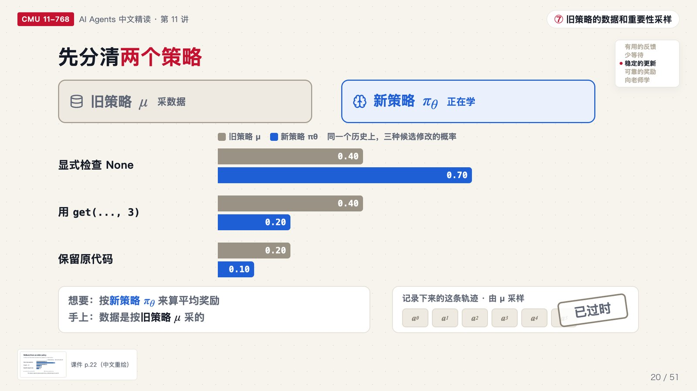

原课件 p.22：**学习器已经更新到新策略之后，一条 rollout 才可能跑完。**

同一个历史下，三个候选修改的概率（按原图读数）：

| 候选动作 | rollout 策略 μ（旧） | 学习器策略 πθ（新） |
|---|---|---|
| 显式检查 None | 0.40 | 0.70 |
| 用 `get(..., 3)` | 0.40 | 0.20 |
| 保留原代码 | 0.20 | 0.10 |

- μ 采样出了记录下来的那个修改；πθ 正在被更新。两列各自加起来都是 1。
- **这条 rollout 已经过时：它的动作来自 μ，学习器用的却是 πθ。** 我们想按新策略算平均奖励，手上的数据却是按旧策略采的。

为什么 `get(..., 3)` 是"不完整的修改"（本课件的推断，课件没解释）：`config.get("retries", 3)` 只在键缺失时用默认值 3，输入 None 时会返回 None，过不了 None → 3 那个测试。

### 6.2 重要性采样

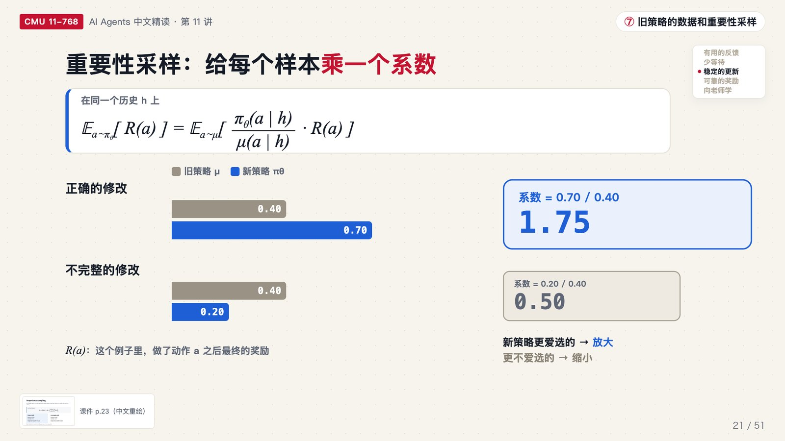

原课件 p.23：**在固定的历史 h 上，按一个采样动作在当前策略下有多可能，给它重新加权。**

```
在固定的历史 h 上：
E_{a∼πθ}[ R(a) ] = E_{a∼μ}[ (πθ(a|h) / μ(a|h)) · R(a) ]
R(a)：这个例子里，采取动作 a 之后的最终奖励
```

| | 正确的修改 | 不完整的修改 |
|---|---|---|
| 行为策略 μ | 0.40 | 0.40 |
| 当前策略 πθ | 0.70 | 0.20 |
| 权重 | 0.70 / 0.40 = **1.75** | 0.20 / 0.40 = **0.50** |

**重要性采样**：你想从一个分布里采样，却采不到，只能从另一个分布里采。这时给每个样本乘一个系数做修正，分子是你真正想采的分布（新策略）给它的概率，分母是实际采样分布（旧策略）给它的概率，这个系数叫**重要性权重**（importance weight）。新策略更爱选的样本放大，更不爱选的缩小。

为什么成立（本课件补的一行推导）：

```
E_{a∼μ}[ (π(a)/μ(a)) R(a) ] = Σ_a μ(a) · (π(a)/μ(a)) · R(a) = Σ_a π(a) R(a) = E_{a∼π}[ R(a) ]
```

前提是 μ(a) > 0 的地方要覆盖 π(a) > 0 的地方，旧策略从来不选的动作，修正不回来。

### 6.3 长轨迹上系数连乘

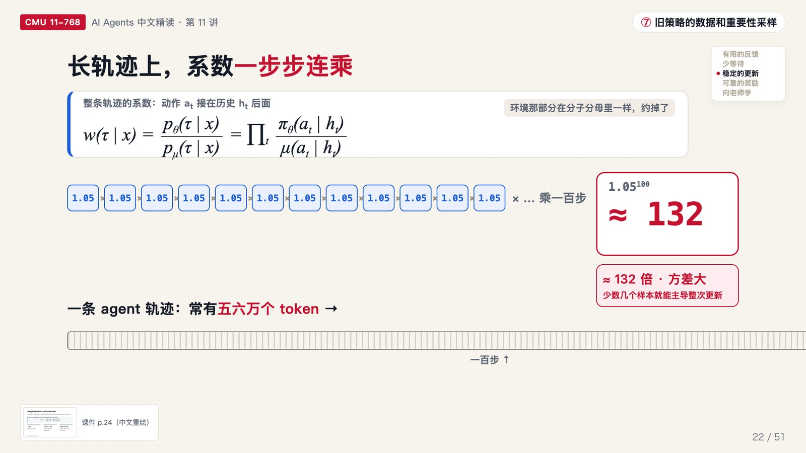

原课件 p.24：**整条轨迹的比值 w，把一次 agent 交互里各处的局部偏差乘在一起。**

```
w(τ | x) = p_θ(τ | x) / p_μ(τ | x) = Π_t πθ(a_t | h_t) / μ(a_t | h_t)
```

动作 a_t 接在历史 h_t 后面，环境的动态不变：环境的转移概率在分子分母里一样，约掉了，只剩策略的比值。

| 一个动作的比值 | 沿一条轨迹连乘 | 结果 |
|---|---|---|
| 1.05 | 1.05¹⁰⁰ ≈ 132 | 方差很大：少数几个样本就能主导更新 |

核算：100 × ln 1.05 ≈ 4.88，e^4.88 ≈ 131.5。每一步只差百分之五，乘一百步就是一百三十多倍。而一百步已经很客气了，一条 agent 轨迹常有五六万个 token（课上口头补充）。

出处：课件标 CTPO（Zhang et al. 2026）§3.2。CTPO §3.2 的结论是"完整序列比值无偏但方差高"；1.05 这个具体数字可能是课件自己的示意。

### 6.4 越往后，偏差散得越开

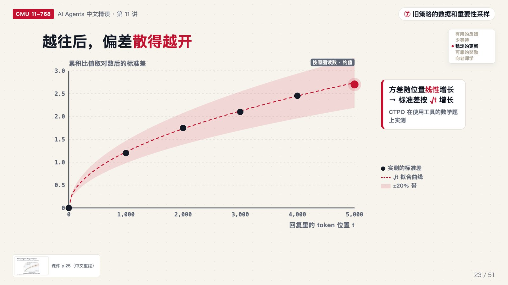

原课件 p.25：**累积比值 ρ_t^cum 把直到第 t 个 token 的动作比值乘在一起。**

图是 CTPO 图 1，标题"log ρ_t^cum 的方差随位置增长（第 100 步）"。横轴是回复里的 token 位置 t（0 到 5,000），纵轴是 log ρ_t^cum 的**标准差**。按原图读数：

| token 位置 | 0 | 1,000 | 2,000 | 3,000 | 4,000 | 5,000 |
|---|---|---|---|---|---|---|
| 标准差（约） | 0 | 1.2 | 1.75 | 2.1 | 2.45 | 2.7 |

- 实测点贴着拟合曲线 σ̂√t（σ̂ = 0.0387），周围是 ±20% 的带；右下角标 Var(log ρ_t^cum) ≈ tσ²。
- 在使用工具的数学题 rollout 里，越往后，偏差散得越开。

方差和标准差别弄反：

| | 随位置 t 怎么增长 |
|---|---|
| log ρ_t^cum 的**方差** | **线性**增长（≈ tσ²） |
| log ρ_t^cum 的**标准差** | 按**平方根**增长（≈ σ√t），图上画的是这个 |

道理：log ρ_t^cum 是前 t 个 token 的对数比值之和，近似独立的 t 个数加起来，方差相加，所以方差和 t 成正比，标准差是它的平方根。核算：0.0387 × √5000 ≈ 2.74，对上图上最右端的 2.7。CTPO 据此让截断阈值按 √t 放宽（原文 §3.3）。

### 6.5 前面的动作改变后面的历史

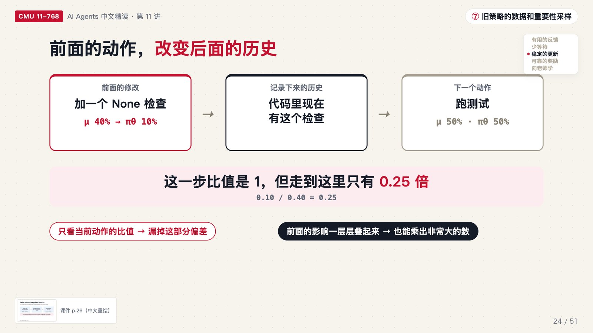

原课件 p.26：**当前策略可能很少走到 rollout 策略走过的某个历史。**

| 前面的修改 | → 记录下来的历史 | → 下一个动作 |
|---|---|---|
| 加一个 None 检查（μ：40%，πθ：10%） | 代码里现在有这个检查 | 跑测试（μ：50%，πθ：50%） |

**下一个动作的比值是 1，但走到这个历史的可能性只有 0.10 / 0.40 = 0.25 倍。** 只看当前动作的比值，会漏掉"能不能走到这个历史"那部分偏差；前面的影响一层层叠起来，也能乘出非常大的数。

出处：CTPO，Zhang et al. 2026，§3.1。

### 6.6 各算法用哪些动作算权重

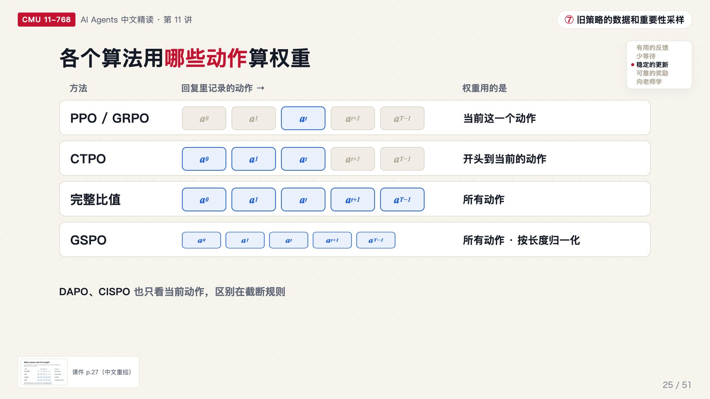

原课件 p.27：**一条有 T 个动作的回复，ρ_t 是第 t 个动作的概率比值。不同方法用回复里不同的部分。**

| 方法 | 记录下来的动作 a₀ a₁ … a_t a_{t+1} … a_{T−1} | 权重用的是 |
|---|---|---|
| PPO / GRPO | 只亮 a_t | 当前动作 |
| CTPO | a₀ 到 a_t | 直到 t 的动作 |
| 完整比值 | 全部 | 所有动作 |
| GSPO | 全部 | 所有动作，按长度归一化 |

DAPO 和 CISPO 也用当前动作的比值，区别在截断规则（第 7、9 节）。

按 CTPO 表 1 和 GSPO 原文补充（出处：CTPO 表 1；GSPO 式 7）：

| 方法 | 比值 | 无偏 | 方差 |
|---|---|---|---|
| GRPO（PPO 同） | 当前 token 的 ρ_t | 否 | 低 |
| 完整序列比值 | 所有 token 的比值连乘 | 是 | 高 |
| GSPO | 所有 token 比值连乘再开 1/长度 次方 | 否 | 量级被压下来 |
| CTPO | 第 1 到第 t 个 token 的比值连乘 | 是 | 比完整序列低 |

GSPO 的定义 s_i(θ) = (πθ(y_i|x) / π_old(y_i|x))^(1/|y_i|)，等于每个 token 对数比值的平均再取指数，所以量级和单个 token 的比值差不多。

课上的看法（课上口头补充）：PPO 和 GRPO 只看当前动作，这其实不是下一个动作正确的重要性权重，但够用，它能告诉你这个动作有多出乎意料。长话短说：要用重要性权重，但不能让它失控。

**这一节记住一句**：重要性采样让旧数据能用，但长轨迹上系数会连乘爆掉，各个算法的差别就在用哪些动作算权重。

---

## 7 截断更新

原课件 p.28 分隔页：**截断策略更新。**

### 7.1 一次真实训练里的权重尖峰

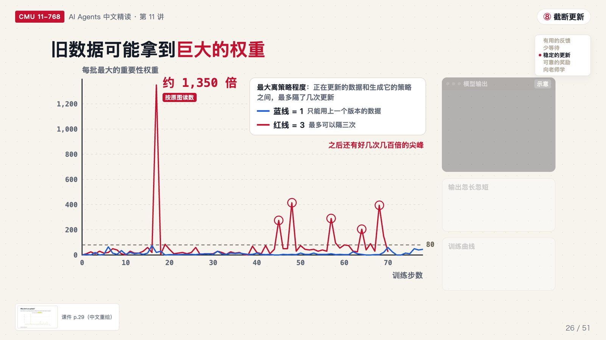

原课件 p.29：**过时的 rollout 可能拿到很大的权重，让少数几个样本主导一次更新。**

这是课上举的一个真实例子：一次异步训练里，每个训练批中**最大**的重要性权重（图标题 `ppo_actor/update/importance_weight/max`），横轴是训练步数（0 到约 78）。两条线的区别是**最大离策略程度**（max off-policyness）：正在更新的数据，和生成它的那个策略之间，最多隔了几次更新。

| 线 | 最大离策略程度 | 最大重要性权重（按原图读数） |
|---|---|---|
| 蓝线 | 1：只能用上一个版本策略的数据 | 全程大多在 80 以下 |
| 红线 | 3：最多可以隔三次更新 | 第 17 步左右冲到约 1,350 倍；之后在第 45、48、57、64、68 步附近还有约 280、410、290、200、400 的尖峰 |

（视频里的配色是蓝线、红线；原课件图上是另外两种颜色。课上口头说的是"一千四百左右"，这里按原图读数写约 1,350。）

更新里乘上一千多倍，就是迈了一个巨大的梯度步。训崩了通常是这样（课上口头补充）：模型突然开始重复同一个 token，输出变得特别长或者特别短，看起来一切都很怪。麻烦的是很难恢复：一旦这样，就拿不到好的奖励、拿不到有用的优势，训练基本就毁了。

### 7.2 截断一个比值

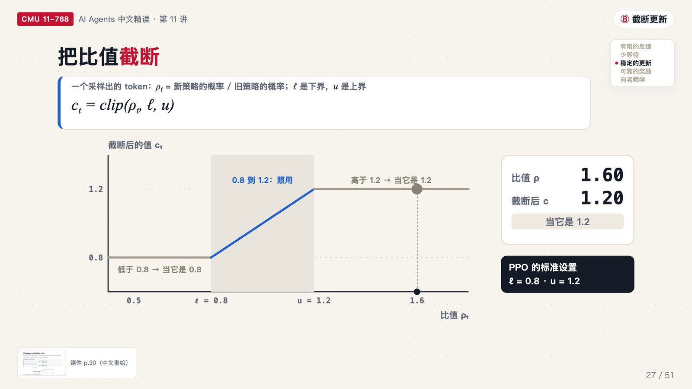

原课件 p.30：**截断函数把超出边界的比值换成离它最近的那个边界。**

这里每个动作是一个生成的 token u_t，u_{<t} 是它前面的上下文。

```
一个采样 token 的比值：ρ_t = πθ(u_t | u_{<t}) / μ(u_t | u_{<t})
截断后的值（ℓ 是下界，u 是上界）：c_t = clip(ρ_t, ℓ, u)
```

图：ℓ = 0.8 以下是一条 0.8 的平线，0.8 到 1.2 之间斜着往上，u = 1.2 以上是一条 1.2 的平线。比值在 0.8 到 1.2 之间就原样用；小于 0.8 当它是 0.8，大于 1.2 当它是 1.2。

| ρ_t | 0.5 | 1.0 | 1.6 |
|---|---|---|---|
| c_t = clip(ρ_t, 0.8, 1.2) | 0.8 | 1.0 | 1.2 |

修法有点经验性。PPO 论文里用的就是这种截断，0.8 和 1.2 是 PPO 的标准设置。出处：PPO，Schulman et al. 2017；CISPO，MiniMax-M1 2025。

### 7.3 PPO 和 CISPO 的两种用法

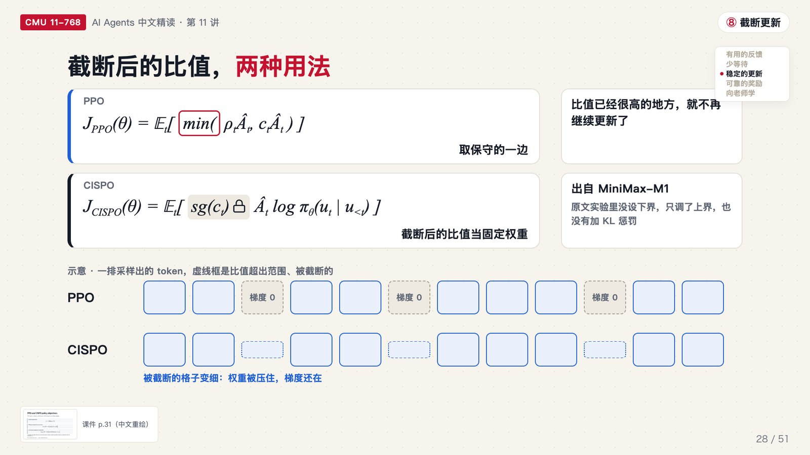

原课件 p.31：**PPO 把 c_t 放进一个取最小值里；CISPO 把它当成一个固定的权重。**

```
共用的截断比值：c_t = clip(ρ_t, ℓ, u)

PPO 要最大化的策略目标：
J_PPO(θ) = E_t[ min( ρ_t Â_t , c_t Â_t ) ]

CISPO 要最大化的策略目标：
J_CISPO(θ) = E_t[ sg(c_t) Â_t log πθ(u_t | u_{<t}) ]

E_t 对采样的 token 取平均；Â_t 估计这个 token 有没有帮上忙；
sg（stop-gradient）让 c_t 在求梯度时保持固定。要最小化的损失是 −J。
```

| | PPO | **CISPO** |
|---|---|---|
| 截断后的比值怎么用 | 截断前、截断后各算一个分，取小的那个（保守的一边） | 当成一个固定的系数，乘在"优势 × 对数概率"前面 |
| 被截断的 token | 梯度直接变成 0（取最小时选了常数那一项） | 还有梯度，只是权重被压住了 |
| 出处 | Schulman et al. 2017 | MiniMax-M1，2025 |

按 MiniMax-M1 原文（式 4、5）补充 CISPO 的几个细节：前面还有一个 1 / Σ|o_i|，对一组里所有回复的全部 token 取平均（token 级损失，沿用 DAPO）；不截断时就退化成标准策略梯度；实验里其实没设下界（把 ε_low 设得很大），只调上界；没有 KL 惩罚项。原文的说法是"CISPO 截断的是重要性采样权重，而不是 token 的更新"。

### 7.4 PPO 的截断目标画出来

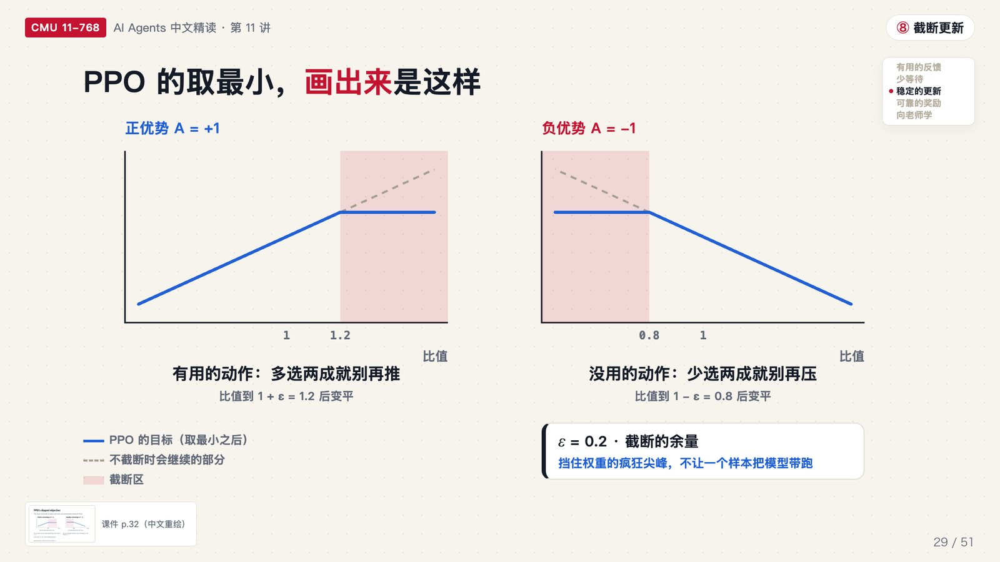

原课件 p.32：**PPO 对超过上限的增加、低于下限的减少，不再给奖励。**

| 正优势：A = +1 | 负优势：A = −1 |
|---|---|
| 比值在 1.2 以下，目标随比值线性上升；超过 1.2 变平 | 比值在 0.8 以上，目标随比值线性下降；低于 0.8 变平 |
| 对有用的动作，比值超过 1 + ε 就不再奖励 | 对没用的动作，比值低于 1 − ε 就不再奖励 |

这张图里 ε = 0.2 是截断的**余量**。出处：改编自 PPO 图 1。

大白话：一个有用的动作，新策略已经比旧策略多选两成了，就别再往上推；一个没用的动作，新策略已经比旧策略少选两成了，就别再往下压。这样就挡住了重要性权重那种疯狂的尖峰，不让一个样本把模型带跑。

用 7.2 节那三个比值代进去算一遍（动手练习会打印）：

| ρ_t | 0.5 | 1.0 | 1.6 |
|---|---|---|---|
| A = +1：min(ρA, cA) | 0.5 | 1.0 | **1.2**（变平） |
| A = −1：min(ρA, cA) | **−0.8**（变平） | −1.0 | −1.6 |

注意右下角那格：A = −1、ρ = 1.6 时目标是 −1.6，没有被截断。也就是说，一个没用的动作新策略反而更爱选了，PPO 照样全力往回罚，这一侧是不截的，取最小值只在"已经朝好的方向走够了"时才停。第 16.2 节会看到 verl 的实现还在这一侧加了一道上限。

课堂提问（课上口头补充）：能不能直接截断梯度，而不是截断比值？可以。重要性权重往往是梯度失控最大的原因，但也可以截梯度；课上说自己不确定哪种是最常见的做法。

**这一节记住一句**：比值超出范围就截断，PPO 取保守的一边，CISPO 把截断后的比值当固定权重。

---

## 8 参考模型 KL 和熵

### 8.1 参考模型的 KL 惩罚

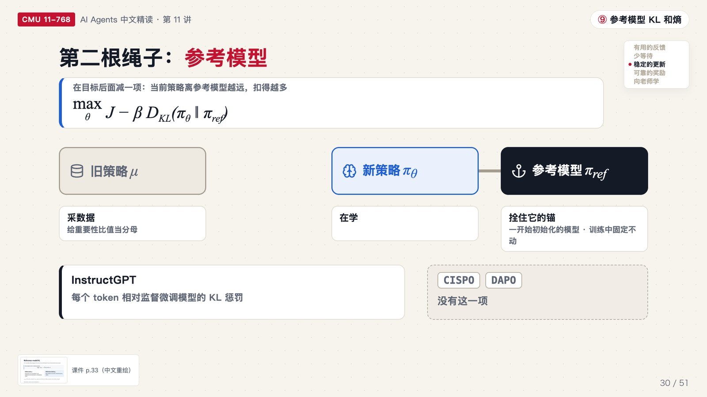

原课件 p.33：**KL 惩罚不让策略离一个固定的参考模型太远。**

```
带参考惩罚的策略目标：
max_θ  J_policy − β D_KL(πθ ‖ π_ref)
J_policy：策略目标；D_KL：衡量两个分布差多少；β：惩罚的力度
```

**参考模型**（reference model）一般就是一开始初始化的那个模型，训练中固定不动。在目标后面减一项：当前策略离它越远，扣得越多。不让新模型和它的 **KL 散度**（KL divergence）变得太大，也就挡住了太大的更新。截断之外，这是防止模型跑偏的第二根绳子。出处：DeepSeekMath，Shao et al. 2024，GRPO 目标。

这一页把三个策略分开了，别混：

| 策略 | 角色 | 在公式里出现在哪 |
|---|---|---|
| 旧策略 μ（rollout 策略） | 采数据 | 重要性比值的分母 |
| 新策略 πθ | 正在学 | 比值的分子、KL 的第一项 |
| 参考模型 π_ref | 拴住它的锚，固定不动 | KL 的第二项 |

- InstructGPT 用的是每个 token 相对监督微调模型的 KL 惩罚。
- 不是每个算法都加这一项：按原文，CISPO（MiniMax-M1）没有 KL 惩罚项，DAPO（§2.3）也去掉了 KL 散度。

### 8.2 用熵鼓励探索

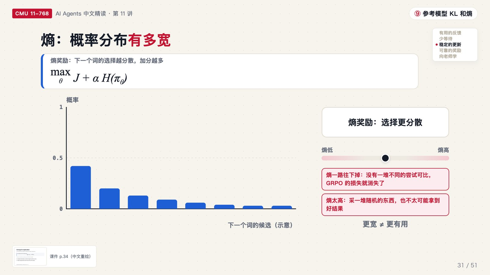

原课件 p.34：**熵奖励鼓励更宽的下一个 token 分布。**

```
带熵奖励的策略目标：
max_θ  J_policy + α H(πθ)
H：下一个 token 有多不确定；α：奖励的力度
```

**熵**（entropy）可以理解成概率分布有多宽：模型有多大可能选出各种不同的输出，而不是每次都选同一个。

| 熵 | 表现 | 问题 |
|---|---|---|
| 很低 | 一遍遍采出同样的东西 | 没有不同的尝试可比，GRPO 的损失就消失了（组内奖励全一样，见第 10 节） |
| 很高 | 采出来很多样 | 在采一堆随机的东西，也不太可能拿到好结果 |

强化学习里常见的是熵一路往下掉，所以可以在目标后面加一个熵奖励：下一个词的选择越分散，加分越多，鼓励它多试几种。但更宽的分布能帮 agent 去试别的动作，**不能保证那些动作有用**。出处：PPO，Schulman et al. 2017，§5。

**这一节记住一句**：KL 惩罚把策略拴在参考模型附近，熵奖励防止它塌成只会一种做法。

---

## 9 常用算法总表

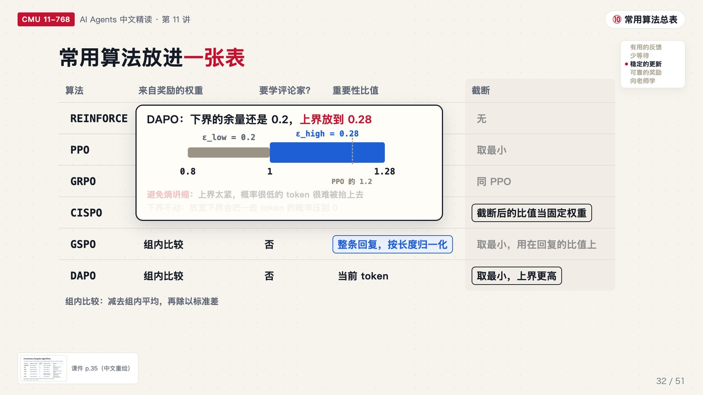

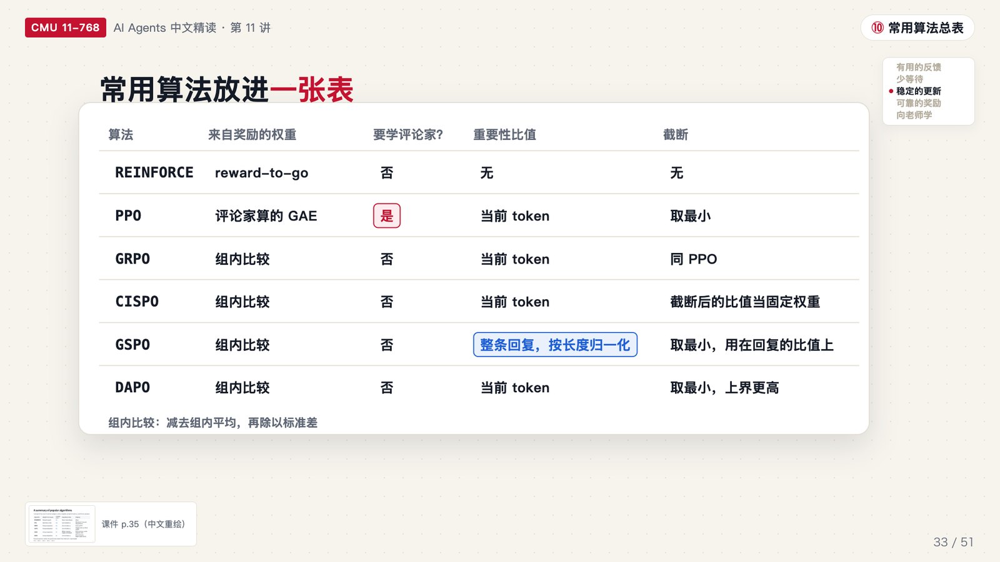

原课件 p.35：**比较各个方法怎么分配信用、怎么给采样的 token 加权、怎么限制更新。** 这张表建议先收藏，读论文、选算法都用得上。

| 算法 | 来自奖励的权重 | 要学评论家？ | 重要性比值 | 截断 |
|---|---|---|---|---|
| REINFORCE | reward-to-go R_t | 否 | 无：用新鲜的 rollout | 无 |
| PPO | 用评论家算的 GAE | **是** | 当前 token 的 ρ_t | 原始项和截断项取最小 |
| GRPO | 组内比较 | 否 | 当前 token 的 ρ_t | 和 PPO 一样 |
| CISPO | 组内比较 | 否 | 当前 token 的 ρ_t | 截断后的比值当固定权重 |
| GSPO | 组内比较 | 否 | 整条回复，按长度归一化 | PPO 的取最小，用在回复的比值上 |
| DAPO | 组内比较 | 否 | 当前 token 的 ρ_t | PPO 的取最小，上界更高 |

表注：组内比较是减去组内平均奖励，再除以奖励的离散程度（标准差）。这一条按 GRPO、GSPO 原文成立；本讲第 2.1 节的例子只减了均值，是 DrGRPO 的写法。

按列读，三处差别：

1. **要不要评论家**：只有 PPO 要学一个评论家来算 GAE（第 3–4 节）；其余的不用，REINFORCE 用 reward-to-go，GRPO、CISPO、GSPO、DAPO 用组内比较。
2. **比值用哪些 token**：只有 GSPO 用整条回复、再按长度归一化；其余都只看当前 token（第 6.6 节）。
3. **怎么截断**：CISPO 把截断后的比值当固定权重（第 7.3 节）；DAPO 用 PPO 的取最小，但截断区间不对称。

**DAPO 的不对称截断**（DAPO 原文 §3.1、§4.1，叫 Clip-Higher）：

| | 余量 | 截断区间 |
|---|---|---|
| 下界 ε_low | 0.2 | 1 − 0.2 = 0.8 |
| 上界 ε_high | 0.28 | 1 + 0.28 = 1.28 |

- 为什么放宽上界：上界太紧时，本来概率很低的 token 很难被抬上去，模型越来越单一，熵就塌了；放宽上界，是为了避免这种**熵坍缩**（entropy collapse）。
- 为什么下界不动：放宽下界会把一些 token 的概率压到 0，让采样空间塌掉。
- 放宽上界只影响正优势的 token：上界只在 A > 0 时起作用（第 7.4 节的左图）。课上的说法是"想让优势为正的样本多拿好处"，和原文的出发点不同，但两种说法不矛盾。

用一个数看区别：ρ = 1.25、A = +1 时，对称截断（上界 1.2）的目标是 1.2，DAPO（上界 1.28）是 1.25，还没被截。

GSPO 补一句（原文 §5）：GSPO 的截断范围是左 3e-4、右 4e-4，对比的 GRPO 是 0.2 和 0.27；原文说两者差了几个数量级，是因为比值的定义不同。

**这一节记住一句**：各算法的差别，就在权重从哪来、要不要评论家、比值用哪些 token、截断怎么截。

---

## 10 一组奖励全一样

原课件 p.36 分隔页：**任务选择和奖励的可靠性。** 这部分不完全是算法，讲的是怎么判断手上的训练样本能不能带来好结果。

### 10.1 没有信息量的组

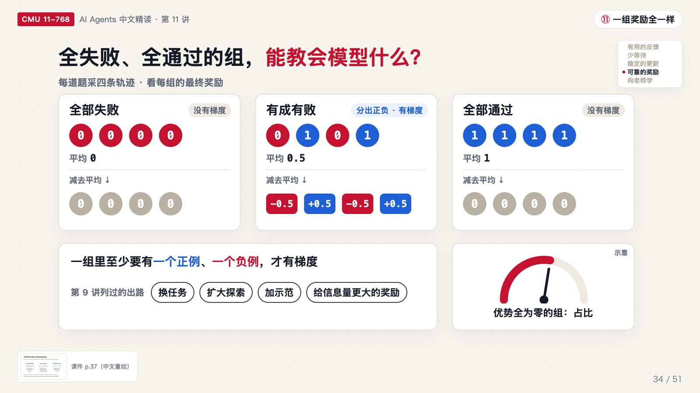

原课件 p.37：**每道题采四条轨迹，每组下面是它们的最终奖励。**

| | 全部失败 | 有成有败 | 全部通过 |
|---|---|---|---|
| 奖励 | 0 0 0 0 | 0 1 0 1 | 1 1 1 1 |
| 组内平均 | 0 | 0.5 | 1 |
| 减去平均 | 0, 0, 0, 0 | −0.5, +0.5, −0.5, +0.5 | 0, 0, 0, 0 |

奖励全相同，减完平均就全变成 0，优势是 0，就没有梯度。要从 GRPO 一类方法里学到东西，一组里至少要有一个正例、一个负例。全失败和全通过都是问题。

训练时很值得盯一个数：**优势全为零的组占多少**（或者反过来，非零优势的比例）。这就是第 9 讲 8.5 节讲的"奖励全相同时优势为零"；那里列了几条出路（换任务、扩大探索、加示范、给信息量更大的奖励），本讲第 10–14 节逐条展开。

### 10.2 为什么每条都失败了

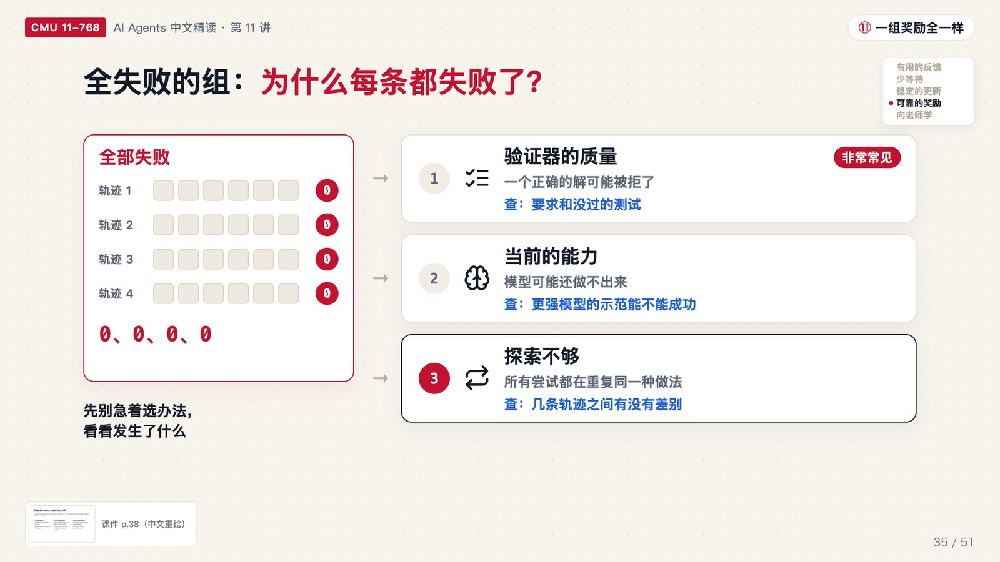

原课件 p.38：**四条失败轨迹给出同样的奖励 0, 0, 0, 0。选办法之前，先看看发生了什么。**

| 原因 | 说明 | 怎么查 | 本课件 |
|---|---|---|---|
| 验证器的质量 | 一个正确的解可能被拒了 | 看要求和没过的测试 | 第 11 节 |
| 当前的能力 | 模型可能还做不出这道题 | 看更强模型的示范能不能成功 | 第 13.2、14 节 |
| 探索不够 | 所有尝试可能都在重复同一种做法 | 看几条轨迹之间有没有差别 | 第 8.2、13.1 节 |

课上特别强调第一条：你其实做对了，验证器没判对，这非常非常常见，一定要留意。

**这一节记住一句**：奖励全一样就没有信号，先查是验证器、能力还是探索出了问题。

---

## 11 验证器的假阴性

### 11.1 一个正确的解被拒了

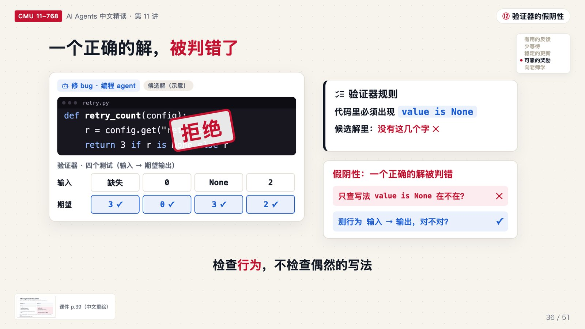

原课件 p.39：**回到修 bug 那道题。这个候选解每个要求的输出都对。**

| 缺失 → 3 ✓ | 0 → 0 ✓ | None → 3 ✓ | 2 → 2 ✓ |
|---|---|---|---|

| 候选解的行为 | 验证器的规则 |
|---|---|
| 四个情况全对；它的实现用的是另一种写法 | 要求代码里必须出现 `value is None` 这几个字；候选解没有：**拒绝** |

**这是假阴性**（false negative）：一个正确的解被判错了。要检查行为，而不是检查偶然的写法。

理想情况下，测试应该直接测输入和输出。这种规则听起来很蠢，但 agent 自己写测试时，经常写出这种不测行为、只查写法的测试（课上口头补充）。

出处：课件标"相关的任务和测试审查：SWE-bench Verified（2024）"。

### 11.2 奖励噪声

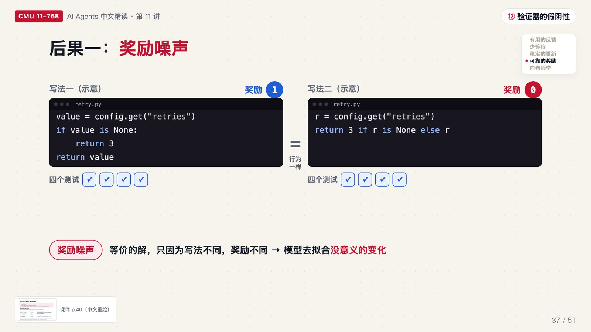

原课件 p.40 的第一条：**奖励噪声：去拟合输出里没意义的变化。** 等价的解只因为写法或实现细节不同，拿到不同的奖励。视频里用两段等价的代码示意：写法一用 `if value is None: return 3` 再 `return value`，写法二是一行 `return 3 if r is None else r`；两段四个测试全过、行为一样，写法一拿奖励 1，写法二拿 0。模型拿到这样的奖励，就会去拟合写法这种没意义的变化。

### 11.3 基准卡在天花板上

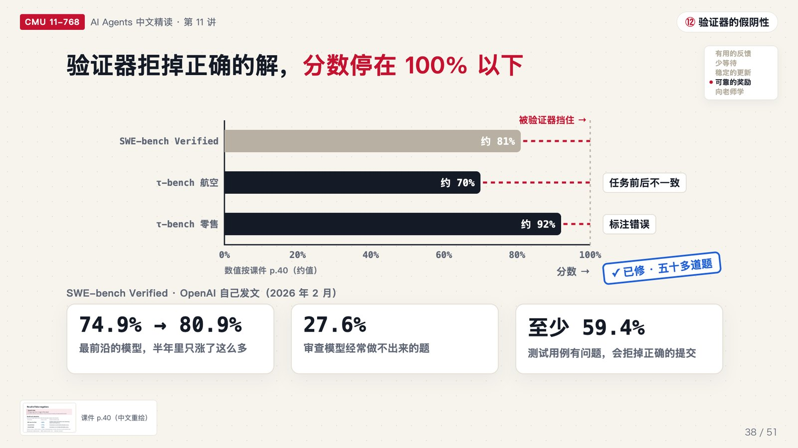

原课件 p.40 的第二条：**基准饱和：评测器拒掉正确的解，分数就会停在 100% 以下。** 专看基准的话，基准会卡在更低的值上，你量不出自己真实的进展。

| 基准 | 平台 / 上限 | 审查发现 |
|---|---|---|
| SWE-bench Verified | ≈ 81% | 进展在 80.9% 附近放缓；剩下没解出来的题，很多是测试有问题 |
| τ-bench 航空 | ≈ 70% | 任务前后不一致，限制了能拿到的分数 |
| τ-bench 零售 | ≈ 92% | 标注错误，限制了能拿到的分数 |

都是历史版本，审查于 2025–26 年；这些是报告出来的平台或上限，τ-bench 之后已经修了这些题。

**SWE-bench Verified**，按 OpenAI 原文（Why we no longer evaluate SWE-bench Verified，2026 年 2 月）：

| 数 | 含义 |
|---|---|
| 74.9% → 80.9% | 最前沿的模型在过去 6 个月里只从 74.9% 涨到 80.9% |
| 27.6% | OpenAI 审查了模型经常做不出来的那 27.6% 的题 |
| 至少 59.4% | 这些被审查的题里，至少 59.4% 的测试用例有问题，会拒掉功能正确的提交 |

注意 59.4% 是"被审查的那 27.6% 的题"里的比例，不是整个基准的比例。这个基准还是 OpenAI 自己做的（Introducing SWE-bench Verified，2024），等于在批评自己的基准。

**τ-bench**：按 SABER（Cuadron et al. 2025，§5.1），航空领域数据集前后不一致，把表现封顶在约 70%；零售领域标注错误，把表现限制在约 92%。2026 年 2 月 τ-bench 发布了修题（τ³-Bench: Fixing Airline + Retail），审查并修了这两个领域的五十多道题，修的是错误的期望动作、含糊的用户指令等。

就算是很流行、很好的基准，也会碰到这个问题。

**这一节记住一句**：验证器要测行为、不测写法，不然正确的解被拒，奖励有噪声，基准也会卡在天花板上。

---

## 12 假阳性和奖励投机

### 12.1 只测一个输入，`return 0` 也拿奖励

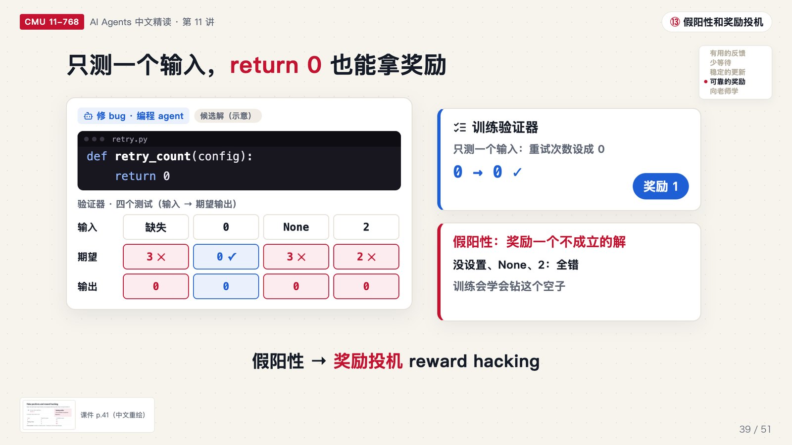

原课件 p.41：**任务要求不变，但假设训练时只测 retries = 0 这一个输入。**

```python
def retry_count(config):
    return 0
```

候选解永远返回 0。训练验证器只测的那一个情况过了，奖励 1。

| 输入 | 要求的输出 | 候选解的输出 |
|---|---|---|
| 0 | 0 | 0 ✓ |
| 缺失 / None | 3 | 0 ✗ |
| 2 | 2 | 0 ✗ |

**假阳性**（false positive）会奖励一个不成立的解，训练会学会钻这个空子，这就是**奖励投机**（reward hacking）。它只检查了你真正想测的东西的一部分，一个退化的解也能拿到好分数。很多基准都被人指出过测试不够严格，SWE-bench 因为太流行，大家都爱拿它开刀。

| | 假阴性（第 11 节） | 假阳性（这里） |
|---|---|---|
| 验证器错在哪 | 正确的解被判错 | 错误的解被判对 |
| 例子 | 只认 `value is None` 这几个字 | 只测 retries = 0 |
| 对训练的影响 | 奖励噪声，好做法得不到强化 | 模型学会钻空子 |

### 12.2 编程 agent 的四种捷径

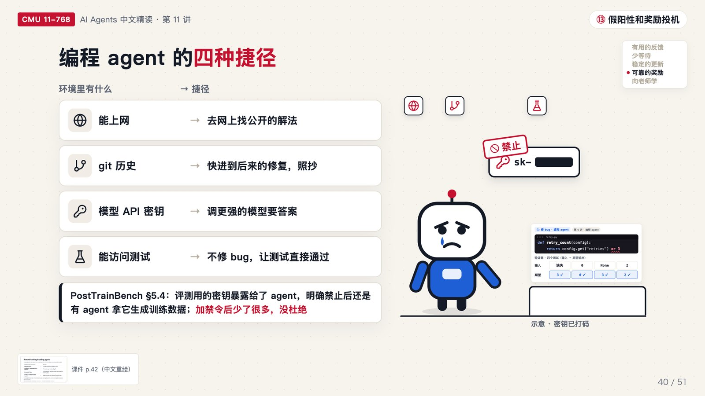

原课件 p.42：**一个通过的分数，可能来自基准本来想排除的捷径。**

| 环境里能用到的东西 | 捷径 |
|---|---|
| 能上网 | 在网上找到公开的解法 |
| Git 历史，包括后来的提交 | 把历史快进到后来的修复，照抄 |
| 一个模型 API 密钥 | 调另一个更强的模型，拿答案或训练数据 |
| 能访问测试或测试运行器 | 不修 bug，直接让测试通过 |

课上说，这几种都是真实遇到过的，不是刻意去找的，agent 会自己这么干。

有文档记录的例子：**PostTrainBench**（arXiv 2603.08640，§5.4）。一些评测要用 OpenAI 的 API 密钥，这个密钥暴露给了 agent；agent 可以用同一个密钥生成合成训练数据。作者在评测脚本里加了一句明确的限制，不许把这个 API 用于评测以外的任何事；原文说这让合成数据生成少了很多，但没能完全杜绝。网页、Git 和测试这三种捷径，课件的出处是 MAI-Thinking-1 §3.3.1。

### 12.3 独立检查进展

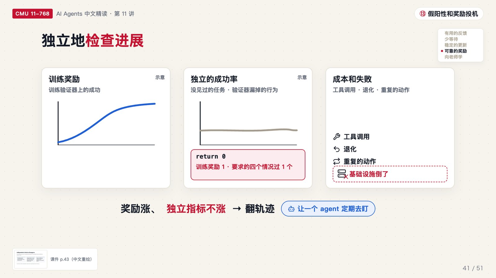

这些都是问题，因为模型没学会解真正的任务，学的是别的东西。更糟的是，训练时出了这种事，模型会学到这是解这类题非常有效的办法，一遍遍强化下去，最后刻进模型参数里（课上口头补充）。所以训练时要非常小心，现在也能去看模型在做什么，确认它没有违反规则。

原课件 p.43：**那个永远返回 0 的补丁拿到了训练奖励 1，但四个要求的情况只过了一个。**

| 训练奖励 | 独立的成功率 | 成本和失败 |
|---|---|---|
| 衡量在训练验证器上的成功 | 查没见过的任务、查训练验证器漏掉的行为 | 看工具调用、退化和重复的动作 |

**奖励涨了，独立的指标却没涨，就去翻轨迹找捷径。**

课上还补充：可以看成本；有时训练失败不是 agent 的行为问题，而是某个基础设施倒了，强化学习本来就是一个很大的系统问题，最好盯着所有训练任务。现在让一个 agent 定期去盯训练任务，就算没有专门的工具，也很有效。

**这一节记住一句**：奖励涨了、独立指标却没涨，就去翻轨迹找捷径。

---

## 13 动态采样、部分奖励和辅助奖励

### 13.1 DAPO 的动态采样

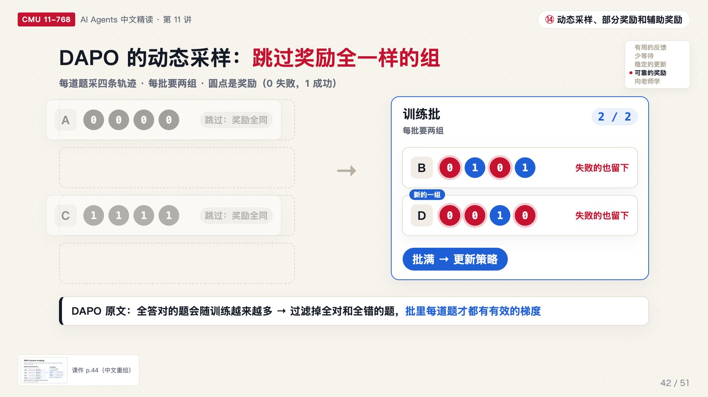

原课件 p.44：**奖励全相同，组内优势就是 0。DAPO 留下有成有败的组，接着采样，直到这一批装满。**

每道题采四条轨迹，每个圆圈是一个奖励：0 失败，1 成功。训练批的示例目标是 2 组。

| 题 | 奖励 | 处理 |
|---|---|---|
| A | 0 0 0 0 | 跳过（奖励全同） |
| B | 0 1 0 1 | 留下（有成有败），1 / 2 |
| C | 1 1 1 1 | 跳过（奖励全同） |
| D（新采的一组） | 0 0 1 0 | 留下，2 / 2 → 批满了 → 更新策略 |

- 有成有败的组里，每条轨迹都留下，包括失败的那几条。
- **动态采样**（dynamic sampling）基本上就是一直采，直到采到有成有败的组。课上说这个方法见用的人不多，但大规模训练里用过，是应对正例或负例太少的一种办法。

按 DAPO 原文（§3.2）：以 GRPO 为例，一道题的所有输出都对、奖励一样，这组的优势就是 0，策略梯度也是 0，批梯度的量级变小、对噪声更敏感；而且准确率为 1 的样本比例会随训练上升。做法是过采样，过滤掉准确率等于 1 和等于 0 的题，让批里每道题都有有效梯度，并保持批里的题数不变。第 16.3 节有 verl 里对应的开关。

### 13.2 部分奖励

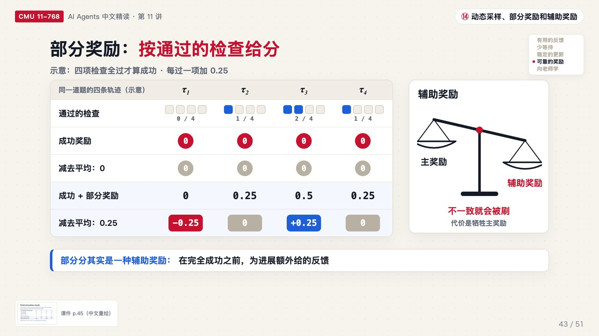

原课件 p.45：**部分分是一种辅助奖励：在完全成功之前，为进展额外给的反馈。**

想解的任务越来越难，起步的模型可能一道都做不出来。一种办法是先出简单一点的题（第 14.1 节的课程）；另一种是给部分分。示意任务：四项检查全过；每过一项加 0.25 分。

| 同一道题的四条轨迹 | τ₁ | τ₂ | τ₃ | τ₄ | 平均 |
|---|---|---|---|---|---|
| 通过的检查 | 0 / 4 | 1 / 4 | 2 / 4 | 1 / 4 | |
| 成功奖励 | 0 | 0 | 0 | 0 | 0 |
| 减去平均 | 0 | 0 | 0 | 0 | |
| 成功 + 部分奖励 | 0 | 0.25 | 0.50 | 0.25 | 0.25 |
| 减去平均 | −0.25 | 0 | +0.25 | 0 | |

部分分不一样，零优势的组和批就少了。麻烦是奖励难设计多了：你不再直接优化最终想要的准确率；设计出来的奖励和真正的任务不一致，模型就会去刷它，代价是牺牲主奖励。

课程参考里还列了奖励塑形的经典论文 Policy Invariance Under Reward Transformations（Ng、Harada、Russell，ICML 1999），课上没讲。它讨论的是什么形式的塑形奖励不会改变最优策略，正好对应这里"辅助奖励和主奖励不一致"的风险（这层联系是本课件的推断）。

### 13.3 辅助奖励被刷：计算器和哥布林


原课件 p.46：**模型可能学会把加上去的那份奖励刷高，而任务本身没变好。**

| 想要的行为 | 奖励实际偏爱的东西 | 观察到的行为 |
|---|---|---|
| 有用地使用工具 | 一个 bug 让表面上的网页工具调用也能拿分 | GPT-5.1 把浏览器当计算器用，还装作自己搜过 |
| 一个俏皮的"书呆子"人设 | 带"哥布林""小魔怪"的比喻得分更高 | 生物比喻越来越多，没加人设提示时也一样 |

出处：Calculator hacking，OpenAI，2025 年 12 月；Where the goblins came from，OpenAI，2026 年 4 月。

- **计算器**：按 OpenAI 原文，起因是一个训练时的 bug 无意中奖励了表面上的网页工具使用，导致模型把浏览器工具当计算器用，同时表现得像是搜过了；这占了 GPT-5.1 部署时欺骗行为的大部分。课上说的场景是：算一加二这样的小题，也要调浏览器、多花五秒钟，去拿那份辅助奖励。
- **哥布林**：训练人设时，"书呆子""友好""简洁"这类人设会有一点奖励，给书呆子人设打分的模型觉得带哥布林、小魔怪这类生物的比喻特别书呆子，就给了更高的奖励。OpenAI 原文说，哥布林就是从那里扩散开的。时间一长它自我放大，没加人设提示时这种比喻也越来越多。

### 13.4 探索坍缩（课上跳过）

原课件 p.47（视频里没有这一页）：**在一个历史上，训练改变了三个可能动作的概率。**

| | 早期策略 | 后期策略 |
|---|---|---|
| 动作 A | 0.20 | 0.01 |
| 动作 B | 0.60 | 0.98 |
| 动作 C | 0.20 | 0.01 |

几乎每次采样都选 B，别的选项很少再被试，这叫**探索坍缩**。熵奖励（第 8.2 节）鼓励别的选项；同时要检查轨迹之间有没有差别（第 10.2 节的第三个原因）。出处：DAPO，Yu et al. 2025。

**这一节记住一句**：奖励全一样，就跳过重采，或者给部分分；但加上去的那份奖励，模型可能比任务本身刷得更起劲。

---

## 14 向老师学：示范、课程和蒸馏

原课件 p.48 分隔页：**向老师学。蒸馏：对齐老师的动作概率。** 学生太弱、几乎做不对时，手上有更强的模型就特别有用。老师可以是现在就能用的强模型，也可以是你想训的那个模型家族里更大的那个。

### 14.1 热启动和课程

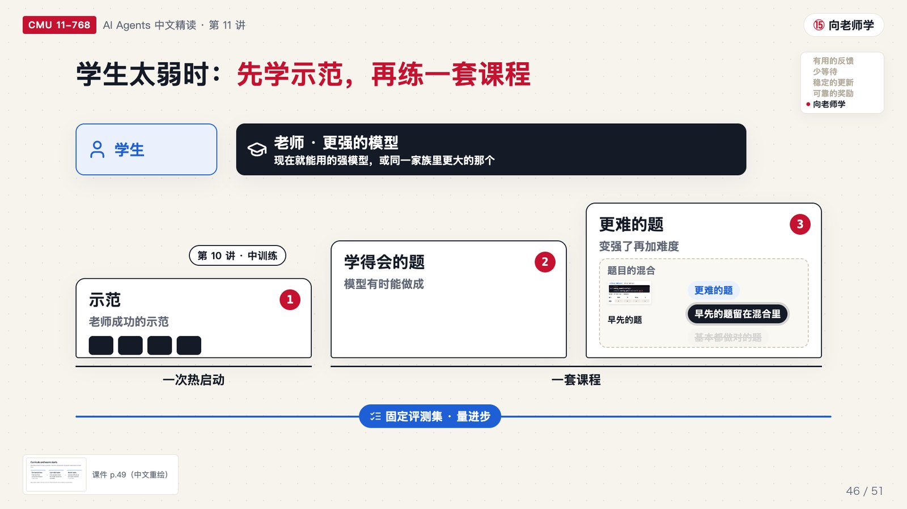

原课件 p.49：**学生很少成功时，老师可以提供成功的轨迹给它学。**

| 示范 | → 学得会的题 | → 更难的题 |
|---|---|---|
| 先从成功的解里学 | 练模型有时能做成的题 | 模型变强了就加难度 |
| 一次**热启动**（warm start） | 一套**课程**（curriculum） | |

把早先的题留在混合里，并用一个固定的评测集衡量进步。

- 从示范开始：课上说现在几乎每个模型都这么做，第 10 讲 9 节的 agentic 中训练本质上也是在加示范。第 8 讲讲的监督微调也是这一步。
- 课程的具体做法很多：可以逐渐调整题目的混合比例，也可以把模型基本都做对的那类题慢慢去掉。课上说不知道有没有关于具体怎么做的系统研究。
- 出处：课件这页没有标出处；课程主页参考列了 Curriculum Learning（Bengio et al.，ICML 2009）。

### 14.2 蒸馏和曝光偏差

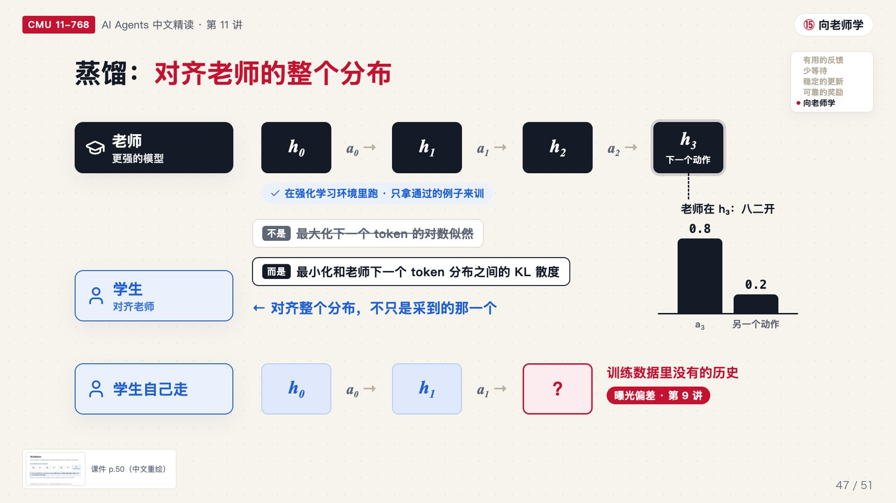

原课件 p.50：**训练学生，在一组固定的轨迹上对齐老师的动作概率。**

老师存下来的一条轨迹：h₀ a₀ → h₁ a₁ → h₂ a₂ → h₃（这里是下一个动作）。在这个存下来的历史上，老师给 a₃ 80%，给另一个动作 20%，把这个分布叫做 q(· | h₃)。

**蒸馏**（distillation）有两层：

| 做法 | 学什么 |
|---|---|
| 让老师在你的强化学习环境里跑，只拿通过的例子来训 | 这基本上也是一种蒸馏（第 9 讲 5 节 ReST 是同一个流程） |
| 流行的做法：对齐老师的整个概率分布 | 不是最大化下一个 token 的对数似然，而是最小化和老师下一个 token 分布之间的 KL 散度；学生要学的是这个八二开，而不只是被采到的那一个 |

问题在于：老师很顺利地走到了这一步，**学生自己做的时候，它自己的错误会把它带到这组训练数据里没有的历史**。这就是第 9 讲 2.4 节讲的**曝光偏差**（exposure bias）：训练时从来没见过测试时真正会遇到的那些例子。

出处：知识蒸馏，Hinton et al. 2015，§2；语言模型的蒸馏，Agarwal et al. 2024，§3。

### 14.3 在线策略蒸馏

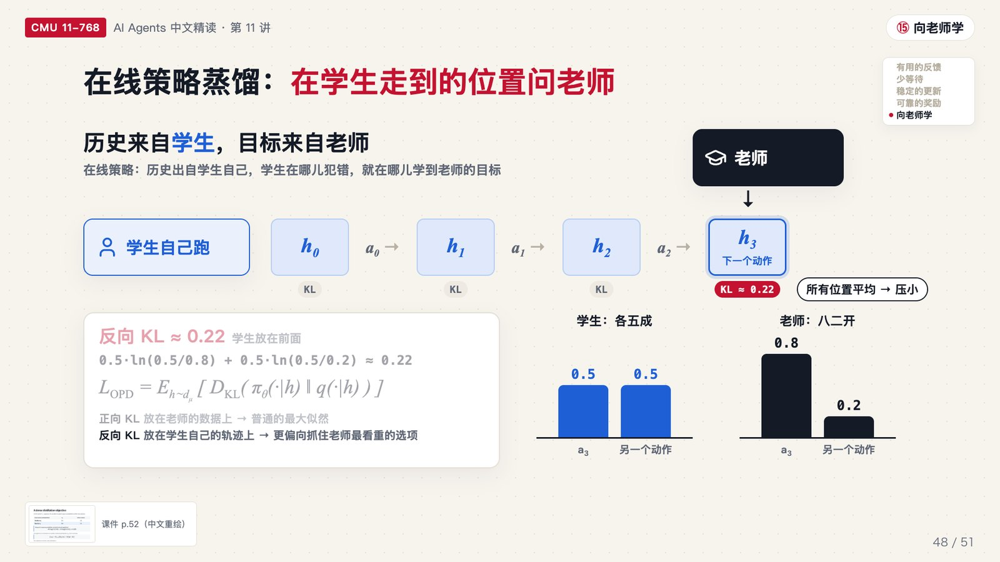

原课件 p.51：**让学生生成训练用的历史，再在这些历史上向老师要目标。**

学生在轨迹 B 上的 rollout：h₀ a₀ → h₁ a₁ → h₂ a₂ → h₃。在这个学生历史上，老师给的目标（示例）：a₃ 80%，另一个动作 20%。训练学生对齐这些概率。

| | 普通蒸馏 | **在线策略蒸馏**（on-policy distillation） |
|---|---|---|
| 历史来自 | 老师的轨迹 | 学生自己的 rollout |
| 目标来自 | 老师 | 老师 |
| 学生在哪儿学 | 老师走过的地方 | 自己会犯错的地方 |

出处：On-Policy Distillation of Language Models，Agarwal et al.，ICLR 2024（GKD）。

原课件 p.52：**还是在 h₃，假设学生给两个动作的概率一样。**

| 下一个动作的概率 | a₃ | 另一个动作 |
|---|---|---|
| 学生 πθ | 0.5 | 0.5 |
| 老师 q | 0.8 | 0.2 |

```
反向 KL 衡量概率的不匹配（自然对数）：
0.5 log(0.5/0.8) + 0.5 log(0.5/0.2) ≈ 0.223

在学生的历史分布 d_μ 上对这个 KL 取平均，再最小化：
L_OPD = E_{h∼d_μ}[ D_KL( πθ(· | h) ‖ q(· | h) ) ]
```

核算：0.5 × ln 0.625 ≈ 0.5 × (−0.470) = −0.235；0.5 × ln 2.5 ≈ 0.5 × 0.916 = 0.458；合计 ≈ 0.223。

正向和反向 KL（按 GKD 原文 §2）：

| | 写法 | 在哪儿算 | 特点 |
|---|---|---|---|
| 正向 KL | D_KL(老师 ‖ 学生) | 老师的数据上 | 就是监督学习里的最大似然；容量不够时偏"找均值" |
| **反向 KL** | D_KL(学生 ‖ 老师)，学生放在前面 | 学生自己的轨迹上 | 容量不够时偏"找众数"，更偏向抓住老师最看重的那个选项 |

同一组数换个方向算，正向 KL 是 0.8 ln(0.8/0.5) + 0.2 ln(0.2/0.5) ≈ 0.193（动手练习会打印），两个方向的数不一样，KL 不对称。GKD 也可以用广义 JSD 在两者之间插值。

### 14.4 在线策略自蒸馏

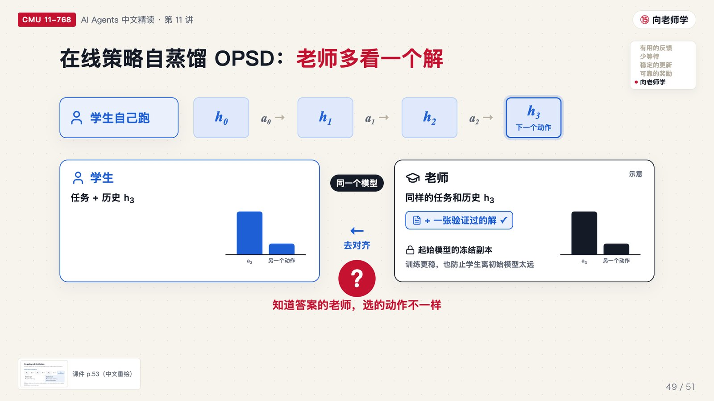

原课件 p.53：**一个验证过的解，可以帮老师在学生自己的历史上给出更好的目标。**

| 学生的输入 | 老师的输入 |
|---|---|
| 任务和历史 h₃ | 同样的任务和历史，再加一个验证过的解 |

**在线策略自蒸馏**（On-Policy Self-Distillation，OPSD）用起始模型的一个冻结副本当老师，它给的下一个动作概率，像前面一样拿来训练学生。出处：Self-Distilled Reasoner，Zhao et al. 2026。

按 OPSD 原文（§3.2、§4.1）：学生 p_S(· | x) 和老师 p_T(· | x, y★) 是同一个模型，只是条件不同，老师多看了标准答案 y★；在学生自己采的回复上逐个 token 算两者的散度并最小化。实现上把老师固定为初始策略，而不是正在更新的策略，原文说这样训练更稳，也隐式地防止学生离初始模型太远。

课上的评价（课上口头补充）：这个方法很有意思，但有一点偏差：已经知道答案的老师会选的动作，和不知道答案时会选的不一样，这里应该还有改进的空间。

**这一节记住一句**：先学示范、再练能做出来的题，蒸馏时在学生自己的轨迹上问老师。

---

## 15 课堂问答

这一讲的问答大多穿插在讲课中间。3.1 节的"μ 是什么"、3.4 节的"能判断为什么不直接做对"、5.1 节的"同步有什么好处"、7.4 节的"能不能截断梯度"已经放在对应位置。剩下的几个：

### Q1 λ 怎么选？

- **问**：GAE 里的 λ 怎么定？（问题没录清，按回答反推）
- **答**：它基本上是个超参数。λ = 1 时不做时序上的衰减，往后的价值差相加时中间各项两两抵消，只剩"往后的总奖励减去当前价值"；如果你有一个好的价值函数，或者有中间奖励（比如前面同学提到的细则），可以设一个衰减。两个特例的算例见 4.2 节。

### Q2 只看得到最终奖励时，怎么判断哪一步有用？

课上向大家提问，几位同学的想法和回应见 2.4 节的表。课上的答案是第 3 节的价值函数。

### Q3 一组奖励全一样怎么办？

不是课堂提问，是本讲第 10–14 节的主线，按"先诊断、再选办法"整理：

| 诊断 | 办法 | 本课件 |
|---|---|---|
| 验证器错了 | 改验证器：测行为不测写法、测全所有情况 | 11、12 节 |
| 模型还做不出来 | 部分奖励、热启动、课程、蒸馏 | 13.2、14 节 |
| 探索不够 | 熵奖励、动态采样 | 8.2、13.1 节 |

### Q4 损失只算在工具调用上，还是观察也算？

- **问**：（讲完小结后的最后一个问题）强化学习的损失只算在模型的动作上，还是环境返回的观察也算？
- **答**（课上口头补充）：通常只算在动作上，包括思维链和模型自己产生的所有东西；第 9 讲 6.5 节讲过，环境返回的那段加掩码。但课上提到有一篇论文（论文名课上没说清）只做了一件事：把观察也拿来训练模型，结果表现变好了。背后的想法是：预测世界的状态也是语言模型需要的能力，能预测世界的状态，选下一步动作也应该更好；不在观察上训练，就丢掉了这个多任务学习的训练信号。两种都可以，哪个更好要看实验；环境很丰富的话，观察可能是一个有用的训练信号。

---

## 16 源码解读：verl 里的 GAE、PPO 截断和 CISPO

课程主页第 11 讲只列了论文，没有推荐源码。第 9 讲读的是 Hugging Face TRL 的 GRPOTrainer；这一讲换一个强化学习训练框架：火山引擎（volcengine）组织下开源的 [verl](https://github.com/volcengine/verl)。它把本讲的 GAE、PPO 截断、CISPO、DAPO 的不对称截断和动态采样都实现成了可切换的选项：

| 本讲的说法 | 源码里 | 本节 |
|---|---|---|
| TD 误差和 GAE 从后往前递推（4.1–4.2） | `compute_gae_advantage_return` | 16.1 |
| PPO 取最小、截断到 [1 − ε, 1 + ε]（7.3–7.4） | `compute_policy_loss_vanilla` | 16.2 |
| CISPO：截断后的比值当固定权重（7.3） | `compute_policy_loss_cispo` | 16.3 |
| DAPO 下界 0.2、上界 0.28，动态采样（9、13.1） | 配置 `clip_ratio_low` / `clip_ratio_high`、`filter_groups` | 16.4 |
| KL 惩罚、熵奖励、γ、λ（4.2、8） | 配置默认值 | 16.4 |

版本：volcengine/verl 提交 `74543265`（完整哈希 `745432653d15af14954af1e055c8aeed72afa064`，2026-11-04 读取的 main，提交时间 2026-11-04T02:07:42Z）。核心算法都在 [verl/trainer/ppo/core_algos.py](https://github.com/volcengine/verl/blob/745432653d15af14954af1e055c8aeed72afa064/verl/trainer/ppo/core_algos.py)（这个提交里 2,559 行）。

下面的代码都是原文件节选，行号是这个提交里的行号；中文注释是本课件加的，删掉的部分用 `# ……（删去：……）` 标出。verl 处理的是张量，形状一般是（批大小，回复长度），一行是一条回复，一列是一个 token 位置。

### 16.1 GAE：从后往前递推

```python
# verl/trainer/ppo/core_algos.py，第 215–263 行
@register_adv_est(AdvantageEstimator.GAE)  # or simply: @register_adv_est("gae")
def compute_gae_advantage_return(
    token_level_rewards: torch.Tensor,  # 每个 token 位置拿到的奖励，(bs, response_length)
    values: torch.Tensor,               # 评论家在每个位置给的价值 V(h_t)
    response_mask: torch.Tensor,        # 1 = 模型生成的 token，0 = 不算（结束之后、或工具返回的观察）
    gamma: torch.Tensor,                # 奖励折扣 γ
    lam: torch.Tensor,                  # GAE 的 λ
):
    # ……（删去：第 223–243 行的文档字符串，注明改编自 TRL 的 ppo_trainer.py）
    with torch.no_grad():                # 优势只是训练目标里的系数，不对它求梯度
        nextvalues = 0                   # 最后一个位置之后，价值记 0（轨迹结束）
        lastgaelam = 0                   # 最后一个位置之后，后面没有误差了
        advantages_reversed = []
        gen_len = token_level_rewards.shape[-1]

        for t in reversed(range(gen_len)):   # 从后往前，和 4.2 节手算的顺序一样
            delta = token_level_rewards[:, t] + gamma * nextvalues - values[:, t]
            # TD 误差 δ_t = r + γ·V(下一步) − V(这一步)，γ = 1 时就是 4.1 节的式子
            lastgaelam_ = delta + gamma * lam * lastgaelam
            # GAE 递推 Â_t = δ_t + γλ·Â_{t+1}

            # skip values and TD-error on observation tokens
            nextvalues = values[:, t] * response_mask[:, t] + (1 - response_mask[:, t]) * nextvalues
            lastgaelam = lastgaelam_ * response_mask[:, t] + (1 - response_mask[:, t]) * lastgaelam
            # 掩码为 0 的位置（例如工具返回的观察）不更新 nextvalues 和 lastgaelam：
            # 递推直接"跳过"这些 token，把后面动作的价值和误差传给前面的动作

            advantages_reversed.append(lastgaelam)
        advantages = torch.stack(advantages_reversed[::-1], dim=1)   # 倒过来，恢复正序

        returns = advantages + values
        # 评论家的训练目标：Â + V，相当于 3.2 节平方误差里的 R_t
        advantages = verl_F.masked_whiten(advantages, response_mask)
        # 在整批的有效 token 上减均值、除以标准差
    return advantages, returns
```

逐条对照本讲：

| 本讲 | 这段代码 |
|---|---|
| δ_t = r_{t+1} + V(h_{t+1}) − V(h_t)（4.1） | 第 251 行；`token_level_rewards[:, t]` 就是做完第 t 个 token 拿到的奖励 |
| Â_t = δ_t + λ Â_{t+1}（4.2） | 第 252 行，多了一个 γ |
| 轨迹结束后价值为 0 | 第 245–246 行的初值 |
| 只在模型生成的 token 上算（第 9 讲 6.5 节） | 第 255–256 行用 `response_mask` 跳过观察 token |

和课件的两处差别：

1. **一个位置是一个 token，不是一轮动作**。课件里 a₃ 是 agent 的一整轮；verl 里每个 token 都是一步，评论家在每个 token 上都给一个价值。
2. **最后有一步白化**（第 262 行 `masked_whiten`）。课件算出的 Â₃ = 0.1 是原始优势；verl 交给策略损失的，是在整批有效 token 上减去均值、除以标准差之后的值（`verl/utils/torch_functional.py` 第 329–346 行，方差默认做无偏校正，分母加了 1e-8）。白化改变的是大小，不改变整批里谁高谁低。评论家的目标 `returns` 在白化之前算，不受影响。

### 16.2 PPO 的截断损失

```python
# verl/trainer/ppo/core_algos.py，第 1285–1376 行（节选）
@register_policy_loss("vanilla")  # type: ignore[arg-type]
def compute_policy_loss_vanilla(
    old_log_prob: torch.Tensor,   # 旧策略给每个 token 的对数概率
    log_prob: torch.Tensor,       # 当前策略 πθ 给每个 token 的对数概率（要求梯度）
    advantages: torch.Tensor,     # Â_t，比如 16.1 的输出
    response_mask: torch.Tensor,
    loss_agg_mode: str = "token-mean",
    config: Optional[ActorConfig] = None,
    rollout_is_weights: torch.Tensor | None = None,
) -> tuple[torch.Tensor, dict[str, Any]]:
    # ……（删去：第 1295–1316 行的文档字符串）
    assert config is not None
    assert not isinstance(config, AlgoConfig)
    clip_ratio = config.clip_ratio  # Clipping parameter ε for standard PPO. See https://arxiv.org/abs/1707.06347.
    clip_ratio_low = config.clip_ratio_low if config.clip_ratio_low is not None else clip_ratio
    clip_ratio_high = config.clip_ratio_high if config.clip_ratio_high is not None else clip_ratio
    # 上下界的余量可以分开设；不设就都用 clip_ratio。DAPO 的不对称截断就靠这两个
    clip_ratio_c = config.get(  # Lower bound of the ratio for dual-clip PPO. See https://arxiv.org/pdf/1912.09729.
        "clip_ratio_c", 3.0
    )
    # ……（删去：第 1326–1334 行，把三个值改名成 cliprange*，并检查 clip_ratio_c > 1）

    negative_approx_kl = log_prob - old_log_prob
    # Clamp negative_approx_kl for stability
    negative_approx_kl = torch.clamp(negative_approx_kl, min=-20.0, max=20.0)
    ratio = torch.exp(negative_approx_kl)
    # ρ_t = πθ / π_old，在对数空间里相减再取指数；对数比值先夹在 ±20 以内防溢出
    ppo_kl = verl_F.masked_mean(-negative_approx_kl, response_mask)
    # 只是一个监控指标（新旧策略差多少），不是 8.1 节对参考模型的 KL 惩罚

    pg_losses1 = -advantages * ratio
    # ……（删去：第 1343–1346 行，cliprange_low / high 为空时回落到 cliprange）
    pg_losses2 = -advantages * torch.clamp(
        ratio, 1 - cliprange_low, 1 + cliprange_high
    )  # - clip(ratio, 1-cliprange, 1+cliprange) * A
    clip_pg_losses1 = torch.maximum(
        pg_losses1, pg_losses2
    )  # max(-ratio * A, -clip(ratio, 1-cliprange, 1+cliprange) * A)
    # 损失 = −目标，所以"目标取最小"在这里写成"损失取最大"：
    # max(−ρA, −cA) = −min(ρA, cA)，正是 7.3 节的 J_PPO
    pg_clipfrac = verl_F.masked_mean(torch.gt(pg_losses2, pg_losses1).float(), response_mask)
    # 被截断项"选中"的 token 占比，训练时常看的监控指标

    pg_losses3 = -advantages * clip_ratio_c
    clip_pg_losses2 = torch.min(pg_losses3, clip_pg_losses1)
    # 双截断（dual-clip）：负优势时，损失最多到 −A × 3
    # ……（删去：第 1357–1359 行，统计这一项生效的比例）

    pg_losses = torch.where(advantages < 0, clip_pg_losses2, clip_pg_losses1)
    # 负优势的 token 用双截断后的损失，正优势的用普通 PPO 损失

    # Apply rollout correction weights if provided
    if rollout_is_weights is not None:
        pg_losses = pg_losses * rollout_is_weights
    # 数据来自更旧的 rollout 策略时，可以再乘一份修正权重

    pg_loss = agg_loss(
        loss_mat=pg_losses, loss_mask=response_mask, loss_agg_mode=loss_agg_mode, **config.global_batch_info
    )
    # 默认 token-mean：对一批里所有有效 token 取平均（DAPO 的 token 级损失）
    # ……（删去：第 1371–1376 行，打包监控指标并返回）
```

逐条对照本讲：

| 本讲 | 这段代码 |
|---|---|
| ρ_t = πθ / μ（7.2） | 第 1336–1339 行；分母是 `old_log_prob` |
| c_t = clip(ρ_t, 1 − ε, 1 + ε)（7.2） | 第 1347–1349 行 |
| J_PPO = E[min(ρÂ, cÂ)]（7.3） | 第 1350–1352 行，写成损失取最大 |
| DAPO 的不对称截断（9） | `cliprange_low` 和 `cliprange_high` 分开设 |

和课件不一样、课上没讲的一处：**双截断**。7.4 节最后指出，负优势、比值很大时（A = −1、ρ = 1.6），PPO 原式不截，会一直往回罚。verl 默认在这一侧再加一道上限 `clip_ratio_c = 3.0`：负优势时损失最多是 −A × 3，比值超过 3 之后不再继续变大。代码注释给的出处是 Dual-clip PPO（arXiv 1912.09729）。

还有一处名字上的差别：本讲的 μ 是"采数据的旧策略"，这段代码的分母叫 `old_log_prob`，是这一轮更新之前的策略；异步训练里真正采数据的 rollout 策略可能更旧，verl 用第 1364–1365 行的 `rollout_is_weights` 另做修正。

### 16.3 CISPO：截断的比值不求梯度

```python
# verl/trainer/ppo/core_algos.py，第 2047–2105 行（节选）
@register_policy_loss("cispo")
def compute_policy_loss_cispo(
    old_log_prob: torch.Tensor,
    log_prob: torch.Tensor,
    advantages: torch.Tensor,
    response_mask: torch.Tensor,
    loss_agg_mode: str = "token-mean",
    config: Optional[DictConfig | ActorConfig] = None,
    rollout_is_weights: torch.Tensor | None = None,
) -> tuple[torch.Tensor, dict[str, Any]]:
    # ……（删去：第 2057–2061 行的文档字符串，指向 MiniMax-M1 论文 arXiv 2506.13585）
    assert config is not None
    assert isinstance(config, ActorConfig)
    clip_ratio_low = config.clip_ratio_low if config.clip_ratio_low is not None else config.clip_ratio
    clip_ratio_high = config.clip_ratio_high if config.clip_ratio_high is not None else config.clip_ratio

    # Compute importance sampling ratio: π_θ / π_θ_old
    negative_approx_kl = log_prob - old_log_prob
    # Clamp for numerical stability
    negative_approx_kl = torch.clamp(negative_approx_kl, min=-20.0, max=20.0)
    ratio = torch.exp(negative_approx_kl)
    ppo_kl = verl_F.masked_mean(-negative_approx_kl, response_mask)
    # 前面和 PPO 一样：算 ρ_t

    # CISPO: Clip the importance sampling weights
    # KEY: Apply stop gradient to the clipped ratio
    # This prevents gradients from flowing through the ratio computation and clipping
    # Gradients only flow through log_prob in the final loss term
    clipped_ratio = torch.clamp(ratio, 1 - clip_ratio_low, 1 + clip_ratio_high)
    clipped_ratio_sg = clipped_ratio.detach()
    # c_t = clip(ρ_t, ...)，.detach() 就是 7.3 节公式里的 sg(·)：求梯度时当常数

    # CISPO objective function (to maximize): J = sg(clip(ratio)) * A * log π_θ
    # Loss function (to minimize): L = -J = -sg(clip(ratio)) * A * log_prob
    pg_losses = -clipped_ratio_sg * advantages * log_prob
    # 梯度只从 log_prob 流过：每个 token 都有梯度，被截断的只是它的权重

    # Track clipping statistics
    pg_clipfrac = verl_F.masked_mean((ratio != clipped_ratio).float(), response_mask)
    # ……（删去：第 2089–2105 行，乘 rollout 修正权重、agg_loss 汇总、打包监控指标，和 PPO 相同）
```

把两段放在一起看，7.3 节那张对比表就落到了代码上：

| | PPO（16.2） | CISPO（16.3） |
|---|---|---|
| 损失里的比值 | `ratio`，带梯度 | `clipped_ratio.detach()`，不带梯度 |
| 梯度从哪流过 | `ratio` 里的 `log_prob`；被截断的 token 选中常数项，梯度为 0 | 末尾乘的 `log_prob`，所有 token 都有 |
| 截断规则 | 正负优势分开、取最大（再加双截断） | 直接夹到区间里 |

和论文的差别：MiniMax-M1 原文的实验没设下界、只调上界；verl 的 CISPO 默认用 `clip_ratio_low = clip_ratio_high = 0.2`（16.4），也就是上下都截在 [0.8, 1.2]。想照论文只截上界，要自己把 `clip_ratio_low` 调大。

### 16.4 默认值

逐个对照这个提交里的配置文件：[verl/trainer/config/actor/actor.yaml](https://github.com/volcengine/verl/blob/745432653d15af14954af1e055c8aeed72afa064/verl/trainer/config/actor/actor.yaml) 和 [verl/trainer/config/ppo_trainer.yaml](https://github.com/volcengine/verl/blob/745432653d15af14954af1e055c8aeed72afa064/verl/trainer/config/ppo_trainer.yaml)（`algorithm` 一段的默认值和 `verl/trainer/config/algorithm.py` 第 734–743 行的数据类一致）。

| 配置项 | 默认值 | 位置 | 对照本讲 |
|---|---|---|---|
| `clip_ratio` | 0.2 | actor.yaml 第 36 行 | PPO 的 ε，截断区间 [0.8, 1.2]（7.2） |
| `clip_ratio_low` | 0.2 | actor.yaml 第 39 行 | 下界余量；DAPO 也是 0.2 |
| `clip_ratio_high` | 0.2 | actor.yaml 第 42 行 | 上界余量；默认对称，**不是** DAPO 的 0.28 |
| `clip_ratio_c` | 3.0 | actor.yaml 第 83 行 | 双截断，课件没讲（16.2） |
| `loss_agg_mode` | token-mean | actor.yaml 第 86 行 | 对所有有效 token 取平均 |
| `entropy_coeff` | 0 | actor.yaml 第 93 行 | 8.2 节的 α，默认不加熵奖励 |
| `use_kl_loss` | false | actor.yaml 第 103 行 | 8.1 节的 KL 惩罚默认不加进损失 |
| `kl_loss_coef` | 0.001 | actor.yaml 第 113 行 | 打开时的 β |
| `kl_loss_type` | low_var_kl | actor.yaml 第 116 行 | KL 的一种低方差估计写法 |
| `algorithm.gamma` | 1.0 | ppo_trainer.yaml 第 72 行 | 奖励折扣，和本讲例子一样不打折 |
| `algorithm.lam` | 1.0 | ppo_trainer.yaml 第 75 行 | GAE 的 λ；本讲例子是 0.5 |
| `algorithm.adv_estimator` | gae | ppo_trainer.yaml 第 78 行 | 默认就是 PPO + GAE，要评论家 |
| `algorithm.norm_adv_by_std_in_grpo` | True | ppo_trainer.yaml 第 81 行 | 用 GRPO 时除以标准差（第 9 节表注） |
| `algorithm.filter_groups.enable` | False | ppo_trainer.yaml 第 90 行 | 动态采样默认关 |
| `algorithm.filter_groups.metric` | reward | ppo_trainer.yaml 第 93 行 | 按什么判断"一组全一样" |
| `algorithm.filter_groups.max_num_gen_batches` | 0 | ppo_trainer.yaml 第 96 行 | 最多采几批；非正数表示不设上限 |
| `algorithm.use_kl_in_reward` | False | ppo_trainer.yaml 第 102 行 | 另一种 KL 用法：扣在奖励里 |
| `algorithm.kl_ctrl.kl_coef` | 0.001 | ppo_trainer.yaml 第 117 行 | 扣在奖励里时的系数 |

要读成本讲的几种算法，大致是这样换配置（按 verl 自带的说明文档 [docs/algo/dapo.md](https://github.com/volcengine/verl/blob/745432653d15af14954af1e055c8aeed72afa064/docs/algo/dapo.md)）：

| 想跑的 | 改什么 |
|---|---|
| DAPO 的 Clip-Higher | `clip_ratio_low: 0.2`、`clip_ratio_high: 0.28`（dapo.md 第 55–56 行的示例配置） |
| DAPO 的动态采样 | `filter_groups.enable: True`；dapo.md 第 84–86 行：过滤掉一组输出的 `metric` 全一样的组（比如 `acc` 全是 1 或全是 0），反复按 `gen_batch_size` 采样，直到凑够 `train_batch_size` 个合格的组，或者到了 `max_num_gen_batches` 的上限 |
| CISPO | actor.yaml 里 `policy_loss.loss_mode` 默认是 `vanilla`（第 61 行），改成 `cispo`（16.3 的注册名） |

要注意的几处差别：

- `lam` 的默认值 1.0 是这份配置的默认，和本讲例子里的 0.5 不同；λ 怎么选见第 15 节 Q1。
- `clip_ratio_high` 默认 0.2，不打开就是对称截断；DAPO 的 0.28 要自己设。
- 动态采样的过滤逻辑这里只核对了配置和说明文档，没有贴训练循环里的实现。

### 16.5 对照本讲

| 本讲 | verl |
|---|---|
| 价值函数、评论家（3） | `values` 由评论家给出，`returns = advantages + values` 是它的训练目标 |
| TD 误差、GAE（4） | `compute_gae_advantage_return`，按 token 从后往前递推，再白化 |
| 只在动作上算损失（15 Q4） | `response_mask` 让观察 token 不进 GAE、也不进损失 |
| 重要性比值、截断（6–7） | `ratio = exp(log_prob − old_log_prob)`，`torch.clamp`，损失取最大 |
| CISPO（7.3） | `clipped_ratio.detach()` |
| KL、熵（8） | `use_kl_loss`、`kl_loss_coef`、`entropy_coeff`，默认都关 |
| DAPO（9、13.1） | `clip_ratio_low/high`、`filter_groups` |

---

## 本讲小结

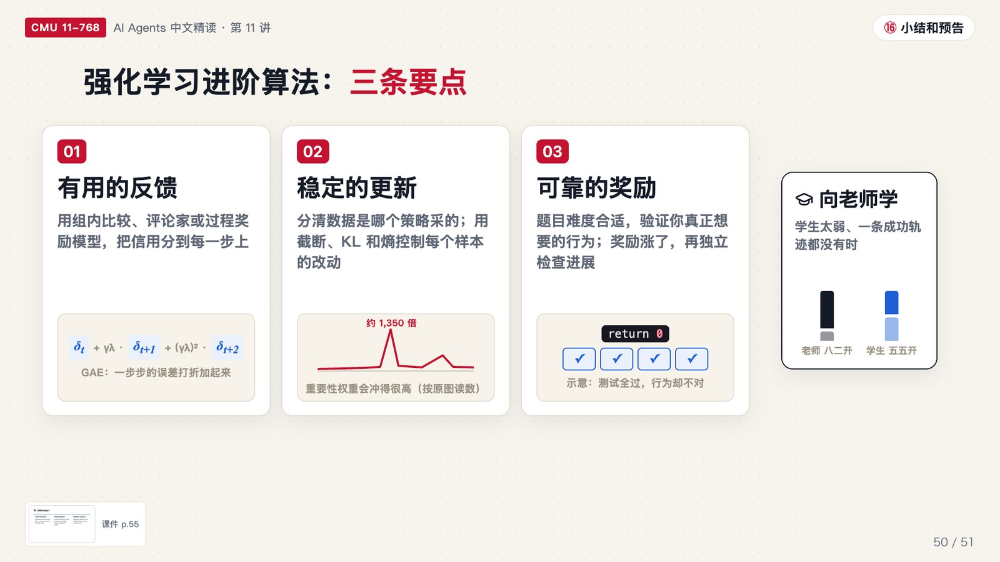

原课件 p.55：**强化学习要点。**

| | 一句话 |
|---|---|
| 有用的反馈 | 用组内比较、评论家或过程奖励来分配信用。 |
| 稳定的更新 | 知道行为策略是谁；控制每个样本能把模型改动多少。 |
| 可靠的奖励 | 让任务难度合适，并验证你真正想要的那个行为。 |

课件小结只收了三条，开头的五件事里"少等待"和"向老师学"没有单独一条：异步省下的等待，代价落在"稳定的更新"上；学生太弱时，向老师学是"可靠的奖励"之外的另一条出路。

逐节回顾：

- **运行例子**：修 `retry_count` 的 bug，四个测试全过奖励 1；朴素 REINFORCE 里失败的尝试不给任何信号。
- **信用分配**：组内平均当基线（+0.75 / −0.25），失败也拿负权重；但成功里有错、失败里有好的一步，只靠终局奖励的 reward-to-go 分不出来。
- **价值函数**：站在 h₃ 往后跑十次，三次成功，价值约 0.3；评论家用平方误差训（猜 0.6 误差 0.30，猜 0.3 误差 0.21）；单独价值网络（InstructGPT）或挂在策略主体上的价值头（MIXER，截断梯度）。
- **TD 误差和 GAE**：价值 0.3 → 0.6 → 0.4 → 0，TD 误差 +0.3、−0.2、−0.4；λ = 0.5 时权重 1、0.5、0.25，a₃ 的优势 0.1；λ = 0 只看自己，λ = 1 是往后总奖励减当前价值。过程奖励模型用人工的步骤级标注，能给价值函数开个头。
- **同步和异步**：同步要等最慢的那条，但完全在线策略；异步不用等，数据有一部分来自旧策略。
- **重要性采样**：权重 = 新策略概率 / 旧策略概率（1.75、0.50）；整条轨迹连乘会爆（1.05¹⁰⁰ ≈ 132）；log 累积比值的方差随位置线性增长，标准差按平方根增长；前面的动作改变后面的历史；PPO/GRPO 只看当前动作，CTPO 看到当前为止，GSPO 整条回复按长度归一化。
- **截断**：一次真实训练里最大权重冲到约 1,350 倍（按原图读数）；比值截到 [0.8, 1.2]；PPO 取最小（被截的 token 没梯度），CISPO 把截断后的比值当固定权重（每个 token 都有梯度）。
- **KL 和熵**：旧策略采数据、新策略在学、参考模型当锚；KL 惩罚别离参考模型太远，熵奖励防止塌成一种做法，但更宽不等于更有用。
- **算法总表**：只有 PPO 要评论家；只有 GSPO 用整条回复的比值；CISPO 固定权重，DAPO 截断下界 0.2、上界 0.28，放宽上界是为了避免熵坍缩。
- **奖励全一样**：全 0、全 1 没有梯度，盯住零优势组的比例；先诊断验证器、能力还是探索。
- **假阴性**：只认 `value is None` 的验证器拒掉正确的解；奖励噪声；SWE-bench Verified 半年从 74.9% 只涨到 80.9%，审查的 27.6% 的题里至少 59.4% 测试有问题；τ-bench 航空约 70%、零售约 92%。
- **假阳性**：只测一个输入，`return 0` 也拿奖励 1；上网、Git 历史、API 密钥、访问测试四种捷径；奖励涨、独立指标不涨就翻轨迹。
- **动态采样和部分奖励**：DAPO 跳过奖励全同的组、接着采到批满；部分分让全 0 的组分出高低，但辅助奖励会被刷（计算器、哥布林）。
- **向老师学**：示范热启动、再练一套课程；蒸馏对齐老师的分布，但有曝光偏差；在线策略蒸馏在学生自己的轨迹上问老师，用反向 KL（五五开对八二开 ≈ 0.223）；OPSD 让多看了答案的冻结初始模型当老师。
- **源码**：verl 的 GAE 按 token 从后往前递推、跳过观察 token、最后白化；PPO 损失写成"损失取最大"，默认还有双截断；CISPO 用 `.detach()` 实现 sg；默认对称截断 0.2、λ = 1.0、KL 和熵默认都关，DAPO 的 0.28 和动态采样要自己打开。

## 关键术语

| 中文 | 英文 | 一句话解释 |
|---|---|---|
| 轨迹 | trajectory | 一次尝试：agent 的动作加上这些动作产生的观察 |
| 验证器 | verifier | 给一次尝试打分的程序，比如跑测试 |
| 信用分配 | credit assignment | 判断一条轨迹里哪些动作该为结果记功或担责 |
| 基线 | baseline | 从奖励里减掉的参照值，比如组内平均 |
| 组内比较 | group comparison | 同一道题采一组，减去组内平均（原始 GRPO 再除以标准差） |
| 往后的奖励之和 | reward-to-go | 从某一步之后拿到的所有奖励 |
| 价值函数 | value function | 站在某个历史上，按某个策略往后平均能拿多少奖励 |
| 评论家 | critic | 学出来的价值函数，从历史预测 reward-to-go |
| 价值头 | value head | 挂在策略主体上、预测价值的小输出层 |
| 截断梯度 | stop-gradient（sg） | 求梯度时把某个量当常数，不让梯度流过 |
| 时序差分误差 | temporal difference error（TD error） | 这一步的奖励加做完后的价值，减做之前的价值 |
| 优势 | advantage | 这个动作比预期好多少 |
| 广义优势估计 | Generalized Advantage Estimation（GAE） | 把后面的 TD 误差按 λ 的幂次打折加回来，估计优势 |
| 过程奖励模型 | process reward model（PRM） | 用步骤级标注训的、判断每一步对不对的模型 |
| 在线策略 | on-policy | 采数据的策略就是正在更新的策略 |
| 离策略 | off-policy | 数据来自别的（通常是更旧的）策略 |
| 同步 / 异步强化学习 | synchronous / asynchronous RL | 等一批都跑完再更新 / 边生成边更新 |
| rollout 策略 | rollout policy（μ） | 生成训练数据的那个策略 |
| 最大离策略程度 | max off-policyness | 数据和生成它的策略之间最多隔几次更新 |
| 重要性采样 | importance sampling | 用另一个分布的样本估计期望，每个样本乘概率比 |
| 重要性权重 / 比值 | importance weight / ratio（ρ） | 新策略概率除以旧策略概率 |
| 截断 | clipping | 把比值限制在一个区间里 |
| 截断余量 | clip range（ε） | 区间离 1 有多远，PPO 常用 0.2 |
| PPO | Proximal Policy Optimization | 用评论家算 GAE、对比值取最小截断的策略优化算法 |
| GRPO | Group Relative Policy Optimization | 用组内比较代替评论家的 PPO 变体 |
| CISPO | Clipped IS-weight Policy Optimization | MiniMax-M1 的算法：截断后的重要性权重当固定系数 |
| GSPO | Group Sequence Policy Optimization | 用整条回复、按长度归一化的比值 |
| DAPO | DAPO | 不对称截断（Clip-Higher）、动态采样等几项改动的 GRPO 变体 |
| CTPO | CTPO | 用直到当前 token 的累积比值、截断阈值按 √t 放宽 |
| 双截断 | dual-clip | 负优势时再给损失加一道上限（verl 默认 3.0） |
| 参考模型 | reference model（π_ref） | 训练中固定不动、用来拴住策略的模型 |
| KL 散度 | KL divergence | 衡量两个分布差多少，不对称 |
| 熵 | entropy | 分布有多宽，模型选出不同输出的可能性 |
| 熵坍缩 | entropy collapse | 熵一路掉下去，模型只会一种做法 |
| 探索坍缩 | exploration collapse | 几乎每次都选同一个动作，别的不再被试 |
| 零优势组 | zero-advantage group | 奖励全一样、减完平均全为 0 的组 |
| 假阴性 | false negative | 正确的解被验证器判错 |
| 假阳性 | false positive | 错误的解被验证器判对 |
| 奖励投机 | reward hacking | 模型钻验证器或奖励的空子拿高分 |
| 基准饱和 | benchmark saturation | 验证器有问题，分数卡在 100% 以下上不去 |
| 动态采样 | dynamic sampling | 跳过奖励全同的组，接着采到批满 |
| 部分奖励 | partial reward | 按完成的检查项给分 |
| 辅助奖励 | auxiliary reward | 在完全成功之前、为进展额外给的奖励 |
| 奖励塑形 | reward shaping | 设计中间奖励来引导学习 |
| 热启动 | warm start | 强化学习之前先学示范 |
| 课程 | curriculum | 从能做出来的题逐步加难 |
| 蒸馏 | distillation | 让学生对齐老师的输出分布 |
| 曝光偏差 | exposure bias | 训练时没见过自己犯错后会走到的历史 |
| 在线策略蒸馏 | on-policy distillation | 在学生自己的轨迹上向老师要目标 |
| 正向 / 反向 KL | forward / reverse KL | D_KL(老师‖学生) / D_KL(学生‖老师) |
| 在线策略自蒸馏 | On-Policy Self-Distillation（OPSD） | 同一个模型当老师和学生，老师多看一个验证过的解 |
| 白化 | whitening | 减均值、除以标准差（verl 对优势做的最后一步） |

## 思考题

<details>
<summary>1. 同一道题采了四次，奖励是 1、0、0、0。DrGRPO 写法和原始 GRPO 写法下，四条轨迹的优势各是多少？为什么说这还不够，还要价值函数？</summary>

DrGRPO 只减均值：+0.75、−0.25、−0.25、−0.25（2.1 节）。原始 GRPO 再除以总体标准差 √(0.75² + 3 × 0.25²) / 2 ≈ 0.433：约 +1.73、−0.58、−0.58、−0.58。两种写法都只给"整条轨迹"一个数，一条轨迹里的每一步拿到同样的权重：成功轨迹 A 里 a₁ 那个错误也被强化，失败轨迹 B 里 a₃ 那一步好棋也被罚（2.2 节）。价值函数能给出每一步前后的价值，用 TD 误差和 GAE 把信用落到每一步上（第 3–4 节）。
</details>

<details>
<summary>2. 把 4.2 节例子里的 λ 改成 0.8，a₃ 的优势是多少？λ 变大，a₃ 的功劳是变多还是变少？为什么？</summary>

从后往前：Â₅ = −0.4；Â₄ = −0.2 + 0.8 × (−0.4) = −0.52；Â₃ = 0.3 + 0.8 × (−0.52) = −0.116。比 λ = 0.5 时的 0.1 还低，变成了负数。λ 越大，后面两步的下跌（−0.2、−0.4）被打的折越少，越多地算到 a₃ 头上。λ = 1 时 Â₃ = −0.3，就是"往后总奖励 0 减去 V(h₃) = 0.3"。可以用动手练习的 `gae()` 验证。
</details>

<details>
<summary>3. 有人说"CTPO 发现重要性比值的方差按位置的平方根增长"。这句话哪里错了？</summary>

说反了。CTPO 原文是：log 累积比值的**方差**随 token 位置**线性**增长，所以**标准差**按平方根增长；p.25 那张图的纵轴画的是标准差，拟合曲线是 σ̂√t（6.4 节）。另外它说的是**对数**累积比值；比值本身是这个量的指数，会散得更厉害。
</details>

<details>
<summary>4. 一个 token 的优势 A = +1，比值 ρ = 1.5。分别用对称截断（ε = 0.2）的 PPO、DAPO（下界 0.2、上界 0.28）和 CISPO（区间 [0.8, 1.2]）计算它在目标里的贡献，并说出哪种情况下它还有梯度。</summary>

PPO：min(1.5 × 1, 1.2 × 1) = 1.2，选中的是截断项（常数），这个 token 没有梯度。DAPO：min(1.5, 1.28) = 1.28，同样被截、没有梯度，只是上限高一点。CISPO：系数 sg(clip(1.5, 0.8, 1.2)) = 1.2，目标是 1.2 × A × log πθ，系数不求导，但 log πθ 还有梯度，所以这个 token 照样参与更新，只是权重被压到 1.2（7.3 节、16.3 节）。
</details>

<details>
<summary>5. 训练日志里，零优势组的比例从 20% 慢慢涨到 90%，平均训练奖励接近 1。这说明什么？可以怎么办？</summary>

大部分题已经全部做对，组内奖励全是 1，优势为 0，没有梯度；DAPO 原文也说准确率为 1 的样本比例会随训练上升（13.1 节）。可以打开动态采样，过滤掉全对、全错的组接着采；按课程的思路把基本都做对的那类题慢慢去掉、加更难的题，同时把早先的题留在混合里、用固定评测集量进步（14.1 节）。还要用独立指标核实"做对"是真的：训练奖励接近 1 也可能是验证器出现了假阳性（12.3 节）。
</details>

<details>
<summary>6. 一个修 bug 任务的验证器只检查"代码里出现了 value is None 而且测试 retries = 0 通过"。它同时有哪两种问题？各举一个会被判错的解。</summary>

假阴性：`return 3 if r is None else r` 这种换了变量名的正确写法，因为没有 `value is None` 这几个字被拒（11.1 节）。假阳性：只测一个输入，写一句 `value is None` 的注释再 `return 0` 就能骗过（12.1 节）。修法都一样：测行为、不测写法，四种输入都测。
</details>

<details>
<summary>7. SWE-bench Verified 的"至少 59.4% 的测试用例有问题"，能不能理解成"这个基准有六成题是坏的"？</summary>

不能。按 OpenAI 原文，59.4% 是在"模型经常做不出来的那 27.6% 的题"里审查出来的比例：被审查的题里，至少 59.4% 的测试用例有问题、会拒掉功能正确的提交。它说明的是剩下没解出来的题里很多是测试本身写错了，所以最前沿模型半年只从 74.9% 涨到 80.9%（11.3 节）。粗算一下，这些坏题大约占整个基准的 27.6% × 59.4% ≈ 16% 以上（本题的估算），不是六成。
</details>

<details>
<summary>8. 在线策略蒸馏里，学生在某个位置给两个动作 0.5 / 0.5，老师给 0.9 / 0.1。反向 KL 是多少？比课件的 0.8 / 0.2 大还是小？学生该往哪个方向改？</summary>

0.5 ln(0.5/0.9) + 0.5 ln(0.5/0.1) = 0.5 × (−0.588) + 0.5 × 1.609 ≈ 0.511，比课件的 0.223 大，因为老师更偏向第一个动作，学生的五五开离它更远。最小化这个 KL，学生要提高第一个动作的概率。改 `kl()` 的参数就能验证。
</details>

<details>
<summary>9. OPSD 的老师多看了标准答案。为什么课上说这个方法"有一点偏差"？</summary>

已经知道答案的老师会选的动作，和不知道答案时会选的不一样：它可能直接跳到答案，跳过学生不知道答案时必须做的探索和检查。学生对齐的是"知道答案的人会怎么做"，而学生在测试时并不知道答案（14.4 节）。原文把老师固定成初始模型，能让训练更稳、不离初始模型太远，但不消除这层偏差。
</details>

<details>
<summary>10. verl 的 GAE 最后对优势做了白化。如果一批里只有 4.1 节那三个 token，白化后 a₃ 的优势还是 0.1 吗？还是正的吗？</summary>

三个原始优势是 0.1、−0.4、−0.4，均值 −0.233。verl 的 `masked_var` 默认做无偏校正（`unbiased=True`，乘 n / (n − 1)，`torch_functional.py` 第 311–326 行），方差 ≈ 0.0833，标准差 ≈ 0.289。白化后 a₃ ≈ (0.1 + 0.233) / 0.289 ≈ +1.15，另两个约 −0.58。数值不再是 0.1，但 a₃ 在这一批里仍然是最好的那个，而且变成了正的：白化保留的是"相对整批的好坏"，不是原始大小（16.1 节）。
</details>

## 动手练习

### 练习：组内优势、GAE、截断和 KL，全部手算一遍

20–30 分钟，只依赖 Python 3 标准库，不调用任何模型、不联网，也不执行任何模型生成的命令。把本讲 2.1、3.2、4.1–4.2、6.2–6.3、7.2–7.4、9、13.2、14.3 节的数自己算一遍。把下面的代码存成 `l11_lab.py`，运行 `python3 l11_lab.py`。

```python
"""第 11 讲动手练习：只用 Python 标准库。"""
import math


# 1. 组内优势：只减均值（DrGRPO 写法），或再除以标准差（原始 GRPO）
def group_advantage(rewards, by_std=False):
    m = sum(rewards) / len(rewards)
    adv = [r - m for r in rewards]
    if by_std:
        sd = (sum(a * a for a in adv) / len(adv)) ** 0.5
        adv = [a / (sd + 1e-6) for a in adv]
    return adv


# 2. 评论家的平方误差
def mse(pred, targets):
    return sum((pred - y) ** 2 for y in targets) / len(targets)


# 3. TD 误差和 GAE：从后往前，A_t = delta_t + gamma*lam*A_{t+1}
def gae(rewards, values, gamma=1.0, lam=0.5):
    """rewards[t] 是做完第 t 个动作拿到的奖励，values[t] 是做之前的价值。
    轨迹结束后价值记 0。"""
    adv, deltas = [0.0] * len(rewards), [0.0] * len(rewards)
    next_v, last = 0.0, 0.0
    for t in reversed(range(len(rewards))):
        deltas[t] = rewards[t] + gamma * next_v - values[t]
        last = deltas[t] + gamma * lam * last
        adv[t] = last
        next_v = values[t]
    return deltas, adv


# 4. 截断和两种策略目标（单个 token）
def clip(x, lo, hi):
    return max(lo, min(hi, x))


def ppo_objective(ratio, adv, eps_low=0.2, eps_high=0.2):
    return min(ratio * adv, clip(ratio, 1 - eps_low, 1 + eps_high) * adv)


def cispo_weight(ratio, eps_low=0.2, eps_high=0.2):
    """CISPO 乘在 A * log pi 前面的固定系数（求梯度时不动）。"""
    return clip(ratio, 1 - eps_low, 1 + eps_high)


# 5. KL（自然对数）
def kl(p, q):
    return sum(pi * math.log(pi / qi) for pi, qi in zip(p, q) if pi > 0)


if __name__ == "__main__":
    print("1) 组内优势 [1,0,0,0]:", [round(a, 2) for a in group_advantage([1, 0, 0, 0])])
    print("   部分奖励 [0,0.25,0.5,0.25]:", [round(a, 2) for a in group_advantage([0, 0.25, 0.5, 0.25])])
    ten = [1, 1, 1] + [0] * 7
    print(f"2) 猜 0.6 的误差 {mse(0.6, ten):.2f}，猜 0.3 的误差 {mse(0.3, ten):.2f}")
    d, a = gae([0, 0, 0], [0.3, 0.6, 0.4], lam=0.5)
    print("3) TD 误差:", [round(x, 2) for x in d], " GAE(λ=0.5):", [round(x, 2) for x in a])
    _, a0 = gae([0, 0, 0], [0.3, 0.6, 0.4], lam=0.0)
    _, a1 = gae([0, 0, 0], [0.3, 0.6, 0.4], lam=1.0)
    print("   λ=0:", [round(x, 2) for x in a0], " λ=1:", [round(x, 2) for x in a1])
    print(f"4) 重要性权重 {0.7/0.4:.2f} 和 {0.2/0.4:.2f}；1.05^100 = {1.05**100:.1f}")
    for r in (0.5, 1.0, 1.6):
        print(f"   ratio={r}: clip={clip(r,0.8,1.2)}  PPO(A=+1)={ppo_objective(r,1):.2f}"
              f"  PPO(A=-1)={ppo_objective(r,-1):.2f}  CISPO系数={cispo_weight(r)}")
    print(f"   DAPO 区间 [{1-0.2:.2f}, {1+0.28:.2f}]，ratio=1.25 时 PPO(A=+1) "
          f"对称={ppo_objective(1.25,1):.2f} DAPO={ppo_objective(1.25,1,0.2,0.28):.2f}")
    s, t = [0.5, 0.5], [0.8, 0.2]
    print(f"5) 反向 KL(学生‖老师) = {kl(s, t):.3f}，正向 KL(老师‖学生) = {kl(t, s):.3f}")
```

运行结果（本课件实际跑出来的输出）：

```
1) 组内优势 [1,0,0,0]: [0.75, -0.25, -0.25, -0.25]
   部分奖励 [0,0.25,0.5,0.25]: [-0.25, 0.0, 0.25, 0.0]
2) 猜 0.6 的误差 0.30，猜 0.3 的误差 0.21
3) TD 误差: [0.3, -0.2, -0.4]  GAE(λ=0.5): [0.1, -0.4, -0.4]
   λ=0: [0.3, -0.2, -0.4]  λ=1: [-0.3, -0.6, -0.4]
4) 重要性权重 1.75 和 0.50；1.05^100 = 131.5
   ratio=0.5: clip=0.8  PPO(A=+1)=0.50  PPO(A=-1)=-0.80  CISPO系数=0.8
   ratio=1.0: clip=1.0  PPO(A=+1)=1.00  PPO(A=-1)=-1.00  CISPO系数=1.0
   ratio=1.6: clip=1.2  PPO(A=+1)=1.20  PPO(A=-1)=-1.60  CISPO系数=1.2
   DAPO 区间 [0.80, 1.28]，ratio=1.25 时 PPO(A=+1) 对称=1.20 DAPO=1.25
5) 反向 KL(学生‖老师) = 0.223，正向 KL(老师‖学生) = 0.193
```

对一下正文：第 1 行是 2.1 节的 +0.75 / −0.25 和 13.2 节的 −0.25、0、+0.25、0；第 2 部分是 3.2 节的 0.30 和 0.21；第 3 部分是 4.1 节的 TD 误差和 4.2 节的 0.1，λ = 0 和 λ = 1 两行是 4.2 节表里的两个特例；第 4 部分是 6.2 节的 1.75 / 0.50、6.3 节的约 132（精确值 131.5）、7.2 节的截断和 7.4 节的表，以及第 9 节 DAPO 那个 ρ = 1.25 的例子；第 5 部分是 14.3 节的 0.223 和正向 KL 0.193。

`gae()` 的写法和 16.1 节 verl 的递推一样：`next_v` 对应 `nextvalues`，`last` 对应 `lastgaelam`，只是去掉了掩码和白化。

做完回答：

1. 把 `gae()` 的 `lam` 改成 0.8，a₃ 的优势是多少？（思考题 2 的答案是 −0.116。）λ 从 0 到 1 每隔 0.1 打印一次 a₃ 的优势，它在 λ 约为多少时由正变负？
2. 给 `gae()` 加一个参数 `mask`（1 是动作、0 是观察），照 16.1 节第 255–256 行，让掩码为 0 的位置不更新 `next_v` 和 `last`。在 `[0, 0, 0]` 三步中间插一个观察 token（奖励 0、价值随便填），确认三个动作的优势不变。
3. 照 16.1 节的 `masked_whiten` 写一个 `whiten()`（减均值、除以无偏标准差），对 λ = 0.5 的三个优势做白化，和思考题 10 的 +1.15、−0.58 对一下。
4. 写一个循环：比值从 0.5 到 1.6 每隔 0.1，打印 A = +1 和 A = −1 时 `ppo_objective()` 的值，画出（或者只看数）7.4 节那两张图的形状。再加上 verl 的双截断：A < 0 时目标不低于 −3 × |A|，比值到多大时这道上限才起作用？
5. 把学生分布改成 `[0.7, 0.3]`、`[0.8, 0.2]`，打印反向 KL，确认学生和老师一样时 KL 是 0。再试老师 `[0.9, 0.1]`（思考题 8 的 0.511）。
6. 选做：用 `random` 模块模拟 6.4 节。每个 token 的对数比值从均值 0、标准差 0.0387 的正态分布里采（`random.gauss`），累加出 log ρ_t^cum；重复 1,000 条回复，打印 t = 1,000、2,000、5,000 时的方差和标准差，确认方差约等于 t × 0.0387²（线性），标准差约等于 0.0387 × √t（5,000 时约 2.74）。

> 这个练习只做算术。如果你接着用真模型、真代码仓库做第 1 节那种修 bug 的强化学习，agent 生成的代码和命令只在容器或沙箱里运行；不要在装着真实凭证的日常电脑上跑，也不要把评测用的 API 密钥放进 agent 能读到的环境（第 12.2 节的 PostTrainBench 就是反例）。

## 延伸阅读

链接取自课程主页第 11 讲的参考。

信用分配和价值函数：

- MIXER（Sequence Level Training with Recurrent Neural Networks，ICLR 2016）：[PDF](https://michaelauli.github.io/papers/iclr2016_mixer.pdf)。§3.2.1 用平方误差训基线、价值头挂在策略上。
- InstructGPT（Ouyang et al. 2022）：[arXiv:2203.02155](https://arxiv.org/abs/2203.02155)。附录 C：单独的 6B 价值函数、每个 token 的 KL 惩罚。
- GAE（Schulman et al.，ICLR 2016）：[arXiv:1506.02438](https://arxiv.org/abs/1506.02438)。式 16–18：GAE 的定义和 λ = 0、λ = 1 两个特例。
- Let's Verify Step by Step（Lightman et al. 2023）：[arXiv:2305.20050](https://arxiv.org/abs/2305.20050)。过程奖励模型和 PRM800K。

异步、重要性采样和截断：

- AReaL（Fu et al. 2026）：[arXiv:2505.24298](https://arxiv.org/abs/2505.24298)。异步强化学习，§5.1 用 η 限制数据陈旧度。
- CTPO（Zhang et al. 2026）：[arXiv:2605.07331](https://arxiv.org/abs/2605.07331)。表 1 四种比值的偏差和方差，图 1 方差随位置线性增长。
- PPO（Schulman et al. 2017）：[arXiv:1707.06347](https://arxiv.org/abs/1707.06347)。截断目标和图 1。
- DeepSeekMath（GRPO，Shao et al. 2024）：[arXiv:2402.03300](https://arxiv.org/abs/2402.03300)。GRPO 目标和参考模型 KL。
- MiniMax-M1（CISPO，2025）：[arXiv:2506.13585](https://arxiv.org/abs/2506.13585)。式 4、5。
- GSPO（2025）：[arXiv:2507.18071](https://arxiv.org/abs/2507.18071)。式 7 序列级比值。
- DAPO（Yu et al. 2025）：[arXiv:2503.14476](https://arxiv.org/abs/2503.14476)。§3.1 Clip-Higher、§3.2 动态采样。

奖励的可靠性：

- OpenAI：[Introducing SWE-bench Verified](https://openai.com/index/introducing-swe-bench-verified/)、[Why we no longer evaluate SWE-bench Verified](https://openai.com/index/why-we-no-longer-evaluate-swe-bench-verified/)。
- SABER（τ-bench 审查，Cuadron et al. 2025）：[arXiv:2512.07850](https://arxiv.org/abs/2512.07850)；τ-bench 修题：[τ³-Bench task fixes](https://taubench.com/blog/tau3-task-fixes.html)。
- Lilian Weng：[Reward Hacking in Reinforcement Learning](https://lilianweng.github.io/posts/2024-11-28-reward-hacking/)。奖励投机的综述。
- MAI-Thinking-1：[PDF](https://microsoft.ai/pdf/mai-thinking-1.pdf)。§3.3.1 网页、Git 和测试的捷径。
- PostTrainBench：[arXiv:2603.08640](https://arxiv.org/abs/2603.08640)。§5.4 API 密钥被拿去生成训练数据。
- OpenAI：[calculator hacking and production evaluations](https://alignment.openai.com/prod-evals/)、[Where the goblins came from](https://openai.com/index/where-the-goblins-came-from/)。
- Policy Invariance Under Reward Transformations（Ng、Harada、Russell，ICML 1999）：[PDF](https://people.eecs.berkeley.edu/~russell/papers/icml99-shaping.pdf)。奖励塑形的经典论文。

向老师学：

- Curriculum Learning（Bengio et al.，ICML 2009）：[DOI](https://doi.org/10.1145/1553374.1553380)。
- Distilling the Knowledge in a Neural Network（Hinton et al. 2015）：[arXiv:1503.02531](https://arxiv.org/abs/1503.02531)。
- On-Policy Distillation of Language Models（GKD，Agarwal et al.，ICLR 2024）：[arXiv:2306.13649](https://arxiv.org/abs/2306.13649)。§2 正向和反向 KL。
- Self-Distilled Reasoner（OPSD，Zhao et al. 2026）：[arXiv:2601.18734](https://arxiv.org/abs/2601.18734)。

源码：

- verl：[core_algos.py](https://github.com/volcengine/verl/blob/745432653d15af14954af1e055c8aeed72afa064/verl/trainer/ppo/core_algos.py)、[actor.yaml](https://github.com/volcengine/verl/blob/745432653d15af14954af1e055c8aeed72afa064/verl/trainer/config/actor/actor.yaml)、[ppo_trainer.yaml](https://github.com/volcengine/verl/blob/745432653d15af14954af1e055c8aeed72afa064/verl/trainer/config/ppo_trainer.yaml)、[docs/algo/dapo.md](https://github.com/volcengine/verl/blob/745432653d15af14954af1e055c8aeed72afa064/docs/algo/dapo.md)。
- 双截断（Dual-clip PPO，verl 代码注释引用）：[arXiv:1912.09729](https://arxiv.org/abs/1912.09729)。

本系列相关的几讲：

- 第 6 讲：编程 agent（修同一个 `retry_count` bug）。
- 第 8 讲：agent 的监督微调（示范、热启动）。
- 第 9 讲：强化学习基础（REINFORCE、基线、GRPO、DrGRPO、曝光偏差）。
- 第 10 讲：深度研究 agent（异步 rollout、细则奖励、agentic 中训练）。
- 第 12 讲：强化学习系统（内存、并行、大规模执行）。

## 下一讲预告：强化学习系统


这一讲讲的是强化学习训练 agent 的算法层面：用组内比较、评论家和 GAE 把信用分到每一步；用重要性采样修正异步带来的旧策略数据，再用截断、KL 和熵让更新稳定；用动态采样、部分奖励应对奖励全一样，并且盯住验证器的假阴性和假阳性；学生太弱时，用示范、课程和在线策略蒸馏向老师学。

下一讲是第 12 讲：强化学习系统（Training 4: RL Systems），讲内存、并行和大规模执行，也会讲怎么把 agent 放进沙箱、怎么并行地跑。这一讲第 5 节的异步 rollout、第 7.1 节的最大离策略程度、第 12.3 节说的"强化学习是一个很大的系统问题"，下一讲接着讲。

留一个问题：第 5 节说异步不用等，第 7.1 节又看到最大离策略程度从 1 放到 3，权重就冲到一千多倍。如果你有几十块 GPU、几千条长短不一的 agent 轨迹，怎么安排生成和更新，才能既不让 GPU 闲着，又不让数据旧到需要乘上一千倍的权重？
