# 第 12 讲 · 强化学习系统：训 agent 的工程坑

> CMU 11-768 AI Agents（2026 秋）中文精读 · 配套课件
> 配套视频（29 分钟）：B 站 / 视频号 / 抖音 / 小红书搜索「竹二木SI」 · 整份幻灯片：[l12-幻灯片.pdf](./l12-幻灯片.pdf)
> 原课程：[cmu-agents.com](https://cmu-agents.com)，课程主讲 Graham Neubig、Daniel Fried，本讲由 Apurva Gandhi 主讲。本课件是非官方的学习整理。

## 这一讲你会学到

学完这一讲，你应该能做到：

1. 把策略梯度更新拆成框架里的操作：`sample`、`forward_backward`、`optim_step`，加上环境的 `step` 和 `verify`，再加 agent harness；说出为什么光有 PyTorch 的三个接口还不够。
2. 说清强化学习框架里为什么有**推理引擎**和**训练引擎**两套系统：一边解码为主、不要梯度，一边整条并行、要自动求导；两边靠轨迹数据和**权重同步**来往，所以哪怕权重一样也有一点离策略。
3. 走一遍一个训练步的五格：sample → verify → forward → backward → optim_step + sync，并把后面每个优化放进对应的格子。
4. 手算 **KV 缓存**的大小（Llama-3-8B 每 token 128 KB，32k 一条约 4 GB，64 条约 256 GB），说出**前缀缓存**、**连续批处理**、**分块预填充**、**分离式推理**、**推测解码**各省掉了什么，以及推测解码在强化学习里为什么要边训边更新草稿模型。
5. 说清**激活检查点**用约 +33% 计算换显存，**前缀共享**省掉重复的前向和反向；分清两组实测：Snowflake ZoRRo 重复提示词 token 80–95%、策略更新最多快 6 倍（端到端最多 3.5 倍），AReaL-DTA 前缀树压缩率 9.43 倍、训练吞吐最多 8.31 倍。
6. 说出数据、流水线、专家、张量、上下文五种并行，和经验法则"数据并行尽量大，通信尽量少"。
7. 算出 1T 参数 bf16 全量同步约 2 TB，解释为什么约 99% 的参数在 bf16 下不变（PULSE），只传变化量能降到几十 GB（课上估算）。
8. 解释**路由重放**（R3）解决的 MoE 训练推理选专家不一致。
9. 用两个 harness 的例子讲清**序列延展**：一直追加的历史能拼成一个数据点，压缩过的要拆成两个；说出默认聊天模板删历史推理为什么会打断它，以及框架为什么自带**渲染器**。
10. 说出轨迹为什么要 **token 进、token 出**：字符串转手会多一个空格，解码是多对一的（Hel + lo 和 Hello）。
11. 说清同步和**异步强化学习**怎么分卡（例如 3 : 1），以及生成到一半换权重时 SGLang 的 abort、retract、in_place 三种暂停模式。
12. 比较三种系统设计：harness 无关的中间人代理、单程序多数据（SPMD）、一切皆服务；说出服务化带来的跨地区训练、多策略训练、在线强化学习，以及多 LoRA 和 Tinker 的四个接口。
13. 读懂 tinker-cookbook 里 Qwen3 渲染器的 `strip_thinking_from_history` 和 `trajectory_to_data`，说出它怎么判断"能不能拼成一个数据点"。

建议先看一遍视频，再对照本课件逐节复习。每节开头的图就是视频里对应的画面。


### 接上一讲

强化学习一共三讲：第 9 讲打基础，第 11 讲讲算法，这一讲讲系统。前两讲留下的几处，这一讲接上：

| 前两讲留下的说法 | 这一讲在哪里接上 |
|---|---|
| 第 11 讲 5 节：异步不用等最慢的那条，但数据有一部分来自旧策略 | 第 11 节：同步共用卡、异步分开卡，生成到一半换权重 |
| 第 11 讲 6–7 节：重要性采样、截断 | 第 2.3 节：推理和训练是两套系统，就算权重一样也略有离策略；第 7 节 R3、第 10 节 token 进 token 出，都是在减少这种不一致 |
| 第 11 讲 12.3 节：强化学习是一个很大的系统问题 | 整讲 |
| 第 9 讲 6.5 节：损失只算在模型生成的 token 上 | 第 8.2 节的损失掩码、第 18.3 节 `trajectory_to_data` 的 `mask` |
| 第 11 讲片尾的问题：几十块 GPU、几千条长短不一的轨迹，怎么安排生成和更新 | 第 3.3 节连续批处理、第 11 节异步和 3 : 1 分卡、第 14–15 节弹性扩容 |

第 11 讲片尾的问题，这一讲给出的答案大致是：推理那边用连续批处理把空位随时补上；推理和训练分开跑、按负载多分卡给推理；最长的那几条不挡训练，生成到一半换上新权重，再用第 11 讲的重要性采样和截断修正那部分旧数据；rollout 跟不上就再拉起推理服务。

### 这一讲的路线

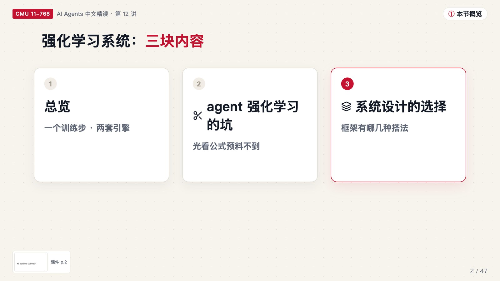

这一讲是一次导览：如果你用一个强化学习框架训 agent，或者想 fork 一个框架来改，机器上会碰到哪些东西。一共三块：

| 三块 | 讲什么 | 本课件 |
|---|---|---|
| 总览 | 一个训练步要做哪些操作；推理和训练两套引擎各自怎么优化、怎么来往 | 1–7 节 |
| agent 强化学习的坑（原课件标题 The Sharp Bits） | 光看公式预料不到、真训 agent 迟早会碰上的事 | 8–12 节 |
| 系统设计的选择 | 要搭或者改一个框架，有哪几种搭法 | 13–16 节 |

### 运行例子：修 bug 的一个训练步

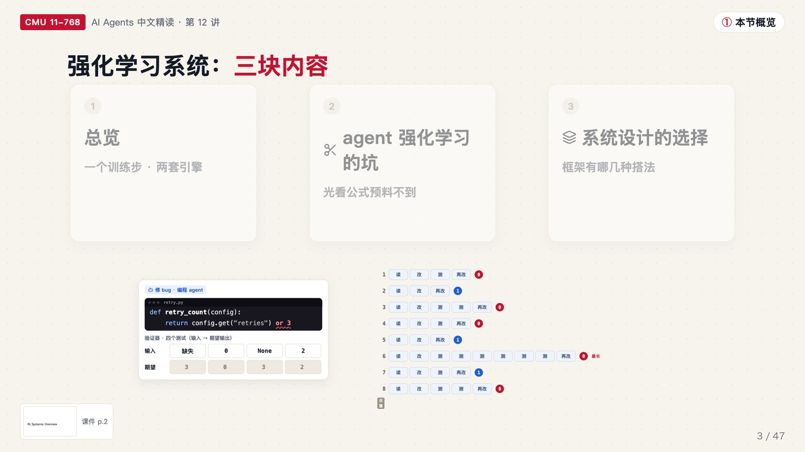

整讲接着用第 11 讲那道题：编程 agent 修 `retry_count`。

```python
def retry_count(config):
    return config.get("retries") or 3
```

0 是假值，`0 or 3` 得到 3，所以"0 次重试"被当成"没设置"。验证器跑四个测试（输入缺失、0、None、2，期望 3、0、3、2），全过奖励 1，否则 0。

这一讲看的是它的**一个训练步**在机器上怎么跑：同一道题采 8 条轨迹（GRPO 一组），每条轨迹几轮"读、改、测、再改"，其中一条特别长。8 条、每条几轮、哪条最长，这些数是我为讲清楚设的，画面上都标了"示意"。推理优化、训练优化、权重同步、序列延展、token 进 token 出、异步、harness 无关设计都能回到这一个训练步；并行、多 LoRA、在线强化学习用这个例子串不自然，就不硬串。

---

## 1 一个训练步要哪些操作

原课件 p.2 分隔页：**强化学习系统：总览。**

### 1.1 公式拆成几个操作

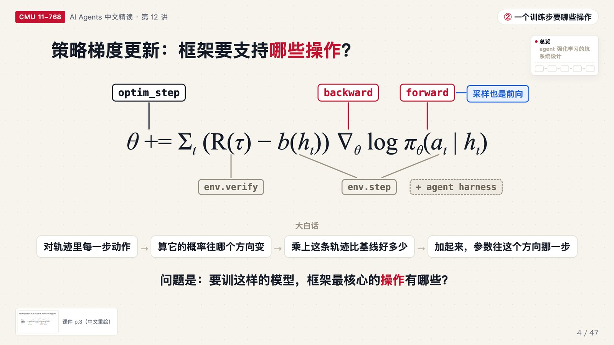

原课件 p.3：**一个大模型强化学习框架必须支持哪些操作？**

```
策略梯度更新：
θ += Σ_t ( R(τ) − b(h_t) ) ∇_θ log π_θ(a_t | h_t)
```

大白话：对轨迹里每一步动作，算"它的概率对参数的梯度"，乘上"这条轨迹比基线好多少"，加起来，参数往这个方向挪一步。它很像监督微调，只是每一项多乘了一个优势当权重（第 9 讲）。

课件在公式上标了每一块由哪个操作负责：

| 公式里的部分 | 操作 | 做什么 |
|---|---|---|
| θ += | `optim_step` | 真正去改模型权重 |
| ∇_θ | `backward` | 反向传播求梯度 |
| log π_θ(a_t \| h_t) | `forward` | 前向算出每个动作的对数概率 |
| R(τ) | `env.verify` | 环境验证一条轨迹，给奖励 |
| h_t、a_t | `env.state` / `env.step`，加上 agent harness | 在环境里走一步、拿回观察；推理本身怎么组织 |

前向有两个用处：算损失要前向；强化学习还要自己采样轨迹，采样也是前向。这一点在第 2 节会变成"两套引擎"。

### 1.2 为什么不直接用 PyTorch 手写

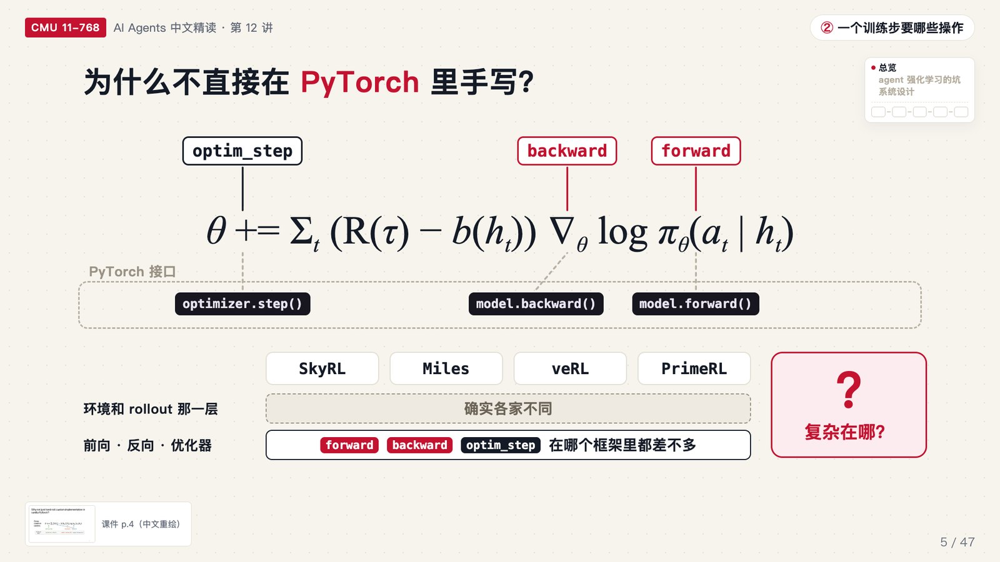

原课件 p.4：**为什么不在原生 PyTorch 里手写一个实现？**

| 操作 | PyTorch 接口 |
|---|---|
| optim_step | `optimizer.step()` |
| backward | `model.backward()` |
| forward | `model.forward()` |

现在的框架一大堆：SkyRL、Miles、veRL、PrimeRL……个个都很复杂。课上有同学说"每个环境、每种结构都不一样"。环境和 rollout 那一层（让 agent 真去做一遍任务、采一条轨迹）确实因框架而异，也可以拆出去；但前向、反向、优化器三步在各个框架里都差不多，单用 PyTorch 或 JAX 也写得出来。复杂在哪？答案在下一节。

**这一节记住一句**：一行策略梯度公式，在机器上是采样、前向、反向、优化器走一步，再加环境的执行和验证。

---

## 2 两种完全不同的负载

### 2.1 推理引擎和训练引擎

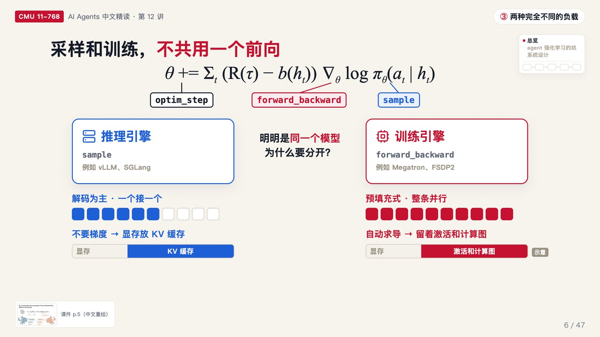

原课件 p.5：**强化学习框架由两种根本不同的负载组成。**

公式上的标注换了：`optim_step` 还在；log π 那里拆成两份，采样用的叫 `sample`，训练用的叫 `forward_backward`（前向加反向）。

| | 推理引擎（例：vLLM、SGLang） | 训练引擎（例：Megatron、FSDP2） |
|---|---|---|
| 计算形态 | 解码为主：一个 token 一个 token 地出，出一个再喂回去 | 预填充式：整条序列已经有了，可以并行地算 |
| 梯度 | 不要梯度：激活值和计算图全扔掉，省下的显存放 KV 缓存 | 自动求导：必须留着激活值和计算图，才能做反向 |
| 接口 | `sample` | `forward_backward` |

各家框架都有一件看起来很怪的事：采样和训练**不共用一个前向**。采样在推理引擎里做；训练时在训练引擎里把前向**再做一遍**。明明是同一个模型，分开是因为两边的计算特点完全不同。

### 2.2 两边各一串优化

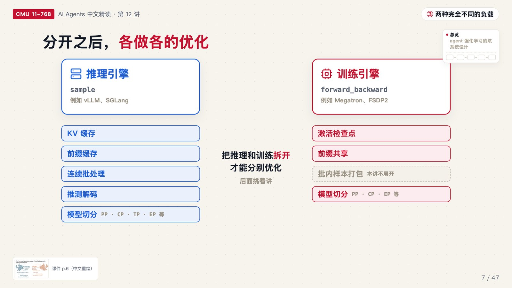

原课件 p.6：

| 推理引擎 | 训练引擎 |
|---|---|
| KV 缓存（3.1） | 激活检查点（4.1） |
| Radix / 前缀缓存，跨请求（3.2） | 前缀共享（4.2） |
| 连续批处理（3.3） | 批内样本打包（Batch Sample Packing，课上没展开） |
| 推测解码 / MTP（3.5） | 模型切分：PP、CP、EP 等（5） |
| 模型切分：PP、CP、TP、EP 等（5） | |

每一边都是一个很复杂的系统。把推理和训练拆开，才能分别给它们做这些专门的优化。

### 2.3 两套引擎之间的来往

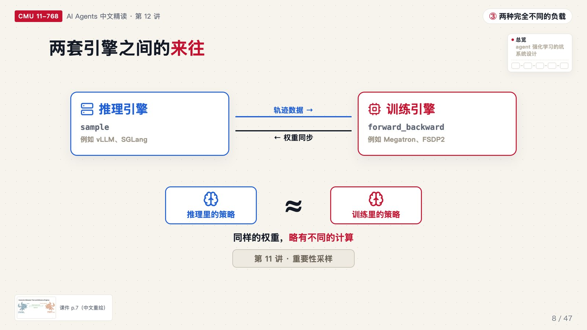

原课件 p.7：推理引擎（`sample`）→ **rollout / 轨迹数据** → 训练引擎（`forward_backward`）；训练引擎 → **权重同步** → 推理引擎。

两边是两套系统，用的算子、前向的算法都可能略有不同。所以**就算权重一样**，推理时也像是从一个稍微不同的策略里采样，训练时训的又是另一个。这种拆开的组织方式下，第 11 讲的**离策略修正**（重要性采样、截断）就很重要。后面第 7 节的 R3、第 10 节的 token 进 token 出，都是在把这种不一致压小。

### 2.4 拆开一个训练步

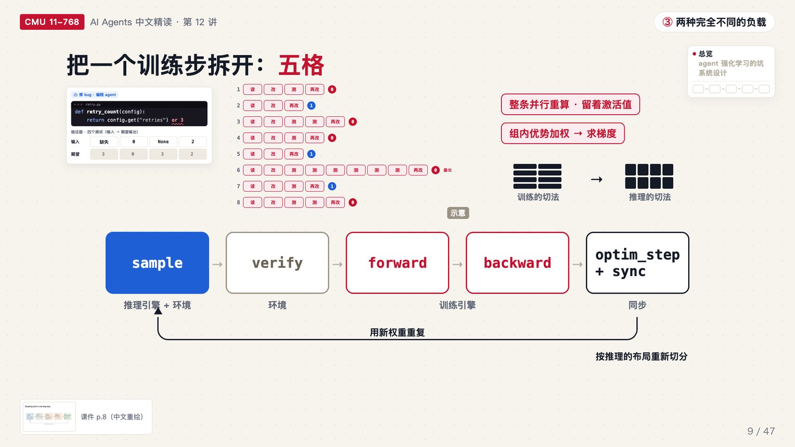

原课件 p.8：

| 格 | 阶段 | 在哪 | 做什么 |
|---|---|---|---|
| ① | sample | 推理引擎 + 环境 | 用当前策略采样轨迹，同时在环境里执行动作 |
| ② | verify | 环境 | 从验证器、测试或工具结果拿奖励 |
| ③ | forward | 训练引擎 | 在训练引擎里重算对数概率，同时记录梯度所需的信息 |
| ④ | backward | 训练引擎 | 反向传播算梯度 |
| ⑤ | optim_step + sync | 同步 | 更新训练端的策略权重，发给推理引擎，并重新切分 |

然后用更新后的权重重复。

**修 bug 的一个训练步**（数字示意）：

1. sample：推理引擎对同一道题采 8 条轨迹，每条里 agent 读代码、改代码、跑测试，**每一轮都是一次单独的模型调用**。
2. verify：环境跑四个测试，全过给 1，否则给 0。
3. forward：训练引擎拿到 8 条轨迹，整条并行地重算每个动作 token 的对数概率，这回留着激活值和计算图。
4. backward：用组内优势加权，反向求梯度。
5. optim_step + sync：改权重，把新权重发回推理引擎。大模型切在很多张卡上，推理的切法和训练不一样，拿到权重还要**按推理的布局重新切分**。

后面每讲一个优化，都标一下它落在哪一格：

| 格 | 本课件 |
|---|---|
| ① sample | 3 节推理优化、7 节 R3 的记录、11 节异步 |
| ③④ forward / backward | 4 节训练优化、7 节 R3 的重放、8 节序列延展 |
| ① 到 ③ 之间的交接 | 10 节 token 进 token 出 |
| ⑤ optim_step + sync | 6 节权重同步 |
| 全部 | 5 节并行、16 节 Tinker 的四个接口 |

**这一节记住一句**：推理和训练是两种负载，分成两套引擎，中间靠轨迹和权重同步来往。

---

## 3 推理优化

这一节的五个优化都落在第 ① 格 sample。

### 3.1 KV 缓存

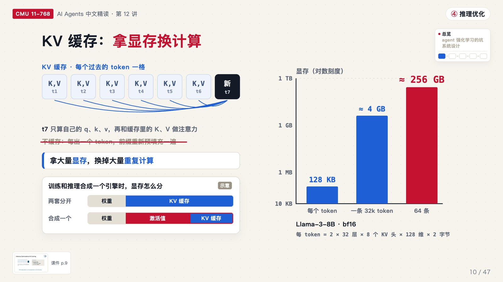

原课件 p.9：**KV 缓存：每个过去的 token 存一份。** 第 7 步只为新 token 算 q、k、v，对所有缓存的 k、v 做注意力，再把自己的 k、v 追加进去。**KV 缓存用大量显存，换掉大量重复计算。**

解码一次只出一个 token。不缓存的话，每出一个新 token 都要把整个前缀重新预填充一遍；前面 token 的 K、V 已经算过，存起来就行（第 3 讲长上下文讲过）。

有多大？Llama-3-8B，bf16：

| | 大小 |
|---|---|
| 每个 token | **128 KB** |
| 一条 32k token 的轨迹 | ≈ **4 GB** |
| 64 条 | ≈ **256 GB** |

按 Llama-3-8B 的公开配置核算（32 层，8 个 KV 头，每头 128 维，K 和 V 两份，bf16 每个数 2 字节）：

```
每 token = 2（K、V）× 32 层 × 8 个 KV 头 × 128 维 × 2 字节 = 131,072 字节 = 128 KB
32k 一条 = 128 KB × 32,768 = 4 GB          64 条 = 4 GB × 64 = 256 GB
（这里的 KB、GB 按 1024 进位）
```

这还算小模型。模型更大、强化学习的批更大，要放的 KV 就更多。要是把训练和推理合成一个引擎，显存里还要同时留激活值，留给 KV 缓存的就很少了。这是两套引擎分开的好处之一。

修 bug 的例子：8 条轨迹越往后上下文越长，KV 缓存跟着涨（示意）。

### 3.2 前缀缓存

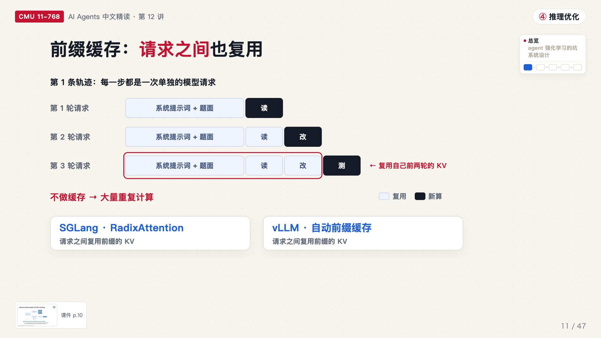

原课件 p.10：**agent 强化学习特别受益于前缀缓存。**

- 组内 rollout（如 GRPO）里，很多 rollout 共享同样的任务提示词。
- 一条 rollout 过去几步的 KV，可以在后面的步骤里复用。

实现：SGLang 的 **RadixAttention**、vLLM 的 **Automatic Prefix Caching**。

KV 缓存是在**一次请求内部**复用；**请求之间**也有大量重复计算，agent 强化学习尤其多：

| 哪里重复 | 修 bug 的例子 |
|---|---|
| 一组 rollout 共享系统提示词和工具说明，组内又共享同一道题 | 8 条轨迹的系统提示词、题面、那几行代码和测试说明只算一次 |
| 轨迹里每一步都是一次**单独的模型请求**，前面的步骤是这一步的严格前缀 | 第 3 轮请求复用它自己第 1、2 轮的 KV |

要记住的是第二行：agent 的一条轨迹不是一次连续的推理，而是一串请求。只要上一步的完整输入加输出是这一步输入的前缀，算过的就都能复用。这个"前缀"在第 8–10 节还会反复出现。

### 3.3 连续批处理

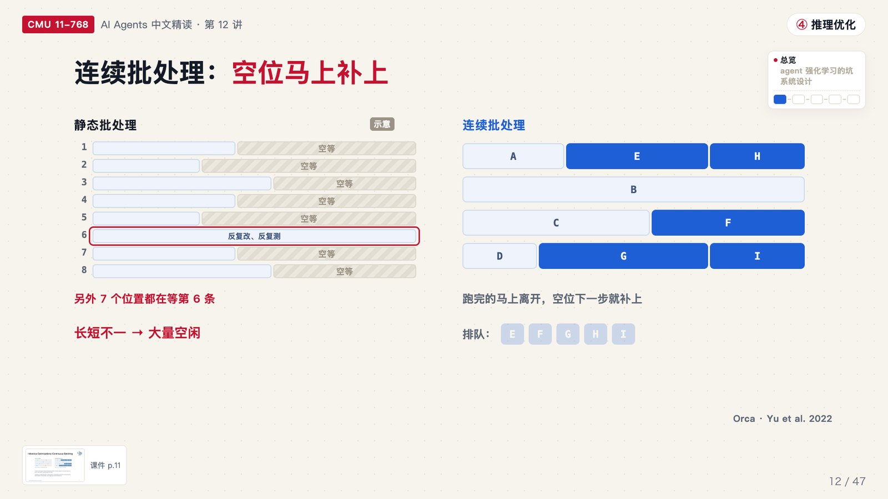

原课件 p.11：

| 静态批处理 | 连续批处理（**continuous batching**） |
|---|---|
| A 跑完后空等；B 最长；C、D 跑完后空等 | A 跑完接 E 再接 H；B 不变；C 跑完接 F；D 跑完接 G 再接 I |
| 每个位置都要等最长的请求（B） | 空出的位置下一步就补上 |

- 按一个解码步的粒度调度：跑完的序列马上离开批，排队的请求补进它的位置。
- 出处：Orca（Yu et al.，OSDI 2022）的迭代级调度。

修 bug 的 8 条里，第 6 条在反复改、反复跑测试，特别长；静态批处理下，另外 7 个位置都在等它，连续批处理下这些位置可以先去跑别的题（示意）。

### 3.4 分块预填充和分离式推理

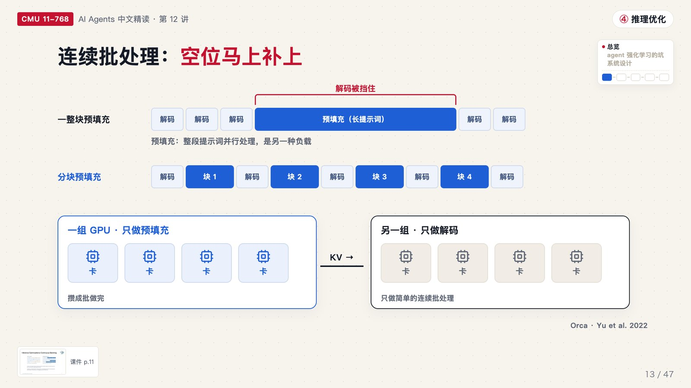

推理不只有解码，还有**预填充**（prefill）：提示词是整段并行处理的，是另一种负载。实际的引擎是把解码的连续批处理和预填充交替进行。

| 问题 | 做法 |
|---|---|
| 某个提示词特别长，它的预填充会长时间挡住解码，解码延迟突然飙高 | **分块预填充**（chunked prefill）：把长提示词切块，分几次处理，处理完的块像 KV 缓存一样留给后面用 |
| 预填充和解码是两种负载，挤在同一组卡上互相干扰 | **分离式推理**（disaggregated inference）：一组 GPU 只做预填充，攒批做完，把 KV 交给另一组；解码那组只做简单的连续批处理 |

分离式推理的两个课堂问答见第 17 节 Q1、Q2。

### 3.5 推测解码

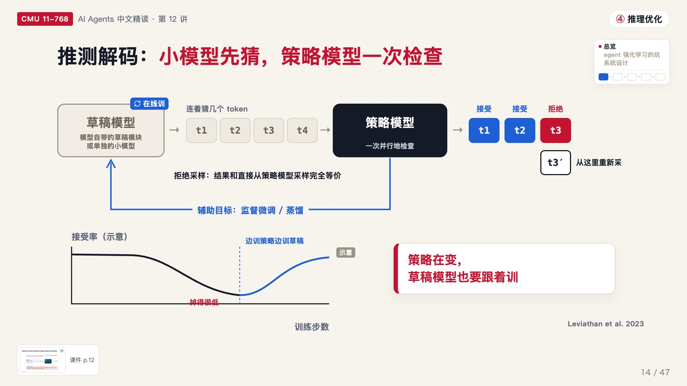

原课件 p.12：**一个便宜的草稿模型先猜 k 个 token；策略模型一次并行检查这 k 个。拒绝采样保证结果和策略模型自己的分布完全一样。**

草稿模型（例：模型自带的 MTP 头，或者一个小模型）提出 k = 4 个：t1 t2 t3 t4 → 策略模型一次打分 → 接受 t1、t2，t3 被拒、换成 t3′，从那里重新采。出处：Leviathan et al. 2023。按原文摘要，它在 T5-XXL 上比标准实现快 2–3 倍，输出分布不变（课件没引这个数）。

**强化学习特有的坑**：策略每个训练步都在变，冻住的草稿模型接受率会越来越低。一开始接受率可能挺高，训着训着策略离草稿越来越远，接受率掉得很低。所以要用一个辅助目标（如监督微调、蒸馏）**边训策略边在线地训草稿模型**。

**这一节记住一句**：推理那边的优化都在省显存、省重复计算、省空等；强化学习里策略一直在变，连草稿模型也要跟着训。

---

## 4 训练优化

这一节的优化落在第 ③④ 格 forward 和 backward。训练要留着激活值做反向，所以这边的优化大多是"多算一点、少用显存"。

### 4.1 激活检查点

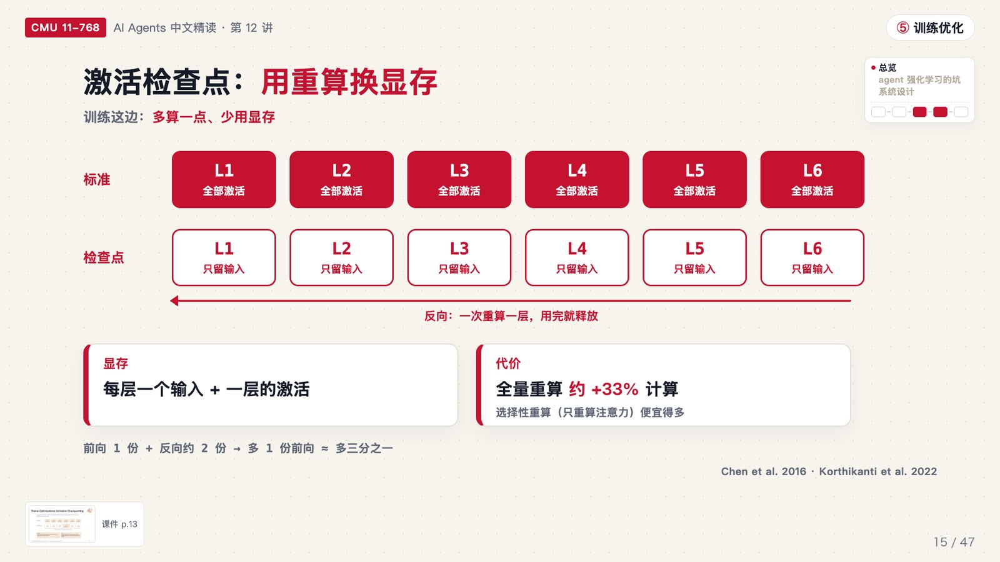

原课件 p.13：**前向时每层只留输入；反向走到这一层时，再把它内部的东西重算出来。**

| | L1 | L2 | L3 | L4 | L5 | L6 |
|---|---|---|---|---|---|---|
| 标准 | 全部激活 | 全部激活 | 全部激活 | 全部激活 | 全部激活 | 全部激活 |
| 检查点 | 只留输入 | 只留输入 | 只留输入 | **正在重算** | 只留输入 | 只留输入 |

反向一次重算一层，用完就释放。

- **显存**：从"每层的全部激活"降到"每层一个输入，加上同一时刻一层的激活"。
- **代价**：全量重算约等于多做一次前向：**约 +33% 计算**。**选择性重算**（selective recomputation，只重算注意力这类部分）便宜得多。

33% 从哪来（本课件补的推导）：一次反向的计算量大约是前向的两倍，所以前向加反向约是 3 份前向；多做一次前向是多 1 份，1 ÷ 3 ≈ 33%。对照原文：Chen et al. 2016 说代价是"每个小批多一次前向"，1000 层 ResNet 运行时间多约 30%；Korthikanti et al. 2022 实测全量重算有 30–40% 的执行时间开销，选择性重算加序列并行能把重算开销减掉 90% 以上。三个说法一致。

训练框架一般全量和选择性两种都有。显存紧张时，它是你最好的朋友。

### 4.2 前缀共享

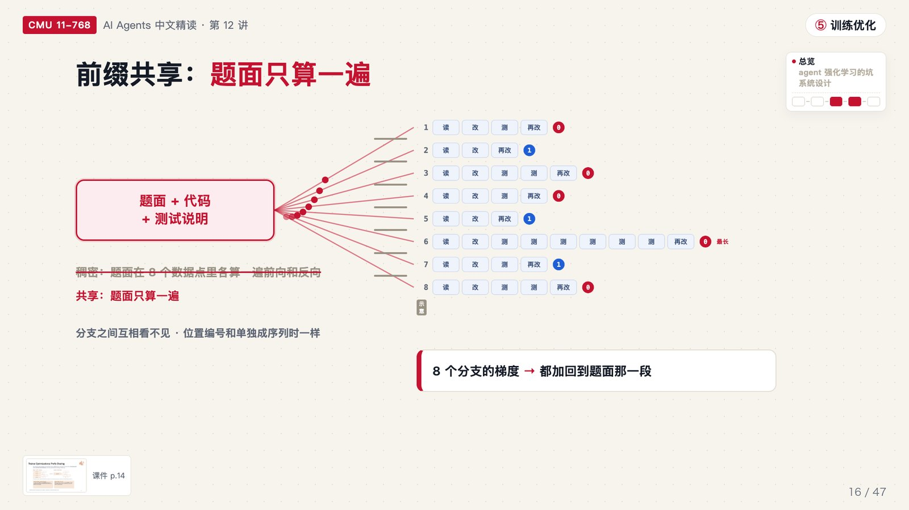

原课件 p.14：**强化学习的批里，前缀一再重复：GRPO 一组里的提示词，多轮里的历史。每个前缀只算一次，前向和反向都是。** 它是推理端前缀缓存在训练端的对应物，区别是现在还要操心激活显存和反向。

| 稠密：提示词重复 | 共享：提示词只算一次 |
|---|---|
| P + r1 / P + r2 / P + r3 / P + r4 | 一个 P，分出 r1、r2、r3、r4 四个分支 |

实现要点：

- **树形注意力掩码**：分支之间不互相看。
- 位置编号和每条单独成序列时一样。
- 每个分支的梯度都累加回 P。

修 bug 的例子：稠密地训时，题面在 8 个数据点里各算一遍前向和反向；共享之后只算一遍，8 个分支的梯度都加回到题面那一段上。

### 4.3 两组实测，两件事

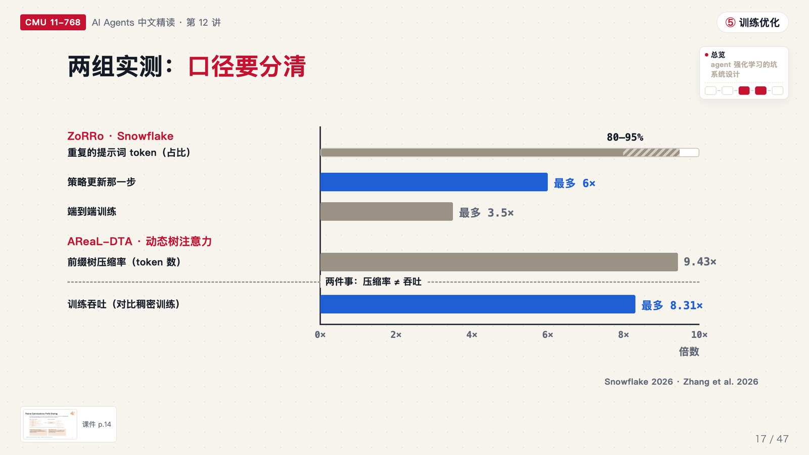

原课件 p.14 下半：

| | Snowflake ZoRRo（Arctic RL） | AReaL-DTA（动态树注意力） |
|---|---|---|
| 场景 | 长提示词的 GRPO 批 | 多轮 τ²-bench 的 rollout |
| 重复有多少 | **80–95%** 的 token 是重复的提示词 token | 压成前缀树，**压缩率 9.43 倍** |
| 快多少 | 去重后**策略更新**最多快 **6 倍**；Snowflake 博客另说**端到端**最多快 3.5 倍 | **训练吞吐**比稠密训练最多高 **8.31 倍** |

两组数不要混：

- 6 倍是**策略更新那一步**，不是整个训练；整个训练端到端是最多 3.5 倍（课件没写这个数，按 Snowflake 博客补）。
- 9.43 倍是**压缩率**（序列 token 总数 ÷ 前缀树里不重复的 token 数，按 AReaL-DTA 图 1 的定义），8.31 倍才是**训练吞吐**。按原文，只算叶子序列时压缩率是 5.56 倍；吞吐比"打包成一棵树、用树形掩码一起算"的稀疏做法最多高 1.70 倍（课件没引）。

动手练习第 2 部分可以自己算一个压缩率。

### 4.4 深度优先：同一时刻只存一条路径

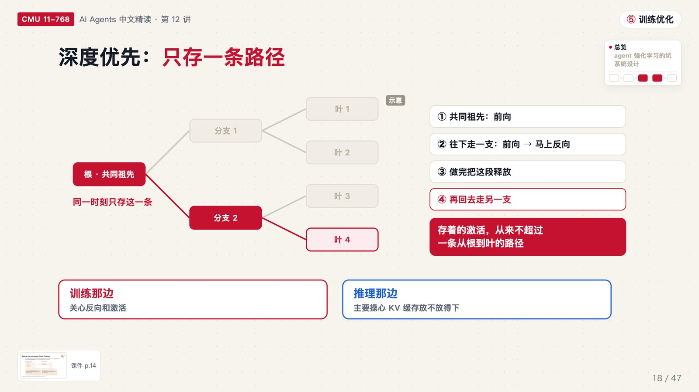

AReaL-DTA 对一个批建一棵前缀树，然后**深度优先**遍历：先对共同的祖先做前向，往下走一个分支做前向；有了这个分支的激活就马上做反向；做完反向，这些激活用不着了，把这段计算图弹出、释放，回到上面再走另一个分支。前向反向在分支之间交替，存着的激活**从来不超过一条从根到叶的路径**。

再强调一次两边关心的东西不一样：训练端关心反向传播和激活，优化围绕它们；推理端主要操心 KV 缓存和有没有足够的显存放它。

**这一节记住一句**：训练那边围着激活和反向做文章，用重算换显存，用共享前缀省掉重复的前向和反向。

---

## 5 并行

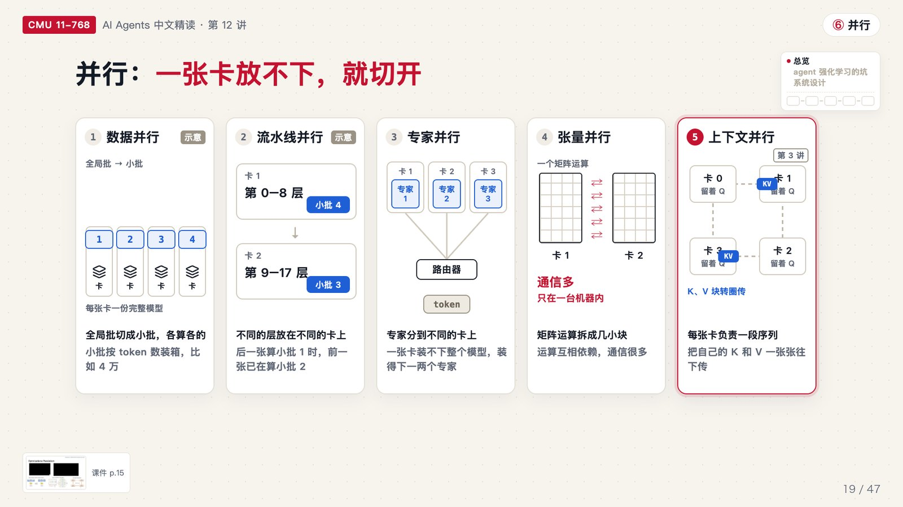

原课件 p.15（NVIDIA NeMo 并行文档）。省显存还有最后一招：一张卡放不下，就切到很多张卡上。课件左上两块是嵌入的视频，PDF 里导不出来，图里数据并行和流水线并行是按课上讲的重画的。

| 切法 | 怎么切 | 课上补充 |
|---|---|---|
| **数据并行**（DP） | 每张卡一份完整的模型，全局批切成小批，各算各的 | 小批大小可以按显存能装多少 token 定，比如 4 万，再把序列装箱装进去 |
| **流水线并行**（PP） | 不同的层放在不同的卡上 | 比如第 0–8 层一张、第 9–17 层另一张；后一张处理第 1 个小批时，前一张已经在处理第 2 个，反向也一样 |
| **专家并行**（EP） | 混合专家模型的专家分到不同的卡上，路由器把 token 分过去 | 整个模型一张卡装不下，但装得下一两个专家 |
| **张量并行**（TP） | 都是稠密层时，把每一个矩阵运算拆成几小块 | 运算互相依赖、通信很多，一般只在同一台机器、网络快的几张卡之间做 |
| **上下文并行**（CP） | 序列很长时，每张卡负责一段 | 注意力要看前面的 K、V，所以每张卡把自己的 K、V 一张张往下传（第 3 讲） |

经验法则：**数据并行尽量大，张量并行这类通信尽量少。** 这些切法推理那边也一样用得上；第 2.4 节第 ⑤ 格说的"按推理的布局重新切分"，就是因为两边选的切法常常不同。

**这一节记住一句**：一张卡放不下就切，切法有五种，能用数据并行就别多做通信。

---

## 6 权重同步

这是第 ⑤ 格 optim_step + sync。

### 6.1 两个 TB 和百分之九十九

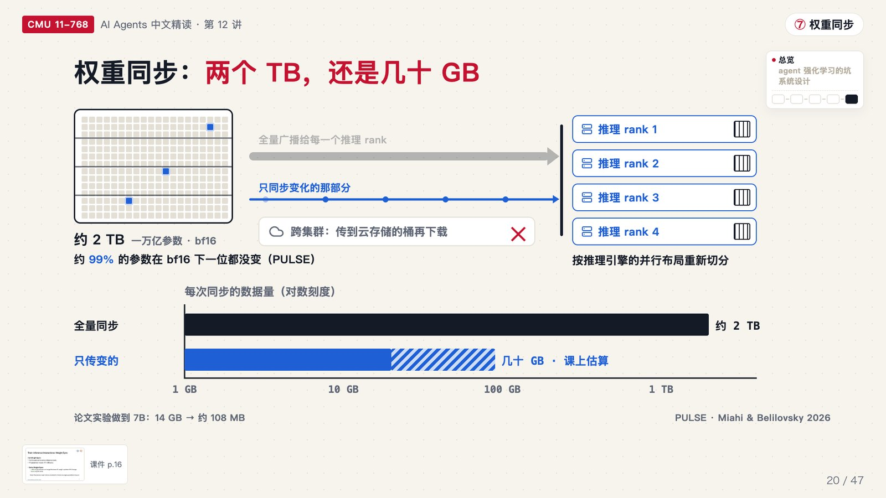

原课件 p.16：**训练和推理的交互：权重同步。**

| 做法 | 说法 |
|---|---|
| **全量同步** | 完整广播给每一个推理 rank。**1T 参数的模型 → 约 2 TB 的同步量。** |
| **增量同步** | 两次强化学习权重更新之间，**约 99%** 的参数在 bf16 下没有变化；只同步变化的部分 |
| 注意 | 参数到了推理端，要按推理引擎的并行布局重新切分 |

出处：PULSE（Miahi & Belilovsky 2026，arXiv 2602.03839）。课件页脚的作者名拼写和原文不同，这里按原文写。

算一下：bf16 每个参数 2 字节，10¹² × 2 字节 = 2 TB。每次更新都要从训练引擎广播给每个推理 rank。现在还有人跨好几个集群训，常常把权重传到云存储的桶里（课上举的是 S3）再下载下来，几个 TB 没法这么传。

好在强化学习的更新非常稀疏。按 PULSE 原文：在强化学习后训练常用的学习率下，Adam 的每步更新常常小于 bf16 的舍入阈值，转成 bf16 之后约 99% 的每步更新"看不见"，稀疏度常常超过 99%。PULSE 只传变化参数的下标和值，无损、逐位一致。

| 数 | 来源 | 可信度 |
|---|---|---|
| 1T 参数 ≈ 2 TB | 课件，算术可验证 | 算出来的 |
| 约 99% 不变 | PULSE 原文 | 原文实测 |
| 7B 模型 14 GB → 约 108 MB | PULSE 原文 | 原文实测，原文实验做到 7B 为止 |
| 1T 模型只传变化量"几十 GB"（课上说二三十 GB） | 课上口头估算 | 估算：原文没有 1T 的数据 |

几十 GB 的量级是对的（本课件补的推导）：1T 的 1% 是 10¹⁰ 个参数，值本身 2 字节就是 20 GB；每个再带一个 4 字节的下标是 60 GB，压缩之后还会更小。动手练习第 6 部分会打印这两个数。

### 6.2 课堂问答：为什么九成九不变

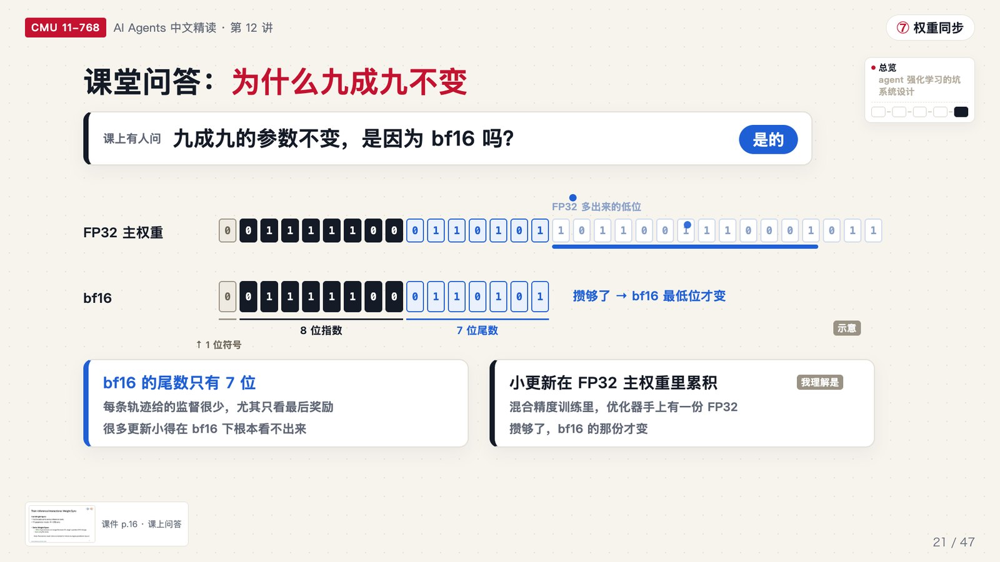

**问**：九成九的参数不变，是因为 bf16 的精度吗？

**答**（课上口头补充）：对。bf16 的尾数只有 7 位（加上隐含位共 8 位有效位）；再加上每条轨迹给的监督很少，尤其是只看终局奖励时，很多更新小得在 bf16 下根本看不出来。

| | 符号 | 指数 | 尾数 | 0.0123 附近相邻两个数差多少 |
|---|---|---|---|---|
| bf16 | 1 位 | 8 位 | 7 位 | 2⁻¹⁴ ≈ 6.1 × 10⁻⁵ |
| FP32 | 1 位 | 8 位 | 23 位 | 2⁻³⁰ ≈ 9.3 × 10⁻¹⁰ |

（表右一栏是本课件补的推导：0.0123 落在 [2⁻⁷, 2⁻⁶) 之间，bf16 的间隔是 2⁻⁷ × 2⁻⁷。）一个 10⁻⁶ 量级的更新，比这个间隔的一半还小得多，舍入回去还是原来那个数。

课上还有一个追问：用 bf16 训练，这些小更新被丢掉，会不会丢失信号？课上的回答是：更新很小；某个方向真重要的话，下一次更新里你会看到这些权重变化更大；而且用 32 位精度训练，存储和显存都会极其困难，所以用 bf16 训练已经是惯例。

再补一层，**我的推断**（课上没讲）：混合精度训练里，优化器手上通常有一份 FP32 的主权重，小更新在那里累积，攒够了，bf16 的那份才变，所以小更新并没有真丢。PULSE 原文附录 A.2 也是"FP32 主副本漂移到一定程度，bf16 值才变"的说法。动手练习第 5 部分模拟了这个过程：0.0123 这个权重每步加 10⁻⁶，第 60 步 bf16 副本才变。

还有一问课上没答出来：每次更新改动的，是不是不同的那些参数？课上说猜是不同的，但不确定。PULSE 原文有一节专门研究跨多步的稀疏度，本课件没有核对到它的结论，不展开。

**这一节记住一句**：大约百分之九十九的参数在 bf16 下没变，只传变的那部分，同步量就从几个 TB 降到几十个 GB。

---

## 7 路由重放 R3

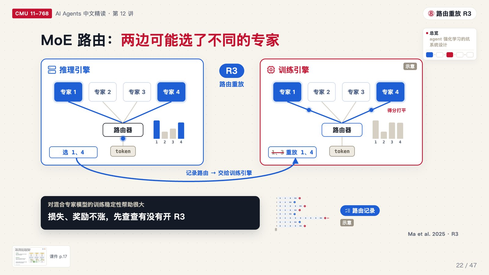

原课件 p.17：**训练和推理的交互：Rollout Routing Replay（R3）。**

- **问题**：极小的数值差异，就可能让 MoE 选出不同的专家。
- **R3 的做法**：把 rollout 时选的专家记下来，训练时重放这些选择。
- 推理引擎必须把路由决策交给训练引擎。

出处：Ma et al. 2025（arXiv 2510.11370），图 1。

**混合专家模型**（MoE）在前向里要不停地选，把每个 token 送给哪几个专家。实现上一点细小的数值差别，甚至两个专家的路由得分打平，都可能让训练引擎和推理引擎选出不同的专家。R3 原文还发现，就算条件完全一样，同一条序列重复做前向，也可能选得不一样。

| | 推理时 | 训练重算时 | 结果 |
|---|---|---|---|
| 不开 R3 | 某个 token 走专家 1 和 4 | 走了 1 和 3 | 这个 token 的概率对不上，又离策略了 |
| 开 R3 | 走专家 1 和 4，**记下来**，随轨迹交给训练引擎 | 扔掉自己的选择，照着走 1 和 4 | 两边一致 |

按 R3 原文摘要：训练和推理之间的策略 KL 明显降低，概率差异很大的 token 少了大约一个数量级，不拖慢训练，在多种设置下防止了训练崩溃，效果好于 GSPO 和 TIS。

现在很多大模型都是 MoE。课上的经验建议：训这类模型时发现损失或奖励不涨，可以先查查有没有开 R3。R3 落在两格：① sample 时记录，③ forward 时重放。

**这一节记住一句**：同样的输入，训练和推理可能走了不同的专家；把推理时的路由记下来，训练时照着走。

---

## 8 序列延展

原课件 p.18 分隔页：**agent 强化学习：容易割手的地方**（The Sharp Bits，配一把刀）。光看策略梯度的目标你预料不到这些事；真开始训 agent，大多数迟早会碰上。

### 8.1 两个 harness，哪个更好训

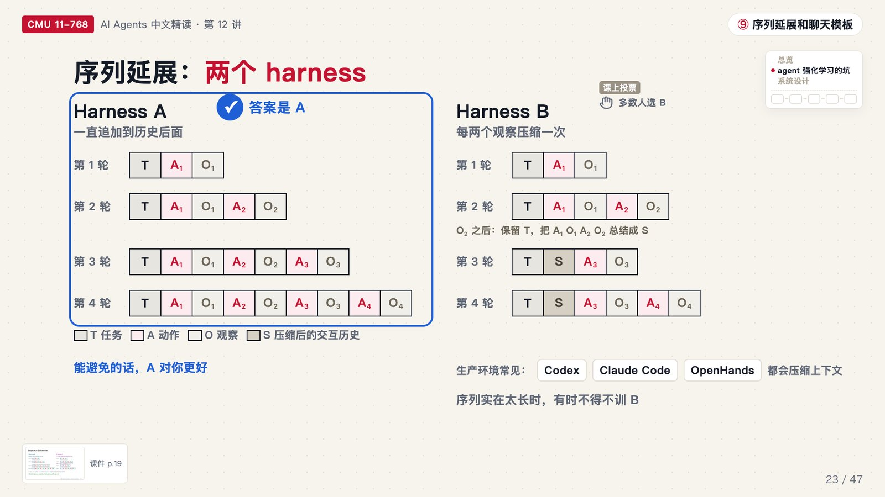

原课件 p.19（出处 Tinker 文档，那一页的标题本身就叫"404: Sequence Extension"，不是失效链接）：

| 回合 | harness A：一直追加到历史后面 | harness B：每两个观察压缩一次 |
|---|---|---|
| 第 1 轮 | T A₁ O₁ | T A₁ O₁ |
| 第 2 轮 | T A₁ O₁ A₂ O₂ | T A₁ O₁ A₂ O₂ |
| 第 3 轮 | T A₁ O₁ A₂ O₂ A₃ O₃ | T **S** A₃ O₃ |
| 第 4 轮 | T A₁ O₁ A₂ O₂ A₃ O₃ A₄ O₄ | T S A₃ O₃ A₄ O₄ |

T = 任务，Aᵢ = 动作，Oᵢ = 观察，S = 把 A₁ O₁ A₂ O₂ 总结成的一小段摘要。

**哪个 harness 训练效率更高？** 课上投票，多数人选了 B。答案是 A。

B 是生产环境里常见的做法，Codex、Claude Code、OpenHands 都会压缩上下文。有时候不得不训 B，因为序列实在太长；能避免的话，A 对你更好。原因看下一页。

### 8.2 拼进训练批是什么样

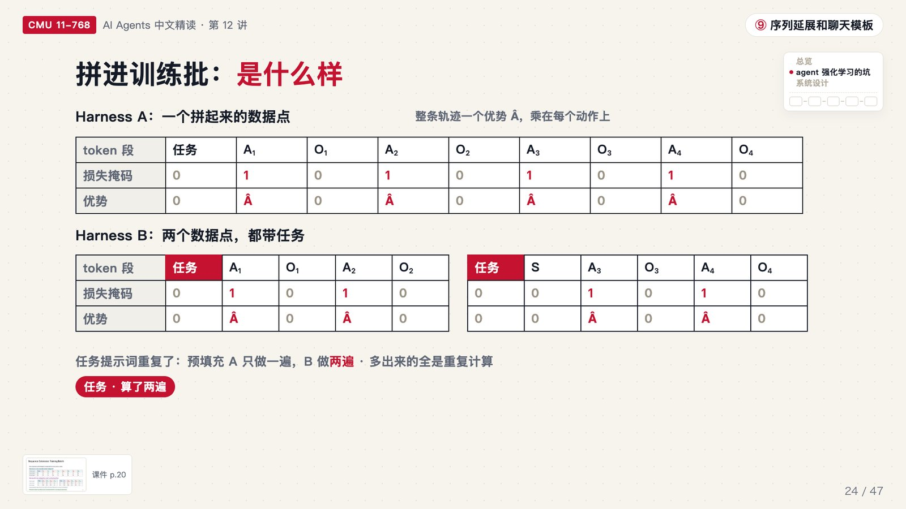

原课件 p.20：**一条轨迹的优势 Â，广播到每一个动作 token 上。**

**harness A：拼成一个数据点**

| token 段 | 任务 | A₁ | O₁ | A₂ | O₂ | A₃ | O₃ | A₄ | O₄ |
|---|---|---|---|---|---|---|---|---|---|
| 损失掩码 | 0 | 1 | 0 | 1 | 0 | 1 | 0 | 1 | 0 |
| 优势 | 0 | Â | 0 | Â | 0 | Â | 0 | Â | 0 |

**harness B：两个数据点，都含任务**

| token 段 | 任务 | A₁ | O₁ | A₂ | O₂ |
|---|---|---|---|---|---|
| 损失掩码 | 0 | 1 | 0 | 1 | 0 |
| 优势 | 0 | Â | 0 | Â | 0 |

| token 段 | 任务 | S | A₃ | O₃ | A₄ | O₄ |
|---|---|---|---|---|---|---|
| 损失掩码 | 0 | 0 | 1 | 0 | 1 | 0 |
| 优势 | 0 | 0 | Â | 0 | Â | 0 |

- 重复的任务 token 没有直接的损失，但仍然要算它们作为上下文的那部分计算。
- **能保住完全一样的前缀，就尽量长地拼下去。**

大白话：损失只算在动作上，观察、任务和摘要 S 都打成 0（第 9 讲 6.5 节）；整条轨迹一个优势，每个动作都乘它。A 的前缀从来没断过，整条轨迹是批里的一个数据点，任务的预填充只做一遍。B 压缩之后变成两段不连续的序列，只能拆成两个数据点，任务在两段里各算一遍。

这个性质叫**序列延展**（sequence extension）：每一轮的输入，都以上一轮的完整输入加输出开头。按 tinker-cookbook 渲染器 README 的定义：对一串 user1、assistant1、user2、assistant2……，user1 时的观察应当是 user2 时观察的前缀，依此类推。第 18.3 节会看到框架怎么用这个性质决定拼成几个数据点。

补救办法也有：第 4.4 节的动态树注意力建一棵树，让多个数据点之间复用计算。但最省事的还是别打断前缀。

### 8.3 修 bug 的轨迹压缩一次

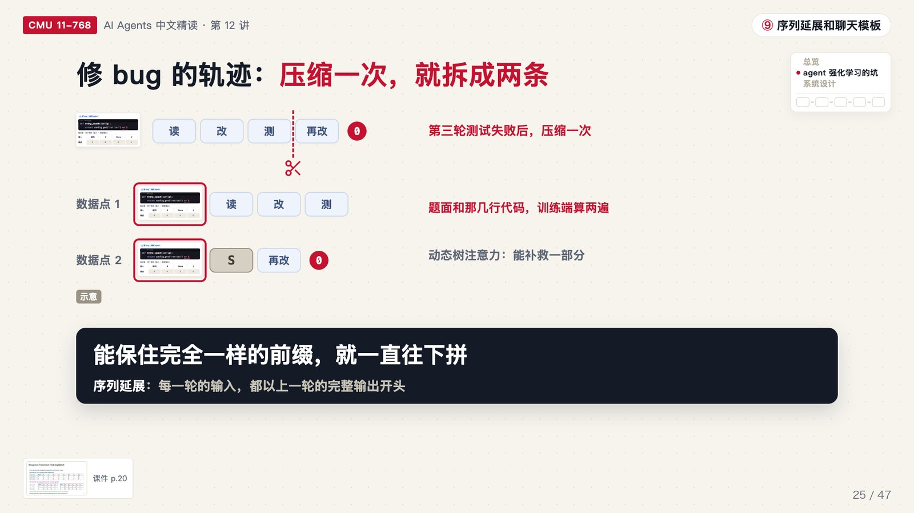

修 bug 的轨迹有 5 轮（读、改、测、再改、再测）。如果 harness 在第 3 轮测试失败之后做了一次压缩，这一条轨迹就要拆成两个数据点，题面和那几行代码在训练端算两遍（示意）。

**这一节记住一句**：前缀能保住就一直往下拼；一压缩，一条轨迹就要拆成几个数据点，重复的部分要多算几遍。

---

## 9 聊天模板的坑

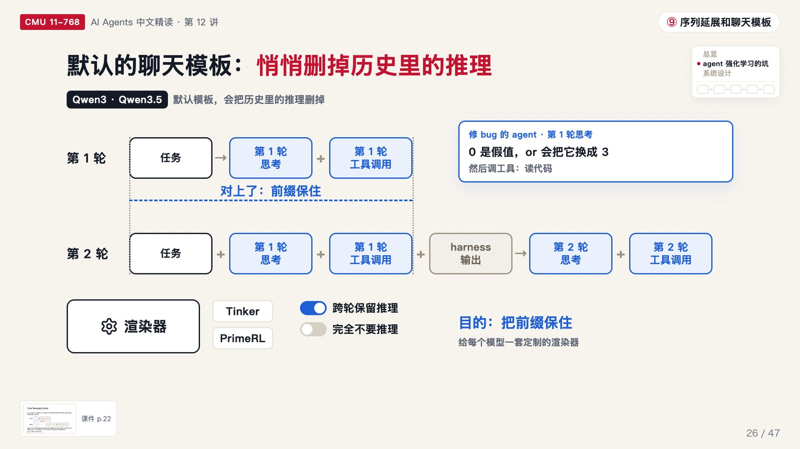

原课件 p.21：**流行的聊天模板不一定满足序列延展性质。** 例：Qwen3 / Qwen3.5 的默认聊天模板，会把推理从过去的历史里删掉。

| 回合 | token 序列 |
|---|---|
| 第 1 轮 | 任务 → 第 1 轮思考 + 第 1 轮工具调用 |
| 第 2 轮 | 任务 + 第 1 轮工具调用 + harness 输出 → 第 2 轮思考 + 第 2 轮工具调用 |

两行之间对不上：第 2 轮的前缀里少了第 1 轮的思考。

开着推理时，模型先出思维链再出动作；新的一轮进来，模板把历史里的思维链删掉。这大概是为了省上下文窗口，旧的思维链也可能让模型分心。它有点像上下文压缩，只是"总结"的办法是把过去的思维链删掉，同样打破了序列延展。

修 bug 的例子：agent 第 1 轮想了一段"0 是假值，`or` 会把它换成 3"，再调工具读代码；第 2 轮用默认模板渲染时这段思考没了，第 2 轮的输入就不再以第 1 轮的完整输出开头。

删不删，准确的条件要看模板（按 Miles 的 TITO 博客）：Qwen3、Kimi K2 这类推理模型的默认模板，删的是**最后一条 user 消息之前**的 assistant 推理；agent harness 常常用 user 消息回传终端输出或者"解析失败，请重试"，每插一条，这条边界就往前推，看上去就像每一轮都在删。

原课件 p.22：**agent 强化学习训练框架常常自带聊天模板，或者叫"渲染器"（renderer），用来保住序列延展**（例：Tinker、PrimeRL）。渲染器给每个模型一套定制的模板，可以按默认模板那样训，也带开关，比如"跨轮保留推理"或者"完全不要推理"，目的都是把前缀保住。课程作业里要搭一个小的强化学习框架，作业也提供了一个这样的模板，给 Qwen3.5 保住前缀。第 18 节读的就是 Tinker 这一套渲染器的源码。

**这一节记住一句**：默认的聊天模板会悄悄删掉历史里的推理，打断序列延展；训练框架自带渲染器，把前缀保住。

---

## 10 token 进、token 出

### 10.1 字符串还是 token

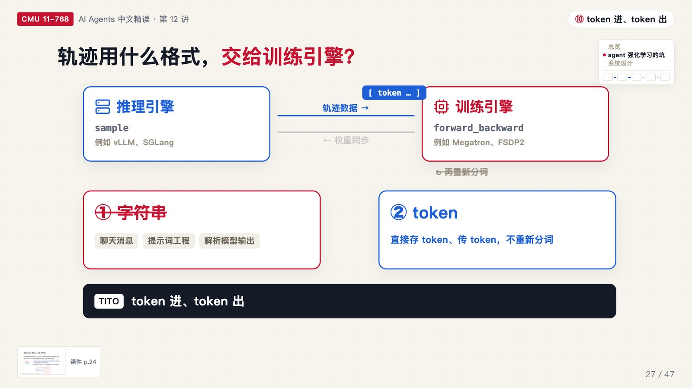

原课件 p.23–24：**从推理引擎到训练引擎，rollout 轨迹数据应该用什么格式存、用什么格式传？** 字符串，还是 token？答案：~~字符串~~，**token**。

很多框架刚开发时用字符串：聊天接口里一条条消息是字符串，提示词工程是字符串，解析模型输出也大多是解析字符串。所以一开始，轨迹用字符串传给训练引擎，训练引擎再重新分词，做它要的前向。很多框架很快发现这是错的：应该直接存 token、传 token，不重新分词。这叫 **token 进、token 出**（Token-In-Token-Out，TITO）。

Miles 的博客给的定义更严格：对每一轮，第 n−1 轮的完整 token 序列（提示词加回复）必须是第 n 轮提示词 token 序列的**逐位一致的前缀**。好处有两个：一个任务一个样本（训练效率，就是第 8 节的拼成一个数据点），保持在线策略（数学正确）。

### 10.2 原因一：字符串上一点小变换

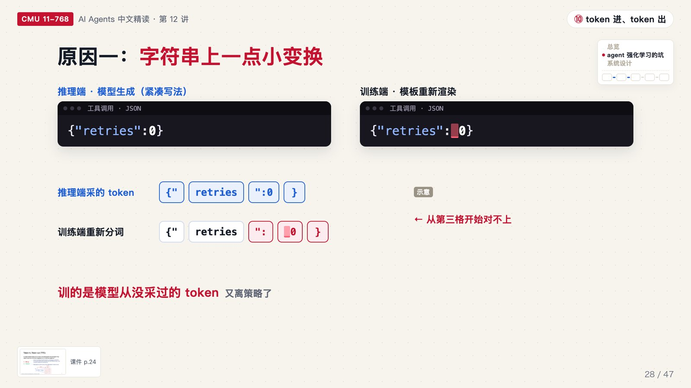

字符串层面细小、不一致的变换，就可能让训练和推理的分词结果不一致，例如聊天模板多加了一个空格。

修 bug 的例子（照 Miles 博客的"模板重新渲染有损"场景）：agent 发出的工具调用是一段 JSON，模型生成的是紧凑写法 `{"retries":0}`；训练端的模板重新渲染时在冒号后面多插了一个空格，变成 `{"retries": 0}`。分出来的 token 和推理端不一样，你训的是一串模型从没采过的 token，又离策略了。

### 10.3 原因二：解码是多对一

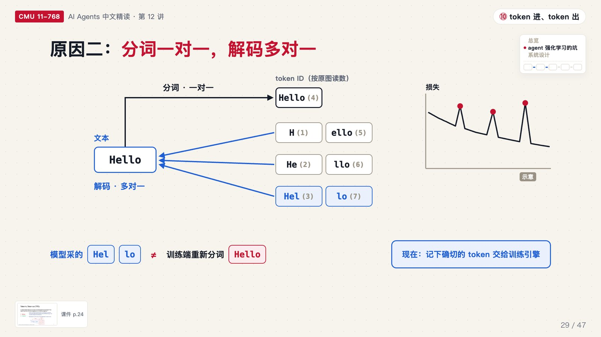

**分词是一对一的，反向解码是多对一的。**

| 方向 | 例子（原课件 p.24 的示意编号） |
|---|---|
| 分词："Hello" → | 唯一的标准结果 Hello(4) |
| 解码：→ "Hello" | H(1)+ello(5)、He(2)+llo(6)、Hel(3)+lo(7) 都能拼回 "Hello" |

模型不一定输出标准的那个 token，它可能出的就是 Hel(3) 和 lo(7)。把它当字符串传过去再分词，训练端拿到的是 Hello(4)：推理端采样的是两个 token，训练端算的是一个，概率当然对不上。动手练习第 4 部分用一个玩具分词器复现了这个例子。

这些问题很隐蔽。早期来回传字符串的框架，见过很奇怪的损失尖峰和训练不稳。现在几乎每个强化学习框架都记下确切的 token，交给训练引擎。

Miles 博客列的三种破坏场景，对照本讲：

| 场景 | 本讲 |
|---|---|
| 解码再分词对不上 | 10.3 节 Hel + lo |
| 推理被聊天模板裁掉 | 第 9 节 |
| 聊天模板重新渲染有损（JSON 重新排版、加空格） | 10.2 节 |

**这一节记住一句**：轨迹传 token，不传字符串；字符串一转手，训练的 token 就可能不是模型采的那一串。

---

## 11 异步强化学习

### 11.1 同步共用卡，异步分开卡

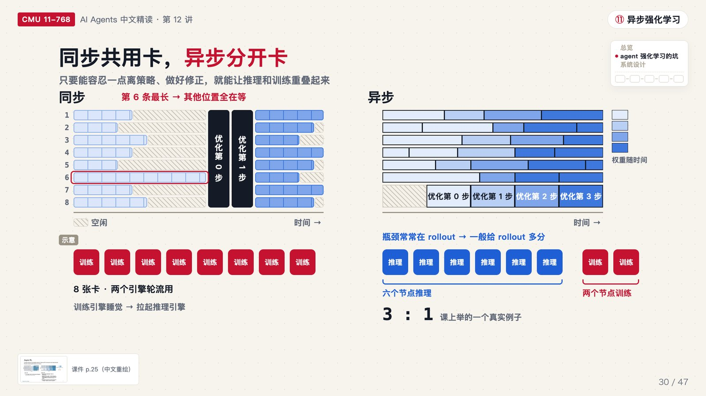

原课件 p.25：**让推理和权重更新重叠起来。减少 rollout 特别长时 GPU 的空闲。需要做陈旧度 / 离策略修正。** 出处：PipelineRL、AReaL。

| | 同步 | 异步 |
|---|---|---|
| 时间图 | 一批生成条长短不一，短的跑完就空等；全部跑完才做优化第 0 步、第 1 步，再下一轮生成 | 生成条一直不断，颜色随权重版本变化；优化第 0、1、2、3 步连续排开 |
| 卡怎么分 | 训练和推理引擎放在一起：比如 8 张卡先全拿来训练，再让训练引擎"睡觉"，拉起推理引擎，两边轮流用 | GPU 分给训练和推理两边，可以给一边多分 |
| 要什么支持 | — | 连续批处理（3.3 节），和生成中途更新权重（11.2 节） |

为什么对 agent 特别有用：请求长短差别很大。同步时一批里总有几条拖后腿的长 rollout，推理阶段大量空闲，都在等最长的那几条。重叠起来以后，拖后腿的那几条可以挪到下一批，下一批里先跑完的短轨迹也可以先拿去更新。修 bug 那 8 条里最长的第 6 条，同步时就让其他位置全在等。

异步时瓶颈常常在 rollout，长程任务要做很长一串解码，所以一般给推理多分卡。课上举的一个真实例子是 **3 : 1**：6 个节点推理、2 个节点训练。

代价是第 11 讲讲过的：有一部分数据来自旧策略，要做重要性采样和截断；数据和当前策略隔了几个版本，就是第 11 讲 7.1 节的"最大离策略程度"。

### 11.2 生成到一半换权重

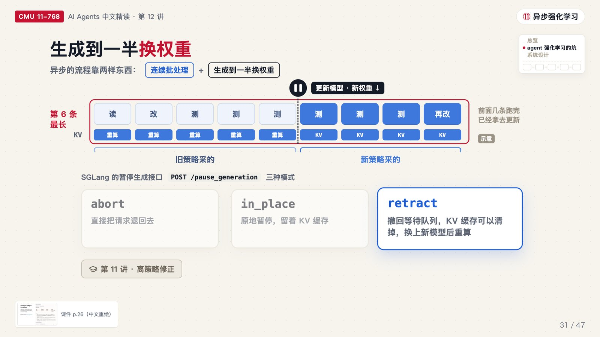

原课件 p.26：**推理框架已经为满足强化学习系统的需要而演进。** 例子来自 SGLang 文档。

异步流程由两样东西组成：连续批处理，加上**生成中途更新权重**（in-flight weight update）：一个推理请求做到一半，先暂停，更新模型，再用新模型把这个请求接着做完。SGLang 有一个"暂停生成"接口 `POST /pause_generation`，请求体字段 `mode` 有三种（按原课件截图读数）：

| 模式 | 意思 |
|---|---|
| `abort`（默认） | 等待队列和运行队列里的请求立刻返回给调用方 |
| `retract` | 引擎进入暂停状态，把正在跑的请求移回等待队列；KV 缓存可以清掉，之后重算 |
| `in_place` | 引擎进入暂停状态，不改请求的状态；正在跑的请求要靠 KV 缓存还在才能继续，所以之后调 `flush_cache` 会失败 |

暂停完用 `POST /continue_generation` 接着生成。课上说最有用的是 `retract`：参数一更新，前缀的 KV 就过时了，清掉以后用新模型重算。vLLM 和 SGLang 都在往这个方向演进。

修 bug 的例子：最长的第 6 条还没跑完，前面几条已经拿去更新；更新完成时就 retract 暂停、清掉旧 KV、换上新权重接着跑。这条轨迹前半段是旧策略采的、后半段是新策略采的，所以要做第 11 讲的离策略修正（示意）。

**这一节记住一句**：异步把推理和训练分开跑，卡可以按 3 : 1 这样多分给推理，代价是生成到一半要换权重，数据也有一部分来自旧策略。

---

## 12 复杂的 harness

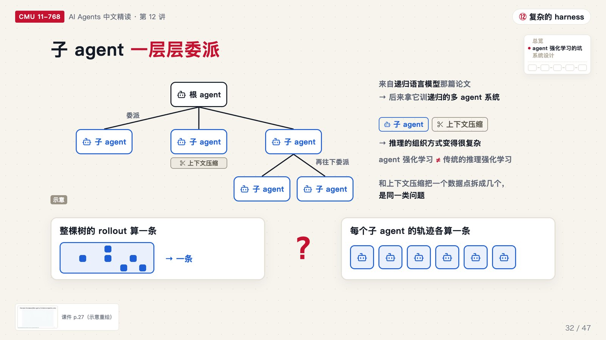

原课件 p.27：**复杂的 harness（子 agent、上下文压缩等）。** 这一页的图在 PDF 里导不出来，图是按课上的描述重画的示意。出处：Recursive Agent Optimization（RAO，2026）；Recursive Language Models（RLM，2025）。

课上举的例子：一篇训练递归多 agent 系统的近期论文（RAO）里用的推理模式，最早来自递归语言模型（RLM）那篇论文：一个根 agent 把任务委派给子 agent，子 agent 还能再往下委派。

现在的 harness 里子 agent 很常见，再加上第 8 节的上下文压缩，推理的组织方式变得很复杂。这是 agent 强化学习和传统的推理强化学习（一问一答出一段思维链）不一样的地方。于是要想怎么组批：

| 组批方式 | 要考虑的 |
|---|---|
| 整棵树的 rollout 算一条 | 子 agent 的上下文和根 agent 不连续，拼不成一段前缀 |
| 每个子 agent 的轨迹各算一条 | 每条都要一个优势：整棵树一个终局奖励怎么分给它们 |

右边一栏是本课件补的思考，课上只提出了问题。它和上下文压缩把一个数据点拆成几个，是同一类问题。

**这一节记住一句**：harness 越复杂，一条 rollout 就越难对应成训练批里的一个数据点。

---

## 13 harness 无关的设计

原课件 p.28 分隔页：**系统设计的选择。**

### 13.1 反模式：每个 harness 一套代码

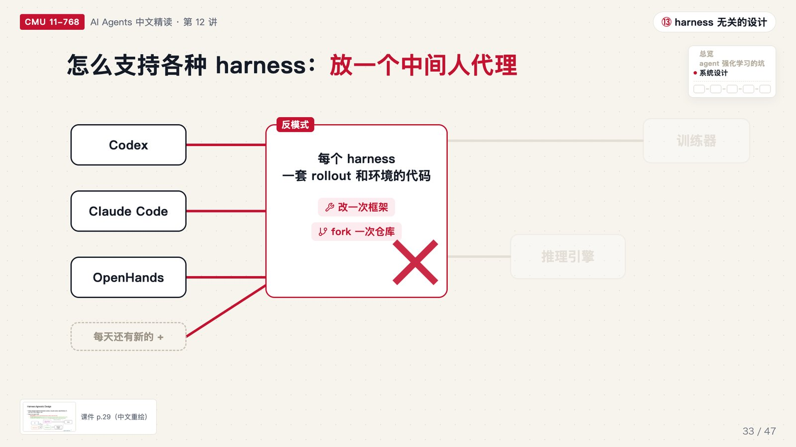

原课件 p.29：**harness 无关的设计。** 流行的 agent harness 很多：Codex、Claude Code、OpenHands、Pi、Hermes、Prime Agent 等，每天还有新的。怎么全都支持？

**反模式**：给每个 harness 各写一套 rollout / 环境代码。每想训一个新的，就改一次框架、改代码，甚至 fork 一次仓库。

### 13.2 中间人代理服务

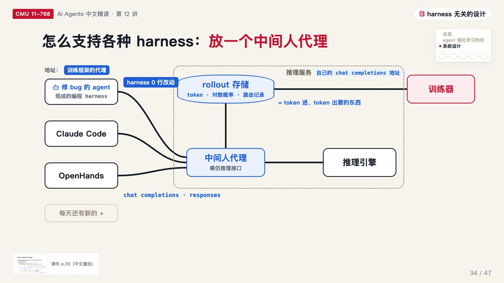

**harness 无关的模式**：一个中间人 / 代理服务，模仿推理接口（chat completions、responses、anthropic 等）→ 换新 harness 时零代码改动。出处：Agent Lightning。

| 方向 | 代理做什么 |
|---|---|
| harness → 推理引擎 | harness 照常发 chat completions 或 responses 请求，代理转给推理引擎 |
| 推理引擎 → harness | 把回复转回 harness |
| 顺手 | 把训练要的数据存进 rollout 存储：每个 token、对数概率、R3 的路由记录等；存储再交给训练器 |

代理只要作为训练框架的一部分写一次；harness 本来就说这些标准接口，一行代码都不用改。整个东西可以打包成框架对外提供的一个推理服务，甚至给它一个自己的 chat completions 地址。

修 bug 的例子：agent 用的是某个现成的编程 harness，照常去请求 chat completions，训练框架只把地址换成自己的代理。代理存下的每一轮 token 和对数概率，正好就是第 10 节 token 进、token 出要的东西。

**这一节记住一句**：别给每个 harness 写一套代码，放一个模仿推理接口的代理，换 harness 就不用改代码。

---

## 14 单程序多数据和一切皆服务

### 14.1 单程序多数据（SPMD）

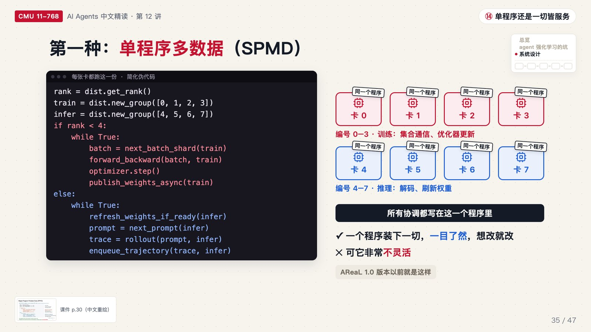

原课件 p.30：**单程序多数据（SPMD）：同一个 Python 程序跑在每一个 GPU rank 上**（课件给的简化示例伪代码）：

```python
rank = dist.get_rank()
train = dist.new_group([0, 1, 2, 3])
infer = dist.new_group([4, 5, 6, 7])
if rank < 4:
    while True:
        batch = next_batch_shard(train)
        forward_backward(batch, train)
        optimizer.step()
        publish_weights_async(train)
else:
    while True:
        refresh_weights_if_ready(infer)
        prompt = next_prompt(infer)
        trace = rollout(prompt, infer)
        enqueue_trajectory(trace, infer)
```

| 谁 | 做什么 |
|---|---|
| 所有 rank | 按同样的顺序建两个组 |
| rank 0–3：训练 | FSDP 的集合通信和优化器更新 |
| rank 4–7：推理 | 张量 / 上下文并行解码，刷新权重 |

- **协调写在每个 rank 都在跑的那个程序里。**
- **一个程序直接控制一切，很直接，但不够灵活。**

写过分布式代码的人会认得这个模式：每张卡跑一模一样的代码，各有一个 rank 号，按 rank 有条件地执行不同的代码。好处是一个程序装下一切，全局在发生什么一目了然，想改就改。出处：AReaL 1.0 以前的版本；AReaL 后来换成了下一种做法。

### 14.2 一切皆服务

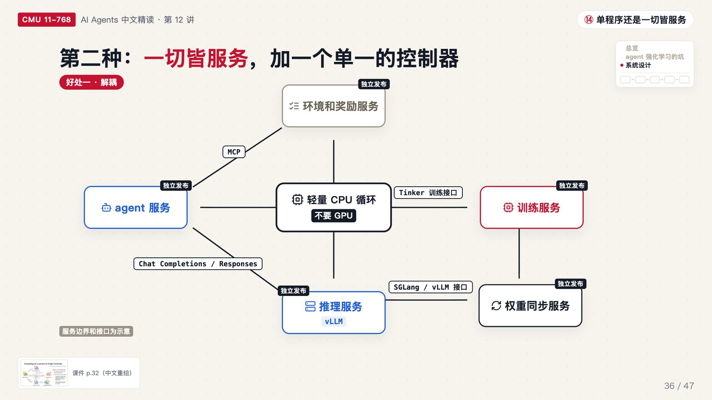

原课件 p.31：**一切皆服务，加一个单一控制器。** 课件标注：服务边界和接口都是示意。

| 服务 | 和控制器之间（或彼此之间）用的接口 |
|---|---|
| agent 服务 | 控制器 ↔ agent：ACP；agent ↔ 环境：MCP；agent ↔ 推理：Chat Completions / Responses |
| 环境 / 奖励服务 | Open Reward Standard（ORS） |
| 训练服务 | Tinker 训练 API |
| 推理服务 | SGLang / vLLM API |
| 权重同步服务 | 推理服务 ↔ 权重同步：SGLang / vLLM API；训练 ↔ 权重同步 |

原课件 p.32 的第一个好处，**解耦**（关注点分离）：

- 每个组件都相当复杂、相当专门（推理和训练各自那一长串优化，见 2.2 节）。
- 不再全都住在同一个代码库里：各个项目的维护、更新和发布不用同步；改一部分不影响其他部分，别人优化到极致的服务可以直接拿来用。
- 编排器只是一个轻量的 CPU 循环，不要 GPU，不要复杂的依赖，研究者试不同的算法很容易。

### 14.3 可替换

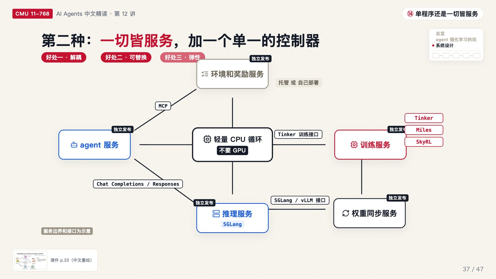

原课件 p.33：**模块化：只要服务之间用同样的协议通信，就很容易把一个服务的实现换成另一个。** 环境 / 奖励服务可以用托管服务（如 OpenReward），也可以自己部署。

课上有人问过该用哪个强化学习框架（第 17 节 Q3）。这里的回答是：框架很多，但只要说同一套接口，就能在框架之间切换。Tinker API 最早是 Thinking Machines 为自己的托管训练服务推出的，现在 Miles、SkyRL 这些开源框架也实现了它；推理用 vLLM 还是 SGLang，也是换一块的事。

### 14.4 弹性扩容和异构算力

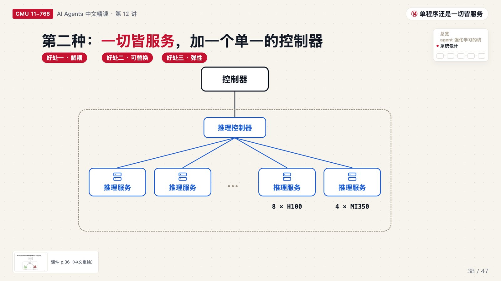

原课件 p.34–36：控制器下面先是一个推理服务，然后换成一个"推理服务控制器"管着一排推理服务；同一个推理服务控制器下，一个推理服务跑在 8 × H100 上，另一个跑在 4 × MI350 上。

| 好处 | 意思 |
|---|---|
| 弹性 | 推理服务可以不止一个，由一个中央控制器管着，rollout 跟不上训练时随时加 |
| 异构 | 它们不用一样：同时有英伟达和 AMD 的算力，一个推理服务用英伟达的卡，另一个用 AMD 的卡 |

修 bug 的例子：题很多、轨迹又长，rollout 跟不上训练时，控制器再拉起几个推理服务，可以是另一个集群、另一种卡；训练服务、权重同步服务不用动（示意）。

**这一节记住一句**：单程序多数据好改但不灵活；一切皆服务，换来的是解耦、可替换和弹性扩容。

---

## 15 服务化能做的三件事

### 15.1 跨地区、用不同的卡：AstraFlow

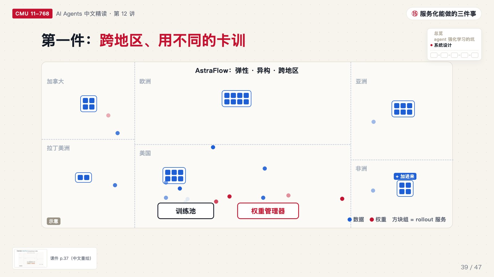

原课件 p.37：**例子：AstraFlow（Haizhong Zheng et al. 2026）。** 原图是一段动图，标题"RaaS：弹性 · 异构 · 跨地区"：几块地区各有一组 GPU，数据流向中间的训练池，权重从权重管理器流回各地。

rollout 都是服务，也就是推理服务加上 agent 和环境；它们可以跑在不同地区、不同种类的 GPU 上，有了就加进来；一个权重服务和训练服务打交道，把权重推给所有推理服务器。按 AstraFlow 原文摘要，同一个系统不改系统层代码就支持多策略训练、弹性扩容、异构跨地区执行；多策略协同训练时比现有系统快 2.7 倍（课件和课上都没引这个数）。

### 15.2 同时训好几个模型

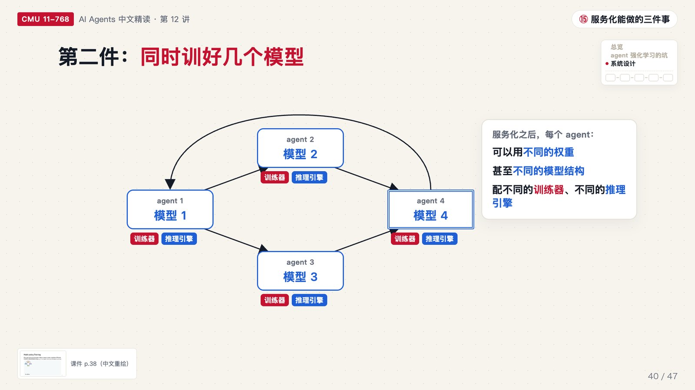

原课件 p.38：**微服务架构让同时训好几个不同的模型变得很容易**（比如多 agent rollout 里，各个 agent 用不同的策略）。

很多多 agent 训练里每个 agent 用的是同一个模型；服务化之后，每个 agent 可以用不同的权重，甚至不同的模型结构：给不同的模型配不同的训练器；推理引擎可以对多个模型做推理，也可以给不同的模型配不同的推理引擎。

### 15.3 部署之后接着训：在线强化学习

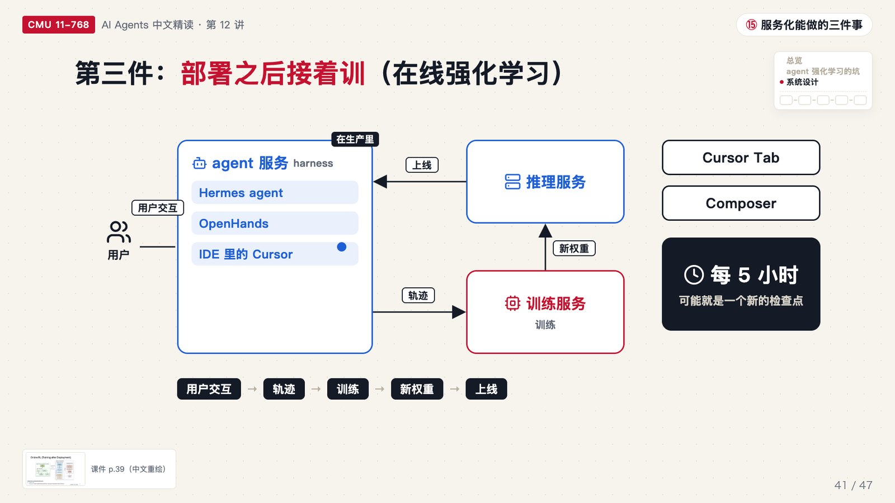

原课件 p.39（AReaL 2.0 的在线强化学习图）：左边 agent 服务（例：Hermes Agent），通过 LLM API 调用连到推理服务；推理服务把轨迹写进轨迹存储，训练服务从存储取数据，经权重同步服务把权重送回推理服务。

**Cursor 生产环境里的在线强化学习**：Cursor Tab；Composer（每 5 小时用真实用户交互训出一个新的模型检查点）。

把 harness 当成一个服务，它在生产里和用户交互、做 rollout 的同时，时不时把数据交给训练服务，部署出去的 agent 就能一直更新。Cursor 的 Composer 博客说，用自动模式和 Composer 的话，每隔 5 小时你用到的可能就是一个新检查点。

**这一节记住一句**：服务化之后，跨地区扩算力、同时训多个模型、部署后接着训，都只是多接几个服务。

---

## 16 多 LoRA 和 Tinker

### 16.1 多租户、多 LoRA

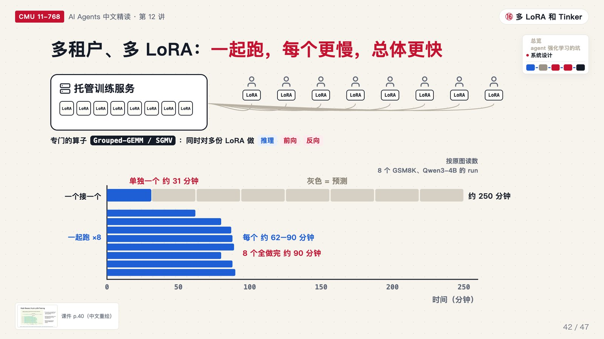

原课件 p.40：

- 8 个并发的 run 在吞吐上胜过 8 个串行的 run（但每个 run 的端到端时间更长）。
- 每个并发的 LoRA run 可以是你训练服务的一个不同用户。
- 需要专门的算子：Grouped-GEMM / SGMV。

出处：SkyRL + Trajectory Labs：Multi-LoRA Training for Continual Learning（2026）；Punica：Multi-tenant LoRA Serving（2023）。

假设你有一个托管训练服务，很多用户各自想训自己的模型。一个办法是给每个用户的 run 分一份 **LoRA** 权重，靠专门的算子，同时对多份 LoRA 做推理、前向和反向。课件的图是 8 个 GSM8K、Qwen3-4B 的 run（按原图读数）：

| | 第一个 run 做完 | 8 个全做完 |
|---|---|---|
| 串行 | 约 31 分钟（实测） | 约 250 分钟（后 7 个是预测段） |
| 8 个并发 | 约 62 分钟 | 约 90 分钟 |

每个 run 自己要等更久（62–90 分钟，比单独跑的约 31 分钟长），但 8 个全做完只要一个半小时左右。（课件原话"but with e2e time per run"像是漏了一个词，按图和课上的话理解为"每个 run 的端到端时间更长"。）

### 16.2 Tinker 的四个接口

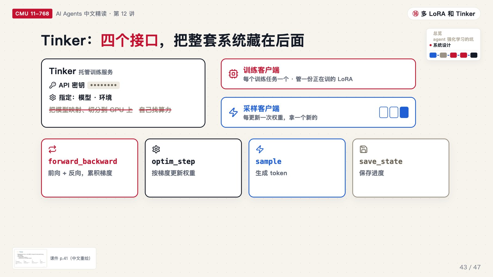

原课件 p.41：Tinker 开创了多租户、多 LoRA 的强化学习训练，以及解耦的训练服务设计。接口很简洁：每个训练 run 一个**训练客户端**，管一份正在训的 LoRA；每个 LoRA 权重检查点一个**采样客户端**，也就是每更新一次权重，拿一个新的。

| 接口 | 作用 |
|---|---|
| `forward_backward` | 做一次前向和一次反向，累积梯度 |
| `optim_step` | 按累积的梯度更新权重 |
| `sample` | 生成 token，用于交互、评测或强化学习的动作 |
| `save_state` | 保存训练进度，便于恢复 |

托管训练的好处是：只要一个 API 密钥，不用操心怎么把模型映射、切分到 GPU 上，也不用自己去找算力，付费用服务就行。代码写给 Tinker 的接口，还能换到 SkyRL、Miles 这些开源实现上，用自己的卡跑同样的训练循环。

### 16.3 回到开头那个问题

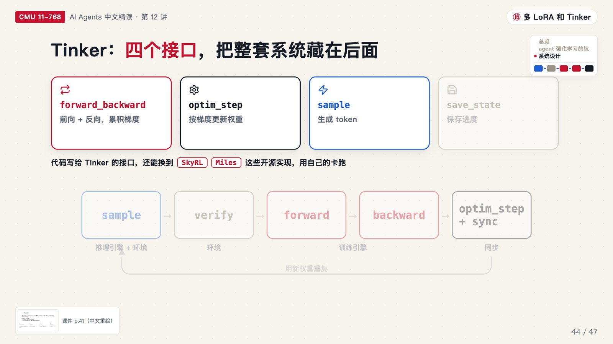

这一讲开头那几个操作，`forward_backward`、`optim_step`、`sample`，这种拆法最早就来自 Tinker 的 API。修 bug 的训练步用它写出来：

| 五格 | Tinker |
|---|---|
| ① sample | `sample` 采 8 条轨迹 |
| ② verify | 自己跑测试打分 |
| ③④ forward / backward | `forward_backward` |
| ⑤ optim_step + sync | `optim_step`，然后拿到新的采样客户端，再 `sample` |

第 1.2 节问"为什么不用 PyTorch 手写"，答案就在这里：这几个接口背后，是这一讲讲的整套推理引擎、训练引擎和权重同步。

**这一节记住一句**：多 LoRA 让很多用户共用一套训练服务，Tinker 用四个接口，把整套系统藏在了后面。

---

## 17 课堂问答

这一讲的问答都穿插在讲课中间。6.2 节的 bf16 两问已经放在对应位置，剩下的几个：

### Q1 已经有 RadixAttention 之类的技术了，分离式预填充还有多大好处？

- **问**：（提问离麦远，按回答里的复述）3.4 节的分离式推理，好处有多大？
- **答**（课上口头补充）：用的是同一种硬件时不太好说。主要的好处在预填充和解码用不同的硬件：有的硬件特别适合解码，有的特别适合高吞吐的预填充，分离式推理让每种负载用适合它的硬件。（课上点了几款硬件的名字，字幕识别得很乱，这里不写。）

### Q2 预填充算出的 KV 要传给解码那边，通信开销大不大？

- **答**（课上口头补充）：要通信，因为解码需要 KV。通常有某种队列，预填充把 KV 放进去，解码从里面取。

### Q3 有没有开箱即用、能自动按 GPU 配置做好这些优化的框架？

- **答**（课上口头补充）：有很多，各有不同的优化和取舍。
  - 底层：用 PyTorch 那一套的话，训练后端常用 Megatron 和 FSDP2，规模大时 Megatron 用得更多；推理一般在 SGLang 和 vLLM 里选。
  - 上层：veRL、PrimeRL、slime、Miles 等强化学习框架把这些底层引擎组合起来，把底层的功能暴露给你。
  - 托管：说要训哪个模型，给数据和奖励函数就能训，通过 API 付费（16.2 节的 Tinker）。
  - 有些框架给每个模型准备了配方，比如 Miles 对每个模型都测过、给出推荐配方，是个可以在上面改的好起点。

### Q4 每次更新改动的，是不是不同的那些参数？

见 6.2 节末尾：课上说不确定，本课件也没有核对到结论。

---

## 18 源码解读：tinker-cookbook 怎么保住前缀

第 8–10 节讲的序列延展、默认模板删推理、token 进 token 出，在 Thinking Machines 开源的 [tinker-cookbook](https://github.com/thinking-machines-lab/tinker-cookbook) 里能看到完整的实现：渲染器决定历史里的推理留不留，`trajectory_to_data` 按"前缀接不接得上"决定一条轨迹拼成几个数据点。

| 本讲的说法 | 源码里 | 本节 |
|---|---|---|
| Qwen3 默认模板删历史里的推理（9） | `Qwen3Renderer` 的 `strip_thinking_from_history`，默认 `True` | 18.1 |
| 框架自带渲染器，带"跨轮保留推理"开关（9） | 渲染器名 `qwen3_5_preserve_thinking` | 18.2 |
| 能保住前缀就拼成一个数据点，否则拆开（8.2） | `trajectory_to_data` 里的 `_is_prefix` | 18.3 |
| 损失只算在动作上，整条轨迹一个优势（8.2） | `mask`、`advantages` 两个列表 | 18.3 |
| token 进、token 出（10） | 拼接比较的是 token，存的是采样时的 `logprobs` | 18.3 |

版本：thinking-machines-lab/tinker-cookbook 提交 `f79fdb2`（完整哈希 `f79fdb2ba4cd967ef2807ba43097c52985f9f17f`，2026-11-04 读取的 main，提交时间 2026-11-04T14:28:00Z）。用到的三个文件：

- [tinker_cookbook/renderers/qwen3.py](https://github.com/thinking-machines-lab/tinker-cookbook/blob/f79fdb2ba4cd967ef2807ba43097c52985f9f17f/tinker_cookbook/renderers/qwen3.py)（864 行）
- [tinker_cookbook/renderers/qwen3_5.py](https://github.com/thinking-machines-lab/tinker-cookbook/blob/f79fdb2ba4cd967ef2807ba43097c52985f9f17f/tinker_cookbook/renderers/qwen3_5.py)（391 行）和 [tinker_cookbook/renderers/\_\_init\_\_.py](https://github.com/thinking-machines-lab/tinker-cookbook/blob/f79fdb2ba4cd967ef2807ba43097c52985f9f17f/tinker_cookbook/renderers/__init__.py)（399 行）
- [tinker_cookbook/rl/data_processing.py](https://github.com/thinking-machines-lab/tinker-cookbook/blob/f79fdb2ba4cd967ef2807ba43097c52985f9f17f/tinker_cookbook/rl/data_processing.py)（332 行）

下面的代码都是原文件节选，行号是这个提交里的行号；中文注释是本课件加的，删掉的部分用 `# ……（删去：……）` 标出。

### 18.1 渲染器：默认删掉历史里的思考

```python
# tinker_cookbook/renderers/qwen3.py，第 168–197 行（节选）
    def __init__(self, tokenizer: Tokenizer, strip_thinking_from_history: bool = True):
        # 默认 True：和 HuggingFace 上 Qwen3 官方聊天模板的行为一致
        # ……（删去：第 169–182 行的文档字符串。原文说 True 时与 HF 的
        #       apply_chat_template（enable_thinking=True）逐 token 相同；
        #       多轮强化学习要序列延展性质时设成 False）
        super().__init__(tokenizer)
        self.strip_thinking_from_history = strip_thinking_from_history
        self._content_tokenizer = _content_tokenizer(tokenizer)

    @property
    def has_extension_property(self) -> bool:
        # 渲染器自己声明：我渲染出来的多轮对话，满不满足序列延展
        # ……（删去：第 189–196 行的文档字符串：False 时历史保留思考，
        #       每一轮的观察都是上一轮的前缀；True 时历史里的思考被删，性质被打破）
        return not self.strip_thinking_from_history
        # 删历史推理 ⇔ 没有序列延展，正是第 9 节那张"对不上"的图
```

真正删的地方在 `render_message` 里：

```python
# tinker_cookbook/renderers/qwen3.py，第 231–262 行（节选）
        content = message["content"]
        frames = self._frames_produced_turn(message, ctx)
        has_reasoning = has_thinking(content)

        if isinstance(content, list):
            # Structured content - handle with list operations
            parts = content
            if (
                self.strip_thinking_from_history
                and message["role"] == "assistant"
                and not ctx.is_last
            ):
                # Remove thinking parts for historical messages
                parts = remove_thinking(parts)
            # 三个条件同时成立才删：开关打开、这是 assistant 的消息、它不是最后一条
            # 第 2 轮渲染时，第 1 轮的 assistant 消息已经"不是最后一条"，思考就没了
            # Render parts in order, preserving interleaved thinking/text structure.
            # No separator needed - whitespace is preserved in TextPart for roundtrip identity.
            rendered_parts = []
            after_block = False
            for p in parts:
                if p["type"] == "thinking":
                    rendered_parts.append(
                        _frame_thinking(p["thinking"])
                        if frames
                        else f"<think>{p['thinking']}</think>"
                    )
                    # 留下来的思考包回 <think>…</think>；frames 决定要不要照官方模板
                    # 补上前后的换行（第 45–53 行：差这几个换行就差 3–4 个 token）
                    after_block = frames
                elif p["type"] == "text":
                    # ……（删去：第 258–259 行注释，说明这里照模板去掉开头的换行）
                    rendered_parts.append(p["text"].lstrip("\n") if after_block else p["text"])
                    after_block = False
            output_content = "".join(rendered_parts)
        # ……（删去：第 263–311 行，字符串形式的内容、工具结果和工具调用的拼法，
        #       最后编码成 token 块返回）
```

逐条对照本讲：

| 本讲 | 这段代码 |
|---|---|
| Qwen3 默认模板删历史推理（9） | `strip_thinking_from_history` 默认 `True`，第 239–244 行删掉"不是最后一条"的 assistant 消息里的思考 |
| 删了就打破序列延展（9） | `has_extension_property` 直接返回 `not strip_thinking_from_history` |
| 渲染器带开关（9） | 构造时传 `strip_thinking_from_history=False` |
| 字符串差一点，token 就不同（10.2） | `_frame_thinking` 的注释：少写几个换行，和官方模板差 3–4 个 token |

和第 9 节说法不完全一样的一处：Miles 博客说官方模板删的是"最后一条 user 消息之前"的推理；这个渲染器删的是"不是最后一条"的所有 assistant 消息。同文件第 732–736 行（`Qwen3VLRenderer._strips_thinking_for` 的注释）承认了这一点：官方模板其实会保留最后一条 user 消息之后的推理，这里多删了"调工具、拿到工具结果"那几轮的思考，为了和已经用这种渲染训出来的检查点兼容才保持原样。

### 18.2 Qwen3.5：开了保留，也不声明满足

```python
# tinker_cookbook/renderers/__init__.py，第 270–277 行
    elif name == "qwen3_5":
        renderer = Qwen3_5Renderer(tokenizer, image_processor=image_processor)
        # 默认的 qwen3_5：不传开关，走默认值 True（Qwen3VLRenderer 第 640 行），删历史推理
    elif name == "qwen3_5_disable_thinking":
        renderer = Qwen3_5DisableThinkingRenderer(tokenizer, image_processor=image_processor)
        # 完全不要推理
    elif name == "qwen3_5_preserve_thinking":
        renderer = Qwen3_5Renderer(
            tokenizer, image_processor=image_processor, strip_thinking_from_history=False
        )
        # 跨轮保留推理：第 9 节说的那个开关，在这里是一个渲染器名字
```

```python
# tinker_cookbook/renderers/qwen3_5.py，第 82–92 行
    @property
    def has_extension_property(self) -> bool:
        """Qwen3.5 cannot claim the extension property, even with thinking preserved.

        A turn that did not reason is sampled after the prompt's open ``<think>\\n``, so
        its tokens continue with a lone ``\\n``. History writes that turn either with the
        closed empty block, whose ``\\n\\n`` the tokenizer merges into a single token, or,
        before a later user message, with no block at all. Either way the sampled sequence
        is not a token-level prefix of the next prompt.
        """
        return False
        # 不管开没开保留，一律返回 False。原因在注释里：没有推理的那一轮，采样时
        # 接在 "<think>\n" 后面，出的是单独一个 "\n"；写进历史时变成闭合的空块，
        # 两个 "\n\n" 被分词器合成一个 token，或者干脆没有这个块。字符串几乎一样，
        # token 却不是前缀，这就是第 10 节"解码多对一"在真实模型上的样子
```

这里有一处源码自己前后不一致：`__init__.py` 第 138–139 行的文档说 `qwen3_5_preserve_thinking` 让多轮 episode"具有序列延展性质"，而 `Qwen3_5Renderer.has_extension_property` 一律返回 `False`。按后者的注释，开了保留之后，有推理的轮次能接上，没有推理的轮次还是会断。第 9 节课上说作业里给 Qwen3.5 提供了保住前缀的模板，说明这一处确实要专门处理。

### 18.3 拼成数据点：`trajectory_to_data`

先看它用到的两个小函数：

```python
# tinker_cookbook/rl/data_processing.py，第 35–43 行（compute_advantages 的函数体）
    advantages_P: list[torch.Tensor] = []

    for traj_group in trajectory_groups_P:
        rewards_G = torch.tensor(traj_group.get_total_rewards())
        # Center advantages within the group
        advantages_G = rewards_G - rewards_G.mean()
        # 组内只减均值、不除以标准差：第 11 讲 2.1 节 DrGRPO 的写法
        advantages_P.append(advantages_G)

    return advantages_P
    # 每条轨迹一个数，后面广播到它的每个动作 token 上
```

```python
# tinker_cookbook/rl/data_processing.py，第 50–54 行
def _is_prefix(seq1: FlatOb, seq2: FlatOb) -> bool:
    """
    Check if seq1 is a prefix of seq2.
    """
    return len(seq1) <= len(seq2) and seq2[: len(seq1)] == seq1
    # 逐个元素比较 token（图片是一整块），差一个 token 就不算前缀
```

主体：

```python
# tinker_cookbook/rl/data_processing.py，第 117–263 行（节选）
def trajectory_to_data(
    traj: Trajectory, traj_advantage: float, include_provenance: bool = True
) -> list[tinker.Datum]:
    """Return one or more Datum objects corresponding to the trajectory.

    If the sequence grows by appending, i.e., each successive observation contains
    the previous observation+action as a prefix, then we can return a single Datum.
    However, if we get a sequence that's not an extension of the previous sequence,
    then that results in a new Datum.
    # ……（删去：第 127–153 行。原文举的例子是 (O1, A1)、(O1+A1+O2, A2)、(O3, A3)：
    #       前两对合成一个 Datum，第三对另起一个；后面是参数说明）
    """
    # ……（删去：第 155–206 行。SequenceAccumulator 攒着四个等长列表：
    #       full_sequence（token）、sampled_logprobs、advantages、mask；
    #       make_datum_from_state 把它们错开一位，变成"输入 → 下一个 token"的训练样本）

    SequenceAccumulator.clear()
    data: list[tinker.Datum] = []
    for transition in traj.transitions:          # 一轮一个 transition：这一轮的观察 + 动作
        ob = transition.ob
        ob_flat = _flatten_chunks(ob.chunks)     # 这一轮完整的提示词，展平成 token
        ac_with_logprobs = transition.ac         # 采样出的动作 token，和采样时的对数概率
        if len(SequenceAccumulator.full_sequence) == 0:
            delta_ob_flat = ob_flat              # 第一轮：整段观察都是新的
        elif _is_prefix(SequenceAccumulator.full_sequence, ob_flat):
            delta_ob_flat = ob_flat[len(SequenceAccumulator.full_sequence) :]
            # 接得上（harness A）：只取多出来的那段观察，接在后面，还是同一个数据点
        else:
            data.append(make_datum_from_state())
            SequenceAccumulator.clear()
            delta_ob_flat = ob_flat
            # 接不上（harness B 压缩之后、或模板删了推理）：先把攒的收成一个数据点，
            # 再从这一轮的完整观察重新开始。任务提示词就在新数据点里又出现一遍
        delta_ob_len = _flat_ob_token_len(delta_ob_flat)
        # ……（删去：第 222–241 行，记录每个 token 来自哪次采样请求的 provenance）
        # Parse-error turns flagged for masking (ParseErrorPolicy.mask_error_turns)
        # contribute no training signal: their action tokens get mask=0 and
        # advantage=0, while surrounding turns train normally.
        masked = float(transition.metrics.get(PARSE_ERROR_MASKED_METRIC_KEY, 0.0)) >= 1.0
        action_mask = 0.0 if masked else 1.0
        action_advantage = 0.0 if masked else traj_advantage
        # 解析失败的那一轮可以整轮掩掉；正常的轮次掩码 1、优势就是整条轨迹的那个数
        SequenceAccumulator.full_sequence.extend(delta_ob_flat)
        SequenceAccumulator.full_sequence.extend(ac_with_logprobs.tokens)
        # 直接接上采样出的 token，没有解码再分词：token 进、token 出
        SequenceAccumulator.sampled_logprobs.extend(
            [0.0] * delta_ob_len + ac_with_logprobs.logprobs
        )
        # 动作 token 存采样时的对数概率，后面算重要性比值的分母（第 11 讲）
        SequenceAccumulator.advantages.extend(
            [0] * delta_ob_len + [action_advantage] * len(ac_with_logprobs.tokens)
        )
        SequenceAccumulator.mask.extend(
            [0.0] * delta_ob_len + [action_mask] * len(ac_with_logprobs.tokens)
        )
        # 观察 token：掩码 0、优势 0；动作 token：掩码 1、优势 Â。就是 8.2 节那两张表

    if SequenceAccumulator.full_sequence:
        data.append(make_datum_from_state())     # 最后攒的那段收成最后一个数据点

    return data
```

逐条对照本讲：

| 本讲 | 这段代码 |
|---|---|
| harness A 拼成一个数据点（8.2） | 每一轮都走第 215–216 行的 `elif`，最后只有第 261 行收一次 |
| harness B 拆成两个，任务算两遍（8.2） | 压缩那一轮走第 217–220 行的 `else`，从完整观察重来 |
| 损失掩码、优势广播（8.2） | 第 253–258 行 |
| token 进、token 出（10） | 第 249 行直接接采样的 token；第 215 行比较的也是 token |
| 默认模板删推理会打断拼接（9） | 删了推理，下一轮的观察就不以上一轮的完整 token 开头，第 215 行判断失败 |

和课件不一样、课上没讲的一处：**判断是逐轮做的，断了不会再接回去**。原文例子里第三对 (O3, A3) 另起一个数据点之后，如果第四轮的观察以 O3 + A3 开头，它会接在第二个数据点后面；但不会去和第一个数据点比。所以 8.2 节 harness B 拆成的正好是两个：压缩前一个，压缩后一个。动手练习第 3 部分用标准库重写了这个循环。

### 18.4 默认值

逐个对照这个提交里的源码：

| 名字 | 默认值 | 位置 | 对照本讲 |
|---|---|---|---|
| `Qwen3Renderer` 的 `strip_thinking_from_history` | `True` | qwen3.py 第 168 行 | 默认删历史里的思考，和官方模板一致（9） |
| `Qwen3VLRenderer` 的 `strip_thinking_from_history` | `True` | qwen3.py 第 640 行 | `Qwen3_5Renderer` 继承它，所以默认的 `qwen3_5` 也删 |
| `get_renderer("qwen3")` | `Qwen3Renderer(tokenizer)` | \_\_init\_\_.py 第 260–261 行 | 不传开关，走默认值 |
| `get_renderer("qwen3_5_preserve_thinking")` | `strip_thinking_from_history=False` | \_\_init\_\_.py 第 274–277 行 | 跨轮保留推理（9） |
| `Qwen3Renderer.has_extension_property` | `not strip_thinking_from_history` | qwen3.py 第 197 行 | 默认 False |
| `Qwen3_5Renderer.has_extension_property` | 恒为 `False` | qwen3_5.py 第 92 行 | 开了保留也不声明（18.2） |
| `trajectory_to_data` 的 `include_provenance` | `True` | data_processing.py 第 118 行 | 记录每个 token 来自哪次采样，本讲不展开 |
| 观察 token 的掩码 / 优势 / 对数概率 | `0.0` / `0` / `0.0` | data_processing.py 第 251–258 行 | 观察不算损失（8.2） |
| `compute_advantages` | 组内减均值，不除以标准差 | data_processing.py 第 40 行 | 第 11 讲的 DrGRPO 写法 |

### 18.5 对照本讲

| 本讲 | tinker-cookbook |
|---|---|
| 两套引擎、Tinker 的四个接口（2、16） | cookbook 是写给 Tinker API 的训练代码，采样拿到 token 和对数概率，训练时把 `Datum` 交给 `forward_backward` |
| 序列延展（8） | 渲染器的 `has_extension_property`；`trajectory_to_data` 用 `_is_prefix` 决定拼不拼 |
| 默认模板删推理（9） | `strip_thinking_from_history=True` 是默认值，要自己选 `preserve_thinking` |
| token 进、token 出（10） | 全程只拼 token；Qwen3.5 的 `"\n\n"` 合成一个 token 的例子 |
| 损失只算在动作上（8.2，第 9 讲 6.5 节） | `mask` 和 `advantages` 两个列表 |

---

## 本讲小结

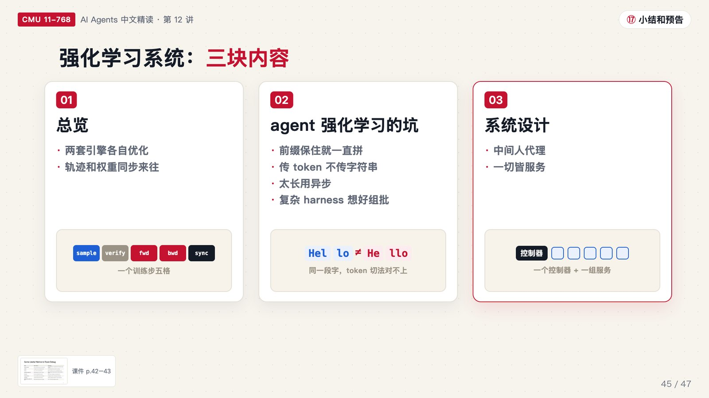

这一讲课件没有单独的小结页，按三块收：

| | 一句话 |
|---|---|
| 总览 | 推理和训练是两种负载，分成两套引擎各自优化：推理省显存、省重复、省空等，训练用重算换显存、用共享前缀省计算；两边靠轨迹和权重同步来往。 |
| agent 强化学习的坑 | 前缀能保住就一直拼；轨迹传 token 不传字符串；rollout 太长就用异步对付；复杂的 harness 要想好怎么组批。 |
| 系统设计 | 放一个模仿推理接口的代理，把一切做成服务：换 harness、换引擎、扩算力、部署后接着训，都不用重写框架。 |

逐节回顾：

- **一个训练步的操作**：策略梯度公式拆成 `sample`、`forward`、`backward`、`optim_step`，加环境的 `step`、`verify` 和 agent harness。
- **两种负载**：推理解码为主、不要梯度；训练整条并行、要自动求导；所以采样和训练不共用一个前向。两套系统之间就算权重一样也略有离策略。五格：sample → verify → forward → backward → optim_step + sync。
- **推理优化**：KV 缓存（Llama-3-8B 每 token 128 KB、32k 约 4 GB、64 条约 256 GB）；前缀缓存（一组共享题面，多轮复用前几轮）；连续批处理；分块预填充和分离式推理；推测解码，强化学习里草稿模型要跟着训。
- **训练优化**：激活检查点约 +33% 计算换显存；前缀共享。ZoRRo：80–95% 重复提示词 token，策略更新最多快 6 倍（端到端最多 3.5 倍）；AReaL-DTA：压缩率 9.43 倍，训练吞吐最多 8.31 倍；深度优先，同一时刻只存一条根到叶的路径。
- **并行**：数据、流水线、专家、张量、上下文五种；数据并行尽量大，通信尽量少。
- **权重同步**：1T 参数 bf16 约 2 TB；约 99% 的参数在 bf16 下不变（PULSE，实验做到 7B）；只传变化量，课上估算降到几十 GB；到推理端要重新切分。
- **R3**：把推理时 MoE 的路由记下来，训练时照着走。
- **序列延展**：harness A 一直追加，拼成一个数据点；B 压缩后拆成两个，任务算两遍。课上多数人选 B，答案是 A。
- **聊天模板**：Qwen3 / Qwen3.5 默认模板删历史里的推理，打断序列延展；框架自带渲染器。
- **token 进、token 出**：字符串转手会多一个空格；解码多对一，Hel + lo 重新分词成 Hello。
- **异步**：同步共用卡、轮流用；异步分开卡，例如 3 : 1；生成到一半换权重，SGLang 的 retract 撤回请求、清掉旧 KV。
- **复杂的 harness**：子 agent 递归委派，一棵树的 rollout 怎么组批是新问题。
- **系统设计**：中间人代理让 harness 零改动；SPMD 好改但不灵活；一切皆服务带来解耦、可替换、弹性和异构算力；AstraFlow、多策略训练、Cursor 每 5 小时一个新检查点。
- **多 LoRA 和 Tinker**：8 个并发约 90 分钟全做完，串行约 250 分钟；Tinker 的 `forward_backward`、`optim_step`、`sample`、`save_state`。
- **源码**：tinker-cookbook 的 Qwen3 渲染器默认 `strip_thinking_from_history=True`，`has_extension_property` 跟着变成 False；Qwen3.5 开了保留也不声明；`trajectory_to_data` 用 `_is_prefix` 逐轮判断，接得上就拼、接不上就另起一个数据点，观察 token 掩码 0。

### 附：排查用的指标表（课上跳过）

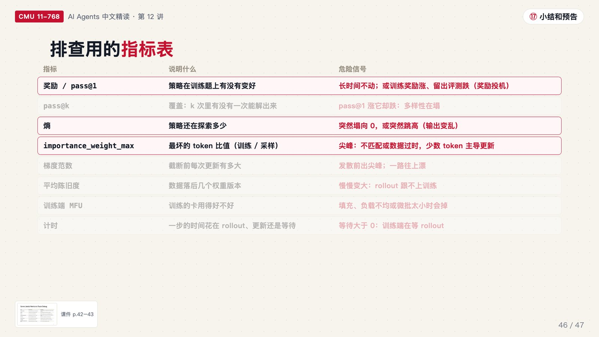

原课件 p.43 排在"Thank you"之后，课上没讲：

| 指标 | 告诉你什么 | 危险信号 |
|---|---|---|
| 奖励 / pass@1 | 策略在训练任务上有没有变好 | 很多步都平着；或者在涨，但留出的评测在跌（奖励投机） |
| pass@k | 覆盖面：k 个样本里有没有一个能做出来 | pass@1 在涨，它却在跌：多样性在坍缩 |
| 熵 | 策略还在多大程度上探索 | 突然塌向 0，或者突然跳高（输出变成乱码） |
| importance_weight_max | 最坏的 token 比值，比如 π_train / π_rollout | 出现尖峰：训练推理不一致或数据过时；少数几个 token 主导了更新 |
| 梯度范数 | 截断之前每次更新有多大 | 发散之前出现尖峰；持续往上漂 |
| 平均陈旧度 | 数据落后了几个权重版本 | 慢慢变大：rollout 跟不上训练 |
| 训练端 MFU | 训练 GPU 用得好不好 | 因为填充、负载不均或小批太小而下降 |
| 计时：rollout、更新、停顿、总计 | 一步的墙钟时间花在哪 | 停顿 > 0：训练器在等 rollout |

最值得盯的是奖励、熵和重要性权重的最大值。这张表把这一讲和第 11 讲串了起来（我的推断）：importance_weight_max 就是第 11 讲 7.1 节那条冲到一千多倍的曲线，熵对应第 11 讲 8.2 节，奖励投机对应第 11 讲 12 节；平均陈旧度和停顿对应这一讲第 11 节，MFU 对应第 4、5 节；importance_weight_max 出尖峰时，可以先查这一讲第 7 节的 R3 和第 10 节的 token 进 token 出。

## 关键术语

| 中文 | 英文 | 一句话解释 |
|---|---|---|
| 推理引擎 | inference engine | 负责采样的那套系统，如 vLLM、SGLang |
| 训练引擎 | training engine | 负责前向、反向和更新的那套系统，如 Megatron、FSDP2 |
| rollout | rollout | 让 agent 真去做一遍任务、采一条轨迹 |
| agent harness | agent harness | 组织 agent 推理的外壳：怎么拼提示词、调工具、压缩上下文 |
| 预填充 / 解码 | prefill / decode | 并行处理整段提示词 / 一个 token 一个 token 地生成 |
| KV 缓存 | KV cache | 存下过去 token 的 K、V，新 token 只算自己那份 |
| 前缀缓存 | prefix caching（RadixAttention） | 请求之间复用相同前缀的 KV |
| 连续批处理 | continuous batching | 每解码一步重新排批，跑完的离开、排队的补进来 |
| 分块预填充 | chunked prefill | 把长提示词切块处理，免得挡住解码 |
| 分离式推理 | disaggregated inference | 预填充和解码分给两组 GPU |
| 推测解码 | speculative decoding | 小模型先猜几个 token，大模型一次检查，分布不变 |
| MTP 头 | multi-token prediction head | 模型自带的草稿模块 |
| 激活检查点 | activation checkpointing | 前向只留每层输入，反向时重算激活 |
| 选择性重算 | selective recomputation | 只重算注意力这类部分，代价小得多 |
| 前缀共享 | prefix sharing | 训练时共同前缀只做一次前向和反向 |
| 树形注意力掩码 | tree attention mask | 分支之间互相看不见的注意力掩码 |
| 压缩率 | compression ratio | 序列 token 总数 ÷ 前缀树里不重复的 token 数 |
| 数据 / 流水线 / 专家 / 张量 / 上下文并行 | DP / PP / EP / TP / CP | 按数据、层、专家、矩阵、序列切到多张卡 |
| 权重同步 | weight sync | 训练端更新后把新权重发给推理端 |
| 全量 / 增量同步 | full / delta sync | 传全部参数 / 只传变化的参数 |
| rank | rank | 分布式里每个进程（每张卡）的编号 |
| 混合专家模型 | Mixture of Experts（MoE） | 每个 token 只送给少数几个专家计算 |
| 路由重放 | Rollout Routing Replay（R3） | 记下推理时选的专家，训练时照着走 |
| 序列延展 | sequence extension | 每一轮的输入都以上一轮的完整输入加输出开头 |
| 损失掩码 | loss mask | 标出哪些 token 算损失（动作 1，观察 0） |
| 上下文压缩 | context compaction | 把较早的交互总结成一小段摘要 |
| 渲染器 | renderer | 训练框架自带的聊天模板，把消息变成 token |
| token 进、token 出 | Token-In-Token-Out（TITO） | 轨迹直接存 token、传 token，不重新分词 |
| 异步强化学习 | asynchronous RL | 推理和训练分开跑、互相重叠 |
| 生成中途更新权重 | in-flight weight update | 请求做到一半暂停、换权重、接着生成 |
| 陈旧度 | staleness | 数据落后了几个权重版本 |
| 中间人代理 | proxy / middleman service | 模仿推理接口、顺手记下训练数据的服务 |
| 单程序多数据 | Single Program Multiple Data（SPMD） | 每张卡跑同一个程序，按编号分工 |
| 单一控制器 | single controller | 一切皆服务架构里协调各服务的轻量循环 |
| 弹性扩容 | elastic scaling | 训练过程中按需增减服务 |
| 异构算力 | heterogeneous compute | 不同厂商、不同型号的卡混用 |
| 在线强化学习 | online RL | 部署后用真实用户交互持续训练 |
| 多租户 | multi-tenant | 很多用户共用一个训练服务 |
| LoRA | Low-Rank Adaptation | 只训一小份低秩增量权重 |
| 检查点 | checkpoint | 某一时刻保存下来的一份模型权重 |
| bf16 | bfloat16 | 1 位符号、8 位指数、7 位尾数的 16 位浮点数 |
| FP32 主权重 | FP32 master weights | 混合精度训练里优化器手上那份高精度权重 |
| MFU | Model FLOPs Utilization | 实际算力占理论峰值的比例 |

## 思考题

<details>
<summary>1. 同一个模型，为什么采样在推理引擎里做一遍前向，训练时还要在训练引擎里再做一遍？两套引擎带来的一个副作用是什么？</summary>

两边计算形态不同：推理一个 token 一个 token 地解码，不要梯度，激活和计算图全扔掉，显存留给 KV 缓存；训练时整条序列已经有了，可以并行地算，还必须留着激活和计算图做反向（2.1 节）。分开以后各自能做专门的优化（2.2 节）。副作用是两边的算子和算法略有不同，就算权重一样，推理采样的策略和训练计算的策略也不完全一样，相当于一点离策略，要靠第 11 讲的重要性采样修正（2.3 节）。
</details>

<details>
<summary>2. 换成 Llama-3-70B（80 层，8 个 KV 头，每头 128 维，bf16），每个 token 的 KV 缓存多大？64 条 32k 的轨迹要多少？</summary>

2 × 80 × 8 × 128 × 2 = 327,680 字节 = 320 KB；32k 一条 = 320 KB × 32,768 = 10 GB；64 条 = 640 GB（按 1024 进位）。层数多了 2.5 倍，KV 也多了 2.5 倍。70B 的层数和头数按公开配置取，本课件没有另外核对，当作本题的设定；把动手练习 `kv_bytes_per_token(80, 8, 128)` 打印出来就能验证。
</details>

<details>
<summary>3. 有人说"AReaL-DTA 让训练快了 9.43 倍，ZoRRo 让训练快了 6 倍"。两句各错在哪里？</summary>

9.43 倍是前缀树的**压缩率**（token 总数 ÷ 不重复的 token 数），训练吞吐是最多 8.31 倍。6 倍是 ZoRRo 让**策略更新那一步**最多快 6 倍，整个训练端到端是最多 3.5 倍（4.3 节）。两组数各说各的口径，不能互相比，也不能都说成"训练快了多少"。
</details>

<details>
<summary>4. 激活检查点为什么大约多花三分之一的计算？如果某个模型的反向计算量是前向的 3 倍，这个比例变成多少？</summary>

全量重算等于多做一次前向。反向约是前向的 2 倍时，前向加反向约 3 份，多 1 份就是 1/3 ≈ 33%（4.1 节，本课件补的推导）。反向是 3 倍时，原本是 4 份，多 1 份就是 25%。
</details>

<details>
<summary>5. 1T 参数的模型，假设每步只有 0.5% 的参数在 bf16 下变化，只传变化量时，值和 4 字节下标一共多少？为什么说"约 99% 不变"不等于"梯度为零"？</summary>

10¹² × 0.5% = 5 × 10⁹ 个参数，每个 2 字节值 + 4 字节下标 = 6 字节，共 30 GB（不压缩）。"不变"说的是转成 bf16 之后看不出变化：Adam 的更新小于 bf16 在那个数附近的舍入间隔，舍入回去还是原数；FP32 主权重其实在动，攒够了 bf16 副本才变（6.2 节，后半句是我的推断）。
</details>

<details>
<summary>6. 一个 MoE 模型训着训着奖励不涨，importance_weight_max 频繁出尖峰。按这一讲，你会先查哪几处？</summary>

先查训练推理不一致的来源：有没有开 R3，训练重算时专家选得和推理时不一样（第 7 节）；轨迹是不是用字符串传、训练端重新分词（第 10 节）；聊天模板有没有改写历史，让训练端的 token 和采样时不同（第 9 节）。再查数据陈旧度：异步时数据是不是落后太多个权重版本（第 11 节、指标表的平均陈旧度）。
</details>

<details>
<summary>7. harness 每 3 轮压缩一次上下文，一条轨迹做了 9 轮。按 `trajectory_to_data` 的逻辑，它会拆成几个数据点？任务提示词算几遍？</summary>

每次压缩后，新一轮的观察不再以之前攒的完整序列开头，第 215 行判断失败，另起一个数据点。第 3、6 轮之后各压一次（压缩生效在第 4、7 轮），9 轮被切成 1–3、4–6、7–9 三段，三个数据点，任务提示词算三遍（18.3 节）。如果用前缀树（第 4.4 节）组织这些数据点，任务那一段可以只算一遍。
</details>

<details>
<summary>8. 把 Qwen3 渲染器设成 `strip_thinking_from_history=False`，训练和部署可能出现什么新的不一致？</summary>

训练时历史里保留了推理，部署时如果用的是官方默认模板，历史里的推理又会被删掉：模型训练时看到的多轮上下文和部署时看到的不一样。这是用训练效率（序列延展、拼成一个数据点）换了一层训练和部署的差别（我的推断）。cookbook 也承认这个取舍：默认值 `True` 就是为了和官方模板逐 token 一致（18.1 节）。
</details>

<details>
<summary>9. 同步时 8 张卡轮流训练和推理，异步时按 6 : 2 分卡。如果 rollout 很短、训练很重，3 : 1 还合适吗？</summary>

不合适。3 : 1 是课上举的 agent 长程任务的例子：瓶颈在 rollout，所以给推理多分（11.1 节）。rollout 很短、训练很重时，瓶颈在训练端，推理那边会空等，应该给训练多分卡，甚至同步共用卡就够。看指标表的计时一行：停顿大于 0 说明训练器在等 rollout，反过来推理端空闲说明训练跟不上。
</details>

<details>
<summary>10. 中间人代理为什么能让 harness"零代码改动"？它除了转发，还必须存下哪些东西？</summary>

harness 本来就说 chat completions、responses 这类标准推理接口，代理模仿同一套接口，harness 只要把地址换成代理（13.2 节）。代理必须存下训练要的东西：每一轮确切的 token（token 进、token 出，第 10 节）、采样时的对数概率（离策略修正的分母）、MoE 的路由记录（R3，第 7 节）。只存字符串的话，训练端还得重新分词，又回到第 10 节的坑。
</details>

## 动手练习

### 练习：KV 缓存、前缀树、数据点拼接、重新分词和 bf16，全部自己算一遍

20–30 分钟，只依赖 Python 3 标准库，不调用任何模型、不联网，也不执行任何模型生成的命令。把本讲 3.1、4.1、4.3、6.1–6.2、8.2、10.3 节和第 18.3 节的数自己算一遍。把下面的代码存成 `l12_lab.py`，运行 `python3 l12_lab.py`。

```python
"""第 12 讲动手练习：只用 Python 标准库。"""
import random
import struct

KiB, GiB, TB = 1024, 1024**3, 10**12


# 1. KV 缓存显存估算
def kv_bytes_per_token(layers, kv_heads, head_dim, bytes_per_num=2):
    return 2 * layers * kv_heads * head_dim * bytes_per_num  # 2 = K 和 V 两份


# 2. 前缀树压缩率：序列 token 总数 / 前缀树里不重复的 token 数
def compression_ratio(seqs):
    trie, unique = {}, 0
    for s in seqs:
        node = trie
        for tok in s:
            if tok not in node:
                node[tok] = {}
                unique += 1
            node = node[tok]
    return sum(len(s) for s in seqs) / unique


# 3. 把一条轨迹拼成训练数据点：照 tinker-cookbook 的 trajectory_to_data
def to_datums(transitions):
    """transitions: [(观察 token 列表, 动作 token 列表), ...]，观察是这一轮完整的提示词。"""
    datums, seq, mask = [], [], []
    for ob, ac in transitions:
        if seq and ob[: len(seq)] == seq:  # 上一轮的完整序列是这一轮提示词的前缀
            delta = ob[len(seq):]
        else:
            if seq:
                datums.append((seq, mask))
            seq, mask, delta = [], [], ob
        seq = seq + delta + ac
        mask = mask + [0] * len(delta) + [1] * len(ac)
    datums.append((seq, mask))
    return datums


def harness(compress):
    T, S = ["T"], ["S"]
    hist, out = T, []
    for i in range(1, 5):
        if compress and i == 3:
            hist = T + S  # 第 3 轮前，把 A1 O1 A2 O2 压成摘要 S
        a, o = [f"A{i}"], [f"O{i}"]
        out.append((hist, a))
        hist = hist + a + o
    return out


# 4. 解码是多对一：一个最长匹配的玩具分词器
VOCAB = {"H": 1, "He": 2, "Hel": 3, "Hello": 4, "ello": 5, "llo": 6, "lo": 7}
ID2TOK = {v: k for k, v in VOCAB.items()}


def encode(text):
    ids, i = [], 0
    while i < len(text):
        piece = max((p for p in VOCAB if text.startswith(p, i)), key=len)
        ids.append(VOCAB[piece])
        i += len(piece)
    return ids


def decode(ids):
    return "".join(ID2TOK[t] for t in ids)


# 5. bf16：float32 的高 16 位，按"就近取偶"舍入
def to_bf16(x):
    u = struct.unpack("<I", struct.pack("<f", x))[0]
    u = (u + 0x7FFF + ((u >> 16) & 1)) >> 16
    return struct.unpack("<f", struct.pack("<I", u << 16))[0]


if __name__ == "__main__":
    b = kv_bytes_per_token(32, 8, 128)
    print(f"1) Llama-3-8B 每 token {b // KiB} KB；32k 一条 {b * 32768 / GiB:.0f} GB；64 条 {64 * b * 32768 / GiB:.0f} GB")
    print(f"   激活检查点：多一次前向 / (前向 1 + 反向 2) = {1 / 3:.0%}")

    prompt = list(range(1000))  # 8 条轨迹共享 1000 个 token 的提示词
    rng = random.Random(0)
    group = [prompt + [10_000 * (k + 1) + j for j in range(rng.randint(100, 400))] for k in range(8)]
    print(f"2) 8 条共享提示词的轨迹，压缩率 {compression_ratio(group):.2f} 倍")

    for name, comp in (("A 一直追加", False), ("B 第 3 轮前压缩", True)):
        ds = to_datums(harness(comp))
        print(f"3) harness {name}：{len(ds)} 个数据点，任务 T 出现 {sum(s.count('T') for s, _ in ds)} 次")
        for s, m in ds:
            print("     ", " ".join(s), "| 掩码", "".join(map(str, m)))

    sampled = [3, 7]  # 模型实际采出的是 Hel + lo
    text = decode(sampled)
    print(f"4) 采样 {sampled} → 解码 {text!r} → 重新分词 {encode(text)}")

    rng = random.Random(0)
    w = [rng.gauss(0, 0.02) for _ in range(100_000)]
    for lr in (1e-7, 1e-6, 1e-5):
        upd = [x - lr * rng.choice((-1, 1)) for x in w]  # Adam 一步的大小约等于学习率
        same = sum(to_bf16(x) == to_bf16(y) for x, y in zip(w, upd)) / len(w)
        print(f"5) 学习率 {lr:g}：一步之后 bf16 下不变的参数 {same:.2%}")
    x0, x, n = 0.0123, 0.0123, 0
    while to_bf16(x) == to_bf16(x0):
        x += 1e-6; n += 1
    print(f"   0.0123 这个权重，FP32 主权重每步加 1e-6，第 {n} 步 bf16 副本才变")
    print(f"6) 1T 参数 bf16 全量 {1e12 * 2 / TB:.0f} TB；只传 1% 的值 {1e12 * 0.01 * 2 / 1e9:.0f} GB，"
          f"再加 4 字节下标共 {1e12 * 0.01 * 6 / 1e9:.0f} GB")
```

运行结果（本课件实际跑出来的输出）：

```
1) Llama-3-8B 每 token 128 KB；32k 一条 4 GB；64 条 256 GB
   激活检查点：多一次前向 / (前向 1 + 反向 2) = 33%
2) 8 条共享提示词的轨迹，压缩率 3.16 倍
3) harness A 一直追加：1 个数据点，任务 T 出现 1 次
      T A1 O1 A2 O2 A3 O3 A4 | 掩码 01010101
3) harness B 第 3 轮前压缩：2 个数据点，任务 T 出现 2 次
      T A1 O1 A2 | 掩码 0101
      T S A3 O3 A4 | 掩码 00101
4) 采样 [3, 7] → 解码 'Hello' → 重新分词 [4]
5) 学习率 1e-07：一步之后 bf16 下不变的参数 99.42%
5) 学习率 1e-06：一步之后 bf16 下不变的参数 95.85%
5) 学习率 1e-05：一步之后 bf16 下不变的参数 74.89%
   0.0123 这个权重，FP32 主权重每步加 1e-6，第 60 步 bf16 副本才变
6) 1T 参数 bf16 全量 2 TB；只传 1% 的值 20 GB，再加 4 字节下标共 60 GB
```

对一下正文：

| 输出 | 正文 |
|---|---|
| 1) 128 KB、4 GB、256 GB；33% | 3.1 节的三个数；4.1 节"约 +33%"的推导 |
| 2) 压缩率 3.16 倍 | 4.3 节压缩率的定义（自己造的 8 条轨迹，不是 AReaL-DTA 的 9.43 倍） |
| 3) A：1 个数据点，T 出现 1 次；B：2 个，T 出现 2 次 | 8.2 节两张表；`to_datums()` 是 18.3 节 `trajectory_to_data` 的简化版 |
| 4) [3, 7] → 'Hello' → [4] | 10.3 节 Hel(3) + lo(7) 的例子 |
| 5) 学习率越小，bf16 下不变的越多；第 60 步才变 | 6.1 节"约 99% 不变"的机制、6.2 节 FP32 主权重累积（我的推断） |
| 6) 2 TB；20 GB；60 GB | 6.1 节的 2 TB 和"几十 GB"（课上估算）的量级 |

关于第 5 部分要说清楚：这是本课件自己设的玩具模拟，不是 PULSE 的实验。权重按标准差 0.02 的正态分布随机取，每步更新的大小固定成学习率、方向随机（Adam 的一步大致是这个量级）。学习率 1e-7 时约 99.4% 不变，1e-6 时约 95.9%，1e-5 时约 74.9%。PULSE 说的约 99% 来自真实的强化学习训练，数字对不上很正常：真实权重的分布、学习率和 Adam 的二阶矩都不是这么简单。它只用来说明"更新小于舍入间隔的一半，bf16 就看不出来"这个机制。

做完回答：

1. 用 `kv_bytes_per_token()` 算思考题 2 的 70B 配置（80 层、8 个 KV 头、每头 128 维），再算一个不用 GQA 的版本（KV 头数等于注意力头数 64），看 KV 缓存差几倍。
2. 把第 2 部分的提示词从 1000 个 token 改成 4000 个，压缩率变成多少？8 条轨迹再加上"同一条轨迹的多轮"（每条再分出 3 轮、每轮共享前面所有 token），压缩率会怎么变？
3. 改 `harness()`，让 B 在第 3 轮和第 5 轮之前各压缩一次，一共 6 轮，`to_datums()` 返回几个数据点？任务 T 出现几次？和思考题 7 对一下。
4. 给 `to_datums()` 加一个 `mask_turns` 参数（一组轮次编号），照 18.3 节第 245–247 行，把这些轮次的动作掩码设成 0，确认它们不再算损失，但仍然留在序列里当上下文。
5. 在 `VOCAB` 里加上 `"Hell": 8` 和 `"o": 9`，假设模型采样出 `[8, 9]`（"Hell" + "o"），解码后重新分词得到什么？再想一想：为什么只有存 token，才能保证训练算的就是采样的那一串。
6. 选做：把第 5 部分的权重换成全部取 0.0123，学习率 1e-6，跑 100 步，打印每一步 bf16 副本是否变化。它是不是大约每 60 步才变一次？这时只传变化量，一步里要传的参数是全部还是零个？这说明了真实训练里哪一点（提示：权重的大小分布）？

> 这个练习只做算术。如果你接着用真模型、真 harness 做多轮强化学习，agent 生成的代码和命令只在容器或沙箱里运行；不要在装着真实凭证的日常电脑上跑，也不要把 API 密钥放进 agent 能读到的环境。下一讲讲的就是这件事。

## 延伸阅读

链接取自原课件页脚引的原文（课表没有列这一讲的 readings）。

推理优化：

- Orca（Yu et al.，OSDI 2022）：[论文页](https://www.usenix.org/conference/osdi22/presentation/yu)。迭代级调度，连续批处理的出处。
- SGLang（RadixAttention）：[arXiv:2312.07104](https://arxiv.org/pdf/2312.07104)。
- vLLM 文档：[Automatic Prefix Caching](https://docs.vllm.ai/en/latest/design/prefix_caching/#example)。
- Speculative Decoding（Leviathan et al. 2023）：[arXiv:2211.17192](https://arxiv.org/abs/2211.17192)。

训练优化和并行：

- Training Deep Nets with Sublinear Memory Cost（Chen et al. 2016）：[arXiv:1604.06174](https://arxiv.org/abs/1604.06174)。梯度检查点，多一次前向换 O(√n) 显存。
- Reducing Activation Recomputation in Large Transformer Models（Korthikanti et al. 2022）：[arXiv:2205.05198](https://arxiv.org/abs/2205.05198)。选择性重算。
- Snowflake：[ZoRRo enterprise RL training](https://www.snowflake.com/en/blog/engineering/zorro-enterprise-rl-training/)。
- AReaL-DTA（Dynamic Tree Attention，Zhang et al. 2026）：[arXiv:2602.00482](https://arxiv.org/abs/2602.00482)。图 1 压缩率的定义。
- NVIDIA NeMo：[Parallelisms](https://docs.nvidia.com/nemo-framework/user-guide/25.02/nemotoolkit/features/parallelisms.html)。

训练和推理的交互：

- PULSE（Miahi & Belilovsky 2026，arXiv 2602.03839）：[Hugging Face 论文页](https://huggingface.co/papers/2602.03839)。约 99% 的更新在 bf16 下看不见。
- R3（Ma et al. 2025）：[arXiv:2510.11370](https://arxiv.org/abs/2510.11370)。
- Tinker 文档：[Sequence Extension](https://tinker-docs.thinkingmachines.ai/tutorials/advanced/sequence-extension/)。
- LMSYS：[No Token Left Behind: Demystifying Token-In-Token-Out in Miles](https://www.lmsys.org/blog/2026-05-13-no-token-left-behind/)。TITO 的定义和三种破坏场景。
- SGLang 文档：[SGLang for RL · pause generation](https://docs.sglang.io/docs/advanced_features/sglang_for_rl#pause-generation)。

异步和系统设计：

- PipelineRL：[arXiv:2509.19128](https://arxiv.org/pdf/2509.19128)。
- AReaL（Fu et al. 2026）：[arXiv:2505.24298](https://arxiv.org/abs/2505.24298)。
- Recursive Language Models（RLM）：[arXiv:2512.24601](https://arxiv.org/abs/2512.24601)；Recursive Agent Optimization（RAO）：[arXiv:2605.06639](https://arxiv.org/abs/2605.06639)。
- Agent Lightning：[arXiv:2508.03680](https://arxiv.org/pdf/2508.03680)。harness 无关的中间人设计。
- AstraFlow（Zheng et al. 2026）：[arXiv:2605.15565](https://arxiv.org/abs/2605.15565)。
- AReaL 2.0 报告：[PDF](https://github.com/areal-project/AReaL/blob/main/docs/paper/AReaL2.0_report.pdf)。在线强化学习的架构图。
- Cursor：[Online RL for Cursor Tab](https://cursor.com/blog/tab-rl)；Composer 的那篇是 Cursor 博客的 Improving Composer through real-time RL。
- Trajectory Labs：[Multi-LoRA training for continual learning](https://www.trajectory.ai/field-notes/multi-lora-training-for-continual-learning)。
- Punica：[arXiv:2310.18547](https://arxiv.org/abs/2310.18547)。多租户 LoRA 的专门算子。
- Tinker：[文档首页](https://tinker-docs.thinkingmachines.ai/)。

源码：

- tinker-cookbook：[renderers/qwen3.py](https://github.com/thinking-machines-lab/tinker-cookbook/blob/f79fdb2ba4cd967ef2807ba43097c52985f9f17f/tinker_cookbook/renderers/qwen3.py)、[renderers/qwen3_5.py](https://github.com/thinking-machines-lab/tinker-cookbook/blob/f79fdb2ba4cd967ef2807ba43097c52985f9f17f/tinker_cookbook/renderers/qwen3_5.py)、[renderers/\_\_init\_\_.py](https://github.com/thinking-machines-lab/tinker-cookbook/blob/f79fdb2ba4cd967ef2807ba43097c52985f9f17f/tinker_cookbook/renderers/__init__.py)、[rl/data_processing.py](https://github.com/thinking-machines-lab/tinker-cookbook/blob/f79fdb2ba4cd967ef2807ba43097c52985f9f17f/tinker_cookbook/rl/data_processing.py)、[renderers/README.md](https://github.com/thinking-machines-lab/tinker-cookbook/blob/f79fdb2ba4cd967ef2807ba43097c52985f9f17f/tinker_cookbook/renderers/README.md)（序列延展性质的定义）。

本系列相关的几讲：

- 第 3 讲：长上下文（KV 缓存、上下文并行）。
- 第 9 讲：强化学习基础（策略梯度、GRPO、损失只算在生成的 token 上）。
- 第 11 讲：强化学习进阶算法（异步、重要性采样、截断、最大离策略程度）。
- 第 13 讲：Agent 安全。

## 下一讲预告：Agent 安全


这一讲讲的是强化学习训 agent 的系统层面：推理和训练两套引擎各自的优化和来往；agent 强化学习里保住前缀、传 token、用异步对付长 rollout；以及把 harness、推理、训练、权重同步、环境都做成服务的设计。

下一讲是第 13 讲：Agent 安全（Safety 1: Agent Safety）。原课件最后一页写的是"沙箱和凭证管理"，下一讲会包括这些。第 11 讲说过"怎么把 agent 放进沙箱、免得它删掉你的文件系统"留到后面讲，第 11 讲 12.2 节的 PostTrainBench 里 API 密钥被拿去生成训练数据，也是这类问题。

留一个问题：这一讲第 15.3 节说，把 harness 当成服务，部署出去的 agent 就能一边在生产里干活、一边把轨迹交给训练服务。如果这个 agent 能执行命令、读写文件、拿着用户的凭证调 API，训练和部署时，它的沙箱边界该画在哪里？哪些东西绝对不能进到它能读到的环境里？
