# 第 14 讲 · OpenHands：拆解一个开源编程 agent

> CMU 11-768 AI Agents（2026 秋）中文精读 · 配套课件
> 配套视频（26 分钟）：B 站 / 视频号 / 抖音 / 小红书搜索「竹二木SI」 · 整份幻灯片：[l14-幻灯片.pdf](./l14-幻灯片.pdf)
> 原课程：[cmu-agents.com](https://cmu-agents.com)，课程主讲 Graham Neubig、Daniel Fried；本讲课表名 Frameworks 1: OpenHands。本课件是非官方的学习整理。

## 这一讲你会学到

学完这一讲，你应该能做到：

1. 说清 OpenHands 是什么：一个开源的软件开发 agent，前身叫 OpenDevin，是在社区复现 Devin 的号召里起步的**独立开源项目**，不是 Devin 的官方开源版；它不绑定模型。
2. 按时间顺序讲出编程 agent 这几年的几个节点：代码补全和 HumanEval → SWE-bench（2023 年 10 月）→ Devin（2024 年 3 月 12 日）→ OpenDevin 早期前端（3 月 26 日）→ SWE-agent（4 月）→ CodeAct 1.0（5 月，SWE-bench Lite 21%）→ 2025 年变强 → 2026 年重在部署；解释"基准分数 = 模型 + agent 系统"。
3. 用 OpenHands SDK 的七块积木把一个修 bug 的 agent 搭出来：**模型和工具**、**对话**（Conversation）、**自定义工具**、**会话持久化**、**上下文压缩**、**远程执行**（Docker）、**动作确认**；每一块能说出它解决什么问题。
4. 读懂 SDK 里三处源码：三种确认策略和"默认从不问"、`LLMSummarizingCondenser` 怎么决定压掉哪些事件、一个自定义工具由 Action / Executor / Observation 三部分组成。
5. 说清课上为什么在**编程**上偏向单 agent，技能和 MCP 怎么替代固定的多 agent 流程，以及分工在什么时候值得（并行、独立审查、控制成本）、代价是什么。
6. 比较本地和云两种托管位置、IDE / 图形界面 / 命令行 / 集成四种界面，说出 Code with Me 研究里的两个数和两条负面反馈。
7. 画出一次自动化运行的五步，说出 issue 分诊的两种输出，讲清 SkillRefiner 怎么离线地从历史记录里改进技能、结果表该怎么读。

建议先看一遍视频，再对照本课件逐节复习。每节开头的图就是视频里对应的画面。


### 接上一讲

第 13 讲片尾留了一个问题：一个 agent 框架要同时支持"agent 在本地跑"和"agent 在云上沙箱里跑"，工具执行、凭证、确认弹窗应该分别放在哪一层，才能让"访问规则和执行权放在 agent 控制不到的地方"在两种部署下都成立？

拿 OpenHands SDK 对照（本课件补的对照，依据是 8 节读过的源码）：

| 第 13 讲的问题 | OpenHands SDK 里的位置 | 本课件 |
|---|---|---|
| 工具在哪执行 | 本地对话在本进程里执行；换成 Docker 工作区后，整个 agent 服务器在容器里，工具也在容器里执行，对话接口不变 | 3.7 节、8.3 节 |
| 确认放在哪 | 确认策略存在**对话状态**里，agent 每一步执行之前查一次；要不要放行由调用方（人）决定，拒绝时由对话补一条"被拒绝"的观察 | 3.8 节、8.1 节 |
| 凭证 | 课上提到 SDK 能管密钥；源码里每个工具的输出在交回模型之前都会过一遍密钥打码 | 3.9 节、8.3 节 |

上一讲讲的是防护原则，这一讲看它们落到一个真实框架里长什么样。

### 这一讲的路线

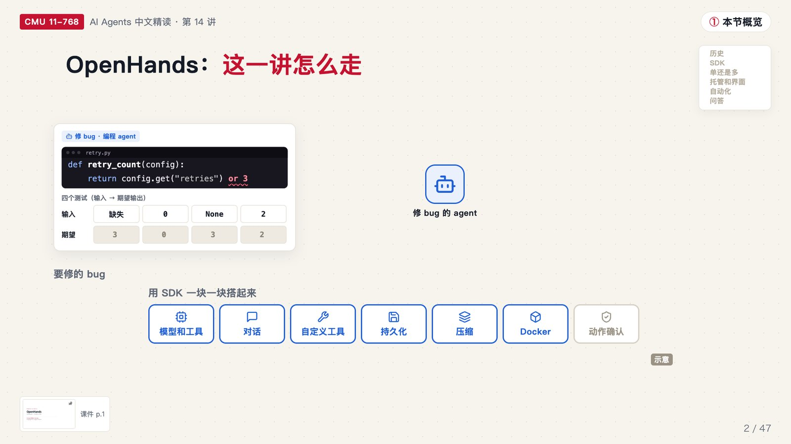

这一讲和前面几讲不太一样：技术内容有，但更多是做一个真有用户在用的 agent 产品时学到的东西。按视频分成六块：

| 块 | 讲什么 | 本课件 |
|---|---|---|
| 历史 | 从代码补全到部署，编程 agent 这两年怎么走过来 | 2 节 |
| SDK | 开箱即用又可替换；七块积木 | 3 节 |
| 单还是多 | 专门角色、单 agent、技能、MCP、什么时候值得分工 | 4 节 |
| 托管和界面 | 本地还是云；四种界面；人的投入和监督 | 5 节 |
| 自动化 | 一次运行的五步、分诊和审查、软件工厂、SkillRefiner | 6 节 |
| 问答 | 本地和云之间、SSH、多 agent 的成本、要不要 GitHub | 7 节 |

8 节是本课件补的源码解读，课上没有逐行读源码。

### 运行例子：用 SDK 亲手搭出修 bug 的 agent

整讲接着用第 6、11–13 讲那个编程 agent 修 `retry_count`：

```python
def retry_count(config):
    return config.get("retries") or 3
```

0 是假值，`0 or 3` 得到 3，所以"0 次重试"被当成"没设置"。四格测试：

| 输入 | 缺失 | 0 | None | 2 |
|---|---|---|---|---|
| 期望 | 3 | 0 | 3 | 2 |
| 原代码 | ✓ | ✕（得到 3） | ✓ | ✓ |

这一讲用 OpenHands SDK 把这个 agent 一块一块搭出来：选模型、给终端 / 编辑器 / 任务清单三个工具 → 开一个对话让它修 → 加一个 grep 工具 → 中途断了能接着跑 → 历史太长时压缩 → 放进 Docker 里跑 → 想直接推主分支时被确认拦下。后面讲单 agent 和多 agent、自动化时也拿它对比。任务文字、技能内容、被拒绝的 `git push`、分诊写出的验收标准都是我为讲清楚设的，画面上标了"示意"。

---

## 1 前端演示：两种用法

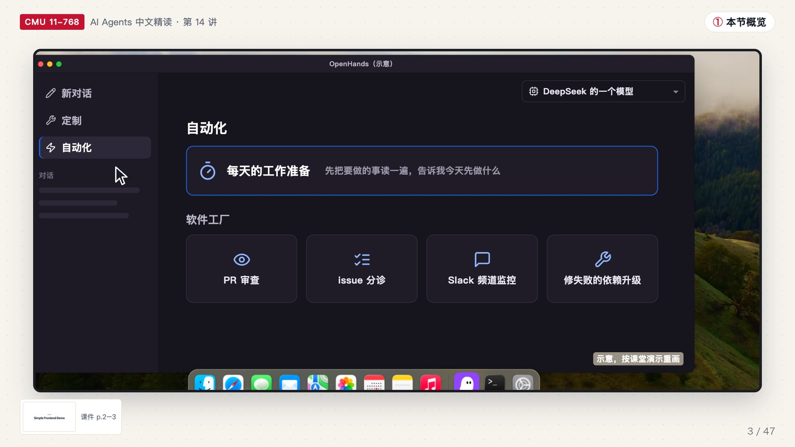

课上先现场演示了 OpenHands 的前端（课件 p.2–3 是截图）。下面只写能确认的步骤，画面是按演示重画的示意：

1. 前端面向两类软件开发工作：一类是**人在环里**（human in the loop），想做什么就在聊天框里打字；另一类是**自动化**（automation），把反复做的事交给它定时或按事件去做。
2. 先选模型，课上选了一个 DeepSeek 的模型（具体版本听不清，本课件不写）。
3. 输入任务，大意是"找出我在仓库里还没合并的 PR，今天我该做什么"。它建一个新对话，开始思考，再去仓库里一个个查。
4. 和 Codex、Claude Code 不一样的是，可以换很多家的模型，中途切到别家再切回来都行。
5. 定制有 MCP 服务器、技能、插件和应用。
6. 自动化里，一个叫"每天的工作准备"：课上举的经历是，它先把要做的事读一遍，告诉我今天先做什么。
7. 另一组是 OpenHands 自己的**软件工厂**（software factory）：审 PR 的机器人、给 issue 分诊的机器人、盯 Slack 频道的，还有依赖升级失败时自动去修的。6 节细讲。

和别的编程 agent 比，课上强调的最大区别在模型上：Claude Code 和 Codex 各自待在一家模型厂商的生态里；OpenHands 很用力地做到**不绑定模型**（model-agnostic）。另一个很火的开源编程 agent 叫 **Pi**，思路有点像：核心很精简，再让它容易扩展。3.1 节会看到两者在"默认给多少"上正好相反。

---

## 2 编程 agent 的历史

课上举的经历是，从 2016 年左右就在做代码生成；直到 2023 年前后，代码生成大多还不是 agent 式的。agent 式的编程，算起来就这两年。讲历史不是为了怀旧：这一讲里的很多设计，都是过去一年半根据教训改出来的，所以要把教训和框架里的设计对上。

| 时间 | 事件 | 一句话 |
|---|---|---|
| 到 2023 年 | 代码补全，评测用 HumanEval | 改、跑、查都靠人 |
| 2023 年 10 月 | SWE-bench | 在整个仓库里修真实 issue |
| 2024 年 3 月 12 日 | Devin 发布演示 | "第一个 AI 软件工程师"，不开源 |
| 2024 年 3 月 13 日 | 社区发起复现 Devin 的号召 | 课上说响应的人非常多 |
| 2024 年 3 月 26 日 | OpenDevin 早期前端 | 前端 + agent + Docker 沙箱 |
| 2024 年 4 月 | SWE-agent | 搜文件、改代码、验证修复 |
| 2024 年 5 月 | CodeAct 1.0 | SWE-bench Lite 上 21% |
| 2024 年底 | 据课上说，agent 开始真正管用 | |
| 2025 年 | 编程 agent 变得很强 | 好几家都有很强的编程模型 |
| 2026 年 | 部署和界面之年 | 跑得久、能并行、可检查 |

### 2.1 代码补全和 HumanEval

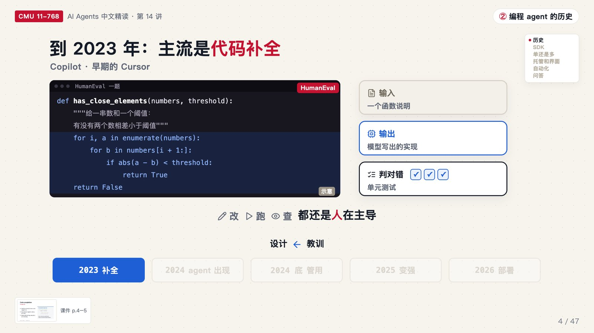

到 2023 年为止，主流是**代码补全**（code completion），比如 Copilot 和早期的 Cursor：你写代码时它给补全建议。评测用 **HumanEval**：给一个函数说明（函数签名加文档字符串），让模型写出函数实现，用单元测试判对错。课件的例子是 `has_close_elements`：给一串数和一个阈值，判断有没有两个数挨得比阈值还近。

这时候改代码、运行、检查，都还是人在主导。模型只负责"写出这一个函数"。

### 2.2 SWE-bench：在整个仓库里修真实 issue

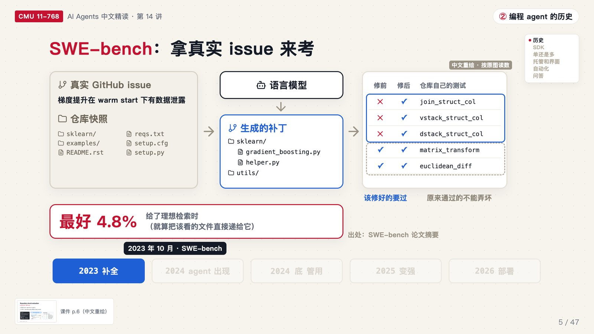

2023 年 10 月出了 **SWE-bench**，影响非常大：

| | |
|---|---|
| 输入 | 一个真实的 GitHub issue，加上那个时刻的整个仓库快照 |
| 输出 | 一个补丁（patch） |
| 怎么判 | 用仓库自己的测试：修之前失败、修之后该通过的那些测试要过；原来就通过的也不能弄坏 |
| 早期结果 | 最好的模型，就算把该看的文件直接递给它（论文叫 oracle 检索），也只修好了不到百分之五（论文摘要：Claude 2 为 4.8%） |

课件的例子是 scikit-learn 里"梯度提升在 warm start 下有数据泄露"那个 issue，测试表里三个测试"修前失败、修后通过"，两个"修前修后都通过"（按原图读数）。

和 HumanEval 比，难的地方在于：要自己在一个大仓库里找到该改的地方，改完还不能弄坏别处。这正是 agent 要解决的事：不断地搜、读、改、跑测试。

### 2.3 Devin 和 OpenDevin

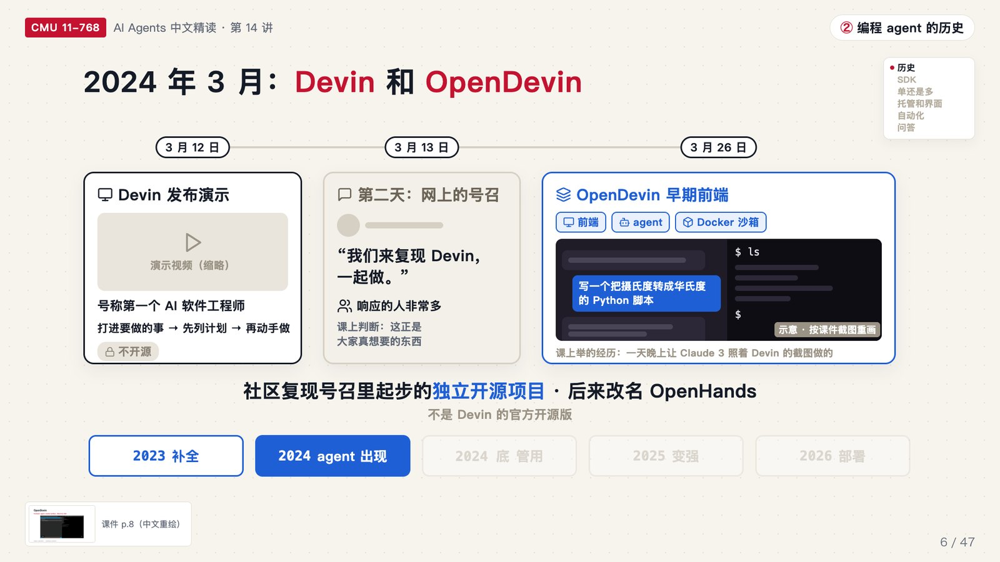

改变局面的是 2024 年 3 月 12 日 **Devin** 的发布演示，号称"第一个 AI 软件工程师"：你打进要做的事，它先列计划，再动手做。Devin 不开源。

第二天（3 月 13 日），有人在网上发起号召：我们来复现 Devin，一起做。课上说响应的人非常多，判断这正是大家真想要的东西，就动手了。

3 月 26 日，**OpenDevin** 放出了早期前端，三块：一个前端、一个 agent、一个 Docker 沙箱。课上举的经历是，那版界面是一天晚上让 Claude 3 照着一张 Devin 的截图做出来的。课件的截图里，用户让它写一个把摄氏度转成华氏度的 Python 脚本，右边是终端。

要写准的一点：**OpenDevin 不是 Devin 的官方开源版**。它是从社区这次复现号召里起步的独立开源项目，后来改名叫 **OpenHands**。早期前端的日期照课件写 3 月 26 日。

### 2.4 SWE-agent 和 CodeAct 1.0

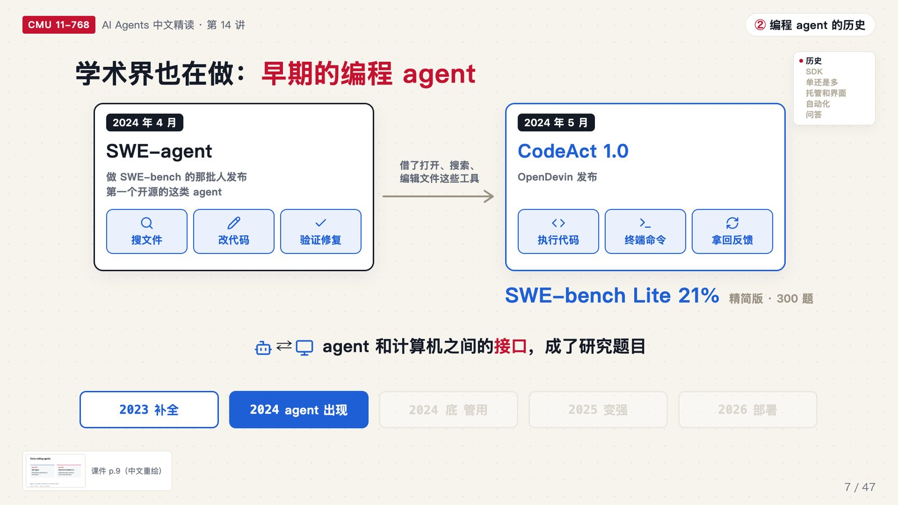

几乎同时，学术界也在做：

| | SWE-agent | CodeAct 1.0 |
|---|---|---|
| 时间 | 2024 年 4 月（早于 CodeAct 1.0） | 2024 年 5 月 |
| 谁做的 | 做 SWE-bench 的那批人 | OpenDevin |
| 能做什么 | 搜文件、改代码、验证修复 | 执行代码、跑终端命令、拿回反馈 |
| 成绩 | 论文摘要：SWE-bench 上 pass@1 12.5% | **SWE-bench Lite**（精简版，300 题）上 21%，不借助额外提示 |

注意 21% 是 **SWE-bench Lite**，不是完整版，两个数不能直接比。按 CodeAct 1.0 的博客，它把动作统一成"写代码去执行"，从 SWE-agent 借了打开、滚动、搜索、编辑文件这些工具，是 OpenDevin v0.5 的默认 agent（本课件按精读稿核对过的博客补）。

从这时起，**agent 和计算机之间的接口**（agent–computer interface）本身就成了一个研究题目：给 agent 什么样的工具、工具返回什么样的结果，直接影响分数。

### 2.5 从不好用到很强：分数从哪来

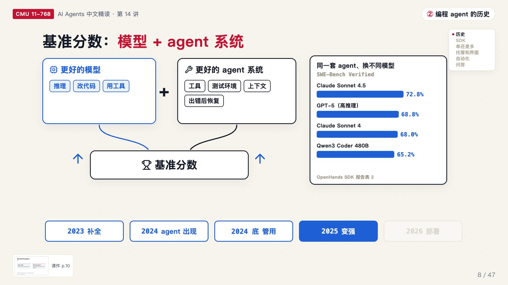

可这一切有一年多其实不好用，愿景很动人，就是跑不起来。据课上说，大概到 2024 年底，agent 才真正开始管用。2025 年编程 agent 变得非常强：年初基本只有 Claude 的 Sonnet 还可以，到年底，好几家都有了很强的编程模型。

课件把进步拆成两边：

| 更好的模型 | 更好的 agent 系统 |
|---|---|
| 推理 | 工具 |
| 改代码 | 测试环境 |
| 用工具 | 上下文 |
| | 出错后的恢复 |

结论是：**基准分数 = 模型 + agent 系统**，两边都在涨。别把它理解成"主要靠模型"。

画面右下角那张横条图来自 OpenHands SDK 报告表 2：同一套 agent、换不同模型，在 SWE-Bench Verified 上 Claude Sonnet 4.5 72.8%、GPT-5（高推理）68.8%、Claude Sonnet 4 68.0%、Qwen3 Coder 480B 65.2%。报告正文把第一个数写成 72%，以表 2 的 72.8% 为准。这张表只有"换模型"这一半；"同一个模型换一套 agent 也会差很多"是从课件结论推的，表里没有。

### 2.6 2026：部署

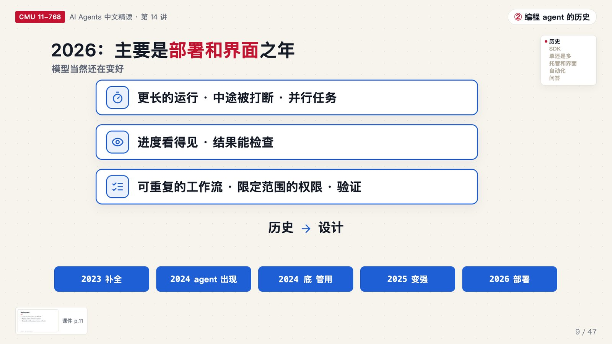

到了 2026 年，模型当然还在变好，但到目前为止，主要是**部署和界面**之年。课件三行（课件原话，出处是一次企业演讲）：

- 更长的运行、中途被打断、并行任务；
- 进度看得见、结果能检查；
- 可重复的工作流、限定范围的访问权限、验证。

后面每一块都能对上：持久化（3.5 节）对"被打断"，压缩（3.6 节）对"更长的运行"，Docker 和确认（3.7、3.8 节）对"限定范围的权限"，自动化（6 节）对"可重复的工作流"。

**这一节记住一句**：编程 agent 两年里从补全走到部署，分数从来是模型加 agent 系统一起涨上去的。

---

## 3 OpenHands SDK：七块积木

### 3.1 重写过一次的 harness：开箱即用，又可替换

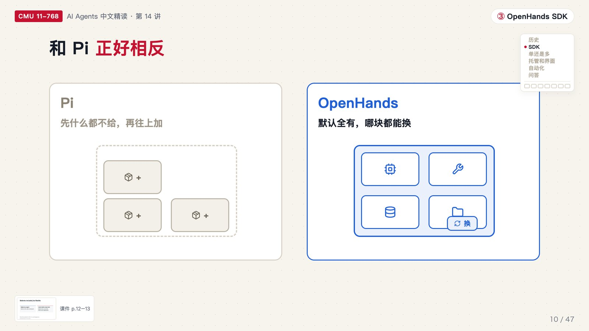

OpenHands 的 agent SDK（Software Agent SDK）是它的 **harness**，已经是第二版：课上说第一版很难用、很难扩展，大约八个月前整个拆掉重写了。SDK 报告把旧版叫 V0、新版叫 V1：V0 里 agent 逻辑、评测和应用挤在一个代码库；V1 拆成 SDK、工具、工作区、agent 服务器四个包（按精读稿核对过的报告 §1 补）。

它的思路是**开箱即用、又可替换**：

| 现成的 | 可替换的 |
|---|---|
| 模型、工具、状态、工作区，都配好了 | 换模型、加工具、改指令、换部署方式 |

同一个底座，撑起图形界面、命令行和各种集成。和 Pi 比正好相反：Pi 是先什么都不给你，你再往上加；OpenHands 是给你一套开箱就好用的默认配置，再让你一块块换。

下面七块就是右上角那条"SDK 积木条"：模型和工具 → 对话 → 自定义工具 → 持久化 → 压缩 → Docker → 动作确认。

### 3.2 第一块：模型和工具

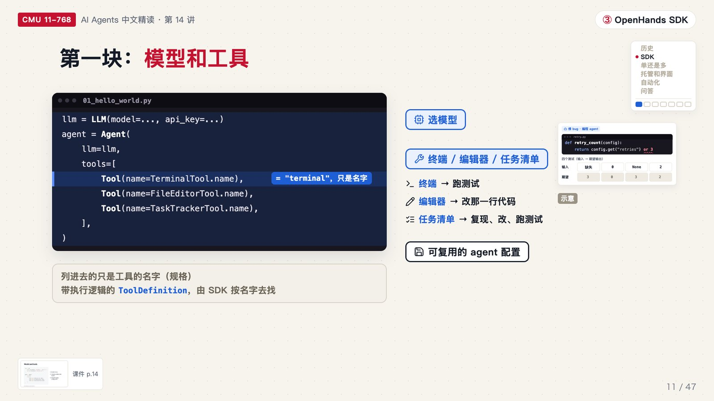

课件的代码就是钉住提交里的 [`examples/01_standalone_sdk/01_hello_world.py`](https://github.com/OpenHands/software-agent-sdk/blob/69e26889401fe69157fff536e6a69049e6644cb3/examples/01_standalone_sdk/01_hello_world.py)，下面是第 9–22 行原文：

```python
llm = LLM(
    model=os.getenv("LLM_MODEL", "gpt-5.5"),
    api_key=os.getenv("LLM_API_KEY"),
    base_url=os.getenv("LLM_BASE_URL", None),
)

agent = Agent(
    llm=llm,
    tools=[
        Tool(name=TerminalTool.name),
        Tool(name=FileEditorTool.name),
        Tool(name=TaskTrackerTool.name),
    ],
)
```

| 行 | 做什么 |
|---|---|
| 9–13 | 选模型：模型名从环境变量 `LLM_MODEL` 读，没设时默认 `gpt-5.5`；key 从 `LLM_API_KEY` 读 |
| 15–16 | 建 agent，挂上模型 |
| 17–21 | 列出三个工具：终端（跑命令、跑测试）、文件编辑器（看文件、改文件）、任务清单（记下要做的几步） |

课上说，在 SWE-bench 上拿到好成绩的那个 agent，基本就十行代码：选一个模型，给上 key，再列出要用的三个工具。放到我们的例子里：终端用来跑测试，编辑器用来改那一行代码，任务清单记下"复现、改、跑测试"三步（示意）。

两点细节（源码核对）：

- `tools` 里列的是 `Tool(name=...)`，只是一个**工具规格**（tool spec），字段只有 `name` 和 `params`。真正带执行逻辑的是**工具定义**（`ToolDefinition`），SDK 按名字从注册表里找。工具名由类名转成蛇形、再去掉 `_tool` 后缀，所以三个工具叫 `terminal`、`file_editor`、`task_tracker`（8.3 节）。
- 直接写 `Agent(...)` 时压缩器 `condenser` 默认是 `None`，不压缩（`agent/base.py` 第 287–288 行）；用 `get_default_agent(llm)` 拿到的默认 agent 会带一个压缩器（3.6 节）。

这样你同时有了**模型的选择**、**工具的选择**，和一份能复用的 agent 配置。

### 3.3 第二块：对话（Conversation）

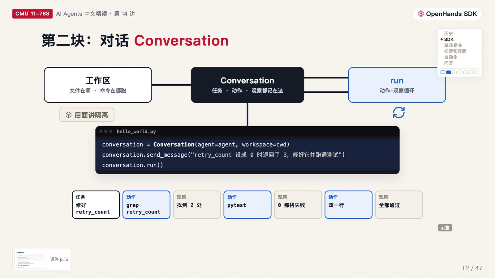

同一个文件的第 24–28 行：

```python
cwd = os.getcwd()
conversation = Conversation(agent=agent, workspace=cwd)

conversation.send_message("Write 3 facts about the current project into FACTS.txt.")
conversation.run()
```

示例的任务是"把这个项目的 3 个事实写进 FACTS.txt"。放进我们的例子，`send_message` 里换成"`retry_count` 设成 0 时返回了 3，修好它并跑通测试"（示意）。

三个概念：

| 概念 | 是什么 |
|---|---|
| **工作区**（workspace） | 文件放在哪、命令在哪执行；可以是本地目录，也可以是隔离的环境（3.7 节） |
| **对话**（Conversation） | 一次对话就是一个任务：任务、动作、观察都按顺序记在这里 |
| **run** | **动作–观察循环**（action–observation loop）：agent 出一个动作，执行，拿回观察，再出下一个动作 |

修 `retry_count` 时，这条事件带大概是这样（示意）：

| 任务 | 动作 | 观察 | 动作 | 观察 | 动作 | 观察 |
|---|---|---|---|---|---|---|
| 修好 retry_count | grep retry_count | 找到 2 处 | pytest | 0 那格失败 | 改一行 | 全部通过 |

源码里的 `Conversation` 是一个**工厂**（`conversation/conversation.py`）：工作区是本地路径或本地工作区时，返回 `LocalConversation`，在本进程里跑完整个循环；是远程工作区（比如 3.7 节的 Docker 工作区）时，返回 `RemoteConversation`，连到远端的 agent 服务器。`max_iteration_per_run` 默认 500，卡死检测 `stuck_detection` 默认开。SDK 报告 §4.2 还说：所有部件本身不可变，会变的东西只记在一个对话状态对象里，事件是只追加的日志。后面的持久化和压缩都建立在"事件只追加"上。

**代码驱动还是命令行驱动**

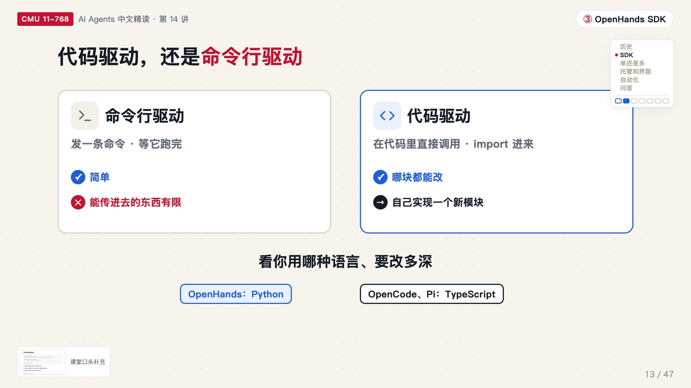

这里有个设计选择。很多别的 agent 主要靠命令行来用，评测时给它发一条命令、等它跑完；OpenHands 是围绕**在代码里直接调用**来设计的。

| | 命令行驱动 | 代码驱动 |
|---|---|---|
| 怎么用 | 发一条命令，等它跑完 | import 进来，哪块都能改 |
| 好处 | 简单，跨语言也能调 | 能深入改、自己实现新模块 |
| 限制 | 能传进去的只有命令行参数和配置文件 | 要用同一种语言 |

想深入改，用 Python 的话 OpenHands 更顺手；用 TypeScript 的话，OpenCode、Pi 这类更顺手。

### 3.4 第三块：自定义工具

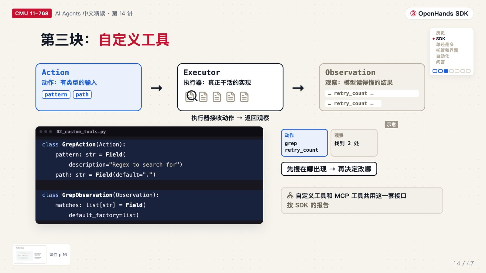

实现一个工具，就是定义三样东西：

| 部件 | 是什么 | grep 例子里 |
|---|---|---|
| **动作**（Action） | 有类型的输入 | `pattern`（要搜的正则）、`path`（默认 `"."`）、`include`（文件名过滤，默认 `None`） |
| **执行器**（Executor） | 真正干活的实现，接收动作、返回观察 | 拼一条 `grep -rHnE` 命令交给终端执行器跑 |
| **观察**（Observation） | 模型读得懂的结果 | `matches`、`files`、`count`，再用 `to_llm_content` 转成给模型看的文字 |

课件只截了 `pattern`、`path`、`matches` 三个字段；`include`、`files`、`count` 是原示例里还有的。给修 bug 的 agent 加上它，它就能先搜 `retry_count` 在哪些文件里出现，再决定改哪。

这是一个通用的工具接口。按 SDK 报告 §4.4，自定义工具和 MCP 工具共用同一套"动作–执行–观察"接口；模型给出的参数先按 Pydantic 模型校验，再交给执行器。逐行源码在 8.3 节。

### 3.5 第四块：会话持久化

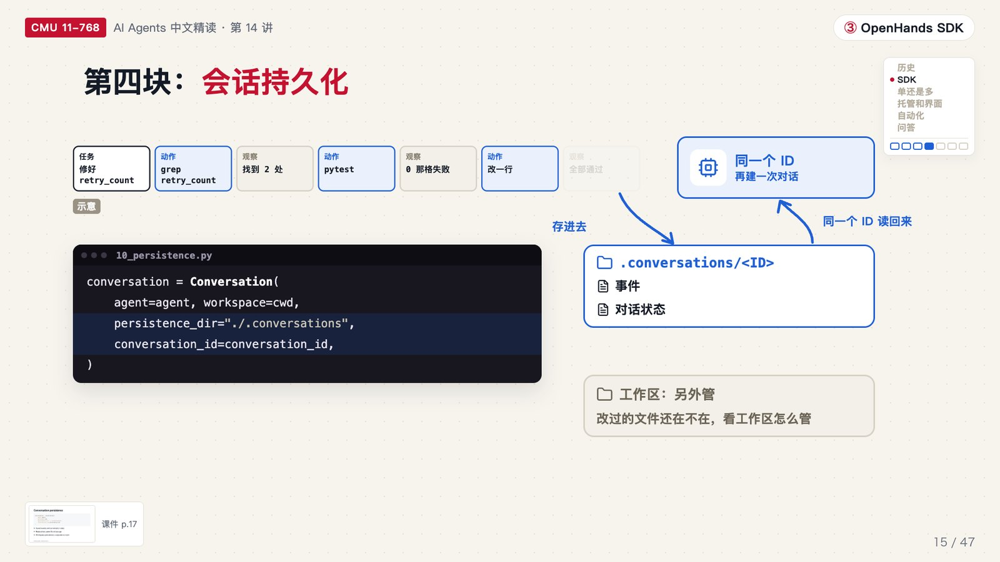

agent 跑得越久，越可能中途断掉。修到一半进程挂了，我不想从头再来。

课件 p.17 上的代码（缩进按 Python 补齐）：

```python
conversation = Conversation(
    agent=agent,
    workspace=cwd,
    persistence_dir="./.conversations",
    conversation_id=conversation_id,
)
```

- 存的是**事件和对话状态**；
- 恢复：用**同一个 ID、同一个存储位置**再建一次对话，就能接着跑，agent 记得已经复现了 bug；
- **工作区的持久化是另一回事**。

钉住提交的示例 `10_persistence.py` 用 `uuid.uuid4()` 生成对话 ID，`del conversation` 之后用同样的 `persistence_dir` 和 `conversation_id` 再建一个对话，接着发消息。按 SDK 报告 §4.2，元数据存成一个 `base_state.json`，事件一条一个 JSON 文件，只写新增的事件；恢复时读回状态、重放事件，从最后处理到的事件接着跑。另外，用远程工作区时**不许**设 `persistence_dir`，由远端服务器负责（`conversation.py` 第 158–162 行）。

"工作区的持久化是另一回事"课上没展开，我的推断是：存下来的是对话记录；agent 改过的那些文件还在不在，要看工作区本身是怎么管的，本地目录会留着，用完就删的容器就没了。

动手练习第 1 部分照这个做法写了一个最小版本。

### 3.6 第五块：上下文管理——压缩

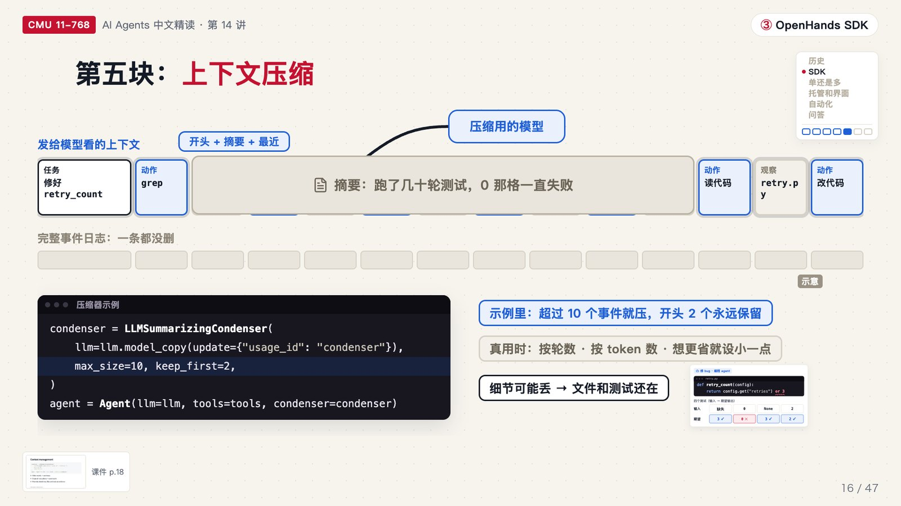

修 bug 跑了几十轮测试，历史会越来越长，最后塞不进模型的上下文。办法是**压缩**：保留**最初的那条指令**和**最近的工作**，把中间的旧事件交给一个模型，写成一段摘要。

课件 p.18 上的代码（缩进按 Python 补齐）：

```python
condenser = LLMSummarizingCondenser(
    llm=llm.model_copy(update={"usage_id": "condenser"}),
    max_size=10,
    keep_first=2,
)
agent = Agent(llm=llm, tools=tools, condenser=condenser)
```

课件三行：旧事件变成一段摘要；保留最初的指令和最近的工作；可能丢细节，所以要靠文件和测试当证据。

几个要点：

1. **只改发给模型看的那份上下文，完整的事件日志一条都没删**。按 SDK 报告 §4.6，压缩结果作为一个事件存进事件日志，发给模型之前再把"被忘掉的事件"换成摘要，随时能回头查。别把它理解成"把旧历史删掉"。
2. 示例里 `max_size=10, keep_first=2`：超过 10 个事件就压，开头 2 个永远保留。这是示例值；类的默认值是 240 和 2，`get_default_agent()` 用的默认压缩器是 80 和 4（8.2 节）。
3. 什么时候压：按事件数，或者按 token 数，阈值都可以自己设，想更省就设小一点。按 token 时，源码取压缩器的 `max_tokens` 和模型有效输入上限里较小的那个（8.2 节）。
4. 摘要可能丢细节：测试文件还在，agent 重跑一遍测试，证据就拿回来了。
5. 用来写摘要的是单独一份模型配置：示例用 `model_copy` 复制一份，把 `usage_id` 设成 `condenser`，方便分开记账。

课上说，OpenHands 是最早一批做这件事的。他们叫 **condensation**，所以组件叫 condenser；现在大家更常叫 **compaction**，其实是一回事。他们试过很多变体，比如把单个动作遮掉，还是"旧的变摘要、留住开头和最近"效果最好。

压缩后到底留多少，8.2 节按源码算了一遍：一次压完大约剩 `max_size` 的一半。动手练习第 2 部分可以自己跑出来。

### 3.7 第六块：远程执行——放进 Docker

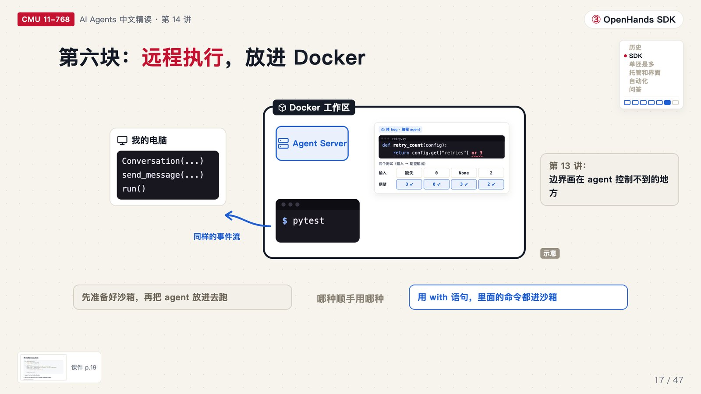

跑 agent 很重要的一点，是能把它隔离、关进沙箱。OpenHands 的做法，是把整个 **agent 服务器**（Agent Server）放进一个 Docker 容器里：

课件 p.19 上的代码：

```python
with DockerWorkspace(
    server_image=server_image,
    platform=detect_platform(),
) as workspace:
    agent = get_default_agent(llm=llm, cli_mode=True)
    conversation = Conversation(agent=agent, workspace=workspace)
    conversation.send_message("3 project facts in FACTS.txt")
    conversation.run()
```

代码里只要换一个 Docker 工作区，用 `with` 语句包起来，里面的对话、发消息、`run` 都和前面一样，**对话的接口不变**。测试改在容器里跑，我这边看到的还是同样的事件流。

源码核对：

- `DockerWorkspace` 继承 `RemoteWorkspace`，所以对话工厂会返回 `RemoteConversation`。`server_image` 默认 `ghcr.io/openhands/agent-server:latest-python`，`platform` 默认 `linux/amd64`；示例里的 `detect_platform()` 按本机芯片选 arm64 或 amd64。
- `get_default_agent(llm, cli_mode=True)` 不带浏览器工具，只有终端、文件编辑器、任务清单。
- 工具执行器的文档字符串写着：即使经 `RemoteConversation` 调用，远端 agent 服务器也会建一个 `LocalConversation` 来真正执行工具。所以工具确实是在容器里跑的。

另一种做法，是先准备好沙箱，再把 agent 放进去跑。课上说也不确定哪种更好：`with` 写起来方便，但很多工具链是围绕"agent 直接在沙箱里起"发展的，哪种顺手用哪种。

上一讲说，边界要画在 agent 控制不到的地方，这就是它落到一个框架里的样子。

### 3.8 第七块：动作确认

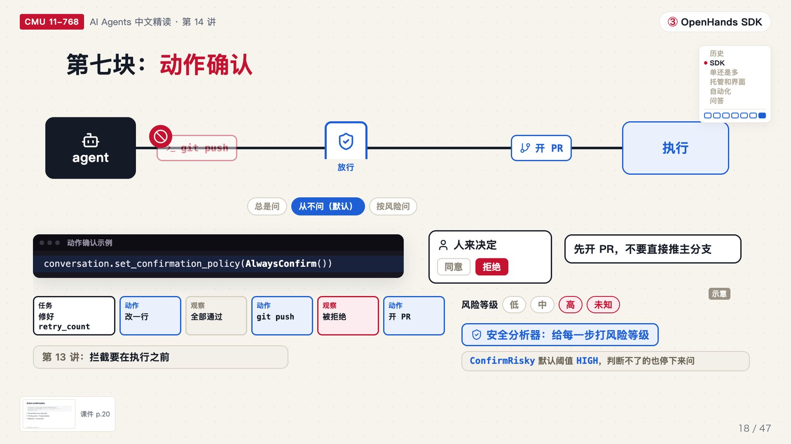

课件 p.20 上的代码：

```python
conversation.set_confirmation_policy(AlwaysConfirm())
```

**确认策略**（confirmation policy）决定哪些动作 agent 能自己执行，哪些要先问人。关键是**在执行之前停下**：

1. 修完 `retry_count`，agent 想执行 `git push`；
2. 策略要求确认，对话状态变成"等待确认"（`WAITING_FOR_CONFIRMATION`），交给人来决定；
3. 我拒绝了，并告诉它先开 PR，不要直接推主分支；
4. 被拒绝不等于任务结束：对话给这个动作补一条"被拒绝"的观察，agent 看到它，就**换个做法**，改成开一个 PR（示意）。

三种策略：

| 策略 | 类名 | 什么时候问 |
|---|---|---|
| 总是问 | `AlwaysConfirm` | 每一步都问 |
| 从不问（**默认**） | `NeverConfirm` | 从不问 |
| 按风险问 | `ConfirmRisky` | 风险达到阈值（默认 `HIGH`）才问；风险判断不了（`UNKNOWN`）时默认也问 |

按风险问时，可以再配一个**安全分析器**（security analyzer），给每一步打风险等级（低、中、高、未知）。SDK 报告 §4.9 说内置了一对：`LLMSecurityAnalyzer`（让模型在每个工具调用里多填一个安全风险字段）和 `ConfirmRisky`；策略可以在对话中途改。

源码里有一个容易踩的点（本课件补，8.1 节）：没配安全分析器时，所有动作的风险都当成"未知"，而 `ConfirmRisky` 默认"未知也问"，结果和"总是问"一样，每一步都会停下来。

上一讲说拦截要在执行之前，这里就是那道闸。

### 3.9 SDK 还有很多

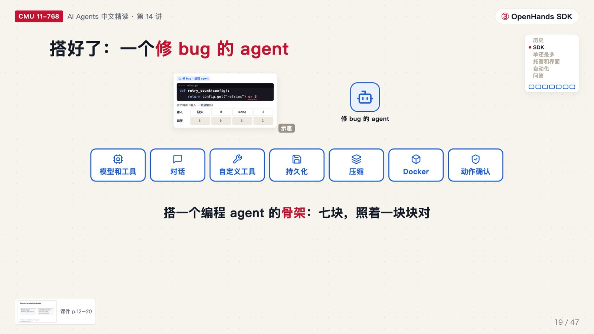

七块到这就齐了。放回例子：选好模型和三个工具，开一个对话去修，加一个 grep，断了接着跑，太长就压缩，测试在容器里跑，想直接推主分支时被确认拦下。

SDK 其实还有很多，课上只讲了很少一部分：管密钥、记 LLM 指标、安全分析器、按任务分给不同的模型、规划 agent、可观测性、子 agent 分派。钉住提交的 `examples/01_standalone_sdk/` 里 50 多个示例都能对上，比如 `12_custom_secrets.py`、`13_get_llm_metrics.py`、`16_llm_security_analyzer.py`、`19_llm_routing.py`、`25_agent_delegation.py`。

做研究要用 Python 写的编程 agent：

| | 适合 |
|---|---|
| OpenHands | 要超长运行、内置可观测性这类重功能 |
| mini-SWE-agent | 只有 bash，故意写得很短，很容易改 |

熟悉 TypeScript 或者只打算通过命令行跑的，也可以选别的 agent，或者自己从头写。

据课上说，OpenHands 现在主要的用户，是想在自己的云上安全地跑编程 agent、又要能选模型的大公司。这一点影响了后面讲的托管和自动化。

> 这七块就是搭一个编程 agent 的骨架，自己动手搭的时候可以照着一块块对，建议先收藏。

### 3.10 课堂问答（SDK 部分）

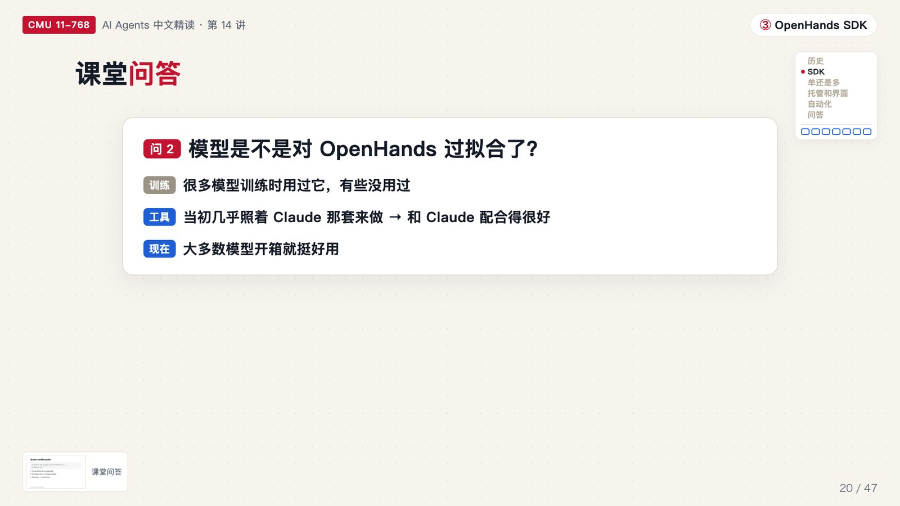

**为什么用 Python？** 最初建项目的是做机器学习的人，更熟 Python；现在要看懂 agent 写的代码，Python 也读得更快。缺点一个是类型安全，agent 可能把类型弄乱，靠每次提交都跑类型检查来补；另一个是速度，但你几乎不会被 agent 代码本身拖慢，要么在等模型，要么在等它跑的程序。

**模型是不是对 OpenHands 过拟合了？** 很多模型训练时用过它，有些没用过。它的工具当初几乎照着 Claude 的那套来做，所以和 Claude 配合得很好；现在大多数模型适应新 harness 的能力不错，开箱就挺好用。

**什么时候压缩？**（并进 3.6 节）按轮数或按 token 数，阈值也可以自己设。

**这一节记住一句**：一个好的 SDK，默认什么都配好，又让每一块都能换；修 bug 的 agent，就是这七块拼出来的。

---

## 4 单 agent 还是多 agent

### 4.1 专门角色：CodeR 的五个角色

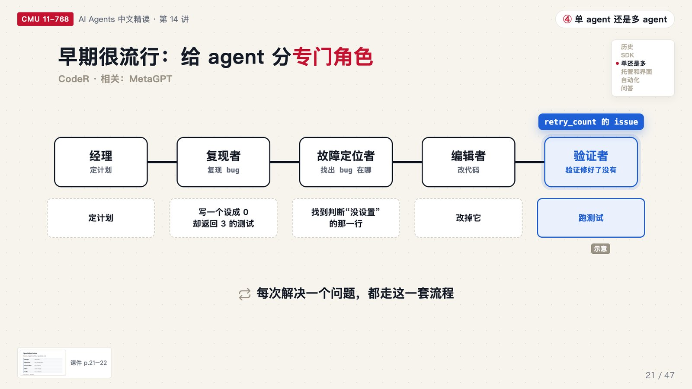

框架搭好了，接下来是一个设计上的大问题：一个 agent，还是好几个？刚开始做 OpenHands 的时候，很流行给 agent 分**专门角色**（specialized roles）。课件举的是 **CodeR**（课件页脚另注"相关：MetaGPT"）：

| 角色 | 干什么 | 套到修 `retry_count` 上（示意） |
|---|---|---|
| 经理（Manager） | 按 issue 选一个计划 | 定计划 |
| 复现者（Reproducer） | 复现 bug | 写一个"设成 0 却返回 3"的测试 |
| 故障定位者（Fault localizer） | 找出 bug 在哪 | 找到判断"没设置"的那一行 |
| 编辑者（Editor） | 改代码 | 改掉它 |
| 验证者（Verifier） | 验证修好了没有 | 跑测试 |

每次解决一个问题，都走这一套流程。按 CodeR 论文 §2，经理选的"计划"规定用哪些角色、按什么顺序，是一张预设的任务图。

### 4.2 单 agent 基线

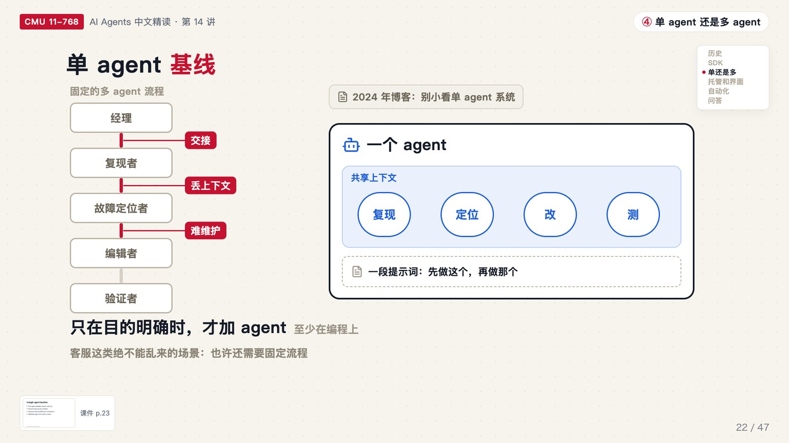

OpenHands 的做法是**单 agent**（single agent）：复现、定位、修改、测试，全由一个 agent 来做，各个活动之间**共享上下文**。

课上提到 2024 年写过一篇博客《别小看单 agent 系统》（Don't Sleep on Single-agent Systems）。论点是：模型在变强，不用把角色做成固定流程，写一段提示词说先做这个、再做那个，它就会照着做完。博客列了固定角色的三个麻烦（课件没写，按精读稿核对过的博客补）：

| 麻烦 | 例子 |
|---|---|
| 结构可能定不对 | 验证者想自己定位一下来确认，却拿不到那套工具 |
| 上下文丢失 | 上游只传下一段摘要，下游丢了有用的细节 |
| 难维护 | 每个角色一套代码或提示词 |

回头看，现在很少有人做这种**固定的多 agent 流程**，尤其是编程。课上说客服这类绝不能乱来的场景也许还需要固定流程；但至少在编程上，单 agent 的灵活更值钱。课件的结论：**只在目的明确时，才加 agent**。

要写准：这里的论点针对的是**编程**上的**固定**多 agent 流程，不是说多 agent 没用（4.7 节）。

### 4.3 少而通用的工具

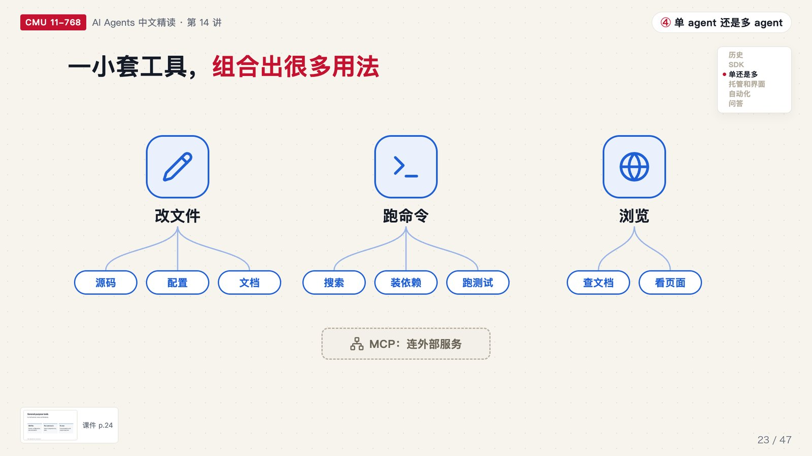

能做成单 agent，前提是工具非常简单。OpenHands 的主要工具就三类：

| 工具 | 用法 |
|---|---|
| 改文件 | 源码、配置、文档 |
| 跑命令 | 搜索、装依赖、跑测试 |
| 浏览 | 查文档、看页面长什么样 |

要连外部服务，再用 MCP（4.5 节）。

### 4.4 技能

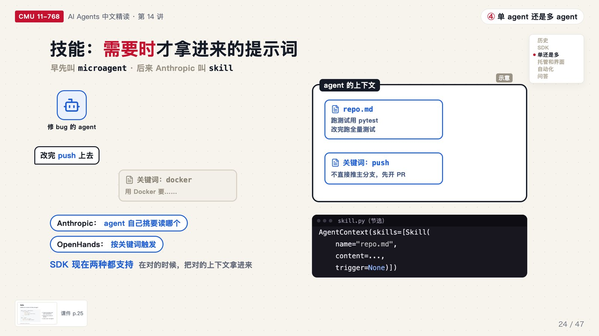

单 agent 也有它的麻烦：所有情况都写进一段提示词，推 GitHub 要怎样，用 Docker 要怎样，提示词会变得非常长。所以后来改成**技能**（skill）：一段专用的提示词，需要时才拿进来。OpenHands 很早就有，叫 **microagent**；后来 Anthropic 做了同样的东西，叫 skill，课上说这个名字起得更好。

课件 p.25 的代码（换行按本课件整理）：

```python
agent_context = AgentContext(
    skills=[Skill(name="repo.md", content=repo_instructions, trigger=None)]
)
agent = Agent(llm=llm, tools=tools, agent_context=agent_context)
```

`Skill.trigger` 决定什么时候拿进来（`skills/skill.py` 里的字段说明）：

| trigger | 什么时候生效 |
|---|---|
| `None`（老格式） | 全文一直放在系统提示里，比如上面的仓库技能 `repo.md` |
| `None`（AgentSkills 格式） | 不自动注入，agent 需要时自己读 |
| `KeywordTrigger(keywords=[...])` | 用户消息里出现关键词时注入 |
| `TaskTrigger` | 特定任务时注入 |

放进例子里（示意）：仓库技能写着"跑测试用 pytest、改完要跑全量测试"，一直生效；另一个关键词技能写着"不要直接推主分支、先开 PR"，只有提到 push 时才拿进来。

起步时两家做法不同：Anthropic 让 agent 自己挑要读哪个技能，OpenHands 按关键词触发。到钉住的这个提交，SDK 两种都支持。目的都一样：在对的时候，把对的上下文拿进来。

### 4.5 MCP 工具

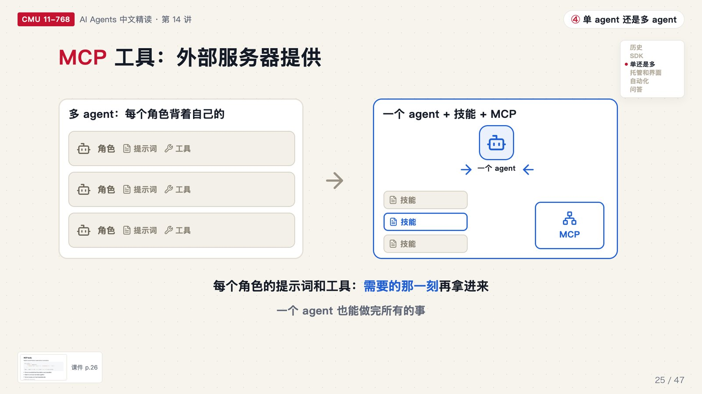

课件 p.26 的代码（换行按本课件整理）：

```python
mcp_config = {
    "repomix": MCPServer(command="npx", args=["-y", "repomix@1.4.2", "--mcp"])
}
agent = Agent(llm=llm, tools=tools, mcp_config=mcp_config)
```

**MCP**（Model Context Protocol，模型上下文协议）工具也是这个思路：工具的说明和执行由外部服务器提供，和内置工具一起用。接上一讲，要看服务器的权限和可信度：它给的工具说明本身也是不可信的输入。钉住提交的示例 `07_mcp_integration.py` 还用 `filter_tools_regex` 只留下 repomix 的一个工具，这也是一种最小权限。

**技能和 MCP 合起来，其实是多 agent 的一种替代**：多 agent 系统里，经理有经理的提示词和工具，复现者有复现者的；用技能和 MCP，这些东西在需要的那一刻动态拿进来，一个 agent 也能做完所有的事。

### 4.6 通用解题：OpenHands-Versa


这个理念走得最远的，是 **OpenHands-Versa**：给模型写代码的能力，再加上能看图的浏览、搜索和读文件，同一套工具，用在编程、调研和办公任务上。

按原图读数（论文图 1，解决率）：

| 基准 | OpenHands-Versa | OpenHands | 已发表的最好成绩 | 差值 |
|---|---|---|---|---|
| GAIA | 51.16% | 37.21% | 49.83% | +1.3 |
| The Agent Company | 33.14% | 26.29% | 24% | +9.1 |
| SWE-Bench Multimodal | 34.43% | 31.72% | 25.34% | +9.1 |

那是一段时间以前的工作，所以绝对分数不高。它要证明的是，这真的管用：在三个很不一样的基准上，都超过了用更专门的 agent 拿到的已发表最好成绩。

### 4.7 什么时候值得分工

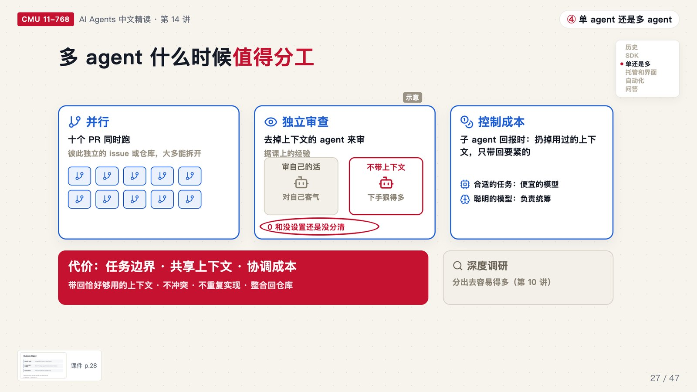

交给 agent 的任务越来越大，多 agent 也越来越有用。课件给了三个理由和一个代价：

| 理由 | 例子 |
|---|---|
| **并行** | 彼此独立的 issue 或仓库；要处理十个 PR，大多能拆开同时做 |
| **独立审查** | 换一个不带上下文的 agent 来检查补丁；单独的任务、单独的权限 |
| **控制成本** | 子 agent 回报时把用过的上下文都扔掉，只带回要紧的；合适的任务用便宜的模型，聪明的模型负责统筹 |
| 代价 | 任务边界、共享上下文、协调成本 |

独立审查那一条，是**据课上的经验**，课上说不知道有没有研究：让 agent 审自己的活，它对自己客气得多；换一个不带上下文的 agent 来审，它不知道当初每个决定的理由，下手就狠得多，检查东西时这往往是好事。放回例子：派一个不带上下文的 agent 审 `retry_count` 的补丁，它更容易挑出"0 和没设置还是没分清"这类问题（示意）。

可多 agent 里的上下文管理非常难。课上提到的一项工作，让一个经理把很长的实现任务分给几个 agent，课上说非常难跑通：每个都要带回恰好够用的上下文，不能冲突、不能重复实现，经理还要把结果整合回仓库。相比之下，深度调研这类任务分出去就容易得多，把 agent 撒到不同的资料源上就行（第 10 讲）。

钉住提交里的子 agent 分派示例是 `examples/01_standalone_sdk/25_agent_delegation.py`。

> 想一想：修一个 bug，你更愿意让一个 agent 从头干到尾，还是分成好几个角色接力？

### 4.8 课堂问答（多 agent 部分）

**多个 agent 同时干活、都向经理汇报，怎么确认到底发生了什么？** 回答很坦白：通常追踪得并不好，一般是去问经理，经理翻看轨迹比人快。这个问题留给下一讲的监控。

**单 agent 和多 agent，在软件不断演化这类任务上谁更好？** 还没有很有说服力的答案，值得研究。

**这一节记住一句**：在编程上，单 agent 加技能和 MCP，往往比固定的多 agent 流程好用；分工只在并行、独立审查和控成本时才值得，而且代价不小。

---

## 5 托管和界面

### 5.1 本地还是云

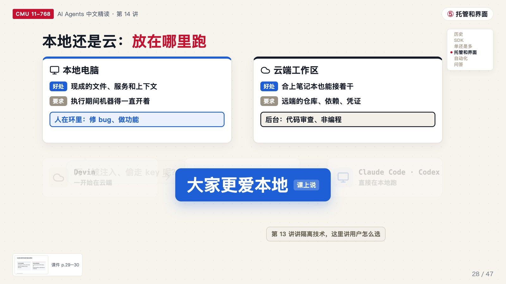

前面讲的都是 agent 本身，接下来是更实际的部分：它放在哪里跑，你怎么跟它打交道。

| | 本地电脑 | 云端工作区 |
|---|---|---|
| 好处 | 现成的文件、服务和上下文 | 合上笔记本也能接着干 |
| 要求 | 执行期间机器得一直开着 | 仓库、依赖、凭证都要放到远端 |

编程 agent 刚火的时候，这并不显然：

1. **Devin** 一开始在云端，是一个软件即服务的平台；
2. **OpenDevin** 反过来跑在本地，但关进 Docker 容器，因为不信任 agent 直接在自己电脑上跑；
3. 后来 **Claude Code、Codex** 都直接在本地跑。

课上说，本来以为本地永远不会被接受：万一 agent 被注入、把 key 传出去呢？结果大家特别喜欢本地，比喜欢云强得多。现在大致是：**人在环里**的活（修 bug、做功能）越来越多在本地；**后台的活和非编程的活**（比如代码审查）在云上很流行。这是课上的观察。

上一讲讲的是隔离技术；这里讲用户实际怎么选：安全上更稳的那个，不一定是用户最喜欢的。

### 5.2 四种界面

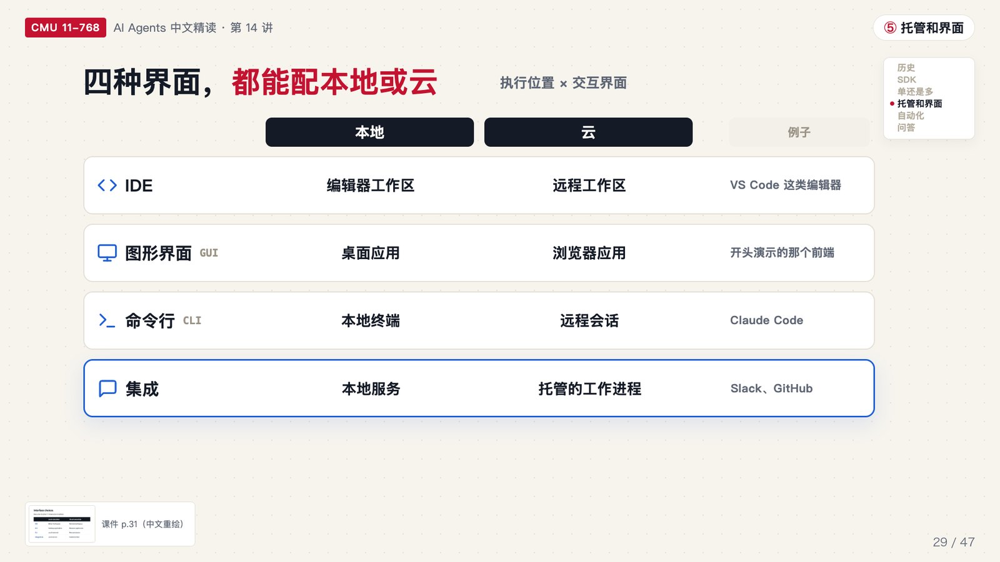

| 界面 | 本地执行 | 云端执行 | 例子 |
|---|---|---|---|
| IDE | 编辑器工作区 | 远程工作区 | 在 VS Code 这类编辑器里用 agent |
| 图形界面（GUI） | 桌面应用 | 浏览器应用 | 开头演示的那个前端 |
| 命令行（CLI） | 本地终端 | 远程会话 | Claude Code |
| 集成 | 本地服务 | 托管的工作进程 | 通过 Slack、GitHub 跟它说话 |

### 5.3 IDE 和自定义图形界面

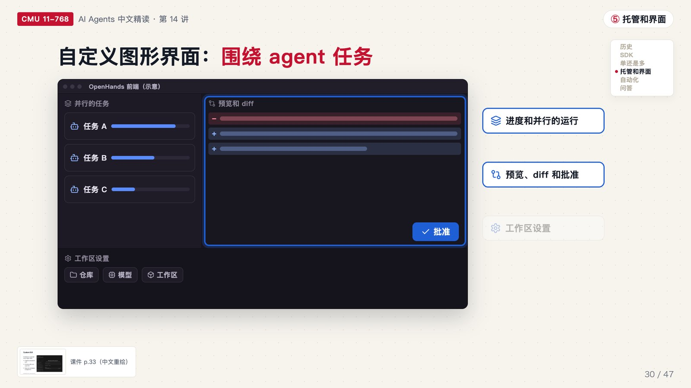

**IDE** 的好处是熟悉：文件、diff、测试、调试器、任务管理和审查都在。坏处是，如果你已经不看代码了，它某种程度上是个旧时代的界面：agent 替你写所有代码，IDE 提供的很多东西你就用不上了。

所以可以从不怎么看代码的人的角度，重新设计界面，这就是**自定义图形界面**：围绕 agent 的任务来组织，看进度和并行的运行，看预览和 diff，点批准，管配置和工作区。

### 5.4 人的投入和监督：Code with Me or for Me?

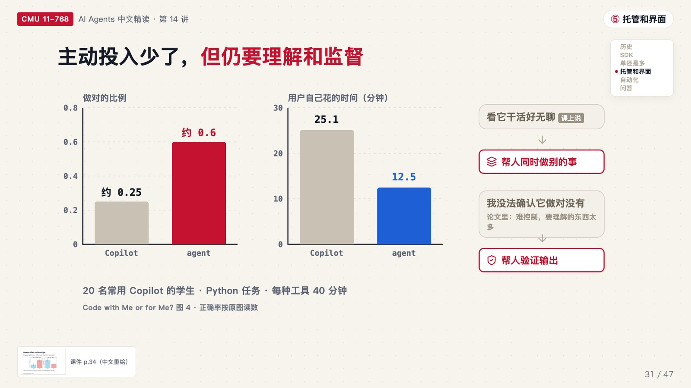

编程 agent 刚火的时候有一个研究（Code with Me or for Me?）：二十个每周都用 Copilot 的学生，做 Python 任务，同一个人两种工具都用一遍（每种 40 分钟，此前都没用过编程 agent）。

| | Copilot | agent（OpenHands） |
|---|---|---|
| 做对的比例（按原图读数） | 约 25% | 约 60% |
| 用户自己花的时间 | 25.1 分钟 | 12.5 分钟 |

论文正文的说法是用 agent 时正确率平均高 35 个百分点。也收到了负面反馈：

- 课上说，一种是坐在那儿看 agent 干活很**无聊**；
- 另一种是没法确认它做得好不好；论文里也有人说它"要理解的东西太多"。

这两条各对应一个挑战：

| 反馈 | 挑战 |
|---|---|
| 无聊 | 要帮人同时去做别的事，效率才拉得满 |
| 没法确认 | 要帮人验证输出 |

### 5.5 命令行和集成

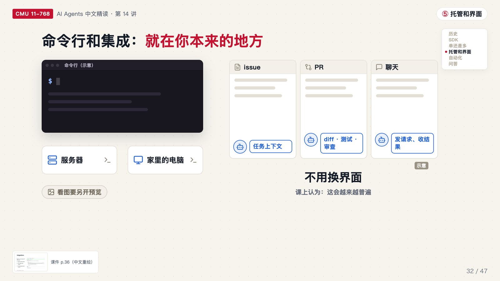

**命令行**最大的好处，是在哪都能用：服务器上、家里的电脑上都行，这是很多人用它的原因；缺点是看图要另开预览。

**集成**是让 agent 进到已有的工作渠道里：issue 给任务上下文，PR 里有 diff、测试和审查，聊天里发请求、收结果，不用打开专门的界面。课上认为这会越来越普遍。

**这一节记住一句**：agent 放在哪跑、用什么界面，用户其实更爱本地；而人最大的负担，是看着无聊，又没法验证。

---

## 6 软件开发自动化

### 6.1 自动化面板

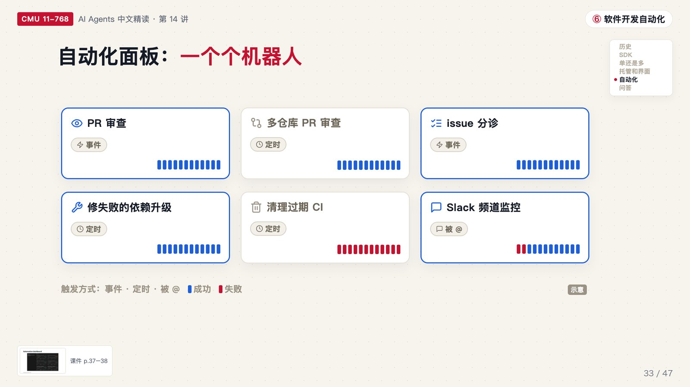

最后一块，是 OpenHands 现在最下功夫的方向，**软件开发的自动化**。开头演示的面板里，有审 PR 的、给 issue 分诊的、修失败的依赖升级的，还有盯 Slack 频道的机器人。每个自动化有自己的触发方式：GitHub 事件、定时、在 Slack 里被 @。画面里的数字是示意，不是课件截图里的运行数据。

### 6.2 一次自动化运行的五步

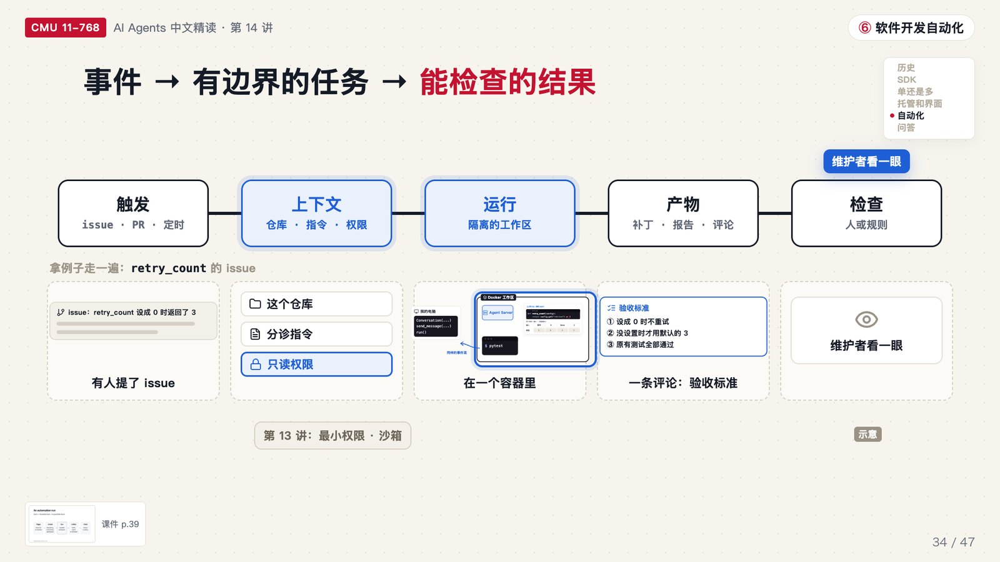

| 步 | 内容 | 拿 `retry_count` 的 issue 走一遍（示意） |
|---|---|---|
| 1 触发 | 一个 issue、一个 PR，或者一个定时 | 有人提了 issue，触发分诊 |
| 2 上下文 | 仓库、指令、权限 | 这个仓库、分诊指令、只读权限 |
| 3 运行 | 在隔离的工作区里 | 在一个容器里跑 |
| 4 产物 | 一个补丁、一份报告，或者一条评论 | 一条评论：验收标准 |
| 5 检查 | 由人或者由规则来检查 | 维护者看一眼 |

上下文里的**权限**、运行时的**隔离**，就是上一讲的最小权限和沙箱在自动化里的位置。

### 6.3 演示：issue 分诊和 PR 审查

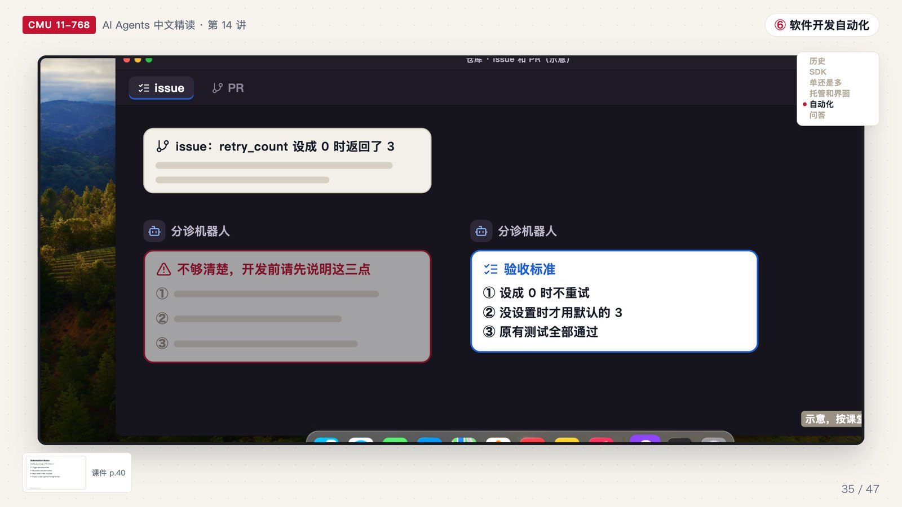

课上现场演示的是 **issue 分诊**（issue triage）。背景是课上说的：OpenHands 是个大型开源项目，PR 多得惊人，基本上一开 issue，马上就有人交来一个用 Claude Code 或 Codex 凭感觉写的 PR。这也不全是坏事，别人替你花了实现代码的 token；坏处是收到很多低质量的代码。课上强调，**这不是模型不好**，大家用的都是好模型，问题在于要做什么本身就不清楚。

所以分诊机器人做两件事之一：

1. 说这个 issue 不够清楚，开发前先澄清这几点；
2. 说可以做，同时列出**验收标准**（acceptance criteria）。比如我们这个 issue（示意）：①设成 0 时不重试 ②没设置时才用默认的 3 ③原有测试全部通过。

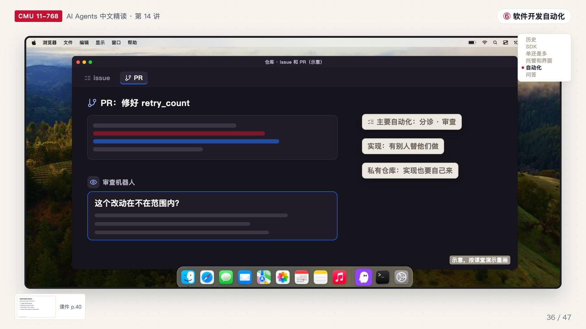

另外还有 **PR 审查**。审查准则打磨得很细，第一条就是这个 PR 在不在范围内、该不该进这个仓库。他们主要自动化分诊和审查，因为实现有别人替他们做；很少收到外部 PR 的私有仓库，实现那一步也要自己来。

### 6.4 软件工厂

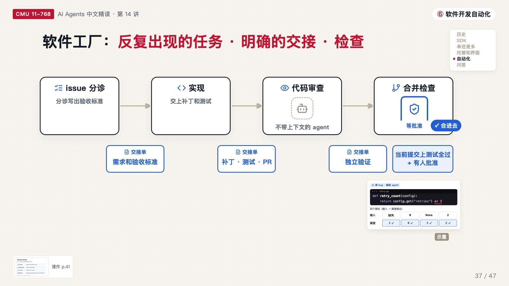

把这些串起来，就是**软件工厂**（课件原话：反复出现的任务、明确的交接、检查）：

| 环节 | 交出的东西 | `retry_count` 走一遍（示意） |
|---|---|---|
| issue 分诊 | 需求和验收标准 | 写出上面三条验收标准 |
| 实现 | 补丁、测试、PR | 实现的 agent 交上补丁和测试 |
| 代码审查 | 独立验证 | 一个不带上下文的 agent 独立审查（接 4.7 节） |
| 合并检查 | 当前这个提交上检查都通过，并且有人批准 | 测试全过、有人批准，才合进去 |

### 6.5 从过去的运行里学：SkillRefiner

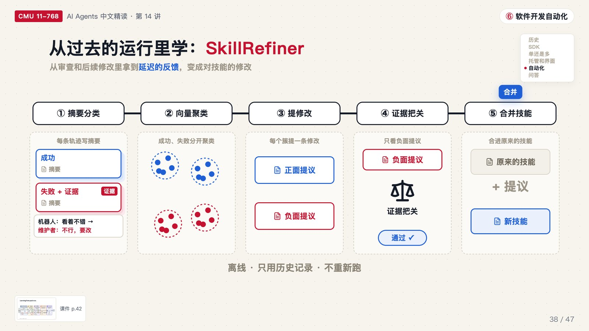

自动化有个很有意思的地方：同一个流程一遍遍地跑，就变成了一个**机器学习问题**。有输入、有输出，以前所有的 PR 都是数据；每次分诊、每次审查，要么做得好，要么不好。

**SkillRefiner** 就是从这里学：从审查和后续修改里拿到**延迟的反馈**，把反复出现的模式变成对技能的修改，一共五步：

| 步 | 做什么 |
|---|---|
| 1 带反馈的轨迹 | 给每条历史轨迹写摘要、分成成功和失败两类，失败的附上证据。比如审查机器人说"看着不错"，结果真正的维护者说"不行、要改"，这种能自动检测出来，放进失败那一堆 |
| 2 向量化和聚类 | 把摘要变成向量，成功和失败**分开**聚类 |
| 3 生成修改提议 | 每个簇提一条修改：成功簇给正面提议，失败簇给负面提议 |
| 4 证据把关 | 负面提议要过证据把关 |
| 5 合并技能 | 把通过的提议合进原来的技能，得到新版技能 |

要注意，它是**离线的**：只用已有的历史记录和当时观察到的结果，精炼时**不重新跑任务**。课上口头说过"也可能用新指令重跑一次看效果"，和论文的方法不一致，本课件按论文写。

### 6.6 技能改进的结果

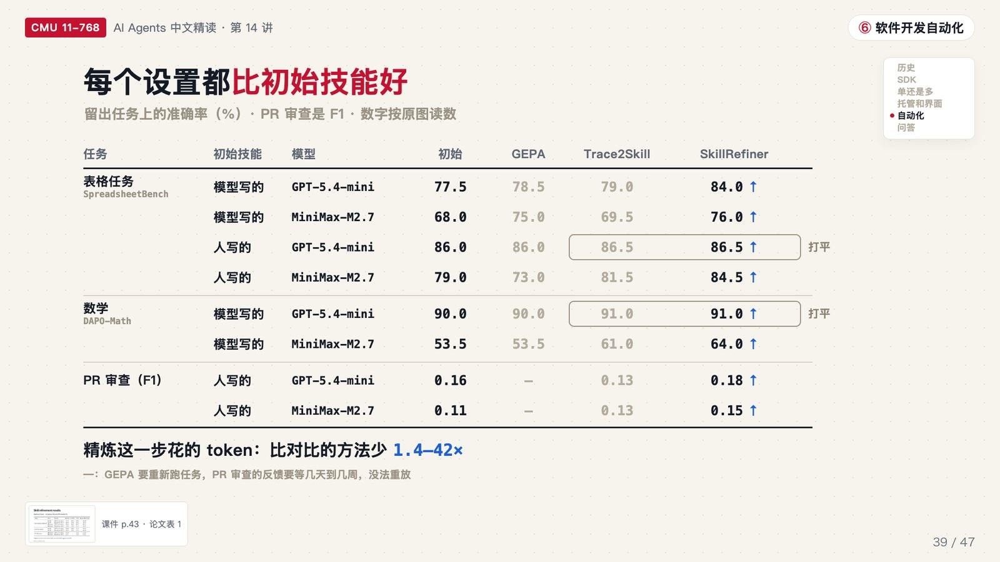

按原图读数（课件 p.43，论文表 1；表格任务和数学是留出任务上的准确率 %，PR 审查是 F1）：

| 任务 | 初始技能 | 模型 | 初始 | GEPA | Trace2Skill | SkillRefiner |
|---|---|---|---|---|---|---|
| 表格任务 SpreadsheetBench | 模型写的 | GPT-5.4-mini | 77.5 | 78.5 | 79.0 | **84.0** |
| | 模型写的 | MiniMax-M2.7 | 68.0 | 75.0 | 69.5 | **76.0** |
| | 人写的 | GPT-5.4-mini | 86.0 | 86.0 | 86.5 | 86.5 |
| | 人写的 | MiniMax-M2.7 | 79.0 | 73.0 | 81.5 | **84.5** |
| 数学 DAPO-Math | 模型写的 | GPT-5.4-mini | 90.0 | 90.0 | 91.0 | 91.0 |
| | 模型写的 | MiniMax-M2.7 | 53.5 | 53.5 | 61.0 | **64.0** |
| PR 审查（F1） | 人写的 | GPT-5.4-mini | 0.16 | — | 0.13 | **0.18** |
| | 人写的 | MiniMax-M2.7 | 0.11 | — | 0.13 | **0.15** |

怎么读：

- **每个设置都比初始的技能好**，这是课件的结论；
- 和另外两种方法比，大多数设置它更高，但有**两行和 Trace2Skill 打平**（人写的技能 + GPT-5.4-mini 的表格任务 86.5，DAPO-Math + GPT-5.4-mini 91.0），不能说"全面碾压所有方法"；
- 精炼这一步花的 token，比对比的方法少 **1.4 到 42 倍**（只算精炼这一步）；
- PR 审查那两行没有 GEPA：GEPA 要重新跑任务，而 PR 审查的反馈要等几天到几周才有，没法重放。

> 这张表建议收藏：读"方法 A 比 B 好"的表时，先看每一行，再看有没有打平、有没有缺格。

### 6.7 往后能做什么

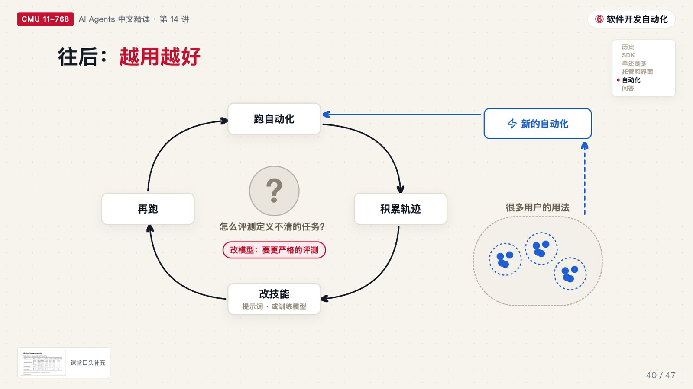

自动化多了，就能一遍遍改进系统。工作流也不一定要人写，可以从大量轨迹里挖出来：把很多用户的用法聚成几类、变成自动化，再自动精炼，越用越好。

这里改的只是提示词，也可以去训练模型。可要改模型，大概需要更严格的评测，而给 issue 分诊、代码审查这种定义不清的任务设计严格的评测，很有意思，也非常难。

**这一节记住一句**：自动化把同一件事一遍遍地跑，就成了一个能从历史里学习的机器学习问题。

---

## 7 课后问答

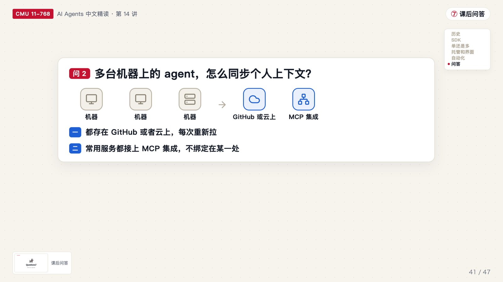

**Q1 要不要在本地和云之间来回转移？**（比如上班在本地干、午饭时转到云上、回来再转回。）课上说大概值得做。课上举的经历是，什么都放在云上用完就扔的沙箱里，每次重新拉上下文；难点是把**恰好够用**的上下文带过去，有点棘手，但不算太难。

**Q2 多台机器上的 agent，怎么同步个人上下文？** 一是都存在 GitHub 或者云上，每次重新拉；二是常用服务都接上 MCP 集成，不绑定在某一处。

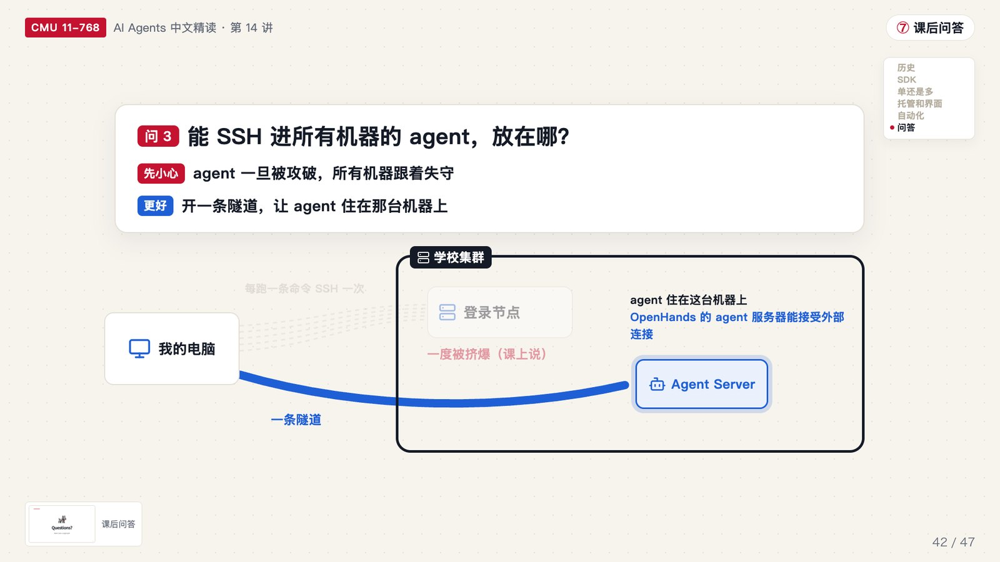

**Q3 一个能 SSH 进所有机器的 agent，放在一台机器上，还是每台各放一个？** 先要小心"能 SSH 进所有机器"这件事：agent 一旦被攻破，所有机器跟着失守（第 13 讲的最小权限）。还有个实际问题：课上说学校集群的登录节点一度被挤爆，因为每个人的 agent 每跑一条命令就 SSH 一次。更好的是开一条隧道，让 agent 住在那台机器上；OpenHands 的 agent 服务器正好能接受外部连接（3.7 节）。

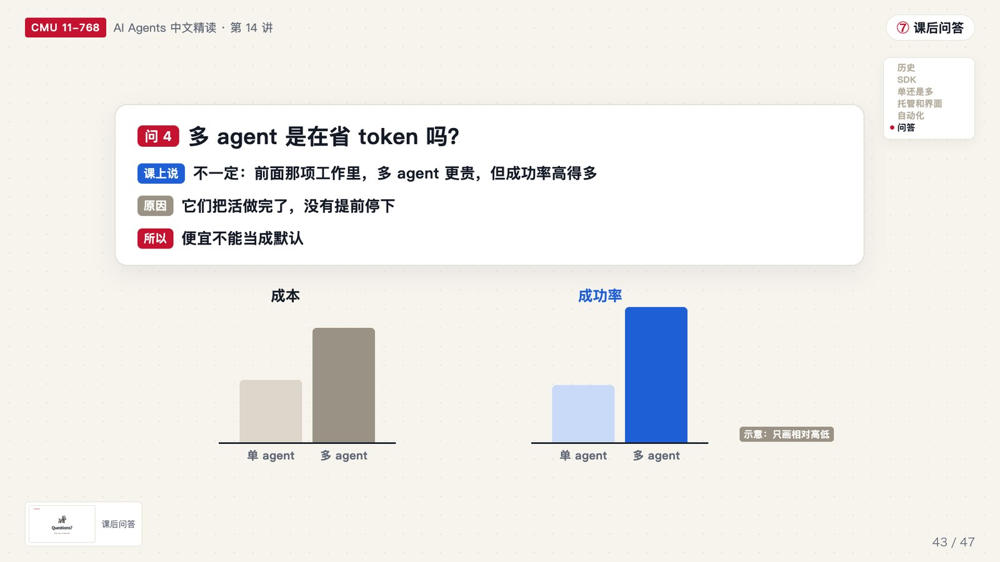

**Q4 多 agent 是在省 token 吗？** 课上说不一定：前面那项工作里，多 agent 更贵，但成功率高得多，因为它们把活做完了，没有提前停下。便宜不能当成默认。

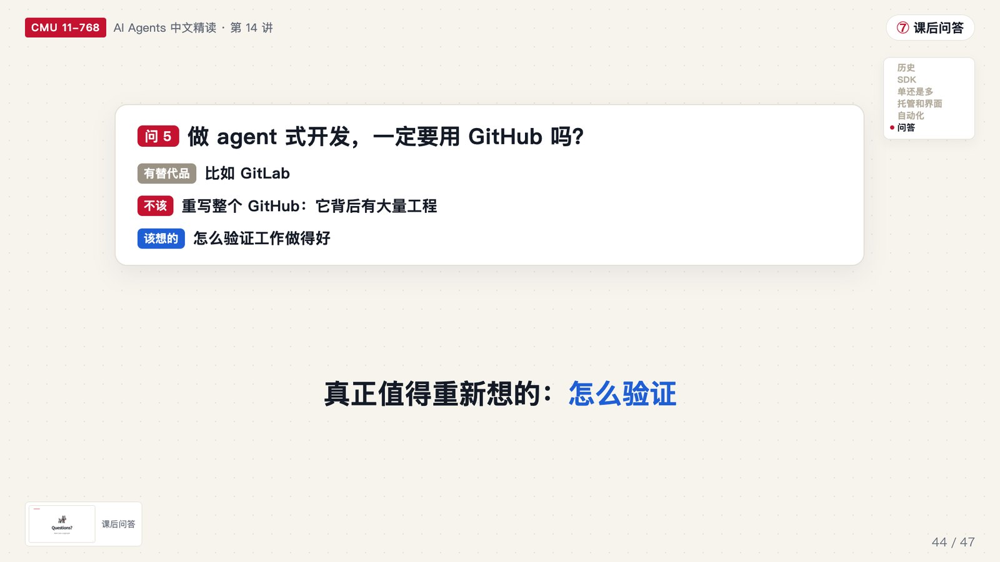

**Q5 做 agent 式开发，一定要用 GitHub 吗？** 有替代品，比如 GitLab；但大概不该重写整个 GitHub，它背后有大量工程。真正值得重新想的，是怎么验证工作做得好。

---

## 8 源码解读：确认、压缩、自定义工具

本节是本课件补的，课上没有逐行读源码。课程钉住了 [OpenHands/software-agent-sdk](https://github.com/OpenHands/software-agent-sdk) 的提交 `69e2688`（完整哈希 `69e26889401fe69157fff536e6a69049e6644cb3`，2026-10-07）。下面的代码都是这个提交里原文件的节选，逐行照抄，行号是这个提交里的行号；删掉的部分用 `# ……（删去：……）` 一行标出，这一行是本课件加的，其余每一行都是原文。解释写在代码块后面的表格里。

用到的文件：

- [openhands-sdk/openhands/sdk/security/confirmation_policy.py](https://github.com/OpenHands/software-agent-sdk/blob/69e26889401fe69157fff536e6a69049e6644cb3/openhands-sdk/openhands/sdk/security/confirmation_policy.py)（61 行）、[security/risk.py](https://github.com/OpenHands/software-agent-sdk/blob/69e26889401fe69157fff536e6a69049e6644cb3/openhands-sdk/openhands/sdk/security/risk.py)（147 行）
- [openhands-sdk/openhands/sdk/conversation/state.py](https://github.com/OpenHands/software-agent-sdk/blob/69e26889401fe69157fff536e6a69049e6644cb3/openhands-sdk/openhands/sdk/conversation/state.py)（776 行）、[conversation/impl/local_conversation.py](https://github.com/OpenHands/software-agent-sdk/blob/69e26889401fe69157fff536e6a69049e6644cb3/openhands-sdk/openhands/sdk/conversation/impl/local_conversation.py)（3174 行）
- [openhands-sdk/openhands/sdk/agent/agent.py](https://github.com/OpenHands/software-agent-sdk/blob/69e26889401fe69157fff536e6a69049e6644cb3/openhands-sdk/openhands/sdk/agent/agent.py)（1622 行）
- [openhands-sdk/openhands/sdk/context/condenser/llm_summarizing_condenser.py](https://github.com/OpenHands/software-agent-sdk/blob/69e26889401fe69157fff536e6a69049e6644cb3/openhands-sdk/openhands/sdk/context/condenser/llm_summarizing_condenser.py)（562 行）
- [openhands-sdk/openhands/sdk/tool/tool.py](https://github.com/OpenHands/software-agent-sdk/blob/69e26889401fe69157fff536e6a69049e6644cb3/openhands-sdk/openhands/sdk/tool/tool.py)（953 行）
- [examples/01_standalone_sdk/02_custom_tools.py](https://github.com/OpenHands/software-agent-sdk/blob/69e26889401fe69157fff536e6a69049e6644cb3/examples/01_standalone_sdk/02_custom_tools.py)（229 行）

| 本讲的说法 | 源码里 | 本节 |
|---|---|---|
| 三种策略，默认从不问（3.8） | `AlwaysConfirm` / `NeverConfirm` / `ConfirmRisky`；对话状态里默认 `NeverConfirm()` | 8.1 |
| 执行之前停下（3.8） | agent 判断要确认时把状态改成 `WAITING_FOR_CONFIRMATION` | 8.1 |
| 拒绝后换做法（3.8） | `reject_pending_actions` 补一条 `UserRejectObservation`，状态回到空闲 | 8.1 |
| 保留开头和最近，中间变摘要（3.6） | `keep_first`、`max_size // 2`、`Condensation(forgotten_event_ids=..., summary=...)` | 8.2 |
| 按轮数或按 token 数（3.6） | 三种触发原因：显式请求、token 超限、事件数超限 | 8.2 |
| 动作、执行器、观察（3.4） | `Action` / `ToolExecutor` / `Observation`，`ToolDefinition` 把三者绑在一起 | 8.3 |

### 8.1 动作确认：三种策略、谁来判断、拒绝之后

**三种策略**，`confirmation_policy.py` 第 27–61 行（文件的后半部分，前面是 import 和抽象基类 `ConfirmationPolicyBase`，它只有一个抽象方法 `should_confirm(risk)`）：

```python
class AlwaysConfirm(ConfirmationPolicyBase):
    def should_confirm(
        self,
        risk: SecurityRisk = SecurityRisk.UNKNOWN,  # noqa: ARG002
    ) -> bool:
        return True


class NeverConfirm(ConfirmationPolicyBase):
    def should_confirm(
        self,
        risk: SecurityRisk = SecurityRisk.UNKNOWN,  # noqa: ARG002
    ) -> bool:
        return False


class ConfirmRisky(ConfirmationPolicyBase):
    threshold: SecurityRisk = SecurityRisk.HIGH
    confirm_unknown: bool = True

    @field_validator("threshold")
    def validate_threshold(cls, v: SecurityRisk) -> SecurityRisk:
        if v == SecurityRisk.UNKNOWN:
            raise ValueError("Threshold cannot be UNKNOWN")
        return v

    def should_confirm(self, risk: SecurityRisk = SecurityRisk.UNKNOWN) -> bool:
        if risk == SecurityRisk.UNKNOWN:
            return self.confirm_unknown

        # This comparison is reflexive by default, so if the threshold is HIGH we will
        # still require confirmation for HIGH risk actions. And since the threshold is
        # guaranteed to never be UNKNOWN (by the validator), we're guaranteed to get a
        # boolean here.
        return risk.is_riskier(self.threshold)
```

| 行 | 说明 |
|---|---|
| 27–32 | 总是问：不管风险多少都返回 `True` |
| 35–40 | 从不问：一律返回 `False` |
| 44 | `threshold` 默认 `SecurityRisk.HIGH` |
| 45 | `confirm_unknown` 默认 `True`：风险判断不了时也问 |
| 47–51 | 阈值本身不许设成 `UNKNOWN` |
| 54–55 | 风险是 `UNKNOWN` 时，直接按 `confirm_unknown` 决定 |
| 61 | 否则比较风险等级。`is_riskier` 默认是"大于等于"（注释说这个比较是自反的），所以阈值是 `HIGH` 时，`HIGH` 也要问 |

风险等级的顺序在 `risk.py` 第 10 行：`_RISK_ORDER = {"LOW": 1, "MEDIUM": 2, "HIGH": 3}`，`UNKNOWN` 不在里面，拿它比较会抛 `ValueError`。

**默认值在对话状态里**，`state.py` 第 119–127 行：

```python
    # Enum-based state management
    execution_status: ConversationExecutionStatus = Field(
        default=ConversationExecutionStatus.IDLE
    )
    confirmation_policy: ConfirmationPolicyBase = NeverConfirm()
    security_analyzer: SecurityAnalyzerBase | None = Field(
        default=None,
        description="Optional security analyzer to evaluate action risks.",
    )
```

第 123 行：确认策略默认 `NeverConfirm()`，也就是**默认从不问**；第 124–127 行：安全分析器默认 `None`。确认策略存在对话状态里，所以它会跟着对话一起持久化，也能在对话中途用 `set_confirmation_policy` 改（`local_conversation.py` 第 2617–2621 行）。

**谁来判断要不要停**，`agent.py` 第 1130–1171 行：

```python
    def _requires_user_confirmation(
        self, state: ConversationState, action_events: list[ActionEvent]
    ) -> bool:
        """
        Decide whether user confirmation is needed to proceed.

        Rules:
            1. Confirmation mode is enabled
            2. Every action requires confirmation
            3. A single `FinishAction` never requires confirmation
            4. A single `ThinkAction` never requires confirmation
        """
        # A single `FinishAction` or `ThinkAction` never requires confirmation
        if len(action_events) == 1 and isinstance(
            action_events[0].action, (FinishAction, ThinkAction)
        ):
            return False

        # If there are no actions there is nothing to confirm
        if len(action_events) == 0:
            return False

        # If a security analyzer is registered, use it to grab the risks of the actions
        # involved. If not, we'll set the risks to UNKNOWN.
        if state.security_analyzer is not None:
            risks = [
                risk
                for _, risk in state.security_analyzer.analyze_pending_actions(
                    action_events
                )
            ]
        else:
            risks = [risk.SecurityRisk.UNKNOWN] * len(action_events)

        # Grab the confirmation policy from the state and pass in the risks.
        if any(state.confirmation_policy.should_confirm(risk) for risk in risks):
            state.execution_status = (
                ConversationExecutionStatus.WAITING_FOR_CONFIRMATION
            )
            return True

        return False
```

| 行 | 说明 |
|---|---|
| 1143–1146 | 只有一个"结束"或"思考"动作时不问：它们不碰外界 |
| 1149–1150 | 没有动作，就没什么可问的 |
| 1154–1160 | 配了安全分析器，就让它给每个待执行动作打风险 |
| 1161–1162 | **没配安全分析器，所有风险都当成 `UNKNOWN`** |
| 1165–1169 | 只要有一个动作按策略需要确认，对话状态就变成 `WAITING_FOR_CONFIRMATION`，这一步停下，动作不执行 |

把 1161–1162 行和上面 `ConfirmRisky` 的第 45、54–55 行放在一起看（本课件补的推导）：只设 `ConfirmRisky()`、不配安全分析器时，每个动作的风险都是 `UNKNOWN`，而 `confirm_unknown` 默认是 `True`，结果每一步都会停下来问，和 `AlwaysConfirm` 一样。想要"只有高风险才问"，得同时配一个安全分析器。动手练习第 3 部分把这一点跑了出来。

**拒绝之后**，`local_conversation.py` 第 2649–2687 行：

```python
    def reject_pending_actions(self, reason: str = "User rejected the action") -> None:
        """Reject all pending actions from the agent.

        This is a non-invasive method to reject actions between run() calls.
        Also clears the agent_waiting_for_confirmation flag.
        """
        pending_actions = ConversationState.get_unmatched_actions(
            self._state.active_branch()
        )

        with self._state:
            # Always clear the agent_waiting_for_confirmation flag
            if (
                self._state.execution_status
                == ConversationExecutionStatus.WAITING_FOR_CONFIRMATION
            ):
                self._state.execution_status = ConversationExecutionStatus.IDLE

            if not pending_actions:
                logger.warning("No pending actions to reject")
                return

            for action_event in pending_actions:
                # Create rejection observation
                rejection_event = UserRejectObservation(
                    action_id=action_event.id,
                    tool_name=action_event.tool_name,
                    tool_call_id=action_event.tool_call_id,
                    rejection_reason=reason,
                )
                record_tool_result(
                    self,
                    name=extract_action_name(action_event),
                    tool_call_id=action_event.tool_call_id,
                    tool_input=action_event.action,
                    tool_output=rejection_event.to_llm_message(),
                )
                self._on_event(rejection_event)
                logger.info(f"Rejected pending action: {action_event} - {reason}")
```

| 行 | 说明 |
|---|---|
| 2649 | 拒绝理由默认是 `"User rejected the action"` |
| 2655–2657 | 找出还没有观察配对的动作，就是那些停在闸门前的待执行动作 |
| 2661–2665 | 状态从"等待确认"改回空闲 `IDLE` |
| 2671–2678 | 给每个待执行动作补一条 `UserRejectObservation`，带上拒绝理由 |
| 2679–2686 | 把这条"被拒绝"记成这个工具调用的结果，发进事件流 |

所以"被拒绝不等于任务结束"在源码里是这样实现的：被拒绝的动作也拿到了一条观察，只是内容是"用户拒绝了，理由是……"。下次 `run()` 时，模型在上下文里看到这条观察，就会换一个做法。钉住提交的示例 `04_confirmation_mode_example.py` 第 61–85 行就是这个循环：状态是"等待确认"时问人，人拒绝就调 `reject_pending_actions` 再继续；人同意就直接再 `run()`，agent 在下一步开头先执行这些待确认的动作。

### 8.2 压缩：保留开头、最近，中间换成摘要

**字段和默认值**，`llm_summarizing_condenser.py` 第 63–97 行：

```python
    llm: LLM
    max_size: int = Field(default=240, gt=0)
    max_tokens: int | None = None

    keep_first: int = Field(default=2, ge=0)
    """Minimum number of events to preserve at the start of the view. The first
    `keep_first` events in the conversation will never be condensed or summarized.
    """

    minimum_progress: float = Field(default=0.1, gt=0.0, lt=1.0)
    """Minimum fraction of events that must be condensed (0.0-1.0). If fewer than
    this proportion of events would be forgotten, condensation is treated as an error.
    Default 0.1 means at least 10% of events must be condensed.
    """
    """Minimum ratio of the view to be condensed. Condensations below this threshold
    are treated as errors.
    """

    hard_context_reset_max_retries: int = Field(default=5, gt=0)
    """Number of attempts to perform hard context reset before raising an error."""

    hard_context_reset_context_scaling: float = Field(default=0.8, gt=0.0, lt=1.0)
    """When performing hard context reset, if the summarization fails, reduce the max
    size of each event string by this factor and retry.
    """

    @model_validator(mode="after")
    def validate_keep_first_vs_max_size(self):
        events_from_tail = self.max_size // 2 - self.keep_first - 1
        if events_from_tail <= 0:
            raise ValueError(
                "keep_first must be less than max_size // 2 to leave room for "
                "condensation"
            )
        return self
```

| 行 | 名字 | 默认值 | 说明 |
|---|---|---|---|
| 63 | `llm` | 必填 | 写摘要用的模型，和 agent 的模型是两份 |
| 64 | `max_size` | 240 | 事件数超过它就压 |
| 65 | `max_tokens` | `None` | token 上限，不设就只看模型自己的上限 |
| 67 | `keep_first` | 2 | 开头这么多个事件永远不被压缩 |
| 72 | `minimum_progress` | 0.1 | 一次至少要压掉一成事件，否则算失败 |
| 81 | `hard_context_reset_max_retries` | 5 | 硬重置时写摘要失败的重试次数 |
| 84 | `hard_context_reset_context_scaling` | 0.8 | 每次重试把单个事件的文字截短到 0.8 倍 |
| 89–97 | 校验 | | `max_size // 2 - keep_first - 1` 必须大于 0，给"最近的事件"留出位置 |

第 77–79 行是一段重复的说明字符串，原文就是这样。

**token 上限取较小的那个**，第 115–134 行：

```python
    def _effective_max_tokens(self, agent_llm: LLM | None) -> int | None:
        """Return the effective token cap that triggers token-based condensation.

        Takes the stricter (i.e. smaller) of the condenser's configured
        ``max_tokens`` and the agent LLM's effective input limit. ``agent_llm``
        is optional throughout the public API -- callers that only assess
        request/event-count pressure may pass ``None`` -- in which case only the
        condenser's own ``max_tokens`` applies.

        Returns ``None`` when no limit is configured.
        """
        limits = [
            limit
            for limit in (
                self.max_tokens,
                agent_llm.effective_max_input_tokens if agent_llm is not None else None,
            )
            if limit is not None
        ]
        return min(limits) if limits else None
```

第 126–134 行：压缩器自己的 `max_tokens` 和 agent 模型的有效输入上限，两者取较小的那个。源码里没有"按上下文窗口的几分之几"这样的系数，阈值就是这两个数里较小的那个。

**三种触发原因**，第 136–173 行：

```python
    def get_condensation_reasons(
        self, view: View, agent_llm: LLM | None = None
    ) -> set[Reason]:
        # ……（删去：第 139–147 行，文档字符串）
        reasons = set()

        # Reason 1: Unhandled condensation request. The view handles the detection of
        # these requests while processing the event stream.
        if view.unhandled_condensation_request:
            reasons.add(Reason.REQUEST)

        # Reason 2: Token limit is provided and exceeded.
        max_tokens = self._effective_max_tokens(agent_llm)
        if max_tokens is not None and agent_llm is not None:
            total_tokens = get_total_token_count(view.events, agent_llm)
            if total_tokens > max_tokens:
                logger.info(
                    "Condenser token limit exceeded: total_tokens=%d max_tokens=%d "
                    "events=%d",
                    total_tokens,
                    max_tokens,
                    len(view),
                )
                reasons.add(Reason.TOKENS)

        # Reason 3: View exceeds maximum size in number of events.
        if len(view) > self.max_size:
            reasons.add(Reason.EVENTS)

        return reasons
```

| 行 | 原因 |
|---|---|
| 152–153 | `REQUEST`：显式要求压缩，比如上下文已经塞不下了 |
| 156–167 | `TOKENS`：token 数超过上面那个上限 |
| 170–171 | `EVENTS`：事件数超过 `max_size` |

紧接着的第 175–203 行（没贴）把它们分成软硬两种：只因为事件数超了是"软"要求，能压就压；token 超限或者显式请求是"硬"要求，必须现在压。

**压掉哪些**，第 278–352 行：

```python
    def _get_forgotten_events(
        self, view: View, agent_llm: LLM | None = None
    ) -> tuple[Sequence[LLMConvertibleEvent], int]:
        # ……（删去：第 281–293 行，文档字符串）
        reasons = self.get_condensation_reasons(view, agent_llm=agent_llm)
        assert reasons != set(), "No condensation reasons found."

        suffix_events_to_keep: set[int] = set()

        if Reason.REQUEST in reasons:
            target_size = len(view) // 2
            suffix_events_to_keep.add(target_size - self.keep_first - 1)

        if Reason.EVENTS in reasons:
            target_size = self.max_size // 2
            suffix_events_to_keep.add(target_size - self.keep_first - 1)

        if Reason.TOKENS in reasons:
            # Compute the number of tokens we need to eliminate to be under half the
            # effective max_tokens value. We know both are not None here because we
            # cannot have Reason.TOKENS without them.
            max_tokens = self._effective_max_tokens(agent_llm)
            assert max_tokens is not None
            assert agent_llm is not None

            total_tokens = get_total_token_count(view.events, agent_llm)
            tokens_to_reduce = total_tokens - (max_tokens // 2)

            suffix_events_to_keep.add(
                get_suffix_length_for_token_reduction(
                    events=view.events[self.keep_first :],
                    llm=agent_llm,
                    token_reduction=tokens_to_reduce,
                    base_events=view.events[: self.keep_first],
                )
            )

        # We might have multiple reasons to condense, so pick the strictest condensation
        # to ensure all resource constraints are met.
        events_from_tail = min(suffix_events_to_keep)

        # Calculate naive forgetting end (without considering atomic boundaries)
        naive_end = len(view) - events_from_tail

        # The leading SystemPromptEvent must never be forgotten, otherwise the
        # condensed view would open with a non-system message. Floor the start
        # of the forgetting range just past it (this also covers keep_first=0).
        protected_prefix = self.keep_first
        system_idx = _leading_system_prompt_index(view.events)
        if system_idx is not None:
            protected_prefix = max(protected_prefix, system_idx + 1)

        # Find actual forgetting_start: smallest manipulation index >= protected_prefix
        forgetting_start = view.manipulation_indices.find_next(protected_prefix)

        # Find actual forgetting_end: smallest manipulation index >= naive_end
        forgetting_end = view.manipulation_indices.find_next(naive_end)

        # Extract events to forget using boundary-aware indices
        forgotten_events = view[forgetting_start:forgetting_end]

        # Summary offset is the same as forgetting_start
        return forgotten_events, forgetting_start
```

| 行 | 说明 |
|---|---|
| 303–305 | 因为事件数超了：目标是压到 `max_size` 的一半，最近的事件保留 `max_size // 2 - keep_first - 1` 个 |
| 299–301 | 因为显式请求：目标是压到当前长度的一半 |
| 307–325 | 因为 token 超了：要削减到上限的一半以下，按 token 数倒推要保留多少个最近事件 |
| 329 | 有好几个原因时，取最严格的那个 |
| 332 | 被忘掉的区间到"倒数第若干个"为止 |
| 337–340 | 开头 `keep_first` 个不动；系统提示那条事件也永远不能被忘掉 |
| 343–346 | 区间的两头要落在"可以切开的位置"上，不能把一次工具调用和它的结果拆开 |

拿示例的 `max_size=10, keep_first=2` 算一遍（本课件补的推导）：最近保留 10 // 2 − 2 − 1 = 2 个。第 11 个事件进来时，开头 2 个 + 1 条摘要 + 最近 2 个，发给模型的是 5 个，正好是 `max_size` 的一半。类的默认值 240 和 2，最近保留 117 个；默认 agent 的 80 和 4，最近保留 35 个。这一段没有考虑第 343–346 行的"可切开位置"，实际区间可能再往后挪一点。

**事件日志不删**，第 271–276 行是写好摘要之后的返回值：

```python
        return Condensation(
            forgotten_event_ids={event.id for event in forgotten_events},
            summary=summary,
            summary_offset=summary_offset,
            llm_response_id=llm_response.id,
        )
```

压缩的结果是一个 `Condensation` 事件，里面记着被忘掉的事件 ID、摘要文字和摘要插在哪个位置。它只是又往日志里追加了一条，原来的事件都还在；发给模型之前，视图才把这些 ID 对应的事件换成摘要。这就是 3.6 节"完整的事件日志一条都没删"。

**压得太少算失败**，第 430–434 行：

```python
        if len(forgotten_events) < len(view) * self.minimum_progress:
            raise NoCondensationAvailableException(
                "Cannot apply condensation: events forgotten below minimum progress "
                "threshold."
            )
```

**默认 agent 用的压缩器**，第 552–562 行：

```python
# Sizing for the standard summarizing condenser. Kept here so the default agent and
# spawned sub-agents stay in sync.
_DEFAULT_MAX_SIZE: Final[int] = 80
_DEFAULT_KEEP_FIRST: Final[int] = 4


def default_condenser(llm: LLM) -> LLMSummarizingCondenser:
    """Standard summarizing condenser used by the default agent and sub-agents."""
    return LLMSummarizingCondenser(
        llm=llm, max_size=_DEFAULT_MAX_SIZE, keep_first=_DEFAULT_KEEP_FIRST
    )
```

所以要分清三组数：类的默认值 240 / 2、默认 agent 的 80 / 4、课件示例的 10 / 2。

### 8.3 自定义工具：动作、执行器、观察

**执行器的接口**，`tool.py` 第 283–306 行：

```python
class ToolExecutor[ActionT, ObservationT](ABC):
    """Executor function type for a Tool."""

    @abstractmethod
    def __call__(
        self, action: ActionT, conversation: "LocalConversation | None" = None
    ) -> ObservationT:
# ……（删去：第 290–306 行，文档字符串，说明里写着：经 RemoteConversation 调用时，远端 agent 服务器也会建一个 LocalConversation 来真正执行工具）
```

执行器只有一个必须实现的方法：接收一个动作，返回一个观察。第 308–327 行还有两个可选的 `close()` 和 `interrupt()`，默认什么都不做。

**工具名怎么来**，第 392–409 行：

```python
    def __init_subclass__(cls, **kwargs):
        """Automatically set name from class name when subclass is created."""
        super().__init_subclass__(**kwargs)
        # Only set automatically if not explicitly defined in the current class
        if "name" not in cls.__dict__:
            cls.name = _camel_to_snake(cls.__name__).removesuffix("_tool")

    description: str
    action_type: type[Action] = Field(repr=False)
    observation_type: type[Observation] | None = Field(default=None, repr=False)

    annotations: ToolAnnotations | None = None
    meta: dict[str, Any] | None = None

    # runtime-only; always hidden on dumps
    executor: SkipJsonSchema[ToolExecutor | None] = Field(
        default=None, repr=False, exclude=True
    )
```

| 行 | 说明 |
|---|---|
| 392–397 | 子类没写 `name` 时，用类名转蛇形再去掉 `_tool`：`GrepTool` → `grep`，`TerminalTool` → `terminal` |
| 399–401 | 工具定义的三样：给模型看的说明、动作类型、观察类型 |
| 407–409 | 执行器只在运行时存在，不会被序列化 |

（第 205 行 `_camel_to_snake` 的文档字符串里写着 `TerminalTool -> bash_tool`，这是旧例子没跟着改，按第 210–212 行的实际代码，结果是 `terminal_tool`，去掉后缀是 `terminal`。）

**模型给的参数先校验**，第 536–541 行：

```python
    def action_from_arguments(self, arguments: dict[str, Any]) -> Action:
        """Create an action from parsed arguments."""
        action_arguments, structured_output = self._split_response_arguments(arguments)
        action = self.action_type.model_validate(action_arguments)
        action._structured_output = structured_output
        return action
```

第 539 行：模型给出的参数先按动作类型（一个 Pydantic 模型）校验，类型不对、少了必填字段，在执行之前就会报错。

**调用一次工具**，第 620–656 行：

```python
    def __call__(
        self, action: ActionT, conversation: "LocalConversation | None" = None
    ) -> Observation:
        """Validate input, execute, and coerce output.

        We always return some Observation subclass, but not always the
        generic ObservationT.
        """
        if self.executor is None:
            raise NotImplementedError(f"Tool '{self.name}' has no executor")

        # Execute
        result = self.executor(action, conversation)

        # Coerce output only if we declared a model; else wrap in base Observation
        if self.observation_type:
            if isinstance(result, self.observation_type):
                observation = result
            else:
                observation = self.observation_type.model_validate(result)
        elif isinstance(result, Observation):
            observation = result
        elif isinstance(result, BaseModel):
            observation = Observation.model_validate(result.model_dump())
        elif isinstance(result, dict):
            observation = Observation.model_validate(result)
        else:
            raise TypeError(
                "Output must be dict or BaseModel when no output schema is defined"
            )

        # Every tool's output funnels through here, so masking once keeps a new
        # tool covered by default instead of by remembering to patch it.
        if conversation is None:
            return observation
        registry = conversation.state.secret_registry
        return registry.mask_secrets_in_model(observation)
```

| 行 | 说明 |
|---|---|
| 628–629 | 没有执行器的工具不能调用 |
| 632 | 交给执行器 |
| 635–649 | 把结果规整成观察 |
| 651–656 | 每个工具的输出都过一遍对话的密钥登记表，把密钥打码后再交回 |

第 651–656 行是 3.9 节"管密钥"在工具这一层的样子：新写的工具不用记得自己去打码，所有输出都从这里过（本课件补）。

**grep 示例：动作和观察**，`02_custom_tools.py` 第 40–67 行：

```python
class GrepAction(Action):
    pattern: str = Field(description="Regex to search for")
    path: str = Field(
        default=".", description="Directory to search (absolute or relative)"
    )
    include: str | None = Field(
        default=None, description="Optional glob to filter files (e.g. '*.py')"
    )


class GrepObservation(Observation):
    matches: list[str] = Field(default_factory=list)
    files: list[str] = Field(default_factory=list)
    count: int = 0

    @property
    def to_llm_content(self) -> Sequence[TextContent | ImageContent]:
        if not self.count:
            return [TextContent(text="No matches found.")]
        files_list = "\n".join(f"- {f}" for f in self.files[:20])
        sample = "\n".join(self.matches[:10])
        more = "\n..." if self.count > 10 else ""
        ret = (
            f"Found {self.count} matching lines.\n"
            f"Files:\n{files_list}\n"
            f"Sample:\n{sample}{more}"
        )
        return [TextContent(text=ret)]
```

| 行 | 默认值 | 说明 |
|---|---|---|
| 41 | 必填 | `pattern`：要搜的正则 |
| 42–44 | `"."` | `path`：从哪个目录搜 |
| 45–47 | `None` | `include`：可选的文件名过滤，比如 `'*.py'` |
| 51–53 | `[]`、`[]`、`0` | 观察里的匹配行、文件、行数 |
| 55–67 | | 给模型看的文字：没找到就说没找到；找到了只给前 20 个文件、前 10 行样例 |

**执行器**，第 73–105 行：

```python
class GrepExecutor(ToolExecutor[GrepAction, GrepObservation]):
    def __init__(self, terminal: TerminalExecutor):
        self.terminal: TerminalExecutor = terminal

    def __call__(self, action: GrepAction, conversation=None) -> GrepObservation:  # noqa: ARG002
        root = os.path.abspath(action.path)
        pat = shlex.quote(action.pattern)
        root_q = shlex.quote(root)

        # Use grep -r; add --include when provided
        if action.include:
            inc = shlex.quote(action.include)
            cmd = f"grep -rHnE --include {inc} {pat} {root_q} 2>/dev/null | head -100"
        else:
            cmd = f"grep -rHnE {pat} {root_q} 2>/dev/null | head -100"

        result = self.terminal(TerminalAction(command=cmd))

        matches: list[str] = []
        files: set[str] = set()

        # grep returns exit code 1 when no matches; treat as empty
        output_text = result.text

        if output_text.strip():
            for line in output_text.strip().splitlines():
                matches.append(line)
                # Expect "path:line:content" — take the file part before first ":"
                file_path = line.split(":", 1)[0]
                if file_path:
                    files.add(os.path.abspath(file_path))

        return GrepObservation(matches=matches, files=sorted(files), count=len(matches))
```

第 79–80 行用 `shlex.quote` 给正则和路径加引号再拼进命令，模型给的参数是不可信输入，这一步防的是命令注入；第 85、87 行用 `head -100` 限制最多 100 行；第 89 行交给终端执行器去跑，所以 grep 和终端共用同一个工作目录。

**工具定义**，第 123–153 行：

```python
class GrepTool(ToolDefinition[GrepAction, GrepObservation]):
    """A custom grep tool that searches file contents using regular expressions."""

    @classmethod
    def create(
        cls, conv_state, terminal_executor: TerminalExecutor | None = None
    ) -> Sequence[ToolDefinition]:
        # ……（删去：第 130–139 行，文档字符串）
        if terminal_executor is None:
            terminal_executor = TerminalExecutor(
                working_dir=conv_state.workspace.working_dir
            )
        grep_executor = GrepExecutor(terminal_executor)

        return [
            cls(
                description=_GREP_DESCRIPTION,
                action_type=GrepAction,
                observation_type=GrepObservation,
                executor=grep_executor,
            )
        ]
```

**组合和注册**，第 172–198 行：

```python
class BashAndGrepToolSet(ToolDefinition[Action, Observation]):
    """Create terminal and grep tools sharing one terminal executor."""

    @classmethod
    def create(cls, conv_state, **params) -> Sequence[ToolDefinition]:
        terminal_executor = TerminalExecutor(
            working_dir=conv_state.workspace.working_dir
        )
        terminal_tool = TerminalTool.create(
            conv_state, executor=terminal_executor, **params
        )[0]
        grep_tool = GrepTool.create(
            conv_state,
            terminal_executor=terminal_executor,
        )[0]
        return [terminal_tool, grep_tool]


register_tool(BashAndGrepToolSet.name, BashAndGrepToolSet)

tools = [
    Tool(name=FileEditorTool.name),
    Tool(name=BashAndGrepToolSet.name),
]

# Agent
agent = Agent(llm=llm, tools=tools)
```

| 行 | 说明 |
|---|---|
| 172–187 | 一个"工具集"一次创建两个工具：终端和 grep，共用一个终端执行器 |
| 190 | 按名字注册到注册表 |
| 192–195 | agent 里只写工具名，这就是 3.2 节说的"列进去的只是工具的名字" |

### 8.4 默认值一览

逐个对照这个提交里的源码：

| 名字 | 默认值 | 位置 |
|---|---|---|
| 对话状态的 `confirmation_policy` | `NeverConfirm()`（从不问） | state.py 第 123 行 |
| 对话状态的 `security_analyzer` | `None` | state.py 第 124–127 行 |
| 对话状态的 `execution_status` | `IDLE` | state.py 第 120–122 行 |
| `ConfirmRisky.threshold` | `SecurityRisk.HIGH` | confirmation_policy.py 第 44 行 |
| `ConfirmRisky.confirm_unknown` | `True` | confirmation_policy.py 第 45 行 |
| 没有安全分析器时的风险 | 全部 `UNKNOWN` | agent.py 第 1161–1162 行 |
| `reject_pending_actions` 的理由 | `"User rejected the action"` | local_conversation.py 第 2649 行 |
| `LLMSummarizingCondenser.max_size` | 240 | llm_summarizing_condenser.py 第 64 行 |
| `LLMSummarizingCondenser.max_tokens` | `None` | 第 65 行 |
| `LLMSummarizingCondenser.keep_first` | 2 | 第 67 行 |
| `LLMSummarizingCondenser.minimum_progress` | 0.1 | 第 72 行 |
| `default_condenser` | `max_size=80, keep_first=4` | 第 554–562 行 |
| `Agent` 的 `condenser` | `None`（不压缩） | agent/base.py 第 287–288 行 |
| `Conversation` 的 `max_iteration_per_run` | 500 | conversation/conversation.py 第 135 行 |
| `Conversation` 的 `stuck_detection` | `True` | conversation/conversation.py 第 136 行 |
| `Conversation` 的 `persistence_dir` | `None`；远程工作区时不许设 | conversation/conversation.py 第 130、158–162 行 |
| `DockerWorkspace.server_image` | `"ghcr.io/openhands/agent-server:latest-python"` | openhands-workspace/…/docker/workspace.py 第 81–84 行 |
| `DockerWorkspace.platform` | `"linux/amd64"` | docker/workspace.py 第 104–106 行 |
| `GrepAction.path` / `include` | `"."` / `None` | 02_custom_tools.py 第 42–47 行 |
| 示例的模型名 | `gpt-5.5`（没设 `LLM_MODEL` 时） | 01_hello_world.py 第 10 行 |

### 8.5 对照本讲

| 本讲 | 源码 |
|---|---|
| 动作确认在执行之前（3.8） | agent 判断要确认就停在 `WAITING_FOR_CONFIRMATION`，动作不执行 |
| 默认从不问（3.8） | `confirmation_policy: ... = NeverConfirm()` |
| 按风险问要配安全分析器（3.8） | 没有分析器时风险全是 `UNKNOWN`，`ConfirmRisky` 默认"未知也问" |
| 拒绝后换做法（3.8） | 补一条 `UserRejectObservation`，模型下一步能看到 |
| 保留开头和最近（3.6） | `keep_first`，最近 `max_size // 2 - keep_first - 1` 个 |
| 事件日志不删（3.6） | 压缩结果是追加的一个 `Condensation` 事件 |
| 有类型的输入、模型读得懂的结果（3.4） | Pydantic 校验动作；观察的 `to_llm_content` |
| 列进去的只是工具名（3.2） | `register_tool(name, cls)` + `Tool(name=...)` |
| 第 13 讲：外部内容是不可信输入 | 执行器用 `shlex.quote` 处理模型给的参数；工具输出统一打码密钥 |

---

## 本讲小结

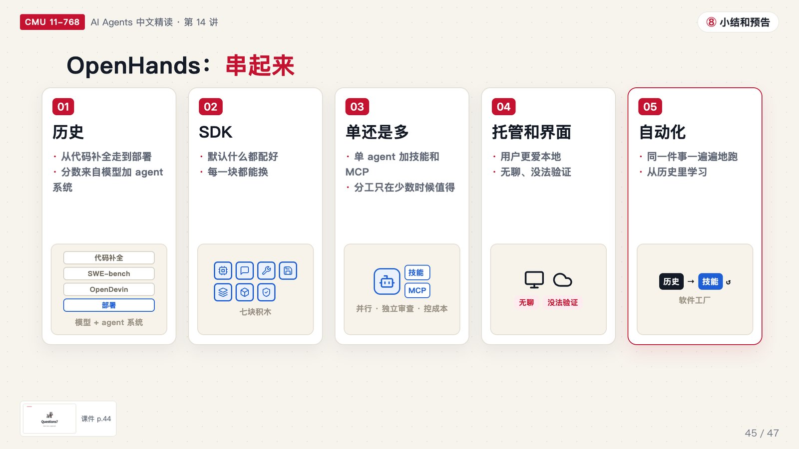

这一讲课件没有单独的小结页，按视频的五块收：

| | 一句话 |
|---|---|
| 历史 | 编程 agent 两年里从代码补全走到了部署，基准分数是模型和 agent 系统一起涨上去的 |
| SDK | 默认什么都配好，每一块又能换：模型和工具、对话、自定义工具、持久化、压缩、Docker、动作确认 |
| 单还是多 | 在编程上，单 agent 加技能和 MCP 往往比固定的多 agent 流程好用；分工只在并行、独立审查、控成本时才值得 |
| 托管和界面 | 用户其实更爱本地；人最大的负担，是看着无聊又没法验证 |
| 自动化 | 把同一件事一遍遍地跑，就成了能从历史里学习的问题 |

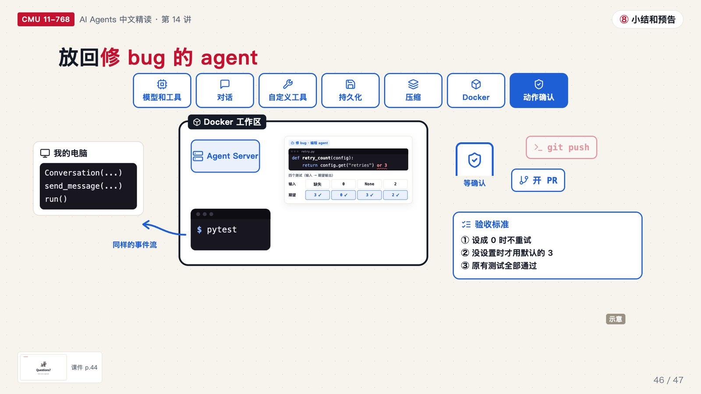

放回修 bug 的 agent（示意）：选好模型和三个工具，开一个对话去修，断了接着跑，太长就压缩，测试在容器里跑，想直接推主分支时被确认拦下、改成开 PR，再交给分诊和审查。

逐节回顾：

- **历史**：HumanEval（函数级，靠人改、跑、查）；SWE-bench（真实 issue + 仓库，早期不到 5%）；Devin 3 月 12 日；OpenDevin 3 月 26 日，社区复现号召里起步的独立项目，后改名 OpenHands；SWE-agent 4 月早于 CodeAct 1.0 5 月（SWE-bench Lite 21%）；SDK 报告表 2 的 72.8%。
- **SDK**：第二版 harness；工具规格只写名字；对话是工厂，本地 / 远程两种；持久化用同一 ID 和目录，工作区另外管；压缩保留开头和最近、日志不删；Docker 工作区换掉后接口不变；确认在执行之前，三种策略、默认从不问，拒绝后换做法。
- **单还是多**：CodeR 五个角色；《别小看单 agent 系统》的三个难点；三类通用工具；技能（早先叫 microagent，关键词触发和 agent 自己读都支持）；MCP；Versa 三个基准都超过已发表最好成绩；分工的三个理由和代价，独立审查据课上的经验。
- **托管和界面**：Devin 在云 → OpenDevin 本地进 Docker → Claude Code、Codex 直接本地；四种界面；Code with Me：约 25% → 约 60%、25.1 → 12.5 分钟，无聊（课上说）和没法验证。
- **自动化**：五步；分诊要么澄清、要么给验收标准，低质量 PR 是因为要做什么不清楚；软件工厂四个环节；SkillRefiner 离线、只用历史记录、不重新跑，每个设置都比初始好，两行和 Trace2Skill 打平，token 少 1.4–42 倍。
- **问答**：本地和云之间带恰好够用的上下文；SSH 到所有机器的风险、agent 住在机器上；多 agent 不一定省 token；该重新想的是怎么验证。
- **源码**：`NeverConfirm()` 是默认；没有安全分析器时 `ConfirmRisky` 每步都问；拒绝补一条 `UserRejectObservation`；压缩保留 `keep_first` 和最近 `max_size // 2 - keep_first - 1` 个，结果是追加的 `Condensation` 事件；工具名由类名推出，参数先经 Pydantic 校验，输出统一打码密钥。

## 关键术语

| 中文 | 英文 | 一句话解释 |
|---|---|---|
| 代码补全 | code completion | 写代码时给补全建议，改、跑、查还靠人 |
| 编程 agent | coding agent | 自己搜、读、改、跑测试，直到把任务做完 |
| harness | harness | 包在模型外面、负责工具、状态和循环的那层程序 |
| 软件开发包 | SDK（software development kit） | 这里指 OpenHands 的 Software Agent SDK |
| 不绑定模型 | model-agnostic | 可以换不同厂商的模型 |
| 人在环里 | human in the loop | 人在旁边看着、随时插话 |
| 工作区 | workspace | 文件放在哪、命令在哪执行 |
| 对话 | Conversation | 一次任务，按顺序记下所有动作和观察 |
| 动作–观察循环 | action–observation loop | 出动作、执行、拿回观察，再出下一个动作 |
| 事件日志 | event log | 只追加的事件记录，持久化和压缩都建在它上面 |
| 工具规格 | tool spec（`Tool`） | 只写工具名和参数，按名字去找工具定义 |
| 工具定义 | `ToolDefinition` | 把说明、动作类型、观察类型和执行器绑在一起 |
| 执行器 | executor | 接收动作、返回观察，真正干活的那部分 |
| 会话持久化 | conversation persistence | 把事件和状态存盘，用同一个 ID 恢复 |
| 压缩 | condensation / compaction | 中间的旧事件换成摘要，保留开头和最近 |
| 压缩器 | condenser | 决定什么时候压、压哪些的组件 |
| 远程执行 | remote execution | agent 服务器跑在容器或远端机器里 |
| agent 服务器 | Agent Server | 在容器里接收对话、执行工具的服务 |
| 确认策略 | confirmation policy | 决定哪些动作要先问人 |
| 安全分析器 | security analyzer | 给每个待执行动作打风险等级 |
| 风险等级 | security risk | 低、中、高、未知 |
| 专门角色 | specialized roles | 经理、复现者、定位者、编辑者、验证者这样的分工 |
| 单 agent | single agent | 一个 agent 做完全部，共享上下文 |
| 技能 | skill（早先叫 microagent） | 一段需要时才拿进来的专用提示词 |
| 模型上下文协议 | MCP（Model Context Protocol） | 连接外部服务器提供的工具 |
| 子 agent 分派 | agent delegation | 主 agent 把子任务派给另一个 agent |
| 独立审查 | independent review | 换一个不带上下文的 agent 来检查 |
| 自动化 | automation | 按事件或定时反复跑的 agent 任务 |
| issue 分诊 | issue triage | 判断 issue 清不清楚，清楚就写验收标准 |
| 验收标准 | acceptance criteria | 这个 issue 算完成必须满足的条件 |
| 软件工厂 | software factory | 分诊、实现、审查、合并检查串成的流水线 |
| 延迟的反馈 | delayed feedback | 审查和后续修改过了几天才给出的对错信号 |
| 离线精炼 | offline refinement | 只用历史记录改进技能，不重新跑任务 |

## 思考题

<details>
<summary>1. 有人说"OpenHands 就是 Devin 的开源版"。这句话错在哪？</summary>

Devin 是一家公司的闭源产品（2024 年 3 月 12 日发布演示）。OpenDevin 是第二天社区发起复现 Devin 的号召之后起步的独立开源项目，3 月 26 日放出早期前端，后来改名 OpenHands（2.3 节）。它是"受 Devin 启发、社区自己做的"，不是 Devin 官方开源出来的，而且它不绑定模型。
</details>

<details>
<summary>2. 有人拿 CodeAct 1.0 的 21% 和 SDK 报告里的 72.8% 比，说"一年半涨了五十多个点"。这样比有什么问题？</summary>

21% 是 SWE-bench Lite（300 题的精简版），72.8% 是 SWE-Bench Verified，题目集不同，不能直接相减（2.4、2.5 节）。而且两者模型和 agent 系统都变了，按"分数 = 模型 + agent 系统"，这个差也分不清有多少来自哪一边。要比，得在同一个题目集上，固定一边、只换另一边。
</details>

<details>
<summary>3. 你给对话设了 `ConfirmRisky()`，想"只有高风险才问"，结果每一步都停下来问你。为什么？怎么改？</summary>

没配安全分析器时，agent 把所有待执行动作的风险都当成 `UNKNOWN`（agent.py 第 1161–1162 行），而 `ConfirmRisky` 的 `confirm_unknown` 默认是 `True`，未知也问（8.1 节）。改法：配一个安全分析器（比如 `LLMSecurityAnalyzer`），让每个动作有具体的风险等级；或者把 `confirm_unknown` 设成 `False`，但那样判断不了的动作就会直接执行，要想清楚是不是你要的。
</details>

<details>
<summary>4. agent 想执行 `git push`，你拒绝了。为什么它没有就此停下，而是换成了开 PR？</summary>

拒绝时 `reject_pending_actions` 给这个动作补了一条 `UserRejectObservation`，带着拒绝理由，状态回到空闲（8.1 节）。对模型来说，这条观察和普通的工具结果一样出现在上下文里，它读到"被拒绝了，理由是先开 PR"，下一步就换一个做法。这也说明拒绝理由写清楚很重要：只说"不行"，它可能换一个同样不行的做法。
</details>

<details>
<summary>5. 压缩之后，agent 说"我不记得第 30 轮测试的具体报错了"。这是 bug 吗？日志里还能找到吗？</summary>

不是 bug：压缩本来就会把中间的事件换成摘要，摘要可能丢细节（3.6 节）。完整的事件日志还在，压缩只是追加了一条 `Condensation` 事件，记着被忘掉的事件 ID（8.2 节），人回头查能查到。对 agent 来说，更好的办法是重跑测试拿回证据，这就是课件说的"靠文件和测试当证据"。
</details>

<details>
<summary>6. `max_size=10, keep_first=4` 会怎样？`keep_first=3` 呢？为什么要有这个限制？</summary>

`10 // 2 - 4 - 1 = 0`，校验不通过，构造时就报错；`keep_first=3` 时是 1，合法（8.2 节，动手练习第 2 部分）。压缩的目标是压到 `max_size` 的一半，开头要留 `keep_first` 个，还要插一条摘要，剩下的才是"最近的事件"。如果最近一条都留不下，agent 压缩完连刚才做了什么都不知道。
</details>

<details>
<summary>7. 你把修 bug 的 agent 从本地改到 `DockerWorkspace` 里跑，同时设了 `persistence_dir`，结果报错。为什么？</summary>

`DockerWorkspace` 是远程工作区，对话工厂会返回 `RemoteConversation`，而远程对话不许设 `persistence_dir`，事件由远端的 agent 服务器负责存（conversation.py 第 158–162 行，3.5、3.7 节）。另外要记得：容器用完就删的话，agent 改过的文件也跟着没了，工作区的持久化要另外管。
</details>

<details>
<summary>8. 课上说在编程上偏向单 agent，又说多 agent 越来越有用。这两句矛盾吗？</summary>

不矛盾。前一句针对的是编程上的**固定**多 agent 流程：每个问题都走经理、复现、定位、编辑、验证这一套，交接会丢上下文、结构定不对、难维护（4.2 节）。后一句说的是有明确目的时才分出去：并行做彼此独立的任务、换一个不带上下文的 agent 独立审查、用便宜的模型和扔掉多余上下文控制成本（4.7 节）。而且多 agent 不一定省 token（7 节 Q4）。
</details>

<details>
<summary>9. 技能和 MCP 为什么能当作多 agent 的替代？它们各自替代了多 agent 里的哪一部分？</summary>

多 agent 里每个角色有自己的提示词和工具。技能替代的是"每个角色的提示词"：需要时按关键词或由 agent 自己读进来；MCP 替代的是"每个角色的工具"：需要连外部服务时再接进来（4.4、4.5 节）。这样一个 agent 在需要的那一刻拿到对应的指令和工具，不用拆成几个 agent 交接。
</details>

<details>
<summary>10. SkillRefiner 的表里，"人写的技能 + GPT-5.4-mini 的表格任务"一行 SkillRefiner 和 Trace2Skill 都是 86.5。这能说明 SkillRefiner 在这一行没用吗？</summary>

不能。它比初始的 86.0 高，课件的结论"每个设置都比初始技能好"在这一行仍然成立；只是和 Trace2Skill 打平（6.6 节）。另外要看成本：精炼这一步 SkillRefiner 花的 token 比对比方法少 1.4–42 倍，同样的分数花得更少也是好处。还要注意初始已经 86.0，提升空间本来就小（我的推断）。
</details>

## 动手练习

### 练习：事件循环和恢复、压缩器、三档确认策略，全部自己跑一遍

20–30 分钟，只依赖 Python 3.9 以上的标准库，不调用任何模型、不联网。"agent"是一个写死的脚本，代替模型决定下一步；它会在一个临时目录里写一个小文件、执行这个文件里的 `retry_count` 来"跑测试"，不碰临时目录以外的任何东西。把下面的代码存成 `l14_lab.py`，运行 `python3 l14_lab.py`。

```python
"""第 14 讲动手练习：只用 Python 标准库。不调用模型、不联网。
三部分：① 动作 -> 执行 -> 观察的事件循环 + 事件日志持久化与恢复；
       ② 保留开头 k 个、最近若干个、中间换成摘要的压缩器；③ 三档确认策略。
所有"执行"都发生在一个临时目录里，只读写这个目录下的一个小文件。"""
import json
import re
import tempfile
import uuid
from pathlib import Path

BUGGY = 'def retry_count(config):\n    return config.get("retries") or 3\n'
FIXED = ('def retry_count(config):\n    r = config.get("retries")\n'
         '    return 3 if r is None else r\n')
CASES = [({}, 3), ({"retries": 0}, 0), ({"retries": None}, 3), ({"retries": 2}, 2)]


# ---------- ① 事件循环 + 持久化 ----------
def tool_grep(ws, pattern):
    hits = [f"{p.name}:{i}:{line}" for p in sorted(ws.glob("*.py"))
            for i, line in enumerate(p.read_text().splitlines(), 1) if re.search(pattern, line)]
    return {"matches": hits, "count": len(hits)}


def tool_pytest(ws):
    ns = {}
    exec((ws / "config.py").read_text(), ns)          # 只执行临时目录里我们自己写的那个文件
    failed = [repr(c) for c, want in CASES if ns["retry_count"](c) != want]
    return {"passed": len(CASES) - len(failed), "failed": failed}


def tool_edit(ws, new_text):
    (ws / "config.py").write_text(new_text)
    return {"ok": True}


TOOLS = {"grep": tool_grep, "pytest": tool_pytest, "edit": tool_edit}


def scripted_agent(events):
    """代替模型：看事件日志决定下一步动作（示意）。"""
    obs = [e for e in events if e["kind"] == "observation"]
    if not obs:
        return {"tool": "grep", "args": {"pattern": "retry_count"}}
    last = obs[-1]
    if last["tool"] == "grep":
        return {"tool": "pytest", "args": {}}
    if last["tool"] == "pytest" and last["result"]["failed"]:
        return {"tool": "edit", "args": {"new_text": FIXED}}
    if last["tool"] == "edit":
        return {"tool": "pytest", "args": {}}
    return {"tool": "finish", "args": {}}


class Conversation:
    def __init__(self, ws, persistence_dir, conversation_id=None):
        self.ws, self.id = ws, conversation_id or uuid.uuid4().hex
        self.dir = Path(persistence_dir) / self.id
        (self.dir / "events").mkdir(parents=True, exist_ok=True)
        self.events = [json.loads(p.read_text()) for p in sorted((self.dir / "events").glob("*.json"))]
        self.resumed = len(self.events)

    def _append(self, event):                          # 一条事件一个文件，只写新增的
        event["seq"] = len(self.events)
        (self.dir / "events" / f"{event['seq']:05d}.json").write_text(json.dumps(event, ensure_ascii=False))
        self.events.append(event)
        (self.dir / "base_state.json").write_text(json.dumps({"id": self.id, "n_events": len(self.events)}))

    def send_message(self, text):
        self._append({"kind": "message", "text": text})

    def run(self, crash_after=None):
        while True:
            if crash_after is not None and len(self.events) >= crash_after:
                raise RuntimeError("进程挂了")
            action = scripted_agent(self.events)
            if action["tool"] == "finish":
                self._append({"kind": "action", **action})
                return
            self._append({"kind": "action", **action})
            result = TOOLS[action["tool"]](self.ws, **action["args"])
            self._append({"kind": "observation", "tool": action["tool"], "result": result})


# ---------- ② 压缩器（照 LLMSummarizingCondenser 的算法写的简化版） ----------
def make_condenser(max_size=240, keep_first=2, minimum_progress=0.1):
    tail = max_size // 2 - keep_first - 1
    if tail <= 0:
        raise ValueError("keep_first must be less than max_size // 2")
    def condense(view):
        if len(view) <= max_size:
            return view, None
        forgotten = view[keep_first:len(view) - tail]
        if len(forgotten) < len(view) * minimum_progress:
            raise RuntimeError("压掉的事件太少")
        summary = f"[摘要：第 {keep_first}–{len(view) - tail - 1} 个事件，共 {len(forgotten)} 个]"
        return view[:keep_first] + [summary] + view[len(view) - tail:], forgotten
    return condense


# ---------- ③ 三档确认策略 ----------
ORDER = {"LOW": 0, "MEDIUM": 1, "HIGH": 2}
always = lambda risk: True
never = lambda risk: False
def confirm_risky(threshold="HIGH", confirm_unknown=True):
    return lambda risk: confirm_unknown if risk == "UNKNOWN" else ORDER[risk] >= ORDER[threshold]

def requires_confirmation(policy, actions, analyzer=None):
    if not actions or (len(actions) == 1 and actions[0] in ("finish", "think")):
        return False
    risks = [analyzer(a) if analyzer else "UNKNOWN" for a in actions]
    return any(policy(r) for r in risks)

toy_analyzer = {"grep retry_count": "LOW", "pytest": "LOW", "edit config.py": "MEDIUM",
                "git push origin main": "HIGH", "gh pr create": "MEDIUM"}.get


if __name__ == "__main__":
    with tempfile.TemporaryDirectory() as tmp:
        ws = Path(tmp, "repo"); ws.mkdir(); (ws / "config.py").write_text(BUGGY)
        conv = Conversation(ws, Path(tmp, ".conversations"))
        conv.send_message("retry_count 设成 0 时返回了 3，修好它并跑通测试")
        try:
            conv.run(crash_after=6)
        except RuntimeError as e:
            print(f"1) 第一次运行：{len(conv.events)} 个事件后{e}")
        cid = conv.id
        del conv
        conv2 = Conversation(ws, Path(tmp, ".conversations"), conversation_id=cid)
        print(f"   同一个 ID 恢复：读回 {conv2.resumed} 个事件，接着跑")
        conv2.run()
        for e in conv2.events:
            if e["kind"] == "message":
                print(f"   #{e['seq']} 任务 {e['text']}")
            elif e["kind"] == "action":
                print(f"   #{e['seq']} 动作 {e['tool']} {list(e['args'])}")
            elif e["kind"] == "observation":
                print(f"   #{e['seq']} 观察 {json.dumps(e['result'], ensure_ascii=False)[:70]}")
        files = sorted(p.name for p in (conv2.dir / "events").iterdir())
        print(f"   事件文件 {len(files)} 个：{files[0]} … {files[-1]}；最终测试 {tool_pytest(ws)}")

    print("2) 压缩：")
    for ms, kf, n in ((10, 2, 11), (240, 2, 241), (80, 4, 81)):
        view = [f"e{i}" for i in range(n)]
        new, forgotten = make_condenser(ms, kf)(view)
        print(f"   max_size={ms}, keep_first={kf}：{n} 个事件 -> {len(new)} 个"
              f"（开头 {kf} + 摘要 1 + 最近 {ms // 2 - kf - 1}），压掉 {len(forgotten)} 个")
    print("   10 个事件、max_size=10：", "不压" if make_condenser(10, 2)([0] * 10)[1] is None else "压")
    for ms, kf in ((10, 4), (10, 3)):
        try:
            make_condenser(ms, kf); print(f"   max_size={ms}, keep_first={kf}：合法")
        except ValueError as e:
            print(f"   max_size={ms}, keep_first={kf}：报错 {e}")

    print("3) 确认策略：")
    acts = ["grep retry_count", "pytest", "edit config.py", "git push origin main"]
    pols = {"总是问": always, "从不问": never, "按风险问(HIGH)": confirm_risky()}
    for name, pol in pols.items():
        row = ["问" if requires_confirmation(pol, [a], toy_analyzer) else "放" for a in acts]
        bare = ["问" if requires_confirmation(pol, [a]) else "放" for a in acts]
        print(f"   {name:<14} 有分析器 {row}   没分析器 {bare}")
    print("   只有一个 finish：", requires_confirmation(always, ["finish"]))
    print("   按风险问(MEDIUM)：", ["问" if requires_confirmation(confirm_risky("MEDIUM"), [a], toy_analyzer)
                                  else "放" for a in acts])
    pol, plan = confirm_risky(), ["git push origin main"]
    if requires_confirmation(pol, plan, toy_analyzer):
        print("   状态 -> WAITING_FOR_CONFIRMATION；人拒绝：先开 PR，不要直接推主分支")
        print("   补一条 UserRejectObservation，状态 -> IDLE；agent 换做法：gh pr create ->",
              "问" if requires_confirmation(pol, ["gh pr create"], toy_analyzer) else "放行")
```

运行结果（本课件实际跑出来的输出）：

```
1) 第一次运行：7 个事件后进程挂了
   同一个 ID 恢复：读回 7 个事件，接着跑
   #0 任务 retry_count 设成 0 时返回了 3，修好它并跑通测试
   #1 动作 grep ['pattern']
   #2 观察 {"matches": ["config.py:1:def retry_count(config):"], "count": 1}
   #3 动作 pytest []
   #4 观察 {"passed": 3, "failed": ["{'retries': 0}"]}
   #5 动作 edit ['new_text']
   #6 观察 {"ok": true}
   #7 动作 pytest []
   #8 观察 {"passed": 4, "failed": []}
   #9 动作 finish []
   事件文件 10 个：00000.json … 00009.json；最终测试 {'passed': 4, 'failed': []}
2) 压缩：
   max_size=10, keep_first=2：11 个事件 -> 5 个（开头 2 + 摘要 1 + 最近 2），压掉 7 个
   max_size=240, keep_first=2：241 个事件 -> 120 个（开头 2 + 摘要 1 + 最近 117），压掉 122 个
   max_size=80, keep_first=4：81 个事件 -> 40 个（开头 4 + 摘要 1 + 最近 35），压掉 42 个
   10 个事件、max_size=10： 不压
   max_size=10, keep_first=4：报错 keep_first must be less than max_size // 2
   max_size=10, keep_first=3：合法
3) 确认策略：
   总是问            有分析器 ['问', '问', '问', '问']   没分析器 ['问', '问', '问', '问']
   从不问            有分析器 ['放', '放', '放', '放']   没分析器 ['放', '放', '放', '放']
   按风险问(HIGH)     有分析器 ['放', '放', '放', '问']   没分析器 ['问', '问', '问', '问']
   只有一个 finish： False
   按风险问(MEDIUM)： ['放', '放', '问', '问']
   状态 -> WAITING_FOR_CONFIRMATION；人拒绝：先开 PR，不要直接推主分支
   补一条 UserRejectObservation，状态 -> IDLE；agent 换做法：gh pr create -> 放行
```

对一下正文：

| 输出 | 正文 |
|---|---|
| 1) 第 7 个事件后挂掉，同一个 ID 读回 7 个事件，接着从 pytest 往下跑 | 3.5 节：同一个 ID、同一个存储位置就能接着跑 |
| 1) 事件文件 10 个，每个事件一个 JSON | 3.5 节：事件一条一个文件，只写新增的（照 SDK 报告 §4.2 的做法简化） |
| 1) 第 4 个事件里 `{'retries': 0}` 失败，改完 4 个全过 | 运行例子的四格测试 |
| 2) 11 个事件 → 5 个；241 → 120；81 → 40 | 8.2 节：最近保留 `max_size // 2 - keep_first - 1` 个，压完约剩一半 |
| 2) `keep_first=4` 报错、`=3` 合法 | 8.2 节第 89–97 行的校验 |
| 3) 按风险问（HIGH）没分析器时四个都"问" | 8.1 节：没有分析器时风险全是 `UNKNOWN`，`confirm_unknown` 默认 `True` |
| 3) 只有一个 finish 时不问 | 8.1 节 agent.py 第 1143–1146 行 |
| 3) 阈值 MEDIUM 时编辑也要问 | 8.1 节：比较是"大于等于" |
| 3) 被拒绝后换成开 PR | 3.8 节、8.1 节（这里只打印流程，没有真的模拟模型换做法） |

这份代码和 SDK 的差别（本课件补的说明）：压缩器没有处理"可切开的位置"，也没有按 token 触发；`toy_analyzer` 是一张写死的表，真实的安全分析器要看动作内容；恢复时 SDK 还会处理"有动作没观察"的中断情况，这里没做。

做完回答：

1. 把 `crash_after=6` 改成 `crash_after=4`，进程挂在哪一步？恢复后 agent 会重新 grep 吗？为什么？（提示：`scripted_agent` 只看事件日志。）
2. 恢复时如果用了一个新的 `conversation_id`，会发生什么？这对应 3.5 节哪一句？
3. 给 `make_condenser` 加一个 `max_tokens` 参数：每个事件按字符数估 token，超过就压，目标是压到上限的一半。和 8.2 节第 307–325 行对照，你的做法少考虑了什么？
4. 把 `confirm_risky()` 改成 `confirm_risky(confirm_unknown=False)`，没分析器时四个动作会怎样？这样设在什么场景下危险？
5. 给 `requires_confirmation` 加一条规则：`git push` 到 `main` 一律问，不管策略是什么。这条规则应该放在策略里，还是放在 agent 控制不到的地方？（提示：第 13 讲 6.5 节。）
6. 选做：在事件循环里加上确认：`run()` 遇到要确认的动作就把状态改成 `WAITING_FOR_CONFIRMATION` 并返回；写一个 `reject_pending_actions(reason)`，补一条 `{"kind": "observation", "tool": ..., "result": {"rejected": reason}}`，再让 `scripted_agent` 看到拒绝时换一个动作。

> 这个练习里"执行"的只是临时目录里我们自己写的那个文件。如果你把这样的循环接到真的模型上，模型生成的命令和代码只在容器或沙箱里运行（3.7 节），不要在装着真实凭证的日常电脑上跑；危险动作前加确认（3.8 节）。

## 延伸阅读

链接取自原课件页脚引的原文和课表这一讲列的参考。

源码和文档：

- [OpenHands/software-agent-sdk](https://github.com/OpenHands/software-agent-sdk/tree/69e26889401fe69157fff536e6a69049e6644cb3)：课程钉住的提交。`examples/01_standalone_sdk/` 里 50 多个示例，本讲用到 01（hello world）、02（自定义工具）、03（技能）、04（确认模式）、07（MCP）、10（持久化）、14（压缩）、25（子 agent 分派）；`examples/02_remote_agent_server/` 是远程执行。
- OpenHands Software Agent SDK 报告：[arXiv:2511.03690](https://arxiv.org/abs/2511.03690)。§4 讲架构（事件、工具、技能、压缩、安全、远程），§5.2 表 2 是基准分数，表 3 是和其他 agent SDK 的功能对比。

历史：

- HumanEval：[arXiv:2107.03374](https://arxiv.org/abs/2107.03374)。
- SWE-bench：[arXiv:2310.06770](https://arxiv.org/abs/2310.06770)。
- SWE-agent：[arXiv:2405.15793](https://arxiv.org/abs/2405.15793)。
- OpenDevin CodeAct 1.0 的发布博客（2024-05-07），SWE-bench Lite 21% 的出处。

单 agent 还是多 agent：

- CodeR：[arXiv:2406.01304](https://arxiv.org/abs/2406.01304)。§2 是五个角色。
- Don't Sleep on Single-agent Systems：OpenHands 博客（2024-09-26）。
- OpenHands-Versa：[arXiv:2506.03011](https://arxiv.org/abs/2506.03011)。

人和 agent：

- Code with Me or for Me?：[arXiv:2507.08149](https://arxiv.org/abs/2507.08149)。§3.1 研究设置，§4.1 图 4 是正确率和时间，§4.2 是参与者的反馈。

自动化：

- SkillRefiner：Offline Skill Refinement from Historical Agent Traces（alphaXiv，2026-10-01）。表 1 是结果，token 统计在概览页。

本系列相关的几讲：

- 第 6 讲：编程 agent（`retry_count` 例子第一次出现）。
- 第 10 讲：深度调研（多 agent 更容易赢的一类任务）。
- 第 12 讲：强化学习系统（把 harness 做成服务）。
- 第 13 讲：Agent 安全（沙箱、最小权限、执行前拦截）。

## 下一讲预告：编排和监控

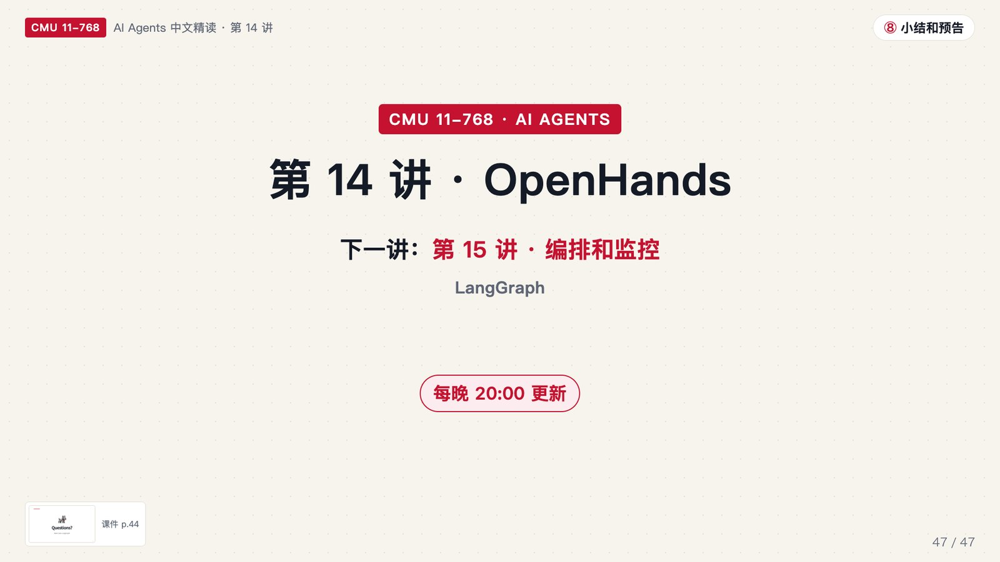

这一讲拆开了一个开源编程 agent：七块积木搭出一个 agent，单 agent 加技能和 MCP 替代固定的多 agent 流程，再把它放进自动化里一遍遍地跑。

下一讲是第 15 讲：编排和监控（课表名 Frameworks 2: Orchestration and Monitoring），用 LangGraph 这类框架把 agent 的流程搭起来，再盯住它在干什么。

留一个问题：4.8 节课上那个问题还没回答。多个 agent 同时跑、都向经理汇报，经理翻轨迹比人快，可经理自己也会出错。要确认"到底发生了什么"，你会把哪些东西记下来、放在哪里、由谁来看？
