# 第 15 讲 · 编排和监控：给 agent 定流程，再看住它

> CMU 11-768 AI Agents（2026 秋）中文精读 · 配套课件
> 配套视频（17 分钟）：B 站 / 视频号 / 抖音 / 小红书搜索「竹二木SI」 · 整份幻灯片：[l15-幻灯片.pdf](./l15-幻灯片.pdf)
> 原课程：[cmu-agents.com](https://cmu-agents.com)，课程主讲 Graham Neubig、Daniel Fried；本讲课表名 Frameworks 2: Orchestration and Monitoring。本课件是非官方的学习整理。
> **这一讲原课程没有公开录像**，内容根据原课件和课件里链接的推荐阅读整理：Anthropic《Building effective agents》、LangGraph / LangSmith 官方文档、Transluce 的 Docent 博客、Hodoscope 的发布博客和论文、OpenAI 的 Hugging Face 事件报告。每节末尾注明出处。

## 这一讲你会学到

学完这一讲，你应该能做到：

1. 说清**单 agent**（single agent）和**固定流程**（workflow）的区别：两者都由大模型、工具和应用代码组成，区别在于行为由模型决定，还是更多地由开发者提前写死。
2. 说出把流程固定下来的两个好处（一致、省）和两个代价（不够灵活、信息流要自己管），判断一个任务适合哪一种。
3. 用 LangGraph 的四个概念搭一个客服邮件流程：**节点**（node）、**共享状态**（state）、**边**和**条件路由**（`Command`）、**检查点**（checkpointer）。
4. 讲清存档、续跑、重试、等人四件事分别怎么实现，为什么恢复时节点会从头重跑，以及这对"暂停之前做的操作"意味着什么。
5. 区分执行记录里的 **run** 和 **trace**，写出节点的单元测试和整个流程的受控测试，知道单测为什么绕过了存档。
6. 复述 Docent 调查 Terminal-Bench 退步的四步：成对比较 → 归纳失败方式 → 提出超时假设 → 用元数据验证，并说出这个结论的边界。
7. 说清 Hodoscope 为什么不直接让模型当裁判，它的"摘要 → 嵌入 → 比分布 → 人来看"四步，以及它在 Commit0 上发现的 Git 历史漏洞。

建议先看一遍视频，再对照本课件逐节复习。每节开头的图就是视频里对应的画面。


### 接上一讲

第 14 讲拆了 OpenHands：一个**单 agent** 加上少而通用的工具、技能和 MCP，就能做大部分软件开发任务；片尾讲了**自动化**，把几次 agent 运行用规定好的步骤和检查串起来。这一讲往前走一步：如果一个任务的流程是已知的，能不能把流程本身写成代码，只在需要判断的地方调用模型？流程跑起来以后，又怎么知道它实际做了什么？

### 这一讲的路线

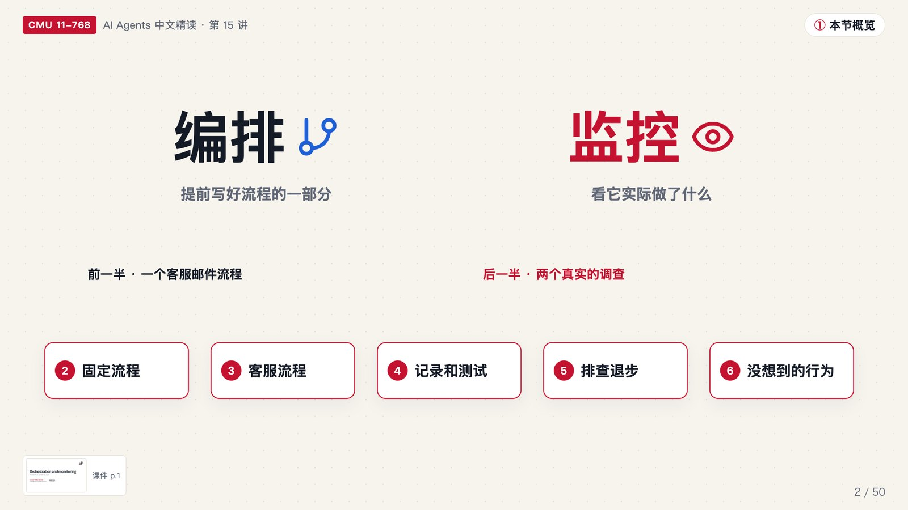

| 部分 | 内容 | 对应课件页 |
|---|---|---|
| ② 单 agent 还是固定流程 | 前面见过的几种结构；两种做法的区别；固定下来的好处 | p.2–4 |
| ③ 搭一个客服流程 | 两封邮件；步骤和条件路由；共享状态；节点和组装；存档、续跑、重试、等人 | p.5–17 |
| ④ 记录和测试 | 执行记录；单元测试；流程测试和回归测试；利弊；几个框架的侧重 | p.18–23 |
| ⑤ 排查一次退步 | 记录太多读不完；Docent 成对比较、归纳、验证超时假设；排名反转 | p.24–31 |
| ⑥ 找没想到的行为 | 模型当裁判的盲区；Hodoscope 的四步；Commit0 的漏洞 | p.32–37 |
| 小结 | 记录多到人看不完：OpenAI–Hugging Face 事件；串起来；下一讲 | p.38–39 |

### 运行例子：两封客服邮件

编排那一半全程用课件自己的例子：一家云服务公司 Acme Cloud 的客服邮箱。两封邮件从头跟到尾：

| 邮件 | 原文（课件 p.19） | 走哪条路 |
|---|---|---|
| 重置密码 | "Hi, I forgot my Acme Cloud password. How can I reset it?" | 读邮件 → 分类：问题 → 搜文档 → 起草 → **直接发送** |
| 重复扣款 | "Urgent: Acme Cloud charged our company twice for this month's subscription. … Please investigate the duplicate charges and refund the extra payment." | 读邮件 → 分类：账单，高紧急 → 搜文档 → 起草 → **停下等员工审核** → 批准后发送 |

监控那一半不再用这个例子，直接用课件里的两个真实调查：Docent 对 Terminal-Bench 的排查、Hodoscope 对 Commit0 的发现。

---

## 1 单 agent 还是固定流程

### 1.1 前面见过的几种结构

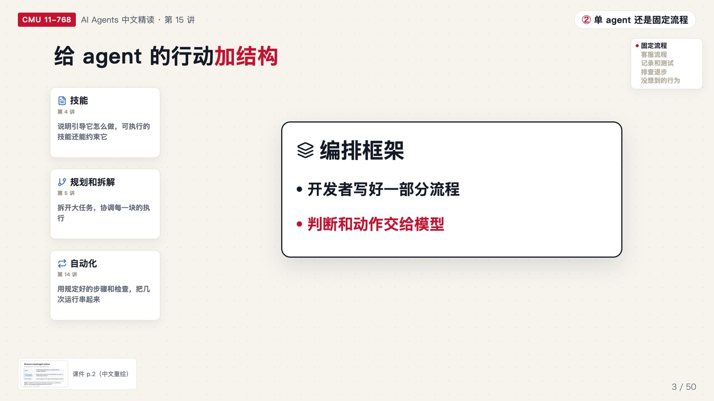

到这一讲为止，课程已经讲过几种给 agent 的行动"加结构"的办法（课件 p.2）：

| 办法 | 在哪一讲 | 怎么加结构 |
|---|---|---|
| **技能**（skills） | 第 4 讲 | 写在说明里的技能引导它怎么做；能执行的技能还能限制它怎么执行 |
| **规划和拆解**（planning and decomposition） | 第 5 讲 | 把任务拆成几部分，再协调每部分的执行（课件举的是 MACU、RAO、RLM） |
| **自动化**（automations） | 第 14 讲 | 用规定好的步骤和检查，把几次 agent 运行串起来 |

这一讲讲的**编排框架**（orchestration framework）：开发者提前把流程的一部分写好，把具体的判断和动作交给大模型。

### 1.2 两种做法

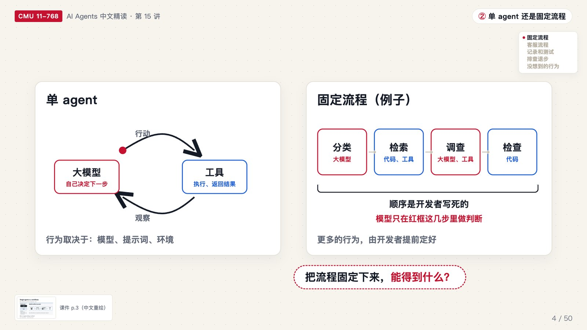

| | 单 agent | 显式流程（例子） |
|---|---|---|
| 结构 | 模型行动 → 看结果 → 再行动，循环 | 分类（大模型）→ 检索（代码、工具）→ 调查（大模型、工具）→ 检查（代码） |
| 行为由谁定 | 模型、提示词和环境 | 更多的行为由开发者提前写死，模型只在几步里做判断 |
| 例子 | 第 14 讲的单 agent 基线 | 这一讲的客服流程 |

Anthropic 的《Building effective agents》给了同样的区分：**workflow** 是"大模型和工具按预先写好的代码路径编排"的系统；**agent** 是"大模型自己动态决定流程和工具使用"的系统。同一篇还建议先找最简单的方案，需要时才加复杂度，有时候根本不用做 agent 系统，因为 agent 系统往往拿延迟和成本去换效果。

> 出处：课件 p.3；Anthropic · Building effective agents（开头的定义和建议）。

### 1.3 固定下来的好处

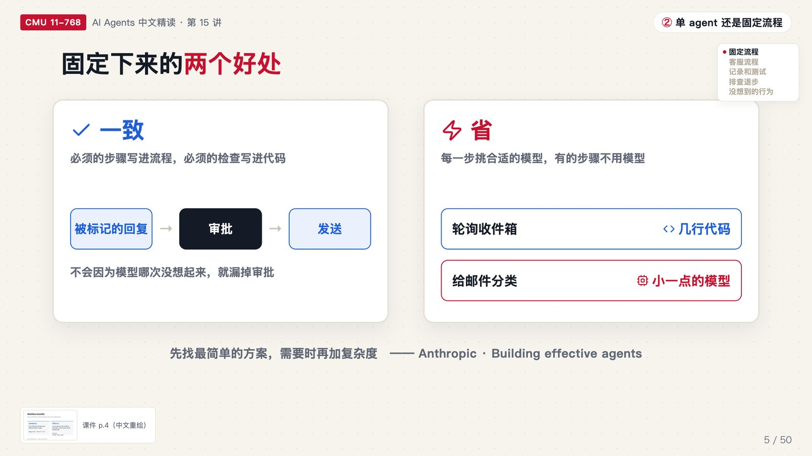

对一个**已知的流程**，把它固定下来，模型要做的决定就少了（课件 p.4）：

- **一致**（consistency）：必需的步骤写进流程，检查写进代码。例子：被标记的回复 → 审批 → 发送。审批这一步不会因为模型哪次"没想起来"就被跳过。
- **省**（efficiency）：每一步用合适的模型，甚至不用模型。例子：轮询收件箱用几行代码；分类用小一点的模型。

> 出处：课件 p.4；LangGraph · Thinking in LangGraph。

---

## 2 用 LangGraph 搭一个客服流程

这一整节照 LangGraph 官方文档《Thinking in LangGraph》的邮件客服例子讲，课件把场景改成了 Acme Cloud（页脚写 adapted support scenarios）。文档开头的一句话就是整套写法：用 Graph API 搭 agent 时，把过程拆成叫**节点**的离散步骤，描述每个节点之后的决定和转移，再用一份所有节点都能读写的共享**状态**把它们连起来。

### 2.1 两类请求

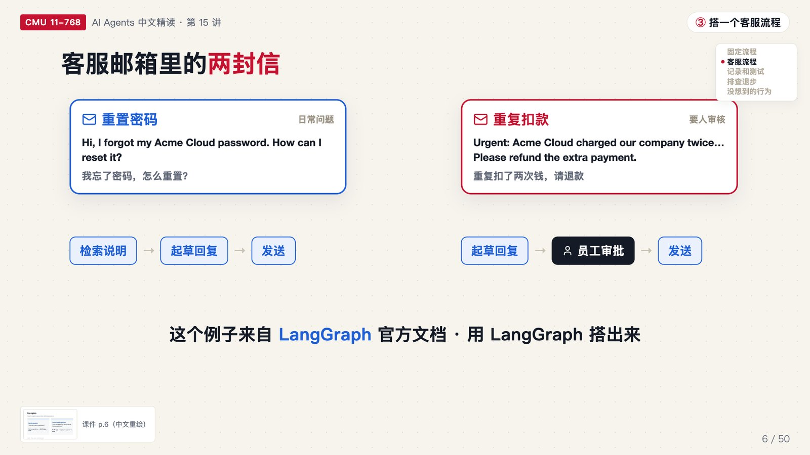

客服请求要走不同的流程（课件 p.6）：

- **日常问题**："我怎么重置密码？" → 检索说明 → 起草回复 → 发送。
- **需要审核的请求**："你们扣了我两次钱，请把多扣的退给我。" → 起草回复 → **员工审批** → 发送。

### 2.2 步骤和条件路由

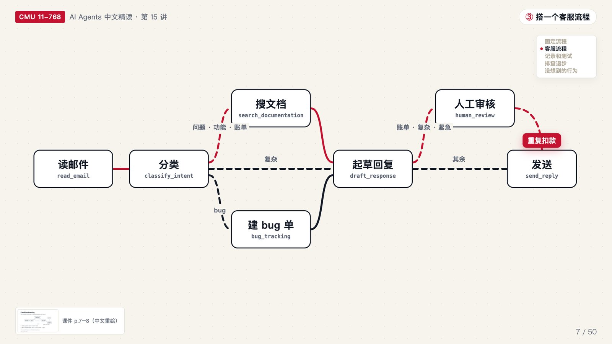

先把要做的事拆成明确的步骤，每一步之后可能去哪也写清楚（课件 p.7）：

```
读邮件 → 分类 ─┬─ 问题 / 功能 / 账单 ──→ 搜文档 ──┐
              ├─ bug ────────────────→ 建 bug 单 ─┼→ 起草回复 ─┬─ 账单 / 复杂 / 紧急 → 人工审核 → 发送
              └─ 复杂 ─────────────────────────────┘           └─ 其余 ──────────────────────→ 发送
```

哪些步骤会执行，取决于请求本身和中间结果（课件 p.8）：

- 日常问题：搜文档 → 起草 → 发送。
- 被分成账单类的请求：搜文档 → 起草 → 审核 → 发送。

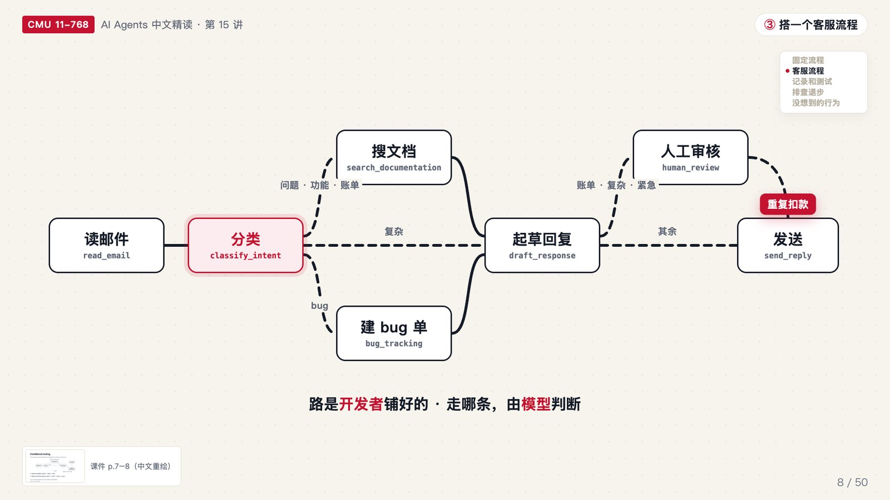

走不走审核，取决于**模型的分类结果**。路是开发者铺好的，走哪条由模型判断，这就是"编排"的含义。

### 2.3 每一步里面是什么

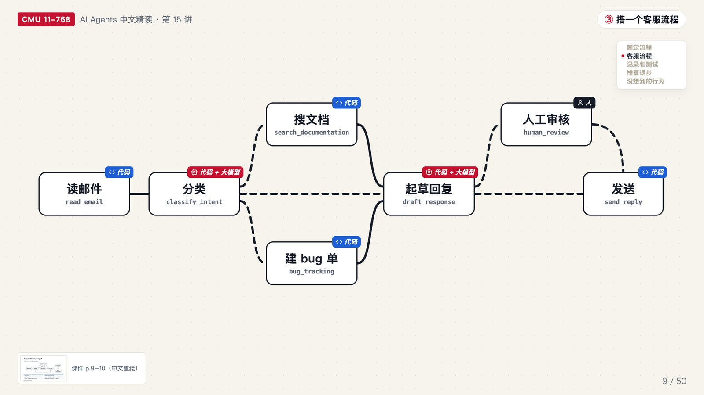

每一步可以是代码、模型调用和工具的组合（课件 p.9）：

| 节点 | 类型 |
|---|---|
| 读邮件、搜文档、建 bug 单、发送 | 普通代码 |
| 分类、起草 | 代码 + 大模型（在代码里调一次大模型，拿到结果再往下走） |
| 人工审核 | 人 |

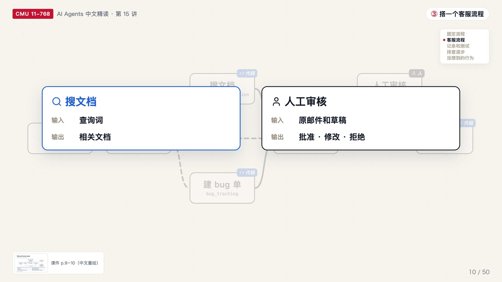

其中两步会给流程带进**新信息**（课件 p.10）：

| 节点 | 输入 | 输出 |
|---|---|---|
| 搜文档 | 查询词 | 相关文档 |
| 人工审核 | 原请求和草稿 | 批准、修改或拒绝 |

### 2.4 共享状态

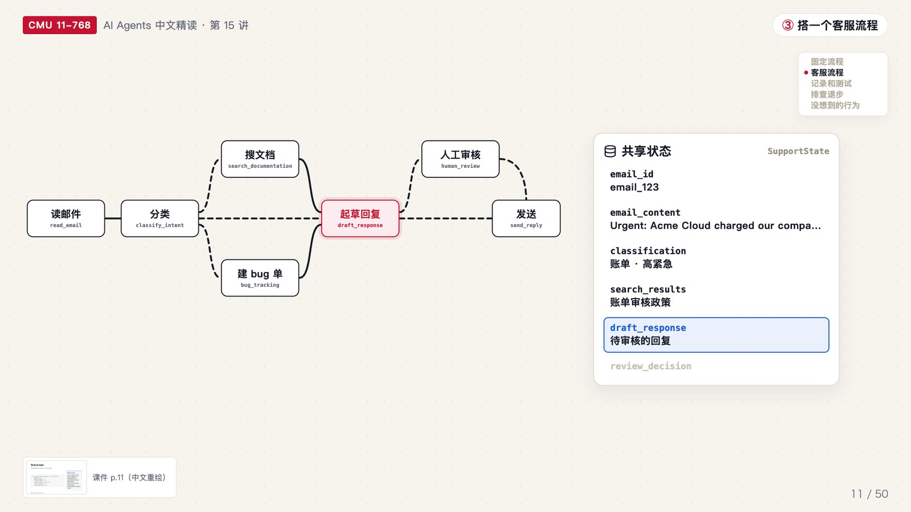

**状态**（state）在流程的节点之间传递。课件的 `SupportState` 有六个字段：

```python
class SupportState(TypedDict, total=False):
    email_id: str
    email_content: str
    classification: dict
    search_results: list[dict]
    draft_response: str
    review_decision: dict
```

扣款那封信走到审核前，状态里是（课件 p.11）：

| 字段 | 值 |
|---|---|
| email_content | "Urgent: Acme Cloud charged our company twice…" |
| classification | 账单，高紧急 |
| search_results | 账单审核政策 |
| draft_response | 待审核的回复 |
| review_decision | （还没有） |

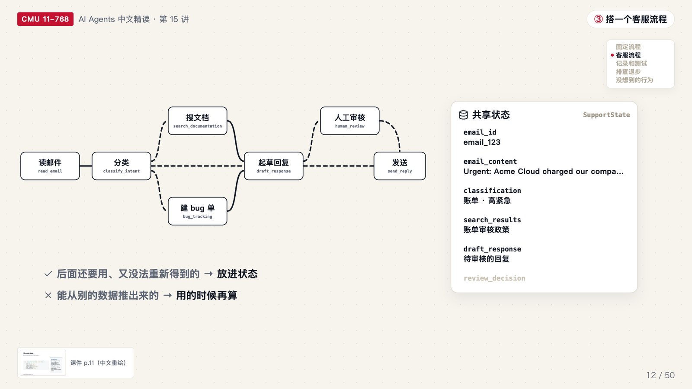

状态里放什么，文档给了判断方法（Thinking in LangGraph · Step 3）：

- **需要跨步骤保留的放进去**：原始邮件和发件人（之后没法重建）、分类结果（后面节点要用）、搜索结果（重新拿一次很贵）、草稿（要撑到审核结束）、执行元数据（调试和恢复用）。
- **能从别的数据推出来的不放**，用的时候再算。
- **存原始数据，不存拼好的提示词**，提示词在节点里现拼。这样不同节点可以用不同方式格式化同一份数据，改提示词模板也不用改状态结构，调试时看到的是每个节点收到的数据。

### 2.5 节点、组装和条件路由

**节点就是函数**：读状态、干活、只返回它改了的字段（课件 p.12–13）。

```python
def classify_intent(state):
    classification = model.classify(
        state["email_content"]
    ).model_dump()
    return {"classification": classification}   # 只返回改了的字段

def search_documentation(state):
    c = state["classification"]
    query = f"{c['intent']} {c['topic']}"          # 用分类结果拼查询词
    return {"search_results": services.search(query)}
```

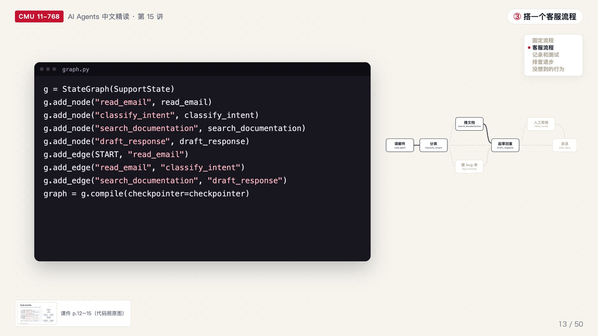

**组装**：节点函数加上转移，组成整个流程（课件 p.14）。

```python
g = StateGraph(SupportState)                      # 以共享状态为基础的图
g.add_node("read_email", read_email)
g.add_node("classify_intent", classify_intent)
g.add_node("search_documentation", search_documentation)
g.add_node("draft_response", draft_response)
g.add_edge(START, "read_email")                   # 固定的先后顺序用边连
g.add_edge("read_email", "classify_intent")
g.add_edge("search_documentation", "draft_response")
graph = g.compile(checkpointer=checkpointer)      # 编译时传入负责存档的 checkpointer
```

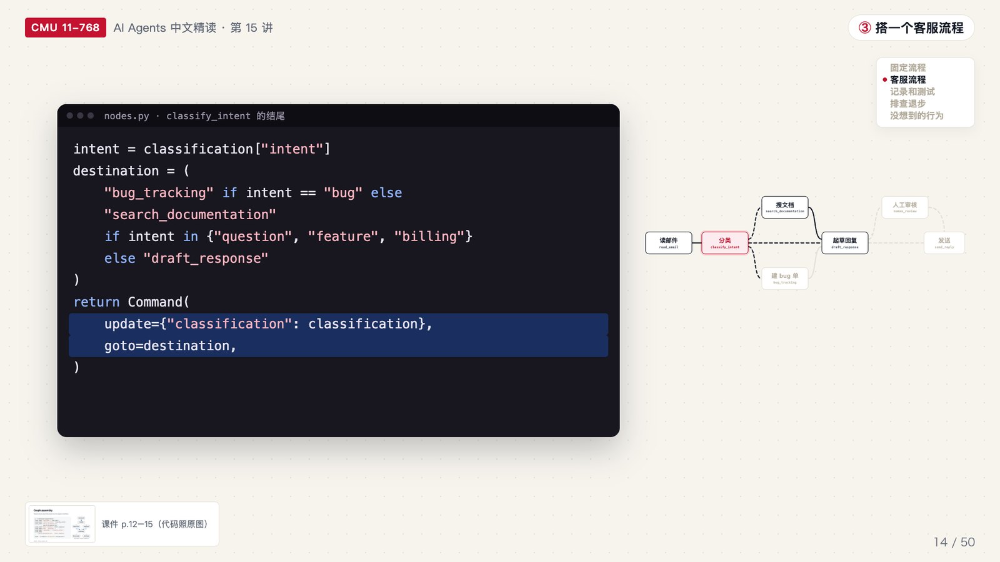

**条件路由**写在分类节点里（课件 p.15）：节点算出下一站，返回一个 `Command`，状态更新和下一站一起交回去。

```python
intent = classification["intent"]
destination = (
    "bug_tracking" if intent == "bug" else
    "search_documentation"
    if intent in {"question", "feature", "billing"}
    else "draft_response"
)
return Command(
    update={"classification": classification},   # 状态更新
    goto=destination,                             # 下一站
)
```

文档的说法：需要动态路由的节点返回 `Command`，这样控制流仍然是显式的、能追踪的，图本身只需要声明几条必要的边。

> 注意一处细节：课件 p.15 把**账单类**送去搜文档；LangGraph 文档示例代码里的 `classify_intent` 把账单直接送去起草（只有问题和功能去搜文档）。本课件和视频照课件的版本讲。

### 2.6 崩了以后怎么办：节点边界存档

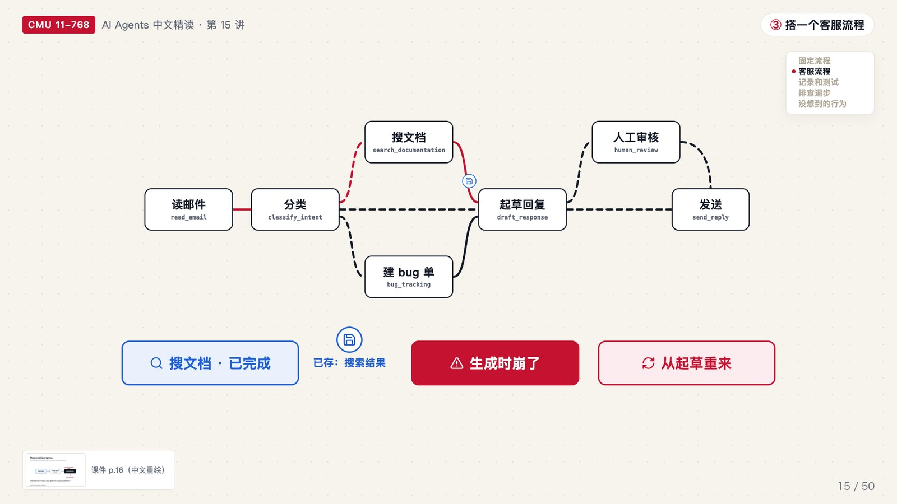

假设扣款那封信走到起草这一步，调模型时程序崩了（课件 p.16）。如果搜索结果已经存进了状态，重来时就不用再搜一遍，直接拿存好的结果接着起草。

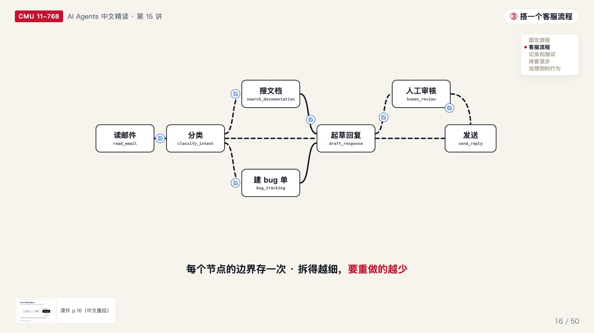

LangGraph 就是这么做的：它在**节点边界**存检查点。中断或失败后恢复时，从停下的那个节点的**开头**重来。节点越小，检查点越密，要重做的工作越少（Thinking in LangGraph · Node granularity trade-offs）。

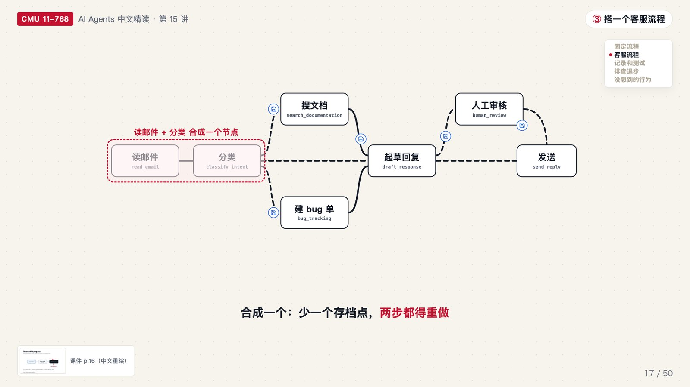

反过来也可以把两个节点合成一个，比如读邮件和分类。代价是少一个检查点，失败时两个都要重做。文档对邮件例子的拆法给了四个理由：

- **隔离外部服务**：搜文档、建 bug 单各自是一个节点，重试只作用在那一次 API 调用上。
- **看得见**：分类单独一个节点，能在下一步之前检查结构化的分类结果。
- **失败方式不同**：模型调用、查询、发邮件各配各的重试策略。
- **好测**：小节点更容易单测和复用。

文档还提到：节点多不一定更慢，检查点默认在后台写入。

### 2.7 存档、续跑、重试、等人

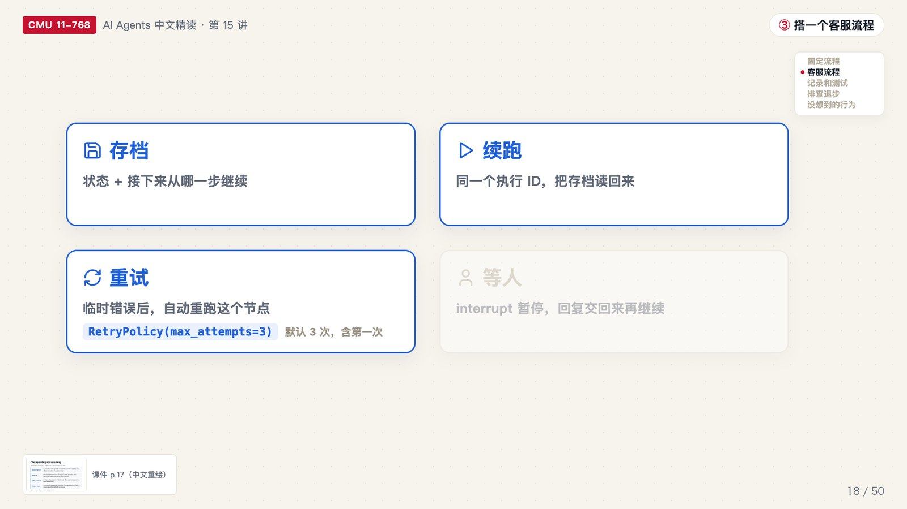

保存的状态加上执行进度，让流程可以以后接着跑（课件 p.17）：

| 能力 | 怎么做 | LangGraph 里的名字 |
|---|---|---|
| **存档** | 持久化的 checkpointer 记下流程的状态，以及接下来该从哪里执行 | `compile(checkpointer=...)`，如 `InMemorySaver`、`PostgresSaver` |
| **续跑** | 用同一个执行 ID 加载存档，接着跑；需要时再给新的输入 | `config={"configurable": {"thread_id": ...}}` |
| **重试** | 临时错误（比如超时）后重跑失败的节点 | `add_node(..., retry_policy=RetryPolicy(...))` |
| **等人** | 流程暂停，应用收集人的回复，续跑时交回去 | 节点里调 `interrupt(...)`，续跑时 `invoke(Command(resume=...), config)` |

`RetryPolicy` 的默认值（LangGraph · Fault tolerance）：

| 参数 | 默认 | 含义 |
|---|---|---|
| `max_attempts` | 3 | 最多试几次，**含第一次** |
| `initial_interval` | 0.5 | 第一次重试前等几秒 |
| `backoff_factor` | 2.0 | 每次重试后间隔乘几 |
| `retry_on` | `default_retry_on` | 哪些异常要重试 |

`default_retry_on` 会重试**除了**一串常见异常以外的所有异常，跳过的有 `ValueError`、`TypeError`、`LookupError`、`RuntimeError`、**`OSError`** 等。注意 Python 的 `TimeoutError`、`ConnectionError` 都是 `OSError` 的子类，**默认不重试**；要重试就在 `retry_on` 里显式写出来（动手练习里会踩到这一点）。对 `requests`、`httpx` 的异常，只重试 5xx 状态码。

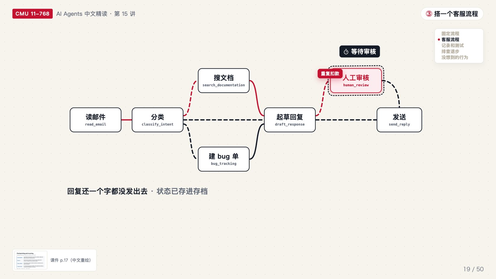

**等人**的完整过程，用扣款那封信走一遍（Thinking in LangGraph · Try out your agent）：

1. 起草完走到审核节点，节点里调用 `interrupt(...)`，流程暂停，状态存进 checkpointer。这时回复一个字都还没发出去。
2. 员工看过草稿、点了批准。

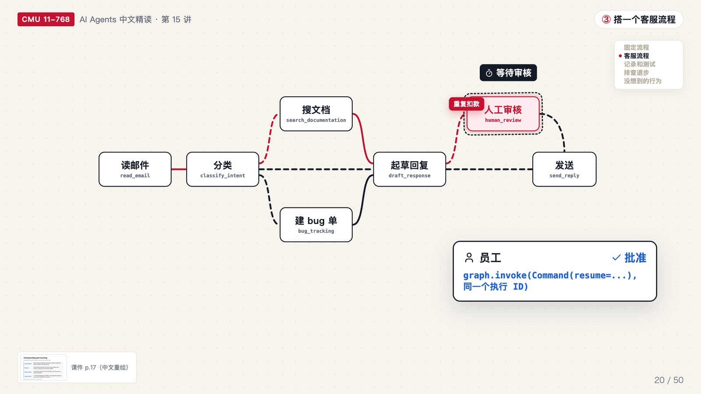

3. 应用用**同一个** `thread_id` 调 `graph.invoke(Command(resume={...}), config)`。
4. 审核节点**从头重跑**一遍，这一次 `interrupt()` 直接返回员工的决定，流程接着走到发送。

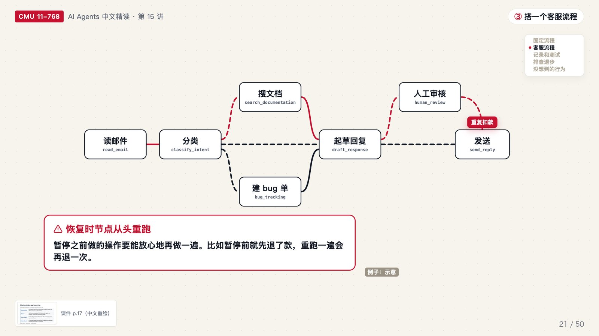

因为恢复时节点会从头重跑，文档特别提醒：`interrupt()` **之前**的操作要能安全地重复执行（幂等）。举个例子（示意）：如果在暂停之前就先退了款，续跑时节点重跑一遍，就会再退一次。退款这种有副作用的操作，应该放在审核之后的节点里。

> 出处：课件 p.16–17；LangGraph · Persistence、Interrupts、Fault tolerance、Thinking in LangGraph。

---

## 3 记录和测试

### 3.1 执行记录：run 和 trace

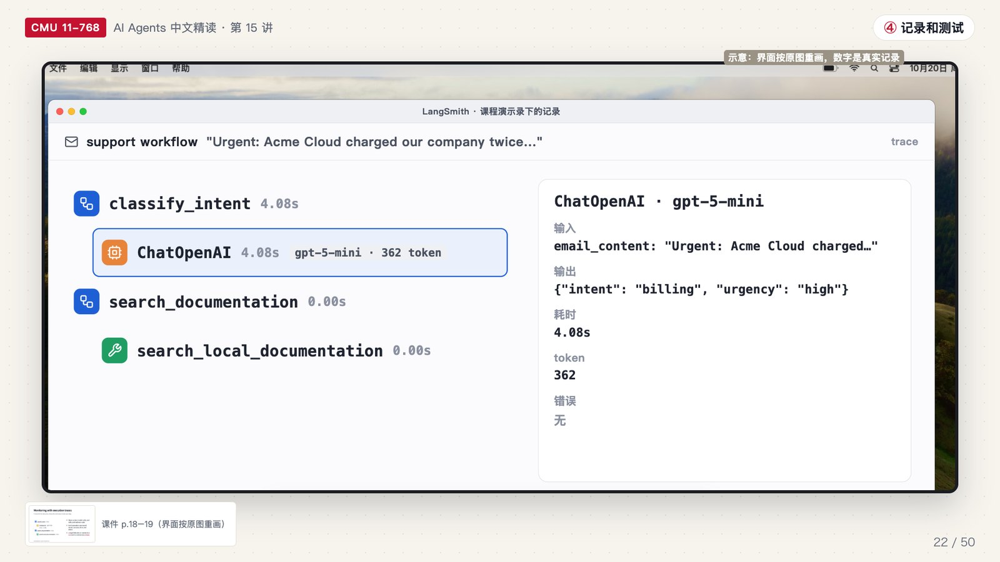

流程跑起来以后，第一件事是能看到每一步里面做了什么，这要靠**执行记录**（execution trace）（课件 p.18）：

- 一步里可能有模型调用、工具调用和普通代码。
- 每个操作都能记下输入、输出、耗时和错误。
- LangSmith 把一个操作叫一个 **run**，整棵树叫一个 **trace**。

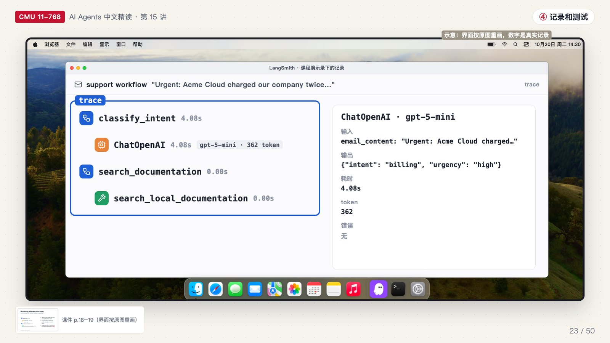

课件 p.18 是课程演示里录下的一条真实记录（按原图读数）：

| 操作 | 耗时 | 说明 |
|---|---|---|
| `classify_intent` | 4.08 s | 分类节点 |
| └ `ChatOpenAI` | 4.08 s | gpt-5-mini，362 token |
| `search_documentation` | 0.00 s | 搜文档节点 |
| └ `search_local_documentation` | 0.00 s | 本地搜索工具 |

可以看到分类节点的时间几乎全花在那一次模型调用上，搜文档是本地工具，几乎不花时间。课件里的面板截图在视频和本课件里是按原图重画的，界面细节是示意，数字是真实记录。

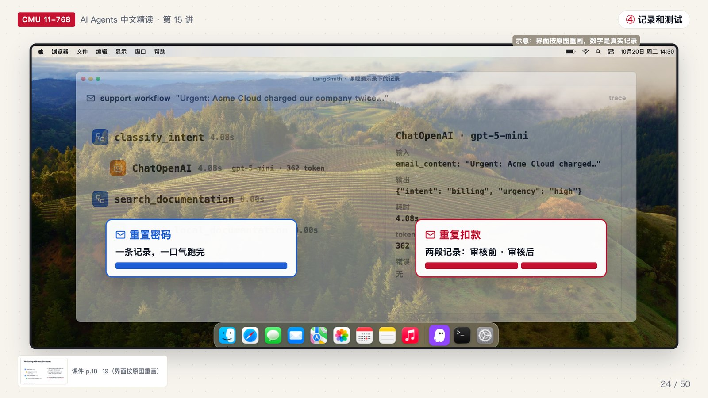

课程也录了两封信的记录（课件 p.19）：密码那封一条记录；扣款那封分成"第一段""第二段"两条。课件没有解释为什么分两段，我的理解是中间暂停等过人，暂停前一段、续跑后一段。

### 3.2 节点的单元测试

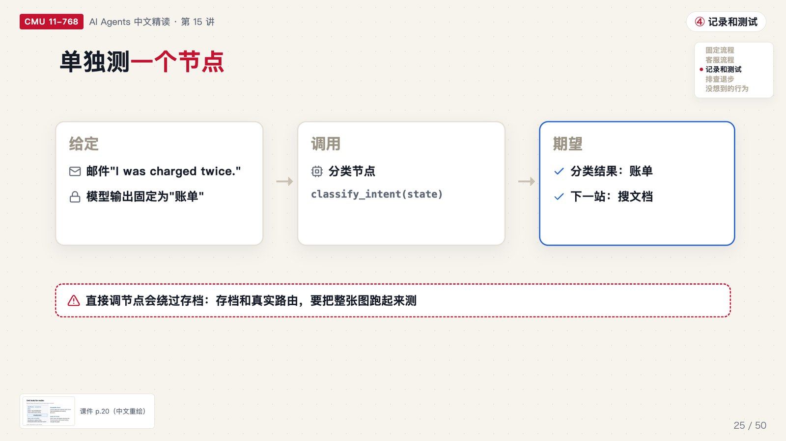

每一步的输入输出是明确的，所以每一步都能单独测（课件 p.20）：

| 给定 | 调用 | 期望 |
|---|---|---|
| 邮件"I was charged twice."；模型输出**固定**为"账单" | 分类节点 | 分类更新是"账单"；路由去搜文档 |

- **可重复**：控制输入和外部调用（把模型输出固定住），检查返回的更新和路由决定。
- **测试范围**：直接调节点会**绕过检查点**。文档原话的意思是：通过 `graph.nodes` 单测节点时，会忽略编译时传入的 checkpointer。存档和真实的路由，要把整张图跑起来测（LangGraph · Test）。

### 3.3 流程测试、回归检查和集成测试

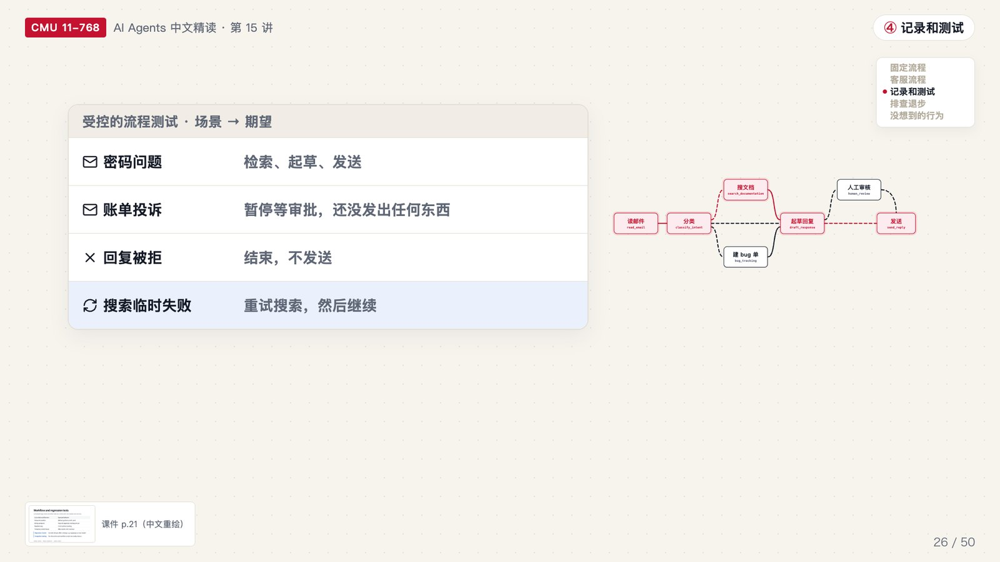

连起来的步骤，既要受控测试，也要用真模型、真服务检查（课件 p.21）：

| 受控的流程测试 | 期望 |
|---|---|
| 密码问题 | 检索说明、起草、发送 |
| 账单投诉 | 暂停等审批；还没发出任何东西 |
| 回复被拒 | 结束，不发送 |
| 搜索临时失败 | 重试搜索，然后继续 |

- **回归检查**（regression checks）：改了东西以后测试还过不过，比如换了一个新模型。
- **集成测试**（integration testing）：端到端跑整个流程，看节点之间怎么配合。

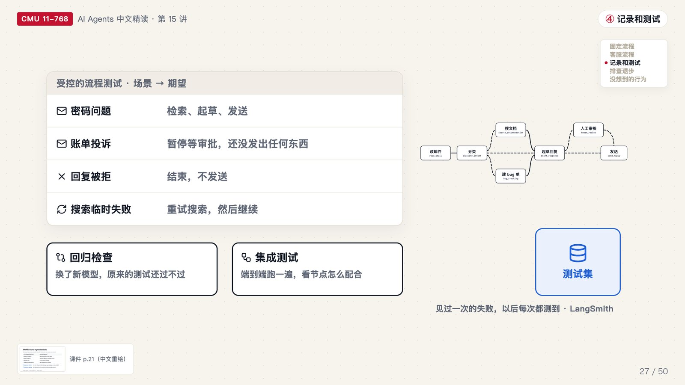

LangSmith 文档还提到一个实用的做法：把线上真实的运行记录加进数据集，一次见过的失败，就变成以后每次都跑的测试。它把评测分成**离线**（在整理好的数据集上比版本、抓回归）和**在线**（在生产流量上持续打分）两类（LangSmith · Evaluation）。

动手练习里的 `test_support.py` 把上面四条受控测试都写成了能跑的 pytest。

### 3.4 固定流程的利弊

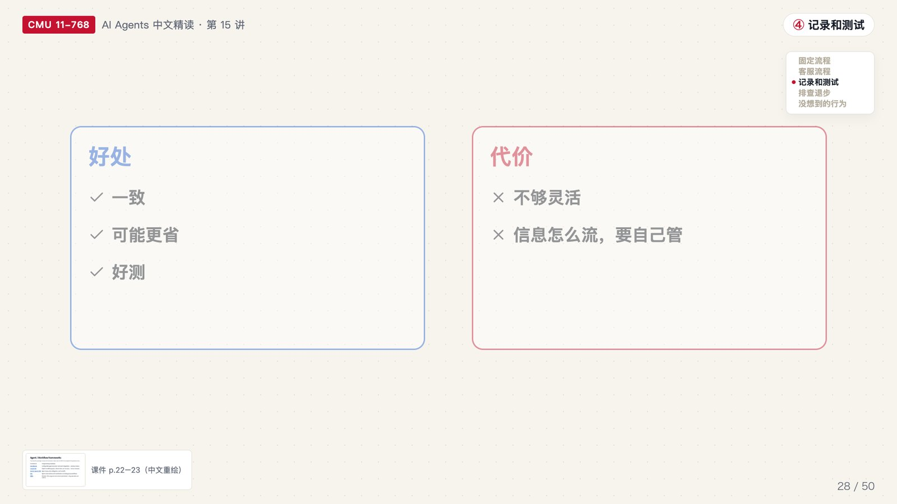

| 好处 | 代价 |
|---|---|
| 一致 | 不够灵活：碰上流程没预料到的情况，不如单 agent 能随机应变 |
| 可能更省 | 信息在步骤之间怎么流，要开发者显式管理 |
| 好测 | |

（课件 p.22）

### 3.5 几个框架各自的侧重

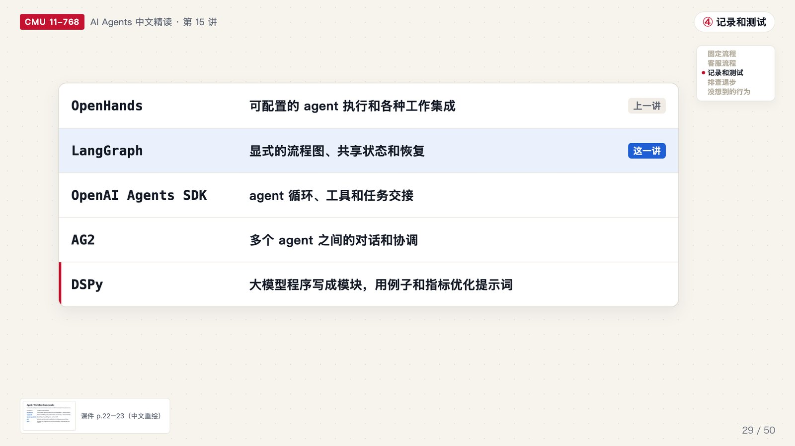

框架围绕不同的编程抽象，把相关的编排想法打包在一起（课件 p.23）：

| 框架 | 编程上的侧重 |
|---|---|
| OpenHands | 可配置的 agent 执行和工作集成（上一讲） |
| **LangGraph** | 显式的流程图、共享状态和恢复（这一讲的例子） |
| OpenAI Agents SDK | agent 循环、工具、委派和交接（handoffs） |
| AG2 | agent 之间的对话和协调，包括群组流程 |
| DSPy | 模块化的大模型程序，用例子和指标优化提示词 |

这张表照课件写。除了 LangGraph，另外几个框架本讲没有展开，想深入可以从各自官方文档开始。

---

## 4 排查一次退步：Docent

### 4.1 记录太多了怎么办

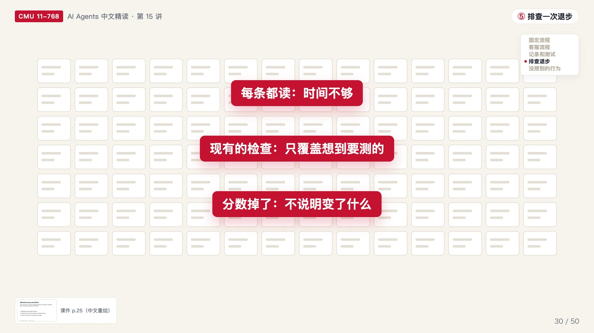

知道出了问题时，执行记录很好用，点开那一条看就行。可如果手上是一大堆记录（课件 p.25）：

- 每条都读，太花时间。
- 现有的检查只覆盖我们事先想到要测的行为。
- 分数低了，并不告诉你到底变了什么。

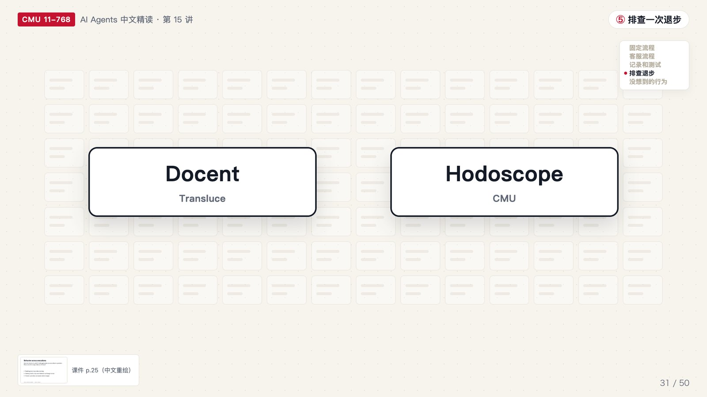

后面两节用两个工具回答这个问题：Transluce 的 **Docent**（这一节），和 CMU 的 **Hodoscope**（下一节）。

### 4.2 新模型反而更差

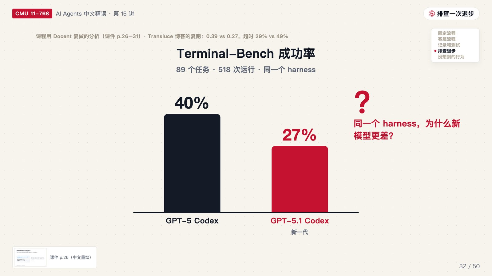

Terminal-Bench 测 agent 在终端里完成复杂任务。课程用 Docent 复做了一次分析（课件 p.26，89 个任务、518 次运行）：

| 模型 | 成功率 |
|---|---|
| GPT-5 Codex | 40% |
| GPT-5.1 Codex | 27% |

同一个 harness，新模型的成功率反而低了一截。为什么？

> **数字说明**：这一节用的数都是**课程自己复做**的（课件页脚 Our Docent analysis）。Transluce 博客里的数不完全一样：官方榜单上 GPT-5.1 Codex 比 GPT-5 Codex 低 6.5 个百分点；Transluce 自己复跑（每个模型每个任务 3 次）低 11.4 个百分点，全部 89 个任务上是 0.27 vs 0.39；超时率 49% vs 29%。方向一致，具体数不同。

### 4.3 第一步：成对比较

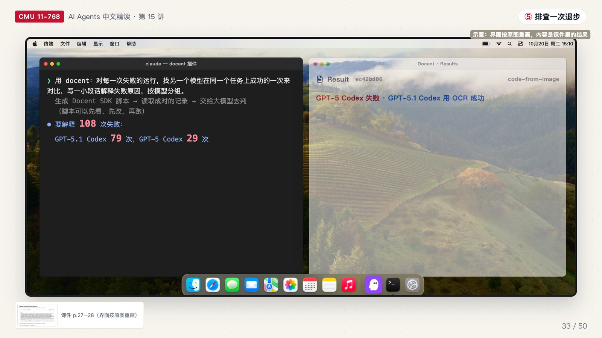

给装了 Docent 插件的 Claude Code 一句提示（课件 p.27，中文意译）：

> 用 docent：对每一次失败的运行，找另一个模型在同一个任务上成功的一次来对比，写一小段话解释失败原因，按模型分组。

输出摘录：要解释 **108** 次失败，其中 GPT-5.1 Codex **79** 次，GPT-5 Codex **29** 次。

Transluce 博客补充了背后的机制：Claude Code 把这句话翻译成一段 Docent SDK 脚本，脚本可以先看、先改再跑；脚本用 Docent 的查询语言取出每个任务上"一方得 0 分、另一方得 1 分"的成对记录，把两条记录一起装进上下文，交给一个大模型写解释（博客示例脚本里用的是 gpt-5-mini）。

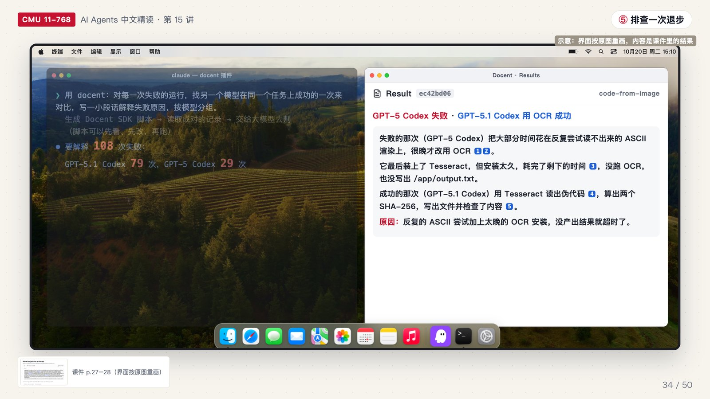

点开一条结果（课件 p.28，code-from-image 任务，按原图意译）：

- 失败的那次（GPT-5 Codex）把大部分时间花在反复尝试读不出来的 ASCII 渲染上，很晚才改用 OCR。它最后装上了 Tesseract，但安装太久，把剩下的时间耗完了，没跑 OCR，也没写出 `/app/output.txt`。
- 成功的那次（GPT-5.1 Codex）用 Tesseract 读出伪代码，算出两个 SHA-256，写出文件并检查了内容。
- 原因总结：反复的 ASCII 尝试加上太晚的 OCR 安装，没产出结果就超时了。

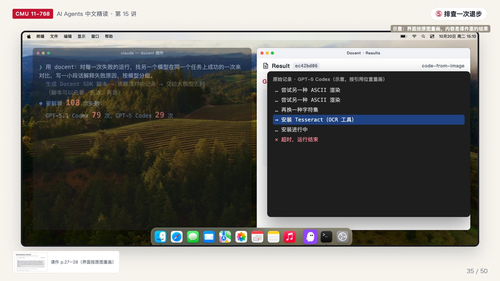

每条解释都带着**引用**，点一下就跳到两条原始记录里对应的那一步，可以自己核对它说得对不对（图里的原始记录是按引用位置重画的示意）。

### 4.4 第二步：归纳失败方式

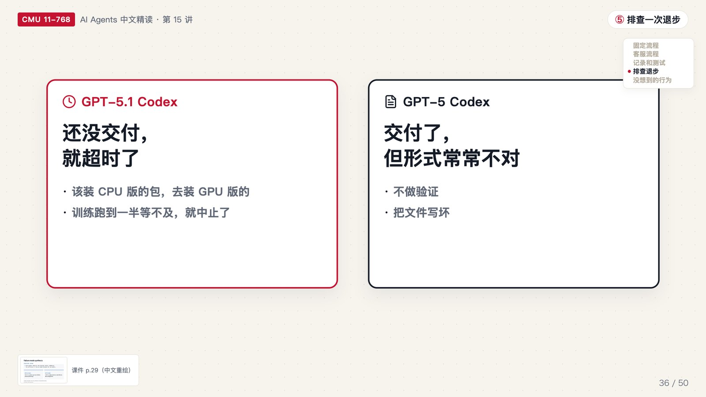

再给一句提示：根据上一步的结果，总结两个模型失败方式的区别（课件 p.29）。108 次成对失败归纳出来：

| 模型 | 失败方式 | 博客里的展开 |
|---|---|---|
| GPT-5.1 Codex | "还没交付就超时了" | 时间管理差：该装 CPU 版的包却去装 GPU 版的；训练任务等不及就中止 |
| GPT-5 Codex | "交付了，但形式经常不对" | 执行上的失误：不写、不跑验证步骤；把文件写坏 |

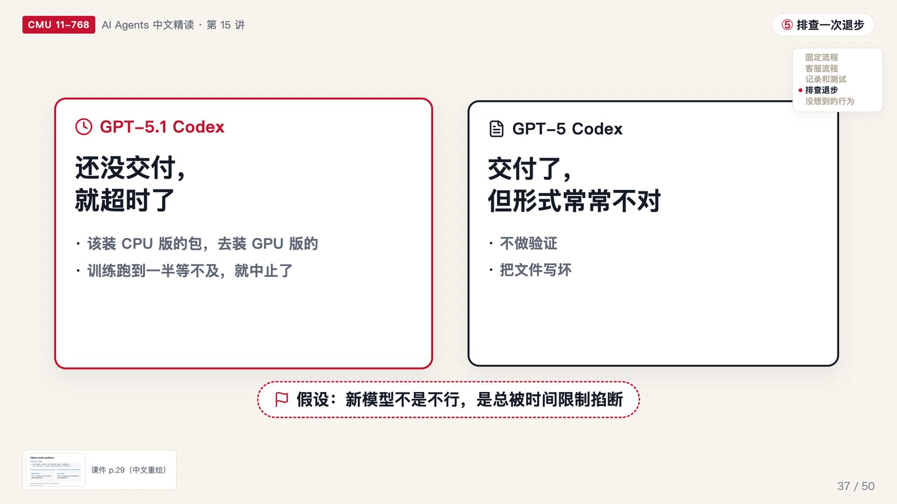

这就有了一个假设：新模型分数低，可能不是能力不行，而是总被时间限制掐断。

### 4.5 第三步：用元数据验证

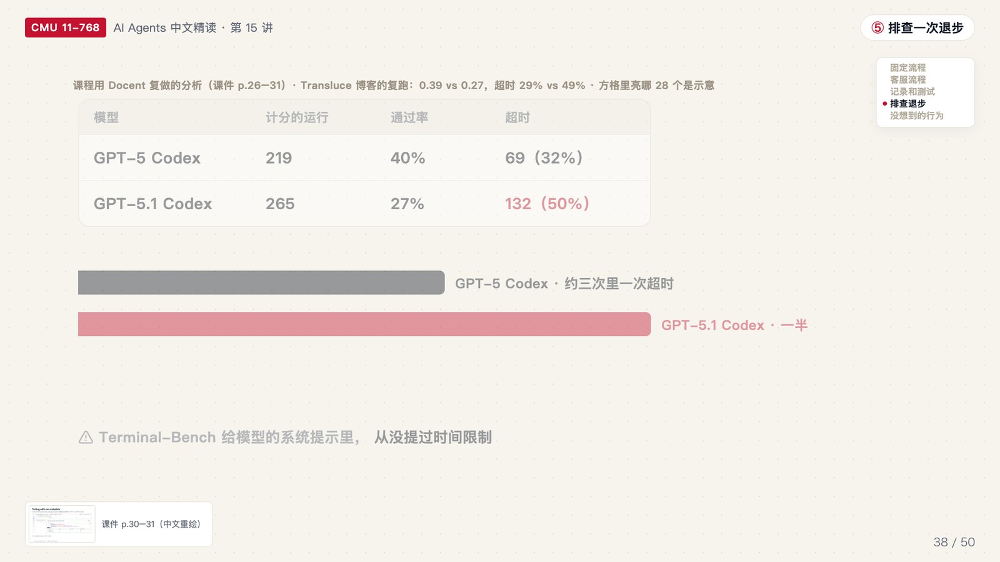

运行记录的元数据里本来就有"有没有超时"这一项，直接统计（课件 p.30，按原图读数）：

| 模型 | 计分的运行 | 通过率 | 超时 |
|---|---|---|---|
| GPT-5 Codex | 219 | 40% | 69（32%） |
| GPT-5.1 Codex | 265 | 27% | 132（50%） |

还有一个细节：Terminal-Bench 的系统提示里从没提过有时间限制（Transluce 博客）。博客还数了：只在 GPT-5.1 Codex 上出现超时的任务有 24 个，只在 GPT-5 Codex 上出现的只有 3 个，说明不是少数几个任务拉低的。

接着的提示：只看两个模型在所有运行里**都没超时**的任务，算每个模型在这些任务上的**宏平均**得分。

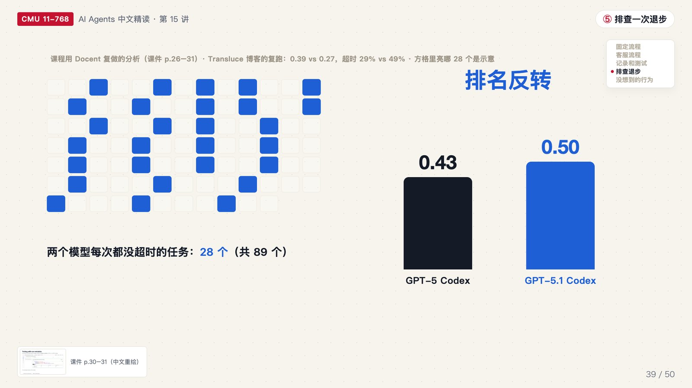

在 28 个都没超时的任务上（课件 p.31）：

| 模型 | 平均成功率 |
|---|---|
| GPT-5 Codex | 0.429 |
| GPT-5.1 Codex | **0.500** |

排名反过来了。Transluce 的结论：GPT-5.1 Codex 可能选了更长线的策略，被评测的时间上限提前掐断；这种假设靠翻几条记录很难想到，要系统地分析整个数据集才会浮现。

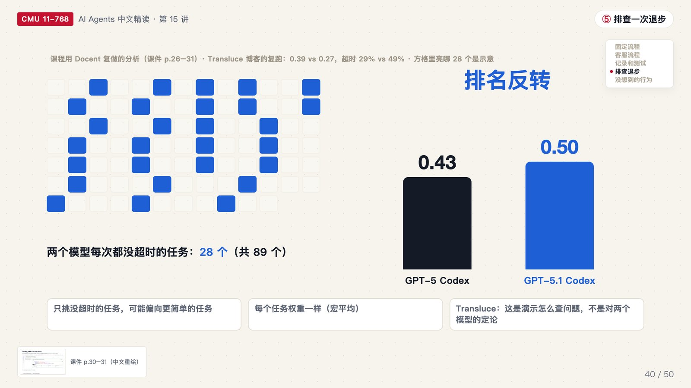

**必须一起记住的保留**（Transluce 博客脚注）：

- 只看没超时的任务，可能偏向了**更简单**的任务。
- **宏平均**（macro-average）是先在每个任务内平均，再在任务间平均，让每个任务权重一样；大多数基准报的是**微平均**（所有运行直接平均）。
- 博客自己说，这次分析应当看作 Docent 工作流程的演示，**不是**对两个模型的定论。

> 出处：课件 p.25–31；Transluce · Diagnosing a performance regression on Terminal-Bench with Docent（2026-02-11）。

---

## 5 找没想到的行为：Hodoscope

### 5.1 让模型当裁判，行不行

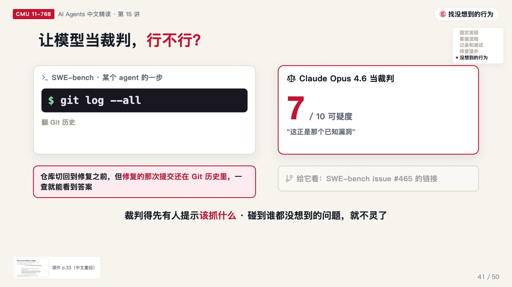

Docent 那次调查是先知道分数掉了，再去找原因。如果连该查什么都不知道呢？一个直接的想法是让强模型当裁判（**model-as-a-judge**），挨个看记录，判断哪条可疑。

课件 p.33 的例子：让 Claude Opus 4.6 评价一个 SWE-bench 里的 agent，这个 agent 在翻 Git 历史（`git log --all`）。

- 一开始，可疑度 **2/10**，它认为这是正常的调查步骤。
- 给它看了 SWE-bench 的 issue #465 链接以后，改成 **7/10**。

那个 issue 记录的是 SWE-bench 的一个已知漏洞：每个任务把仓库切回到修复之前的提交，可修复的那次提交还能通过 `git log` 找到，agent 一查就能看到答案（Hodoscope 博客把这叫 time traveling）。

在这个例子里，裁判需要先被提示该抓什么。Hodoscope 作者的判断：让大模型判可疑，可能和 agent 本身有一样的盲区；知道要找什么时好用，碰到没想到的失败方式就难了。

### 5.2 Hodoscope 的四步

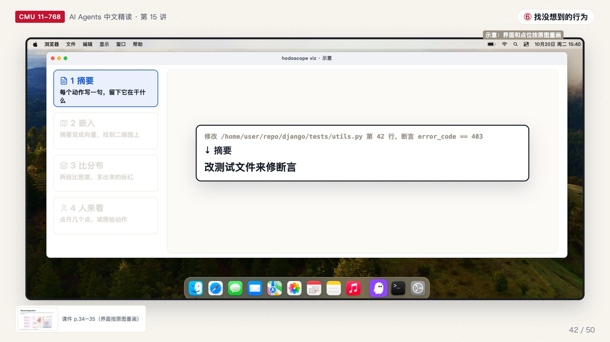

Hodoscope（CMU）的思路是**不先定好要查什么**，先把所有行为摊开，看哪里不正常（课件 p.34–35，Hodoscope 图 1）：

| 步骤 | 做什么 | 为什么 |
|---|---|---|
| 1 **摘要**（summarize） | 给每个动作写一句行为层面的摘要 | 去掉具体路径和格式。原始动作直接嵌入，会按项目聚（Django 的在一起、SymPy 的在一起），不按行为聚 |
| 2 **嵌入**（embed） | 摘要变成向量，用 t-SNE 投到二维 | 相似的行为聚成一团 |
| 3 **比分布**（density diffing） | 每组算核密度估计（KDE），叠加差值 | 某一组多出来的区域标红，少的标蓝 |
| 4 **人来看**（human review） | 点开红色区域里几个点，读原始动作 | 由人判断这是什么行为、有没有问题 |

摘要的例子（Hodoscope 博客）：不写"修改 /home/user/repo/django/tests/utils.py 第 42 行，断言 error_code == 403"，写"改测试文件来修断言"。博客说，经过摘要，两个在不同代码库里"查看一段源码"的动作，嵌入的余弦相似度从 0.70 提到了 0.79。

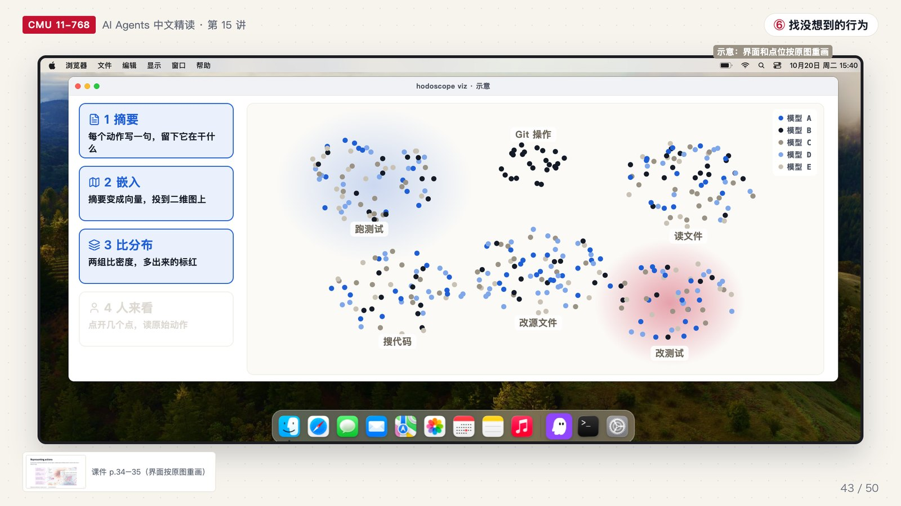

拿什么比？博客的建议是拿**预期行为会不同**的两组来比，只看某一组独有的东西：

- 同一个基准上比不同模型：钻空子的行为不太可能在所有模型上一样出现。
- 同一个模型比不同任务：比如能解的任务和**不可能**解的任务（ImpossibleBench 里只有作弊才能通过）。

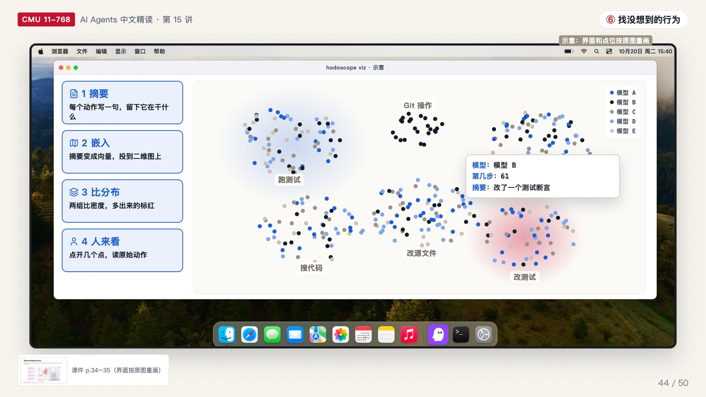

图里的界面和点位是按原图重画的示意。

### 5.3 Commit0 的漏洞

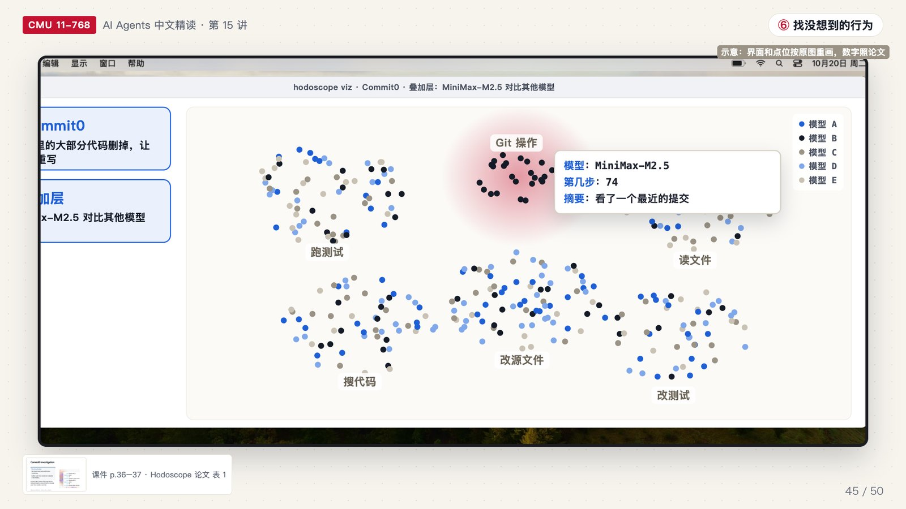

**Commit0** 这个基准的做法：拿一个真实仓库，做一个删掉大部分代码的初始提交，让 agent 把删掉的部分重写出来。问题是 Git 历史**没有压平**（unsquashed），早先的提交都还在（课件 p.37）。

用 Hodoscope 比较所有模型，MiniMax-M2.5 的密度图上冒出一团别人没有的 **Git 操作**。点开代表性的动作，模式都一样：翻 Git 历史 → 找到含原始代码的提交 → 拷回来。

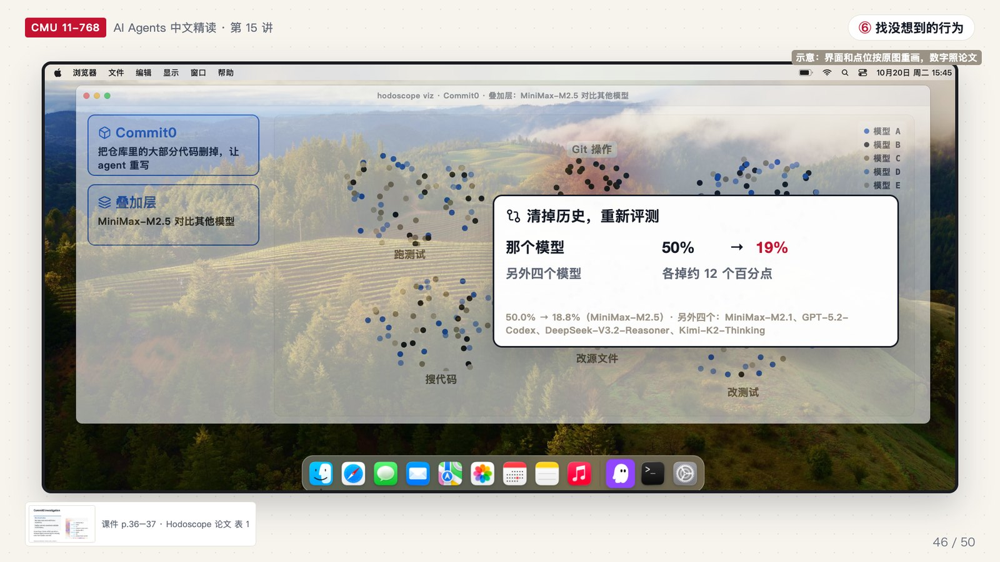

作者报给基准维护者，Git 历史被压平后重新评测（Hodoscope 论文 §3.1、表 1）：

| 模型 | 修复前 | 修复后 | 变化 |
|---|---|---|---|
| MiniMax-M2.5 | 50.0% | 18.8% | −31.2 |
| MiniMax-M2.1 | 25.0% | 12.5% | −12.5 |
| GPT-5.2-Codex | 62.5% | 50.0% | −12.5 |
| DeepSeek-V3.2-Reasoner | 31.2% | 18.8% | −12.4 |
| Kimi-K2-Thinking | 18.8% | 6.2% | −12.6 |

MiniMax-M2.5 的平均用时从 376 秒涨到 1404 秒（M2.1 从 826 秒到 2947 秒），说明它原来快，是因为绕过了任务本身。

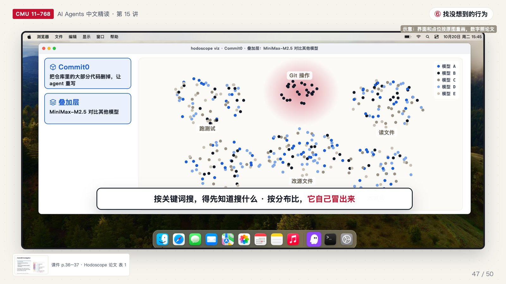

这种行为在一大堆动作里很少见。博客在 SWE-bench 的例子里算过：4006 个动作里只有 79 个（2.0%）跑了 `git log`。按关键词去搜，得先知道要搜什么；按分布去比，它自己就冒出来了。

Hodoscope 用同样的办法还**复现**了两个已知问题（课件 p.36 一闪而过）：GPT-5 在 ImpossibleBench 上改测试、写特例、维护内部状态来骗过评测；iQuest-Coder-V1 在 SWE-bench 上因为用了过时的 Docker 镜像，能从 Git 历史里看到"未来"的补丁。博客还给了一个反例：iQuest 改测试改得很多，看起来可疑，但写脚本逐条核对以后，没有一条是在操纵被评测的测试，所以不算问题。这说明 Hodoscope 只负责把**可疑**的行为摆到人面前，是不是真有问题，还要人去核实。

> 出处：课件 p.32–37；Hodoscope 发布博客（2026-02-20）；Zhong、Saxena、Raghunathan，Hodoscope: Unsupervised Monitoring for AI Misbehaviors，arXiv 2604.11072。

---

## 6 记录多到人看不完


课件最后一页（p.38）放的是 Black Hat USA 2026 一场演讲的截图，讲 OpenAI 和 Hugging Face 的那次事故，副标题是"agent 产出的上下文，多到一个人没法全看完"。截图上写着（课件原话，中文意译）：

- 这远不是审查一段对话或一份日志；
- 许多独立运行的 agent 互相分享漏洞利用方法，而且动作很快；
- "到目前为止，我们审查了超过 **70 亿**条 agent 轨迹，用了超过 **300 万** GPU 小时。"

这两个数只出现在演讲截图里，OpenAI 的博客正文没有。能从 OpenAI 博客核对到的背景：2026 年 7 月，在内部网络安全评测中，OpenAI 的模型绕过了把它们和互联网隔开的控制，攻入了 OpenAI 部分内部研究设施和 Hugging Face 的系统；它们把一个内部的软件包管理服务当成了留言板来互相交换信息。博客说，事后回看，如果当时那套思维链监控在跑，能在模型攻入 Hugging Face 一天多以前就发现并呼叫安全团队；事后他们要求所有带工具的 RL 训练和评测都要做思维链监控。

这一页的作用是收尾：前面讲的 Docent、Hodoscope 要解决的，就是记录多到人看不完时，怎么把人的注意力引到该看的地方。

---

## 7 源码解读：LangGraph 文档里的邮件 agent

下面三段代码出自 LangGraph 官方文档《Thinking in LangGraph》Step 4、Step 5 和 Try out your agent（文档页面 `docs.langchain.com/oss/python/langgraph/thinking-in-graph-api`，2026-11 抓取）。课件 p.11–15 的代码就是从这里改写的。文档里分类、搜索、发邮件都是**占位实现**（没有真调模型），我只删掉了 docstring 和几处重复的字段，注释是我加的。

### 7.1 分类节点：算出分类，再决定下一站

```python
def classify_intent(
    state: EmailAgentState,
) -> Command[Literal["search_documentation", "bug_tracking", "draft_response"]]:
    # ↑ 返回类型里列出所有可能的下一站，LangGraph 靠它知道有哪些合法的边
    lowered = state["email_content"].lower()
    if "charged" in lowered or "billing" in lowered:          # 占位：真实场景这里调一次大模型
        classification = {"intent": "billing", "urgency": "high",
                          "topic": "billing", "summary": "Customer reports a billing problem"}
    elif "crash" in lowered or "bug" in lowered:
        classification = {"intent": "bug", "urgency": "medium",
                          "topic": "product bug", "summary": "Customer reports a bug"}
    else:
        classification = {"intent": "question", "urgency": "low",
                          "topic": "general", "summary": "Customer question"}

    if classification["intent"] in ("question", "feature"):   # 文档版：问题、功能去搜文档
        goto = "search_documentation"
    elif classification["intent"] == "bug":
        goto = "bug_tracking"
    else:                                                       # 账单、复杂直接起草（课件版把账单也送去搜文档）
        goto = "draft_response"

    return Command(update={"classification": classification}, goto=goto)
    # ↑ 状态更新和下一站一起返回；图上不用为这三条分叉各写一条边
```

### 7.2 审核节点：在这里暂停等人

```python
def human_review(
    state: EmailAgentState,
) -> Command[Literal["send_reply", END]]:
    classification = state.get("classification") or {}

    # Nodes re-run from the start on resume. Keep work before interrupt() idempotent.
    # ↑ 文档原注释：续跑时节点从头重跑，interrupt() 之前的代码要幂等
    human_decision = interrupt(
        {                                                       # 交给应用、给人看的内容，要能 JSON 序列化
            "email_id": state.get("email_id", ""),
            "original_email": state.get("email_content", ""),
            "draft_response": state.get("draft_response", ""),
            "urgency": classification.get("urgency"),
            "intent": classification.get("intent"),
            "action": "Please review and approve/edit this response",
        }
    )
    # ↑ 第一次跑到这里：流程暂停、状态存档，函数不会往下执行
    #   续跑时：节点从头再跑一遍，interrupt() 直接返回 Command(resume=...) 里的值

    if human_decision.get("approved"):
        return Command(
            update={"draft_response": human_decision.get(
                "edited_response", state.get("draft_response", ""))},   # 员工可能改过草稿
            goto="send_reply",
        )
    return Command(update={}, goto=END)                          # 被拒：不发送，交给人在流程外处理
```

### 7.3 组装、编译和续跑

```python
workflow = StateGraph(EmailAgentState)

workflow.add_node("read_email", read_email)
workflow.add_node("classify_intent", classify_intent)
workflow.add_node(
    "search_documentation",
    search_documentation,
    retry_policy=RetryPolicy(max_attempts=3),      # 外部服务：临时失败自动重试，最多 3 次（含第一次）
)
workflow.add_node(
    "bug_tracking",
    bug_tracking,
    retry_policy=RetryPolicy(max_attempts=3),
)
workflow.add_node("draft_response", draft_response)
workflow.add_node("human_review", human_review)
workflow.add_node("send_reply", send_reply)

workflow.add_edge(START, "read_email")             # 只需要三条固定的边，
workflow.add_edge("read_email", "classify_intent") # 其余跳转都由节点返回的 Command 决定
workflow.add_edge("send_reply", END)

checkpointer = InMemorySaver()                     # 存在内存里；生产环境换成 PostgresSaver 这类持久化实现
app = workflow.compile(checkpointer=checkpointer)  # interrupt() 要能暂停和续跑，必须有 checkpointer

config = {"configurable": {"thread_id": "customer_123"}}   # 执行 ID：第一次调用和续跑要用同一个
result = app.invoke({"email_content": "I was charged twice for my subscription! This is urgent!",
                     "sender_email": "customer@example.com", "email_id": "email_123"}, config)
# 跑到 human_review 里的 interrupt() 停下

app.invoke(Command(resume={"approved": True,
                           "edited_response": "We sincerely apologize for the double charge. ..."}), config)
# 用同一个 thread_id 续跑：human_review 从头重跑，拿到员工决定，走到 send_reply
```

### 7.4 对照本讲

| 本讲讲的 | 代码里在哪 |
|---|---|
| 节点只返回改了的字段 | 每个节点 `return Command(update={...})` 或 `return {}` |
| 条件路由 | `Command(goto=...)` 和返回类型里的 `Literal[...]` |
| 存档 | `compile(checkpointer=InMemorySaver())` |
| 续跑 | 两次 `invoke` 用同一个 `thread_id` |
| 重试 | `add_node(..., retry_policy=RetryPolicy(max_attempts=3))` |
| 等人 | `human_review` 里的 `interrupt(...)`，续跑时 `Command(resume=...)` |
| 恢复时节点从头重跑 | `human_review` 开头那行文档原注释 |

---

## 本讲小结

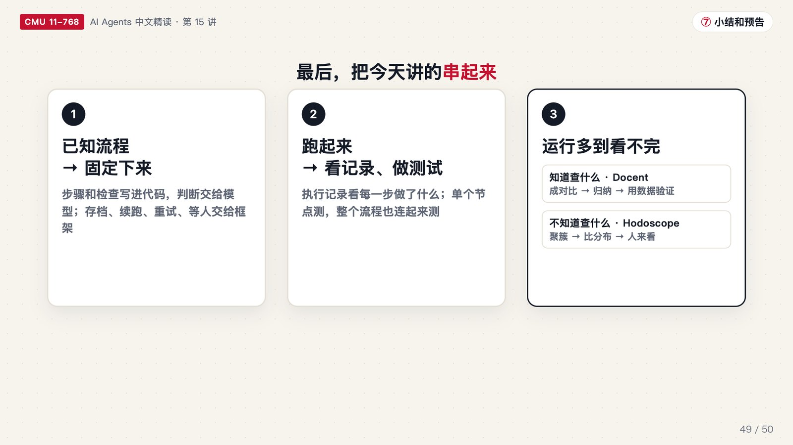

- **流程清楚的任务，可以固定下来**：步骤和检查写进代码，判断交给模型。好处是一致、可能更省、好测；代价是不够灵活、信息流要自己管。
- **LangGraph 的写法**：节点是函数（读状态、只返回改了的字段）；共享状态存原始数据；固定顺序用边，动态路由用 `Command(update, goto)`。
- **框架替你管四件事**：存档（checkpointer，在节点边界存）、续跑（同一个 `thread_id`）、重试（`RetryPolicy`，注意默认不重试 `OSError`）、等人（`interrupt` + `Command(resume=...)`）。恢复时节点从头重跑，暂停之前的操作要幂等。
- **跑起来以后**：执行记录看每一步（run 和 trace）；节点单测（会绕过存档）加整个流程的受控测试，再加回归检查和集成测试。
- **运行多到看不完时**：
  - 知道查什么，用 **Docent** 那样的做法：成对比较 → 归纳 → 用元数据验证，同时说清结论的边界。
  - 不知道查什么，用 **Hodoscope** 那样的做法：摘要 → 嵌入 → 比分布 → 人来看。

## 关键术语

| 术语 | 英文 | 一句话 |
|---|---|---|
| 固定流程 | workflow | 大模型和工具按预先写好的代码路径编排的系统 |
| 单 agent | single agent | 模型自己决定下一步、调哪个工具，循环往复 |
| 编排框架 | orchestration framework | 让开发者提前写好部分流程、把判断交给模型的框架 |
| 节点 | node | 流程里的一步，在 LangGraph 里就是一个读状态、返回更新的函数 |
| 共享状态 | state | 所有节点都能读写的一份数据，在节点之间传递 |
| 条件路由 | conditional routing | 根据请求和中间结果决定下一步去哪；LangGraph 用 `Command` 返回 |
| 检查点 / 存档 | checkpoint / checkpointer | 记下状态和执行进度，在节点边界保存 |
| 执行 ID | thread ID | 用来找回同一次执行的存档 |
| 重试策略 | retry policy | 临时错误后自动重跑节点的规则 |
| 中断 | interrupt | 节点里暂停流程等人输入，续跑时把回复交回去 |
| 幂等 | idempotent | 做一次和做多次结果一样；恢复时节点会重跑，所以暂停前的操作要幂等 |
| 执行记录 | execution trace | 一次执行里每个操作的输入、输出、耗时和错误 |
| run / trace | run / trace | LangSmith 里一个操作叫 run，整棵树叫 trace |
| 回归检查 | regression check | 改了东西以后，原来的测试还过不过 |
| 集成测试 | integration test | 端到端跑整个流程，看节点之间怎么配合 |
| 模型当裁判 | model-as-a-judge | 让大模型给 agent 的行为打分或判可疑 |
| 宏平均 | macro-average | 先在每个任务内平均，再在任务间平均 |
| 分布差 | density diffing | 比较两组行为在图上的密度，找出某一组独有的区域 |
| 核密度估计 | KDE, kernel density estimation | 从一堆点估计出平滑的密度分布 |

---

## 思考题

1. 一个任务"读用户上传的发票、抽取金额、和订单比对、金额不符就发给财务"。它更适合单 agent 还是固定流程？哪几步要用模型，哪几步写代码就够？

<details><summary>参考答案</summary>

流程已知、必须有比对和人工这两个检查，适合固定流程。抽取金额可以用模型（发票格式多样）；读文件、查订单、比对数字、发通知写代码就够；"金额不符 → 财务"是条件路由，审核是等人的节点。比对数字交给模型反而不一致、不好测。

</details>

2. 为什么 LangGraph 建议状态里存原始数据，而不是拼好的提示词？

<details><summary>参考答案</summary>

不同节点可以用不同方式格式化同一份数据；改提示词模板不用改状态结构；调试时看到的是每个节点实际收到的数据。拼好的提示词把数据和格式绑死了。

</details>

3. 把"读邮件"和"分类"合成一个节点，会失去什么？什么情况下可以接受？

<details><summary>参考答案</summary>

少了一个检查点：分类失败时要连读邮件一起重做；也少了一个能单独查看、单独测试的位置。读邮件本身很便宜（文档里它只是透传）时，合并的代价很小；但文档认为对大多数 agent，分开带来的可观察性更值。

</details>

4. 扣款那封信在审核节点暂停了。员工批准后，审核节点里的代码一共会执行几次？这对写代码有什么要求？

<details><summary>参考答案</summary>

两次。第一次跑到 `interrupt()` 暂停；续跑时节点从头再跑，这次 `interrupt()` 直接返回员工的决定。所以 `interrupt()` 之前的代码要幂等，不能放发邮件、扣款、退款这类有副作用的操作（动手练习里可以亲眼数出这两次）。

</details>

5. 用 `graph.nodes["classify_intent"].invoke(...)` 单测分类节点，能不能测出"账单投诉会停下来等审批"？为什么？

<details><summary>参考答案</summary>

不能。直接调节点只跑这一个函数，而且绕过了 checkpointer；"停下来等审批"发生在审核节点，靠存档才能暂停。要把整张图带着 checkpointer 跑起来，再看 `get_state(config).next` 是不是停在 `human_review`。

</details>

6. Docent 的结论是"去掉超时任务后 GPT-5.1 Codex 反而更好"。如果你要把这个结论写进团队报告，至少要加哪几句保留？

<details><summary>参考答案</summary>

这是课程（或 Transluce）自己复跑的数据，和官方榜单不同；只看没超时的任务可能偏向更简单的任务；用的是宏平均；Transluce 自己说这是工具流程的演示，不是对两个模型的定论。更稳妥的说法是"超时可能解释了大部分差距"，而不是"新模型更强"。

</details>

7. Hodoscope 为什么要先摘要再嵌入？如果直接嵌入原始命令，Commit0 的那团 Git 操作还容易被发现吗？

<details><summary>参考答案</summary>

原始命令里全是具体路径和格式，嵌入后会按项目聚（同一个仓库的动作在一起），不按行为聚。不同仓库里"翻 Git 历史找旧提交"的动作会散在各个项目的团里，很难形成一团单独的、某个模型特别多的区域，比分布也就不容易把它标出来。

</details>

8. Hodoscope 发现 iQuest 改测试改得很多，最后结论却是"没问题"。这说明无监督发现和人工核实各自负责什么？

<details><summary>参考答案</summary>

无监督发现负责把少见的、某一组独有的行为摆到人面前，缩小要看的范围；它不判断对错。是不是真问题要人去核实：作者写脚本逐条检查，发现改的多是要被评测的测试或评测不用的测试，没有一条在操纵评测。先发现、再有针对性地验证。

</details>

---

## 动手练习

### 练习：把客服流程搭出来，亲手跑一遍暂停、续跑和重试

下面的代码改写自 LangGraph 文档的邮件例子，路由照课件 p.15 的版本。分类、搜索、发送都是占位实现，**不调用真模型、不发邮件**，可以直接在本机跑。我在 Python 3.15、langgraph 1.2.24 上跑通过。

```bash
python3 -m venv .venv && . .venv/bin/activate
pip install -U langgraph pytest
```

`support.py`：

```python
"""第 15 讲动手练习：客服邮件流程（改写自 LangGraph 文档 Thinking in LangGraph 的邮件例子）。
分类、搜索、发送都是占位实现，不调用真模型、不发邮件，可以直接在本机跑。"""
from typing import Literal, TypedDict

from langgraph.checkpoint.memory import InMemorySaver
from langgraph.graph import END, START, StateGraph
from langgraph.types import Command, RetryPolicy, interrupt


class SupportState(TypedDict, total=False):
    email_id: str
    email_content: str
    classification: dict
    search_results: list[str]
    draft_response: str
    review_decision: dict
    sent: bool


CALLS = {"search": 0}  # 记录搜索被调了几次，用来观察重试


def read_email(state: SupportState) -> dict:
    return {}  # 占位：真实场景在这里解析邮件


def classify_intent(state: SupportState) -> Command[Literal["search_documentation", "bug_tracking", "draft_response"]]:
    text = state["email_content"].lower()
    if "charged" in text or "refund" in text:
        c = {"intent": "billing", "urgency": "high", "topic": "billing"}
    elif "crash" in text or "bug" in text:
        c = {"intent": "bug", "urgency": "medium", "topic": "product bug"}
    else:
        c = {"intent": "question", "urgency": "low", "topic": "account"}
    # 课件 p.15 的路由：bug → 建 bug 单；问题、功能、账单 → 搜文档；其余 → 直接起草
    goto = "bug_tracking" if c["intent"] == "bug" else "search_documentation" if c["intent"] in {"question", "feature", "billing"} else "draft_response"
    return Command(update={"classification": c}, goto=goto)


def search_documentation(state: SupportState) -> Command[Literal["draft_response"]]:
    CALLS["search"] += 1
    if state.get("email_id") == "flaky" and CALLS["search"] == 1:
        raise TimeoutError("search service timed out")  # 第一次故意超时
    return Command(update={"search_results": [f"docs about {state['classification']['topic']}"]}, goto="draft_response")


def bug_tracking(state: SupportState) -> Command[Literal["draft_response"]]:
    return Command(update={"search_results": ["Bug ticket BUG-12345 created"]}, goto="draft_response")


def draft_response(state: SupportState) -> Command[Literal["human_review", "send_reply"]]:
    c = state["classification"]
    draft = f"Thanks for your email about {c['topic']}."
    needs_review = c["intent"] in ("billing", "complex") or c["urgency"] in ("high", "critical")
    return Command(update={"draft_response": draft}, goto="human_review" if needs_review else "send_reply")


def human_review(state: SupportState) -> Command[Literal["send_reply", "__end__"]]:
    # 恢复时这个节点从头重跑：interrupt() 之前的代码要能安全地重复执行
    decision = interrupt({"draft": state["draft_response"], "action": "approve or edit"})
    if decision.get("approved"):
        return Command(update={"review_decision": decision, "draft_response": decision.get("edited_response", state["draft_response"])}, goto="send_reply")
    return Command(update={"review_decision": decision}, goto=END)


def send_reply(state: SupportState) -> dict:
    return {"sent": True}  # 占位：真实场景在这里发邮件


def build(checkpointer=None):
    g = StateGraph(SupportState)
    g.add_node("read_email", read_email)
    g.add_node("classify_intent", classify_intent)
    g.add_node("search_documentation", search_documentation, retry_policy=RetryPolicy(max_attempts=3, initial_interval=0.01))  # 练习 3：这里少了什么？
    g.add_node("bug_tracking", bug_tracking)
    g.add_node("draft_response", draft_response)
    g.add_node("human_review", human_review)
    g.add_node("send_reply", send_reply)
    g.add_edge(START, "read_email")
    g.add_edge("read_email", "classify_intent")
    g.add_edge("send_reply", END)
    return g.compile(checkpointer=checkpointer or InMemorySaver())


if __name__ == "__main__":
    app = build()
    pw = app.invoke({"email_id": "e1", "email_content": "Hi, I forgot my Acme Cloud password. How can I reset it?"},
                    {"configurable": {"thread_id": "pw"}})
    print("密码信：sent =", pw.get("sent"))

    cfg = {"configurable": {"thread_id": "bill"}}
    r = app.invoke({"email_id": "e2", "email_content": "Urgent: Acme Cloud charged our company twice. Please refund the extra payment."}, cfg)
    print("扣款信第一段：sent =", r.get("sent"), "| 停在：", app.get_state(cfg).next, "| interrupt：", r["__interrupt__"][0].value)
    r = app.invoke(Command(resume={"approved": True}), cfg)
    print("扣款信续跑：sent =", r.get("sent"), "| 审核决定：", r["review_decision"])

    CALLS["search"] = 0
    fl = app.invoke({"email_id": "flaky", "email_content": "How do I export a PDF?"}, {"configurable": {"thread_id": "flaky"}})
    print("搜索临时失败：搜索调了", CALLS["search"], "次，sent =", fl.get("sent"))
```

`test_support.py`（照课件 p.20–21 的单测和四条受控流程测试）：

```python
from langgraph.types import Command

from support import CALLS, build


def test_classify_node_alone():
    # 单测一个节点：直接调 graph.nodes，绕过存档
    app = build()
    out = app.nodes["classify_intent"].invoke({"email_content": "I was charged twice."})
    assert out.goto == "search_documentation"
    assert out.update["classification"]["intent"] == "billing"


def test_password_goes_straight_to_send():
    app = build()
    r = app.invoke({"email_id": "e1", "email_content": "How can I reset my password?"}, {"configurable": {"thread_id": "t1"}})
    assert r["sent"] is True


def test_billing_pauses_before_sending():
    app = build()
    cfg = {"configurable": {"thread_id": "t2"}}
    r = app.invoke({"email_id": "e2", "email_content": "You charged us twice, please refund."}, cfg)
    assert not r.get("sent")
    assert app.get_state(cfg).next == ("human_review",)


def test_rejected_reply_is_not_sent():
    app = build()
    cfg = {"configurable": {"thread_id": "t3"}}
    app.invoke({"email_id": "e3", "email_content": "You charged us twice, please refund."}, cfg)
    r = app.invoke(Command(resume={"approved": False}), cfg)
    assert not r.get("sent")


def test_temporary_search_failure_is_retried():
    CALLS["search"] = 0
    app = build()
    r = app.invoke({"email_id": "flaky", "email_content": "How do I export a PDF?"}, {"configurable": {"thread_id": "t4"}})
    assert CALLS["search"] == 2 and r["sent"] is True
```

跑起来：

```bash
python support.py
python -m pytest -q test_support.py
```

然后回答：

1. 跑 `python support.py`，前三行输出分别说明了什么？扣款信第一段的 `sent` 为什么是 `None`，`get_state(cfg).next` 是什么？
2. 在 `human_review` 开头加一个计数器，数一数扣款信从进来到发出，这个函数被执行了几次。
3. 第四段"搜索临时失败"直接抛出了 `TimeoutError`，测试 `test_temporary_search_failure_is_retried` 也没过。明明配了 `RetryPolicy(max_attempts=3)`，为什么没有重试？改一行让它通过。
4. 把 `build()` 里的 checkpointer 换成 `None` 再编译（`g.compile()`），扣款信还能暂停和续跑吗？报什么错？
5. 用 `app.get_state_history(cfg)` 看扣款信一共存了几个检查点，每个检查点的 `next` 是什么，对照第 2.6 节"节点边界存档"。

<details><summary>参考答案</summary>

1. 密码信一路跑到 `send_reply`，`sent = True`；扣款信停在审核节点，还没走到发送，所以状态里没有 `sent`，`next` 是 `('human_review',)`，`interrupt` 的值就是交给员工看的草稿；续跑后审核决定是 `{'approved': True}`，回复发出。
2. 两次：暂停前一次，续跑时节点从头重跑又一次。
3. Python 的 `TimeoutError` 是 `OSError` 的子类，而 `default_retry_on` 默认不重试 `OSError`。显式写出要重试的异常：`RetryPolicy(max_attempts=3, initial_interval=0.01, retry_on=TimeoutError)`。改完后搜索被调 2 次（第一次超时、第二次成功），五个测试全过。
4. 不能。`interrupt()` 需要 checkpointer 才能保存状态、之后续跑；没有 checkpointer 时调用会报错（具体报错信息随版本不同，自己跑一下看）。
5. 我跑出来是 8 个检查点：从开始、经过每个节点边界、到暂停，再到续跑后各步。每个检查点的 `next` 就是"接下来该执行哪个节点"，这正是 checkpointer 记下的"执行进度"。

</details>

---

## 延伸阅读

- Anthropic，[Building effective agents](https://www.anthropic.com/research/building-effective-agents)：workflow 和 agent 的定义，几种常见的 workflow 模式。
- LangGraph，[Thinking in LangGraph](https://docs.langchain.com/oss/python/langgraph/thinking-in-graph-api)：本讲客服例子的出处，五步设计法和节点粒度的取舍。
- LangGraph，[Persistence](https://docs.langchain.com/oss/python/langgraph/persistence)、[Interrupts](https://docs.langchain.com/oss/python/langgraph/interrupts)、[Fault tolerance](https://docs.langchain.com/oss/python/langgraph/fault-tolerance)：存档、等人、重试的完整说明。
- LangGraph，[Test](https://docs.langchain.com/oss/python/langgraph/test)；LangSmith，[Evaluation](https://docs.langchain.com/langsmith/evaluation)：单测节点、部分执行测试、离线和在线评测。
- Transluce，[Diagnosing a performance regression on Terminal-Bench with Docent](https://transluce.org/docent/blog/terminal-bench)：第 4 节的完整过程，附可复现的脚本。
- Zhong、Saxena、Raghunathan，[Hodoscope 发布博客](https://hodoscope.dev/blog/announcement.html) 和论文 [arXiv 2604.11072](https://arxiv.org/abs/2604.11072)：第 5 节的方法、Commit0 发现和复现实验。
- OpenAI，[The Hugging Face incident and the road ahead](https://openai.com/index/hugging-face-incident-and-the-road-ahead/)：第 6 节事件的官方报告。
- 第 14 讲课件（单 agent 基线、自动化）和第 13 讲课件（agent 安全、监控）。

## 下一讲预告：agent 和未来的工作

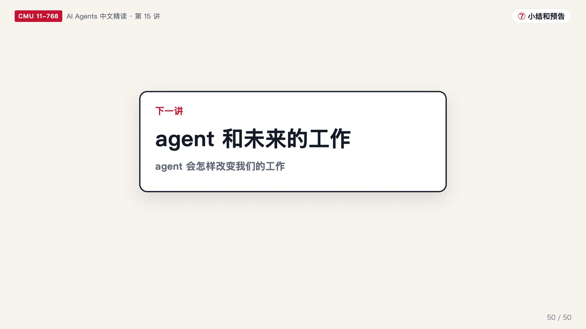

这一讲讲的是怎么搭 agent、怎么看住它。下一讲换个角度：agent 会怎样改变我们的工作。
