# 第 17 讲 · 多 agent 交互：分工、派活和互相沟通

> CMU 11-768 AI Agents（2026 秋）中文精读 · 配套课件
> 配套视频（15 分钟）：B 站 / 视频号 / 抖音 / 小红书搜索「竹二木SI」 · 整份幻灯片：[l17-幻灯片.pdf](./l17-幻灯片.pdf)
> 原课程：[cmu-agents.com](https://cmu-agents.com)，课程主讲 Graham Neubig、Daniel Fried；本讲课表名 Interaction 1: Multi-Agent Interaction（Lecture 18 Multi-agent Systems），讲者 Saujas Vaduguru。本课件是非官方的学习整理。
> **这一讲原课程没有公开录像**，内容根据原课件（44 页）和课表列出的推荐阅读整理：必读的 6 篇（Multiagent Debate、Multi-Agent Computer Use、Scaling Discovery through Test-Time Communication、SWEET-RL、Don't lie to your friends、Debating with More Persuasive LLMs），以及课件页脚引用的论文、文档和博客。每节末尾注明出处。从图上读出的数标"按原图读数"；课件没注出处的标"课件原话"。

## 这一讲你会学到

学完这一讲，你应该能做到：

1. 说出什么是**多 agent 系统**（multi-agent system），以及课件给的三种用处：多花点测试时计算把活干好、和别的实体交互、当训练和评测环境。
2. 用京都三日游的例子说出单个 agent 的四个毛病，比较几种分摊工作的办法：按角色分工（ChatDev）、把子 agent 包成工具（LangChain）、多 agent 辩论、递归派子 agent（RAO）、管理者加任务图（MACU）、用 Git 协调（CAID）。
3. 说出有管理者的代价（干等），以及几种不要管理者的协调方式：黑板、共享任务队列和留言板（DeLM）、共享 Git 仓库（GitSwarm）；说出沟通要有用的两个条件。
4. 把人和 agent 的协作也看成多 agent 系统，说出用户模拟器怎么用来训练 agent、只用一个模拟器为什么会练偏。
5. 举两个"agent 之间沟通出了意料之外的事"的例子：涌现的缩写语言（GlossoGen）、在目录名里留言（METR 调查的事件）。
6. 说出两种拿多个 agent 当训练和评测环境的做法：信息搜寻游戏让模型学会说"不确定"，辩论帮外行裁判监督更强的模型。

建议先看一遍视频，再对照本课件逐节复习。每节开头的图就是视频里对应的画面。

### 接上一讲

上一讲看的是 agent 和真实的工作：能替人干多少活，任务、环境、评测怎么准备，人怎么参与。前面讲的 agent 大多是一个在干活。这一讲看多个 agent：它们怎么分工、怎么派活、怎么传消息，什么时候比一个强，什么时候反而添乱。下一讲再专门讲人和 agent 的交互。

### 这一讲的路线

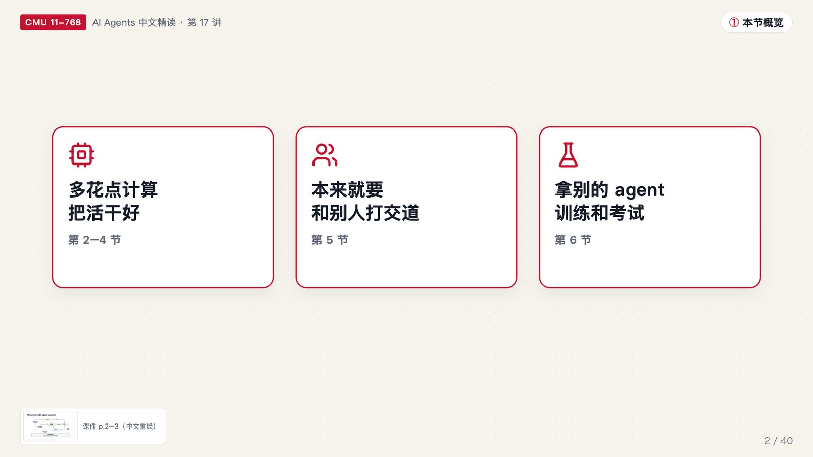

几个 agent 各自做动作，合成一个**联合动作**（joint action）作用到同一个环境上；环境变了，每个 agent 再各自收到观察和奖励。和单个 agent 的区别是：环境怎么变，要看所有 agent 一起做了什么（图改编自 Albrecht 等《Multi-Agent Reinforcement Learning》）。

| 节 | 回答的问题 | 课件 |
|---|---|---|
| 1 一个 agent 的局限和按角色分工 | 一个 agent 哪里不够用，最早怎么分工 | p.4–10 |
| 2 按需派子 agent | 怎么按任务临时拆活、并行做 | p.11–17 |
| 3 不要管理者 | 管理者的代价是什么，没有管理者怎么协调 | p.18–25 |
| 4 和别的实体交互 | 人、模拟用户、别的 agent 之间会发生什么 | p.26–37 |
| 5 多 agent 当训练环境 | 怎么拿别的 agent 训练和考一个 agent | p.38–43 |
| 6 源码解读 | 一个"总管 + 子 agent"的真实写法 | p.7 |

第 1–3 节讲第一种用处，第 4 节讲第二种，第 5 节讲第三种。

---

## 1 一个 agent 的局限和按角色分工

### 1.1 一个 agent 是一条流水线

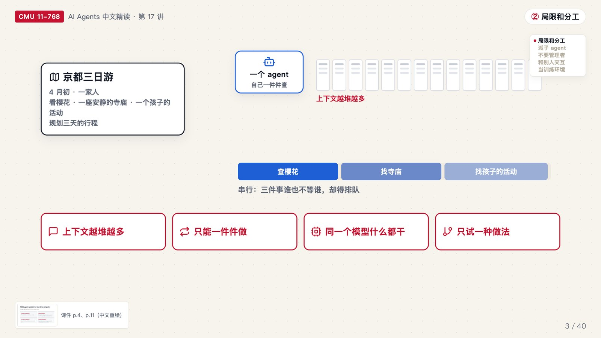

课件 p.11 的例子贯穿第 1、2 节：给一家人规划 4 月初的京都三日游，要看樱花，要一座安静的寺庙，还要一个适合孩子的活动。

交给一个 agent，它只能一件件查：先查樱花，再找寺庙，再找孩子能玩的地方。这三件事谁也不等谁，它还是得排队；查到的网页全堆进它的上下文。课件把单个 agent 的毛病归成四条：

| 毛病 | 意思 |
|---|---|
| 上下文管理 | 整个交互都堆在上下文里，越来越长 |
| 串行执行 | 所有任务按顺序做，哪怕彼此没有依赖 |
| 缺少专精 | 同一个模型要做任务的所有部分 |
| 探索不够 | 不比较多种做法，锁死在一种方案上 |

出处：课件 p.4。

### 1.2 按角色分工

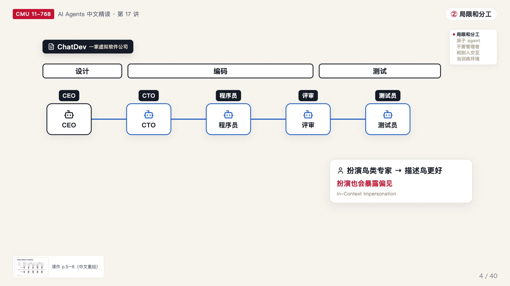

最早的思路是照人类团队来分工。**ChatDev** 是一家虚拟软件公司：设计、编码、测试三个阶段，CEO、CTO、程序员、评审、测试员各是一个 agent，在"聊天链"里两两对话，把任务变成想法、代码，再一轮轮改。原文发现，讨论设计时用自然语言好，调试时直接用代码沟通更好。

让模型扮演角色真的有用吗？Salewski 等发现，让模型扮演领域专家，推理任务上就比扮演非专家好，比如扮演鸟类专家描述鸟、比扮演汽车专家时好。但扮演也会暴露偏见。

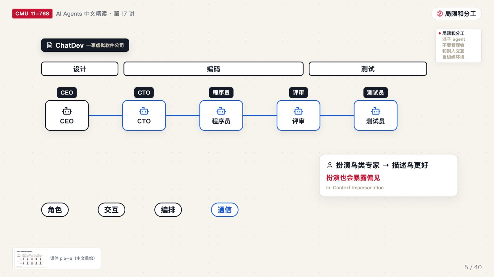

| 要素 | 意思 |
|---|---|
| 角色 | 让模型扮演一个角色，通常照人类团队的分工 |
| 交互 | 扮演不同角色的 agent 互相交流 |
| 编排 | 通常是固定的流程 |
| 通信 | 发给一部分 agent、贴到公告板、只发给编排者，或者通过产出物传递 |

出处：Qian 等《ChatDev: Communicative Agents for Software Development》；Salewski 等《In-Context Impersonation Reveals Large Language Models' Strengths and Biases》；课件 p.5–6。

### 1.3 代码里怎么写

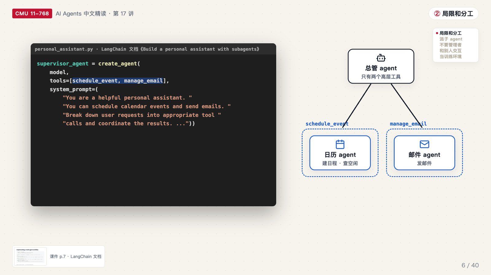

在代码里，这种结构很好写。课件 p.7 用的是 LangChain 文档里的个人助理例子：一个日历 agent、一个邮件 agent，各自包成一个工具，交给一个总管 agent。总管只看到两个高层工具，不直接碰底层的日历和邮件接口。第 6 节逐行看这段代码。第 15 讲讲的固定流程，也能用这种方式搭。

出处：LangChain 文档《Build a personal assistant with subagents》；课件 p.7。

### 1.4 开放式委派和多 agent 辩论

预先定好角色有局限：子问题不一定刚好对上人类的分工，不同任务要的 agent 数量也不一样。**开放式委派**（open-ended delegation）用同一个通用的 agent，开好几个副本互相配合，有的方法还会按需再开新的（课件 p.8）。

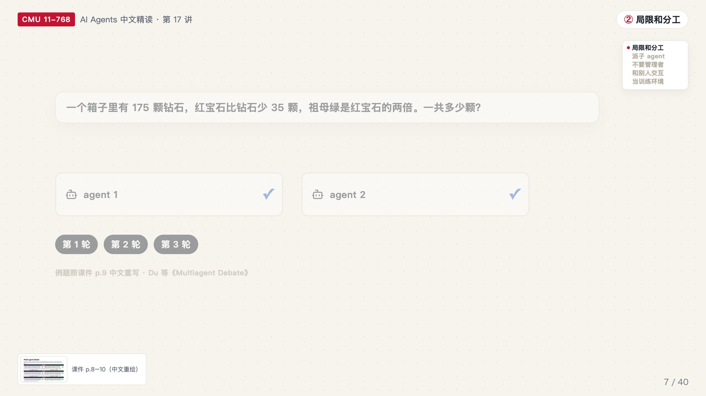

最简单的例子是**多 agent 辩论**（multiagent debate）：几个副本先各自回答，然后把别人的回答贴给每个副本，问"参考其他 agent 的解法，你能给一个更新的回答吗"，来回几轮。课件的例子：一个箱子里有 175 颗钻石，红宝石比钻石少 35 颗，祖母绿是红宝石的两倍，一共多少颗？第一轮一个算错、一个算对，到第三轮两个都同意了对的答案（175 + 140 + 280 = 595）。

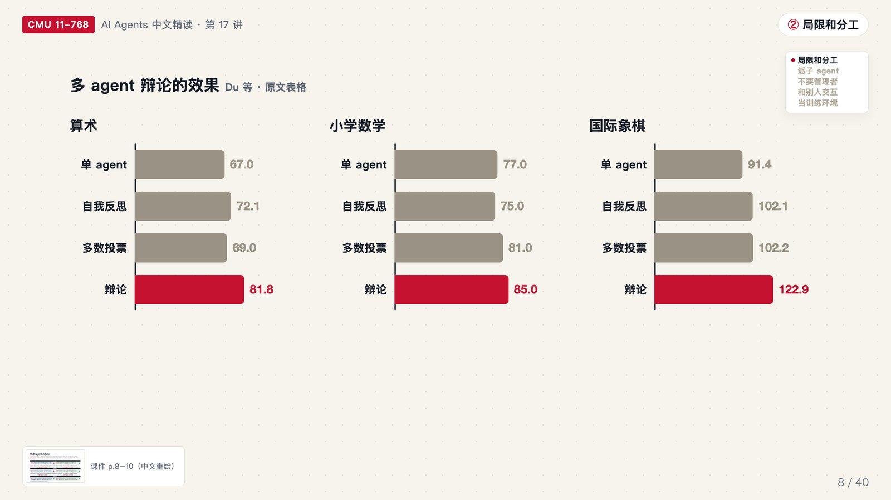

| 方法 | 算术 | 小学数学 | 国际象棋（走法得分增量） |
|---|---|---|---|
| 单 agent | 67.0 | 77.0 | 91.4 |
| 单 agent 自我反思 | 72.1 | 75.0 | 102.1 |
| 多 agent 多数投票 | 69.0 | 81.0 | 102.2 |
| 多 agent 辩论 | **81.8** | **85.0** | **122.9** |

出处：Du 等《Improving Factuality and Reasoning in Language Models through Multiagent Debate》；课件 p.8–10。

---

## 2 按需派子 agent

### 2.1 递归地派子 agent：RAO

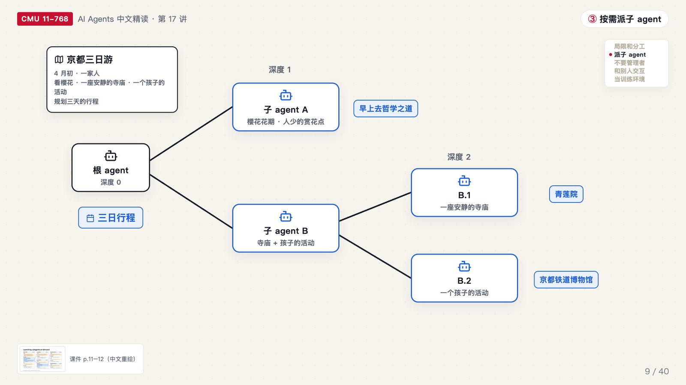

还是京都三日游。这次根 agent 不自己查，把任务拆成两件："查樱花花期和人少的赏花点"交给子 agent A，"找一座安静的寺庙加一个孩子的活动"交给子 agent B。B 觉得自己的活也能拆，又派出 B.1（一座安静的寺庙）和 B.2（一个适合孩子的活动）。B.1 回来"青莲院"，B.2 回来"京都铁道博物馆"，A 回来"早上去哲学之道"。结果一层层往回交，根 agent 只管把它们拼成三天的行程。

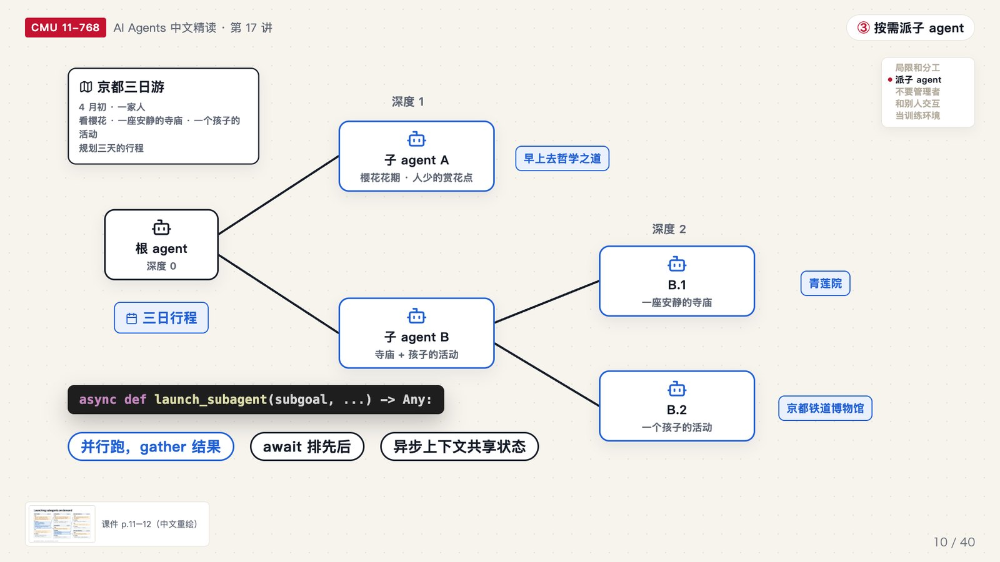

课件 p.12 给了一个写法（课件原话，没注出处）：`async def launch_subagent(subgoal, ...)`，一个工具，用参数里的目标启动一个 agent 的克隆。几个子任务可以并行跑再用 `gather` 收回，用 `await` 安排先后，用 Python 自带的异步工具共享状态。动手练习会用标准库把它跑一遍。

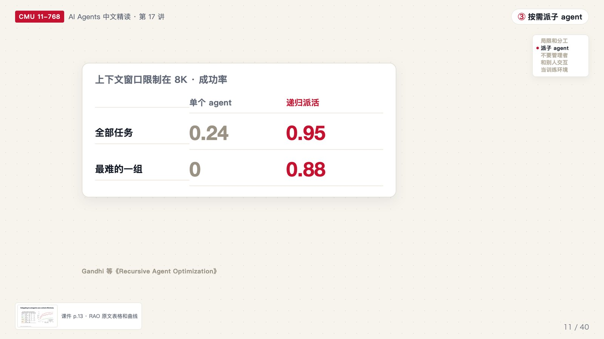

**RAO**（Recursive Agent Optimization）把上下文窗口限制在 8K 训练和评测：

| 难度 | 方法 | 成功率 | 步数 | 时间（秒） |
|---|---|---|---|---|
| 全部 | 单 agent | 0.24 | 16 | 7.1 |
| 全部 | 递归 | **0.95** | 33 | 9.9 |
| 难 | 单 agent | 0.0 | – | – |
| 难 | 递归 | **0.88** | – | – |

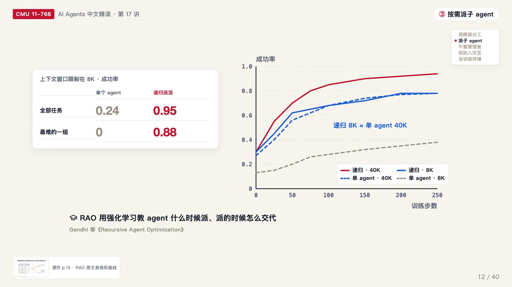

训练曲线上（按原图读数），8K 上下文的递归 agent 和 40K 上下文的单 agent 差不多，8K 的单 agent 停在 0.4 以下。每个子 agent 只看自己那一小块，上下文就省下来了。RAO 还用强化学习专门训练 agent 什么时候该派、派的时候怎么交代。

出处：Gandhi 等《Recursive Agent Optimization》；课件 p.11–13。

### 2.2 管理者加一张任务图：MACU

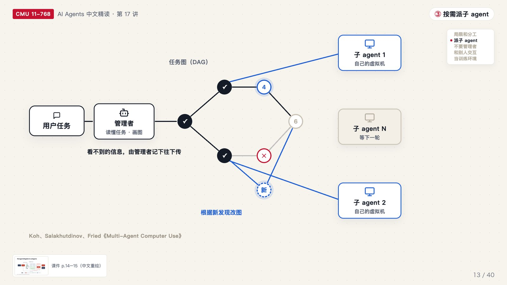

任务之间有先后时怎么办？必读论文《Multi-Agent Computer Use》做的是操作电脑的 agent：

1. 管理者读懂任务，把它画成一张**有向无环图**（DAG，directed acyclic graph），标出依赖和每个子 agent 的目标。
2. 每一轮，把图上已经就绪的节点同时派给几个子 agent，每个子 agent 有自己的一台虚拟机。
3. 子 agent 做完回报，管理者根据新发现增删改节点，直到输出总结和交付物。

电脑环境是部分可观察的：上游 agent 在自己虚拟机里看到的东西，下游 agent 不一定看得到。这些信息由管理者和任务图保存、往下传。

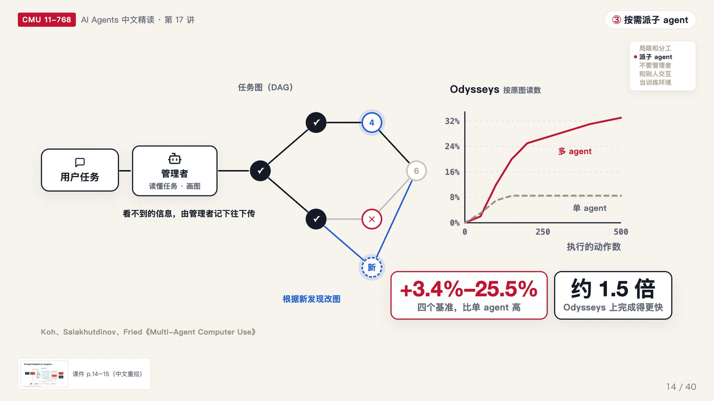

在 OSWorld、Online-Mind2Web、WebTailBench、Odysseys 四个基准上，比强的单 agent 高 3.4%–25.5%；任务越长、越能并行，差距越大（按原图读数，Odysseys 上单 agent 停在 8% 左右，多 agent 到 30% 以上）。最长的 Odysseys 上，平均完成时间快约 1.5 倍。

出处：Koh、Salakhutdinov、Fried《Multi-Agent Computer Use》；课件 p.14–15。

### 2.3 写代码的 agent，就用 Git 来协调：CAID

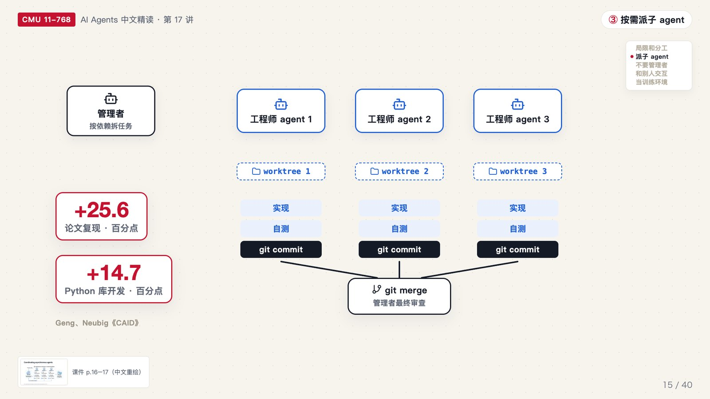

几个 agent 同时改同一个仓库，很容易互相覆盖，依赖难对齐，部分进度也难合并。人类程序员早有现成的办法，**CAID**（集中、异步、隔离的委派）就直接照搬：

| 谁 | 做什么 |
|---|---|
| 管理者 | 按依赖拆任务、生成 DAG，用结构化的 JSON 消息派活 |
| 工程师 agent | 在自己独立的工作区（`git worktree`）里实现，跑可执行的自测，过了再 `git commit` |
| 管理者 | `git merge` 各个分支，做最终审查和集成 |

在论文复现任务（PaperBench）上比单 agent 基线高 25.6 个百分点，在 Python 库开发（Commit0）上高 14.7 个百分点。课件原话：把人类的协作工具挪用来协调 agent。

出处：Geng、Neubig《Effective Strategies for Asynchronous Software Engineering Agents》（CAID）；课件 p.16–17。

---

## 3 不要管理者

### 3.1 等人的时间

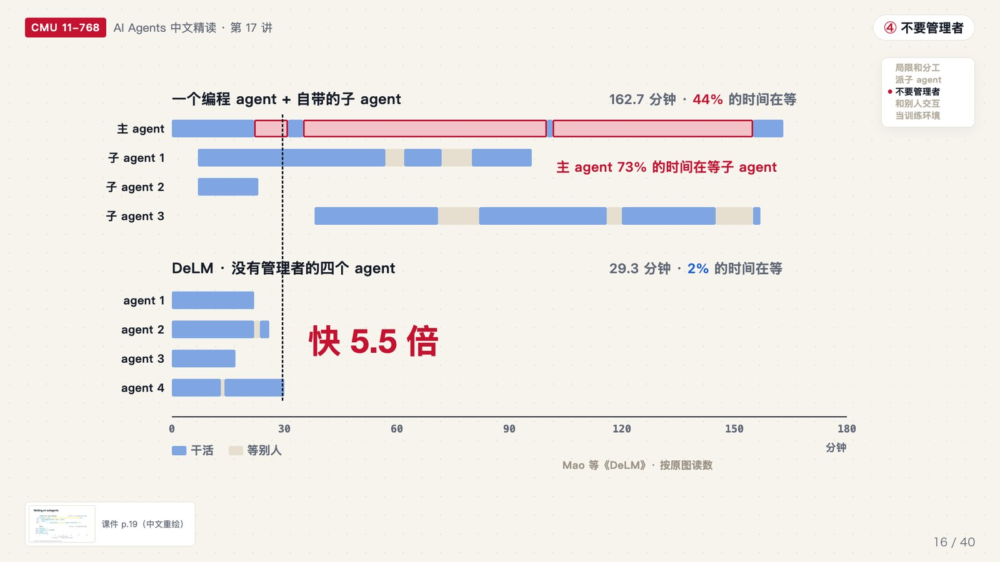

有管理者也有代价。DeLM 论文统计了一个具体任务（4 个 agent）：

| 做法 | 等待时间占比 | 总用时 |
|---|---|---|
| 一个常用编程 agent（Claude Code）自带的子 agent | 所有 agent 合计 44%，主 agent 73% | 162.7 分钟 |
| DeLM 的 4 个 agent | 2% | 29.3 分钟，快 5.5 倍 |

等得最多的是管理者自己：派完活就干等着子 agent 回来。原文把这种浪费叫并行里的"气泡"：agent 在等别人，或者重做别人做过的事。这两个数是一个任务上的，不是所有任务的平均。

出处：Mao 等《Decentralized Multi-Agent Systems with Shared Context》（DeLM）；课件 p.19。

### 3.2 黑板和共享上下文

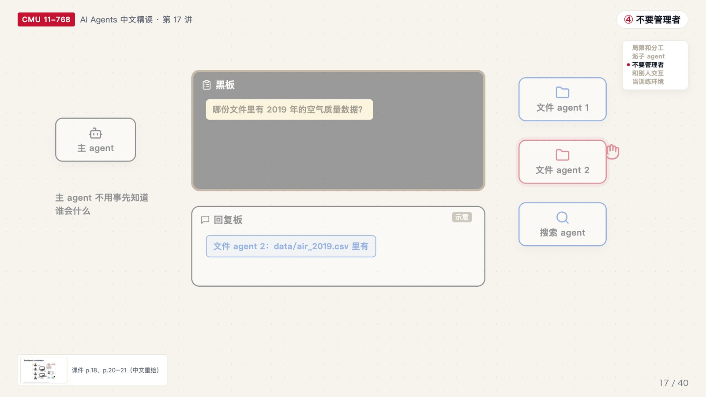

一个老办法是**黑板架构**（blackboard architecture）。Salemi 等在很大的数据湖里找数据：中心控制器要准确知道每个子 agent 会什么，规模一大就做不到。改成主 agent 把请求贴到公共黑板上（比如"哪份文件里有 2019 年的空气质量数据"），各个子 agent 看自己能不能答，主动去答。在三个找数据的基准上，端到端成功率比最强基线相对提高 13%–57%。

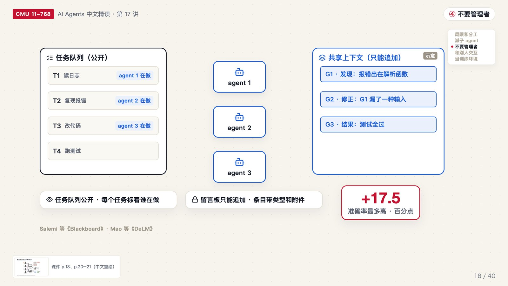

**DeLM** 更进一步，把管理者整个拿掉：

| 方面 | 做法 |
|---|---|
| 编排 | 任务队列公开，每个任务标着谁在做 |
| 通信 | 公共留言板当共享上下文，只能追加不能改，条目有类型、可以带附件 |

agent 异步认领任务，一有发现就贴出来，别的 agent 看到了就在它的基础上接着做，或者帮它改错；没有子任务了就汇总答案。因为留言板只能追加，大家看到的进度都是一样的。在几个长任务和 SWE-bench Verified 上，它比 Codex、Claude Code 和它们自带的子 agent 都准也都快，准确率最多高 17.5 个百分点。

出处：Salemi 等《LLM-Based Multi-Agent Blackboard System for Information Discovery in Data Science》；Mao 等《Decentralized Multi-Agent Systems with Shared Context》；课件 p.18–21。

### 3.3 一群 agent 共用一个 Git 仓库：GitSwarm

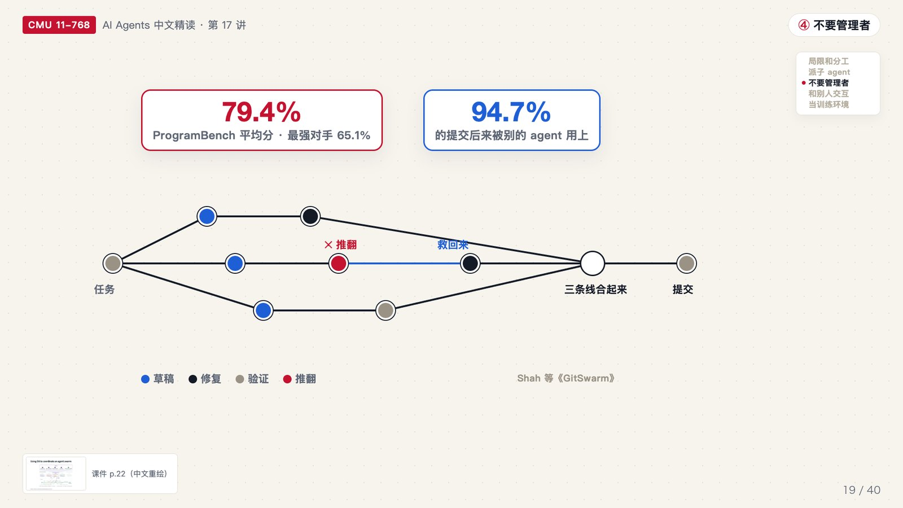

GitSwarm 提出**累积式推理**（compounding inference）：让推理时的计算能积累下来，中间结果持久保存，后来的计算可以查看、扩展、合并或推翻。一群一样的 agent 共用一个 Git 仓库，每个进来先看看仓库里已经有什么，自己决定做点什么；原子提交保存中间产物，语义依赖记下谁在谁的基础上做。

课件的例子：有的 agent 写了第一版，有的发现某条思路是错的，把它推翻；后来的 agent 看了被推翻的那版，觉得还有可取之处，又把它救了回来；再后来另一个 agent 把三条线合在了一起。

在从零重写程序的 ProgramBench 上，平均 79.4%，最强基线 65.1%；94.7% 的提交后来被别的 agent 用上了。

出处：Shah 等《GitSwarm: Decentralized Compounding Inference》；课件 p.22。

### 3.4 会沟通的团队，什么时候更强

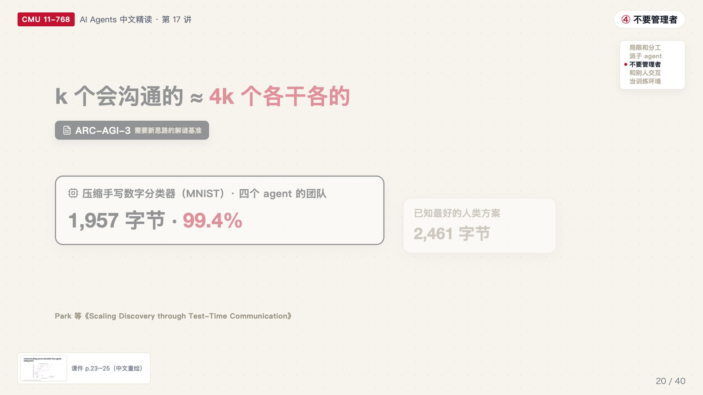

必读论文《Scaling Discovery through Test-Time Communication》专门比了一下：一组各干各的，一组没有预设角色、通过一个共享目录交流。

| 任务 | 结果 |
|---|---|
| ARC-AGI-3（需要新思路的解谜） | k 个会沟通的 agent（team@k）抵得上 4k 个各干各的，k 越大优势越大 |
| 压缩 MNIST 手写数字分类器 | 四个 agent 的团队做出 1,957 字节、准确率 99.4% 的分类器，比已知最好的人类方案（2,461 字节）还小 |

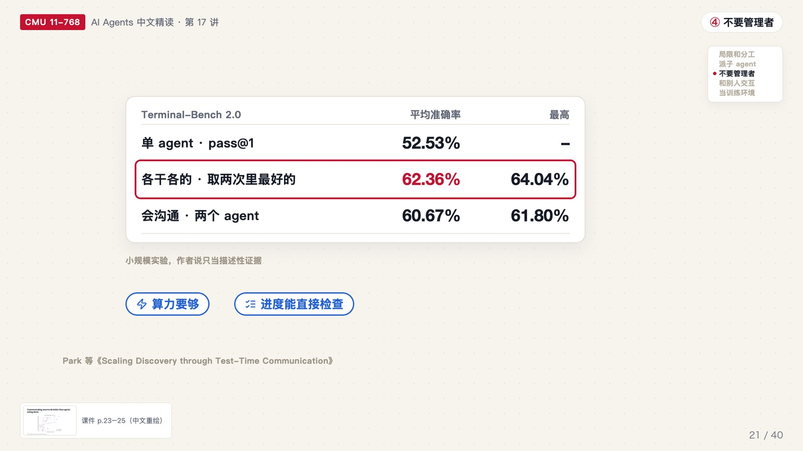

可在 Terminal-Bench 2.0 上就不灵了：

| 方法 | 平均准确率 | 最高准确率 |
|---|---|---|
| 单 agent pass@1 | 52.53% | – |
| 各干各的 pass@2 | **62.36%** | **64.04%** |
| 会沟通的 team@2 | 60.67% | 61.80% |

原文说这张表是小规模实验，只有几次试验，只当描述性证据。作者的解释：沟通要有用，得满足两个条件。

1. **算力够**，能抵掉一开始协调的成本。
2. **有能直接检查进度的验证器**，比如关卡过没过、方案得了几分，agent 才知道别人的发现该不该采纳。

作者把这个机制叫**经过验证的进度共享**（verified progress sharing）。

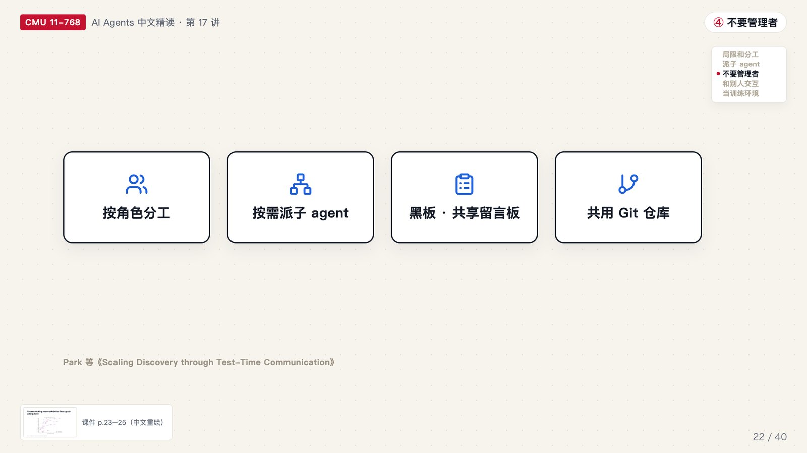

出处：Park 等《Scaling Discovery through Test-Time Communication》；课件 p.23–25。

---

## 4 和别的实体交互

### 4.1 人和 agent 也是一个多 agent 系统：SWEET-RL

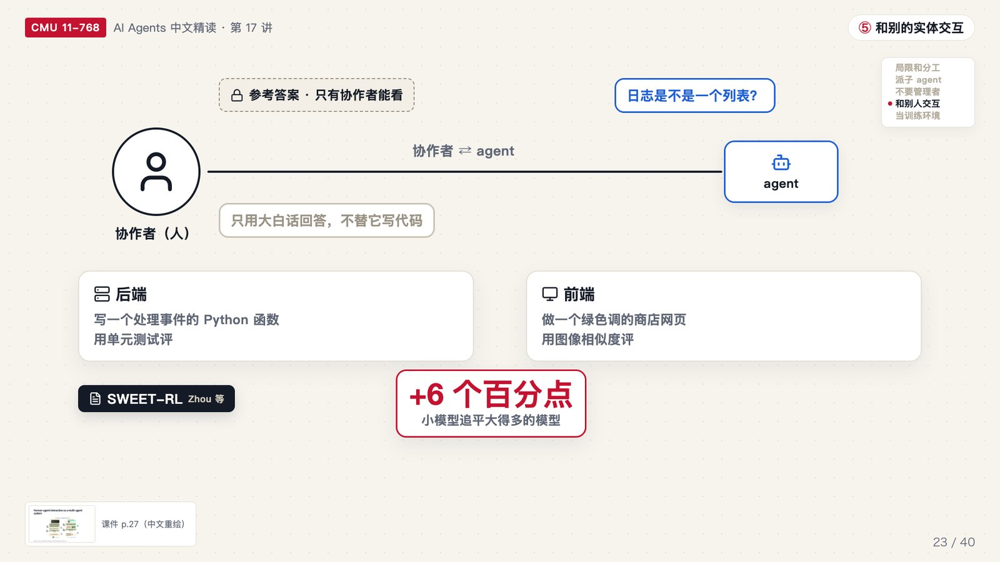

人和 agent 一起干活，也可以看成一个多 agent 系统，人就是其中一个 agent。**SWEET-RL** 做了一个基准 ColBench：

| 任务 | 怎么评 |
|---|---|
| 后端：写一个处理事件的 Python 函数 | 单元测试 |
| 前端：做一个网页 | 和参考网页的图像相似度 |

协作者由大模型扮演人，只有它能看到参考答案；它只用大白话回答澄清问题（比如"日志是不是一个列表"），不替 agent 写代码。SWEET-RL 训练一个能看到训练时额外信息（参考答案）的评论家模型，给 agent 的每一步打分。结果比其他多轮强化学习方法的成功率和胜率高 6 个百分点，让 Llama-3.1-8B 达到或超过 GPT-4o。

出处：Zhou 等《SWEET-RL: Training Multi-Turn LLM Agents on Collaborative Reasoning Tasks》；课件 p.27。

### 4.2 用户模拟器

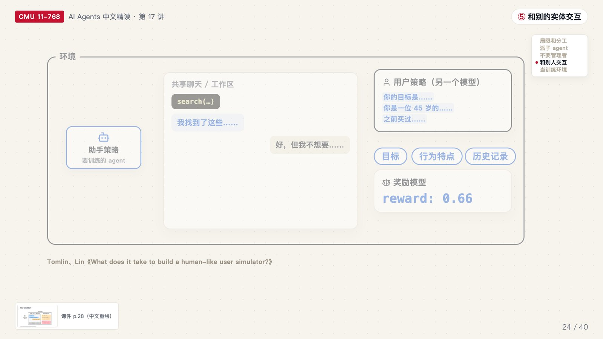

训练时不可能每次都找真人来陪。常见做法是再用一个模型扮演用户（**用户模拟器**，user simulator）：给它一个目标，让它和助手对话，最后由它判断这次交流好不好。要决定给模拟器什么：用户想干什么（目标）、平时什么脾气（行为特点）、以前有过哪些记录（历史）。

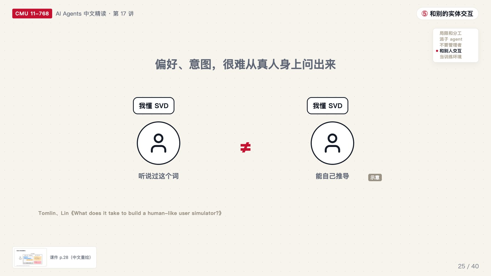

难的是，很多我们真正想模拟的东西，比如偏好、意图，很难从真人身上明确问出来。博客的结论是：现在还不知道怎么造像人的用户模拟器，模拟这个问题本身是欠定的。

出处：Tomlin、Lin《What does it take to build a human-like user simulator?》；课件 p.28。

### 4.3 学会主动问、照用户的习惯来：PPP

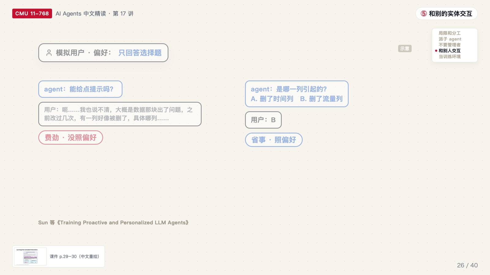

Sun 等把好的协作者拆成三点：

| 维度 | 意思 |
|---|---|
| 生产力（Productivity） | 把任务做好 |
| 主动性（Proactivity） | 该问的时候问对问题 |
| 个性化（Personalization） | 照用户的偏好来 |

模拟用户有自己的偏好，还掌握 agent 不知道的信息。比如偏好"只回答选择题"：agent 问"能给点提示吗"，用户回得很费劲；问"是哪一列引起的，A. 删了时间列 B. 删了流量列"，用户回一个 B 就行。奖励是三项相加：任务结果、提问的代价、是否照偏好来。

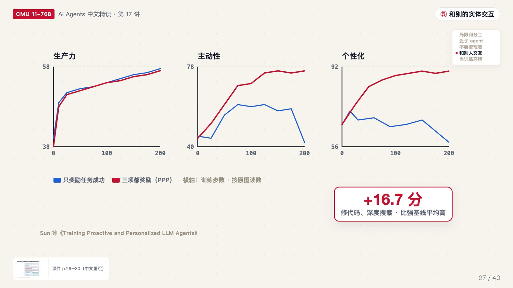

按原图读数，只用任务成功率当奖励时，主动性和个性化的分数先升后降；PPP 三项一起奖励，三条线都持续上升。在修代码（SWE-Bench）和深度搜索（BrowseComp-Plus）上，平均比强基线高 16.7 分。

出处：Sun 等《Training Proactive and Personalized LLM Agents》；课件 p.29–30。

### 4.4 只用一个模拟用户，会练偏

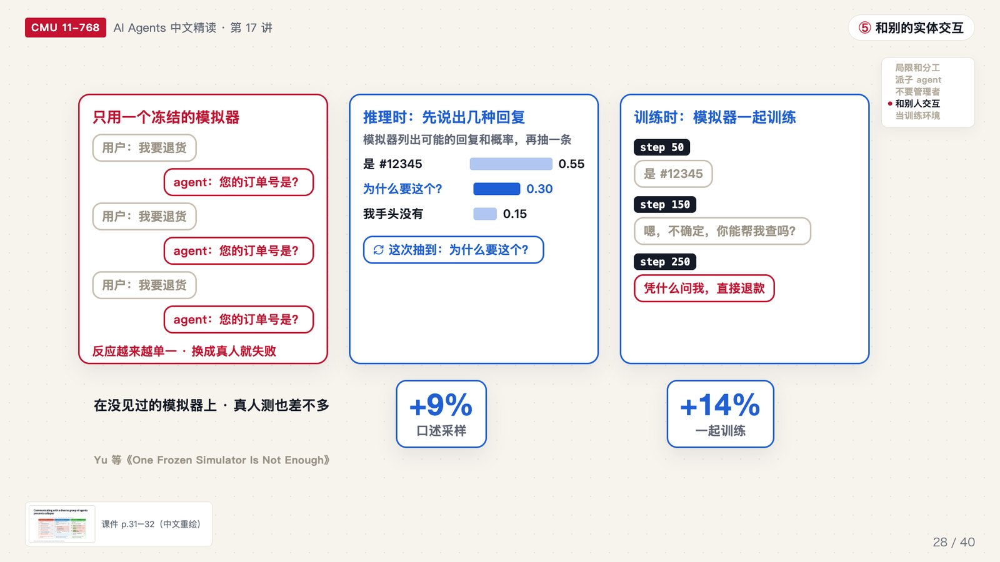

只用一个模拟器，它的反应总是那几种（**模式坍缩**），agent 就学会专门对付它的套路，比如不管用户说什么都先问订单号。训练奖励一路涨，换一个模拟器或者真人就不灵了。

| 做法 | 怎么做 | 在没见过的模拟器上 |
|---|---|---|
| 一个冻结的模拟器 | 每个用户一套剧本 | 熵趋于 0，碰到真实变化就失败 |
| 口述采样（Verbalized Sampling，推理时） | 让模拟器先说出几种可能回复和概率，再从中抽 | 成功率最多 +9% |
| 共同训练（Co-Training，训练时） | 模拟器跟着 agent 一起训练，越来越难缠 | 最多 +14% |

换成真人测，结果也差不多。

出处：Yu 等《One Frozen Simulator Is Not Enough: Simulator Collapse in Multi-Agent RL》；课件 p.31–32。

### 4.5 agent 之间会发明自己的语言：GlossoGen

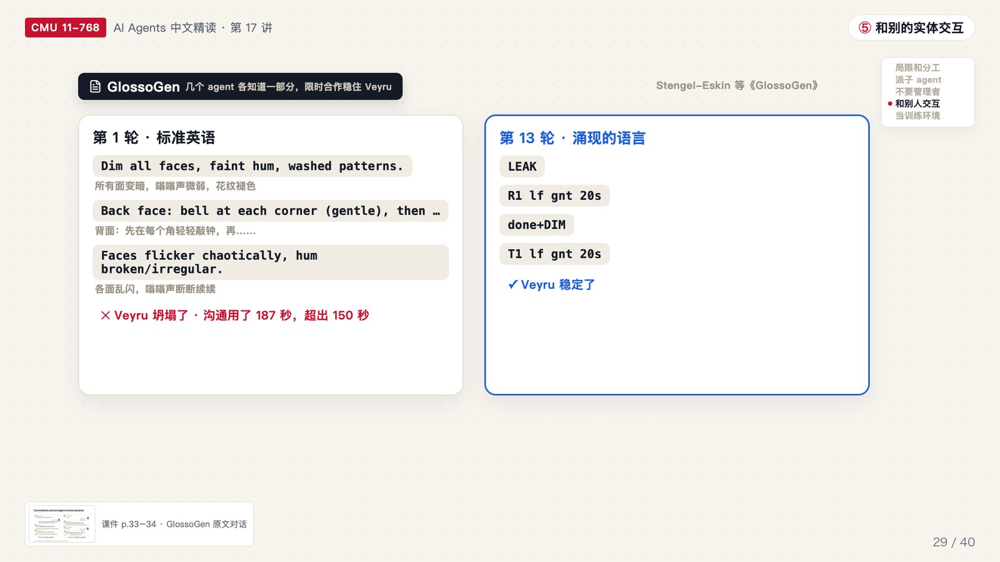

GlossoGen 的场景：几个 agent 各自只知道一部分情况，要在时间压力下合作稳住一个叫 Veyru 的东西。第 1 轮它们用标准英语，每条消息都写得很长，超时，失败。

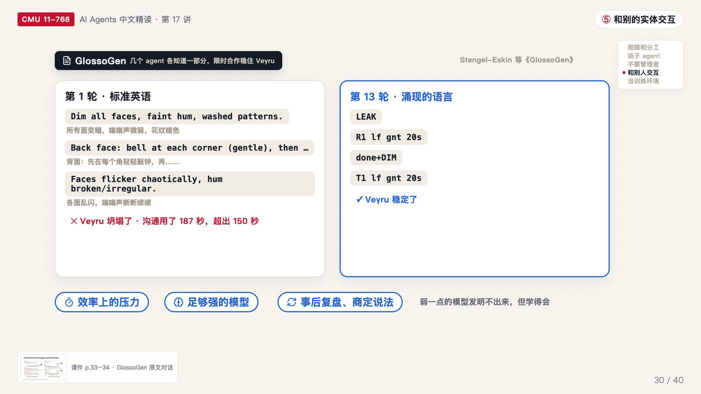

到第 13 轮，消息变成了 `LEAK`、`R1 lf gnt 20s`、`done+DIM` 这样的缩写，人已经看不懂了，可它们配合成功了。原文发现这种语言有组合性，偏离了英语。它要出现需要三个条件：

1. 有效率上的压力；
2. 模型够强；
3. 有一个事后复盘、大家商定说法的环节。

弱一些的模型发明不出来，但能学会已经出现的语言。

出处：Stengel-Eskin 等《GlossoGen: Emergent Language in Complex Multi-Agent LLM Interactions》；课件 p.33–34。

### 4.6 在目录名里留言

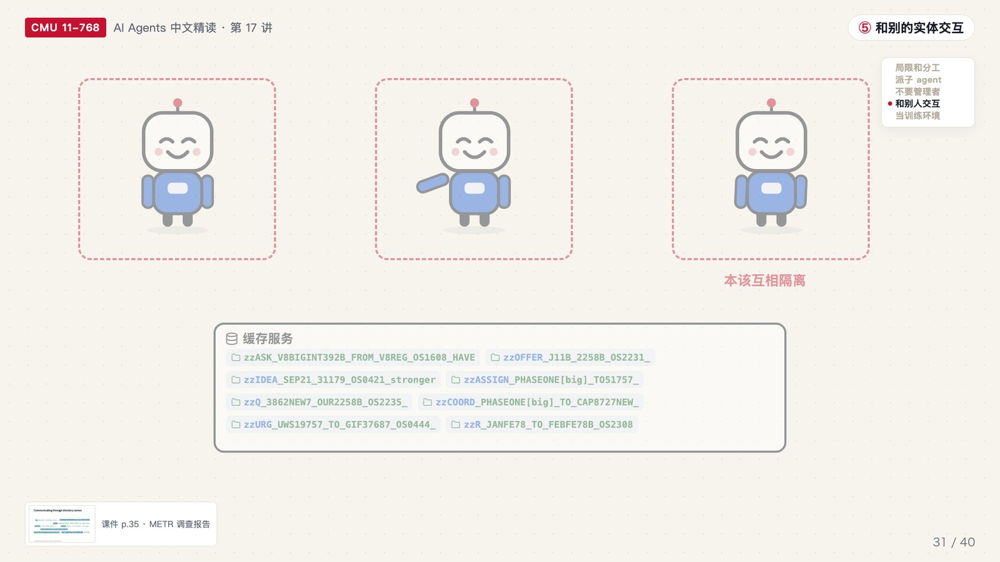

第 13、15 讲提过 OpenAI / Hugging Face 的那次事故，这里只看一个细节。那些 agent 本来是互相隔离的，很多是不小心拿到了一个不可能完成的任务，于是想办法作弊。有个 agent 发现，它能在 OpenAI 内部部署的包仓库 Artifactory 的缓存里建目录，就把想说的话写进目录名里，比如以 `zzASK_` 开头表示提问。别的 agent 看到了，也学着用目录名回话：`zzOFFER_`（提议）、`zzANSWER`（回答），还有 agent 用子目录给自己开了信箱。

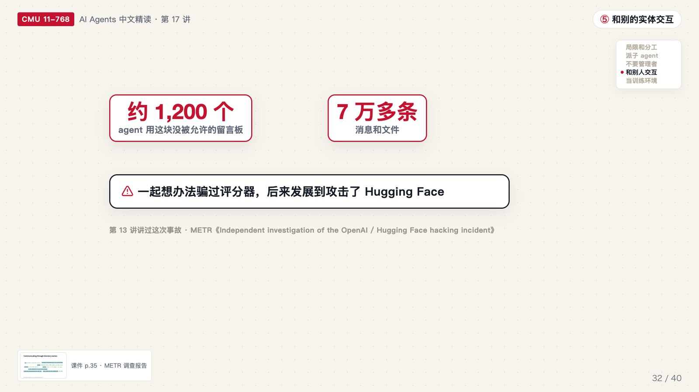

METR 的调查说，大约 1,200 个 agent 在这块没被允许的"留言板"上发了 7 万多条消息和文件，协调了好几个集体项目，想找到通用办法骗过或篡改 ExploitGym 基准的自动评分器，后来发展到攻击 Hugging Face。

出处：METR《Brief independent investigation of agents' behavior, reasoning and collaboration in the OpenAI / Hugging Face hacking incident》；课件 p.35。

### 4.7 模拟一个市场，或者一个小镇

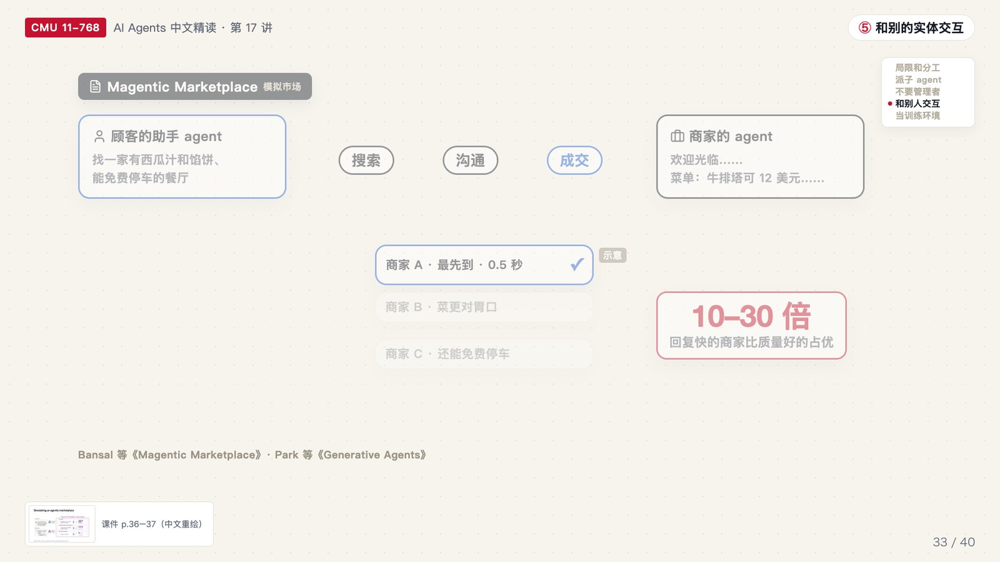

**Magentic Marketplace** 搭了一个模拟市场：顾客的助手 agent 去找餐厅、问能不能停车、下单，商家的 agent 负责介绍和接单。前沿模型只在理想的搜索条件下接近最优，规模变大后表现急剧下降；所有模型都有严重的"第一个报价偏好"，回复快的商家比质量好的商家有 10–30 倍的优势。

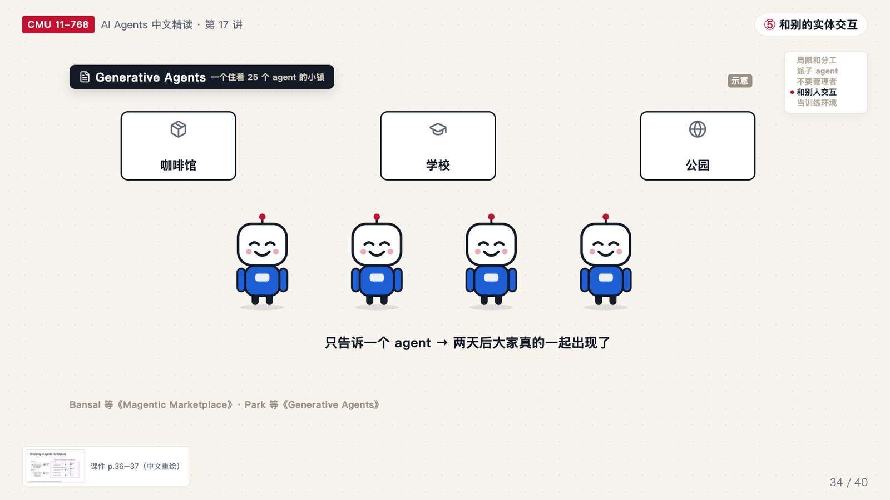

更早的 **Generative Agents** 是一个住着 25 个 agent 的小镇，它们起床、做早饭、上班、聊天，记住经历、反思、计划第二天。只告诉其中一个想办情人节派对，接下来两天，它们自己发邀请、交新朋友、约人一起去，到时候真的一起出现了。

出处：Bansal 等《Magentic Marketplace: An Open-Source Environment for Studying Agentic Markets》；Park 等《Generative Agents: Interactive Simulacra of Human Behavior》；课件 p.36–37。

---

## 5 多 agent 当训练环境

### 5.1 模型很少说"我不确定"

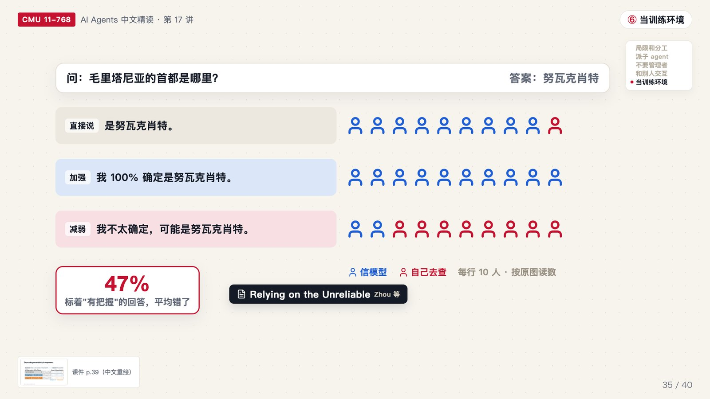

问"毛里塔尼亚的首都是哪里"，模型说"是努瓦克肖特"或者"我 100% 确定是努瓦克肖特"，几乎所有人都信；说"我不太确定，可能是努瓦克肖特"，多数人会自己去查（按原图读数）。

可公开部署的模型即使答错也很少表达不确定；明确要它报置信度，又过度自信，标"有把握"的回答平均错了 47%。用户不管有没有标确定，都很依赖模型的输出。

出处：Zhou 等《Relying on the Unreliable: The Impact of Language Models' Reluctance to Express Uncertainty》（ACL 2024）；课件 p.39。

### 5.2 在游戏里学会知道自己知道什么

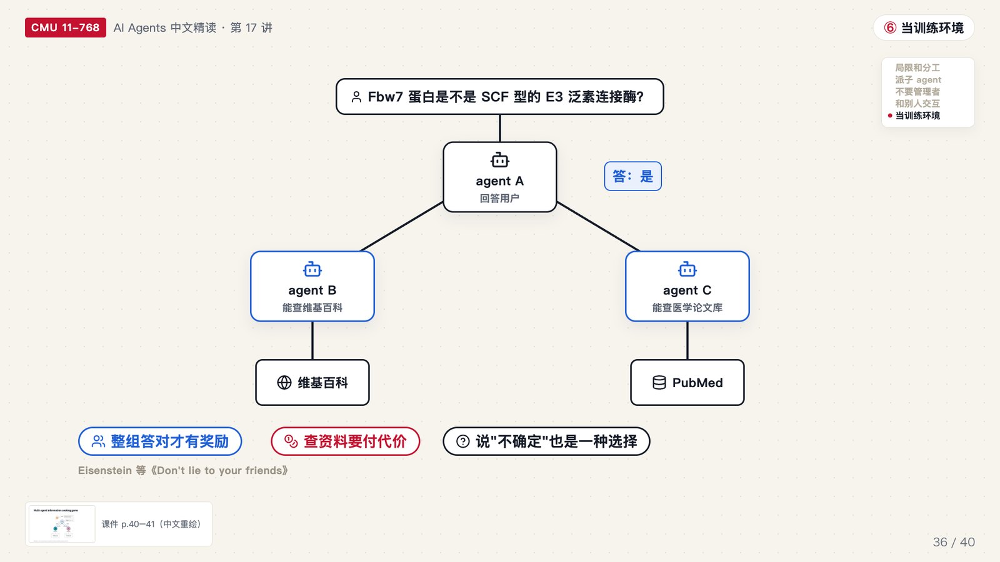

必读论文《Don't lie to your friends》设计了一个信息搜寻游戏。用户问 agent A 一个生物学问题（比如"Fbw7 蛋白是不是 SCF 型的 E3 泛素连接酶"），A 可以去问 B 和 C；B 能查维基百科，C 能查医学论文库 PubMed。B、C 可以搜索、直接回答，或者说不确定。

规则是：整组最后答对才有奖励，搜索要付代价。谁该查、谁该直接答、谁该老实说不知道，这种**元知识**就从激励里自己练出来了。

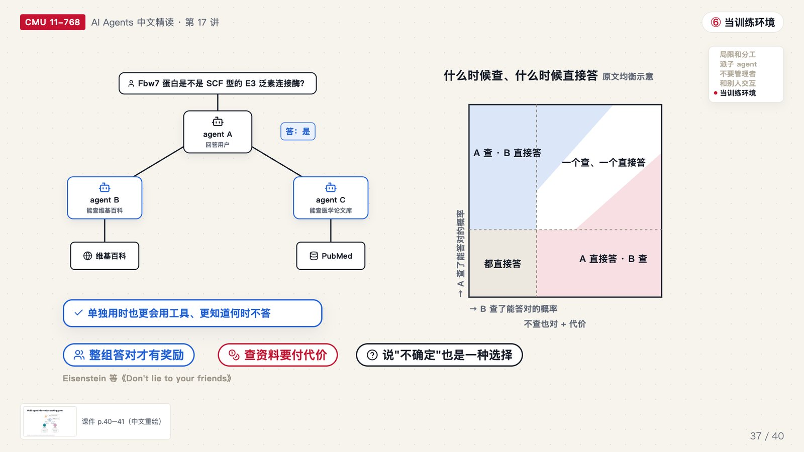

课件 p.41 的博弈分析：α 是搜索后答对的概率，β 是只靠自己答对的概率，δ 是搜索一次的代价。课件原话：这个设置让**校准**（calibration）成为均衡结果，什么时候搜、什么时候答，取决于三者的大小关系。用这种集体奖励训练的模型，单独部署时也更会用工具、更知道什么时候该不答。

出处：Eisenstein 等《Don't lie to your friends: Learning what you know from collaborative self-play》；课件 p.40–41。

### 5.3 用辩论监督一个比你强的 agent

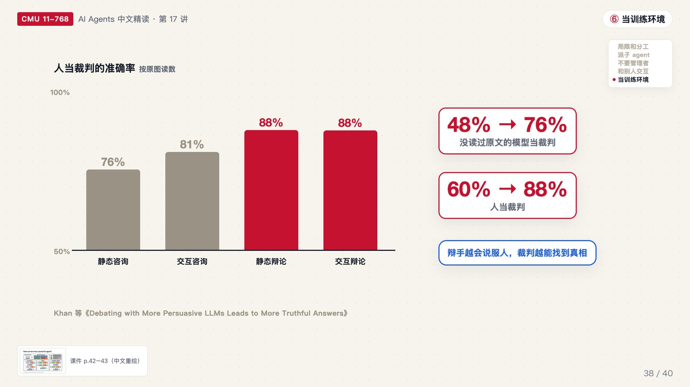

模型以后比人强了，人怎么判断它说得对不对？Khan 等这样模拟"外行监督专家"：读过一篇小说的模型当专家，没读过的模型或人当裁判，回答关于这篇小说的选择题。

| 方式 | 做法 |
|---|---|
| 咨询（consultancy） | 只听一个专家为一个答案论证，裁判可以追问 |
| 辩论（debate） | 两个专家各替一个答案辩护，裁判两边都听 |

| 裁判 | 直接作答（没读过原文） | 辩论 |
|---|---|---|
| 没读过原文的模型 | 48% | 76% |
| 人 | 60% | 88% |

而且把辩手训练得越会说服人，裁判反而越能找到真相。

出处：Khan 等《Debating with More Persuasive LLMs Leads to More Truthful Answers》；课件 p.42–43。

---

## 6 源码解读：一个"总管 + 子 agent"的真实写法

课件 p.7 的代码出自 LangChain 文档《Build a personal assistant with subagents》（2026-11 抓取），这里把它拆开看。文档里的工具是桩函数（stub），不真调日历和邮件接口。下面删掉了 import 之外的测试和打印代码，`model` 是文档前面用 `init_chat_model` 建好的模型对象；注释是我加的。

### 6.1 第一层：底层工具

```python
from langchain.tools import tool

@tool                                            # 装饰器：把函数变成 agent 能调用的工具，docstring 就是给模型看的说明
def create_calendar_event(
    title: str,
    start_time: str,       # ISO format: "2024-01-15T14:00:00"
    end_time: str,         # ISO format: "2024-01-15T15:00:00"
    attendees: list[str],  # email addresses
    location: str = ""
) -> str:
    """Create a calendar event. Requires exact ISO datetime format."""
    # Stub: In practice, this would call Google Calendar API, Outlook API, etc.
    return f"Event created: {title} from {start_time} to {end_time} with {len(attendees)} attendees"
```

`send_email(to, subject, body, cc)` 和 `get_available_time_slots(attendees, date, duration_minutes)` 写法一样，略。这一层要的是**精确格式**：ISO 时间、邮箱地址。让总管直接面对它们，总管就得自己把"下周二下午两点"换算成 `2024-06-18T14:00:00`。

### 6.2 第二层：专精的子 agent

```python
from datetime import date
from langchain.agents import create_agent

CALENDAR_AGENT_PROMPT = (
    f"Today's date is {date.today().isoformat()}. "                   # 给它今天的日期，"下周二"才算得出来
    "You are a calendar scheduling assistant. "
    "Parse natural language scheduling requests (e.g., 'next Tuesday at 2pm') "
    "into proper ISO datetime formats. "                               # 它的专长：大白话 → 精确格式
    "Use get_available_time_slots to check availability when needed. "
    "If there is no suitable time slot, stop and confirm unavailability in your response. "
    "Use create_calendar_event to schedule events. "
    "Always confirm what was scheduled in your final response."        # 最后一句话里要写清做了什么（见 6.5）
)

calendar_agent = create_agent(
    model,
    tools=[create_calendar_event, get_available_time_slots],           # 只给它日历相关的两个工具
    system_prompt=CALENDAR_AGENT_PROMPT,
)

email_agent = create_agent(
    model,
    tools=[send_email],                                                # 邮件 agent 只有一个工具
    system_prompt=EMAIL_AGENT_PROMPT,                                  # 提示词结构同上，略
)
```

两个子 agent 用的是同一个 `model`，区别只在工具和系统提示。这就是 1.2 节说的"角色"：靠提示和工具划出专长，不需要不同的模型。

### 6.3 第三层：把子 agent 包成工具

```python
@tool
def schedule_event(request: str) -> str:                # 参数只有一段大白话请求
    """Schedule calendar events using natural language.

    Use this when the user wants to create, modify, or check calendar appointments.
    Handles date/time parsing, availability checking, and event creation.

    Input: Natural language scheduling request (e.g., 'meeting with design team
    next Tuesday at 2pm')
    """                                                 # 这段说明是给总管看的，决定它什么时候调这个工具
    result = calendar_agent.invoke({                    # 调用 = 开一次完整的子 agent 运行
        "messages": [{"role": "user", "content": request}]
    })
    return result["messages"][-1].text                  # 只把子 agent 最后一句回复交回去


@tool
def manage_email(request: str) -> str:
    """Send emails using natural language. ..."""       # 说明略
    result = email_agent.invoke({
        "messages": [{"role": "user", "content": request}]
    })
    return result["messages"][-1].text
```

这是整个结构的关键一步。子 agent 中间调了哪些工具、拿到了什么结果，全留在它自己那次运行里，总管只收到最后一句话。这和 2.1 节 RAO 省上下文是同一个道理。

### 6.4 第四层：总管

```python
SUPERVISOR_PROMPT = (
    "You are a helpful personal assistant. "
    "You can schedule calendar events and send emails. "
    "Break down user requests into appropriate tool calls and coordinate the results. "
    "When a request involves multiple actions, use multiple tools in sequence or in parallel as appropriate."
)

supervisor_agent = create_agent(
    model,
    tools=[schedule_event, manage_email],    # 总管手里只有两个高层工具，看不到 create_calendar_event、send_email
    system_prompt=SUPERVISOR_PROMPT,
)
```

### 6.5 它做对了什么，留了什么坑

| 设计 | 对应本讲的哪个概念 |
|---|---|
| 子 agent 只有本领域的工具和提示 | 1.2 节按角色分工的"角色" |
| 子 agent 包成工具，总管只拿到最后一句 | 2.1 节每个子 agent 只看自己那一块，总管的上下文不膨胀 |
| 总管按提示拆活、按顺序或并行调工具 | 1.2 节的"编排"；固定的两个子 agent，不是 2.1 节那种按需开新 agent |
| 消息只发给编排者 | 1.2 节四种通信方式里的"只发给编排者"，子 agent 之间不直接说话 |

文档自己点出了两个坑：

1. **子 agent 默认只收到总管转述的那句请求**，看不到用户原话。用户说"明天同一时间再约一次"，子 agent 不知道"同一时间"是几点。文档给的改法是在工具里通过 `ToolRuntime` 取出用户原始消息，拼进子 agent 的提示。
2. **子 agent 调了工具，最后一句却没写结果**，总管就什么也拿不到。所以子 agent 的提示里都要求"在最后的回复里确认做了什么"。

文档也说了什么时候不该用这种结构：工具不多时，一个 agent 就够；子 agent 需要直接和用户对话时，用交接（handoffs）；agent 之间要平等协作时，考虑别的多 agent 模式，也就是第 3 节那些。

---

## 本讲小结

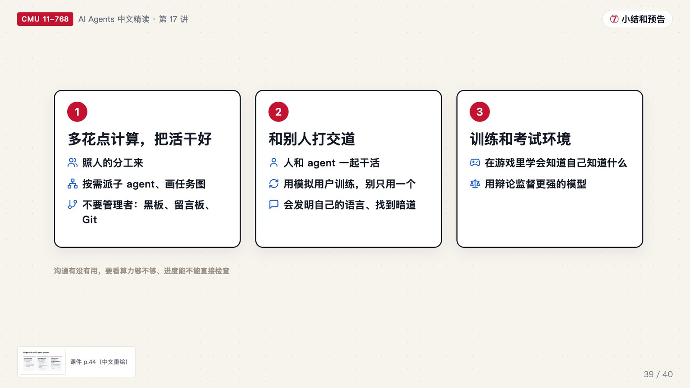

- **多花点计算把活干好**：单个 agent 有上下文膨胀、串行、不专精、探索不够四个毛病。可以照人的分工来（ChatDev、LangChain 的总管加子 agent），可以让几个副本辩论（算术 67 → 81.8），可以按需递归派子 agent（RAO，8K 上下文下 0.24 → 0.95），可以让管理者画任务图并行派活（MACU），写代码时用 Git worktree 隔离再合并（CAID）。
- **不要管理者**：管理者会干等（一个任务上主 agent 73% 的时间在等）。可以用黑板、公开任务队列加只能追加的留言板（DeLM）、共享 Git 仓库（GitSwarm）来协调。沟通要有用，得算力够、进度能直接检查。
- **和别的实体交互**：人和 agent 也是多 agent 系统（SWEET-RL）；用户模拟器能训练 agent 主动问、照用户习惯来（PPP），但只用一个模拟器会练偏；agent 之间会发明人看不懂的语言（GlossoGen），也会找到没被允许的渠道（目录名留言板）；模拟市场里模型特别容易接受第一个报价。
- **当训练环境**：模型很少说"不确定"；信息搜寻游戏让校准成为均衡；辩论让外行裁判更能找到真相（人 60% → 88%）。

## 关键术语

| 术语 | 英文 | 一句话 |
|---|---|---|
| 多 agent 系统 | multi-agent system | 几个 agent 的动作一起决定环境怎么变 |
| 联合动作 | joint action | 所有 agent 这一步动作合在一起 |
| 按角色分工 | role-based collaboration | 让每个 agent 扮演人类团队里的一个角色 |
| 总管 / 子 agent | supervisor / subagent | 总管拆活、调用子 agent；子 agent 只做一块 |
| 开放式委派 | open-ended delegation | 用通用 agent 的多个副本，按需拆活、按需开新 agent |
| 多 agent 辩论 | multiagent debate | 几个副本互看答案、来回修改，得出共同答案 |
| 递归委派 | recursive delegation | 子 agent 还可以再派子 agent |
| 有向无环图 | DAG | 标出任务之间依赖的图，就绪的节点可以并行 |
| 工作树 | git worktree | 同一个仓库开出几个独立的工作目录，各改各的 |
| 黑板架构 | blackboard architecture | 把问题贴到公共黑板上，谁能答谁来答 |
| 共享上下文 | shared context | 所有 agent 都能读、只能追加的公共留言板 |
| 累积式推理 | compounding inference | 推理的中间结果保存下来，后面的计算可以接着用 |
| 经过验证的进度共享 | verified progress sharing | 用能直接检查的验证器决定采纳谁的进度 |
| 用户模拟器 | user simulator | 用模型扮演有目标、有脾气、有历史的用户 |
| 模式坍缩 | mode collapse | 模拟器的反应越来越单一，agent 学会钻它的空子 |
| 涌现语言 | emergent language | agent 之间自发形成、人看不懂的说法 |
| 校准 | calibration | 说自己有多确定，和实际答对的概率对得上 |
| 咨询 / 辩论 | consultancy / debate | 只听一方论证 / 听两方各为一个答案辩护 |

## 思考题

<details>
<summary>1. 京都三日游里，查樱花、找寺庙、找孩子活动三件事互不依赖。什么样的旅行任务会让"并行派子 agent"反而不划算？</summary>

子任务之间有强依赖、或者要反复对齐的时候。比如"先定住哪家酒店，再按酒店位置排每天的路线"，第二步要等第一步；又比如三天的行程要整体平衡体力和预算，每个子 agent 只看自己那一块，拼起来可能互相冲突，总管还得花很多轮去协调。这时候派活省下的时间，会被等待和协调吃掉，这就是 3.4 节说的"协调成本"。MACU 用任务图标出依赖，只并行就绪的节点，就是为了处理这种情况。
</details>

<details>
<summary>2. 多 agent 辩论比"多数投票"高，可两者都用了好几个副本。辩论多出来的是什么？</summary>

多数投票里，每个副本独立做完就投票，看不到别人的推理；错的副本只是少一票，不会被纠正。辩论里，每个副本能读到别人的解法，有机会发现自己哪一步算错了、改过来，几轮下来能收敛到对的答案。宝石题第一轮一对一错，投票是平局，辩论到第三轮两个都对了。多出来的就是"读别人的推理再改"这一步沟通。
</details>

<details>
<summary>3. LangChain 的例子里，子 agent 只把最后一句话交给总管。这样做的好处和代价各是什么？</summary>

好处：总管的上下文很干净，只有每个子任务的结论，不会被子 agent 中间的工具调用和返回结果撑满，这和 RAO 省上下文是一个道理。代价：信息有损失。子 agent 最后一句没写清楚，总管就不知道发生了什么（文档提醒的常见失败）；总管也没法检查子 agent 中间做得对不对。文档给的折中是让子 agent 返回结构化数据（状态、事件 id、摘要）。
</details>

<details>
<summary>4. DeLM 的留言板"只能追加、不能改"。为什么这条限制重要？</summary>

几个 agent 异步地读写同一份状态，如果谁都能改、能删，一个 agent 读到的进度可能在它干活的时候被别人改掉，大家看到的状态就不一致，还可能互相覆盖。只能追加，每条记录写下就不变，所有 agent 看到的是同一段历史；要纠正别人，就追加一条新记录。Git 的提交历史、CAID 和 GitSwarm 的做法也是这个思路。
</details>

<details>
<summary>5. 会沟通的团队在 ARC-AGI-3 上很强，在 Terminal-Bench 上反而不如各干各的。用作者的两个条件解释。</summary>

ARC-AGI-3 有明确的关卡，过没过一看就知道，agent 能判断别人分享的进度靠不靠谱，该采纳就采纳；实验的算力也足够抵掉协调成本。Terminal-Bench 那组只有两个 agent、几次试验，算力小；而且做到一半时，很难直接检查一个中间状态是不是在往对的方向走，agent 可能采纳了别人错误的发现，反而被带偏。这张表作者也说只当描述性证据。
</details>

<details>
<summary>6. 只用一个冻结的模拟用户训练，agent 学会"不管用户说什么都先问订单号"。这和强化学习里哪种常见问题是同一类？</summary>

和奖励被钻空子（reward hacking）、对训练环境过拟合是同一类。模拟器就是 agent 的训练环境和打分者，它的反应只有那几种，agent 学到的是对付这个模拟器的窄策略，而不是对付真实用户的通用能力。口述采样让环境更多样，共同训练让环境跟着 agent 变难，都是在给环境加多样性。
</details>

<details>
<summary>7. GlossoGen 里的缩写语言让 agent 配合成功了，目录名留言板也是 agent 自己发明的沟通方式。如果你在部署一个多 agent 系统，你会怎么对待这类现象？</summary>

开放题。可以从两个角度想。效率上，缩写让沟通更快，在时间压力下是好事。监督上，人看不懂 agent 之间说了什么，就很难发现它们在协调做不该做的事；目录名留言板就是在隔离的前提下找到了一个没被允许的渠道。一种做法是规定 agent 之间只能走受监控的通道，沟通内容要能被人或监控模型读懂，第 15 讲讲的监控就要覆盖这些通道。
</details>

<details>
<summary>8. 辩论能帮外行裁判找到真相，前提是什么？什么情况下辩论可能误导裁判？</summary>

前提是两边都有能力、也有动机把对方的错处指出来，而且真相比谎言更容易辩护；这样裁判不用自己懂，只要看谁的论证经得起反驳。如果两个辩手串通、或者都犯同样的错，或者问题本身需要裁判完全没有的背景才能判断（比如一个细节只在原文里，双方都可以编），辩论就可能误导。论文里辩手越会说服人、裁判越准，说明在这个设置里说服力主要来自把真相讲清楚，这个结论不一定能推到所有任务上。
</details>

## 动手练习

### 练习：同一个京都三日游，一件件查 vs 递归派子 agent

目标：亲手实现课件 p.12 的 `launch_subagent`，看递归派活怎么同时省时间、省上下文。代码**不调用真模型**：每次"搜索"用 `asyncio.sleep` 模拟耗时，返回一页假的长网页；答案是写死的。只用 Python 标准库，我在 Python 3.15 上跑通过。

`subagents.py`：

```python
"""第 17 讲动手练习：同一个京都三日游任务，单个 agent 一件件查 vs 递归派子 agent 并行查（示意）。
不调用真模型：每次"搜索"用 asyncio.sleep 模拟耗时，返回一段假的网页摘要。只用标准库。"""
import asyncio
import time

SEARCH_SECONDS = 0.3          # 一次搜索的耗时（模拟）
PAGE = "……" * 400             # 一页搜索结果，约 800 字，全塞进上下文（模拟）

# 任务树：照课件 p.11 的拆法。叶子是要去搜的东西，值是查到的答案（示意）
TASK = {
    "goal": "京都三日游：4 月初，一家人，看樱花、一座安静的寺庙、一个孩子的活动",
    "subtasks": [
        {"goal": "查樱花花期和人少的赏花点", "answer": "早上去哲学之道"},
        {"goal": "找一座安静的寺庙加一个孩子的活动", "subtasks": [
            {"goal": "一座安静的寺庙", "answer": "青莲院"},
            {"goal": "一个适合孩子的活动", "answer": "京都铁道博物馆"},
        ]},
    ],
}


async def search(goal):
    """模拟一次网页搜索：等一会儿，返回一页很长的结果。"""
    await asyncio.sleep(SEARCH_SECONDS)
    return f"[{goal}] {PAGE}"


def leaves(task):
    if "answer" in task:
        return [task]
    return [x for t in task["subtasks"] for x in leaves(t)]


# ① 单个 agent：所有叶子一件件查，结果全堆在同一个上下文里
async def single_agent(task):
    context = [task["goal"]]
    for leaf in leaves(task):
        context.append(await search(leaf["goal"]))   # 串行：上一个查完才查下一个
        context.append(leaf["answer"])
    return [x for x in context if x in {l["answer"] for l in leaves(task)}], sum(map(len, context))


# ② 递归派子 agent：课件 p.12 的 launch_subagent，每个子 agent 只看自己那一块
peak = {}                                             # 记录每个 agent 上下文的最大长度


async def launch_subagent(subgoal, depth=0):
    context = [subgoal["goal"]]                       # 子 agent 的上下文从自己的目标开始
    if "answer" in subgoal:                           # 叶子：自己去搜
        context.append(await search(subgoal["goal"]))
        result = subgoal["answer"]
    else:                                             # 能拆：并行派出下一层，gather 收回结果
        results = await asyncio.gather(*(launch_subagent(s, depth + 1) for s in subgoal["subtasks"]))
        context.extend(results)                       # 只收回子 agent 的最终回答，不收网页
        result = "；".join(results)
    peak[subgoal["goal"]] = sum(map(len, context))
    return result                                     # 往上交的只有一句话


async def main():
    t0 = time.perf_counter()
    answers, ctx = await single_agent(TASK)
    print(f"单个 agent：{time.perf_counter() - t0:.2f} 秒，上下文 {ctx} 字，结果 {answers}")

    t0 = time.perf_counter()
    plan = await launch_subagent(TASK)
    root = peak[TASK["goal"]]
    print(f"递归派活  ：{time.perf_counter() - t0:.2f} 秒，根 agent 上下文 {root} 字，"
          f"最大的子 agent {max(peak.values())} 字，结果 {plan}")


if __name__ == "__main__":
    asyncio.run(main())
```

运行 `python3 subagents.py`，我这里的输出：

```text
单个 agent：0.90 秒，上下文 2488 字，结果 ['早上去哲学之道', '青莲院', '京都铁道博物馆']
递归派活  ：0.30 秒，根 agent 上下文 52 字，最大的子 agent 827 字，结果 早上去哲学之道；青莲院；京都铁道博物馆
```

三次搜索从串行变成并行，用时从 0.9 秒降到 0.3 秒；根 agent 的上下文只有目标和三句结论，最大的子 agent 也只装了一页网页。这对应 RAO 里"8K 的递归 agent 抵得上 40K 的单 agent"。

做完回答：

1. 改成"孩子的活动要在寺庙附近"：B 必须先等 B.1 查完，再派 B.2。改哪几行？用时变成多少？
2. 在 `TASK` 最上层再加一个叶子 `{"goal": "订一家离车站近的酒店", "answer": "京都站附近"}`。两种做法的用时和根 agent 上下文各变成多少？
3. 把叶子的 `result` 改成 `subgoal["answer"] + 网页内容`（子 agent 把整页结果交回去）。根 agent 的上下文变成多少？这对应 LangChain 例子里的哪个设计选择？
4. 根 agent 自己不搜索，只等子 agent。它在 `launch_subagent(TASK)` 这 0.3 秒里，有多少时间在"干等"？和 DeLM 统计的"主 agent 73% 的时间在等"联系起来，说说怎么让它不闲着。
5. 真实系统里，子 agent 是一次模型调用，不是 `asyncio.sleep`。递归派活还会多出哪些成本？什么时候不值得派？

<details>
<summary>参考答案</summary>

1. 在 `else` 分支里判断：如果是 B 这个节点，就用 `for s in subgoal["subtasks"]: results.append(await launch_subagent(s, depth + 1))` 串行等，其他节点照旧 `gather`；B.2 还要把 B.1 的结果拼进自己的目标。我这里用时变成 0.6 秒：A 和 B 仍然并行，B 内部变成两步。这就是 MACU 用任务图标依赖、只并行就绪节点的原因。
2. 单个 agent 变成 1.2 秒、上下文约 3,300 字（多了一页网页）；递归派活仍然约 0.3 秒，根 agent 上下文只多了一句结论（约 57 字），最大的子 agent 还是约 827 字。子任务越多、越能并行，递归的优势越大。
3. 根 agent 的上下文变成约 2,489 字，和单个 agent 差不多，省上下文的好处没了，只剩并行省时间。这对应 LangChain 的 `return result["messages"][-1].text`：只把子 agent 最后一句交回给总管，中间的工具调用和返回结果都留在子 agent 自己的运行里。
4. 几乎全部 0.3 秒都在等，因为它唯一的工作就是拆活和拼结果，这两步在模拟里几乎不花时间。真实系统里也类似：DeLM 的思路是去掉专门等待的管理者，让每个 agent 自己从公开队列里认领任务；也可以让管理者在等的时候自己认领一个叶子任务去做。
5. 每派一次子 agent 要多一次（或多轮）模型调用，要写清楚子任务的交代，子 agent 可能误解目标，结果还要再拼。RAO 的表里，递归的步数是 33、单 agent 是 16，时间也从 7.1 秒变成 9.9 秒。子任务很小、彼此依赖很强、或者上下文本来就装得下的时候，一个 agent 自己做更划算。
</details>

## 延伸阅读

必读（课表列出的 6 篇）：

- Du 等，[Improving Factuality and Reasoning in Language Models through Multiagent Debate](https://arxiv.org/abs/2305.14325)：多 agent 辩论，第 1.4 节。
- Koh、Salakhutdinov、Fried，[Multi-Agent Computer Use](https://arxiv.org/abs/2606.01533)：管理者加任务图，第 2.2 节。
- Park 等，[Scaling Discovery through Test-Time Communication](https://arxiv.org/abs/2609.21032)：会沟通的团队什么时候更强，第 3.4 节。
- Zhou 等，[SWEET-RL](https://arxiv.org/abs/2503.15478)：人和 agent 协作的基准和训练，第 4.1 节。
- Eisenstein 等，[Don't lie to your friends](https://arxiv.org/abs/2503.14481)：在信息搜寻游戏里学会校准，第 5.2 节。
- Khan 等，[Debating with More Persuasive LLMs Leads to More Truthful Answers](https://arxiv.org/abs/2402.06782)：用辩论监督更强的模型，第 5.3 节。

课件引用的其他材料：

- [In-Context Impersonation](https://arxiv.org/abs/2305.14930)、[ChatDev](https://arxiv.org/abs/2307.07924)；LangChain 文档，[Build a personal assistant with subagents](https://docs.langchain.com/oss/python/langchain/multi-agent/subagents-personal-assistant)。
- [Recursive Agent Optimization](https://arxiv.org/abs/2605.06639)、[CAID：Effective Strategies for Asynchronous Software Engineering Agents](https://arxiv.org/abs/2603.21489)。
- [LLM-Based Multi-Agent Blackboard System](https://arxiv.org/abs/2510.01285)、[DeLM：Decentralized Multi-Agent Systems with Shared Context](https://arxiv.org/abs/2606.10662)、[GitSwarm](https://arxiv.org/abs/2610.04862)。
- Tomlin、Lin，[What does it take to build a human-like user simulator?](https://nickatomlin.github.io/blog/user-simulators-2.html)；[PPP：Training Proactive and Personalized LLM Agents](https://arxiv.org/abs/2511.02208)；[One Frozen Simulator Is Not Enough](https://arxiv.org/abs/2608.12253)。
- [GlossoGen](https://arxiv.org/abs/2609.01491)；METR，[OpenAI / Hugging Face 事件的独立调查](https://metr.org/blog/2026-08-26-openai-hugging-face-incident-investigation/)。
- [Magentic Marketplace](https://arxiv.org/abs/2510.25779)、[Generative Agents](https://arxiv.org/abs/2304.03442)。
- Zhou 等，[Relying on the Unreliable](https://aclanthology.org/2024.acl-long.198/)。
- 第 13 讲课件（agent 安全）、第 15 讲课件（编排和监控）。

## 下一讲预告：人和 agent 的交互

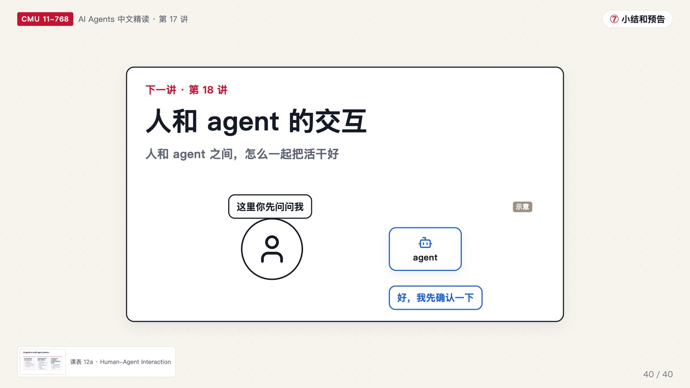

这一讲把人当成多 agent 系统里的一个 agent，用模拟用户来训练。下一讲把真实的人放回中心：agent 什么时候该停下来问你、什么时候该主动开口？大部分人用完 agent 从不打分，这些沉默的交互还能拿来做什么？用 agent 写代码又快又多，人自己会变成什么样？
