# 第 18 讲 · 人和 agent 的交互：从完成任务到一起干活

> CMU 11-768 AI Agents（2026 秋）中文精读 · 配套课件
> 配套视频（13 分钟）：B 站 / 视频号 / 抖音 / 小红书搜索「竹二木SI」 · 整份幻灯片：[l18-幻灯片.pdf](./l18-幻灯片.pdf)
> 原课程：[cmu-agents.com](https://cmu-agents.com)，课程主讲 Graham Neubig、Daniel Fried；本讲课表名 Interaction 2: Human-Agent Interaction，讲者 Valerie Chen，课件标题 Rethinking Human-AI Collaboration in the Agentic Era。本课件是非官方的学习整理。
> **这一讲原课程没有公开录像**，内容根据原课件（89 页）和课表列出的推荐阅读整理：必读的 5 篇（Guidelines for Human-AI Interaction、Completion ≠ Collaboration、PULSE、Code with Me or for Me?、(Im)Paired Programming），以及课件页脚引用的论文和博客。每节末尾注明出处。从图上读出的数标"按原图读数"；论文还没公开、只能照课件写的标"课件原话"。

## 这一讲你会学到

学完这一讲，你应该能做到：

1. 用咖啡店的例子说清"把任务做完"和"跟人一起把活干好"的区别，说出**协作投入的扩展性**（collaborative effort scaling）想衡量什么。
2. 说出**混合主动**（mixed-initiative）的意思，把 Horvitz 的原则和 Amershi 等的 18 条准则对到 agent 交互的三个阶段：开始前、干活中、交回来以后。
3. 区分被动 AI 和主动 AI，举两个主动 agent 的研究（ToM-SWE、IDE 里的主动建议），说出"时机"为什么关键。
4. 解释为什么 agent 时代的反馈要比两段过程而不是两句回答，以及 **PULSE** 怎么用少量用户评分加大量没评分的交互来比较两个 agent 设计。
5. 说出隐式交互信号的两种用法：比较 agent 设计（PULSE），训练模型（评分卡 critic、实时强化学习），以及**奖励被钻空子**（reward hacking）的风险。
6. 用几组实验数字说清用 agent 对人的影响：做得更快更多，但对自己的代码理解更差；agent 写的代码也更难让 agent 接着改；人可以学着把 agent 用好。

建议先看一遍视频，再对照本课件逐节复习。每节开头的图就是视频里对应的画面。

### 接上一讲

上一讲讲多 agent 交互，其中一部分是人和 agent 也可以看成一个多 agent 系统：用模拟用户训练 agent 主动提问、照用户习惯来。这一讲把人放回中心：真实的人用 agent 时，交互该怎么设计，交互记录能拿来做什么，人自己又会变成什么样。这一讲是综述，论文很多，每篇我只挑最能说明问题的一两个数。

### 这一讲的路线

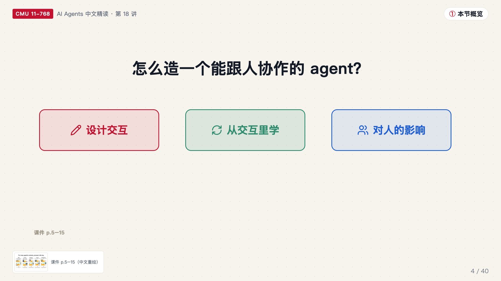

| 节 | 回答的问题 | 课件 |
|---|---|---|
| 1 本节概览 | 做完任务和一起干活有什么不同，交互的形状怎么变了 | p.2–15 |
| 2 交互该怎么设计 | 老准则在 agent 时代还管不管用，agent 该不该主动、什么时候主动 | p.16–40 |
| 3 从交互里学 | 没人打分的交互怎么拿来比设计、训模型 | p.41–63 |
| 4 对人的影响 | 用 agent 的人生产力、理解、技能会怎么变 | p.64–88 |
| 5 方法解读 | PULSE 的估计公式在算什么 | p.51 |

课件把"怎么为协作流程造 agent"分成三件事：**优化**交互（Optimize）、从交互里**学**（Learn）、**理解**下游影响（Understand），就是第 2、3、4 节。

---

## 1 本节概览

### 1.1 开一家咖啡店：两种走法

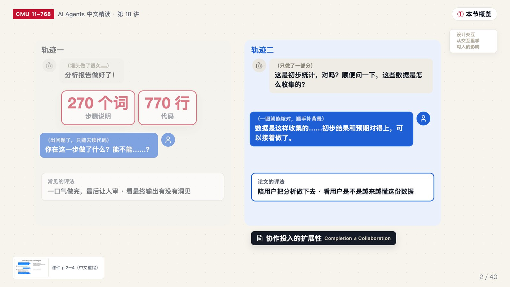

课件全程用同一个例子。用户说：我打算在西雅图开一家咖啡店，想用手上的数据把这笔投资想清楚。agent 给了个高层计划：先加载数据、清洗，再做探索性分析。用户说好，你做吧。

| | 轨迹一 | 轨迹二 |
|---|---|---|
| agent 做了什么 | 埋头做完，交回一份分析报告，附 270 个词的步骤说明、770 行代码 | 只做一部分，交回初步统计，问"这样对吗？这些数据是怎么收集的？" |
| 用户怎么办 | 发现不对，只能去读代码，再追问"你在这一步做了什么？" | 一眼就能核对，顺手补了数据怎么收集的背景，让它接着做 |
| 背后的"好 agent"标准 | 端到端做完分析，最后让人审；看最终输出有没有洞见 | 支持用户的分析过程，做子任务、搭脚手架；看用户有没有获得领域和数据的知识 |

这个例子来自必读论文《Completion ≠ Collaboration》。原文的观点：现在的评测围绕一次性做完任务，没考虑真实问题往往是迭代、协作的，人的目标经常说不清、还会变。它提出**协作投入的扩展性**：看 agent 的价值怎么随用户投入的增加而增长。两个想要的性质是：

- **交互可持续**（interaction sustainability）：用户投入越多，agent 带来的价值越大。
- **最大可用性**（maximum usability）：让用户愿意参与下去，别早早放弃。

原文的案例覆盖教育、数据分析、旅行规划，发现现在的 agent 经常过早交出一个"打磨得很完整、却很难消化"的答案，就是轨迹一。

出处：Shen、Chen 等《Completion ≠ Collaboration: Scaling Collaborative Effort with Agents》（ACL Findings 2026）；课件 p.2–4。

### 1.2 很多场景里，过程才是关键

课件 p.5 列了五个领域，人和 agent 一起干，各有一种失败：

| 领域 | 一起做什么 | 失败 |
|---|---|---|
| 数学 | 查定理、出想法、提猜想、检查证明 | 证明有细微错误 |
| 科学 | 出想法、做实验、综述文献、分析数据 | 缺少多轮协作（讨论、辩论） |
| 教育 | 讲解解题过程 | 短期目标和长期学习冲突 |
| 金融 | 自动生成理财建议 | 没确认客户目标和风险承受能力 |
| 数据科学 | 高效执行分析步骤 | 缺领域知识，以为自己掌握了全部背景 |

共同的毛病是 agent 自顾自往下做，没跟人对齐。

### 1.3 交互的形状变了

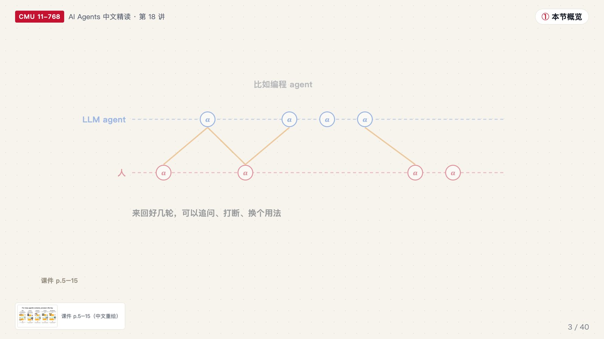

- **以前**（p.6–8）：人在自己的时间线上做一串动作，中间某一步调用一次 AI 模型（比如新闻分类器），拿到一个结果接着做。用户很清楚什么时候该用它，结果也容易核对，但能追问的方式很有限。
- **现在**（p.9–11）：agent 一干就是很多步，人和它来回交替好几轮。用户可以追问、打断、换个用法，能做的事多了，人和 agent 之间要协调的东西也跟着多了。

出处：课件 p.5–15。

---

## 2 交互该怎么设计

### 2.1 混合主动

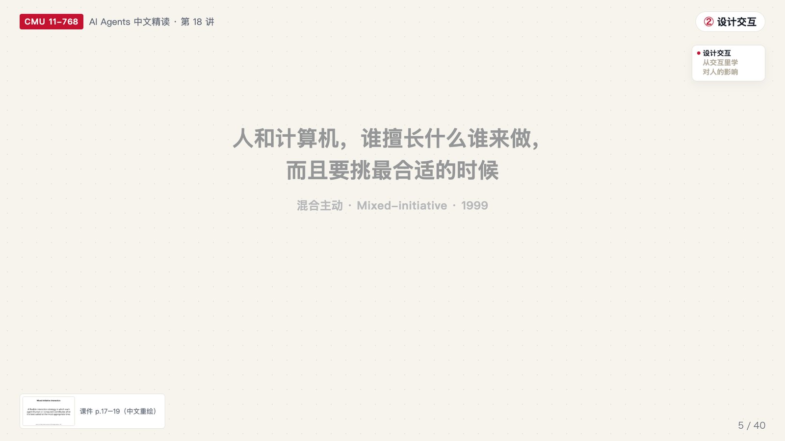

人和 AI 怎么分工是个老问题。Hearst 等 1999 年给**混合主动**下的定义（意译）：一种灵活的交互策略，每个参与者，不管是人还是计算机，在最合适的时候，贡献自己最擅长的那部分。

同一年 Horvitz 用微软的邮件助手 LookOut 演示这件事：用户读到一封信"我们明天下午 3 点左右聊聊吧"，系统猜用户可能要约会议，在角落弹出一个小按钮；点一下，日程窗口里时间已经填好；不点，它也不打扰。

Horvitz 总结了 12 条原则（课件 p.19）：

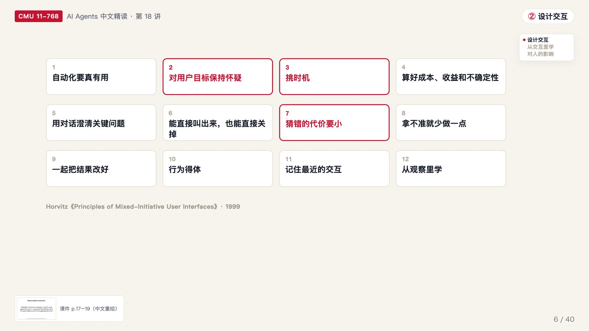

| # | 原则 | # | 原则 |
|---|---|---|---|
| 1 | 自动化要真有增益 | 7 | 让猜错的代价尽量小 |
| 2 | 对用户的目标保持不确定 | 8 | 把精确度和不确定性匹配起来（拿不准就少做一点） |
| 3 | 注意用户的注意力和时机 | 9 | 和用户一起细化结果 |
| 4 | 用成本、收益、不确定性算出最该做的动作 | 10 | 行为符合社交规范 |
| 5 | 用对话解决关键的不确定 | 11 | 记住最近的交互 |
| 6 | 能直接调用，也能直接终止 | 12 | 通过观察来学 |

第 2、3、7 条放到今天的 agent 上几乎不用改：别假设自己懂了用户要什么，挑对时候开口，猜错了也别闯大祸。

出处：Hearst 等《Mixed-Initiative Interaction》（IEEE Intelligent Systems 1999）；Horvitz《Principles of Mixed-Initiative User Interfaces》（CHI 1999）；课件 p.17–19。

### 2.2 十八条准则，对到 agent 身上

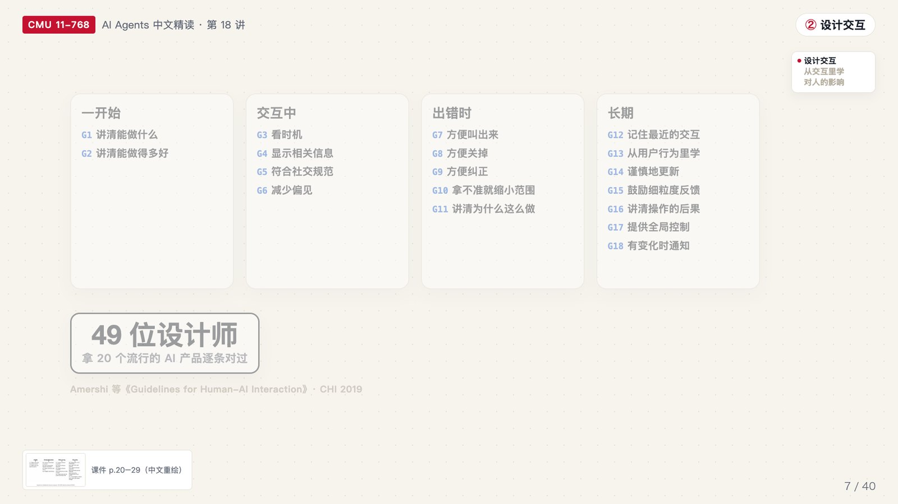

Amershi 等 2019 年在微软研究院总结了 18 条**人和 AI 交互的准则**（Guidelines for Human-AI Interaction），按四个阶段分：

| 阶段 | 准则 |
|---|---|
| 一开始 | G1 讲清系统能做什么；G2 讲清它能做得多好 |
| 交互中 | G3 按上下文把握时机；G4 显示和上下文相关的信息；G5 符合相关的社交规范；G6 减少社会偏见 |
| 出错时 | G7 方便调用；G8 方便关掉；G9 方便纠正；G10 拿不准时缩小服务范围；G11 讲清为什么这么做 |
| 长期 | G12 记住最近的交互；G13 从用户行为里学；G14 谨慎地更新和适应；G15 鼓励细粒度反馈；G16 讲清用户操作的后果；G17 提供全局控制；G18 有变化时通知用户 |

原文经过多轮评估，其中一轮是 49 位设计从业者拿这些准则去检验 20 个流行的 AI 产品。

这些准则当年针对的是"调一下就出结果"的 AI。课件 p.27 把它们对到 agent 的三个阶段：

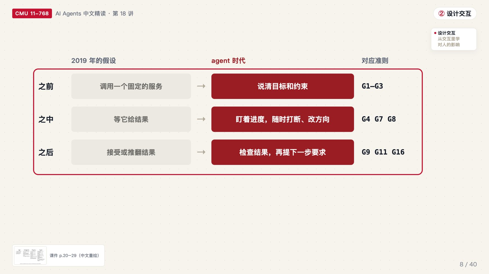

| | 2019 年的假设 | agent 时代 | 对得上的准则 |
|---|---|---|---|
| 开始前 | 调用一个预先定义好的服务 | 说清目标和约束 | G1、G2、G3 |
| 干活中 | 等模型给预测 | 盯进度、打断、纠正方向 | G4、G7、G8 |
| 交回来以后 | 接受或推翻模型的预测 | 检查结果、提后续要求 | G9、G11、G16 |

做 agent 产品时，这张表可以当检查清单：三个阶段里，用户分别能不能做到右边那一列。

出处：Amershi 等《Guidelines for Human-AI Interaction》（CHI 2019）；课件 p.20–29。

### 2.3 从被动到主动：开始前先揣摩用户

课件 p.28 区分了两种 AI：

| | 公式 | 例子 |
|---|---|---|
| 被动的 AI | 输出 = 模型（你的提示） | 你问一句它答一句 |
| 主动的 AI | 什么时候出现、说什么 = 模型（上下文） | 它自己看你的提示、以前的会话、代码，决定什么时候开口 |

"开始前"这一步出问题的典型场景（p.30–31）：

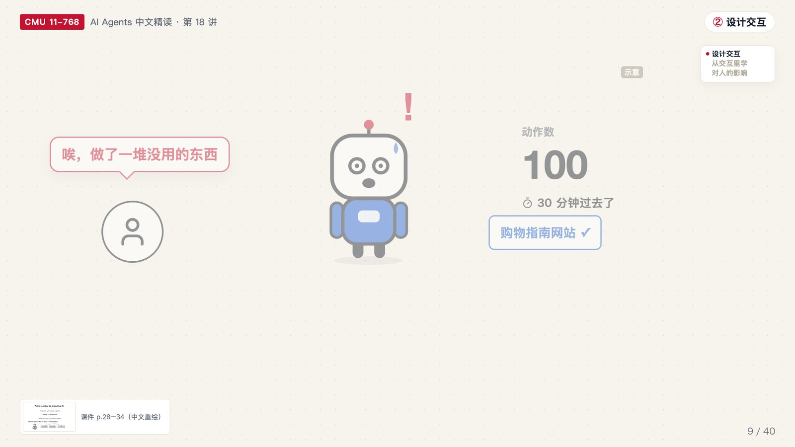

你在终端里对编程 agent 说"给我做个网站"。它说好，搭项目结构、做响应式布局……一百个动作、半个小时之后："好了！我做了一个关于购物指南的网站。"你想要的其实是个人主页。

**ToM-SWE** 给写代码的 agent 配了个搭档：一个轻量的 **ToM agent**（ToM 是 theory of mind，心智理论），专门从指令和交互历史里推断用户的目标、约束和偏好，持久记住这个用户。写代码的 agent 发现指令不清楚，先去问它；它可能回"要的是个人网站，偏好用 Vercel 部署；学术风格；沟通要简洁"。

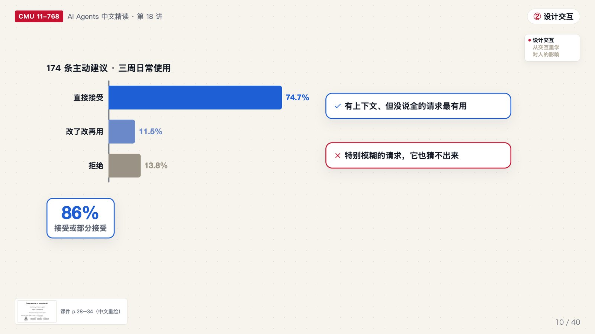

| 结果 | 数字 |
|---|---|
| 有状态的 SWE 基准（带用户模拟器和过去的交互历史）上的任务成功率 | ToM-SWE 59.7%，OpenHands 18.1% |
| 三周真实使用：209 个编程会话里主动给的建议 | 174 条 |
| 开发者接受 / 部分接受 / 拒绝 | 74.7% / 11.5% / 13.8%（合计接受 86%） |

开发者的反馈（课件原话）：ToM 帮我把以前对话里就有的规则明确写了下来；它对"有点没说清、但有上下文"的请求最有用；对非常模糊的请求还是不行。

出处：Zhou 等《ToM-SWE》（ICML 2026）；课件 p.28–34。

### 2.4 干活中和交回来以后：什么时候插话

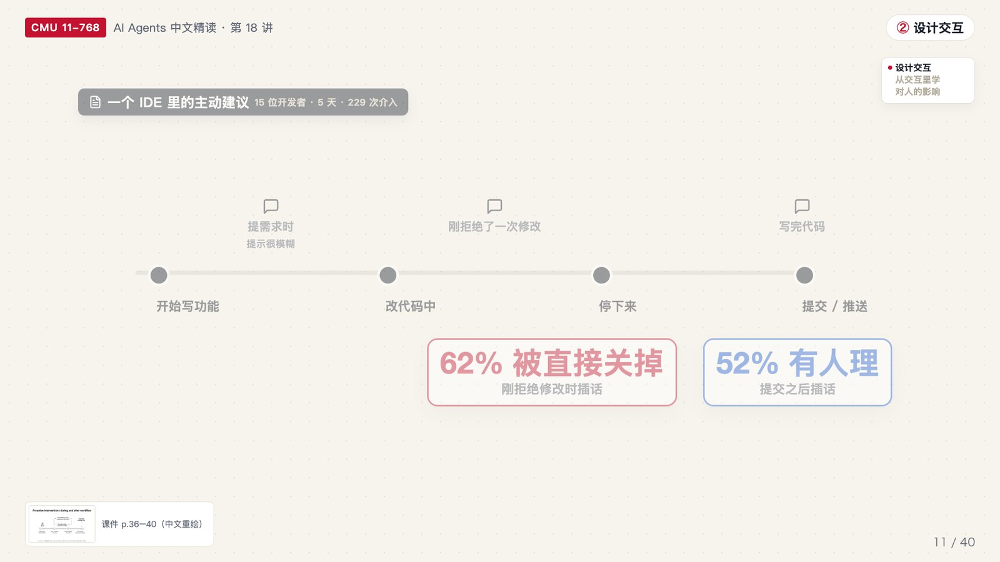

Kuo 等和 JetBrains、代尔夫特理工合作，在一个商用 IDE（JetBrains Fleet）里加了主动给代码质量建议的功能，15 位开发者用了 5 天，共 229 次 AI 介入、5,732 个交互点。

| 发现 | 数字 |
|---|---|
| 在工作流的分界处介入（比如提交之后） | 参与率 52% |
| 在任务中间介入（比如刚拒绝了一次修改） | 62% 被直接关掉 |
| 看懂一条建议的平均时间 | 时机合适的主动建议 45.4 秒，用户自己去问的被动建议 101.4 秒（p=0.0016） |

主动不是越多越好，时机是设计出来的。这正好对上 Horvitz 的第 3 条和 Amershi 的 G3。

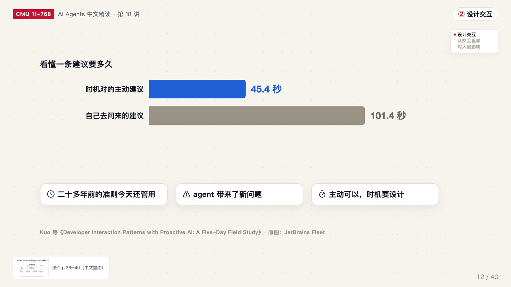

**第 2 节小结**（课件 p.40）：二十多年前的准则今天仍然适用；人和 agent 的交互会冒出新问题；主动 AI 是一条路，但要仔细设计。

出处：Kuo 等《Developer Interaction Patterns with Proactive AI: A Five-Day Field Study》（IUI 2026）；课件 p.36–40。

---

## 3 从交互里学

### 3.1 比两句回答，还是比两段过程

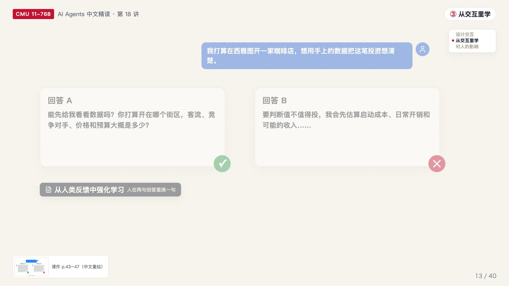

训练聊天模型的经典做法是**从人类反馈中强化学习**（RLHF，InstructGPT）：让人在两个回答里挑更好的。咖啡店的例子里，回答 A 先反问要哪些数据（街区、客流、竞争对手、价格、预算），回答 B 直接开始估算成本，人会挑 A。

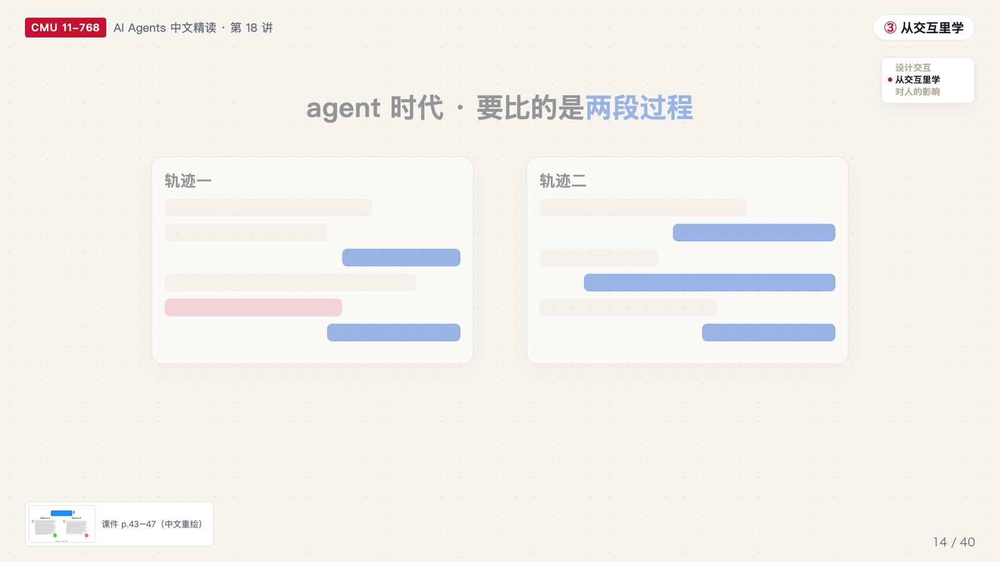

agent 干得好不好，很多时候要看整个过程，比较的对象从一句话变成一整段多轮交互，就像 1.1 节的两条轨迹。

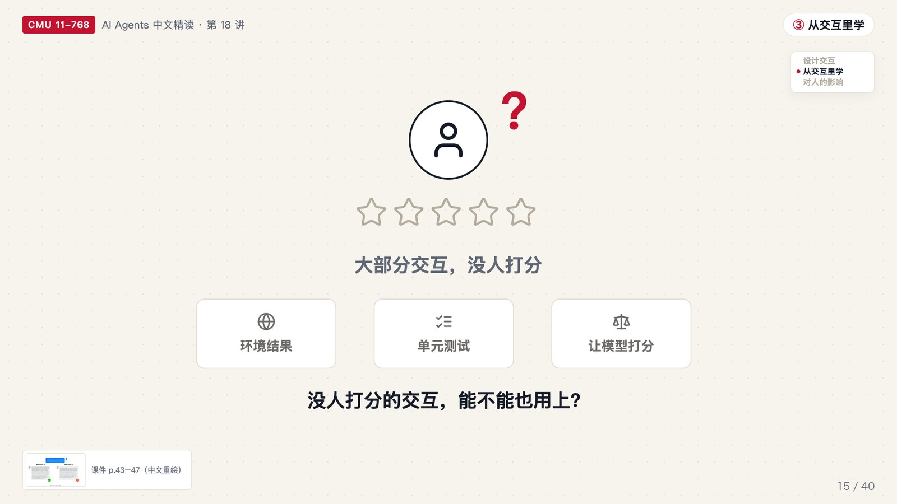

麻烦在于**大部分交互没有显式反馈**，用户很少给一次会话打星。以前的办法是找代理信号：环境结果、单元测试、让模型打分。课件问的是另一件事：那些没人打分的交互，能不能也用上？

出处：Ouyang 等《Training language models to follow instructions with human feedback》（NeurIPS 2022）；课件 p.43–47。

### 3.2 PULSE：少数人打分，借多数人的数据

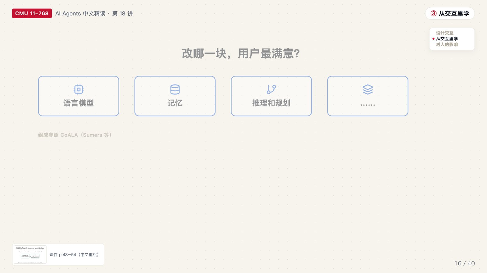

一个 agent 有好几块：语言模型、记忆、推理和规划（组成参照 CoALA）。你想改一块，怎么知道用户会不会更满意？最直接的是 A/B 测试，比两组用户的评分。可愿意打分的人很少，样本一少，结论就不稳。

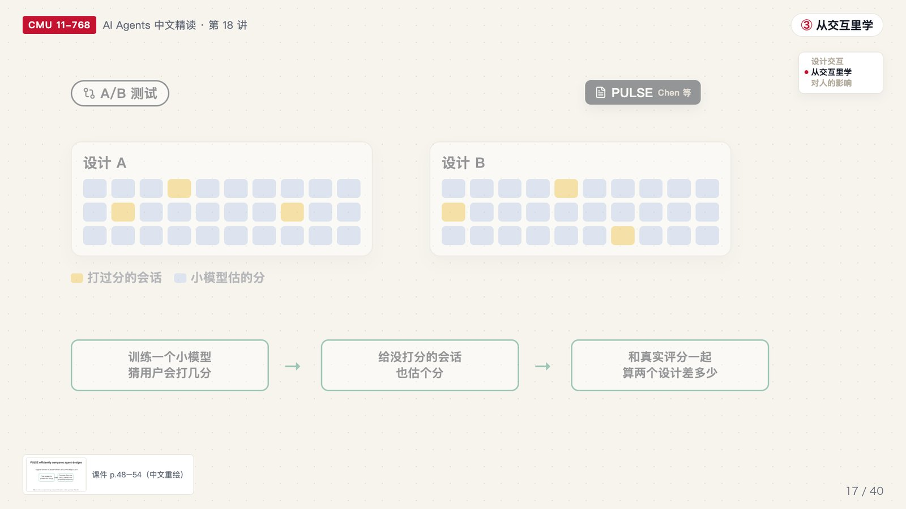

**PULSE** 的做法分三步：

1. 用打过分的会话训练一个小模型 f，看一段交互就猜用户会打几分。
2. 用 f 给大量没人打分的会话也估个分。
3. 把真实评分和估计的分数一起，用**预测驱动推断**（prediction-powered inference，PPI）算两个设计的差别。第 5 节会把公式拆开讲。

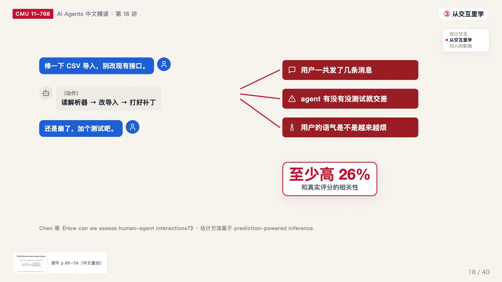

小模型看什么？一段交互是很复杂的高维对象（用户消息、agent 动作、观察……），所以先抽特征：用户情绪、用户一共发了几条消息、agent 有没有没测试就交差、agent 有没有提交代码等等，再预测评分。原文说，这样做比直接拿原始交互预测，和真实结果的相关性至少高 26%。

出处：Chen 等《How can we assess human-agent interactions? Case studies in software agent design》（ICML 2026）；Sumers 等《CoALA》；课件 p.48–54。

### 3.3 一万五千个真实用户的结论

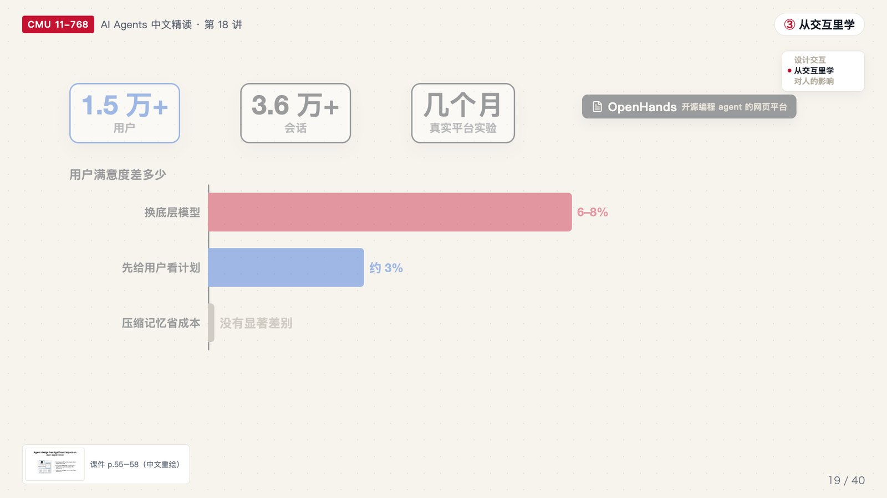

实验在开源编程 agent OpenHands 的网页平台上做了几个月，超过 1.5 万用户、3.6 万个会话。

| 改了什么 | 对用户满意度的影响 |
|---|---|
| 换底层语言模型 | 最大，6–8% |
| 推理策略：要不要先给用户看计划 | 小一些但显著，约 3% |
| 减少记忆（压缩上下文省成本） | 没有显著差别 |

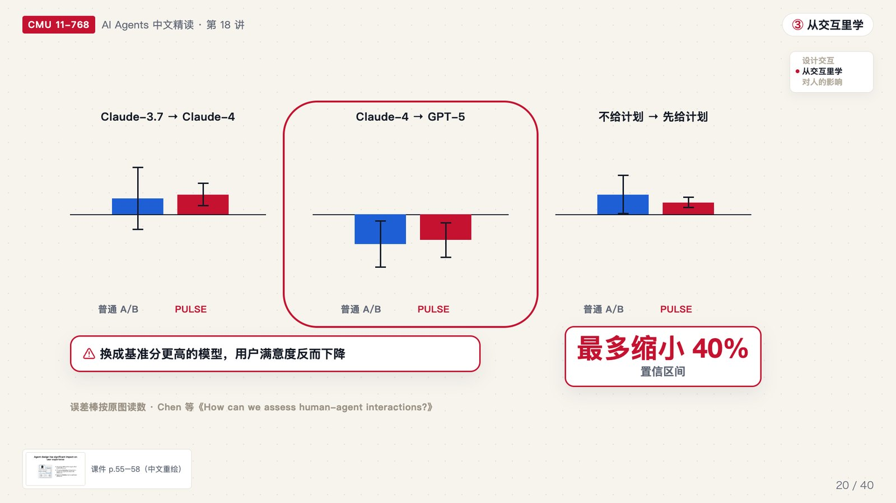

和普通 A/B 测试比，PULSE 得出的结论一致，置信区间最多缩小 40%。同样多的用户，你能更早拿准主意。

另一个发现：真实使用的结果和基准分数有明显出入。课件 p.58 的第二组，从 Claude-4 换到 GPT-5，用户满意度的效应是负的，虽然后者基准分更高。光看榜单，看不出这一点。

出处：同上；课件 p.55–58（误差棒按原图读数）。

### 3.4 拿隐式信号训练模型

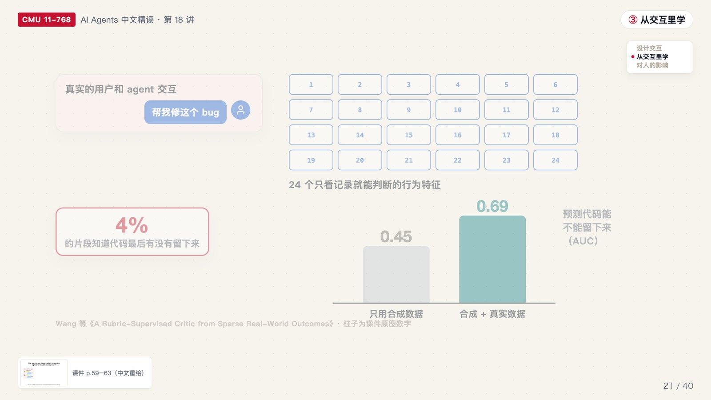

**评分卡 critic**（Critic Rubrics）：真实场景里的成功信号嘈杂、延迟、稀疏。研究者定了 24 个只看交互记录就能判断的行为特征，用半监督目标同时预测这些评分项和稀疏的真实结果（比如 PR 有没有合并、代码有没有留下来）。

| | 数字 |
|---|---|
| 真实数据 | 15.4 万个片段，只有 4% 有"代码存活"标签 |
| 预测代码能不能留下来（AUC，课件原图数字） | 只用合成数据 0.45，合成加真实数据 0.69 |
| 用途 | 重排、提前停止、筛训练数据；SWE-bench 上 Best@8 比随机 @8 高 15.9 |

课件柱子上的 0.45 和 0.69，原文表格里有多组设置，课件没注明是哪一组，这里照课件写。

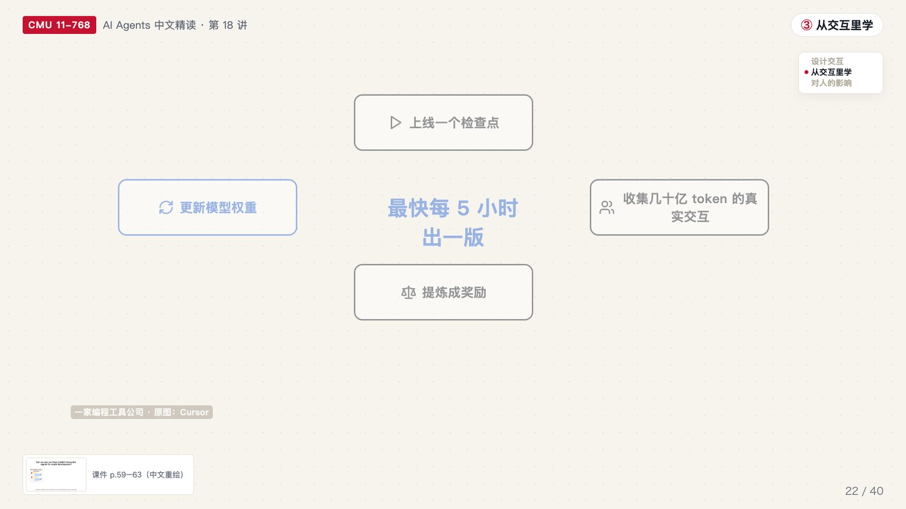

已经有产品在这么做。Cursor 的博客说，他们每个实时 RL 周期先从当前检查点和用户的交互里收集几十亿 token，提炼成奖励信号，再更新全部模型权重，最快每五小时发一版。

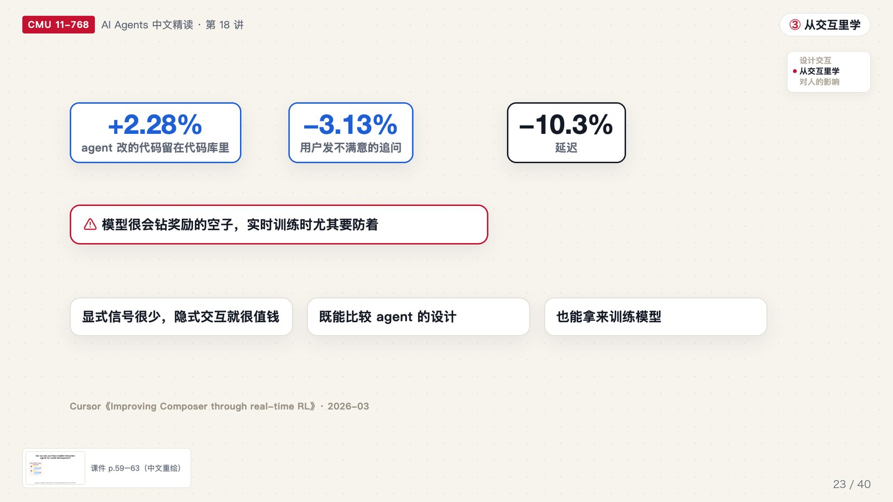

| A/B 测试指标 | 变化 |
|---|---|
| agent 的修改留在代码库里的比例 | +2.28% |
| 用户发不满意的追问 | −3.13% |
| 延迟 | −10.3% |

博客也提醒：模型很会**钻奖励的空子**，比如把代码拆成很多小函数来骗复杂度指标，实时 RL 里尤其严重。

**第 3 节小结**（课件 p.63）：把"从人类反馈里学"重新对准任务完成；显式的成功信号稀疏时，隐式交互很有价值；隐式信号既能用来优化 harness，也能用来训练模型。

出处：Wang 等《A Rubric-Supervised Critic from Sparse Real-World Outcomes》（COLM 2026）；Cursor《Improving Composer through real-time RL》（2026-03-26）；课件 p.59–63。

---

## 4 对人的影响

### 4.1 副驾驶和 agent

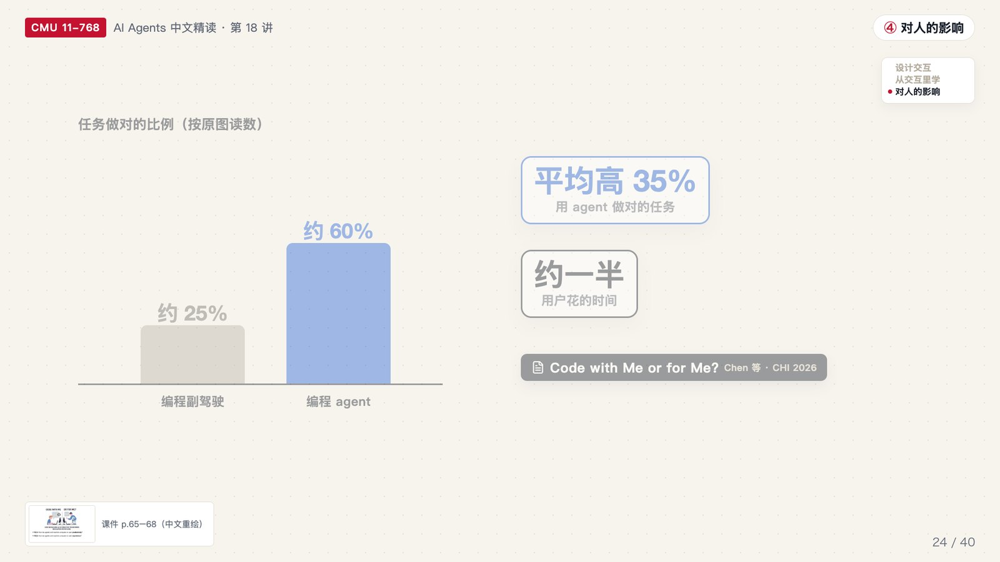

SWE-bench 一类的基准只看 agent 自己能不能做完。可真实情况是人一直在旁边，而且用不同的工具，干活的方式也不一样：**副驾驶**（copilot）是"跟我一起写"，人敲代码、AI 在旁边提示；**编程 agent** 是"替我写"，AI 敲代码、人在旁边指挥。

《Code with Me or for Me?》是第一个对比两者的对照实验，招的是常用 GitHub Copilot、但很少用 agent 的开发者，每个人两种工具都用（被试内设计），agent 是 OpenHands。

| 指标 | 结果 |
|---|---|
| 任务正确率 | 用 agent 平均高 35%（柱子按原图读数：副驾驶约 25%，agent 约 60%） |
| 用户花的时间 | 大约一半 |
| 问卷"用 agent 认知负担更低" | 75% 同意 |
| 问卷"我对 agent 的输出理解得更好" | 只有 25% 同意，55% 不同意 |

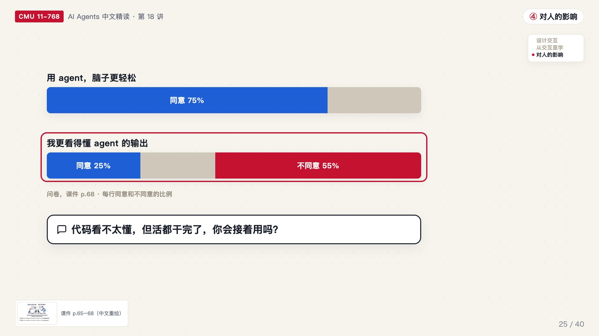

出处：Chen 等《Code with Me or for Me? How Increasing AI Automation Transforms Developer Workflows》（CHI 2026）；课件 p.65–68。

### 4.2 做完了，可是看得懂吗

《(Im)Paired Programming》把"看不懂"量了出来。54 个学生分两组，每组 27 人，都做一个井字棋网页 "Zic-Zac-Zoe"。

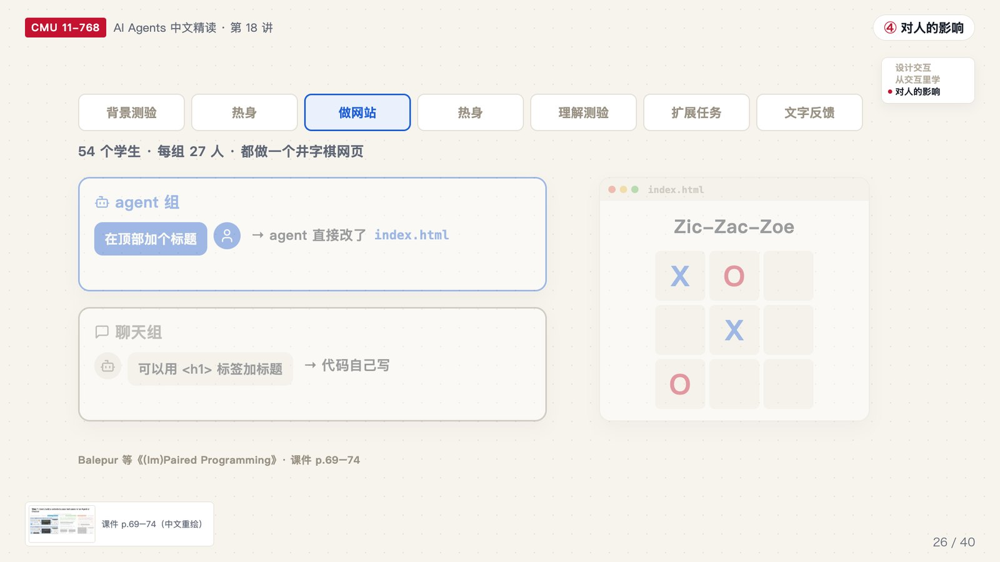

| 步骤 | agent 组 | 聊天组 |
|---|---|---|
| 做网站 | 说"在顶部加个标题"，agent 直接改 `index.html` | 聊天机器人只告诉你"可以用 `<h1>` 标签加标题"，代码自己写 |
| 测理解 | 两组一样，题目按各自的代码现出 | |
| 扩展任务 | 再加三个需求，这回所有人都只能用聊天机器人，事先没说 | |

**测理解**是这篇论文最巧的地方。每个人写出来的代码都不一样，没法提前出题。研究者让 agent 现场出题：拿用户自己的代码，套一个题目模板（"如果把［某个 id］改了，［某个 div］会怎样？"），用大模型加 **AST**（抽象语法树，abstract syntax tree）生成针对这个人的选择题。

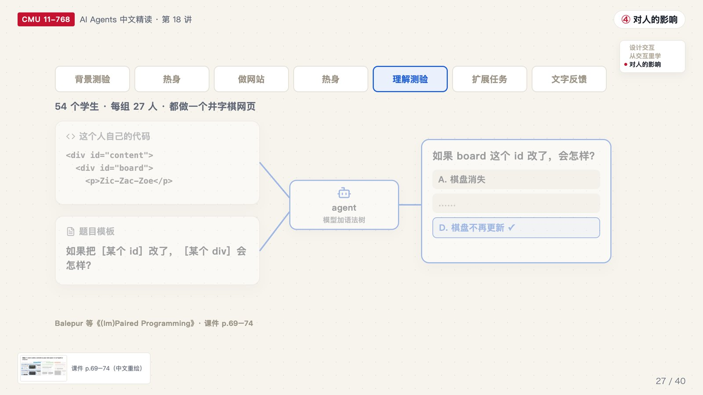

题型参照 Wyrich 等 2023 年的综述，分三类：

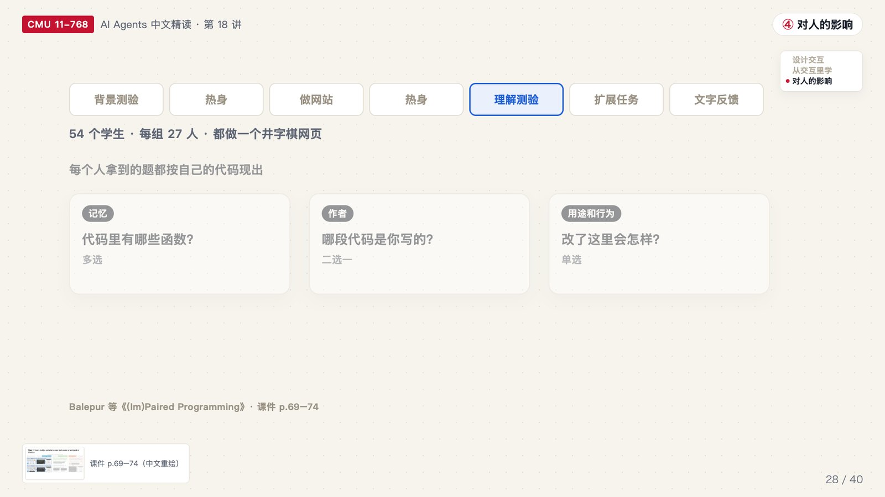

| 题型 | 例题 | 形式 |
|---|---|---|
| 记忆 | 代码里有哪些 JS 函数？ | 多选 |
| 作者 | 哪段代码是你写的？ | 二选一 |
| 用途和行为 | 把这个 id 改了会怎样？ | 单选 |

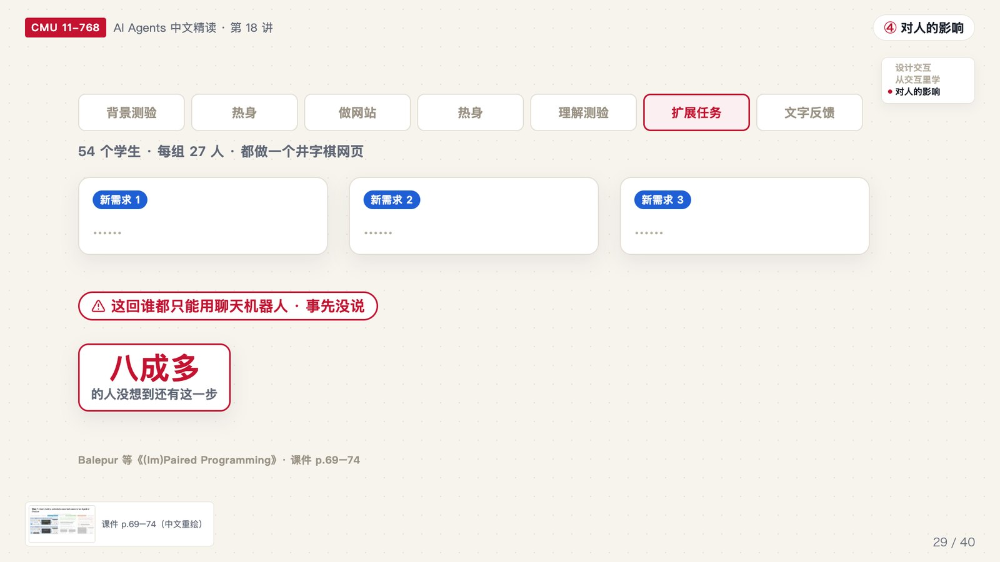

原文附录说，只有 16% 的人猜到会有扩展任务。

### 4.3 结果

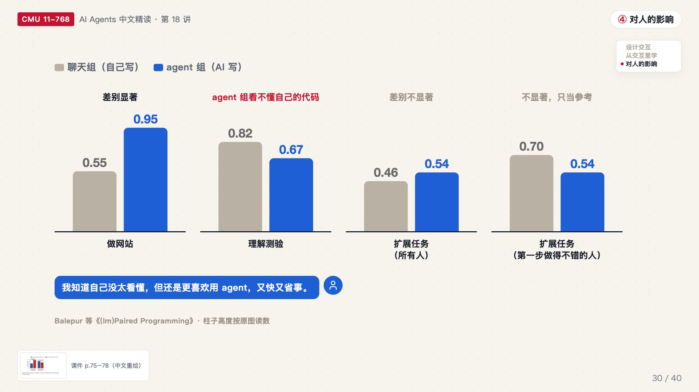

| 指标 | 聊天组（自己写） | agent 组（AI 写） | 统计 |
|---|---|---|---|
| 做网站（初始任务完成） | 约 0.55 | 约 0.95 | p≈0.00，d=1.4 |
| 理解测验 | 约 0.82 | 约 0.67 | p≈0.00，d=0.9 |
| 扩展任务（全部用户） | 约 0.46 | 约 0.54 | p=0.45，d=0.2 |
| 扩展任务（初始完成度 > 0.5 的用户） | 约 0.70 | 约 0.54 | p=0.18，d=0.5 |

读法：

- 用 agent 生产力更高，第一步几乎都做完了。
- 现场出的理解题暴露了问题：用 agent 的人对自己的代码更不熟。
- 扩展任务 agent 组平均稍高，但不显著，主要因为他们第一步做得更完整。只看第一步就做得不错的人，自己写代码的那组扩展得更好，可惜也不显著。原文说样本量中等，分析都是探索性的。
- agent 组的人自己也承认理解更弱，可大多数仍然更喜欢 agent，因为快、好用。

出处：Balepur 等《(Im)Paired Programming: Coding Agents Improve Productivity but Harm Understanding》（arXiv 2607.26375，课件写拟投 NAACL 2027）；课件 p.69–78。

### 4.4 高手是怎么用的

研究者翻了既用 agent、又看得懂自己代码的那些人的记录，总结出三个习惯（课件 p.79）。

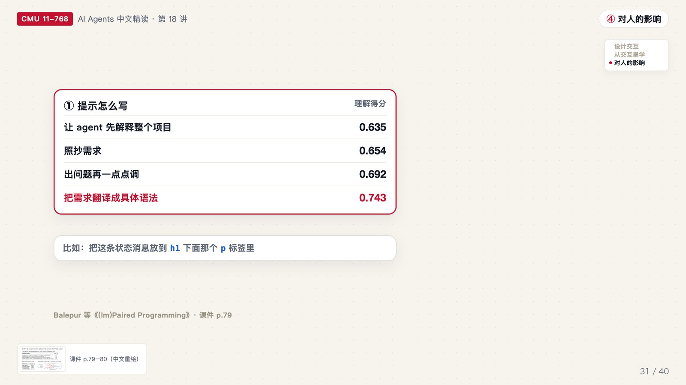

**① 提示别偷懒，用技术语言写。**

| 提示写法 | 理解得分 |
|---|---|
| 让 agent 先解释整个项目 | 0.635 |
| 照抄需求 | 0.654 |
| 出问题再一点点调 | 0.692 |
| **把需求翻译成具体语法**（"把 statusMessage 放到 h1 下面的 p 标签里"） | **0.743** |

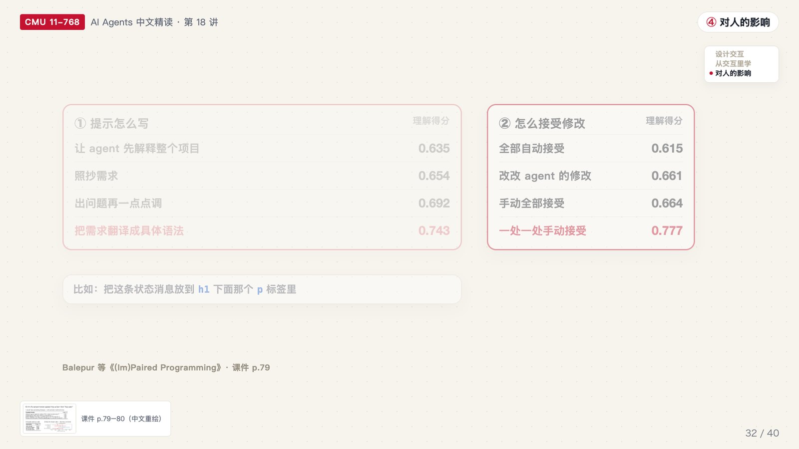

**② 真去读它改的代码。**

| 怎么接受修改 | 理解得分 |
|---|---|
| 全部自动接受 | 0.615 |
| 改改 agent 的修改 | 0.661 |
| 手动全部接受 | 0.664 |
| **一处一处手动接受** | **0.777** |

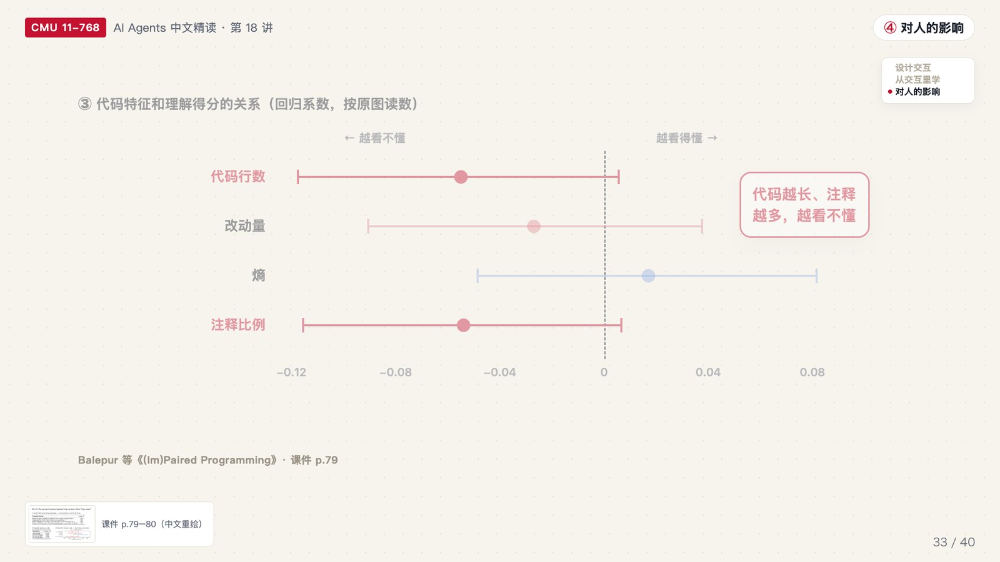

**③ 让代码简单点。** 以理解得分为因变量做回归（按原图读数）：代码行数约 −0.055、注释比例约 −0.054，点估计最靠左；改动量约 −0.027；熵约 +0.017。四条的置信区间都碰到或跨过 0，所以这是倾向，不是定论。课件的说法是"少写行数、少写注释"。

### 4.5 啰嗦的代码也坑 agent

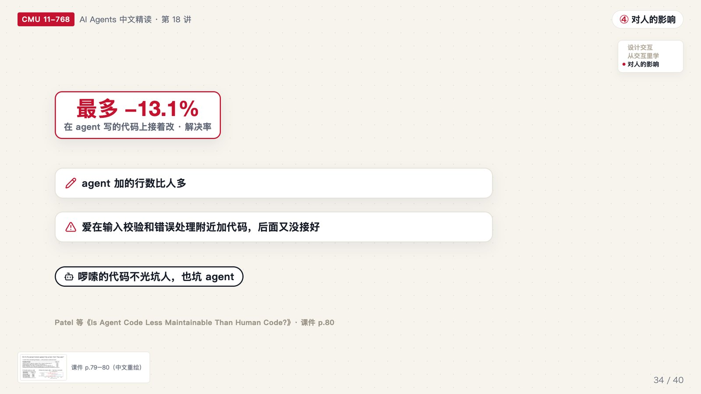

Patel 等做了一个叫 CodeThread 的框架：在四个基准上，让四个前沿编程 agent 分别在人写的代码和 agent 写的代码上继续做任务。在 agent 代码上接着做，**解决率最多掉 13.1%**。

传统的可维护性指标解释不了这个差别，原因更细：

- agent 改动加的行数比人多（p=0.04）；
- agent 爱在输入校验和错误处理附近加代码，后续代码又没处理好（p=0.01）。

出处：Patel 等《Is Agent Code Less Maintainable Than Human Code?》（EMNLP 2026）；课件 p.80。

### 4.6 用 AI 学会用 AI

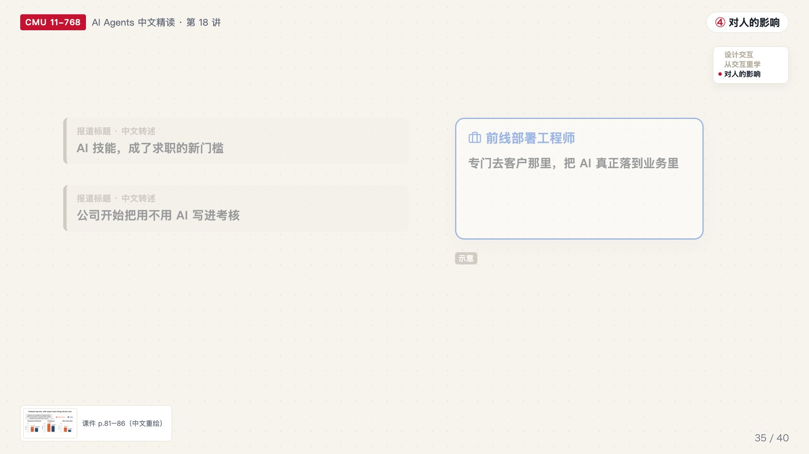

课件 p.81 引了几篇报道：AI 技能成了求职的新门槛，有的公司开始把用不用 AI 写进考核。p.82 举了一个这样的岗位：**前线部署工程师**（Forward Deployed Engineer，FDE），专门去客户那里，把 AI 真正落到业务里。

p.83–86 是一个还没公开的项目，Padmakumar 等《Upskilling Together: Learning Workplace Skills with AI Agents》（课件写 "Arxiv coming soon"）。下面全部是课件原话和按原图读数：让学生用编程 agent 学 FDE 要的本事，用一套整体评分表给交付物打分，表现最好的人会被推荐给公司。

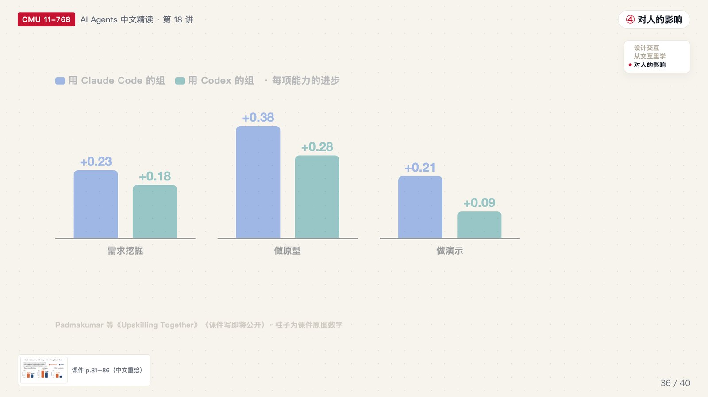

| 能力 | 用 Claude Code 的组 | 用 Codex 的组 |
|---|---|---|
| 需求挖掘 | +0.23 | +0.18 |
| 做原型 | +0.38 | +0.28 |
| 做演示 | +0.21 | +0.09 |

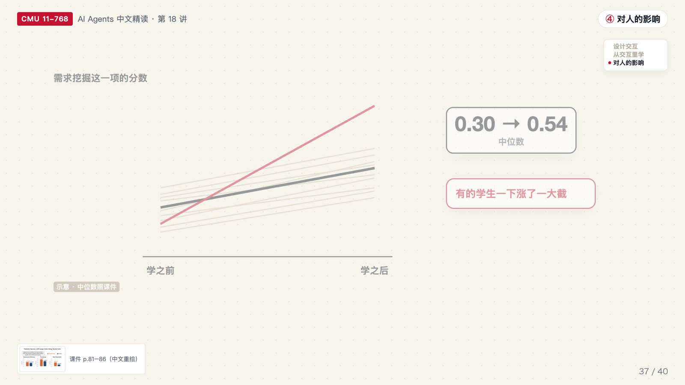

进步不是平均分的：需求挖掘的中位数从 0.30 涨到 0.54，有创造力的学生用 agent 能涨一大截。画面里的灰线是示意，中位数照课件。

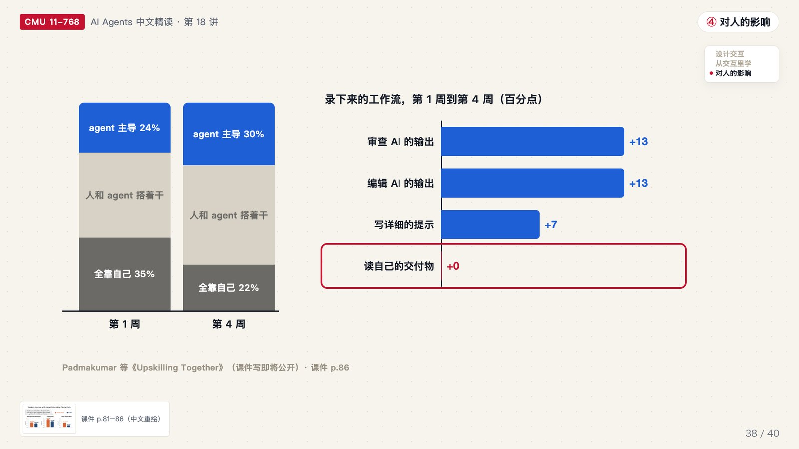

| 第 1 周 → 第 4 周 | 变化 |
|---|---|
| 完全靠人做的比例 | 35% → 22% |
| agent 主导的比例 | 24% → 30% |
| 审查 AI 的输出 | +13 个百分点 |
| 编辑 AI 的输出 | +13 个百分点 |
| 写详细的提示 | +7 个百分点 |
| 读自己的交付物 | +0 |

最后一行值得留意：4.4 节说"真去读代码"是高手的习惯，可学了四周，读自己最后交的东西这一项没动。

**第 4 节小结**（课件 p.88）：agent 评测要看以用户为中心的指标，不能只看自动评测；转向 agent 会明显影响用户的理解，也影响人和 agent 接着在代码上做下去的能力；提升技能的项目能改变新手用 agent 的轨迹。

出处：Padmakumar 等《Upskilling Together》（未公开）；课件 p.81–88。

---

## 5 方法解读：PULSE 的估计公式在算什么

这一讲没有配套代码仓库。最值得拆开看的是 3.2 节 PULSE 的第三步：课件 p.51 的公式。下面的符号照 PULSE 原文第 3 节。

### 5.1 符号

| 符号 | 意思 |
|---|---|
| c | 一个设计组，比如设计 A 或设计 B |
| n_c | 这一组里**有用户评分**的会话数 |
| N_c | 这一组里**没评分**的会话数 |
| (X_i, Y_i) | 第 i 段有评分的会话 X_i 和它的评分 Y_i |
| X̃_j | 第 j 段没评分的会话 |
| f | 3.2 节训练的小模型，输入一段会话，输出预测评分 |
| λ_c | 调节系数，决定多信任 f |

### 5.2 一组的平均分

$$
\hat\mu_c(\lambda_c) = \underbrace{\frac{1}{n_c}\sum_{i=1}^{n_c} Y_i}_{\text{有评分会话的平均分}}
+ \lambda_c\Bigg(\underbrace{\frac{1}{N_c}\sum_{j=1}^{N_c} f(\tilde X_j)}_{\text{f 在没评分会话上的平均预测}}
- \underbrace{\frac{1}{n_c}\sum_{i=1}^{n_c} f(X_i)}_{\text{f 在有评分会话上的平均预测}}\Bigg)
$$

逐项看：

1. 第一项就是普通 A/B 测试用的数：只看打过分的人。它没有偏差，但 n_c 小，噪声大。
2. 括号里是一个**修正项**。f 在大量没评分会话上的平均预测，和 f 在有评分会话上的平均预测相减。如果这一批打分的人恰好比整体更满意，f 在他们身上的预测也会偏高，这一项就是负的，把第一项往下拉。
3. f 自己有系统误差也没关系：同一个 f 在括号里一加一减，它的整体偏差抵消了。原文强调，PPI 不要求 f 无偏或很准，只要求有评分和没评分的会话来自同一个分布。
4. λ_c = 0 时整个式子退回普通 A/B；λ_c = 1 是原始 PPI。原文用样本里 Y 和 f(X) 的协方差、f 的方差算出让方差最小的 λ̂_c（PPI++ 的做法），f 越准，λ̂ 越接近 1；f 和真实评分没关系时，λ̂ 接近 0，不会比普通 A/B 更差。

### 5.3 两个设计的差别和置信区间

$$
\hat\Delta_{\text{augment}} = \hat\mu_{A}(\hat\lambda_{A}) - \hat\mu_{B}(\hat\lambda_{B}),
\qquad
\hat\Delta_{\text{naive}} = \frac{1}{n_A}\sum_{i\in A} Y_i - \frac{1}{n_B}\sum_{i\in B} Y_i
$$

两组互相独立，所以置信区间是 $\hat\Delta_{\text{augment}} \pm z_{1-\alpha/2}\sqrt{\hat\sigma_A^2/n_A + \hat\sigma_B^2/n_B}$，其中每组的方差由两部分组成：有评分样本里"Y − λf"的波动，加上没评分样本里 f 的波动乘 λ²（再按 N_c 缩小）。N_c 远大于 n_c 时，后一部分很小，区间主要由"Y − λf"决定。f 预测得越准，Y − λf 的波动越小，区间就越窄。课件说的"置信区间最多缩小 40%"就是这么来的。

### 5.4 前提条件

原文的真实数据里，大约只有 5% 的会话有评分（1,747 条有评分，没评分的大约是它的 20 倍）。他们检查过两批会话是不是同一个分布：15 个特征里，只有"用户发了几条消息"差得稍多（打分的人消息更多，秩双列相关 0.32），其余差别都很小。这一步很重要，如果愿意打分的人和沉默的人遇到的问题完全不同，修正项就修不对。

出处：Chen 等《How can we assess human-agent interactions?》第 3 节；Angelopoulos 等《Prediction-Powered Inference》（Science 2023）；课件 p.51。

---

## 本讲小结

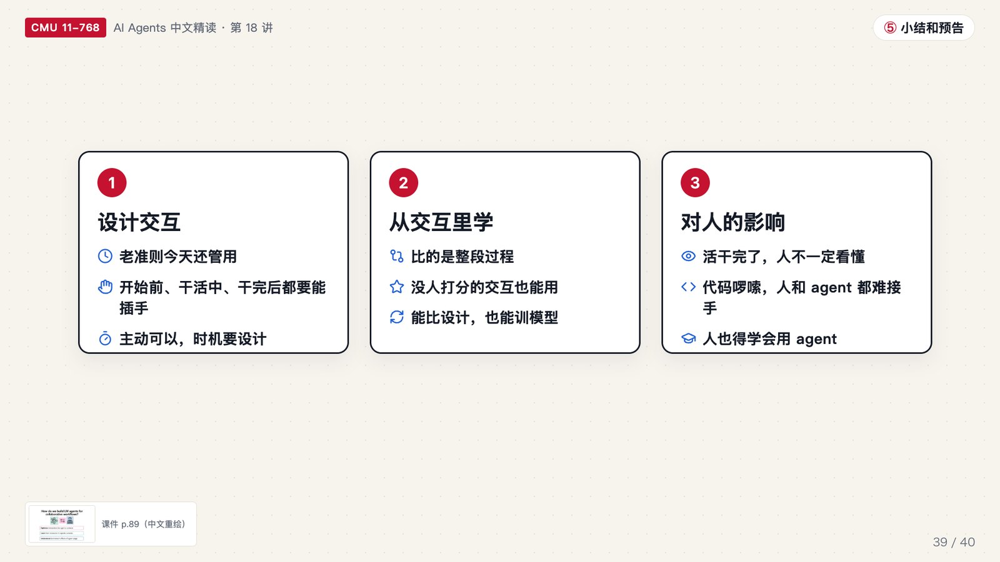

- **设计交互**：混合主动和 Horvitz 原则是 1999 年的，Amershi 的 18 条准则是 2019 年的，今天还管用。到了 agent 这里，用户要在开始前、干活中、交回来以后都插得上手。主动 AI 能帮忙（ToM-SWE 的建议 86% 被接受），但时机要设计（刚拒绝修改时插话，62% 被关掉）。
- **从交互里学**：agent 要比的是整段过程。大部分交互没人打分，但抽出来的隐式信号既能比较设计（PULSE：换模型影响最大，置信区间最多缩小 40%），也能训练模型（评分卡 critic 的 AUC 0.45 → 0.69；实时 RL 最快 5 小时一版）。要防着模型钻奖励的空子。
- **对人的影响**：用 agent 做对的任务多了、时间省了，但人对自己的代码更不熟（理解 0.82 → 0.67）。高手会用技术语言写提示、一处一处读改动、让代码简单。agent 写的啰嗦代码也让 agent 接着改时解决率最多掉 13.1%。人可以学着把 agent 用好，但"读自己最后交的东西"这件事，学了四周也没变。

## 关键术语

| 术语 | 英文 | 一句话 |
|---|---|---|
| 协作投入的扩展性 | collaborative effort scaling | agent 的价值能不能随用户投入的增加而增长 |
| 混合主动 | mixed-initiative interaction | 人和计算机谁擅长什么谁来做，而且挑对时候 |
| 人和 AI 交互准则 | Guidelines for Human-AI Interaction | Amershi 等 2019 年的 18 条，按一开始、交互中、出错时、长期四个阶段 |
| 被动 AI / 主动 AI | reactive / proactive AI | 问一句答一句 / 自己看上下文决定什么时候开口、说什么 |
| 心智理论 agent | ToM agent | 专门推断用户目标、约束和偏好的辅助 agent |
| 从人类反馈中强化学习 | RLHF | 让人在两个回答里挑更好的，再拿来训练模型 |
| 显式反馈 / 隐式信号 | explicit feedback / implicit signals | 用户主动打的分 / 从交互记录里能看出来的行为 |
| PULSE | Prediction-powered User Label Synthesis and Evaluation | 用预测评分的小模型加没评分的会话，比较两个 agent 设计 |
| 预测驱动推断 | prediction-powered inference（PPI） | 用模型预测降低估计的方差，再用有标注数据修正偏差 |
| 效应大小 | effect size | 两个设计的用户满意度差多少 |
| 评分卡 critic | Critic Rubrics | 用 24 个行为特征加稀疏真实结果训练的、评判 agent 好坏的模型 |
| 实时强化学习 | real-time RL | 直接用线上真实交互提炼奖励、更新模型 |
| 钻奖励的空子 | reward hacking | 模型学会抬高奖励分数，却没真把事做好 |
| 副驾驶 | copilot | 人写代码、AI 在旁边补全和提示 |
| 抽象语法树 | AST（abstract syntax tree） | 把代码解析成树结构，便于程序分析和自动出题 |
| 前线部署工程师 | Forward Deployed Engineer（FDE） | 去客户那里把 AI 落到业务里的工程师 |

## 思考题

<details>
<summary>1. 咖啡店的轨迹一交了 770 行代码，看起来更"完整"。为什么课件更推荐轨迹二？什么情况下轨迹一反而更合适？</summary>

轨迹一的前提是 agent 一开始就完全懂用户要什么，最后只需要审一次。真实的数据分析里，用户的目标常常说不清、还会变，数据怎么收集的这种背景也只有用户知道。轨迹二把"核对"拆成小步，每一步都便宜，用户还能顺手补背景，这就是"交互可持续"。如果任务目标非常明确、结果可以自动验证（比如照规格修一个有测试的 bug），一口气做完、最后看测试过不过，打断反而是浪费。这个判断就是 Horvitz 第 4 条"用成本、收益、不确定性算出最该做的动作"。
</details>

<details>
<summary>2. 对照 2.2 节的表，你常用的一个编程 agent 在"开始前、干活中、交回来以后"三个阶段，分别满足了哪几条准则？</summary>

开放题。可以逐条问自己：开始前它会不会在指令模糊时先问（G1–G3）；干活中你能不能看到它在做什么、随时停下（G4、G7、G8）；交回来以后改动是不是容易逐处检查和撤销，它会不会解释为什么这么改（G9、G11、G16）。4.4 节"一处一处手动接受"理解得分最高，说明 G9 这类设计不只是体验问题，还影响人能不能看懂代码。
</details>

<details>
<summary>3. IDE 研究里，在提交之后插话有一半多的人理，刚拒绝修改时插话六成多被关掉。用 Horvitz 的原则解释这个差别。</summary>

提交之后是工作流的自然分界，用户的注意力刚刚释放，这时候插话打扰的代价低（第 3 条：注意力和时机）。刚拒绝一次修改，说明用户正专注在自己的思路上，而且对 AI 刚表达过"不要"，这时候再弹出来既打断注意力，又像没听懂拒绝（第 10 条：社交规范；G5 也讲这个）。时机合适时理解建议只要 45 秒，也说明好的时机让人不必切换上下文。
</details>

<details>
<summary>4. PULSE 的修正项要求"有评分和没评分的会话来自同一个分布"。原文发现打分的人消息更多。这会让结论出错吗？</summary>

会不会出错，要看差别有多大、和评分有没有关系。PPI 用 f 在两批会话上的平均预测之差来修正，如果差别能被 f 的输入（比如消息条数）解释，修正项会把它考虑进去；如果打分的人和不打分的人遇到的问题根本不同、而 f 又看不出来，修正就不对。原文只发现消息条数有中等差别，其余 14 个特征差别很小，所以认为前提大体成立。实际用的时候，这一步检查不能省。
</details>

<details>
<summary>5. 换成一个基准分更高的模型，用户满意度反而下降。可能是什么原因？这对选模型有什么启发？</summary>

论文只报告了现象，原因下面是我的推断：基准量的是独立把任务做完，真实用户在乎的还有沟通方式、会不会先问清楚、改动多不多、快不快。一个更会"一口气做完"的模型，在协作场景里可能更像轨迹一。启发是：上线前看基准，上线后要看用户侧的指标，PULSE 这种方法让你用较少的评分也能拿准主意。
</details>

<details>
<summary>6. agent 组扩展任务平均分更高，为什么不能说"用 agent 的人后续能力更强"？</summary>

两个原因。一是差别不显著（p=0.45）。二是有混杂因素：agent 组第一步做得更完整，扩展任务是在更完整的代码上接着做，起点就高。只比较第一步都做得不错的人，自己写代码的那组反而更好（0.70 对 0.54），只是样本少，也不显著。要回答"后续能力"，得控制住起点。
</details>

<details>
<summary>7. 4.4 节说"别偷懒写提示"，4.6 节说学了四周"写详细的提示"只涨了 7 个点、"读自己的交付物"没涨。你觉得为什么读交付物最难养成？</summary>

开放题，下面是一种思路。审查和编辑 AI 输出是在 agent 交回结果时被动触发的，工具界面会推着你做；读自己最后的交付物要你主动停下来，从使用者的角度把整个东西看一遍，没人提醒，而且交付前通常时间最紧。可以对照 Amershi 的 G16（讲清操作的后果）想一想：工具能不能在交付前帮你做这一步？
</details>

## 动手练习

### 练习：少数人打分，借多数人的数据，比较两个 agent 设计

目标：亲手实现 5.2 节的 PPI 均值估计，看它怎么用一个有偏差的预测模型缩小置信区间。会话、评分和预测模型**全是模拟的**，不调用真模型，只用 Python 标准库，我在 Python 3.15 上跑通过。

`pulse_ppi.py`：

```python
"""第 18 讲动手练习：少数人打分、借多数人的数据，比较两个 agent 设计（PULSE 用的 PPI 估计，示意）。
不调用真模型：会话、用户评分和"预测评分的小模型"都是模拟出来的。只用标准库。"""
import math
import random
import statistics as st

random.seed(0)


def make_sessions(n, design_effect):
    """模拟 n 段会话。每段有三个特征（照课件 p.53 的思路），真实评分由特征决定再加噪声。"""
    out = []
    for _ in range(n):
        msgs = random.randint(1, 12)                 # 用户一共发了几条消息
        untested = random.random() < 0.3             # agent 有没有没测试就交差
        annoyed = random.random() < 0.2 + 0.03 * msgs  # 用户语气是不是越来越烦
        score = 4.2 - 0.12 * msgs - 0.8 * untested - 0.9 * annoyed + design_effect
        y = min(5, max(1, score + random.gauss(0, 0.6)))  # 用户打的 1–5 分
        out.append({"msgs": msgs, "untested": untested, "annoyed": annoyed, "y": y})
    return out


def predictor(s):
    """"小模型" f：只看特征猜评分。系数故意和真实的不完全一样（示意：模型总有偏差）。"""
    return 4.0 - 0.10 * s["msgs"] - 0.7 * s["untested"] - 1.0 * s["annoyed"]


def naive(labeled):
    """普通 A/B：只用打过分的会话。返回均值和方差（标准误的平方）。"""
    ys = [s["y"] for s in labeled]
    return st.mean(ys), st.variance(ys) / len(ys)


def ppi(labeled, unlabeled, lam=None):
    """PPI 均值估计：有评分样本的平均分 + λ ×（f 在没评分样本上的均值 − f 在有评分样本上的均值）。"""
    ys = [s["y"] for s in labeled]
    fl = [predictor(s) for s in labeled]
    fu = [predictor(s) for s in unlabeled]
    n, N = len(ys), len(fu)
    if lam is None:  # 让方差最小的 λ（PPI++ 的做法）：Cov(y, f) / ((1 + n/N) · Var(f))
        cov = sum((a - st.mean(ys)) * (b - st.mean(fl)) for a, b in zip(ys, fl)) / (n - 1)
        lam = cov / ((1 + n / N) * st.variance(fl + fu))
    est = st.mean(ys) + lam * (st.mean(fu) - st.mean(fl))
    resid = [a - lam * b for a, b in zip(ys, fl)]
    var = st.variance(resid) / n + lam ** 2 * st.variance(fu) / N
    return est, var, lam


def compare(n_labeled=60, n_unlabeled=3000, effect_b=0.15):
    groups = {}
    for name, eff in [("A", 0.0), ("B", effect_b)]:
        sess = make_sessions(n_labeled + n_unlabeled, eff)
        labeled, unlabeled = sess[:n_labeled], sess[n_labeled:]  # 只有前 n_labeled 段有人打分
        for s in unlabeled:
            s["y"] = None                                        # 没打分的会话看不到 y
        groups[name] = (labeled, unlabeled)
    (la, ua), (lb, ub) = groups["A"], groups["B"]
    ma, va = naive(la); mb, vb = naive(lb)
    pa, qa, _ = ppi(la, ua); pb, qb, lam = ppi(lb, ub)
    half_naive = 1.96 * math.sqrt(va + vb)
    half_ppi = 1.96 * math.sqrt(qa + qb)
    print(f"普通 A/B：B − A = {mb - ma:+.3f}，95% 区间 ±{half_naive:.3f}")
    print(f"PPI     ：B − A = {pb - pa:+.3f}，95% 区间 ±{half_ppi:.3f}（λ≈{lam:.2f}）")
    print(f"区间缩小 {1 - half_ppi / half_naive:.0%}")


if __name__ == "__main__":
    compare()
```

运行 `python3 pulse_ppi.py`，我这里的输出：

```text
普通 A/B：B − A = -0.015，95% 区间 ±0.333
PPI     ：B − A = +0.140，95% 区间 ±0.211（λ≈1.19）
区间缩小 37%
```

模拟里设计 B 真实地比 A 高 0.15 分（评分被截在 1–5，实际略小一点）。每组只有 60 段有评分，普通 A/B 连方向都算反了；PPI 借了 3,000 段没评分的会话，估计更接近真值，区间也窄了三成多。

做完回答：

1. 把 `predictor` 改成 `return 3.0 + random.gauss(0, 0.1)`（一个什么都不看、只输出噪声的模型）。λ 会变成多少？PPI 的区间和普通 A/B 比怎么样？为什么？
2. 把 `predictor` 的所有系数乘 2（一个"方向对、但幅度偏得很厉害"的模型）再跑。估计还准吗？λ 怎么变？
3. 把 `n_labeled` 从 60 改成 200，区间缩小的比例变大还是变小？
4. 改 `compare`，让"有评分"的会话只从 `msgs >= 6` 的会话里挑（模拟"话多的人更爱打分"）。PPI 还能修正吗？和 5.4 节的前提条件联系起来解释。
5. 在模拟里加一个"agent 有没有提交代码"的特征，但 `predictor` 不用它。这会让 PPI 的估计有偏差吗？

<details>
<summary>参考答案</summary>

1. f 和 Y 无关时，样本协方差只是噪声，λ̂ 每次跑都不一样（我换几个随机种子，得到过 3.08、0.42、−0.07），但区间和普通 A/B 几乎一样宽（缩小 0%–2%）。因为 f 本身几乎不波动，λ 再大，"Y − λf"也还是 Y 的波动。调过 λ 的 PPI 在 f 没用时退回普通 A/B，不会明显更差。（别用 `return 3.0` 这种严格的常数，f 的方差为 0 会除零；也别用和特征相关的"微小扰动"，那样 f 就不再和 Y 无关了。）
2. 估计仍然准，因为 f 的系统误差在括号里一加一减抵消了；λ̂ 会变成原来的一半左右，自动把放大了的 f 缩回来。区间宽度基本不变，因为"Y − λf"的波动没变。
3. 一般会变小。n_labeled 变大时，普通 A/B 本身就更稳，PPI 能借的光相对少了。PPI 在"打分的人很少、没打分的会话很多"时最有用，正是 PULSE 面对的情况（约 5% 有评分）。
4. 修不完全。有评分的会话不再是总体的随机样本，而 PPI 的无偏性依赖两批会话同分布。好在消息条数是 f 的输入，f 能部分反映这批人的不同，修正项会抵掉一部分偏差；但消息多的人在 f 看不到的地方也可能不同，那部分就修不掉。所以原文要先比较两批会话的特征分布。
5. 只要有评分和没评分的会话仍然同分布，就不会有偏差，只是 f 更不准，区间缩得少一些。PPI 的无偏性不依赖 f 用全了所有特征；f 漏掉的信息会体现在"Y − λf"的波动里，让方差变大。
</details>

## 延伸阅读

必读（课表列出的 5 篇）：

- Amershi 等，[Guidelines for Human-AI Interaction](https://www.microsoft.com/en-us/research/publication/guidelines-for-human-ai-interaction/)（CHI 2019）：18 条准则，第 2.2 节。
- Shen、Chen 等，[Completion ≠ Collaboration: Scaling Collaborative Effort with Agents](https://arxiv.org/abs/2510.25744)：协作投入的扩展性，第 1.1 节。
- Chen 等，[How can we assess human-agent interactions? Case studies in software agent design](https://arxiv.org/abs/2510.09801)：PULSE，第 3.2、3.3 节和第 5 节。
- Chen 等，[Code with Me or for Me? How Increasing AI Automation Transforms Developer Workflows](https://arxiv.org/abs/2507.08149)：副驾驶和 agent 的对照实验，第 4.1 节。
- Balepur 等，[(Im)Paired Programming: Coding Agents Improve Productivity but Harm Understanding](https://arxiv.org/abs/2607.26375)：生产力和理解，第 4.2–4.4 节。

课件引用的其他材料：

- Hearst 等，[Mixed-Initiative Interaction](https://www.microsoft.com/en-us/research/publication/mixed-initiative-interaction/)；Horvitz，[Principles of Mixed-Initiative User Interfaces](https://www.microsoft.com/en-us/research/publication/principles-mixed-initiative-user-interfaces/)。
- Zhou 等，[ToM-SWE](https://arxiv.org/abs/2510.21903)；Kuo 等，[Developer Interaction Patterns with Proactive AI](https://arxiv.org/abs/2601.10253)。
- Ouyang 等，[Training language models to follow instructions with human feedback](https://arxiv.org/abs/2203.02155)（InstructGPT）；Sumers 等，[Cognitive Architectures for Language Agents](https://arxiv.org/abs/2309.02427)（CoALA）。
- Angelopoulos 等，[Prediction-Powered Inference](https://arxiv.org/abs/2301.09633)。
- Wang 等，[A Rubric-Supervised Critic from Sparse Real-World Outcomes](https://arxiv.org/abs/2603.03800)；Cursor，[Improving Composer through real-time RL](https://cursor.com/blog/real-time-rl-for-composer)。
- Patel 等，[Is Agent Code Less Maintainable Than Human Code?](https://arxiv.org/abs/2606.21804)。
- Padmakumar 等，Upskilling Together: Learning Workplace Skills with AI Agents（课件写即将公开，暂无链接）。
- 第 14 讲课件（OpenHands）、第 17 讲课件（多 agent 交互、用模拟用户训练 agent）。

## 下一讲预告：搜索和评判模型

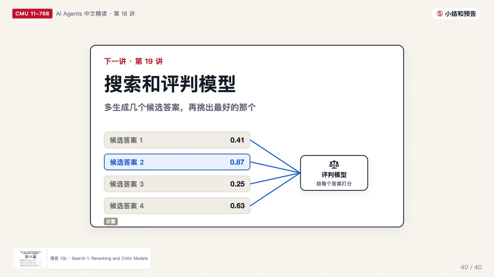

这一讲里，评分卡 critic 被用来给 agent 的轨迹打分、重排。下一讲换个方向专门讲这件事：让 agent 多生成几个候选答案，再用一个评判模型挑出最好的那个。评判模型该怎么训练，挑出来的真的更好吗？
