# 第 19 讲 · 搜索和评判模型：多生成几个，再挑出最好的

> CMU 11-768 AI Agents（2026 秋）中文精读 · 配套课件
> 配套视频（9 分钟）：B 站 / 视频号 / 抖音 / 小红书搜索「竹二木SI」 · 整份幻灯片：[l19-幻灯片.pdf](./l19-幻灯片.pdf)
> 原课程：[cmu-agents.com](https://cmu-agents.com)，课程主讲 Graham Neubig、Daniel Fried；本讲课表名 Search 1: Reranking and Critic Models（Lecture 20），讲者 Daniel Fried，课件标题 Search over Trajectories。本课件是非官方的学习整理。
> **这一讲原课程没有公开录像**，内容根据原课件（31 页）和课表列出的推荐阅读整理：必读的 4 篇（Large Language Monkeys、PDR、Scaling Test-Time Compute for Agentic Coding、Meta-Harness），以及课件页脚引用的论文和代码。每节末尾注明出处。从图上读出的数标"按原图读数"；我自己算的、核对的数标"我的推断"。

## 这一讲你会学到

学完这一讲，你应该能做到：

1. 说清楚"多花测试时计算"的几种花法：并行多跑（广度）、一轮轮改（深度）、候选之间共享经验，最后挑一个交出去。
2. 用公式算出**覆盖率**（coverage，也写作 pass@k），会用无偏估计从一份样本算出所有 k 的覆盖率；解释为什么覆盖率涨得快，但"挑得出来"才是真正的瓶颈，以及为什么多数投票选不中稀有的对答案。
3. 区分几类**验证信号**：真实检查（证明检查器、参考测试）和预测的正确性（预测测试、奖励模型、和其他候选的相似度），说出 **Best-of-N**、**自洽投票**（self-consistency）、按运行结果投票各自怎么挑。
4. 用一个简单的公式说明**不完美的验证器**为什么给多跑设了天花板，这个上限为什么和试几次无关、题越难越低。
5. 说出**迭代改进**（iterative refinement）的做法（Reflexion、Self-Refine、Self-Debugging、PDR）和局限：没有外部反馈时，模型自己批改可能把对的改错；会用延迟和总花费两本账比较 PDR 和一轮轮改。
6. 说出长程 agent 上测试时扩展的难点（轨迹太长没法直接比），以及摘要加**递归锦标赛投票**（RTV）的做法和它的几个设计选择；说出 **harness 搜索**（Meta-Harness）为什么要看原始执行记录，以及权重、harness 交替优化（WHALE）在做什么。

建议先看一遍视频，再对照本课件逐节复习。每节开头的图就是视频里对应的画面。

### 接上一讲

上一讲讲人和 agent 的交互，其中一部分是怎么从交互里学：大部分交互没人打分，研究者训练评判模型（critic）去估分。这一讲换个方向用评判模型：不训练 agent 本身，而是让 agent 多试几次，再用评判模型挑出最好的那个。这属于**测试时计算**（test-time compute）：模型不变，推理的时候多花算力。

### 这一讲的路线

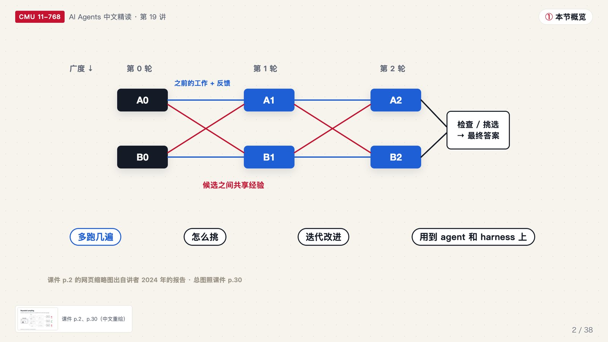

课件 p.30 的总图贯穿全讲：横向是轮次（第 0、1、2 轮），纵向是广度（候选 A、B）。第 0 轮各自独立采样；之后每轮带着"之前的工作 + 反馈"改进；候选之间可以共享经验；最后"检查 / 挑选"出最终答案。

| 节 | 回答的问题 | 课件 |
|---|---|---|
| 1 多跑几遍 | 随机性从哪来，多跑能带来多少 | p.2–8 |
| 2 怎么挑 | 有哪些验证信号，怎么从候选里挑 | p.9–15 |
| 3 迭代改进 | 怎么一轮轮改，改有什么局限 | p.16–21 |
| 4 放到 agent 上 | 轨迹太长时怎么比、怎么复用 | p.22–25 |
| 5 优化 harness | harness 和权重也能搜 | p.26–30 |
| 6 源码解读 | 一个真实的 harness 长什么样 | p.27 |

---

## 1 多跑几遍

### 1.1 随机性从哪来

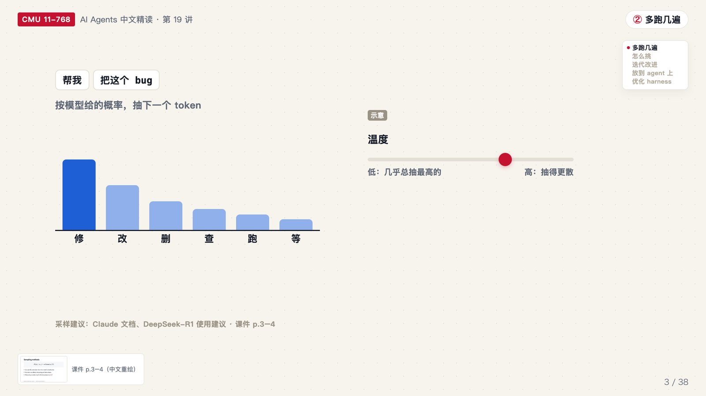

模型每一步按 softmax(z/T) 的概率抽下一个 token，T 是**温度**（temperature）：温度低，几乎总抽概率最高的那个；温度高，抽得更散。这种随机性不光影响推理的思路，也影响 agent 调哪个工具、传什么参数。课件提醒：推理模型常常建议把温度固定在 1.0（引 Claude 文档的采样设置和 DeepSeek-R1 的使用建议），不让你随便调。

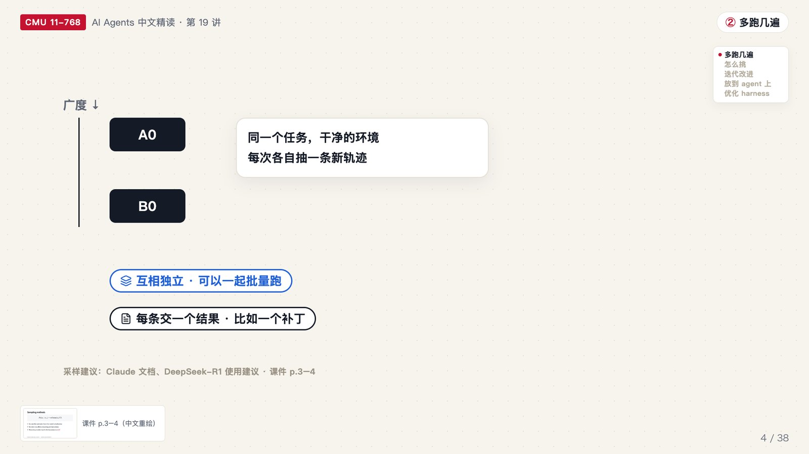

最简单的做法是**并行尝试**（parallel attempts）：每次都从同一个任务、一个干净的环境开始，各跑各的。它们互相独立，常常能放进一批一起跑；每条轨迹交出一个结果，比如一个补丁。

出处：课件 p.3–4。

### 1.2 覆盖率

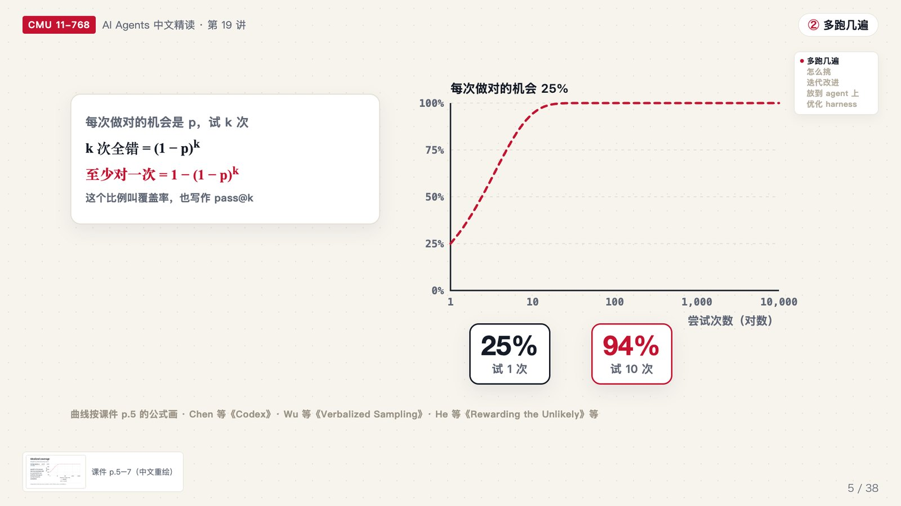

**pass@k**：k 次尝试里至少成功一次的比例。单次成功概率是 p 时：

$$
P(\text{k 次全失败}) = (1-p)^k,\qquad P(\text{至少成功一次}) = 1-(1-p)^k
$$

课件的交互图取 p = 25%：k = 1 是 25%；按公式，k = 10 时 1 − 0.75¹⁰ ≈ 94%（我的推断，课件图上 k = 10 附近曲线已接近顶）。课件强调，pass@k 是"有一个神谕能完美分清候选对错"时的成功率，所以也叫**覆盖率**（coverage）：答案在不在候选里。

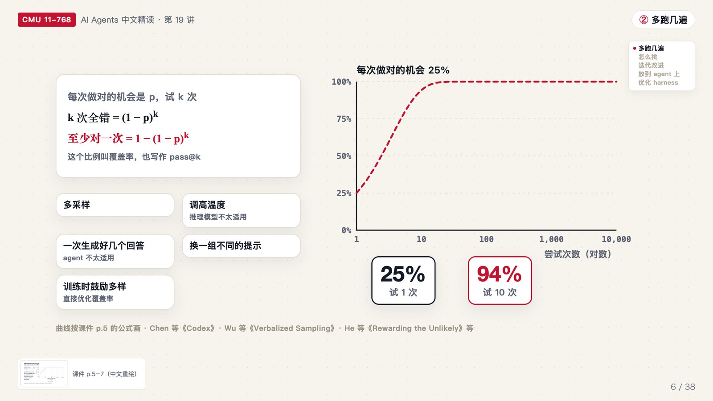

想让覆盖率涨得更快，要让候选更不一样：

| 办法 | 说明 | 课件引用 |
|---|---|---|
| 多采样 | 最直接 | |
| 调高温度 | 推理模型不太适用 | Codex |
| 一次生成多个回答 | agent 不太适用 | Verbalized Sampling |
| 用一组不同的提示 | | Mode-conditioning |
| 训练时鼓励多样、直接优化 pass@k | | Rewarding the Unlikely、Differential Smoothing、MaxRL |

Codex 原文有一个实用的结论：k 越大，最优的采样温度越高，因为样本更多样，而 pass@k 只看有没有一个对的。

出处：课件 p.5–7；Chen 等《Evaluating Large Language Models Trained on Code》。

### 1.3 覆盖率怎么量、能涨多少

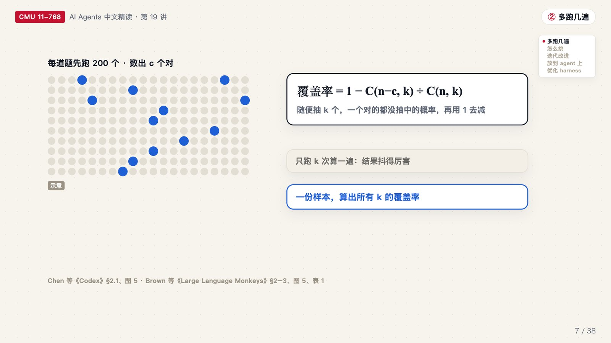

**无偏估计**。真去跑 k 次、看有没有一个对，结果抖得厉害。Codex 论文的做法是每题先采 n 个样本（论文里 n = 200），数出其中 c 个对，再算"随便抽 k 个，至少抽中一个对的"的概率：

$$
\text{pass@}k = \mathbb{E}_{\text{题目}}\left[1 - \frac{\binom{n-c}{k}}{\binom{n}{k}}\right]
$$

分子是"k 个全从错的里抽"的组合数。一份 n 个样本，就能算出所有 k ≤ n 的覆盖率。Codex 给了数值稳定的写法：

```python
def pass_at_k(n, c, k):
    if n - c < k:
        return 1.0
    return 1.0 - np.prod(1.0 - k / np.arange(n - c + 1, n + 1))
```

**温度跟着 k 走**。同一篇论文发现，679M 参数的模型 pass@1 的最优温度是 0.2，pass@100 的最优温度是 0.8。试得多时比的是"里面有没有一个对的"，样本越散越好。

**规模规律**。Large Language Monkeys 每题采一万个样本，覆盖率在四个数量级上一直涨，log(覆盖率) 和样本数 k 的关系常能用幂律拟合：

$$
c \approx \exp(a\,k^{b})
$$

例如 Llama-3-8B-Instruct 在 MATH 上 a = −1.33、b = −0.43。小模型涨得最多：Gemma-2B 在编程竞赛题 CodeContests 上，pass@1 是 0.02%，pass@10k 是 7.1%，涨了 300 多倍。

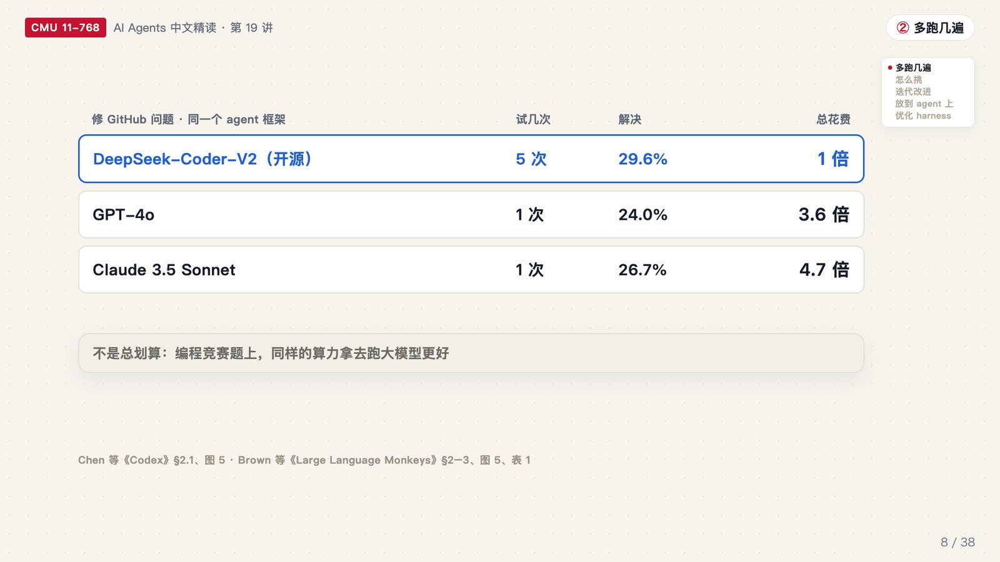

**多试几次也能省钱**。原文表 1（SWE-bench Lite，同一个 agent 框架 Moatless Tools）：

| 模型 | 试几次 | 解决 | 相对总花费 |
|---|---|---|---|
| DeepSeek-Coder-V2-Instruct | 5 | 29.62% | 1 倍 |
| GPT-4o | 1 | 24.00% | 3.6 倍 |
| Claude 3.5 Sonnet | 1 | 26.70% | 4.7 倍 |

但不是总划算：按推理 FLOPs 算，MiniF2F、GSM8K、MATH 上 8B 模型多采样更划算，CodeContests 上 70B 模型几乎总是更划算。

出处：Chen 等《Codex》§2.1、图 3、图 5；Brown 等《Large Language Monkeys》§2.2–3.1、图 4–5、表 1。

### 1.4 答案在里面，可是挑不出来

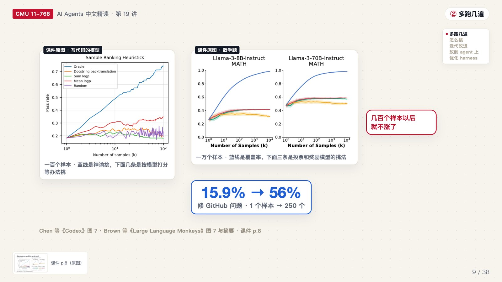

现实里没有神谕。课件 p.8 放了两张图（按原图读数）：

- **Codex · HumanEval**：一百个样本时，神谕挑的通过率到 0.7 以上；按平均对数概率、文档字符串反向翻译等启发式挑，只有 0.2–0.35 左右。
- **Large Language Monkeys · MATH**：样本加到一万个，覆盖率接近 1；多数投票、奖励模型挑、奖励模型加投票都在几百个样本后停住（8B 模型约 0.4，70B 约 0.6）。

反过来，能自动验证的任务上，多跑就是真的多得分。Large Language Monkeys 原文：SWE-bench Lite 上 DeepSeek-Coder-V2-Instruct 一个样本解决 15.9%，250 个样本解决 56%，超过当时单样本最好的 43%。原文还发现，覆盖率常常随样本数呈对数线性增长，跨了四个数量级。

出处：Chen 等《Codex》图 7；Brown 等《Large Language Monkeys: Scaling Inference Compute with Repeated Sampling》图 7 与摘要；课件 p.8。

---

### 1.5 为什么挑不出来

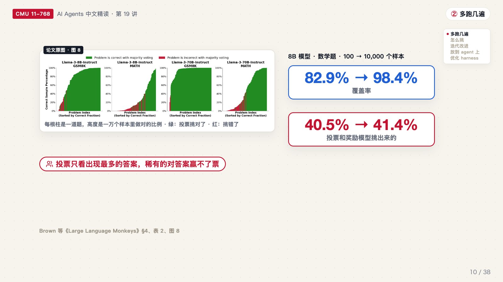

Large Language Monkeys 第 4 节解释了"几百个样本后就不涨"：

- 样本越多，覆盖率的增长来自那些**很少出现的对答案**（有的题一万个样本里只有 1% 以下是对的）。多数投票只看出现最多的答案，稀有的对答案永远赢不了票。Llama-3-8B-Instruct 在 MATH 上，覆盖率从 100 个样本的 82.9% 涨到 1 万个的 98.44%，投票、奖励模型最好也只从 40.50% 涨到 41.41%。
- 对答案是不是蒙的？作者人工检查了 105 条做对的 GSM8K 推理，九成以上每一步都对，连 pass@1 低于 10% 的难题也大多如此。所以验证器是有信号可用的，现有挑法没用好。

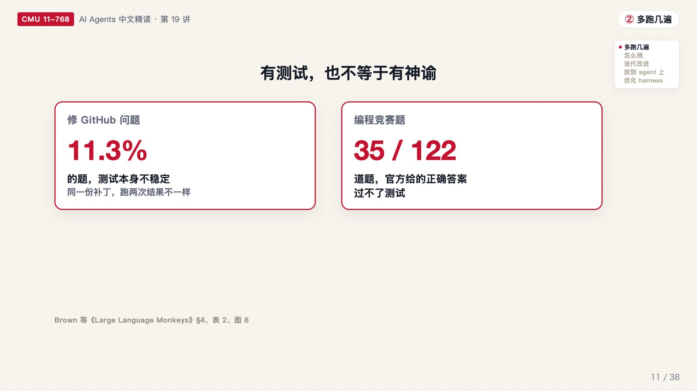

**测试也不是神谕**（原文 §4.2）：

| 数据集 | 问题 | 后果 |
|---|---|---|
| SWE-bench Lite | 11.3% 的题测试不稳定，同一份补丁跑两次结果不同；有的依赖 Python 集合的顺序 | 假阴性、假阳性都有 |
| CodeContests | 122 道有 Python3 解的题里，35 道的官方正确解过不了测试（多个正确输出只认一个；变异出来的输入违反题目约束） | 对的程序被判错 |

出处：Brown 等《Large Language Monkeys》§4、表 2、图 8。

---

## 2 怎么挑

### 2.1 验证信号

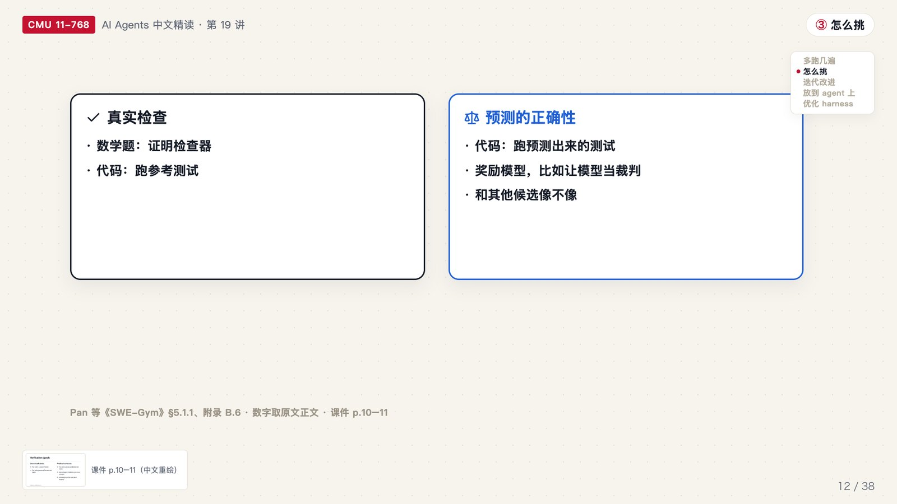

| 类型 | 数学 | 代码 | 其他 |
|---|---|---|---|
| 真实检查 | 证明检查器 | 跑参考测试 | |
| 预测的正确性 | | 跑预测出来的测试 | 奖励模型（比如让 LLM 当裁判）；和其他候选像不像 |

### 2.2 训一个验证器：SWE-Gym

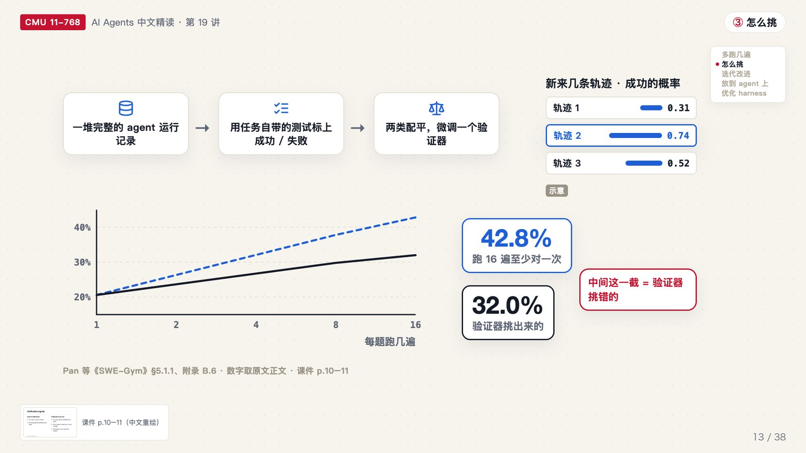

SWE-Gym 在完整的 OpenHands 运行记录上训练一个**结果验证器**（outcome verifier）：

1. 让 agent 在训练任务上跑很多遍；
2. 用任务自带的测试给每条轨迹标上"成功 / 失败"；
3. 两类样本配平，在完整的轨迹上微调；
4. 新轨迹按"成功"的概率打分，交分最高的那条。

原文（32B 微调模型当 agent，SWE-Bench Verified）：

| 每题跑几遍 | 1 | 8 | 16 |
|---|---|---|---|
| Pass@k（至少成功一次） | 20.6% | 37.8% | 42.8% |
| Best@k（验证器挑出来的） | 20.6% | 29.8% | 32.0% |

两行之间的差距就是验证器挑错的部分，原文说这说明奖励模型还有很大改进空间。

出处：Pan 等《Training Software Engineering Agents and Verifiers with SWE-Gym》§5.1.1、附录 B.6；课件 p.10–11。

### 2.3 三种挑法

| 挑法 | 怎么挑 | 课件例子 |
|---|---|---|
| **Best-of-N** | 奖励模型给每个候选打分，交最高的 | A 0.3、B 0.8、C 0.5 → 交 B |
| **自洽投票** | 不同的推理路径各算一个答案，选票数最多的 | 推理 A 得 42、B 得 17、C 得 42 → 选 42 |
| **按运行结果投票** | 把每个程序跑一遍，按输出分组，选人最多的那组 | 见下 |

自洽投票在课件里写成 0–1 损失下的**最小贝叶斯风险**（MBR）解码：

$$
\hat a_{\text{MBR}} = \arg\max_a \sum_z p(z, a \mid x) \approx \arg\max_a \sum_{i=1}^N \mathbb{1}\{a^{(i)} = a\}
$$

意思是：对所有推理路径 z 求和得到每个答案的概率，用样本里的票数来近似。

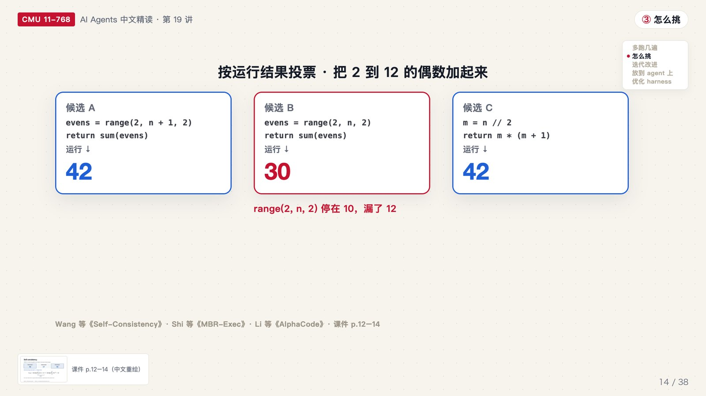

按运行结果投票的例子（任务：求 2 到 n 的偶数和，含 n，n = 12）：

| 候选 | 代码 | 运行结果 |
|---|---|---|
| A | `evens = range(2, n + 1, 2); return sum(evens)` | 42 |
| B | `evens = range(2, n, 2); return sum(evens)` | 30（`range` 不含终点，漏了 12） |
| C | `m = n // 2; return m * (m + 1)` | 42 |

两个 42 一组，B 被多数票刷掉。AlphaCode 和 MBR-Exec 用的都是这个思路。

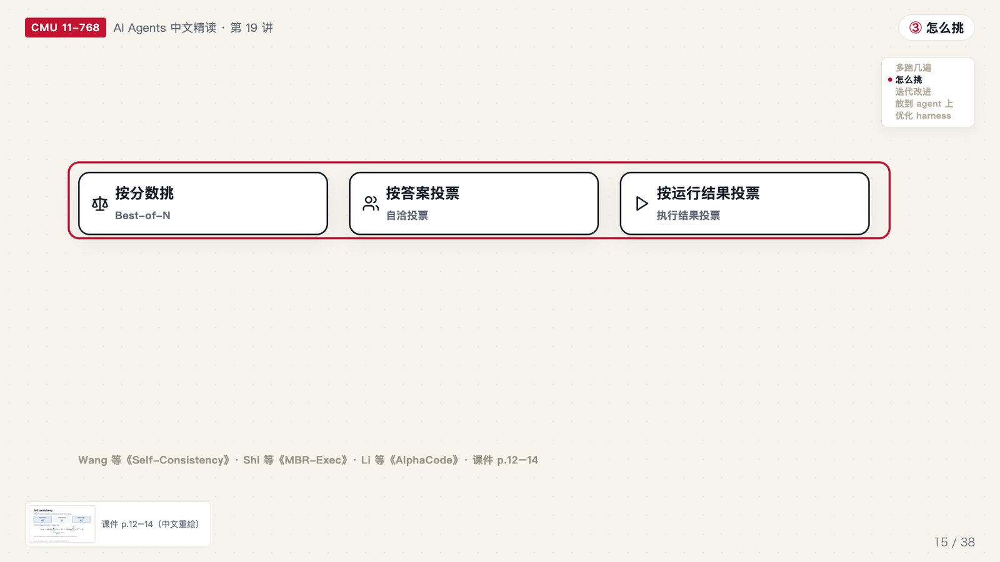

**AlphaCode 把按运行结果挑走到了头**（原文 §4、§5.3）：

1. 每道题最多采一百万个程序；
2. 用题面给的例子测试过滤，约 99% 被筛掉，仍可能剩下几万个；
3. 另训一个模型根据题面编新的测试输入，把剩下的程序都跑一遍，输出一样的归成一组；
4. 从最大的组往小，每组交一个，最多交 10 个。

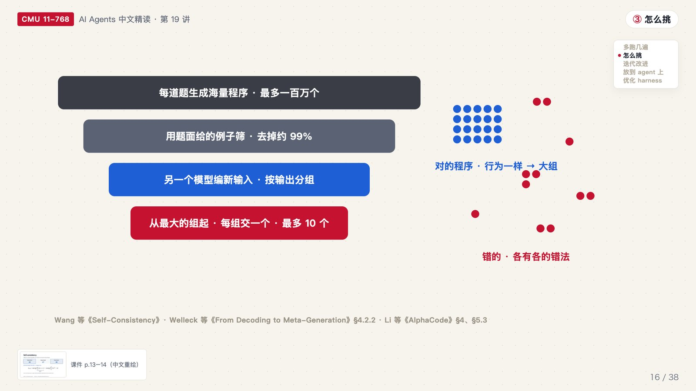

为什么先挑大组？原文的解释：错的程序各有各的错法，对的程序行为往往一样，所以会聚成大组。这和自洽投票是同一个道理。

出处：Wang 等《Self-Consistency Improves Chain of Thought Reasoning》；Welleck 等《From Decoding to Meta-Generation》§4.2.2；Shi 等《Natural Language to Code Translation with Execution》（MBR-Exec）；Li 等《Competition-Level Code Generation with AlphaCode》；课件 p.12–14。

### 2.4 验证器不完美

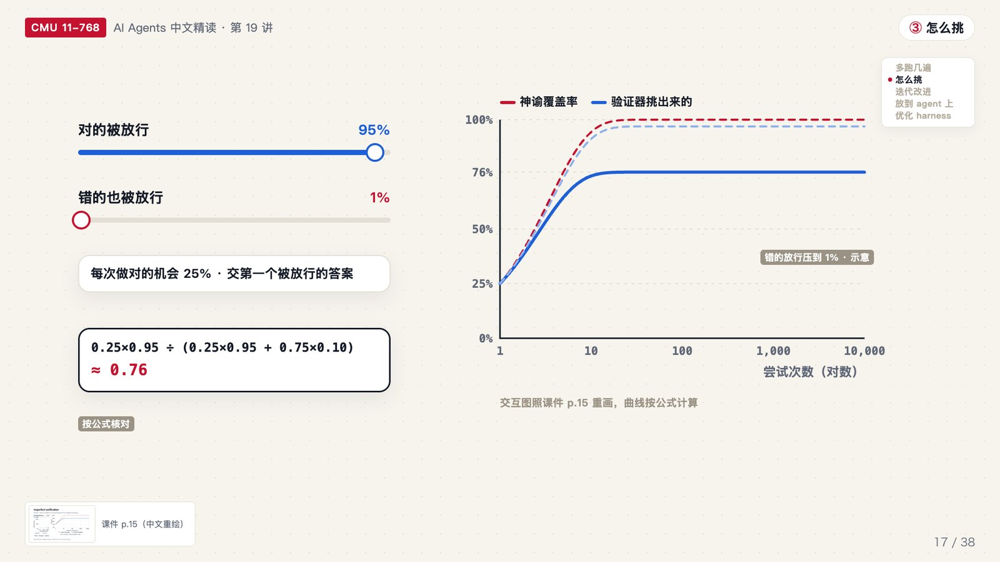

课件 p.15 的交互图：验证器把对的答案放行的概率是 q，把错的也放行的概率是 r；挑法是"交第一个被放行的答案，都没放行就交最后一个"。取 p = 25%、q = 95%、r = 10%，k = 1 时是 25%，k 再大也只到 76.0%，而神谕覆盖率接近 100%。

76% 可以这样算（我的推断）：k 很大时，几乎总有候选被放行，交出去的就是"第一个被放行的"。一次尝试里，对的且被放行的概率是 p·q，错的却被放行的概率是 (1−p)·r，所以

$$
P(\text{交出去的是对的}) = \frac{p\,q}{p\,q + (1-p)\,r} = \frac{0.25 \times 0.95}{0.25 \times 0.95 + 0.75 \times 0.10} \approx 0.76
$$

错答案本来就多（75%），哪怕只漏过一成，也会挤掉不少对的。把 r 压到 1%，上限就升到约 97%。动手练习会用模拟验证这一点。

出处：课件 p.15。

---

### 2.5 难题上更难挑

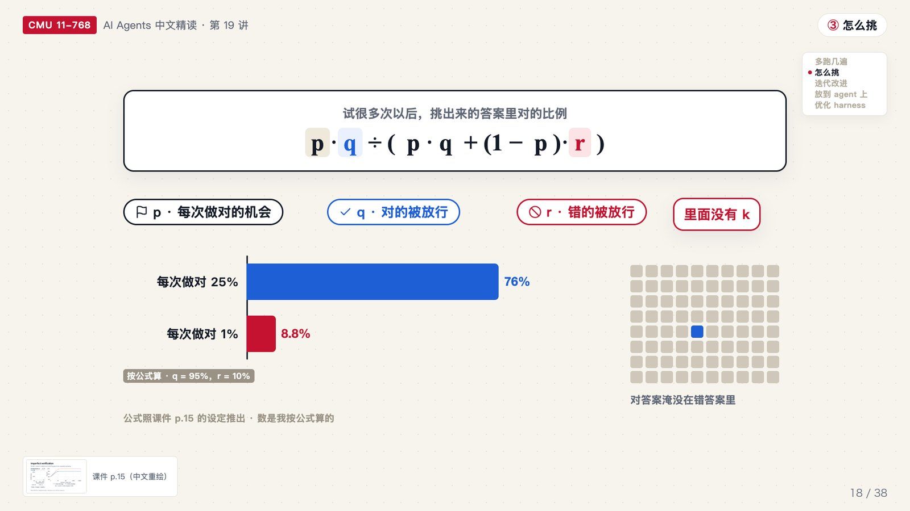

再看 2.4 的公式：k 很大时挑中对答案的比例是 p·q /（p·q +（1 − p）·r），**式子里没有 k**。验证器不变，试再多次也越不过这条线。

题越难，这条线越低。同一个验证器（q = 95%、r = 10%），p = 25% 时上限 76%；p = 1% 时：

$$
\frac{0.01 \times 0.95}{0.01 \times 0.95 + 0.99 \times 0.10} \approx 8.8\%
$$

这和 1.5 的现象对得上：对答案越稀有，越容易淹没在错答案里，越需要准的验证器。

出处：课件 p.15 的设定，数是我按公式算的。

---

## 3 迭代改进

### 3.1 一轮轮改


第二种花计算的办法是**改进**（refinement）：每一轮把上一轮的结果和反馈一起交给模型，让它再改一版。轮次只能一轮接一轮，但几个候选可以同时改。


**Reflexion** 把这件事做成一个循环：尝试 → 评估器（算出或预测奖励）→ 反思（写一段反馈）→ 同一个任务再试一次。课件的例子（中文转述）：

| | 内容 |
|---|---|
| 第 1 次 | 问"1776 年 10 月 28 日在纽约州怀特普莱恩斯附近打的一系列战役是什么"，答"怀特普莱恩斯战役"，错 |
| 自己写的反馈 | 题目问的是一系列战役，我只答了其中一场……下次要给出所属战役的名字 |
| 第 2 次 | 答"纽约和新泽西战役"，对 |


反馈的来源和挑候选的信号差不多：

| 类型 | 例子 | 课件引用 |
|---|---|---|
| 真实检查 | 证明检查器报的错；参考测试的结果 | Self-Debugging |
| 预测的正确性 | 预测的测试结果 | Reflexion |
| | 奖励模型，可以就是 agent 自己 | Self-Refine |
| | 和其他候选比 | PDR |

出处：Shinn 等《Reflexion: Language Agents with Verbal Reinforcement Learning》；Chen 等《Teaching Large Language Models to Self-Debug》；Madaan 等《Self-Refine》；课件 p.17–19。

### 3.2 三种有名的改法


| 方法 | 反馈从哪来 | 怎么用反馈 | 摘要里的结果 |
|---|---|---|---|
| Reflexion | 任务反馈（标量或文字，外部或模型自己模拟） | 把反思写成文字存进情景记忆，下次先读再做；不改权重 | HumanEval pass@1 91% |
| Self-Refine | 同一个模型给自己挑毛病 | 写 → 反馈 → 改，循环 | 7 个任务平均提高约 20 个点（绝对值） |
| Self-Debugging | 执行结果，加上让模型解释自己的代码（"小黄鸭调试"） | 读运行结果找错再改 | 最多 +12%；能追上多生成 10 倍以上候选的基线 |

出处：Shinn 等《Reflexion》、Madaan 等《Self-Refine》、Chen 等《Teaching Large Language Models to Self-Debug》（摘要）。

### 3.3 改着改着，可能改错

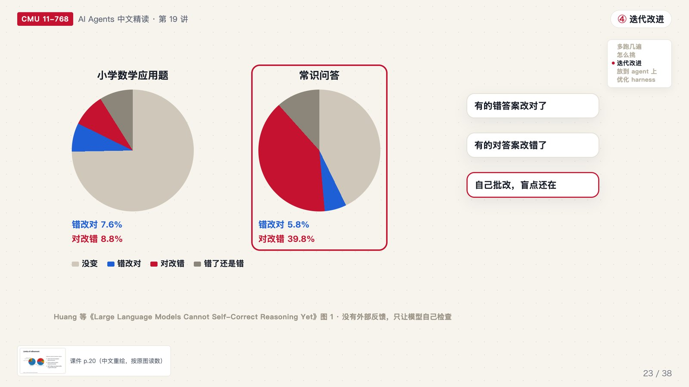

Huang 等专门测了**内在自我纠正**（intrinsic self-correction）：不给外部反馈，只让模型检查自己的回答再改。课件 p.20 的两个饼图（GPT-3.5，按原图读数）：

| 数据集 | 没变 | 错改对 | 对改错 | 错了还是错 |
|---|---|---|---|---|
| GSM8K（小学数学应用题） | 74.7% | 7.6% | 8.8% | 8.9% |
| CommonSenseQA（常识问答） | 42.8% | 5.8% | **39.8%** | 11.6% |

原文的结论：没有外部反馈时，大模型很难自我纠正推理，有时改完反而更差。课件总结三点：有的错答案改对了，有的对答案改错了，自我批评可能保留原来的盲点。

出处：Huang 等《Large Language Models Cannot Self-Correct Reasoning Yet》图 1；课件 p.20。

**和 3.2 的好成绩怎么对上？** 要看有没有外部信号。Self-Debugging 每一轮读的是真实的运行结果，有新信息进来；Huang 等测的是推理题上的**内在**自我纠正，什么外部信息都不给，只让模型自己再想一遍。所以用自我批改之前，先问一句：这一轮有没有新的信息进来？

### 3.4 先并行，再提炼，再改：PDR

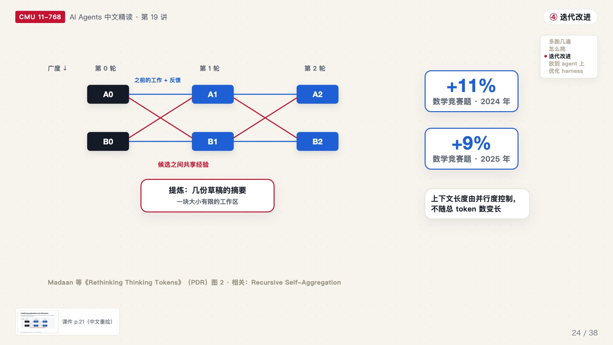

**PDR**（Parallel-Distill-Refine）把多跑和改进合在一起：

1. **并行**：同时写几份草稿；
2. **提炼**：把它们提炼成一个大小有限的文字工作区；
3. **改进**：每个候选看着这块工作区改，产出的结果作为下一轮的种子。

原文的要点：上下文长度由并行度控制，不再和生成的总 token 数绑在一起；比长思维链更准、延迟更低；并行度设成 1 就是**串行改进**（Sequential Refinement）。数学题上 PDR 提升最大：AIME 2024 +11%，AIME 2025 +9%。作者还用强化学习训练了一个 8B 模型，让它适应 PDR 这种推理方式。

出处：Madaan 等《Rethinking Thinking Tokens: LLMs as Improvement Operators》图 2 与摘要；相关：Recursive Self-Aggregation；课件 p.21。

---

### 3.5 PDR 为什么这样设计

**为什么不把所有旧尝试都塞进上下文？** 原文给了三条：上下文越长越容易出现长上下文的失败；成本随轮数涨；模型有锚定偏差，容易跟着旧答案走。所以工作区每轮**重新写**、大小有上限（|C| ≤ κ），只放几份草稿一致的地方、互相矛盾的地方、算出来的中间结果和没解决的子目标。

**两本账**：

- B_seq（延迟）：只算最后被采纳的那条路径上的 token；
- B_total（总花费）：所有调用都算，包括被扔掉的草稿。

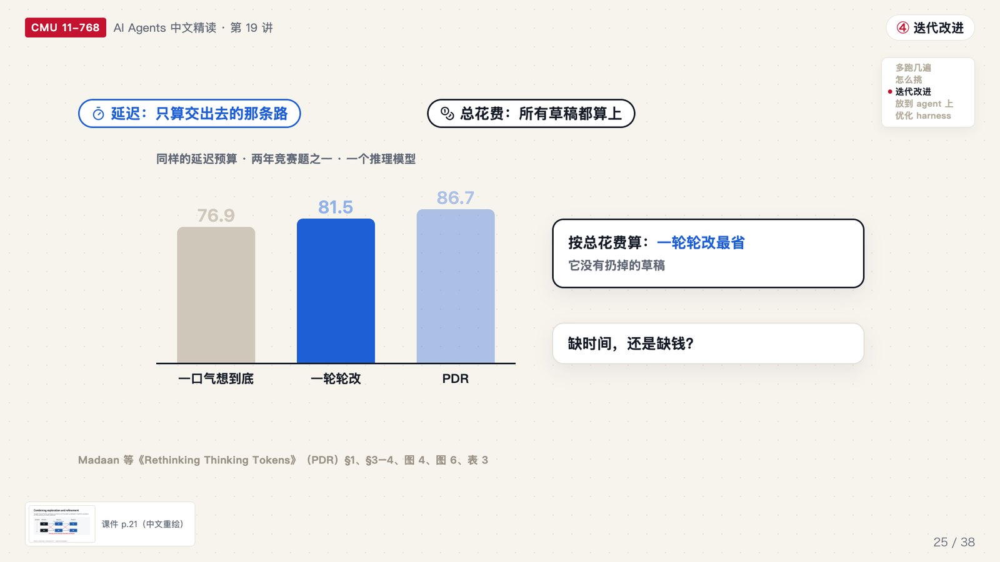

| o3-mini，AIME 2024，有效预算 49k token | 准确率 |
|---|---|
| 一口气想到底（长思维链） | 76.9 |
| 一轮轮改（SR） | 81.5 |
| PDR | 86.7 |

按 B_seq 比，PDR 在帕累托前沿上；按 B_total 比，SR 在前沿上，因为它没有被扔掉的草稿。总预算都是 442k token 时，SR 要跑 17 轮、B_seq ≈ 442k 才追上 PDR，PDR 只用了 172k。选哪种，要看你更缺延迟还是更缺钱。

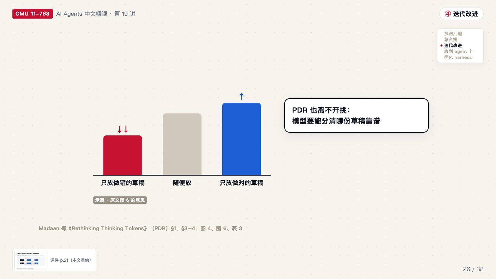

**工作区里放什么**。原文图 6 故意只把错的草稿放进工作区（Oracle-Incorrect），准确率明显下降；只放对的（Oracle-Correct）比随机放好。所以 PDR 也离不开挑：模型的自我验证能力决定了它能不能从工作区里得益。提炼方式里，全局总结和每个分支各选 top-k 最好，共享 top-k 和随机 k 差一些（原文表 2）。

**训练时也这样用**。原文表 3：8B 模型在标准 RL 之外，再按"并行 4 份 → 提炼 → 改一次"的方式做 RL，AIME 2024 / 2025 上持续训练的版本分别多了 5.00 和 4.59 个点。

出处：Madaan 等《Rethinking Thinking Tokens: LLMs as Improvement Operators》§1、§3、§4、图 4–6、表 2–3。

---

## 4 放到 agent 上

### 4.1 轨迹太长，先做摘要

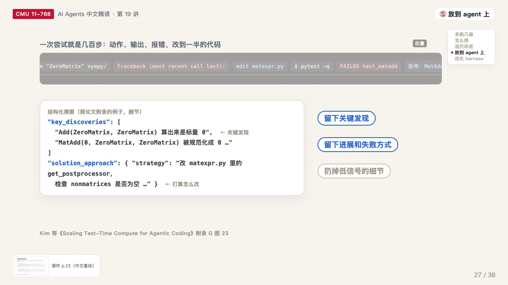

前面的方法适合短答案，能直接比、直接投票。长程编程 agent 的一次尝试是几百步的动作、观察、报错和改到一半的代码，没法直接拿来比。Kim 等的观点：这时难点不再是多生成几次，而是把以前的经验表示成能挑、能复用的形式。

他们的做法是让模型给每条轨迹写一份**结构化摘要**，保留关键假设、进展和失败方式，丢掉低信号的细节。课件 p.23 的例子是一个 sympy 问题的摘要片段：

```json
"key_discoveries": [
  "Add(ZeroMatrix, ZeroMatrix) evaluates to scalar 0",
  "MatAdd(0, ZeroMatrix, ZeroMatrix) canonicalizes to 0 because rm_id removes all identities and keeps the first one (0)"
]
"solution_approach": {
  "strategy": "Modify `get_postprocessor` in `sympy/matrices/expressions/matexpr.py` to check if `nonmatrices` is empty. […]"
}
```

出处：Kim 等《Scaling Test-Time Compute for Agentic Coding》附录 G 图 23；课件 p.23。

### 4.2 递归锦标赛和复用

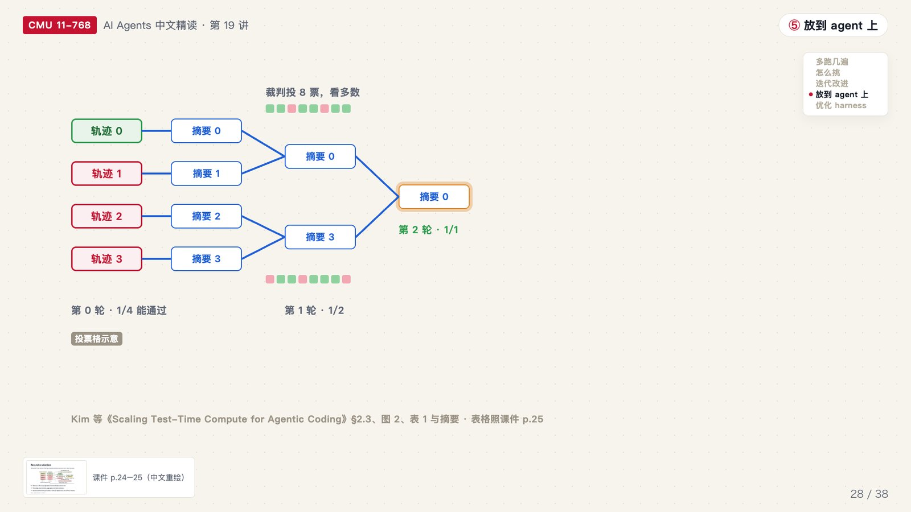

**递归锦标赛投票**（Recursive Tournament Voting，RTV）：

1. 把几份摘要分成小组（组大小 G）；
2. 让 LLM 裁判在组里挑出最好的；裁判有噪声，每次比较投 V 票看多数；
3. 胜出的摘要晋级，重复直到只剩一份。

课件图例：N = 4 条轨迹，G = 2；第 0 轮 4 条里 1 条能通过（0.25），第 1 轮 2 条里 1 条（0.5），第 2 轮剩下的那条通过（1.0）。原文还比较了 G ∈ {16, 8, 4, 2} 和 V ∈ {1, 2, 4, 8, 16}。

挑出来的摘要还能复用：像 PDR 一样，让新一轮的尝试以挑出来的摘要为条件，最后再挑一次。

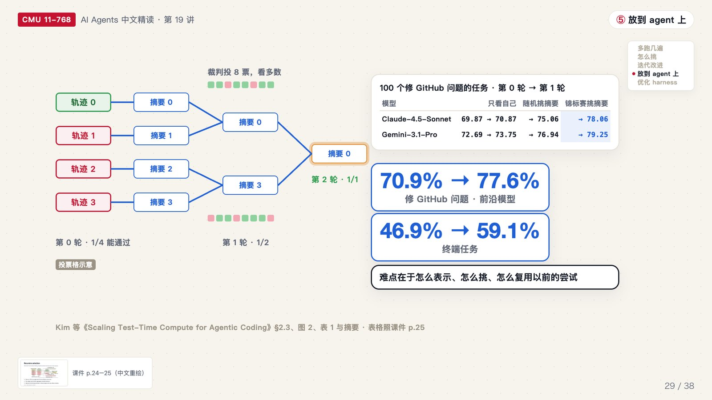

100 个 SWE-bench 任务，最终挑选之前的平均成功率（课件 p.25，原文表 1）：

| 模型 | 只看自己 第 0 → 1 轮 | 随机挑几份摘要 | 用 RTV 挑几份摘要 |
|---|---|---|---|
| Claude-4.5-Sonnet | 69.87 → 70.87 | 69.87 → 75.06 | 69.87 → **78.06** |
| Gemini-3.1-Pro | 72.69 → 73.75 | 72.69 → 76.94 | 72.69 → **79.25** |

原文的整体结果：Claude-4.5-Opus 在 SWE-Bench Verified（mini-SWE-agent）上从 70.9% 提到 77.6%，在 Terminal-Bench v2.0（Terminus 1）上从 46.9% 提到 59.1%。作者的结论：长程 agent 的测试时扩展，本质是表示、挑选和复用的问题。

出处：Kim 等，§2.3、图 2、图 3、表 1 与摘要；课件 p.24–25。

---

### 4.3 几个设计为什么这样选

论文对每个选择都做了对照实验（§3.2）：

- **比摘要，不比原始轨迹**（Finding 1）：完整轨迹太长太乱。锦标赛越到后面，剩下的候选越接近，最后一轮用摘要的优势最大。
- **两两比，比多份摊开挑好**（Finding 2）：组大小 G ∈ {16, 8, 4, 2} 里 G = 2 最好；每次比较投 V 票，V 到 8 以后收益变小。主实验设置 N = 16、K = 4、G = 2、V = 8。
- **带进下一轮的摘要质量几乎决定结果**（表 2，Claude-4.5-Sonnet，锦标赛挑 K = 4 份）：

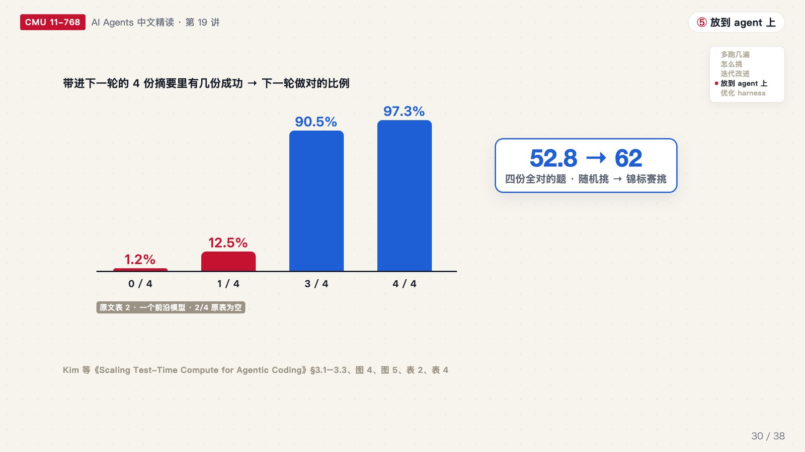

| 4 份摘要里成功的份数 | 0 | 1 | 2 | 3 | 4 |
|---|---|---|---|---|---|
| 下一轮平均 pass@1 | 1.2% | 12.5% | （原表为空） | 90.5% | 97.3% |

  锦标赛挑让"4 份全对"的题从随机挑的 52.8 道变成 62 道。
- **步数减半**（表 4）：带着摘要的第 1 轮不用重新摸清代码库，Claude-4.5-Opus 在 SWE-Bench Verified 上平均步数从 41.23 降到 14.31。

**代价**（我按论文设置估算）：每题两轮共 32 条完整轨迹；锦标赛挑 4 份要 12 次比较，最后挑 1 条要 15 次比较，每次 8 票，共 216 票。适合做对一次很值钱的任务。

出处：Kim 等《Scaling Test-Time Compute for Agentic Coding》§2.5、§3.1–3.3、图 4–5、表 2–4。

---

## 5 优化 harness

### 5.1 harness 也能搜：Meta-Harness

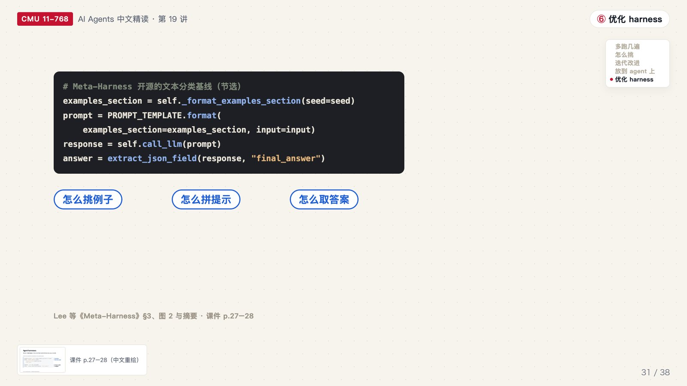

**harness** 是控制怎么用模型的那段代码（第 1 讲讲过）：挑哪些例子、怎么拼提示、怎么从回复里取答案、记住什么。第 6 节会逐行看一个真实的例子。

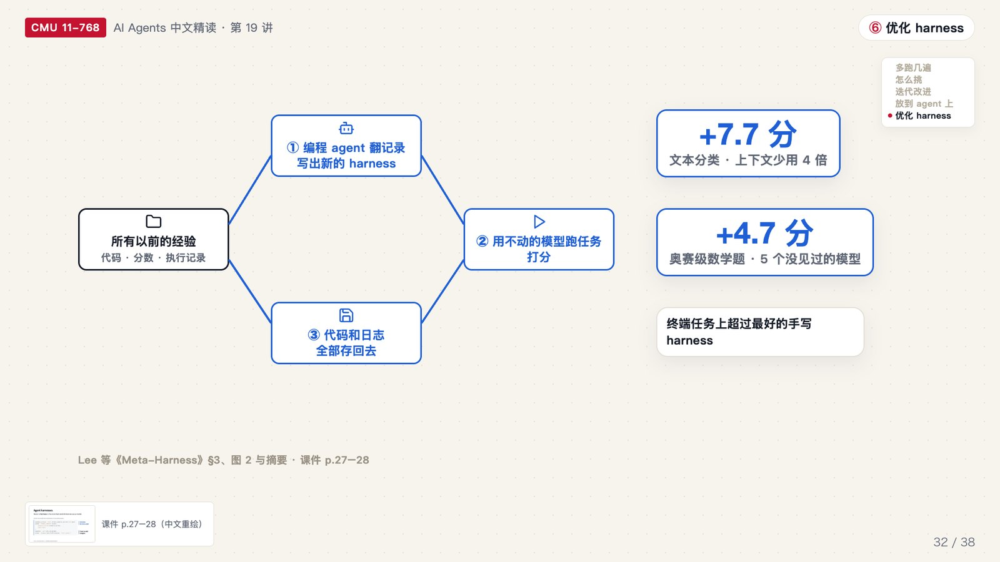

**Meta-Harness** 在模型权重不动的前提下，只搜 harness 代码，让任务奖励最大：

1. **提议**：一个编程 agent 去翻文件系统里以前所有候选的源代码、分数和执行记录，写出新的 harness；
2. **评测**：用固定的模型跑这个 harness，打分；
3. **存档**：把代码和所有日志存回文件系统，进入下一圈。

原文认为，现有的文本优化器把反馈压缩得太狠，不适合这件事；让提议者看到全部原始经验更有用。结果：

| 任务 | 结果 |
|---|---|
| 在线文本分类 | 比最好的上下文管理系统高 7.7 分，上下文 token 少用 4 倍 |
| 检索增强的数学推理 | 找到的一个 harness，在 200 道 IMO 级题目上、五个没见过的模型平均高 4.7 分 |
| 终端编程任务（TerminalBench-2） | 超过最好的手写 harness |

出处：Lee 等《Meta-Harness: End-to-End Optimization of Model Harnesses》§3、图 2 与摘要；课件 p.27–28。

**为什么要看原始执行记录**。Meta-Harness 原文的几个关键数字：

- 引文：同一个模型、同一个基准，只换 harness，成绩能差 6 倍。
- 现有文本优化器（OPRO、TextGrad、GEPA、AlphaEvolve、TTT-Discover 等）有的只看分数，有的只看上一版，有的只看总结，每一步能看的上下文约 100 到 3 万 token；而评测一版 harness 产生的执行记录最多有 1000 万 token（表 1）。
- Meta-Harness 把所有记录存成文件，让编程 agent（Claude Code）用 `grep`、`cat` 自己翻。最难的那组实验里，每轮读的文件中位数是 82 个，参考 20 多个旧版本。

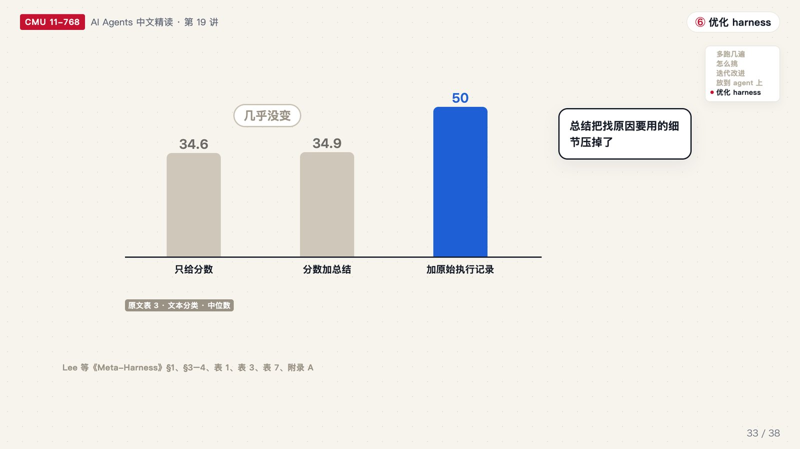

| 提议者能看到什么 | 中位数 | 最好 |
|---|---|---|
| 只给分数 | 34.6 | 41.3 |
| 分数加总结 | 34.9 | 38.7 |
| 加原始执行记录（完整的 Meta-Harness） | 50.0 | 56.7 |

总结几乎没帮上忙，甚至可能把找原因要用的细节压掉。

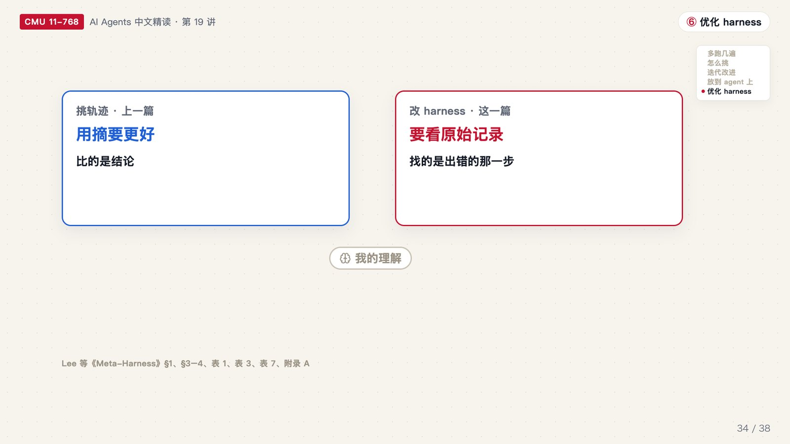

**和 4.3 放在一起看**（我的理解）：Agentic Coding 说挑轨迹时摘要比原始轨迹好，Meta-Harness 说改 harness 时原始记录比总结好。两者不矛盾，用途不同：挑结果比的是结论，找原因就得看到出错的那一步。

原文附录 A 还记下了提议者的推理：前几轮它同时改了结构和提示词，两版都变差；它判断问题出在两版共用的那处提示词改动上，把两处改动拆开试，最后换成一个只加不删、更稳的改法，成了这次最好的版本。终端任务基准 TerminalBench-2 上，找到的 harness 用 Claude Opus 4.6 得 76.4%（最好的手写 harness Terminus-KIRA 74.7%），用 Claude Haiku 4.5 得 37.6%，在同模型的榜单上排第一（表 7）。

出处：Lee 等《Meta-Harness》§1、§3–4、表 1、表 3、表 7、附录 A。

### 5.2 权重和 harness 一起改：WHALE

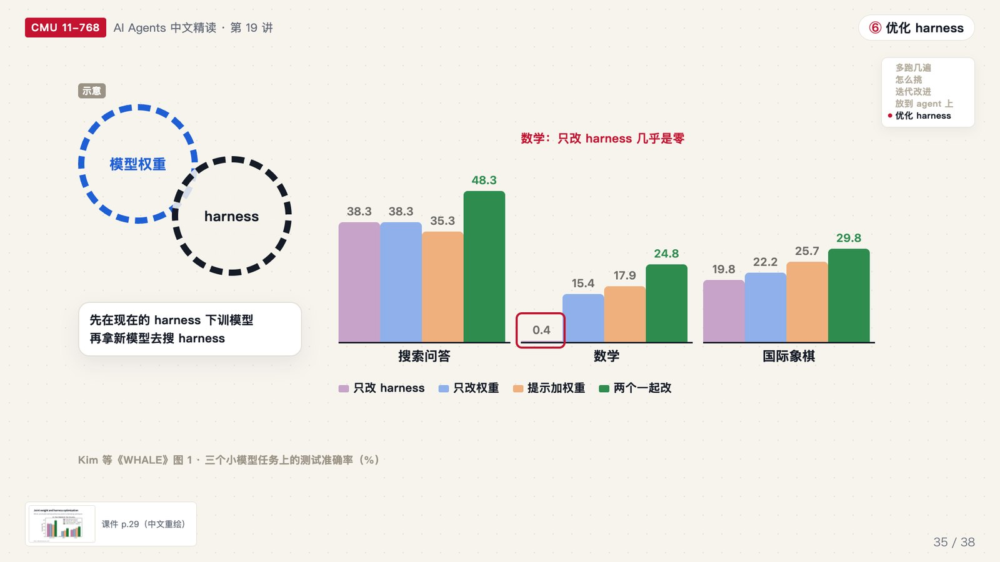

**WHALE** 交替做两件事：先在当前 harness 下更新模型（在线拒绝采样微调），再在更新后的模型下用 Meta-Harness 搜更好的 harness。课件 p.29 的柱子（Qwen3.5 小模型，适配后的测试准确率 %）：

| 任务 | 只改 harness | 只改权重 | Fast-Slow（提示 + 权重） | WHALE（两个一起改） |
|---|---|---|---|---|
| SearchQA | 38.3 | 38.3 | 35.3 | **48.3** |
| Math | 0.4 | 15.4 | 17.9 | **24.8** |
| Chess | 19.8 | 22.2 | 25.7 | **29.8** |

原文的观察：两边都可能是瓶颈。SearchQA 上只搜 harness 用少得多的 rollout 就能追上只改权重的最好成绩；数学上只搜 harness 几乎没用，要先更新一次权重，搜 harness 才起作用。小步交替也比先训完权重再搜 harness 更准、更省。

出处：Kim 等《WHALE: A Simple Recipe for Joint Harness-Weight Optimization》图 1 与摘要；课件 p.29。

WHALE 摘要的结论：两边都可能是瓶颈。搜索问答上，只搜 harness 用少得多的尝试就追上只改权重的最好成绩；数学上要先更新一次权重，搜 harness 才有用。小步交替着改，比先训完权重再搜 harness 更准，也更省。

### 5.3 算力该花在哪

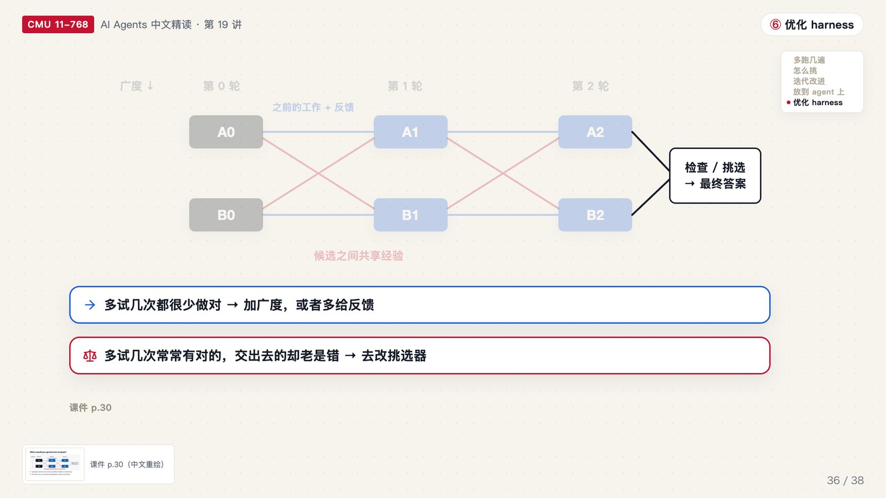

课件最后给了一个很实用的判断：

| 症状 | 该做什么 |
|---|---|
| pass@k 本身就低：多试几次也很少做对 | 加广度，或者多给反馈、让候选以反馈为条件 |
| 最终准确率比 pass@k 低很多：常常有对的，交出去的却是错的 | 改进挑选器（验证器、奖励模型、裁判） |

出处：课件 p.30。

---

## 6 源码解读：一个真实的 harness

课件 p.27 的代码来自 Meta-Harness 开源的文本分类基线 `reference_examples/text_classification/agents/fewshot_memory.py`（[stanford-iris-lab/meta-harness](https://github.com/stanford-iris-lab/meta-harness)，2026-11 抓取）。它是 Meta-Harness 搜索的起点之一：把训练时见过的带标签例子全部存下来，测试时挑一部分当 few-shot 示例。下面删掉了 import、`get_state` / `set_state` 和 `get_context_length`，注释是我加的：

```python
PROMPT_TEMPLATE = """Solve the problem below based on the examples provided.

{examples_section}

**Problem:**
{input}

**Instructions:**
- Follow the patterns shown in the examples above
- Respond in JSON format

{{"reasoning": "[your reasoning]", "final_answer": "[your answer]"}}"""   # 要求模型按 JSON 回答

MAX_CHARS = 30000                                     # 示例部分最多 3 万字符，防止提示太长


def _seed_for_input(input: str) -> int:
    """Return a stable per-input seed across Python processes."""
    return int.from_bytes(hashlib.sha256(input.encode()).digest()[:8], "big")   # 同一道题每次都用同一个种子


class FewShotMemory(MemorySystem):
    def __init__(self, llm: LLMCallable, max_examples: int = 50):
        super().__init__(llm)
        self.max_examples = max_examples              # 每道题最多放 50 个示例
        self.examples: list[dict[str, str]] = []      # "记忆"：训练时见过的 (题目, 答案)

    def _format_examples_section(self, seed: int | None = None) -> str:
        if not self.examples:
            return ""
        if seed is not None and len(self.examples) > self.max_examples:
            rng = random.Random(seed)
            to_use = rng.sample(self.examples, self.max_examples)   # 例子太多：按种子随机抽 50 个
        else:
            to_use = self.examples[-self.max_examples :]            # 不多：取最近的 50 个
            if seed is not None:
                rng = random.Random(seed)
                to_use = list(to_use)
                rng.shuffle(to_use)                                 # 再按种子打乱顺序

        parts = []
        total_chars = 0
        for ex in to_use:
            question = ex.get("raw_question", ex["input"])          # 优先用短题面，不重复任务说明
            part = f"Q: {question}\nA: {ex['target']}"
            if total_chars + len(part) > MAX_CHARS:                 # 超过字符上限就停
                break
            parts.append(part)
            total_chars += len(part) + 2
        return "\n\n".join(parts)

    def predict(self, input: str) -> tuple[str, dict[str, Any]]:
        seed = _seed_for_input(input)
        examples_section = self._format_examples_section(seed=seed)  # ① 挑例子
        prompt = PROMPT_TEMPLATE.format(                             # ② 拼提示
            examples_section=examples_section,
            input=input,
        )
        response = self.call_llm(prompt)                             # ③ 调模型（权重不动）
        answer = extract_json_field(response, "final_answer")        # ④ 从 JSON 里取答案
        return answer, {"full_response": response, "num_examples": len(self.examples)}

    def learn_from_batch(self, batch_results: list[dict[str, Any]]) -> None:
        for r in batch_results:                                      # 训练阶段：把每个带标签的例子存进记忆
            ex = {"input": r["input"], "target": r["ground_truth"]}
            if "raw_question" in r:
                ex["raw_question"] = r["raw_question"]
            self.examples.append(ex)
```

### 6.1 哪些地方是 Meta-Harness 可以改的

| 位置 | 现在的做法 | 可以搜的方向（我的推断，举例） |
|---|---|---|
| `learn_from_batch` | 每个例子原样存下来 | 只存做错过的、去重、存成总结过的规则 |
| `_format_examples_section` | 随机抽 50 个、3 万字符封顶 | 按和当前题目的相似度挑、按类别平衡、少放几个 |
| `PROMPT_TEMPLATE` | 一段固定的说明 | 加上"先判断类别再回答"之类的步骤 |
| `extract_json_field` | 只取 `final_answer` | 取不到时的兜底、多次调用投票 |

这些都是 harness 代码，不碰模型权重。Meta-Harness 原文在这个任务上找到的 harness 比最好的手写上下文管理系统高 7.7 分，上下文 token 还少用 4 倍。从这段基线代码就能看出为什么能省：基线把多达 3 万字符的例子塞进每一次调用。

---

## 本讲小结

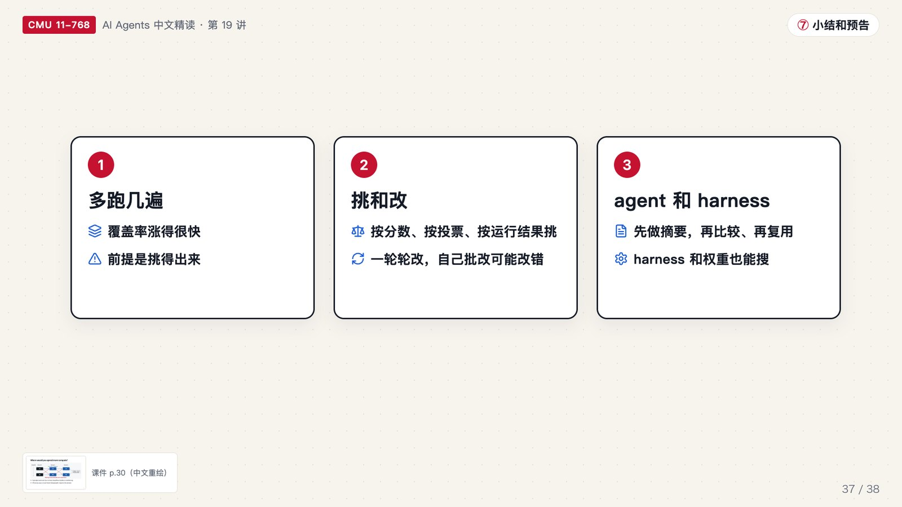

- **多跑几遍**：覆盖率 1 − (1−p)^k 涨得很快，能自动验证的任务上多跑就是多得分（SWE-bench Lite 15.9% → 56%）。可没有神谕时，投票和奖励模型在几百个样本后就停住了。前提是挑得出来。
- **怎么挑**：真实检查最可靠；没有就预测正确性。Best-of-N 按分数挑，自洽投票按答案投，代码可以按运行结果投。验证器不完美时多跑有上限：q = 95%、r = 10% 时只能到 76%。
- **迭代改进**：一轮轮带着反馈改（Reflexion），反馈可以来自测试、裁判或其他候选；只靠模型自己批改可能把对的改错。PDR 先并行、再提炼、再改，上下文由并行度控制。
- **放到 agent 上**：长轨迹先压成结构化摘要，再用递归锦标赛挑、再复用（SWE-Bench Verified 70.9% → 77.6%）。
- **优化 harness**：Meta-Harness 让编程 agent 翻以前所有版本的代码、分数和记录来改 harness；WHALE 交替改权重和 harness。
- **算力花在哪**：覆盖率低，加广度和反馈；最终准确率远低于覆盖率，改挑选器。

## 关键术语

| 术语 | 英文 | 一句话 |
|---|---|---|
| 测试时计算 | test-time compute | 模型不变，推理时多花算力 |
| 温度 | temperature | 采样时 softmax 的缩放，越高抽得越散 |
| 并行尝试 | parallel attempts / repeated sampling | 同一个任务独立跑很多遍 |
| 覆盖率 | coverage / pass@k | k 次里至少一次对的比例，等于神谕挑选的成功率 |
| 神谕 | oracle | 能完美分清候选对错的理想挑选器 |
| 验证器 | verifier | 判断一个候选对不对的检查或模型 |
| 奖励模型 | reward model | 给候选打分的模型，可以是 LLM 裁判 |
| Best-of-N | Best-of-N | 给 N 个候选打分，交最高的 |
| 自洽投票 | self-consistency | 不同推理路径的答案里选票数最多的 |
| 最小贝叶斯风险 | minimum Bayes risk（MBR） | 选期望损失最小的答案，0–1 损失下就是投票 |
| 迭代改进 | iterative refinement | 带着反馈一轮轮改同一个候选 |
| 内在自我纠正 | intrinsic self-correction | 不给外部反馈，让模型自己检查自己 |
| PDR | Parallel-Distill-Refine | 并行草稿 → 提炼成有上限的工作区 → 改进 |
| 结构化摘要 | structured summary | 把一条长轨迹压成关键发现、方案和失败方式 |
| 递归锦标赛投票 | Recursive Tournament Voting（RTV） | 小组比摘要、投多票、胜者晋级，直到剩一份 |
| harness | harness | 控制怎么用模型的代码 |
| harness 搜索 | harness search | 权重不动，自动改 harness 代码让奖励最大 |

## 思考题

<details>
<summary>1. 每次做对的机会只有 5%，试 100 次的覆盖率是多少？为什么覆盖率高不等于实际交出去的答案对？</summary>

1 − 0.95¹⁰⁰ ≈ 99.4%。覆盖率只说明"对的答案在候选里"，交出去之前还得挑。挑选器如果看不出对错，候选越多，混进来的错答案也越多。课件 p.8 的两张图就是这个情况：神谕挑能到七八成甚至接近 1，实际的挑法停在两三成到五六成。
</details>

<details>
<summary>2. 课件说"推理模型可能把温度固定在 1.0"，"一次生成多个回答对 agent 不太适用"。那对推理模型和 agent，还能怎么让候选更多样？</summary>

换一组不同的提示（Mode-conditioning 的思路，比如让模型按不同的解题思路或不同的人设去做）；或者在训练时就鼓励多样、直接优化 pass@k（Rewarding the Unlikely 等）。对 agent 还可以让不同的尝试从不同的起点或不同的计划出发。这一条的具体做法是我的推断，课件只列了方法名。
</details>

<details>
<summary>3. 自洽投票在什么情况下会失效？按运行结果投票为什么在代码上更好用？</summary>

当错误答案集中在同一个值上（大家都犯同一个错），错答案的票数比对的多，投票就会选错。动手练习里把错答案从 8 种改成 1 种，多数投票会从接近 100% 掉到接近 0。代码不能直接比文本（写法千差万别），但运行结果可以直接比；而且不同的错误写法往往跑出不同的错结果，对的写法跑出同一个结果，票更容易集中在对的那组。
</details>

<details>
<summary>4. 按 2.4 节的公式，要把上限提到 90%，错答案的放行率 r 最多是多少（p = 25%、q = 95%）？</summary>

0.2375 / (0.2375 + 0.75 r) ≥ 0.9 → 0.75 r ≤ 0.2375 / 9 ≈ 0.0264 → r ≤ 约 3.5%。也就是验证器要把 96% 以上的错答案拦下来。这说明为什么 SWE-Gym 训出来的验证器挑的结果和 Pass@k 差了一截：区分"差一点就对"和"对"非常难。
</details>

<details>
<summary>5. Huang 等发现自我纠正在 CommonSenseQA 上把 39.8% 的对答案改错了，可 Reflexion 的例子里改对了。这矛盾吗？</summary>

不矛盾。Reflexion 的评估器能给出"这次错了"的信号（例子里是和标准答案比对，或者跑测试），模型知道自己错了才去反思。Huang 等测的是没有任何外部反馈、只让模型自己判断要不要改的情况，模型常常把本来对的答案当成错的去改。所以课件说"没有神谕的对错标签时"改进有局限；有可靠的反馈时，改进是有用的。
</details>

<details>
<summary>6. 为什么长程 agent 不能直接套用自洽投票或 Best-of-N？摘要解决了什么，又可能丢掉什么？</summary>

agent 的一次尝试是几百步的轨迹，最后的产物（补丁）可能每次都不一样，没法按"答案相同"投票；直接把几条完整轨迹塞给裁判又太长。摘要把轨迹压成关键发现、方案和失败方式，裁判能比，新一轮的尝试也能借用。可能丢掉的是摘要模型认为"低信号"、其实很关键的细节，比如某个报错信息里的一个文件路径。
</details>

<details>
<summary>7. 你的 agent 在一个任务上 pass@16 是 40%，最终交出去的准确率是 15%。按 5.3 节，你会先把算力花在哪？</summary>

最终准确率远低于 pass@k，说明对的答案常常在候选里，问题出在挑选上，应该先改进挑选器：训练或换一个更好的验证器、用多票的裁判、加上能跑的测试。如果反过来 pass@16 只有 18%、最终 15%，挑选器已经不错了，该加广度或给更好的反馈。
</details>

## 动手练习

### 练习：多跑几遍，再用不同的办法挑一个

目标：用模拟亲手看到覆盖率、不完美验证器的上限、多数投票和 Best-of-N 各自在什么条件下好用。代码**不调用真模型**：每道题的候选答案按固定概率随机生成，验证器和奖励模型也是模拟的。只用 Python 标准库，我在 Python 3.15 上跑通过（约 0.5 秒）。

`selectors_demo.py`：

```python
"""第 19 讲动手练习：多跑几遍，再用不同的办法挑一个（示意）。
不调用真模型：每道题的"候选答案"按固定概率随机生成，验证器和奖励模型也是模拟的。只用标准库。"""
import random
from collections import Counter

random.seed(0)
P = 0.25           # 每次做对的机会
Q, R = 0.95, 0.10  # 验证器：对的放行概率、错的放行概率
WRONG = list(range(1, 9))  # 错答案有 8 种，散得比较开


def sample():
    """模拟一次尝试：返回 (答案, 是否正确)。正确答案记作 0。"""
    if random.random() < P:
        return 0, True
    return random.choice(WRONG), False


def oracle(cands):
    """神谕：只要有一个对的就算对（这就是覆盖率 pass@k）。"""
    return any(ok for _, ok in cands)


def first_accepted(cands):
    """课件 p.15 的挑法：交第一个被验证器放行的；都没放行就交最后一个。"""
    for ans, ok in cands:
        if random.random() < (Q if ok else R):
            return ok
    return cands[-1][1]


def majority(cands):
    """自洽投票：选出现次数最多的答案。"""
    top, _ = Counter(a for a, _ in cands).most_common(1)[0]
    return top == 0


def best_of_n(cands, noise=0.6):
    """Best-of-N：奖励模型给对的平均高一点的分，再加噪声；交分最高的。"""
    scored = [((1.0 if ok else 0.0) + random.gauss(0, noise), ok) for _, ok in cands]
    return max(scored)[1]


def run(k, n_problems=4000):
    res = {"覆盖率": 0, "第一个放行": 0, "多数投票": 0, "Best-of-N": 0}
    for _ in range(n_problems):
        cands = [sample() for _ in range(k)]
        res["覆盖率"] += oracle(cands)
        res["第一个放行"] += first_accepted(cands)
        res["多数投票"] += majority(cands)
        res["Best-of-N"] += best_of_n(cands)
    return {name: v / n_problems for name, v in res.items()}


if __name__ == "__main__":
    print("k     " + "  ".join(f"{n:>8}" for n in ["覆盖率", "第一个放行", "多数投票", "Best-of-N"]))
    for k in [1, 4, 16, 64, 256]:
        r = run(k)
        print(f"{k:<5} " + "  ".join(f"{v:>8.1%}" for v in r.values()))
```

运行 `python3 selectors_demo.py`，我这里的输出：

```text
k          覆盖率     第一个放行      多数投票  Best-of-N
1        26.1%     26.1%     26.1%     26.1%
4        67.5%     59.3%     32.3%     54.7%
16       98.8%     76.2%     58.0%     83.8%
64      100.0%     75.8%     93.1%     94.5%
256     100.0%     76.5%    100.0%     98.4%
```

"第一个放行"停在 76% 左右，和 2.4 节算的一样。文件名别叫 `selectors.py`，它会盖住 Python 标准库里的同名模块。

做完回答：

1. 把 `R` 改成 `0.01`，"第一个放行"的上限变成多少？和公式对得上吗？
2. 把 `WRONG` 改成 `[1]`（所有错答案都一样），多数投票在 k = 256 时变成多少？为什么？
3. 把 `best_of_n` 的 `noise` 改成 `2.0`（奖励模型很不准），k = 256 时 Best-of-N 变成多少？
4. 把 `P` 改成 `0.05`，k = 16 时四种做法各是多少？按 5.3 节的判断，这时该加广度还是改挑选器？
5. 加一个"Reflexion 式"的挑法：候选没被放行时，下一次尝试的做对概率提高到 `P + 0.1`（用了反馈）。k = 4 时比"第一个放行"高多少？

<details>
<summary>参考答案</summary>

1. 约 96%–97%（我这里 k = 16 是 96.3%，k = 256 是 97.1%）。公式给 0.2375 / (0.2375 + 0.0075) ≈ 96.9%，对得上。
2. 约 0%。错答案只有一种时，它占 75% 的票，对的只占 25%，样本越多，多数票越稳定地选中错的。这就是自洽投票的前提：错答案要散，对答案要集中。
3. 约 57%（我这里 k = 16 是 44.5%，k = 256 是 57.1%）。奖励模型越不准，"错答案里碰巧分数最高的那个"越容易赢；候选越多，这种碰巧也越多。
4. 我这里 k = 16 时覆盖率 57.1%、第一个放行 31.1%、多数投票 1.5%、Best-of-N 32.7%。覆盖率本身就不高，该先加广度或给更好的反馈；同时最终准确率比覆盖率低了一半，挑选器也值得改。多数投票几乎是零：对答案只占 5%，永远凑不够票。
5. 开放题，结果取决于你怎么实现。一种写法是在 `first_accepted` 的循环里维护一个当前概率 `p`，每次没放行就 `p = min(1, p + 0.1)` 再生成下一个候选。要点是：串行改进让每次尝试不再独立，k 小时就能比并行多跑更快地找到对的答案，代价是只能一轮接一轮地跑。
</details>

## 延伸阅读

必读（课表列出的 4 篇）：

- Brown 等，[Large Language Monkeys: Scaling Inference Compute with Repeated Sampling](https://arxiv.org/abs/2407.21787)：覆盖率随样本数的扩展规律，第 1.3 节。
- Madaan 等，[Rethinking Thinking Tokens: LLMs as Improvement Operators](https://arxiv.org/abs/2510.01123)：PDR，第 3.3 节。
- Kim 等，[Scaling Test-Time Compute for Agentic Coding](https://arxiv.org/abs/2604.16529)：摘要、RTV 和复用，第 4 节。
- Lee 等，[Meta-Harness: End-to-End Optimization of Model Harnesses](https://arxiv.org/abs/2603.28052)：harness 搜索，第 5.1 节和第 6 节。

课件引用的其他材料：

- Chen 等，[Evaluating Large Language Models Trained on Code](https://arxiv.org/abs/2107.03374)（Codex）；Wu 等，[Verbalized Sampling](https://arxiv.org/abs/2510.01171)；[Mode-Conditioning](https://arxiv.org/abs/2512.01127)；He 等，[Rewarding the Unlikely](https://arxiv.org/abs/2506.02355)。
- Pan 等，[SWE-Gym](https://arxiv.org/abs/2412.21139)；Wang 等，[Self-Consistency](https://arxiv.org/abs/2203.11171)；Welleck 等，[From Decoding to Meta-Generation](https://arxiv.org/abs/2406.16838)；Shi 等，[MBR-Exec](https://aclanthology.org/2022.emnlp-main.231/)；Li 等，[AlphaCode](https://arxiv.org/abs/2203.07814)。
- Shinn 等，[Reflexion](https://arxiv.org/abs/2303.11366)；Madaan 等，[Self-Refine](https://arxiv.org/abs/2303.17651)；Chen 等，[Self-Debug](https://arxiv.org/abs/2304.05128)；Huang 等，[Large Language Models Cannot Self-Correct Reasoning Yet](https://arxiv.org/abs/2310.01798)；[Recursive Self-Aggregation](https://arxiv.org/abs/2509.26626)。
- Kim 等，[WHALE](https://arxiv.org/abs/2609.00196)；相关：[Darwin Gödel Machine](https://arxiv.org/abs/2505.22954)、[Group-Evolving Agents](https://arxiv.org/abs/2602.04837)。
- 第 1 讲课件（harness）、第 14 讲课件（OpenHands）、第 18 讲课件（评分卡 critic）。

## 下一讲预告：树搜索

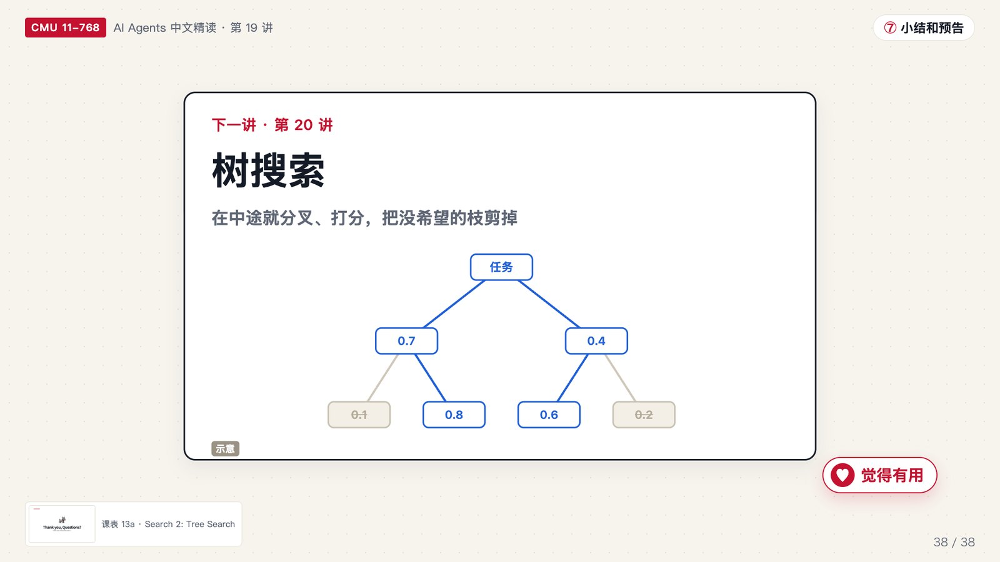

这一讲的每次尝试都是从头跑到尾再比。下一讲讲树搜索：在中途就分叉、给半成品打分，把没希望的枝剪掉。网页 agent 能不能在点下一个按钮之前，先在脑子里"预演"一下会发生什么？
