# 第 20 讲 · 树搜索：边走边分叉，把没希望的枝剪掉

> CMU 11-768 AI Agents（2026 秋）中文精读 · 配套课件
> 配套视频（16 分钟）：B 站 / 视频号 / 抖音 / 小红书搜索「竹二木SI」 · 整份幻灯片：[l20-幻灯片.pdf](./l20-幻灯片.pdf)
> 原课程：[cmu-agents.com](https://cmu-agents.com)，课程主讲 Graham Neubig、Daniel Fried；本讲课表名 Search 2: Tree Search，讲者 JY Koh，课件标题 Search and Planning。本课件是非官方的学习整理。
> **这一讲原课程没有公开录像**，内容根据原课件（正文 81 页，附录到 100 页）和课表列出的推荐阅读整理：必读的 6 篇（Tree of Thoughts、Stream of Search、Tree Search for Language Model Agents、WebDreamer、Recursive Language Models、MACU），以及课件页脚和附录引用的论文和代码（Expert Iteration、Graph of Thoughts、Searchformer、DeepSeek-Prover-V1.5、CWM、DeepSeek-R1 等）。每节末尾注明出处。从图上读出的数标"按原图读数"；我自己补的标"我的推断"。

## 这一讲你会学到

学完这一讲，你应该能做到：

1. 说出上一讲（整段尝试再挑）和这一讲（在部分解上分叉）的区别，解释**前沿**（frontier）在搜索里的作用。
2. 区分深度优先、广度优先和**蒙特卡洛树搜索**（MCTS），写出蒙特卡洛树搜索的选枝公式并解释它怎么平衡深挖和探索；说出**专家迭代**（Expert Iteration）为什么能让搜索和网络互相带着变强，以及这一套搬到语言模型上卡在哪（搜索空间、价值模型）。
3. 说出**思维树**（Tree of Thoughts）把搜索拆成哪三件事、评估怎么打分、为什么比思维链强、要多花多少 token；说出思维图的合并为什么能提高"容量"，搜索流为什么连失败的过程一起学反而更好。
4. 说出在真实环境里搜索的好处（环境给反馈）和代价（延迟、回退不一定能恢复、有些动作收不回来），讲清证明模型的截断续写和网页树搜索的打分、预算、重置重放。
5. 解释**世界模型**（world model）和验证器的区别，说出 WebDreamer 怎么"先预演再动手"，为什么想得越远越不准（想象里的动作提议幻觉），以及三种世界模型表示各自的风险。
6. 说出把任务拆成互补子任务（RLM、RAO、MACU、CAID）的做法，解释 RLM 为什么能绕开上下文腐烂、递归为什么不是越深越好，以及为什么加速受**关键路径**（critical path）限制。

建议先看一遍视频，再对照本课件逐节复习。每节开头的图就是视频里对应的画面。

### 接上一讲

上一讲讲多花测试时计算的第一种办法：每次从头跑到尾，再用验证器或评判模型挑一个；或者带着反馈一轮轮改。这一讲换成**结构化搜索**：不等跑完，在半成品上就分叉、打分、选下一步展开哪个，把没希望的枝剪掉。

### 这一讲的路线

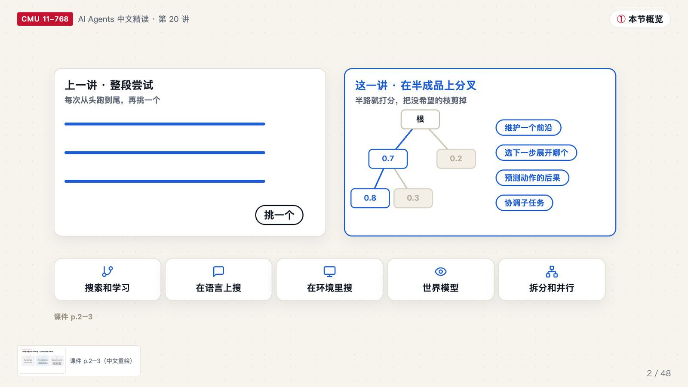

| 节 | 回答的问题 | 课件 |
|---|---|---|
| 1 搜索和学习 | 经典的搜索怎么做，搜索怎么反过来训练模型，为什么难搬到语言模型上 | p.5–15、p.97–99 |
| 2 在语言上搜 | 怎么在文字的部分解上分叉、打分、合并、回退 | p.17–32、p.83–88 |
| 3 在环境里搜 | 动作会真的改变世界时，搜索要付什么代价 | p.34–42 |
| 4 世界模型 | 能不能先预测后果，再决定做不做 | p.44–54 |
| 5 拆分和并行 | 把任务拆成互补的几块，能快多少 | p.56–74 |
| 6 源码解读 | 思维树的官方代码怎么生成、评估、选择 | 附录 p.83–84 |

---

## 1 搜索和学习

### 1.1 一段简史

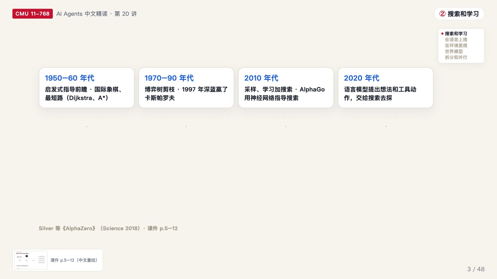

| 年代 | 做法 | 例子 |
|---|---|---|
| 1950–60 年代 | 启发式指导前瞻 | 国际象棋、最短路（Dijkstra、A*） |
| 1970–90 年代 | 博弈树剪枝 | α-β 剪枝让深蓝 1997 年赢了卡斯帕罗夫 |
| 2010 年代 | 采样、学习加搜索 | AlphaGo 用神经网络指导搜索 |
| 2020 年代 | 在语言和动作上搜 | 语言模型提出想法和工具动作，交给搜索去探 |

### 1.2 深度优先、广度优先、蒙特卡洛树搜索

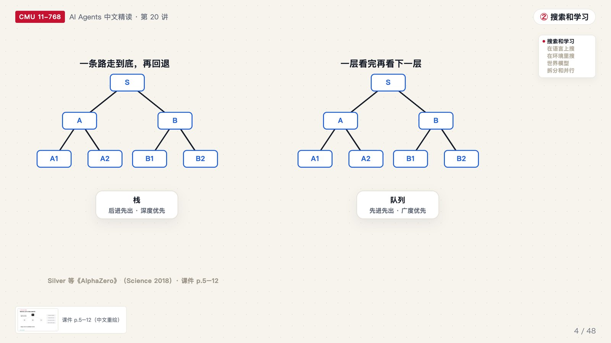

**深度优先**（DFS）一条路走到底再回退，前沿是一个栈（后进先出）；**广度优先**（BFS）一层看完再看下一层，前沿是一个队列（先进先出）。两者的差别只在于前沿里的节点按什么顺序拿出来。

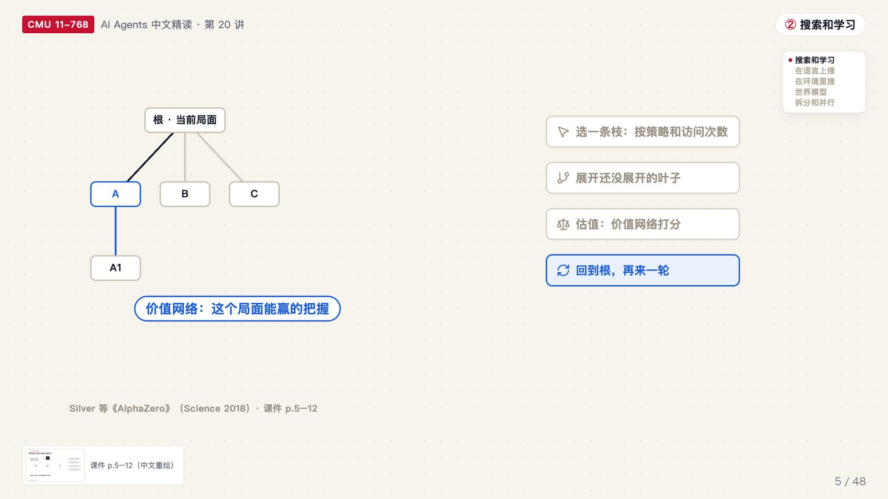

**蒙特卡洛树搜索**（MCTS）里，节点是状态，边是动作。每一轮四步：

1. **选择**：从根往下，按当前策略给的动作分布和以前的访问次数选一条枝；
2. **展开**：走到还没展开的叶子，展开它；
3. **估值**：用价值网络估这个局面最后能不能赢（早期做法是随机推演到底）；
4. **回传**：回到根，开始下一轮，决定往深走还是换一条枝。

出处：Silver 等《A general reinforcement learning algorithm that masters chess, shogi, and Go through self-play》（AlphaZero，Science 2018）；课件 p.5–12。

### 1.3 选枝公式：既深挖，也看冷门

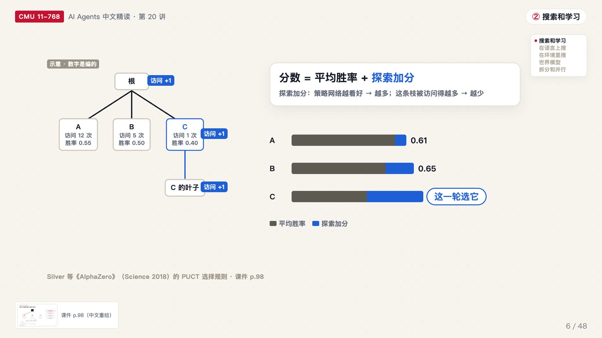

蒙特卡洛树搜索每一轮从根往下选枝，AlphaZero 用的是 PUCT 规则：

```
分数(s, a) = Q(s, a) + c · P(s, a) · √N(s) / (1 + N(s, a))
```

| 符号 | 含义 |
|---|---|
| Q(s, a) | 这条枝到目前为止的平均价值（可以理解成平均胜率） |
| P(s, a) | 策略网络给这一步的先验概率 |
| N(s) | 父节点被访问的总次数 |
| N(s, a) | 这条枝被访问的次数 |
| c | 调探索力度的常数 |

后一项就是"探索加分"：策略越看好这一步，加分越多；这条枝去得越多，分母越大，加分越少。所以热门的枝去多了，分数会越来越由 Q 决定；没怎么去过、先验又不低的枝，就会被轮到。只看 Q，搜索会早早锁死在一开始估得好的枝上；只看 P，又等于照着网络的直觉走，不往下验证。

叶子估完值以后做**回传**（backup）：从叶子到根，路径上每个节点访问次数加一，Q 更新成新的平均。下一轮选枝用的就是更新后的数。

出处：Silver 等《AlphaZero》（Science 2018）；课件 p.98。场景里的访问次数和胜率是示意数字。

### 1.4 搜索产出训练数据


**专家迭代**（Anthony 等 NeurIPS 2017）：神经策略指导树搜索，树搜索找到比策略本身更好的决策，再拿这些决策训练策略，循环往复。AlphaGo Zero（Silver 等 Nature 2017）每走一步都先搜一遍，记下每个走法的访问次数（成为策略的训练目标）和最后的胜负（成为价值的训练目标）。


这一套在棋类里好用，搬到语言模型上就难了（课件 p.15）：

| 环节 | 棋类 | 语言模型的难处 |
|---|---|---|
| 状态 | 紧凑的棋盘 | 一长串历史，还有看不见的信息 |
| 状态转移 | 精确、便宜的模拟器 | 要调工具、有副作用，或者只能靠预测 |
| 动作 | 合法走法能一个个列出来 | 生成的文字和工具参数数不过来 |
| 结果 | 胜负一清二楚 | 任务算不算做成，常常说不清 |

课件小结里还补了一点（p.77）：围棋的同一个走法身份不变，可以反复访问；语言模型每次生成的"想法"都可能是新的一枝。局部看着合理的想法，也不一定推进最终的解。搜索带来的决策提升，要值得它的成本。

出处：Anthony 等《Thinking Fast and Slow with Deep Learning and Tree Search》；Silver 等《Mastering the game of Go without human knowledge》；课件 p.13–15、p.77。

---

### 1.5 专家迭代为什么管用

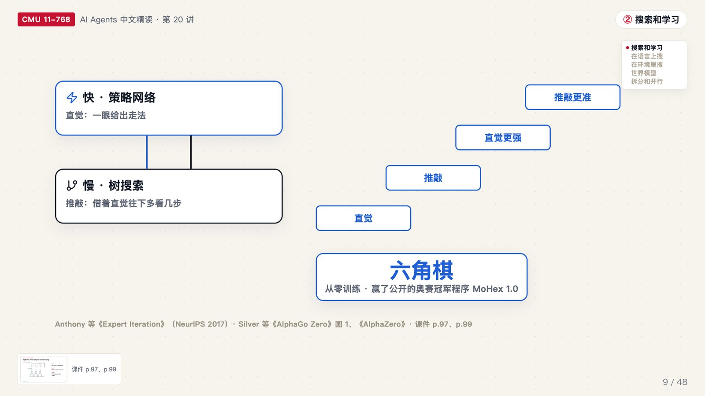

专家迭代（Expert Iteration）借了心理学里"快思考、慢思考"的说法：

- **徒弟**是神经网络，快，一眼给出走法，相当于直觉；
- **专家**是树搜索，慢，借着徒弟的直觉往下多看几步，相当于推敲。

推敲出来的走法通常比直觉好，因为它真的往下看了。让徒弟模仿专家的结果，徒弟变强；徒弟强了，专家用它指导搜索，又能搜得更准。论文在六角棋（Hex）上从零训练，最后的树搜索程序赢了当时公开的最新奥赛冠军程序 MoHex 1.0。

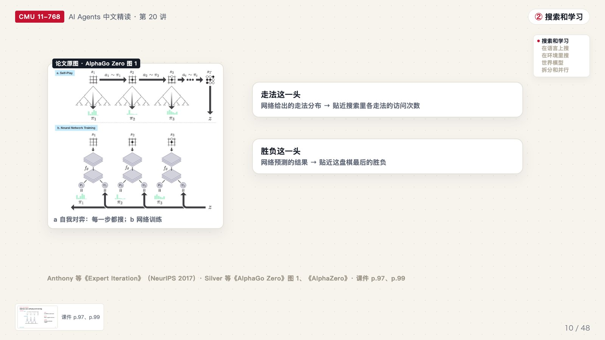

AlphaZero 训练网络有两个目标（课件 p.99，正则项略）：

| 目标 | 网络输出 | 要贴近的东西 |
|---|---|---|
| 走法 | 各走法的概率 | 这一步搜索里各走法的访问次数分布 |
| 胜负 | 对局面的胜负预测 | 这盘自我对弈最后的结果 |

访问次数分布能当训练目标，是因为它已经是"往下看过几百次"的结果，比网络直接给的概率更好。这正是专家带徒弟的那一步。

出处：Anthony、Tian、Barber《Thinking Fast and Slow with Deep Learning and Tree Search》（NeurIPS 2017）摘要、§1；Silver 等《AlphaGo Zero》图 1；课件 p.97、p.99。

### 1.6 搬到语言模型上卡在哪

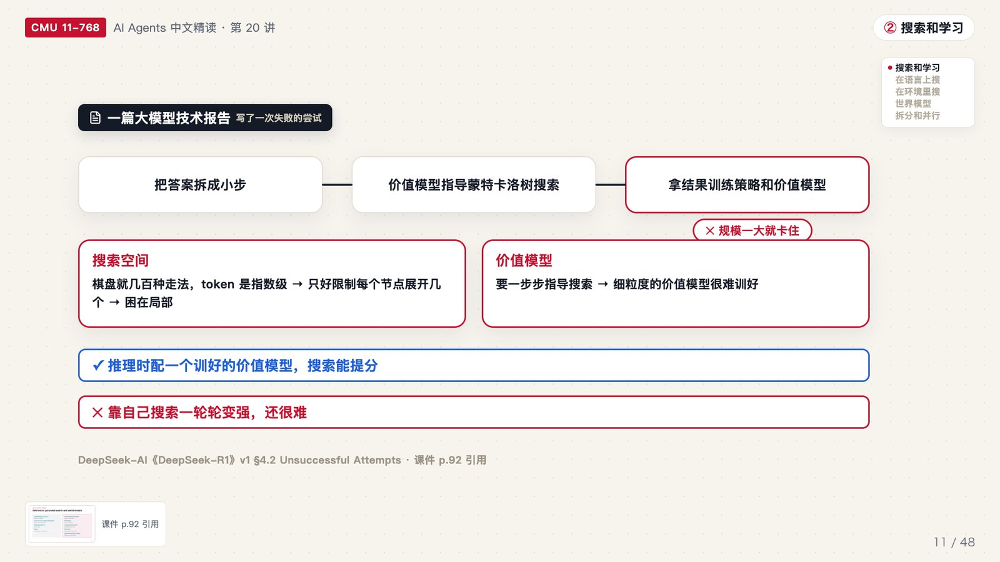

DeepSeek-R1 的技术报告（v1）在"不成功的尝试"一节里写了用蒙特卡洛树搜索训练推理模型的经历：把答案拆成小步，让预训练的价值模型指导搜索，再拿搜出来的问答对训练策略模型和价值模型，一轮轮迭代。规模一上去就遇到两个问题：

1. **搜索空间**：棋的走法空间相对明确，生成 token 的空间是指数级的。他们给每个节点设了最多展开几个的上限，结果模型容易困在局部最优。
2. **价值模型**：它直接决定每一步搜索的方向，可细粒度的价值模型本身就很难训好，于是整套方法很难一轮轮提升。

报告的结论是：推理时配一个预训练好的价值模型，蒙特卡洛树搜索确实能提分；但想像 AlphaGo 那样靠自我搜索迭代变强，仍是一个很大的挑战。这正好对应上面 1.4 对照表里"状态""动作""结果"三行的难处。

出处：DeepSeek-AI《DeepSeek-R1》v1 §4.2 Unsuccessful Attempts；课件 p.92 引用。

## 2 在语言上搜索

### 2.1 思维树


**思维树**（ToT）用 24 点做例子：用 1、3、4、6 各一次算出 24。每一步做一次两数运算就分个叉：

- 1 + 3 = 4，剩 4、4、6 → 再怎么算都凑不出 24，退回；
- 3 ÷ 4 = 0.75，剩 1、0.75、6 → 1 − 0.75 = 0.25，剩 0.25、6 → 6 ÷ 0.25 = 24。

（最后这条解是我按课件的分叉补全的，课件 p.20 只说"每个数恰好用一次"。）

思维树把搜索拆成三件可以分别选择的事（课件 p.21）：

| 组件 | 做什么 |
|---|---|
| 前沿 | 存着部分解 |
| 控制器（语言模型） | 挑下一枝往哪走 |
| 启发式（语言模型） | 给部分解打分，看还有没有希望 |

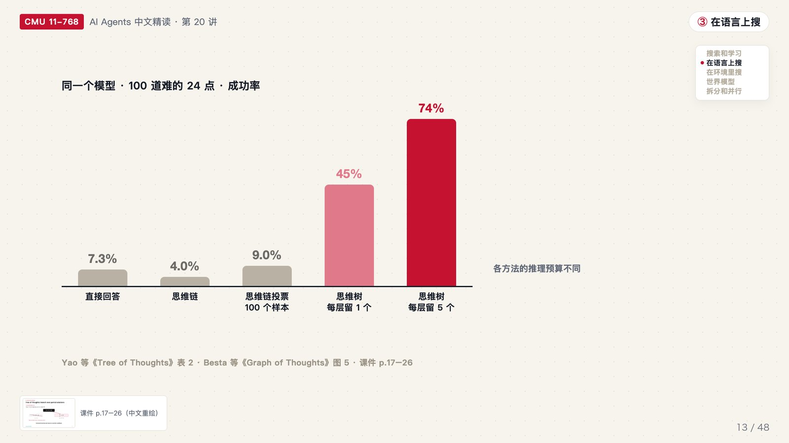

原文表 2（GPT-4，100 道难题）：

| 方法 | 成功率 |
|---|---|
| 直接回答 | 7.3% |
| 思维链 | 4.0% |
| 思维链 + 自洽投票（100 个样本） | 9.0% |
| 思维树，每层留 1 个 | 45% |
| 思维树，每层留 5 个 | **74%** |

课件提醒：这些方法的推理预算不一样，思维树调用模型的次数多得多。

出处：Yao 等《Tree of Thoughts: Deliberate Problem Solving with Large Language Models》表 2；课件 p.17–22。

### 2.2 思维树为什么管用、要花多少

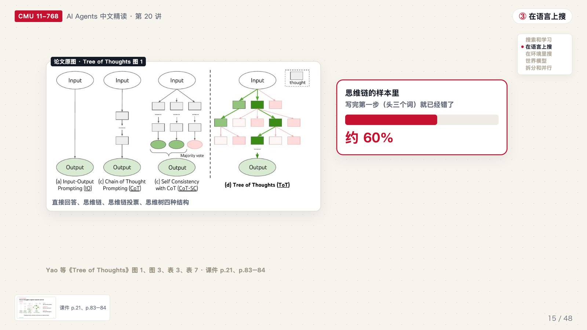

**失败出在哪一步。** 论文统计了 24 点上思维链和思维树分别在第几步失败：大约 60% 的思维链样本在写完第一步，也就是头三个词（比如"4 + 9"）的时候，就已经不可能凑到 24 了。从左到右一口气写下去，第一步错了后面没法救。


**评估怎么打分。** 每个候选状态让模型判断"这几个数能凑到 24 吗"，回答 sure / likely / impossible。官方代码按最后一行解析成权重：sure 20、likely 1、impossible 0.001。课件特意注明这是**手挑的搜索权重，不是概率**。同一个状态评三次求和，每层留分最高的五个（b = 5）。它的作用是让模型凭"太大了""太小了"这种常识，早早砍掉没希望的部分解。

**一步切多大。** 论文的原则是：一个想法要小到模型能写出几种不同的候选（一下写一整本书就做不到），又要大到模型能判断它有没有希望（一个 token 看不出什么）。所以 24 点里一步是一行算式，创意写作里一步是一段写作计划，填字游戏里一步是几个词。

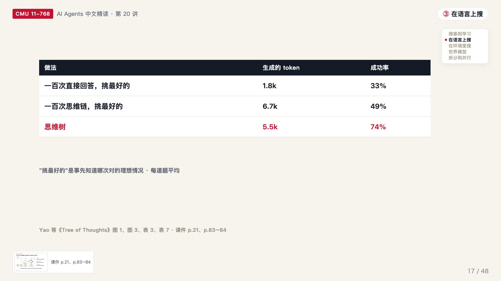

**代价**（原文附录 B.3 表 7，每道题平均）：

| 方法 | 生成 / 提示 token | 每题花费 | 成功率 |
|---|---|---|---|
| 直接回答，100 次里挑最好的 | 1.8k / 1.0k | $0.13 | 33% |
| 思维链，100 次里挑最好的 | 6.7k / 2.2k | $0.47 | 49% |
| 思维树 | 5.5k / 1.4k | $0.74 | 74% |

"100 次里挑最好的"是理想情况，假设你事先知道哪次对。思维树生成的 token 和 100 次思维链差不多，成功率高 25 个点。

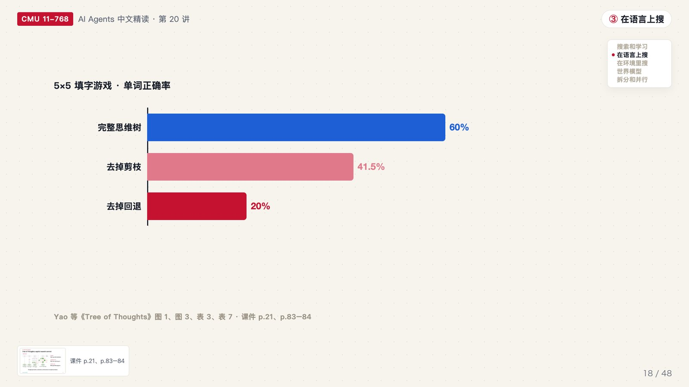

**剪枝和回退各值多少**（原文表 3，5×5 填字游戏，单词正确率）：完整思维树 60%，去掉剪枝 41.5%，去掉回退 20%。

出处：Yao 等《Tree of Thoughts》§3、§4.1、图 3、表 3、表 7；课件 p.83–84。

### 2.3 思维图：枝和枝可以合并

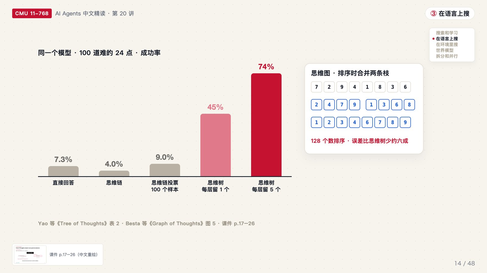

**思维图**（Graph of Thoughts）允许几条枝的结果合并。排序例子：把一串数分成两半各自排好，再让模型合并两个有序列表，合并出来的结果由代码重新打分（数字的多和少、相邻的逆序）。128 个数排序（ChatGPT-3.5，每种方法 100 个输入），中位误差比思维树少约 62%。

出处：Besta 等《Graph of Thoughts》图 5、§7.2；课件 p.23–26、附录 p.85–87。

#### 合并怎么打分，为什么要合并

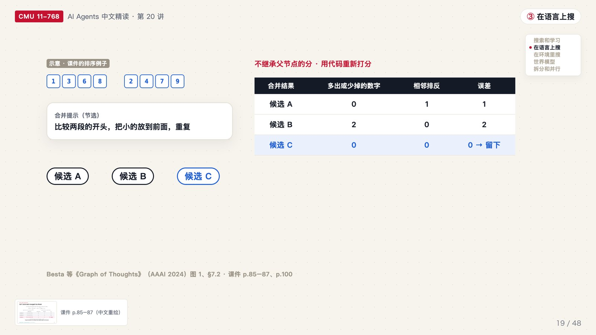

课件附录把排序的合并过程拆开讲（p.85–86，输出是示意）：

1. 选出两段已经排好的子列表，交给模型，提示是"比较两段的开头，把小的放到前面，重复，只返回合并后的列表"；
2. 合出几个候选。**父节点的分不往下加**，每个候选都由代码重新打分：数字多出或少掉的个数，加上相邻的逆序个数；
3. 留误差最小的那个，再采样几次修补、重新打分。

| 合并结果 | 多出或少掉的数字 | 相邻排反 | 误差 |
|---|---|---|---|
| 候选 A | 0 | 1 | 1 |
| 候选 B | 2 | 0 | 2 |
| 候选 C | 0 | 0 | 0 → 留下 |

**为什么合并有用。** 论文定义了一个想法的"容量"（volume）：图里有多少个之前的想法能走到它，也就是有多少想法可能影响了它。在总花费相同的条件下（原文表 2）：

| 结构 | 延迟（跳数） | 容量 |
|---|---|---|
| 思维链 | N | N |
| 思维链投票 | N/k | N/k |
| 思维树 | log_k N | O(log_k N) |
| 思维图 | log_k N | N |

树上的最终答案只"见过"自己那条枝上的祖先；思维图把一棵树的叶子再按镜像树合起来，最后的想法能汇总所有中间结果，延迟还和树一样低。代价是任务要能拆成小块、各自解决、再合起来，比如排序、集合求交、关键词计数。排序上它比思维树误差低约 62%，花费还低 31% 以上。

出处：Besta 等《Graph of Thoughts》摘要、§6 表 2、§7.2；课件 p.85–87、p.100。

### 2.4 搜索流：把搜索过程写成文字来训练


**搜索流**（Stream of Search，SoS）把搜索的过程本身写成一串文字。课件的例子（目标 24，数字 4、6、7、8）：

```text
4*6=24 → 剩 [7, 8, 24]
7+8=15 → 剩 [24, 15]
24+15=39 ≠ 24     No Solution
24-15=9  ≠ 24     No Solution
回到上一层：剩 [7, 8, 24]
8-7=1  → 剩 [24, 1]
24*1=24           Goal Reached
```

回退不是删掉前面的内容，而是接着往下写，失败的尝试都留在上下文里。

训练做法（课件 p.30）：用 12 种启发式的深度优先 / 广度优先策略生成 50 万条搜索轨迹，约 57% 成功；从头训练一个 2.5 亿参数的 GPT-Neo（上下文 4,096）；整条轨迹都算损失，包括失败的探索和"No Solution"之后的回退。之后再用 STaR（采样、过滤、再拟合）和 APA（奖励正确又高效的搜索、惩罚多余的展开）继续改进。

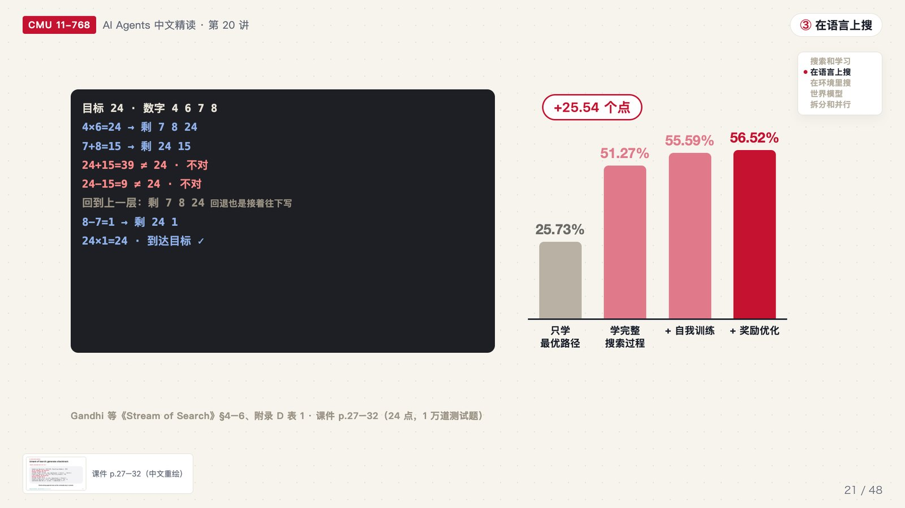

| 训练方式（24 点，1 万道测试题） | 准确率 |
|---|---|
| 只学最优路径 | 25.73% |
| 学完整搜索过程 | 51.27% |
| + STaR | 55.59% |
| + APA | 56.52% |

原文摘要还说，微调后的模型解出了 36% 以前没解出的题，包括任何启发式求解器都解不出的。

出处：Gandhi 等《Stream of Search (SoS): Learning to Search in Language》§4–6、附录 D 表 1；课件 p.27–32。

---

### 2.5 为什么学失败的过程反而更好


搜索流论文开头的说法是：模型训练时很少见到"有用的错误"。只见过一次做对的干净答案，模型会以为题目都该一口气做完，一步错了就一路错下去，也很难预测几步之后的后果。学了完整的搜索过程，模型学到的是一套办法：什么时候换方向，怎么记住走过的路。再用 STaR 和 APA 改进以后，它解出了 36% 以前没解出的题，其中有些是生成训练数据的那 12 种启发式求解器都解不出的。


参考论文 Searchformer 走得更远：把 A* 搜索的动态（什么时候往搜索树里加节点、什么时候删）写成 token 序列让 Transformer 学，再微调。它解没见过的推箱子关卡，93.7% 走出了最优解，用的搜索步数比训练它的那个 A* 实现最多少 26.8%。

局限也要看到：两篇都在规则清楚、能自动判对错的小游戏上。搜索流的错误分析把错误分成算术错误（算错、除以零）、格式错误、探索错误（跳到一个没有父节点的节点）和其他，APA 压低了算术错误。搬到开放任务上效果如何，还要再看。

出处：Gandhi 等《Stream of Search》摘要、§1、§6；Lehnert 等《Beyond A*》摘要；课件 p.88。

## 3 在环境里搜索

### 3.1 让环境告诉你哪条枝对


到了真实环境里，搜索多了一个可靠的打分来源：环境自己的反馈。DeepSeek-Prover 在 Lean 的证明状态上搜索：生成证明的后续，Lean 发现错误时保留它接受的步骤，从检查过的状态接着写（"截断再续写"）。原文：miniF2F 63.5%，ProofNet 25.3%。LATS 把推理、行动和规划结合起来，每次展开都可以拿到环境的结果。


**网页 agent 的树搜索**（Koh 等）在真实的网页状态上做**最佳优先搜索**（best-first search）。课件的示意：找一间会议那几天能退款的房间，打开酒店甲看到不能退款；想换一条枝打开酒店乙，得先把网页重置，把前面的操作再重放一遍，回到原来那一页。


| 基准（5 步 agent，GPT-4o） | 不搜索 | 搜索 |
|---|---|---|
| VisualWebArena（带截图标记） | 18.9% | 26.4% |
| WebArena | 15.0% | 19.2% |

原文：相对提升 39.7% 和 28.0%，成功率随测试时计算增加而提高。

出处：Xin 等《DeepSeek-Prover-V1.5》；Zhou 等《Language Agent Tree Search》；Koh 等《Tree Search for Language Model Agents》表 2；课件 p.34–40。

### 3.2 两个例子的细节

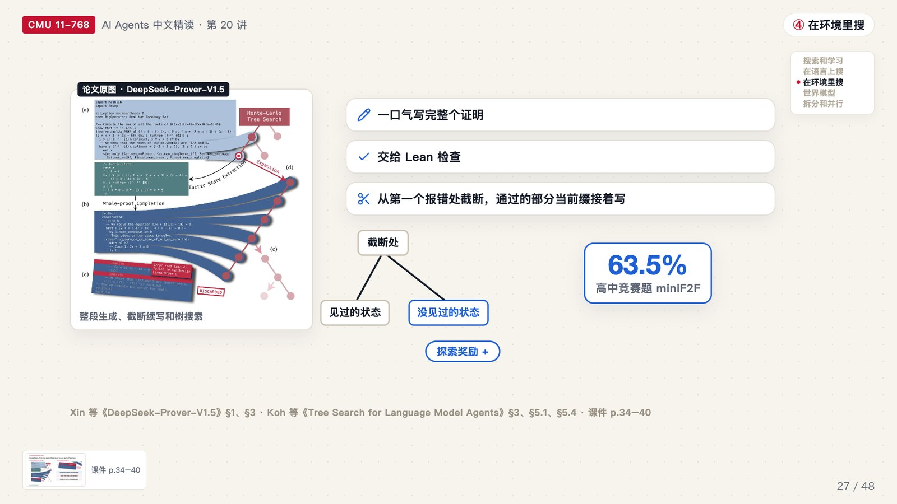

**证明模型**（DeepSeek-Prover-V1.5）的截断续写：先整段生成证明，交给 Lean 4 检查；出错就在第一个报错处截断，后面全丢掉，把通过的部分当前缀接着生成。每个截断位置是一个树节点，它在这些节点上跑一种蒙特卡洛树搜索变体 RMaxTS：走到没见过的证明状态就给一份**内在奖励**。原因是证明搜索的奖励很稀疏，只有写完才知道对不对，不加探索奖励，搜索会在熟悉的地方打转。最终在高中竞赛题 miniF2F 测试集上做到 63.5%，大学题 ProofNet 上 25.3%。

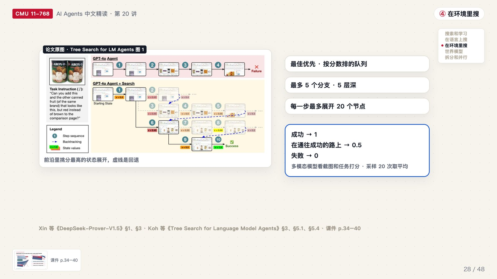

**网页 agent 的树搜索**（Koh 等）是最佳优先搜索，粗略受 A* 启发：

- 前沿是一个按分数排的最大优先队列，每次取分最高的状态展开；
- 参数是深度 d = 5、分支 b = 5、每一步最多展开 c = 20 个节点，执行最多 5 个动作；
- 价值函数让多模态模型看截图和任务，判断当前是成功（1）、失败（0），还是在通往成功的路上（0.5），用自洽的办法采样 20 条推理取平均。

预算越多越好（200 道 VisualWebArena 任务，原文图 2）：不搜索 24.5%，c = 5 是 32.0%，c = 20 是 37.0%。


**为什么回退要重置加重放。** 直接执行"后退"可能丢掉页面上的重要信息，比如滚动位置和已经输入的文字。所以实现里记下到达每个状态的动作序列，回退时把环境重置，再把同样的动作序列重放一遍。代价是慢：c = 20 意味着每一步最多多调 20 倍的模型。

出处：Xin 等《DeepSeek-Prover-V1.5》摘要、§1；Koh 等《Tree Search for Language Model Agents》§3、§4.1、§5.1、§5.4；课件 p.34–40。

### 3.3 回退的代价

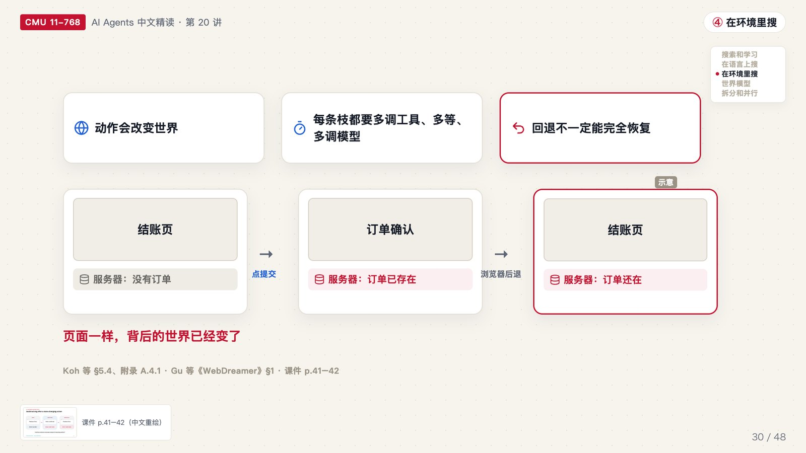

在环境里搜有三个代价（课件 p.41）：

| 代价 | 说明 |
|---|---|
| 动作会改变世界 | 搜索的每一步都是真的执行 |
| 延迟 | 每多一条枝，就多调工具、多等页面、多调模型 |
| 回退不一定能恢复 | 重置和重放可能留下副作用 |

课件 p.42 的例子：结账页点了"提交订单"，再点浏览器后退，页面回到了结账页，可服务器上订单已经存在。页面一样，背后的世界已经变了。课件的建议：分叉之前，先确认能不能回到同一个世界状态。

出处：Koh 等 §5.4、附录 A.4.1；Gu 等《WebDreamer》§1；课件 p.41–42、p.78。

---


网页树搜索论文的建议：真要上线，得把搜索空间限制在没有破坏性的动作上。破坏性动作指会不可逆地改变网站状态、很难回退的动作，比如在电商网站上下单。可以训一个分类器预测哪些动作有破坏性，碰到就不在那里展开；对具体应用有领域知识时（比如知道某些页面不能碰），也可以直接写规则。

出处：Koh 等 §5.4。

## 4 世界模型

### 4.1 先在脑子里预演

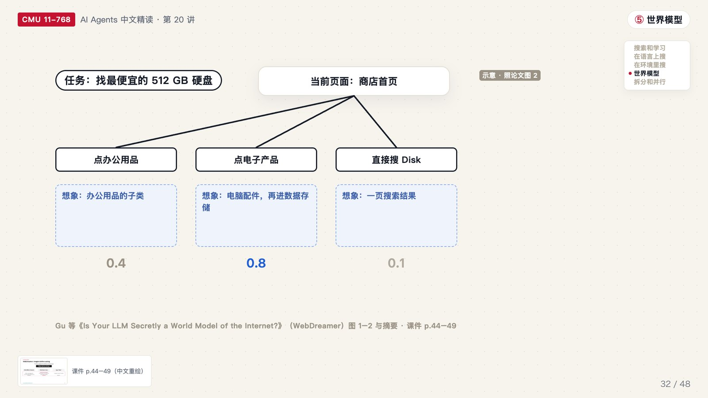

| | 输入 | 输出 |
|---|---|---|
| 验证器 | 执行之后观察到的结果 | 对不对、成没成 |
| **世界模型** | 现在的状态 + 一个打算做的动作 | 预测的下一个状态或奖励 |

**WebDreamer** 让语言模型同时当世界模型和价值函数。例子（照原文图 2）：任务是在数据存储类里找最便宜的 512 GB 硬盘，当前在商店首页。候选动作"点办公用品""点电子产品""直接搜 Disk"，模型分别想象点了以后的页面（办公用品的子类；电脑配件，再进数据存储；一页搜索结果），打分 0.4、0.8、0.1；然后在浏览器里真的点电子产品，看到新页面再重新规划。

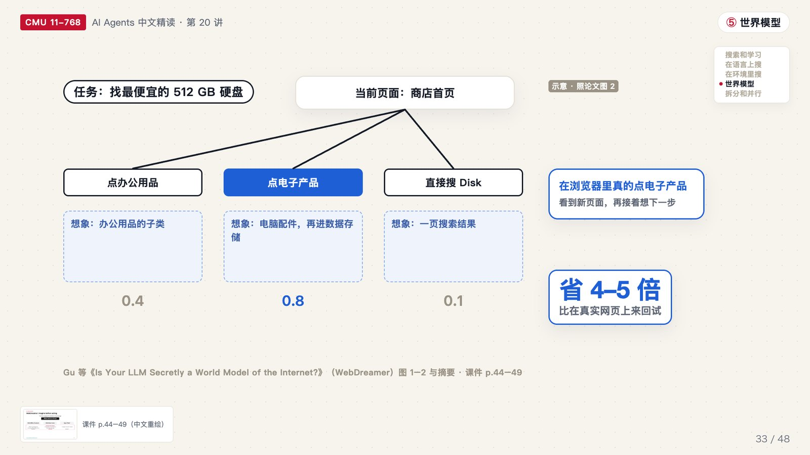

原文摘要：网页上很多动作不可逆，回退很难；WebDreamer 在 VisualWebArena 上和树搜索差不多，效率高 4–5 倍；训练的 Dreamer-7B 和 GPT-4o 相当。

出处：Gu 等《Is Your LLM Secretly a World Model of the Internet? Model-Based Planning for Web Agents》图 1–2 与摘要；课件 p.44–49。

### 4.2 语言模型凭什么能当网页的世界模型

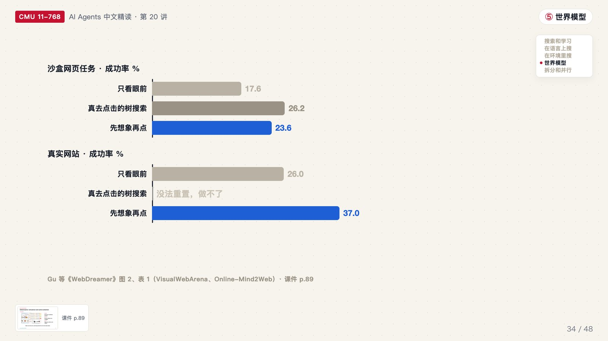

WebDreamer 的出发点：语言模型训练时见过海量网页，大致知道"点了电子产品"会出来什么。所以让同一个模型做两件事：先用文字描述执行某个动作后页面会怎么变，再按任务给这个想象出来的结果打分，选分最高的动作真的去执行，看到新页面再重新规划。

原文表 1（成功率 %）：

| 方法 | VisualWebArena（沙盒） | Online-Mind2Web（真实网站） |
|---|---|---|
| 只看眼前（反应式） | 17.6 | 26.0 |
| 真去点击的树搜索 | 26.2 | — |
| WebDreamer（GPT-4o 想象） | 23.6 | 37.0 |
| WebDreamer（Dreamer-7B 想象） | 21.9 | 35.0 |

在沙盒里它比真点击的树搜索低一点，但效率高 4–5 倍；在真实网站上没法随便重置，树搜索很难实现，它把成功率从 26.0 提到 37.0。专门训的 70 亿参数世界模型 Dreamer-7B 和用 GPT-4o 想象差不多。

出处：Gu 等《Is Your LLM Secretly a World Model of the Internet?》摘要、表 1；课件 p.89。

### 4.3 想得越远，越不准

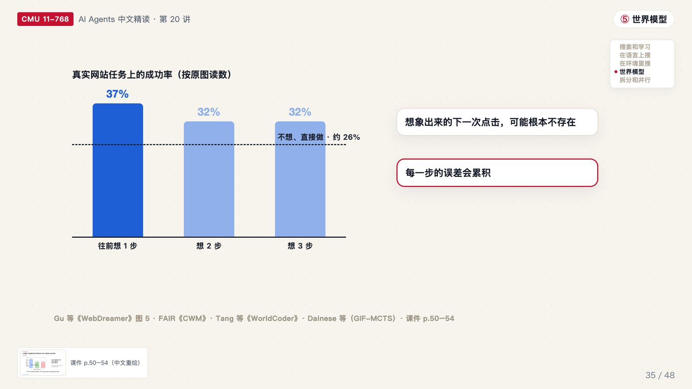

原文图 5（GPT-4o，Online-Mind2Web，按原图读数）：往前想 1 步约 37%，2 步、3 步都约 32%，不想直接做约 26%。原因：想象出来的下一次点击在真实网页上可能根本不存在，每一步的误差会累积。所以主实验只往前想一步。

### 4.4 为什么想远了反而差


论文的解释是想象里的**动作提议幻觉**：在想象出来的页面上提下一个动作时，模型偏向提那些"看着和任务相关"的动作，哪怕预测出来的页面上根本没有这个按钮。规划得越远，从不同动作出发想象出来的几条路都显得有点对，越来越难区分。所以主实验只往前想一步。

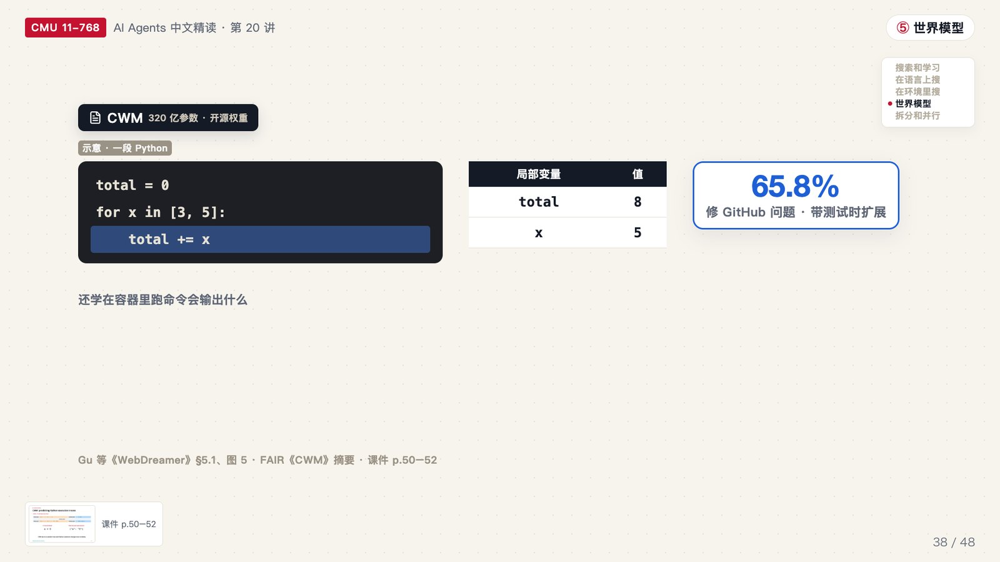

"学出来的执行动态"这一类的代表是 CWM：一个 320 亿参数的开源权重模型，中期训练时专门学 Python 执行轨迹（每执行一行，局部变量怎么变）和 Docker 环境里 agent 跑命令、改代码的交互轨迹。它在 SWE-bench Verified 上做到 65.8%（带测试时扩展）。

出处：Gu 等《WebDreamer》§5.1、图 5；FAIR CodeGen Team《CWM》摘要、§1；课件 p.50–52。

### 4.5 世界模型的三种表示


| 表示 | 例子 | 主要风险 |
|---|---|---|
| 用文字描述后果 | RAP、WebDreamer | 听着合理，其实是错的未来 |
| 学出来的执行动态 | CWM：预测 Python 每条语句之后变量怎么变、Docker 命令的输出 | 预测误差，分布偏移 |
| 可执行的转移程序 | WorldCoder、GIF-MCTS：让模型写出 `transition(state, action)` | 一条错规则变成一个跑得飞快的错模拟器 |

课件的判断标准：看世界模型的预测能不能让决策变好，而不只是预测得像不像。

出处：Hao 等《RAP》；FAIR CodeGen Team《CWM》；Tang 等《WorldCoder》；Dainese 等《Generating Code World Models with LLMs Guided by MCTS》；课件 p.50–54。

---

## 5 拆分和并行

### 5.1 把长文档交给代码：RLM


上一讲的候选是"同一个完整任务做几遍"；这里是"拆成互补的子任务，再组合"。**递归语言模型**（RLM）把长提示当成外部数据放在一个持久的 Python REPL 里，根模型写代码去查看、过滤、切分、计算，再对挑出来的片段调用子模型（评测的实现里子调用是顺序的）。


原文表 1（根模型 GPT-5，子调用 GPT-5-mini）：

| 任务 | 直接用 | 压缩上下文 | 只用 REPL | RLM 深度 1 | 其他 |
|---|---|---|---|---|---|
| BrowseComp-Plus（600 万–1100 万 token，准确率） | 超出上下文 | 70.5 | 88.0 | 91.3 | OpenCode + 卸载 94.0 |
| OOLONG-Pairs（3.2 万 token，F1） | 0.1 | | 43.9 | 58.0 | RLM 深度 3：76.0 |

深度不是越深越好：CodeQA 上 Qwen3-Coder 只用 REPL 是 66%，递归深度 3 是 44%（课件 p.60）。

出处：Zhang、Kraska、Khattab《Recursive Language Models》表 1、§4；课件 p.56–60。

### 5.2 为什么不直接塞进去

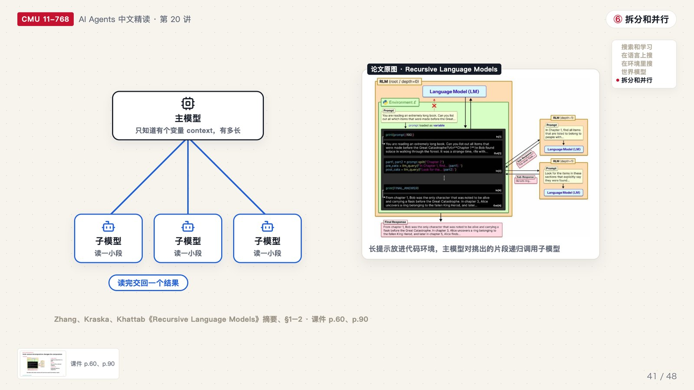

RLM 论文开头讲的问题叫**上下文腐烂**（context rot）：就算没超出上下文窗口，提示越长，模型的表现掉得越厉害。递归读法的做法是：把提示设成 REPL 里的一个变量，只告诉模型这个环境的概况（比如字符串有多长），让它写代码去查看、切分、过滤，再对挑出来的片段调用子模型，子模型返回结构化的中间结果。主模型从头到尾没把全文读进自己的上下文。


- 在四个长上下文任务上，用 GPT-5 当根模型，RLM 比压缩上下文的做法中位数高 26%，比带子调用的 CodeAct 高 130%，成本相当；
- 递归不是越深越好：CodeQA 上 Qwen3-Coder 只用 REPL 是 66%，递归深度 3 反而 44%（课件 p.60）。深度要按任务选。

出处：Zhang、Kraska、Khattab《Recursive Language Models》摘要、§1–2；课件 p.60、p.90。

### 5.3 拆开不一定更快


第 17 讲讲过的 RAO（学会何时派活）和 MACU（管理者维护任务图），课件给了新的数字：

| 任务 | 单 agent → 派活 | 用时 |
|---|---|---|
| TextCraft-Synth（合成配方，成功率） | 73% → 96% | 困难题 180.0 秒 → 73.3 秒 |
| Oolong-Real（长对话记录汇总，平均奖励） | 0.203 → 0.320 | |
| DeepDive（多跳网页调研，成功率） | 24% → 40% | 13.3 秒 → 233.0 秒 |
| Odysseys（MACU，成功率） | 8.5% → 34.0% | 中位 162.4 → 110.3 分钟 |
| Online-Mind2Web（MACU，成功率） | 52.2% → 55.6% | 中位 18.5 → 33.6 分钟 |

配方任务的几个分支互相独立，可以同时做；多跳调研后面要查什么，得等前面查到。MACU 的工人是 Qwen3.6-27B、管理者是 Opus 4.6，和第 17 讲引的原文摘要是不同的配置。


**阿姆达尔定律**（课件 p.74 的合成例子）：A、B、C 三件事串着做 4 + 3 + 2 = 9 分钟；并行做的时间是最长的那条（A，4 分钟），再加上协调和合并的时间。依赖和协调都加在关键路径上。

另外两个课件提到的系统：LLMCompiler 调度一张依赖图，一个任务的输入齐了就派出去；CAID 给每个工程师 agent 一个 git worktree，最后合并、跑集成测试。课件 p.73 总结：交接必须保留后面子任务需要的状态。

出处：Gandhi 等《Recursive Agent Optimization》表 1–3、§4–5；Koh、Salakhutdinov、Fried《Multi-Agent Computer Use》；Kim 等《LLMCompiler》；Geng、Neubig《CAID》；课件 p.61–74。

---

### 5.4 多 agent 操作电脑：拆得开才快


MACU 原文表 1（工人都是 Qwen3.6-27B，管理者 Opus 4.6；单 agent → 多 agent）：

| 基准 | 成功率 | 中位用时（分钟） |
|---|---|---|
| Odysseys（长任务网页） | 8.5% → 34.0% | 162.4 → 110.3 |
| Online-Mind2Web | 52.2% → 55.6% | 18.5 → 33.6 |
| OSWorld | 43.8% → 48.5% | 26.6 → 21.4 |

同一套做法，在长任务上又准又快，在 Online-Mind2Web 上只准了一点、用时却多了八成。活拆得开、子任务之间依赖少，并行才省时间；拆不开，管理者的协调本身就是开销。课件附录 p.94 还列了管理者换成 Qwen 的结果，Odysseys 上也有 32.0%。我的理解是，这里的收益主要来自拆分本身，不是管理者模型更强。

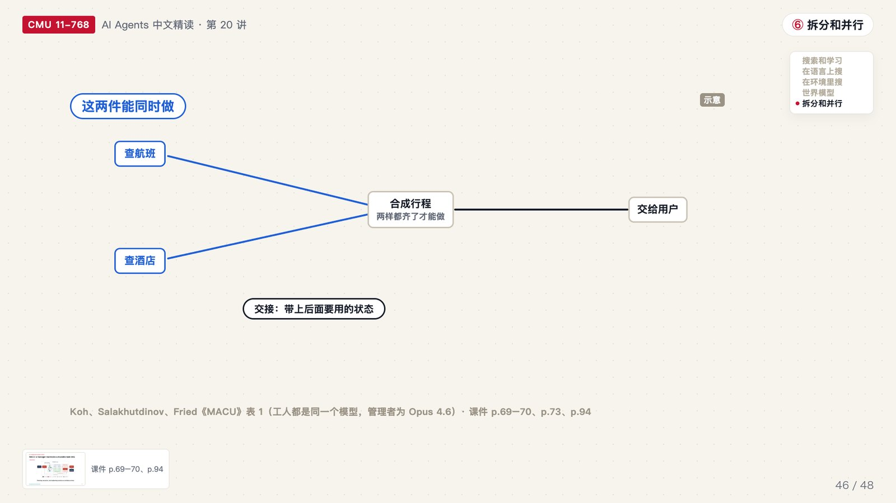

所以分活之前先画依赖：哪些能同时做，哪些必须等；交接时把后面的子任务需要的状态（发现、文件、观察，或者提交和测试结果）一起交过去（课件 p.73）。

出处：Koh、Salakhutdinov、Fried《Multi-Agent Computer Use》表 1；课件 p.69–70、p.73、p.94。

## 6 源码解读：思维树的生成、评估、选择

课件附录 p.83–84 讲了思维树官方代码怎么给 24 点的部分解打分。代码在 [princeton-nlp/tree-of-thought-llm](https://github.com/princeton-nlp/tree-of-thought-llm) 的 `src/tot/methods/bfs.py` 和 `src/tot/tasks/game24.py`（2026-11 抓取）。下面删掉了打印日志和 `naive_solve`，注释是我加的。

### 6.1 一层一层地搜：`solve`

```python
def solve(args, task, idx, to_print=True):
    global gpt
    gpt = partial(gpt, model=args.backend, temperature=args.temperature)
    x = task.get_input(idx)                      # 题目，比如 "1 3 4 6"
    ys = ['']                                    # 前沿：当前留下的部分解，一开始是空的
    infos = []
    for step in range(task.steps):               # 24 点是 4 步（3 次运算 + 写出答案）
        # ① 生成：让模型为每个部分解提出下一步
        if args.method_generate == 'sample':
            new_ys = [get_samples(task, x, y, args.n_generate_sample, prompt_sample=args.prompt_sample, stop=task.stops[step]) for y in ys]
        elif args.method_generate == 'propose':  # 24 点用 propose：一次提出多个候选
            new_ys = [get_proposals(task, x, y) for y in ys]
        new_ys = list(itertools.chain(*new_ys))
        ids = list(range(len(new_ys)))
        # ② 评估：让模型给每个新部分解打分
        if args.method_evaluate == 'vote':
            values = get_votes(task, x, new_ys, args.n_evaluate_sample)
        elif args.method_evaluate == 'value':    # 24 点用 value：每个状态单独评
            values = get_values(task, x, new_ys, args.n_evaluate_sample)
        # ③ 选择：只留下一部分进入下一层
        if args.method_select == 'sample':
            ps = np.array(values) / sum(values)
            select_ids = np.random.choice(ids, size=args.n_select_sample, p=ps).tolist()
        elif args.method_select == 'greedy':     # 按分数取前 n_select_sample 个（论文里的"广度 5"）
            select_ids = sorted(ids, key=lambda x: values[x], reverse=True)[:args.n_select_sample]
        select_new_ys = [new_ys[select_id] for select_id in select_ids]
        infos.append({'step': step, 'x': x, 'ys': ys, 'new_ys': new_ys, 'values': values, 'select_new_ys': select_new_ys})
        ys = select_new_ys                       # 新的前沿
    return ys, {'steps': infos}
```

这就是 2.1 节的三件事：`get_proposals` 是生成想法，`get_values` 是启发式打分，`greedy` 选择加上 `ys` 是前沿。这里用的是**束搜索**式的广度优先：每层只留分最高的几个，不留的枝就被剪掉了，不会再回来。

### 6.2 打分：把模型的话变成数

```python
def get_values(task, x, ys, n_evaluate_sample, cache_value=True):
    values = []
    local_value_cache = {}
    for y in ys:                                  # 每个部分解
        if y in local_value_cache:                # 同一层重复的候选给 0 分，避免重复保留
            value = 0
        else:
            value = get_value(task, x, y, n_evaluate_sample, cache_value=cache_value)
            local_value_cache[y] = value
        values.append(value)
    return values
```

`get_value` 用评估提示问模型 `n_evaluate_sample` 次（论文设置是 3 次），再交给任务自己的解析函数：

```python
# src/tot/tasks/game24.py
def value_outputs_unwrap(x: str, y: str, value_outputs: list) -> float:
    if len(y.strip().split('\n')) == 4 and 'answer' not in y.lower():
        return 0                                   # 已经走完 3 步却没写出答案：0 分
    value_names = [_.split('\n')[-1] for _ in value_outputs]     # 只看模型回答的最后一行
    value_map = {'impossible': 0.001, 'likely': 1, 'sure': 20}  # TODO: ad hoc
    value = sum(value * value_names.count(name) for name, value in value_map.items())
    return value
```

几个值得注意的地方：

| 细节 | 说明 |
|---|---|
| 只看最后一行 | 评估提示让模型先写推理，最后一行写 sure / likely / impossible，解析器只读这一行 |
| 0.001、1、20 | 课件特意指出这是手挑的搜索权重，不是概率；源码注释也写着 `ad hoc` |
| 三次求和 | 两次 sure 一次 likely 得 41 分，三次 impossible 只有 0.003 分；多问几次能平滑掉模型偶尔的误判 |
| 重复给 0 | 同一层里一模一样的部分解只保留一次，把名额让给不同的枝 |

---

## 本讲小结

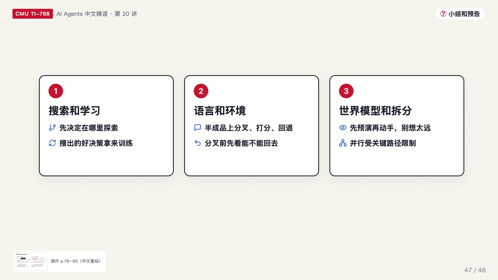

- **搜索和学习**：深度优先、广度优先、蒙特卡洛树搜索的差别在于前沿怎么取；专家迭代让搜索产出更好的决策，再拿来训练。棋类好搬，因为状态紧凑、模拟器便宜、动作能列举、胜负明确；语言模型这四样都难。
- **在语言上搜**：思维树在部分解上分叉、打分、剪枝（24 点 4% → 74%）；思维图让枝合并（排序误差少约六成）；搜索流把整个搜索过程写成文字来训练（25.73% → 51.27%）。
- **在环境里搜**：证明器、网页能给真实反馈（VisualWebArena 18.9% → 26.4%），但每条枝都有延迟，回退不一定能恢复，有些动作收不回来。
- **世界模型**：先预测再动手（WebDreamer 比树搜索省 4–5 倍）；想太远误差会累积；判断标准是预测能不能改善决策。
- **拆分和并行**：把长输入交给代码、递归调子模型（RLM）；派活的好处取决于子任务是否独立；加速受关键路径和协调成本限制。

## 关键术语

| 术语 | 英文 | 一句话 |
|---|---|---|
| 前沿 | frontier | 还没展开、等着被选的节点 |
| 深度优先 / 广度优先 | DFS / BFS | 前沿是栈 / 队列 |
| 最佳优先搜索 | best-first search | 每次展开打分最高的节点 |
| 蒙特卡洛树搜索 | Monte Carlo tree search（MCTS） | 选择、展开、估值、回传四步循环 |
| 专家迭代 | Expert Iteration | 搜索找到更好的决策，再拿来训练策略 |
| 价值网络 | value network | 估一个状态最后能不能成功 |
| 思维树 | Tree of Thoughts（ToT） | 在文字的部分解上分叉、评估、选择 |
| 思维图 | Graph of Thoughts（GoT） | 允许几条枝的结果合并 |
| 搜索流 | Stream of Search（SoS） | 把搜索过程（含失败和回退）写成文字来训练 |
| 回退 | backtracking | 退回到之前的状态换一条枝 |
| 世界模型 | world model | 输入状态和动作，预测下一个状态或奖励 |
| 规划步数 | planning horizon | 世界模型往前想几步 |
| 递归语言模型 | Recursive Language Models（RLM） | 把长输入放进代码环境，递归调用子模型读片段 |
| 关键路径 | critical path | 并行任务里最长的那条依赖链 |
| 阿姆达尔定律 | Amdahl's law | 加速受不能并行的那部分限制 |

## 思考题

<details>
<summary>1. 深度优先和广度优先在 24 点上各有什么优缺点？思维树用的是哪一种？</summary>

深度优先省内存，一条路走到底能很快找到一个解，但如果开头那步走错，要走很深才发现。广度优先每层都看全，不会错过浅层的解，但候选数会指数增长。思维树 24 点用的是广度优先的变体：每层只留分最高的 5 个（束搜索），剩下的剪掉。它靠评估器判断哪些枝"还有希望"，评估器错了，好的枝就可能被剪掉、再也回不来。
</details>

<details>
<summary>2. 为什么说 AlphaZero 那一套搬到语言模型上很难？举一个你用过的 agent 任务，对照 1.4 节的表说说难在哪。</summary>

开放题。以"让 agent 修一个 bug"为例：状态是整个仓库加上对话历史，很大，而且有看不见的信息（比如线上环境）；转移要真跑命令、改文件，有副作用；动作是任意的命令和代码，没法列举；结果要看测试，测试可能不全。课件 p.77 还提到，语言模型每次生成的想法都可能是新的，不像围棋的同一个走法可以反复访问、积累统计。
</details>

<details>
<summary>3. 搜索流把失败的尝试也拿来训练，为什么比只学最优路径好这么多？</summary>

只学最优路径的模型只见过"一步就对"的样子，测试时一旦走错就不知道怎么办，错误会滚雪球。搜索流的训练数据里有"试了不对 → 回到上一层 → 换一条"的完整过程，模型学会的是怎么搜，而不只是答案。原文摘要的说法是：语言模型训练时很少见到"有用的错误"。
</details>

<details>
<summary>4. 网页上的树搜索要"重置再重放"才能回到之前的状态。哪些网页动作即使重放也回不去？你会怎么处理？</summary>

提交订单、发邮件、发帖、付款、删除数据这类会改服务器状态的动作。处理办法：对这类动作禁止分叉，或者先用世界模型预演、在动手前打分（WebDreamer 的思路）；或者在沙箱、测试账号里搜；真实环境里执行前要人确认。这一题后半是我的推断，课件只给了问题和 WebDreamer 这个方向。
</details>

<details>
<summary>5. WebDreamer 往前想 1 步最好，想 2、3 步反而变差。这和第 19 讲"验证器不完美"有什么相似之处？</summary>

都是"打分的东西不可靠，越依赖它越吃亏"。第 19 讲里验证器放错的比例给多跑设了上限；这里世界模型每多想一步，预测的页面就可能更离谱（比如想象出一个不存在的按钮），在这个错误的想象上再打分，误差会叠加。两者的共同建议是：先评估打分器或世界模型本身准不准，再决定在它身上花多少算力。
</details>

<details>
<summary>6. 一个任务拆成 A（4 分钟）、B（3 分钟）、C（2 分钟），C 要用 A 的结果，协调和合并各要 0.5 分钟。并行做最少要多久？</summary>

A 和 B 可以同时开始，C 要等 A 做完：关键路径是 A → C，4 + 2 = 6 分钟，加上协调和合并 1 分钟，共 7 分钟。只比串行的 9 分钟快 2 分钟。依赖越多、协调越贵，并行的收益越小，这就是 RAO 在多跳调研上反而变慢的原因。
</details>

<details>
<summary>7. 选枝公式里如果去掉探索加分、只按平均胜率 Q 选，会出什么问题？如果只按策略先验 P 选呢？</summary>

只按 Q 选：一开始估得高的枝会被反复访问，其他枝几乎没机会被看，前几次估值的偶然误差会把搜索锁死在一条枝上。只按 P 选：就等于照着网络的直觉走，搜索没往下验证，也就产生不出"比网络更好"的访问分布，专家迭代那一步就失效了。公式里 √N(s) / (1 + N(s, a)) 让冷门枝的加分随父节点访问次数慢慢变大，热门枝的加分慢慢变小，两头兼顾（1.3 节）。
</details>

<details>
<summary>8. 思维树每题生成的 token 和 100 次思维链差不多，成功率却高 25 个点。多出来的效果从哪来？什么样的任务上这笔账就不划算了？</summary>

从两处来：一是评估让模型在半路就砍掉凑不出 24 的部分解（约六成思维链样本第一步就错了），算力花在还有希望的枝上；二是每步留 5 个候选，相当于在最容易出错的早期多试几次。不划算的情况：评估器本身不准（会剪掉好枝）；任务一步就能做完，没有"半成品"可评；或者每次评估都要调昂贵的工具、真改环境（第 3 节的代价）。这一题后半是我的推断。
</details>

## 动手练习

### 练习：照思维树的做法搜 24 点

目标：亲手实现 6.1 节的"生成 → 评估 → 选择"循环，看评估器的准确程度和每层留几个怎么影响结果。代码**不调用真模型**："提出下一步"枚举所有两数运算；"评估"是一个会按一定概率答错的打分函数，假装是语言模型，标签权重照官方代码。只用 Python 标准库，我在 Python 3.15 上跑通过（约 5 秒）。

`tot24.py`：

```python
"""第 20 讲动手练习：照思维树（ToT）的广度优先搜索做 24 点（示意）。
不调用真模型："提出下一步"枚举所有两数运算；"评估"用一个有噪声的打分函数假装是语言模型。只用标准库。"""
import itertools
import random
from fractions import Fraction

fmt = lambda x: str(x) if x.denominator == 1 else f'({x})'   # 分数加括号，比如 (3/4)
VALUE_MAP = {'impossible': 0.001, 'likely': 1, 'sure': 20}   # 照官方代码 value_outputs_unwrap 的权重


def propose(nums):
    """一步：挑两个数做一次运算，返回所有可能的下一状态（剩下的数，算式）。"""
    out = []
    for i, j in itertools.permutations(range(len(nums)), 2):
        a, b = nums[i], nums[j]
        rest = [nums[t] for t in range(len(nums)) if t not in (i, j)]
        cands = [(a + b, '+'), (a - b, '-'), (a * b, '*')] + ([(a / b, '/')] if b != 0 else [])
        for v, op in cands:
            out.append((tuple(sorted(rest + [v])), f'{fmt(a)} {op} {fmt(b)} = {fmt(v)}'))
    return out


def reachable(nums):
    """真值：剩下这些数还能不能凑出 24（穷举，只用来模拟"评估器"）。"""
    if len(nums) == 1:
        return nums[0] == 24
    return any(reachable(n) for n, _ in propose(list(nums)))


def evaluate(nums, rng, n_eval=3, noise=0.2):
    """假装让语言模型评三次："sure / likely / impossible"，按官方权重求和。noise 是答错的概率。"""
    truth = reachable(nums)
    labels = []
    for _ in range(n_eval):
        right = rng.random() > noise
        if truth == right:
            labels.append('sure' if rng.random() < 0.5 else 'likely')
        else:
            labels.append('impossible')
    return sum(VALUE_MAP[l] for l in labels)


def tot_bfs(start, breadth, rng, noise=0.2):
    """每层：展开所有候选 → 打分 → 只留分最高的 breadth 个（照官方 bfs.py 的 greedy 选择）。"""
    frontier = [(tuple(Fraction(x) for x in start), [])]
    calls = 0
    for _ in range(3):                                   # 4 个数要 3 步
        new = []
        for nums, steps in frontier:
            for nxt, eq in propose(list(nums)):
                new.append((nxt, steps + [eq]))
        uniq = {n: s for n, s in new}                     # 同一个状态只评一次
        scored = []
        for n, s in uniq.items():
            calls += 1
            scored.append((evaluate(n, rng, noise=noise), n, s))
        scored.sort(key=lambda x: -x[0])
        frontier = [(n, s) for _, n, s in scored[:breadth]]
    for nums, steps in frontier:
        if nums[0] == 24:
            return True, steps, calls
    return False, None, calls


if __name__ == '__main__':
    rng = random.Random(0)
    ok, steps, calls = tot_bfs([1, 3, 4, 6], breadth=5, rng=rng)
    print('1 3 4 6 →', ok, steps, f'评估调用 {calls} 次')
    problems = [p for p in itertools.combinations_with_replacement(range(1, 10), 4) if reachable(tuple(map(Fraction, p)))]
    rng2 = random.Random(1)
    sample = rng2.sample(problems, 100)
    for b in [1, 5]:
        r = [tot_bfs(p, b, random.Random(i)) for i, p in enumerate(sample)]
        print(f'每层留 {b} 个：解出 {sum(x[0] for x in r)}/100，平均评估 {sum(x[2] for x in r) / 100:.0f} 次')
```

运行 `python3 tot24.py`，我这里的输出：

```text
1 3 4 6 → True ['3 / 4 = (3/4)', '1 - (3/4) = (1/4)', '6 / (1/4) = 24'] 评估调用 115 次
每层留 1 个：解出 37/100，平均评估 43 次
每层留 5 个：解出 70/100，平均评估 108 次
```

1 到 9 里取 4 个数（可重复）的 495 种组合中，有 404 种能凑出 24，练习从里面随机抽了 100 道。评估器每次有 20% 的概率答错时，每层留 5 个比留 1 个多解出 33 道，评估次数也多了一倍多。和原文 45% → 74% 的趋势一致，数字没有可比性。

做完回答：

1. 把 `noise` 改成 `0`（评估器完全准确），每层留 1 个能解出多少？说明了什么？
2. 把 `noise` 改成 `0.4`，两种设置各解出多少？为什么比留 1 个、`noise=0.2` 还差这么多？
3. 把 `VALUE_MAP` 的 `sure` 从 20 改成 1（和 likely 一样），结果会变吗？为什么官方要拉开这么大？
4. 把 `tot_bfs` 改成深度优先：每次只展开分最高的一个，走不通再回到上一层换次高的。和"每层留 5 个"比，评估次数和解出的题数怎么变？
5. 代码里 `reachable` 是穷举出来的"真值"，真实的思维树没有它。如果评估器是语言模型，你会怎么估计它的 `noise`？

<details>
<summary>参考答案</summary>

1. 100/100。评估器完全准确时，每一层都能直接挑出一个"还能凑出 24"的状态，一条路就走到底，根本不需要更宽的搜索。搜索的宽度是在为评估器的错误买保险。
2. 我这里留 1 个只解出 2 道，留 5 个解出 16 道。噪声 0.4 时，每次评估有四成概率说反，而 `impossible` 只值 0.001 分：一个本来能凑出 24 的状态只要被评成一次 impossible，总分就会大幅落后；相反，大量凑不出的状态被误评成 sure，挤占了名额。每层候选有几十上百个，能凑出的只是少数，误判把它们淹没了。
3. 会变，而且在这个模拟里反而变好：我这里留 1 个解出 46 道、留 5 个解出 94 道。原因是模拟的评估器对能凑出的状态随机说 sure 或 likely，这两个标签本身不带信息，把 sure 设成 20 只是放大了噪声。真实的语言模型说 sure 时通常更有把握，拉开权重才有意义。课件强调这些是手挑的搜索权重，不是概率：权重值不值得调，要看标签本身有没有区分度。
4. 开放题，结果取决于实现。一般来说，深度优先找到第一个解时评估次数更少，但评估器误判时容易在一条错枝上走很深，回退的代价更大；"每层留 5 个"每层都多看几个，更稳，但每层都要付评估的钱。
5. 一种办法是抽一批已知答案的状态（比如用穷举标好"能不能凑出 24"），让语言模型评估，算它说对的比例，就得到它的 `noise`；再用 1 和 2 的结果判断该留几个、评几次。这和第 19 讲"先看看验证器有多准"是同一个思路。
</details>

## 延伸阅读

必读（课表列出的 6 篇）：

- Yao 等，[Tree of Thoughts](https://arxiv.org/abs/2305.10601)：第 2.1 节和第 6 节。
- Gandhi 等，[Stream of Search (SoS): Learning to Search in Language](https://arxiv.org/abs/2404.03683)：第 2.3 节。
- Koh 等，[Tree Search for Language Model Agents](https://arxiv.org/abs/2407.01476)：第 3.1 节。
- Gu 等，[Is Your LLM Secretly a World Model of the Internet?](https://arxiv.org/abs/2411.06559)（WebDreamer）：第 4 节。
- Zhang、Kraska、Khattab，[Recursive Language Models](https://arxiv.org/abs/2512.24601)：第 5.1 节。
- Koh、Salakhutdinov、Fried，[Multi-Agent Computer Use](https://arxiv.org/abs/2606.01533)：第 5.2 节。

课件引用的其他材料：

- Anthony 等，[Expert Iteration](https://arxiv.org/abs/1705.08439)；Zhang 等，[ReST-MCTS*](https://arxiv.org/abs/2406.03816)。
- Besta 等，[Graph of Thoughts](https://arxiv.org/abs/2308.09687)；Lehnert 等，[Searchformer](https://arxiv.org/abs/2402.14083)。
- Zhou 等，[Language Agent Tree Search](https://arxiv.org/abs/2310.04406)；Xin 等，[DeepSeek-Prover-V1.5](https://arxiv.org/abs/2408.08152)。
- FAIR CodeGen Team，[CWM](https://arxiv.org/abs/2510.02387)；Tang 等，[WorldCoder](https://arxiv.org/abs/2402.12275)；Dainese 等，[Generating Code World Models with LLMs Guided by MCTS](https://arxiv.org/abs/2405.15383)。
- Gandhi 等，[Recursive Agent Optimization](https://arxiv.org/abs/2605.06639)；Geng、Neubig，[CAID](https://arxiv.org/abs/2603.21489)；Li 等，[Discriminative World Models for Web Agents](https://arxiv.org/abs/2609.02885)。
- 思维树官方代码：[princeton-nlp/tree-of-thought-llm](https://github.com/princeton-nlp/tree-of-thought-llm)。
- 第 17 讲课件（RAO、MACU、CAID）、第 19 讲课件（并行多跑和验证器）。

## 下一讲预告：怎么信任你的 AI agent


这几讲一直在想办法让 agent 做得更好：多跑、挑、改、搜。可做得好不好，最后要靠评测来说。下一讲问的是：一个 agent 在基准上分数很高，我们就能信任它吗？还需要哪些证据？
