# 第 21 讲 · 怎么信任你的 AI agent：从跑分到可靠

> CMU 11-768 AI Agents（2026 秋）中文精读 · 配套课件
> 配套视频（5 分钟）：B 站 / 视频号 / 抖音 / 小红书搜索「竹二木SI」 · 整份幻灯片：[l21-幻灯片.pdf](./l21-幻灯片.pdf)
> 原课程：[cmu-agents.com](https://cmu-agents.com)，课程主讲 Graham Neubig、Daniel Fried；本讲课表名 How to Trust Your AI Agents，讲者 Karthik Narasimhan（普林斯顿大学），课件副标题 Evaluation when generation is cheap。本课件是非官方的学习整理。
> **这一讲原课程没有公开录像**，内容根据原课件（25 页）和课表列出的推荐阅读整理：WebShop、SWE-bench、τ-bench、Agentic Benchmark Checklist、Trust in Automation 等。每节末尾注明出处。课件自己标"示意""近似"的图照样标注；我补的话标"我的推断"。
> 课表 14a 没有课件，14b 是假期，15a/15b 是海报展示，这一讲是本系列目前的最后一讲。

## 这一讲你会学到

学完这一讲，你应该能做到：

1. 说清"生成便宜、验证贵"是什么意思，以及为什么每个时代的 AI 都取决于标准答案从哪来、要花多少。
2. 讲出评测的**验证梯子**：人工标注 → 环境奖励（WebShop）→ 开发者的测试（SWE-bench）→ 模拟用户加最终状态（τ-bench）→ 还没解决的第五级，以及每一级的短板。
3. 解释基准为什么会**饱和**，古德哈特定律说的是什么，以及 agent 基准反复出现的三个老问题。
4. 区分 **pass@k** 和 **pass^k**，用代码算出两者，解释为什么"试一次的成功率"不等于可靠性。
5. 区分**可靠性**和**信任**，用"好不好检查 × 可不可靠"的四格表判断该放手、抽查还是别用。
6. 说出让人信任 agent 的四种做法：大规模测试、和结果一起交出证据、告诉人该看哪里、一点点挣来的自主权。

建议先看一遍视频，再对照本课件逐节复习。每节开头的图就是视频里对应的画面。

### 接上一讲

第 19、20 讲讲怎么多花测试时计算把活干好：多跑、挑、改、搜。这一讲退一步问：活干完了，我们怎么知道它干得对、能不能信它？这也是第 16 讲"任务、环境、评测"里评测那一件的延续。

### 这一讲的路线

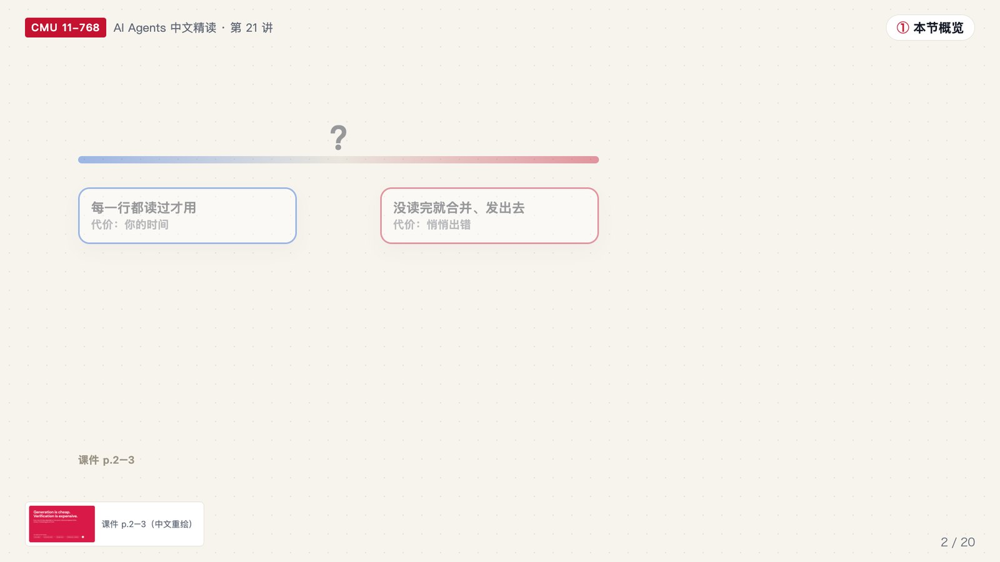

| 节 | 回答的问题 | 课件 |
|---|---|---|
| 1 评测是怎么一路走来的 | 标准答案以前从哪来，基准为什么会过时 | p.4–7 |
| 2 agent 基准的梯子 | agent 的成功怎么自动判断，每一级漏了什么 | p.8–14 |
| 3 可靠性 | 怎么把"每次都行"量出来 | p.15–20 |
| 4 信任 | 人怎么知道什么时候该靠它 | p.21–24 |
| 5 源码解读 | τ-bench 是怎么算 pass^k 的 | p.11 |

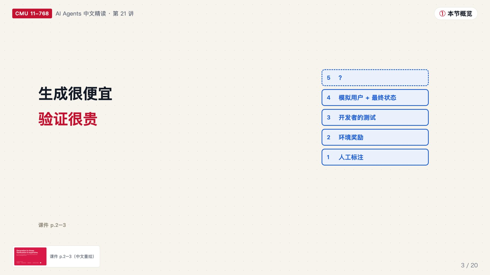

---

## 1 评测是怎么一路走来的

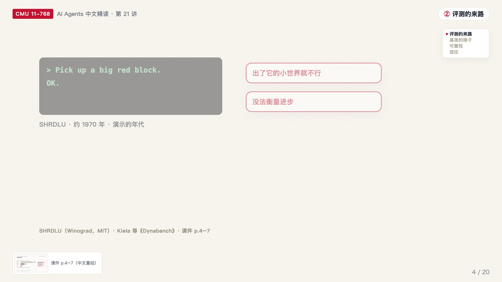

| 阶段 | 标准答案从哪来 | 例子 | 问题 |
|---|---|---|---|
| 演示的年代 | 演示的人说了算 | SHRDLU（约 1970 年，"Pick up a big red block." "OK."）、ELIZA、专家系统 | 出了自己的小世界就不行，没法衡量进步 |
| 第一级：人工标注 | 花钱请人标 | Penn Treebank、MNIST、TREC QA | 每个数据集都是固定的 |

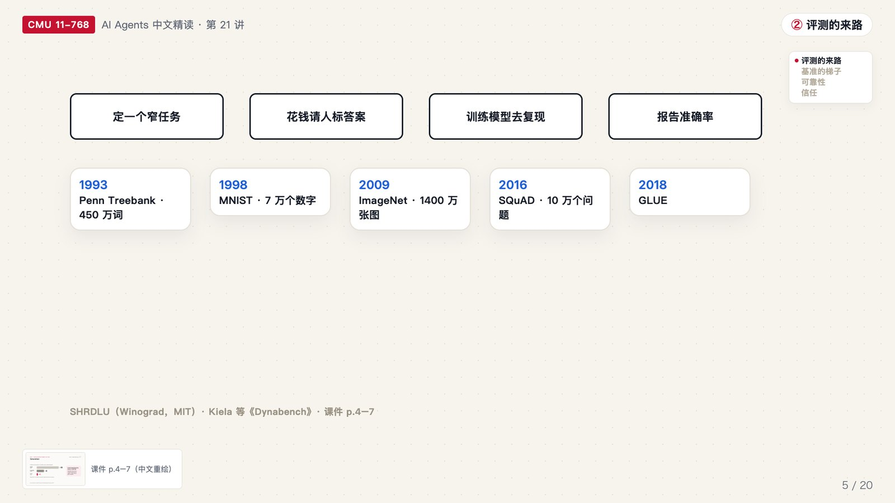

第一级的流程：定一个窄任务（句法分析、手写数字、问答）→ 花钱请人标标准答案 → 训练模型去复现 → 报告准确率，检查本身是免费的。数据集越做越大：Penn Treebank（1993，450 万词）、MNIST（1998，7 万个数字）、ImageNet（2009，现在 1400 万张图）、MS COCO（2014，33 万张）、SQuAD（2016，10 万个问题）、GLUE → SuperGLUE（2018–19）。

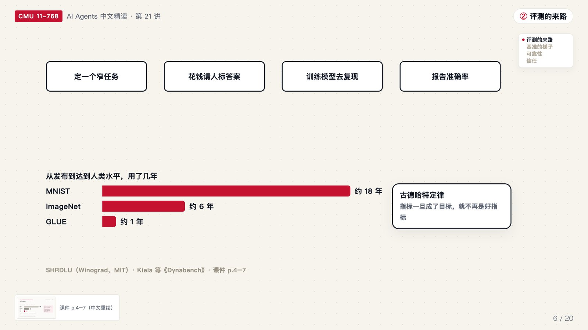

可固定的数据集有**半衰期**（课件 p.7，来源 Dynabench 论文）：MNIST 约 18 年被追到人类水平，ImageNet 约 6 年，GLUE 约 1 年，更难的 SuperGLUE 不到两年。**古德哈特定律**（Goodhart's law）：一个指标一旦成了目标，就不再是好指标。

出处：Kiela 等《Dynabench: Rethinking Benchmarking in NLP》；课件 p.4–7。

---

## 2 agent 基准的梯子

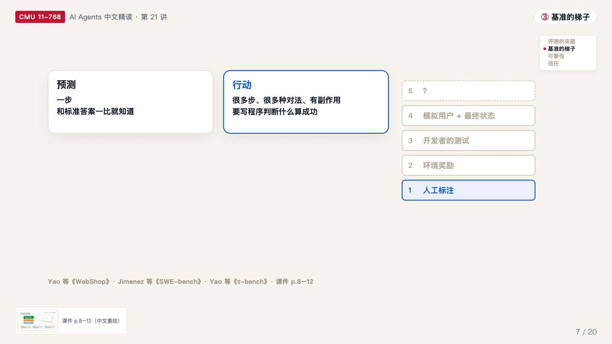

预测只有一步，和标准答案一比就知道对不对。行动是很多步，对的做法有很多种，还有副作用，要写一个程序来判断什么算成功。早期的版本是文字游戏（LSTM-DQN 2015、TextWorld、Jericho）和 MiniWoB（2017，点、输入、提交这种小网页任务）。

| 级 | 怎么检查 | 代表 | 成本 | 短板 |
|---|---|---|---|---|
| 1 | 人工标注 | ImageNet、SQuAD、GLUE | 按标注付钱 | 很快饱和 |
| 2 | 环境奖励 | **WebShop**：118 万件真实商品、12,087 条人写的指令，奖励是挑中的商品和隐藏目标有多匹配 | 环境搭一次 | 奖励只是用户真正想要的代理 |
| 3 | 开发者的测试 | **SWE-bench**：2,294 个真实 GitHub issue（12 个 Python 仓库），跑开发者自己的测试 | 复用现成的测试 | 测试会漏，基准本身也要被检查 |
| 4 | 模拟用户 + 最终状态 | **τ-bench**：语言模型扮演用户，对话结束后比对数据库状态 | 每次运行都要调模型 | 一次通过不等于可靠 |
| 5 | ？ | 没有现成检查办法的长任务 | | 还没解决 |

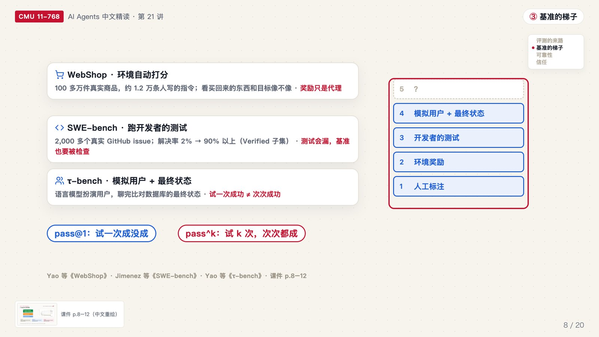

几个原文数字：

| 基准 | 数字 |
|---|---|
| WebShop | 最好的模型成功率 29%，规则方法 9.6%，人类专家 59% |
| SWE-bench | 发表时最好的模型只解决 1.96%；课件说今天（Verified 子集）已到 90% 以上 |
| τ-bench | 最强的函数调用 agent 成功率不到 50%，零售领域 pass^8 不到 25% |

每往上一级，自动化的检查更多，但能覆盖的任务更窄（课件 p.12）。

出处：Yao 等《WebShop》；Jimenez 等《SWE-bench》；Yao 等《τ-bench》；课件 p.8–12。

### 2.1 老问题和新难题

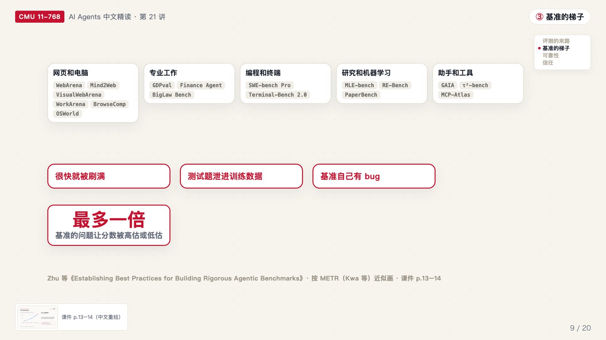

课件 p.13 列了现在的基准：网页和电脑（WebArena、Mind2Web、VisualWebArena、WebVoyager、WorkArena、BrowseComp、OSWorld-Verified）、专业工作（GDPval、Finance Agent、BigLaw Bench）、编程和终端（SWE-bench Pro、Terminal-Bench 2.0）、研究和机器学习（MLE-bench、RE-Bench、PaperBench）、助手和工具调用（GAIA、τ²-bench、MCP-Atlas）。老问题反复出现：

1. 很快饱和；
2. 测试数据可能泄进训练数据；
3. 基准自己有 bug。Zhu 等的 Agentic Benchmark Checklist（ABC）原文举例：SWE-bench Verified 测试用例不够，τ-bench 把空回答算成成功；这类问题会让表现被高估或低估最多 100%（相对）。用 ABC 检查 CVE-Bench，高估减少了 33%。

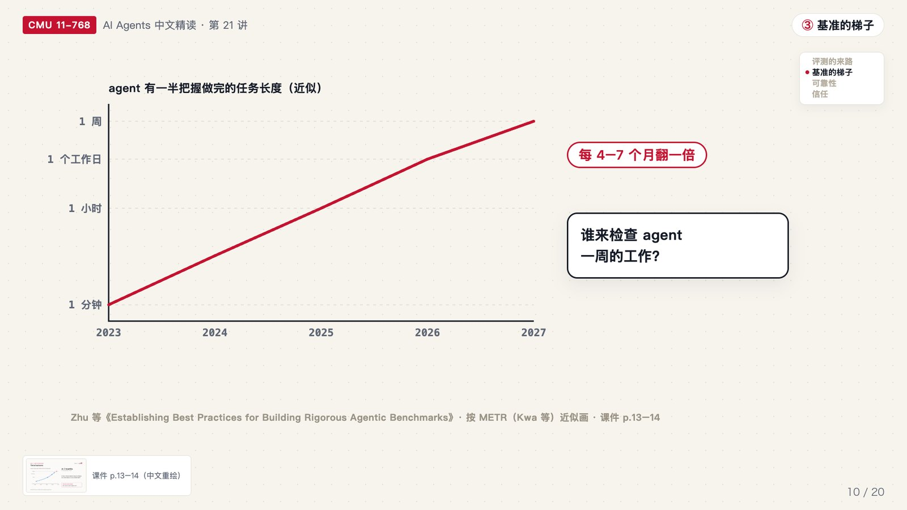

更难的是任务越来越长。课件按 METR 近似画：agent 有一半把握做完的任务长度每 4–7 个月翻一倍，正从一分钟往一周走。METR 原文：2025 年初前沿模型的 50% 时间跨度约 50 分钟，自 2019 年以来大约每 7 个月翻一倍。一分钟的任务好检查，一周的呢？梯子的第五级还空着。

出处：Zhu 等《Establishing Best Practices for Building Rigorous Agentic Benchmarks》；Kwa 等《Measuring AI Ability to Complete Long Software Tasks》；课件 p.13–14。

---

## 3 可靠性

### 3.1 两根柱子

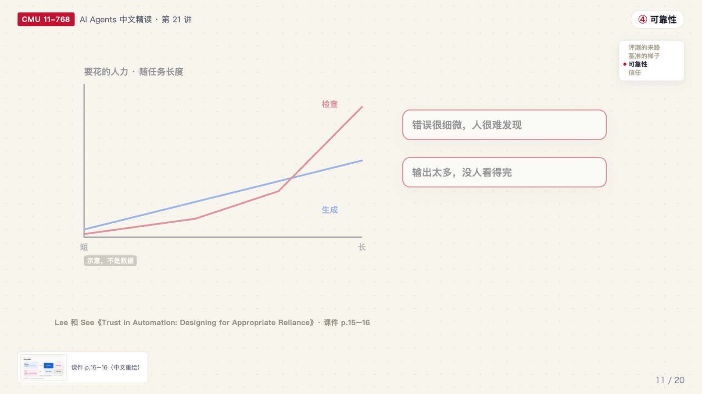

以前检查比做便宜得多。任务一长，错误藏得很深、很难发现，输出又多到没人看得完，检查的成本追了上来（课件 p.15 的图是示意）。

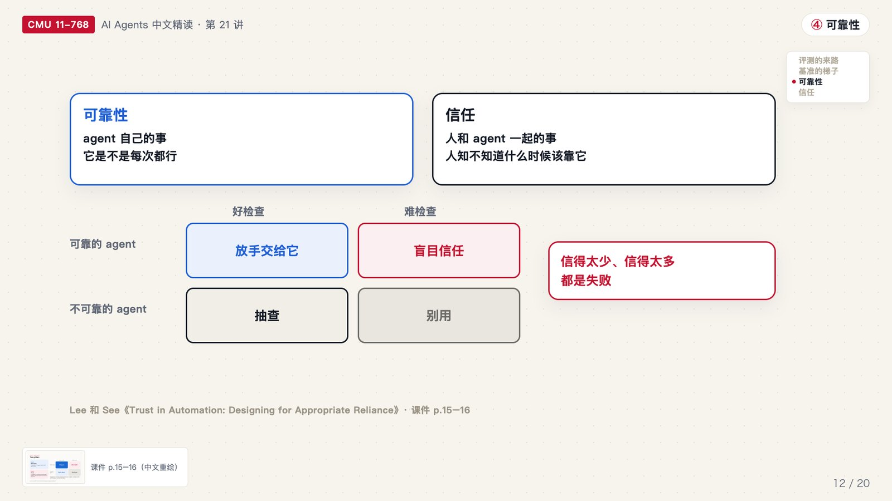

课件把问题拆成两根柱子（借 Lee 和 See 2004 年的《Trust in Automation》）：

- **可靠性**（reliability）：agent 自己的属性，它是不是每次都行；
- **信任**（trust）：人和 agent 一起的属性，人知不知道什么时候该依赖它。

| | 容易检查 | 难检查 |
|---|---|---|
| 可靠的 agent | 放手交给它 | **盲目信任** |
| 不可靠的 agent | 抽查 | 别用 |

目标是**校准过的依赖**（calibrated reliance）：信得太少和信得太多，都是失败。

### 3.2 把可靠性量出来

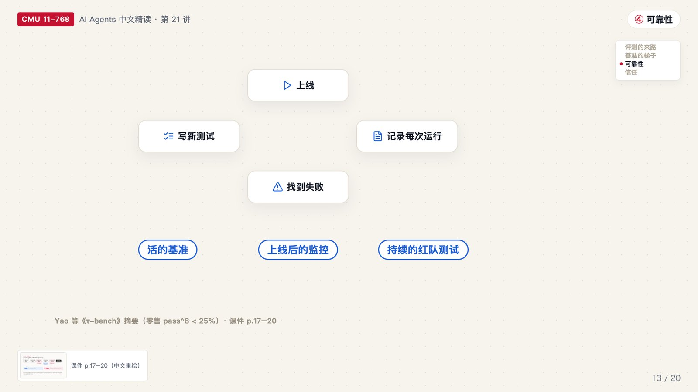

**评测是持续的**：上线 → 记录每次运行 → 找到失败 → 写新测试。测试集一直在变，就背不下来。三种做法：活的基准（SWE-bench-Live、LiveCodeBench 不断加新题）、上线后的监控、持续的红队测试。

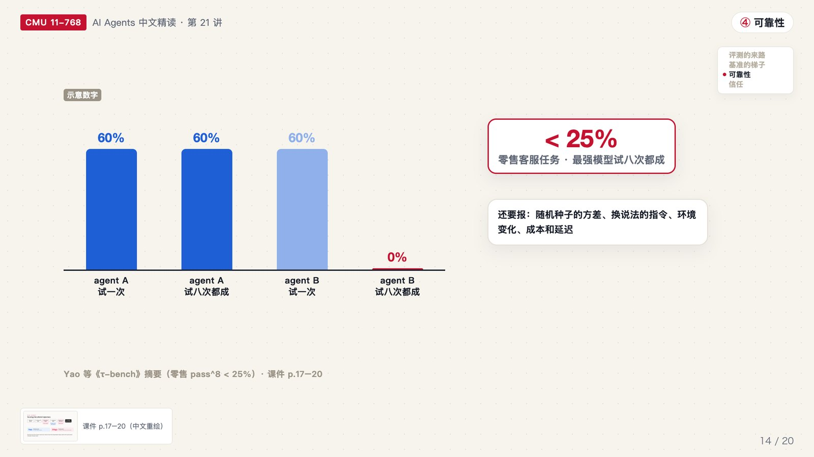

**别只看试一次的成绩**。课件 p.18 的示意：agent A pass@1 约 60%、pass^8 约 60%；agent B pass@1 约 60%、pass^8 是 0%。还要报告：不同随机种子的方差、换个说法的指令、环境变化、成本和延迟。

| 指标 | 意思 | 衡量的是 |
|---|---|---|
| pass@k | k 次里**至少一次**成功 | 能力，有没有可能做对 |
| pass^k | k 次**全部**成功 | 可靠性，每次都能做对 |

**大规模测试**（p.19）：每个 agent 跑几千到几百万次模拟，罕见的失败只有量大才看得到；把失败的运行分组，看有哪几类（跳过政策检查、工具参数错、过早放弃）。自动驾驶的模拟里程、软件的模糊测试是同一个思路。

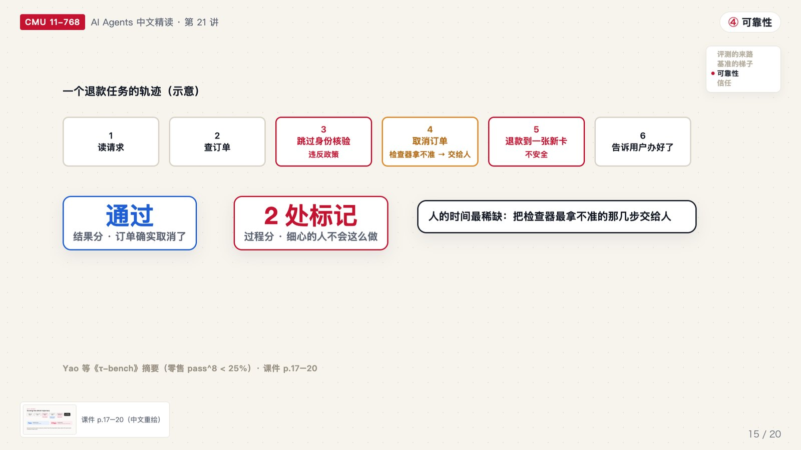

**给整条轨迹打分**（p.20 示意）：一个退款任务，读请求 → 查订单 → **跳过身份核验**（违反政策）→ 取消订单（检查器拿不准，交给人）→ **退款到一张新卡**（不安全）→ 告诉用户办好了。结果分：通过，订单确实取消了；过程分：两处标记，两步是细心的人不会做的。人是稀缺资源，把检查器最拿不准的重要步骤交给人。

出处：Lee 和 See《Trust in Automation: Designing for Appropriate Reliance》；Yao 等《τ-bench》；课件 p.15–20。

---

## 4 信任

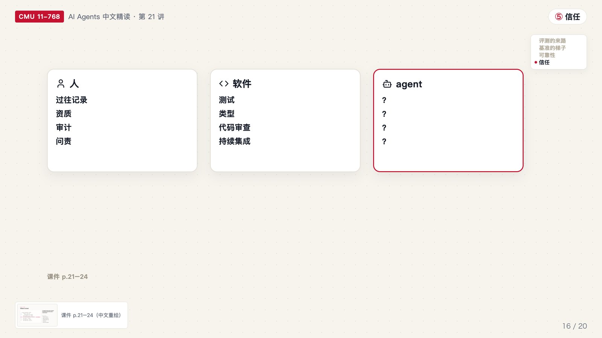

| 对象 | 我们靠什么信任 |
|---|---|
| 人 | 过往记录、资质、审计、问责 |
| 软件 | 测试、类型、代码审查、持续集成 |
| agent | ？ |

课件给了三件事：

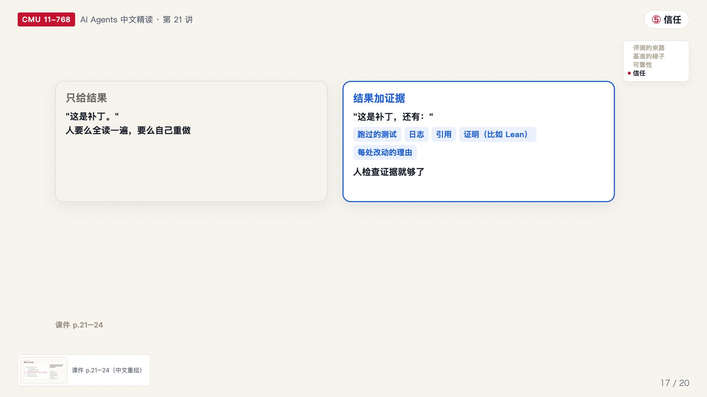

**① 交出证据。** 只给结果（"这是补丁"），人要么读完全部，要么自己重做；结果加证据（跑过的测试、引用、日志、证明比如 Lean、每处改动的理由），人检查证据就行。

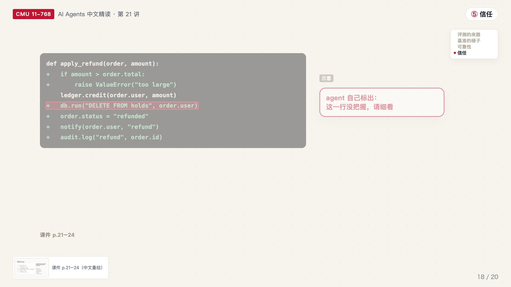

**② 告诉人该看哪里。** 课件 p.23 的示意：一段 `apply_refund` 的改动里，agent 把 `db.run("DELETE FROM holds", order.user)` 标成低置信度，让审查的人细看这一行。做法：校准过的置信度、给不确定的部分加标记、总结它做了什么、按风险审查、抽查和审计。

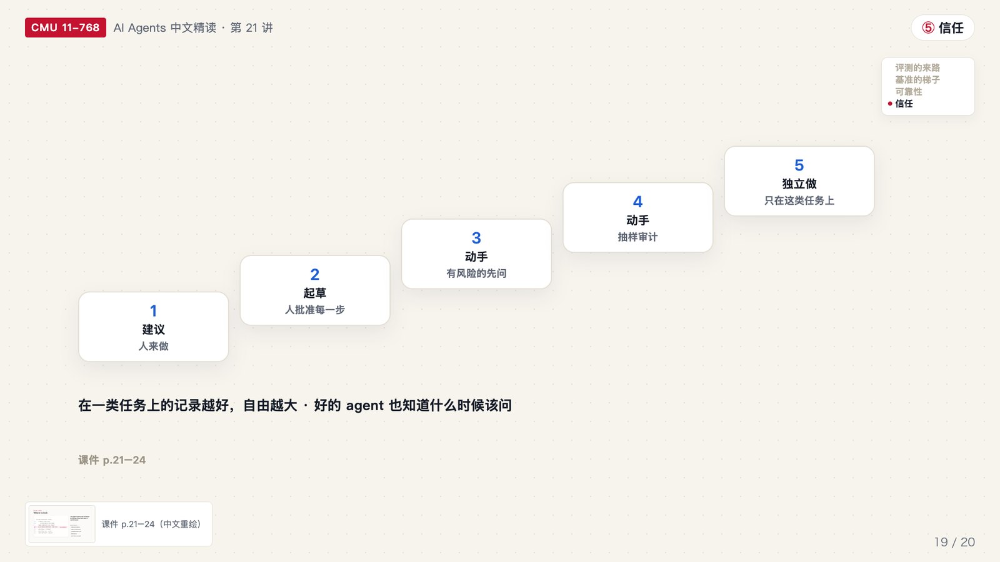

**③ 挣来的自主权。** agent 在某类任务上的记录越好，在这类任务上的自由越大，像自动驾驶那样分级：

| 级 | agent 做什么 | 人做什么 |
|---|---|---|
| 1 建议 | 给建议 | 人来做 |
| 2 起草 | 起草 | 批准每一步 |
| 3 动手 | 动手，有风险的步骤先问 | 回答问题 |
| 4 动手 | 动手 | 抽样审计 |
| 5 独立 | 只在这类任务上独立做 | |

好的 agent 也知道什么时候该开口问。

出处：课件 p.21–24。

---

## 5 源码解读：τ-bench 怎么算 pass^k

τ-bench 的 `display_metrics` 在 [sierra-research/tau-bench](https://github.com/sierra-research/tau-bench) 的 `tau_bench/run.py`（2026-11 抓取），原样照录，注释是我加的：

```python
def display_metrics(results: List[EnvRunResult]) -> None:
    def is_successful(reward: float) -> bool:
        return (1 - 1e-6) <= reward <= (1 + 1e-6)        # 奖励等于 1 才算成功（数据库最终状态完全对上）

    num_trials = len(set([r.trial for r in results]))    # 每道题跑了几次，记作 n
    rewards = [r.reward for r in results]
    avg_reward = sum(rewards) / len(rewards)              # 平均奖励，就是常说的 pass@1
    # c from https://arxiv.org/pdf/2406.12045
    c_per_task_id: dict[int, int] = {}                    # 每道题成功了几次，记作 c
    for result in results:
        if result.task_id not in c_per_task_id:
            c_per_task_id[result.task_id] = 1 if is_successful(result.reward) else 0
        else:
            c_per_task_id[result.task_id] += 1 if is_successful(result.reward) else 0
    pass_hat_ks: dict[int, float] = {}
    for k in range(1, num_trials + 1):
        sum_task_pass_hat_k = 0
        for c in c_per_task_id.values():
            sum_task_pass_hat_k += comb(c, k) / comb(num_trials, k)   # 从 n 次里随机挑 k 次，全是成功的概率
        pass_hat_ks[k] = sum_task_pass_hat_k / len(c_per_task_id)     # 所有题取平均
    print(f"🏆 Average reward: {avg_reward}")
    print("📈 Pass^k")
    for k, pass_hat_k in pass_hat_ks.items():
        print(f"  k={k}: {pass_hat_k}")
```

关键是那一行 $\binom{c}{k} / \binom{n}{k}$：一道题跑了 n 次、成功 c 次，从这 n 次里不放回地随机挑 k 次，k 次全是成功的概率。对比常见的 pass@k 无偏估计 $1 - \binom{n-c}{k} / \binom{n}{k}$，它算的是"k 次里至少一次成功"。两个公式只差在"全部"和"至少一次"：

| | 公式（每道题） | k 变大时 |
|---|---|---|
| pass@k | $1 - \binom{n-c}{k}/\binom{n}{k}$ | 只增不减，越试越容易"碰上一次" |
| pass^k | $\binom{c}{k}/\binom{n}{k}$ | 只减不增，越试越难"次次都成" |

几个细节：

- 只有奖励恰好等于 1 才算成功，部分对不算；
- k 从 1 到 n 都算一遍，k = 1 时 pass^1 就等于平均成功率；
- 用组合数而不是直接看"前 k 次"，是为了用上全部 n 次运行，估计更稳。

---

## 本讲小结

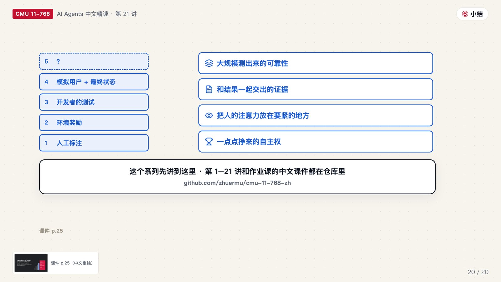

- **生成便宜、验证贵**：AI 的每个阶段都取决于标准答案从哪来、要花多少。
- **验证的梯子**：人工标注（会饱和）→ 环境奖励（是代理）→ 开发者的测试（会漏）→ 模拟用户加最终状态（一次通过不等于可靠）→ 第五级还空着。基准还会被泄露、自己有 bug，任务长度每几个月翻一倍。
- **可靠性**：评测要持续做；同时报 pass@1 和 pass^k，以及方差、换说法、环境变化、成本；大规模测试找罕见失败；给整条轨迹打分，把拿不准的步骤交给人。
- **信任**：用"可不可靠 × 好不好检查"判断放手、抽查还是别用；交出证据、标出该看的地方、让自主权一点点挣来。
- 课件的结论：评测已经从细心的人工检查走向自动化，现在的问题是让验证跟上 agent 能做的事。

## 关键术语

| 术语 | 英文 | 一句话 |
|---|---|---|
| 标准答案 | ground truth | 判断对错的依据 |
| 基准饱和 | benchmark saturation | 模型很快追到人类水平，基准区分不出强弱 |
| 古德哈特定律 | Goodhart's law | 指标一旦成了目标，就不再是好指标 |
| 环境奖励 | environment reward | 环境里的程序自动判断成没成 |
| 模拟用户 | simulated user | 用语言模型扮演和 agent 对话的用户 |
| pass@k | pass@k | k 次里至少一次成功 |
| pass^k | pass^k | k 次全部成功，衡量可靠性 |
| 时间跨度 | time horizon | agent 有一半把握做完的任务，人类要花多久 |
| 可靠性 | reliability | agent 每次都能做对 |
| 校准过的依赖 | calibrated reliance | 该信的时候信、不该信的时候不信 |
| 活的基准 | living benchmark | 不断加新题，背不下来 |
| 红队测试 | red-teaming | 专门找 agent 新的出错方式 |
| 过程分 | process score | 不只看结果，还给每一步打分 |
| 挣来的自主权 | earned autonomy | 记录越好，在这类任务上给的自由越大 |

## 思考题

<details>
<summary>1. 为什么说"生成便宜、验证贵"在 agent 时代更严重了？</summary>

以前的模型输出很短（一个标签、一句话），检查几乎不花时间；标准答案准备好以后，每次检查都是免费的。agent 一次就交出几百行代码、一整份报告，错误可能藏在很深的地方，检查要花的人力接近重做一遍。而且 agent 生成越来越快、越来越便宜，人检查的速度没变，两者的差距越来越大。
</details>

<details>
<summary>2. WebShop 的奖励"只是代理"，SWE-bench 的测试"会漏"。各举一个 agent 拿高分、用户却不满意的例子。</summary>

WebShop：奖励看商品属性和目标有多匹配，agent 挑了一个属性全对、但评价很差或者明显是假货的商品，奖励很高，真用户不会买。SWE-bench：测试只覆盖 issue 里提到的情况，agent 写了一个只让这几个测试通过的特判（甚至改坏了别的没被测到的功能），测试全过，维护者不会合并。这两个例子是我的推断，课件只说了"代理""测试会漏"。
</details>

<details>
<summary>3. 两个 agent 的 pass@1 都是 60%。在什么场景下你会选 pass^8 高的那个？什么场景下 pass@8 高的那个反而更有用？</summary>

要它在真实业务里一次做对、没有重试机会的场景（客服退款、改生产数据库），选 pass^8 高的：它会的题每次都会，不会的题你也能提前知道。可以多试几次、而且有可靠的检查器的场景（写代码跑测试、数学题有证明检查器），pass@8 高的那个更好：每题都有机会做对，多跑几次再挑，这就是第 19 讲的做法。动手练习里的 B 就是这种 agent：pass@8 是 100%，pass^8 只有 1%。
</details>

<details>
<summary>4. 四格表里"可靠却难检查"为什么叫"盲目信任"，而不是"放手交给它"？</summary>

可靠是事实，但人没法验证它可靠，只能靠相信。一旦哪天它不可靠了（换了版本、遇到没见过的情况），人也发现不了，这时的依赖就是盲目的。所以这一格要做的是把"难检查"变成"好检查"：让 agent 交出证据、标出没把握的地方，或者把任务拆成能检查的小块。
</details>

<details>
<summary>5. "给整条轨迹打分"要人参与，可人的时间最稀缺。怎么决定哪些步骤交给人看？</summary>

课件的原则是：交给人看自动检查器最拿不准的、又重要的步骤。具体可以按风险（涉及钱、权限、删除、不可逆的操作）和检查器的置信度排序，只把高风险、低置信度的那一小部分交给人，其余靠自动检查和抽样审计。这和第 18 讲 PULSE"少数人打分，借多数人的数据"是同一类问题：把稀缺的人工标注用在最有信息量的地方。
</details>

<details>
<summary>6. 挣来的自主权要"按任务类型"分别给。为什么不能因为 agent 写代码很可靠，就让它也自己去发邮件？</summary>

可靠性是在某类任务上测出来的，换一类任务，失败方式、代价和能不能撤回都不一样：代码改错了可以回滚、有测试兜底；邮件发出去就收不回来，也没有测试。第 20 讲"有些动作收不回来"、第 13 讲 agent 安全讲的都是这件事。自主权跟着记录走，没有记录的任务就从第 1 级开始。
</details>

## 动手练习

### 练习：pass@1 一样，可靠性差多少

目标：用 5 节的公式自己算 pass@k 和 pass^k，看两个"试一次都是六成"的 agent 有多不一样。代码**不调用真模型**：每道题给一个"这道题上的成功率"，每次运行按这个概率随机成败。只用 Python 标准库，我在 Python 3.15 上跑通过。

`passk.py`：

```python
"""第 21 讲动手练习：同一个 agent，试一次的成功率和"试 k 次次次都成"的比例差多少（示意）。
不调用真模型：每道题有一个"这道题上的成功率"，每次运行按这个概率随机成败。只用标准库。"""
import random
from math import comb

random.seed(0)


def run_trials(task_probs, n_trials=8):
    """每道题跑 n_trials 次，返回 {题号: 成功次数}（对应 τ-bench 代码里的 c_per_task_id）。"""
    return {i: sum(random.random() < p for _ in range(n_trials)) for i, p in enumerate(task_probs)}


def pass_at_k(c_per_task, n, k):
    """pass@k：k 次里至少一次成功（无偏估计 1 - C(n-c, k) / C(n, k)）。"""
    return sum(1 - comb(n - c, k) / comb(n, k) for c in c_per_task.values()) / len(c_per_task)


def pass_hat_k(c_per_task, n, k):
    """pass^k：k 次全部成功（照 τ-bench 的 display_metrics：C(c, k) / C(n, k)）。"""
    return sum(comb(c, k) / comb(n, k) for c in c_per_task.values()) / len(c_per_task)


AGENTS = {
    # 两个 agent 试一次都是六成左右，可成功的方式不一样（示意）
    "A：六成的题稳定会做": [0.98] * 60 + [0.02] * 40,
    "B：每道题都六成看运气": [0.6] * 100,
}

if __name__ == "__main__":
    n = 8
    for name, probs in AGENTS.items():
        c = run_trials(probs, n)
        row = "  ".join(f"pass^{k}={pass_hat_k(c, n, k):.0%}" for k in (1, 2, 4, 8))
        print(f"{name}  pass@8={pass_at_k(c, n, 8):.0%}  {row}")
```

运行 `python3 passk.py`，我这里的输出：

```text
A：六成的题稳定会做  pass@8=66%  pass^1=59%  pass^2=57%  pass^4=54%  pass^8=49%
B：每道题都六成看运气  pass@8=100%  pass^1=59%  pass^2=34%  pass^4=11%  pass^8=1%
```

两个 agent 的 pass^1 都是 59%。A 的 pass^8 还有 49%，B 只有 1%；反过来，B 的 pass@8 是 100%，A 只有 66%。这就是课件 p.18 那两个 agent。

做完回答：

1. B 的每道题成功率都是 0.6，pass^8 的理论值是多少？和模拟出来的 1% 对得上吗？
2. 把 `n_trials` 从 8 改成 16，再算 B 的 pass^8。估计会更准还是更不准？为什么 τ-bench 要多跑几次再算？
3. 如果你只能报一个数，给一个要上线做客服的 agent，你会报 pass@1、pass@8 还是 pass^8？
4. 改 `AGENTS`，造一个 pass@1 只有 40%、但 pass^8 比 B 高的 agent C。

<details>
<summary>参考答案</summary>

1. 0.6⁸ ≈ 1.7%。模拟出来是 1%（8 次全成的题只有一两道），对得上，差别来自随机。
2. 我这里 n = 8 时是 3%（另一组随机数），n = 16 时是 1.4%，更接近 1.7%。每道题跑的次数越多，组合数估计用到的运行越多，方差越小。τ-bench 原文就是每道题跑多次再算 pass^k。
3. pass^8（或者至少同时报 pass@1 和 pass^k）。客服没有"重试八次挑一个"的机会，用户每次都要它做对；pass@8 只说明它有可能做对，对上线没有参考价值。
4. 例如 `[0.98] * 40 + [0.0] * 60`：会的 40% 稳定会，不会的完全不会。pass@1 约 40%，pass^8 约 34%，远高于 B 的 1%。这种 agent 好管理：知道它在哪类题上靠得住，就只把那类题交给它，正是第 4 节"按任务类型挣来的自主权"。
</details>

## 延伸阅读

必读（课表列出的前 5 篇）：

- Yao 等，[WebShop](https://arxiv.org/abs/2207.01206)：环境奖励，第 2 节。
- Jimenez 等，[SWE-bench](https://arxiv.org/abs/2310.06770)：开发者的测试，第 2 节。
- Yao 等，[τ-bench](https://arxiv.org/abs/2406.12045)：模拟用户和 pass^k，第 2、3、5 节；代码在 [sierra-research/tau-bench](https://github.com/sierra-research/tau-bench)。
- Zhu 等，[Establishing Best Practices for Building Rigorous Agentic Benchmarks](https://arxiv.org/abs/2507.02825)：agent 基准检查清单，第 2.1 节。
- Lee 和 See，[Trust in Automation: Designing for Appropriate Reliance](https://doi.org/10.1518/hfes.46.1.50_30392)：可靠和信任，第 3.1 节。

课件和课表列出的其他材料：

- Kiela 等，[Dynabench](https://aclanthology.org/2021.naacl-main.324/)；Kwa 等（METR），[Measuring AI Ability to Complete Long Software Tasks](https://arxiv.org/abs/2503.14499)。
- 网页和电脑：[WebArena](https://arxiv.org/abs/2307.13854)、[Mind2Web](https://arxiv.org/abs/2306.06070)、[VisualWebArena](https://arxiv.org/abs/2401.13649)、[WebVoyager](https://arxiv.org/abs/2401.13919)、[WorkArena](https://arxiv.org/abs/2403.07718)、[BrowseComp](https://arxiv.org/abs/2504.12516)、[OSWorld-Verified](https://os-world.github.io/)。
- 专业工作：[GDPval](https://arxiv.org/abs/2510.04374)、[Finance Agent Benchmark](https://arxiv.org/abs/2508.00828)、[BigLaw Bench](https://www.harvey.ai/blog/introducing-biglaw-bench)。
- 编程和研究：[SWE-Bench Pro](https://arxiv.org/abs/2509.16941)、[Terminal-Bench 2.0](https://www.tbench.ai/news/announcement-2-0)、[MLE-bench](https://arxiv.org/abs/2410.07095)、[RE-Bench](https://arxiv.org/abs/2411.15114)、[PaperBench](https://arxiv.org/abs/2504.01848)。
- 助手和工具：[GAIA](https://arxiv.org/abs/2311.12983)、[τ²-bench](https://arxiv.org/abs/2506.07982)、[MCP-Atlas](https://arxiv.org/abs/2602.00933)。
- 活的基准：[SWE-bench Goes Live!](https://arxiv.org/abs/2505.23419)、[LiveCodeBench](https://arxiv.org/abs/2403.07974)。
- 第 13 讲课件（agent 安全）、第 16 讲课件（任务、环境、评测）、第 18 讲课件（PULSE）、第 19 讲课件（覆盖率和验证器）。

## 下一讲预告：系列到这里

课表后面一讲（14a Lessons in Building a Coding Agent）没有放出课件，之后是假期和期末海报展示，这个系列就先讲到这里。从第 1 讲"什么是 agent"，到这一讲"怎么信任它"，所有讲次和作业课的课件都在这个仓库里。
